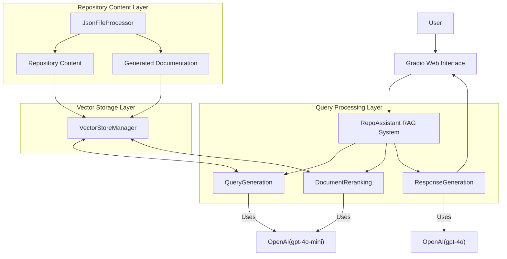
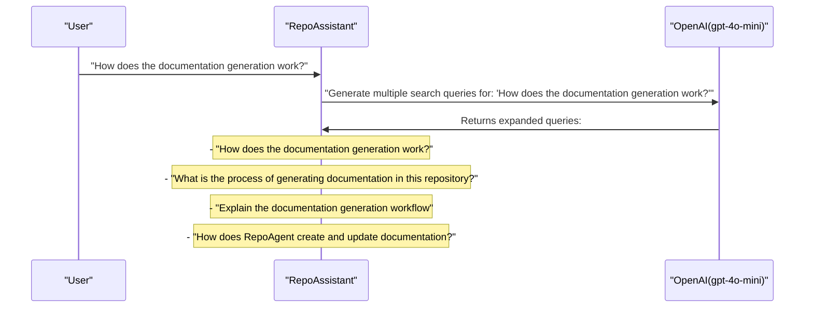
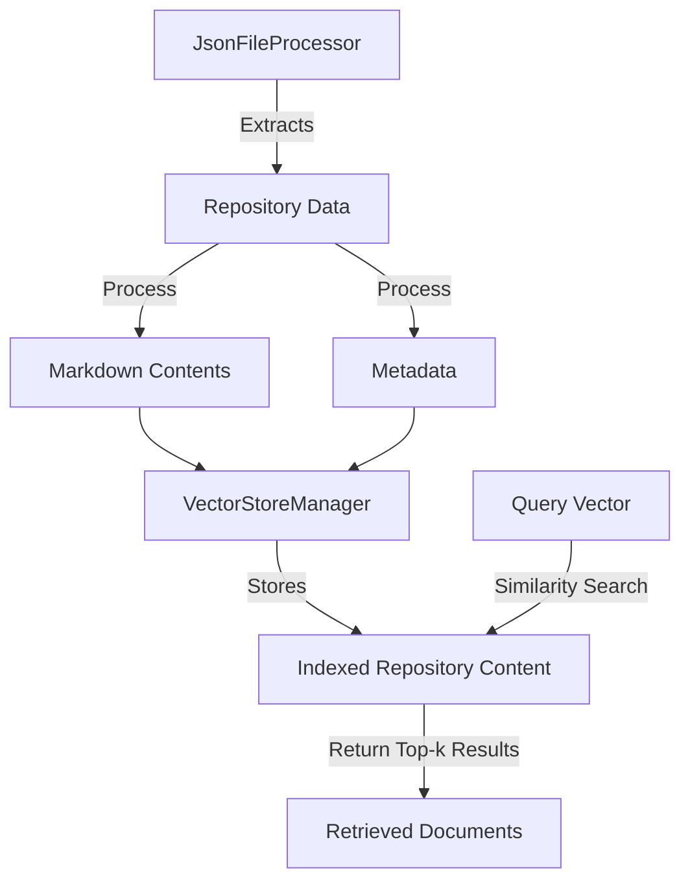
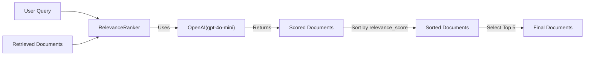
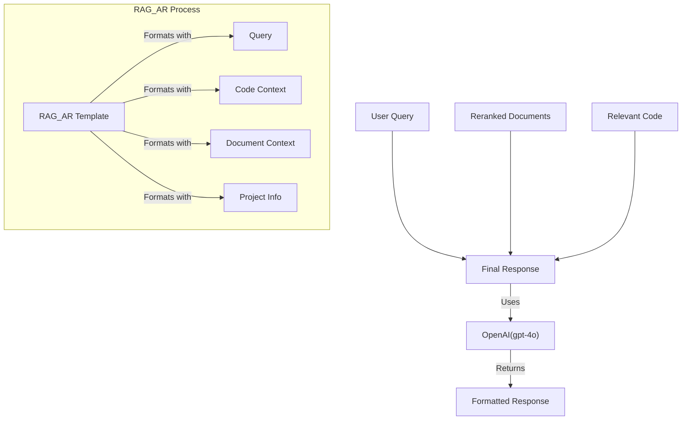
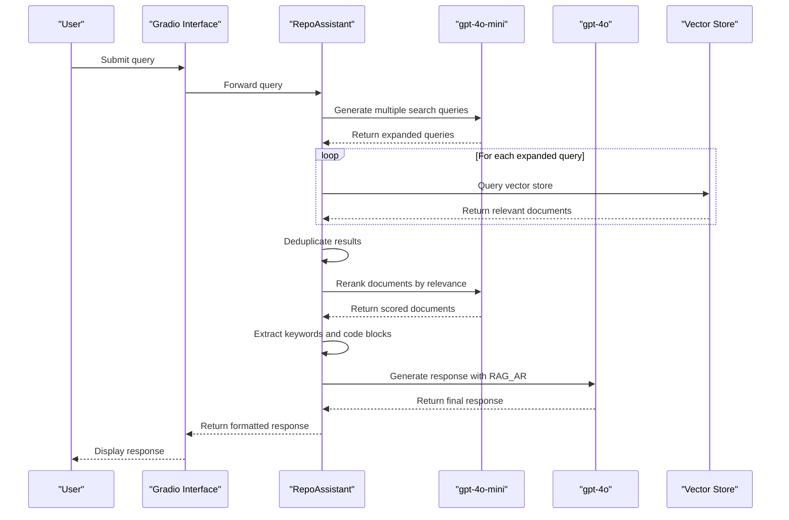
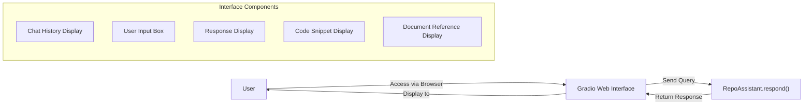

<!-- source: DeepWiki mcp.deepwiki.com · repo OpenBMB/RepoAgent · page 4 Chat with Repository Feature · fetched 2026-10-26 -->

# Chat with Repository Feature

<details>
<summary>Relevant source files</summary>

The following files were used as context for generating this wiki page:

- [README.md](README.md)
- [README_CN.md](README_CN.md)
- [repo_agent/chat_with_repo/__init__.py](repo_agent/chat_with_repo/__init__.py)
- [repo_agent/chat_with_repo/main.py](repo_agent/chat_with_repo/main.py)
- [repo_agent/chat_with_repo/prompt.py](repo_agent/chat_with_repo/prompt.py)
- [repo_agent/chat_with_repo/rag.py](repo_agent/chat_with_repo/rag.py)

</details>


## Introduction

The Chat with Repository Feature is an interactive component of RepoAgent that enables users to query and explore codebases through natural language conversations. This feature serves as a unified gateway connecting RepoAgent to human users and other AI agents, allowing for intuitive exploration of repository content and documentation.

This page focuses on the implementation and architecture of the chat interface and its underlying Retrieval-Augmented Generation (RAG) system. For information about the core documentation generation capabilities of RepoAgent, see [Documentation Generation System](#2.1).

Sources: [README.md:199-203](), [README_CN.md:185-189]()

## System Architecture

The Chat with Repository feature consists of several key components working together to enable natural language interaction with a codebase:



The system implements a Retrieval-Augmented Generation (RAG) approach that combines document retrieval with generative AI to provide contextually accurate answers about the repository.

Sources: [repo_agent/chat_with_repo/rag.py:15-32](), [repo_agent/chat_with_repo/main.py:1-43]()

## RAG System Components

The RAG system consists of four main components:

### 1. Query Generation



The Query Generation component expands the user's original query into multiple related queries to improve retrieval quality. It uses gpt-4o-mini to rewrite and diversify the original question, improving the chances of finding relevant content in the vector store.

Sources: [repo_agent/chat_with_repo/rag.py:36-42](), [repo_agent/chat_with_repo/prompt.py:4-12]()

### 2. Vector Store

The Vector Store component indexes and stores repository content including:
- Generated documentation
- Code content
- Repository metadata

It uses embeddings to convert text into vector representations, allowing for semantic search by measuring similarity between query vectors and document vectors.



The Vector Store enables efficient semantic search across the repository's content, returning the most relevant documents to a given query based on vector similarity.

Sources: [repo_agent/chat_with_repo/main.py:26-36](), [repo_agent/chat_with_repo/rag.py:33-34]()

### 3. Document Reranking



The Document Reranking component improves retrieval quality by:
1. Taking the initial set of retrieved documents
2. Using gpt-4o-mini to score each document's relevance to the original query
3. Sorting documents by relevance score
4. Selecting the top most relevant documents

This step helps filter out irrelevant content and prioritize the most useful information.

Sources: [repo_agent/chat_with_repo/rag.py:44-56](), [repo_agent/chat_with_repo/prompt.py:14-31]()

### 4. Response Generation



The Response Generation component synthesizes information from the retrieved documents and code snippets to create a comprehensive answer to the user's query. It uses a more powerful model (gpt-4o) for this task to ensure high-quality responses. The system employs an advanced RAG template (RAG_AR) that structures the input to the model with:

- The original query
- Relevant code snippets
- Relevant document sections
- Project context

Sources: [repo_agent/chat_with_repo/rag.py:74-82](), [repo_agent/chat_with_repo/prompt.py:42-64]()

## Complete RAG Workflow

The full RAG workflow combines all components to process user queries and generate responses:



The workflow processes the query through several steps:
1. Query expansion
2. Vector store retrieval
3. Result deduplication
4. Document reranking
5. Keyword extraction
6. Final response generation

This multi-stage approach ensures high-quality, contextually relevant responses.

Sources: [repo_agent/chat_with_repo/rag.py:84-176]()

## Web Interface

The Chat with Repository feature provides a user-friendly Gradio web interface for interacting with the system:



The Gradio interface provides a chat-like experience where users can:
- Submit natural language queries about the repository
- View responses generated by the RAG system
- See relevant code snippets and documentation references
- Maintain conversation history for context

Sources: [repo_agent/chat_with_repo/main.py:38-39]()

## Usage Guide

### Installation

To use the Chat with Repository feature, you must first install the required dependencies:

```bash
pip install repoagent[chat-with-repo]
```

### Configuration

Before using the feature, ensure your OpenAI API key is set:

```bash
export OPENAI_API_KEY=YOUR_API_KEY  # on Linux/Mac
set OPENAI_API_KEY=YOUR_API_KEY  # on Windows
$Env:OPENAI_API_KEY = "YOUR_API_KEY"  # on Windows (PowerShell)
```

### Running the Feature

To start the chat interface:

```bash
repoagent chat-with-repo
```

This command will:
1. Initialize the RepoAssistant system
2. Load the repository data
3. Create a vector store from the repository content and documentation
4. Launch the Gradio web interface

Sources: [README.md:204-207](), [README_CN.md:190-194](), [repo_agent/chat_with_repo/main.py:9-43]()

## Implementation Details

### Key Classes

1. **RepoAssistant**: The core class that implements the RAG system
   - Manages query generation, reranking, and response generation
   - Coordinates interaction between different components

2. **JsonFileProcessor**: Extracts data from repository JSON files
   - Processes project hierarchy and documentation

3. **VectorStoreManager**: Manages the vector store for document retrieval
   - Creates and queries the vector index

4. **TextAnalysisTool**: Provides text analysis functionality
   - Extracts keywords and processes text for improved retrieval

5. **GradioInterface**: Implements the web interface
   - Provides the user-facing chat interface

Sources: [repo_agent/chat_with_repo/rag.py:17-177](), [repo_agent/chat_with_repo/main.py:1-43]()

### Prompt Templates

The system uses several prompt templates to guide the LLM's behavior:

1. **Query Generation Template**: Expands the original query into multiple search queries
2. **Relevance Ranking Template**: Scores document relevance to the query
3. **RAG Template**: Basic retrieval and generation prompt
4. **RAG_AR Template**: Advanced template that structures input with code, documents, and context

These templates ensure consistent and high-quality interactions with the LLMs.

Sources: [repo_agent/chat_with_repo/prompt.py:1-64]()

## Conclusion

The Chat with Repository feature provides an intuitive natural language interface for interacting with repositories. By combining document retrieval with generative AI, it enables users to efficiently explore and understand codebases through conversational interaction.

This feature represents an initial prototype of RepoAgent's vision to serve as a unified gateway for downstream applications, connecting repository content with human users and other AI agents.

---

