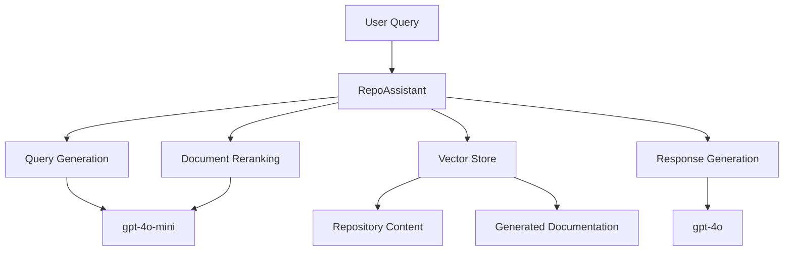
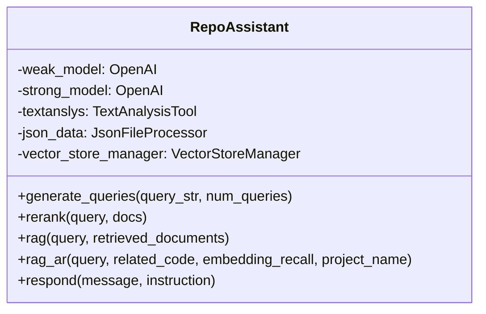
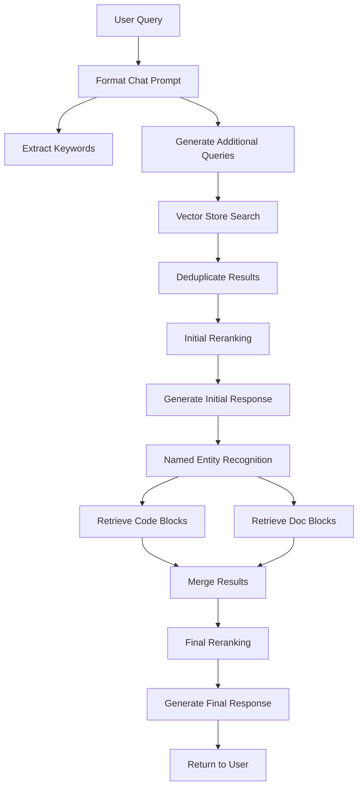
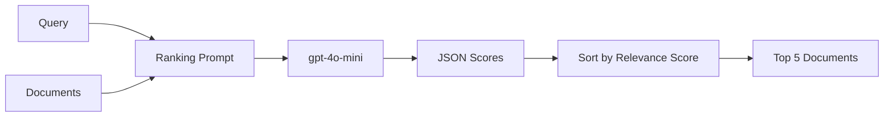
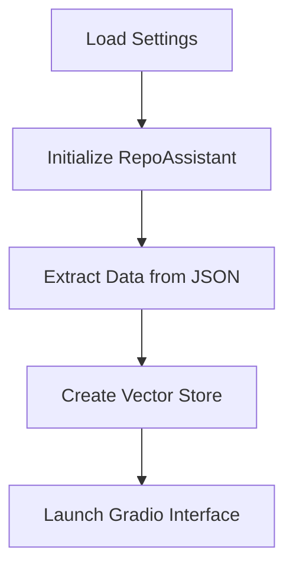

<!-- source: DeepWiki mcp.deepwiki.com · repo OpenBMB/RepoAgent · page 4.1 RAG System · fetched 2026-10-26 -->

# RAG System

<details>
<summary>Relevant source files</summary>

The following files were used as context for generating this wiki page:

- [repo_agent/chat_with_repo/main.py](repo_agent/chat_with_repo/main.py)
- [repo_agent/chat_with_repo/prompt.py](repo_agent/chat_with_repo/prompt.py)
- [repo_agent/chat_with_repo/rag.py](repo_agent/chat_with_repo/rag.py)

</details>


This document provides a detailed technical description of the Retrieval-Augmented Generation (RAG) System in RepoAgent. The RAG System powers the "Chat with Repository" feature, enabling users to query a codebase using natural language and receive contextually relevant responses based on both code content and generated documentation.

For information about the web-based user interface that exposes this functionality, see [Web Interface](#4.2).

## System Architecture

The RAG System implements a multi-stage retrieval and generation pipeline that combines vector search with language model processing. The system is designed to retrieve relevant code snippets and documentation from a repository, then use this information to generate accurate and helpful responses.



Sources: [repo_agent/chat_with_repo/rag.py:17-35](), [repo_agent/chat_with_repo/main.py:9-40]()

## Core Components

### RepoAssistant Class

The `RepoAssistant` class ([repo_agent/chat_with_repo/rag.py:17-176]()) serves as the central controller of the RAG system, orchestrating the entire query-response process:



The class initializes with:
- API credentials for language model access
- Database path to the repository structure
- Two OpenAI model instances:
  - `weak_model`: gpt-4o-mini for query generation and reranking
  - `strong_model`: gpt-4o for final response generation
- Supporting components for text analysis, file processing, and vector search

Sources: [repo_agent/chat_with_repo/rag.py:17-35]()

### Vector Store Management

The `VectorStoreManager` handles document embedding and retrieval, creating a searchable vector representation of repository content. It's initialized with a configurable `top_k` parameter that determines how many results to return from each query.

Sources: [repo_agent/chat_with_repo/rag.py:34]()

### Query Processing Pipeline

The RAG system processes user queries through a multi-stage pipeline coordinated by the `respond` method:



Sources: [repo_agent/chat_with_repo/rag.py:84-176]()

## Technical Implementation

### Query Generation

The `generate_queries` method ([repo_agent/chat_with_repo/rag.py:36-42]()) expands a single user query into multiple search queries:

```python
def generate_queries(self, query_str: str, num_queries: int = 4):
    fmt_prompt = query_generation_template.format(
        num_queries=num_queries - 1, query=query_str
    )
    response = self.weak_model.complete(fmt_prompt)
    queries = response.text.split("\n")
    return queries
```

This query expansion improves retrieval by capturing different aspects or phrasings of the original question.

Sources: [repo_agent/chat_with_repo/rag.py:36-42](), [repo_agent/chat_with_repo/prompt.py:5-12]()

### Document Reranking

The `rerank` method ([repo_agent/chat_with_repo/rag.py:44-56]()) uses the language model to score and sort retrieved documents based on their relevance to the query:



The method uses a specialized prompt template (`relevance_ranking_chat_template`) that instructs the model to output a JSON structure with relevance scores for each document.

Sources: [repo_agent/chat_with_repo/rag.py:44-56](), [repo_agent/chat_with_repo/prompt.py:15-31]()

### Response Generation

The system provides two methods for response generation:

1. **Basic RAG** (`rag` method, [repo_agent/chat_with_repo/rag.py:58-63]())
   - Uses the weak model with retrieved documents
   - Applied for initial response generation

2. **Advanced RAG** (`rag_ar` method, [repo_agent/chat_with_repo/rag.py:74-82]())
   - Uses the strong model with both code snippets and documentation
   - Incorporates more context for final, comprehensive responses
   - Follows specific formatting and language guidelines

Sources: [repo_agent/chat_with_repo/rag.py:58-63](), [repo_agent/chat_with_repo/rag.py:74-82](), [repo_agent/chat_with_repo/prompt.py:34-64]()

### Main Response Pipeline

The `respond` method ([repo_agent/chat_with_repo/rag.py:84-176]()) orchestrates the complete RAG pipeline:

1. **Format chat prompt and extract keywords** ([repo_agent/chat_with_repo/rag.py:92-96]())
2. **Generate additional queries** ([repo_agent/chat_with_repo/rag.py:99-100]())
3. **Query vector store for each query** ([repo_agent/chat_with_repo/rag.py:106-110]())
4. **Deduplicate results** ([repo_agent/chat_with_repo/rag.py:113-120]())
5. **Rerank documents by relevance** ([repo_agent/chat_with_repo/rag.py:123-124]())
6. **Generate initial response** ([repo_agent/chat_with_repo/rag.py:127-130]())
7. **Extract named entities from response and query** ([repo_agent/chat_with_repo/rag.py:136-138]())
8. **Retrieve additional code and documentation** ([repo_agent/chat_with_repo/rag.py:140-154]())
9. **Rerank final selection of documents and code** ([repo_agent/chat_with_repo/rag.py:161-167]())
10. **Generate comprehensive final response** ([repo_agent/chat_with_repo/rag.py:173]())
11. **Return results to user** ([repo_agent/chat_with_repo/rag.py:176]())

Sources: [repo_agent/chat_with_repo/rag.py:84-176]()

## Prompt Templates

The RAG System relies on specialized prompt templates to guide the language models:

| Template | Purpose | Model | File Location |
|----------|---------|-------|--------------|
| `query_generation_template` | Generate query variations | gpt-4o-mini | [repo_agent/chat_with_repo/prompt.py:5-12]() |
| `relevance_ranking_chat_template` | Score document relevance | gpt-4o-mini | [repo_agent/chat_with_repo/prompt.py:15-31]() |
| `rag_template` | Basic response generation | gpt-4o-mini | [repo_agent/chat_with_repo/prompt.py:34-40]() |
| `rag_ar_template` | Advanced response generation | gpt-4o | [repo_agent/chat_with_repo/prompt.py:43-64]() |

These templates provide specific instructions to the language models for each processing stage, guiding their behavior and output format.

Sources: [repo_agent/chat_with_repo/prompt.py:1-64]()

## System Initialization

The RAG System initialization process in `main.py` includes:



The process measures and logs the time required to create the vector store, as this is typically the most time-consuming initialization step.

Sources: [repo_agent/chat_with_repo/main.py:9-40]()

## Integration with Repository Data

The RAG System integrates with repository data through the following components:

1. **JsonFileProcessor**: Extracts content and metadata from repository JSON files
2. **VectorStoreManager**: Creates and manages embeddings for efficient semantic search
3. **TextAnalysisTool**: Provides text analysis capabilities including named entity recognition and keyword extraction

This integration enables the system to access both the content of code files and the metadata that describes their structure and relationships.

Sources: [repo_agent/chat_with_repo/rag.py:33-34]()

## Technical Performance Considerations

The RAG System balances performance and response quality through:

- Using a lighter model (gpt-4o-mini) for tasks that don't require deep reasoning
- Using a stronger model (gpt-4o) only for final response generation
- Employing multiple query expansion to improve retrieval recall
- Using reranking to improve precision of retrieved documents
- Caching vector embeddings to speed up repeated queries

Sources: [repo_agent/chat_with_repo/rag.py:22-31](), [repo_agent/chat_with_repo/main.py:30-36]()

---

