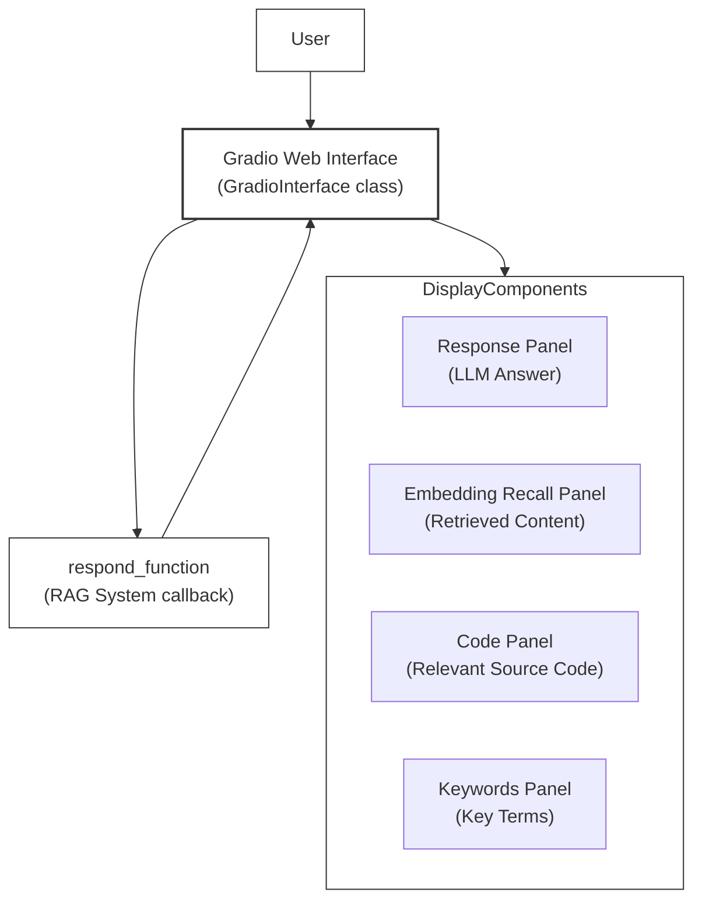
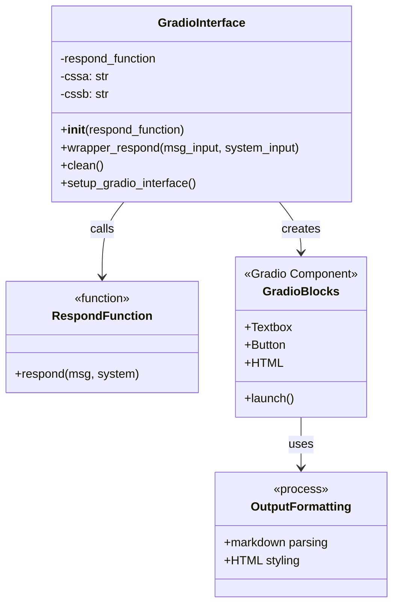
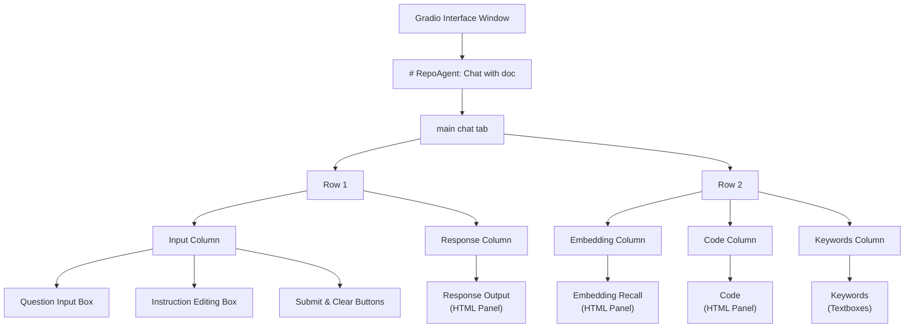
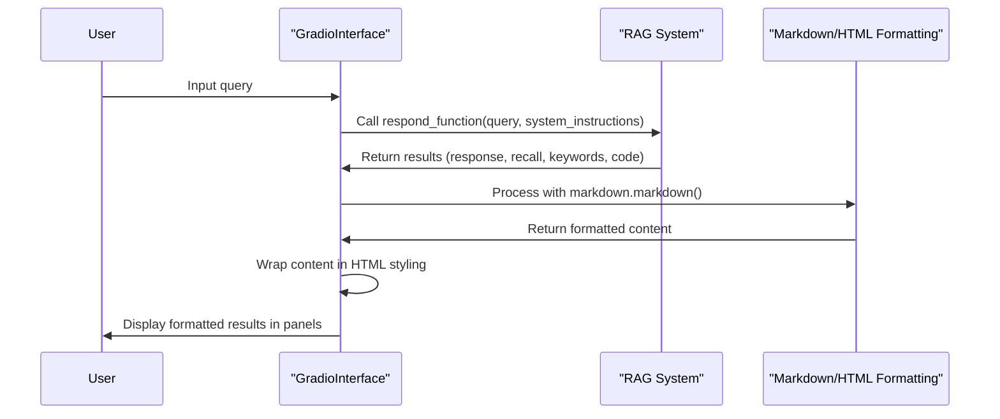
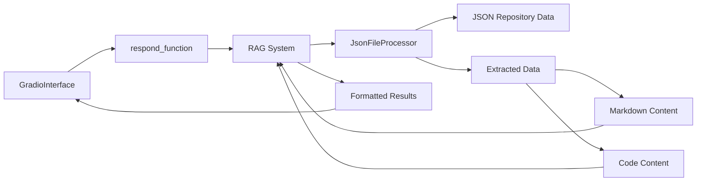

<!-- source: DeepWiki mcp.deepwiki.com · repo OpenBMB/RepoAgent · page 4.2 Web Interface · fetched 2026-10-26 -->

# Web Interface

<details>
<summary>Relevant source files</summary>

The following files were used as context for generating this wiki page:

- [repo_agent/chat_with_repo/gradio_interface.py](repo_agent/chat_with_repo/gradio_interface.py)
- [repo_agent/chat_with_repo/json_handler.py](repo_agent/chat_with_repo/json_handler.py)

</details>


## Purpose and Scope

This document details the Web Interface component of RepoAgent's "Chat with Repository" feature. The web interface provides a user-friendly, browser-based way to interact with codebases through natural language queries and view contextually relevant responses, code snippets, and documentation.

For information about the underlying retrieval and generation system that powers the interface, see [RAG System](#4.1).

## Overview

The Web Interface is built using Gradio, a Python library for creating customizable web interfaces for machine learning models. It serves as the visual front-end that connects users to the repository assistant functionality, displaying query results in organized, formatted panels.



Sources: [repo_agent/chat_with_repo/gradio_interface.py:7-196]()

## Interface Architecture

The Web Interface consists of a `GradioInterface` class that wraps around the RAG system's response function, providing styled HTML outputs and input handling.



Sources: [repo_agent/chat_with_repo/gradio_interface.py:7-44](), [repo_agent/chat_with_repo/gradio_interface.py:126-196]()

## Interface Components

The web interface is organized into several key components:

| Component | Purpose | Implementation |
|-----------|---------|----------------|
| Question Input | Text field for user queries | Gradio Textbox with 4 lines |
| System Instruction | Optional field to customize RAG behavior | Gradio Textbox with 4 lines |
| Submit Button | Triggers query processing | Gradio Button |
| Clear Button | Resets all fields | Gradio ClearButton |
| Response Panel | Displays formatted LLM answer | HTML panel with custom styling |
| Embedding Recall Panel | Shows retrieved context | HTML panel with custom styling |
| Code Panel | Displays relevant code | HTML panel with custom styling |
| Keywords Panels | Shows key terms from analysis | Gradio Textboxes |

The interface layout follows a multi-column design with tabs for organization:



Sources: [repo_agent/chat_with_repo/gradio_interface.py:127-178]()

## Implementation Details

### Initialization and Setup

The `GradioInterface` class is initialized with a response function (`respond_function`) that connects to the underlying RAG system:

```python
def __init__(self, respond_function):
    self.respond = respond_function
    self.cssa = """..."""  # CSS styles for panel start
    self.cssb = """..."""  # CSS styles for panel end
    self.setup_gradio_interface()
```

The response function is expected to return multiple values that will be displayed in different panels of the interface.

Sources: [repo_agent/chat_with_repo/gradio_interface.py:7-43]()

### Response Processing Workflow

When a user submits a query, the following happens:

1. The `wrapper_respond` method is called with the user's query and optional system instructions
2. It calls the underlying RAG system's respond function
3. The response is processed and formatted with Markdown and HTML styling
4. The formatted responses are returned to update the interface panels



Sources: [repo_agent/chat_with_repo/gradio_interface.py:45-88](), [repo_agent/chat_with_repo/gradio_interface.py:180-192]()

### Panel Styling and Structure

Each output panel has a consistent structure with styled HTML:

1. An outer box container
2. A title section
3. An inner box with scrollable content
4. Formatted content (Markdown converted to HTML)

The styling is defined using CSS that controls borders, padding, font sizes, and other visual aspects.

Sources: [repo_agent/chat_with_repo/gradio_interface.py:10-42](), [repo_agent/chat_with_repo/gradio_interface.py:53-86]()

## Data Handling

The interface indirectly works with the `JsonFileProcessor` class to retrieve and display repository data:



The `JsonFileProcessor` class handles:
- Reading structured JSON data about the repository
- Extracting markdown documentation and code snippets
- Searching for specific elements by name
- Providing this data to the RAG system for query processing

Sources: [repo_agent/chat_with_repo/json_handler.py:7-86]()

## Launching the Interface

The interface is launched using Gradio's built-in server with the following configuration:

```python
demo.queue().launch(share=False, height=800)
```

This starts a local web server that hosts the interface with a fixed height of 800 pixels and without public sharing.

Sources: [repo_agent/chat_with_repo/gradio_interface.py:194-195]()

## Usage Example

The following example demonstrates how to instantiate and use the `GradioInterface`:

1. Define a response function that follows the expected signature
2. Create a `GradioInterface` instance with this function
3. The interface automatically launches in a browser window

```python
def respond_function(msg, system):
    # Process the query and generate response components
    response = "Generated response..."
    embedding_recall = "Retrieved context..."
    keywords = "key1, key2, key3"
    code_snippet = "def example_function():\n    return 'example'"
    
    return msg, response, embedding_recall, keywords, code_snippet, "additional_info"

gradio_interface = GradioInterface(respond_function)
```

When users interact with the interface, they can:
1. Enter a natural language question about the repository
2. Optionally provide custom instructions
3. Submit the query using the button or Enter key
4. View the formatted response, context, and code in separate panels
5. Clear all fields to start a new query

Sources: [repo_agent/chat_with_repo/gradio_interface.py:198-208]()

---

