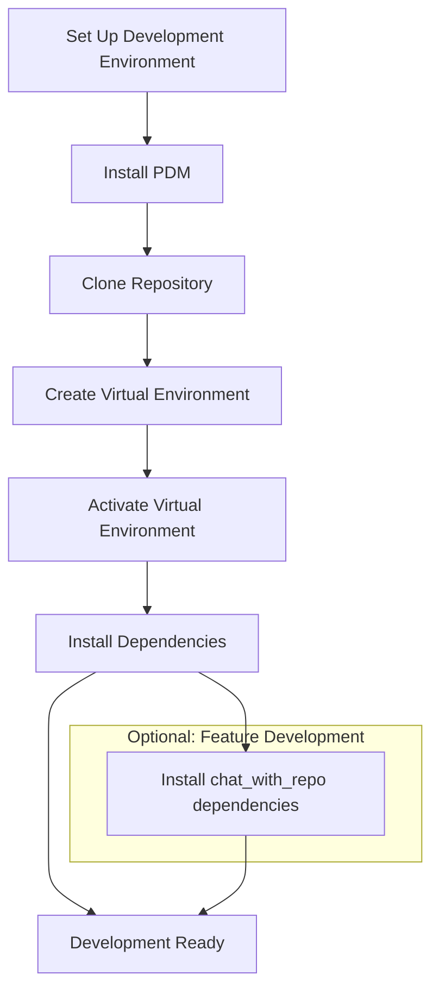
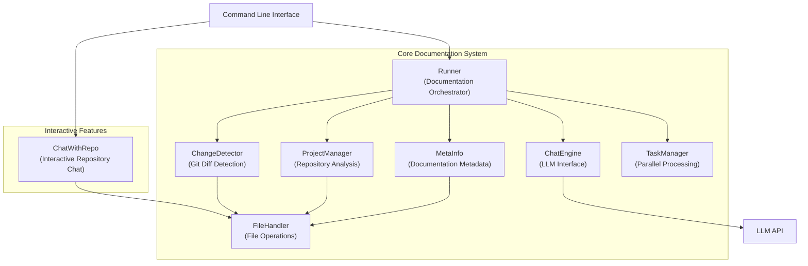
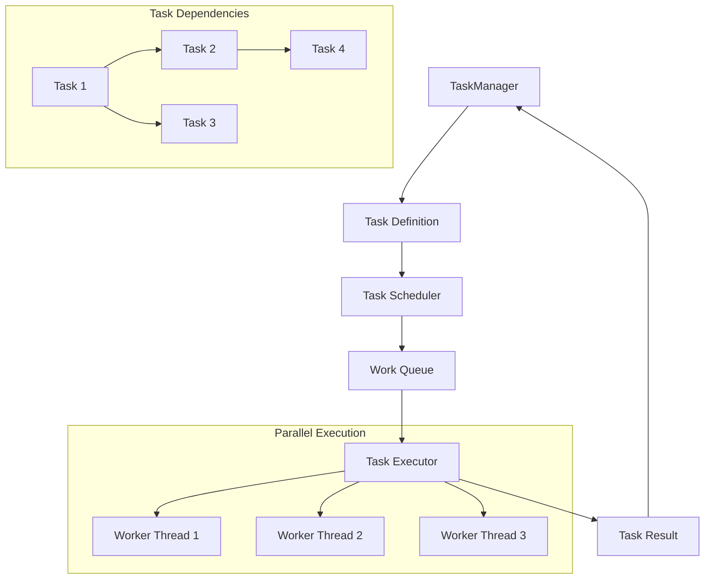
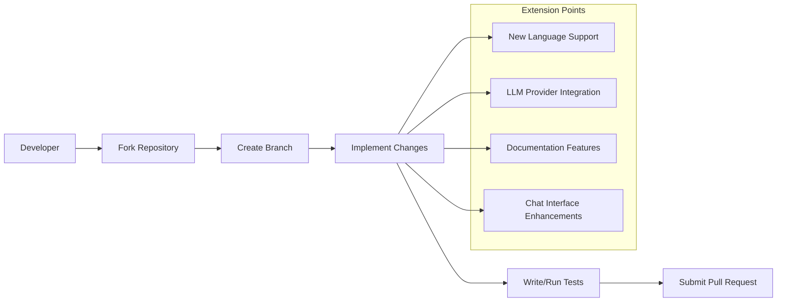

<!-- source: DeepWiki mcp.deepwiki.com · repo OpenBMB/RepoAgent · page 5 Developer Guide · fetched 2026-10-26 -->

# Developer Guide

<details>
<summary>Relevant source files</summary>

The following files were used as context for generating this wiki page:

- [README.md](README.md)
- [README_CN.md](README_CN.md)
- [pdm.lock](pdm.lock)
- [pyproject.toml](pyproject.toml)
- [repo_agent/chat_with_repo/__init__.py](repo_agent/chat_with_repo/__init__.py)
- [requirements.txt](requirements.txt)

</details>


This document provides technical information for developers who want to contribute to or extend RepoAgent. It covers development environment setup, project structure, dependency management, and the task management system. For information about the core architecture and components, see [Core Architecture](#2).

## Development Environment Setup

RepoAgent uses PDM (Python Development Master) for dependency management. The repository is structured to support both end-user installation via pip and development setup through PDM.



### Setup Steps

1. **Install PDM** if not already installed
   ```bash
   # Install PDM using pip or your system package manager
   pip install pdm
   ```

2. **Clone the repository**
   ```bash
   git clone https://github.com/OpenBMB/RepoAgent.git
   cd RepoAgent
   ```

3. **Create a Python virtual environment**
   ```bash
   pdm venv create --name repoagent
   ```

4. **Activate the virtual environment** (platform-specific)
   - For detailed activation instructions, see the [PDM documentation](https://pdm-project.org/latest/usage/venv/#activate-a-virtualenv)

5. **Install dependencies**
   ```bash
   pdm install
   ```

6. **For "chat with repo" feature development**
   ```bash
   pdm install -G chat_with_repo
   ```

Sources: [README.md:71-103](), [pyproject.toml:40-45]()

## Project Structure

RepoAgent is organized into several core modules that work together to generate documentation. The following diagram illustrates the key components and their relationships:



### Main Components
- **CLI**: Entry point for user commands
- **Runner**: Central orchestrator for documentation generation
- **MetaInfo**: Manages repository structural information and documentation status
- **ChatEngine**: Interfaces with LLMs to generate documentation
- **ChangeDetector**: Analyzes Git diffs to identify modified files
- **ProjectManager**: Analyzes repository structure through AST parsing
- **FileHandler**: Handles file I/O operations
- **TaskManager**: Manages parallel documentation tasks
- **ChatWithRepo**: Provides conversational interface to repository

Sources: [README.md:44-52](), [repo_agent/chat_with_repo/__init__.py:1-4]()

## Dependency Management

RepoAgent uses a structured approach to manage dependencies, separating core requirements from optional features.

### Core Dependencies

The project relies on the following main dependencies:

| Dependency | Purpose | Version |
|------------|---------|---------|
| loguru | Logging system | ≥0.7.2 |
| jedi | Python code analysis | ≥0.19.1 |
| GitPython | Git repository interaction | ≥3.1.41 |
| prettytable | Terminal table display | ≥3.9.0 |
| python-iso639 | Language code handling | ≥2024.2.7 |
| pydantic-settings | Configuration management | ≥2.2.1 |
| click | Command-line interface | ≥8.1.7 |
| colorama | Terminal color support | ≥0.4.6 |
| llama-index-llms-openai-like | LLM interface | ≥0.3.3 |

### Optional Dependencies

For the "chat with repo" feature, additional dependencies are required:

| Dependency | Purpose | Version |
|------------|---------|---------|
| markdown | Markdown parsing | ≥3.7 |
| llama-index-embeddings-openai | Text embeddings | ≥0.2.5 |
| llama-index-vector-stores-chroma | Vector storage | ≥0.3.0 |
| gradio | Web interface | ≥5.6.0 |

### Development Dependencies

Development-specific dependencies are organized into groups:

**Test dependencies:**
```
pytest<8.0.0,>=7.4.4
pytest-mock<4.0.0,>=3.12.0
```

**Lint dependencies:**
```
ruff>=0.7.4
```

Sources: [pyproject.toml:10-21](), [pyproject.toml:40-45](), [pyproject.toml:62-68]()

## Task Management System

The Task Management System enables efficient multi-threaded processing of documentation tasks. This system is crucial for handling large repositories with many files.



### Key Components

1. **Task Definition**: Tasks represent units of work for documenting specific code elements (files, classes, functions)

2. **Task Dependencies**: 
   - File-level tasks depend on repository structure analysis
   - Class-level tasks depend on their containing file tasks
   - Method-level tasks depend on their containing class tasks

3. **Task Scheduler**:
   - Analyzes dependencies between tasks
   - Creates a directed acyclic graph (DAG) of tasks
   - Determines which tasks can be executed in parallel

4. **Task Executor**:
   - Manages worker threads
   - Distributes tasks to available workers
   - Collects and processes results

5. **Error Handling**:
   - Implements retry mechanisms for failed tasks
   - Logs errors for debugging
   - Ensures failures don't block the entire process

Sources: [README.md:48-49]()

## Contributing to RepoAgent

RepoAgent welcomes contributions in several areas:

### Extension Areas

1. **Multi-language Support**
   - Currently supporting Python
   - Planned support for Java, C, C++, and other languages
   - Requires implementing language-specific parsers

2. **LLM Provider Integration**
   - Currently supporting OpenAI models and compatible APIs
   - Integration with local models (Llama, ChatGLM, Qwen, GLM4)

3. **Documentation Features**
   - README.md generation
   - Enhanced documentation formatting
   - Additional output formats



### Development Workflow

1. Fork the repository
2. Create a feature branch
3. Implement changes following project conventions
4. Add tests for new functionality
5. Ensure all tests pass
6. Submit a pull request

### Testing Your Changes

Run the test suite to verify your changes:

```bash
pdm run pytest
```

For testing documentation generation:

```bash
pdm run repoagent run --target-repo-path /path/to/test/repo
```

Sources: [README.md:210-214]()

## Building and Packaging

RepoAgent uses PDM for building and packaging:

```bash
# Build the package
pdm build

# Install in development mode
pdm install -e
```

The package can be published to PyPI:

```bash
pdm publish
```

Sources: [pyproject.toml:47-73]()

---

