<!-- source: DeepWiki mcp.deepwiki.com · repo OpenBMB/RepoAgent · page 5.1 Dependency Management · fetched 2026-10-26 -->

# Dependency Management

Relevant source files

The following files were used as context for generating this wiki page:

- [pdm.lock](pdm.lock)
- [pyproject.toml](pyproject.toml)
- [requirements.txt](requirements.txt)

This page documents how RepoAgent manages its dependencies, including the package management system, dependency types, and the structure of dependency files. The document focuses on the tools and configurations used to maintain project dependencies.

## Overview

RepoAgent uses PDM (Python Dependency Manager) to handle package dependencies. PDM is a modern Python package manager that supports PEP 621 standards and provides efficient dependency resolution. The project's dependency configuration is primarily defined in `pyproject.toml` with locked versions in `pdm.lock`.

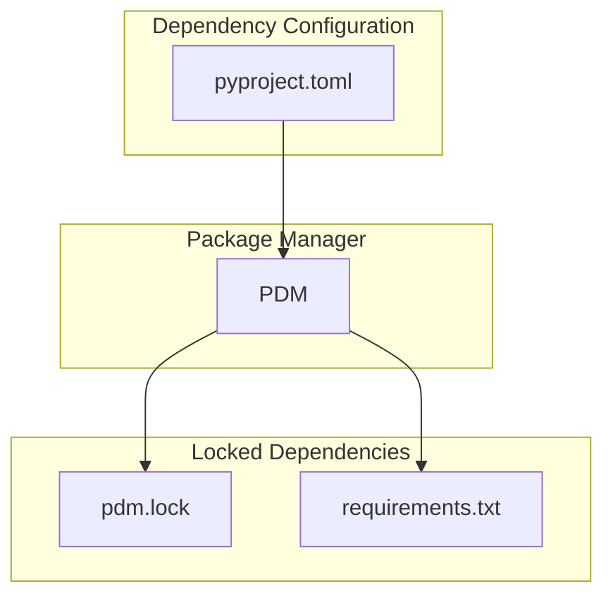

Sources: [pyproject.toml](), [pdm.lock](), [requirements.txt]()

## Dependency Types

RepoAgent organizes dependencies into several categories:

1. **Core Dependencies**: Required for the base functionality of RepoAgent
2. **Optional Dependencies**: Additional packages needed for specific features
3. **Development Dependencies**: Tools used during development but not required for users

### Core Dependencies

Core dependencies are essential for RepoAgent's main documentation generation functionality. These are specified in the `dependencies` section of `pyproject.toml`.

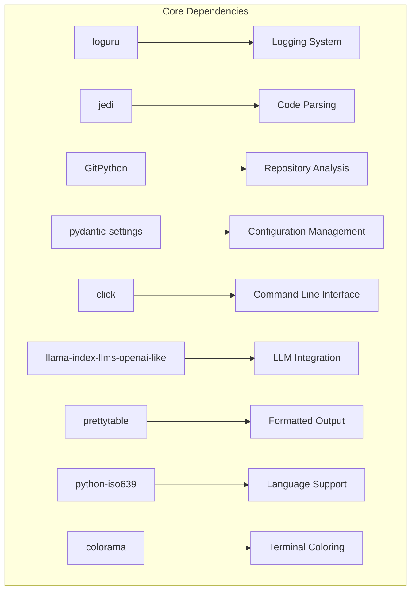

Sources: [pyproject.toml:10-21]()

### Optional Dependencies

Optional dependencies are organized as feature groups that users can install based on their needs. The "chat_with_repo" feature provides additional functionality for interactive repository exploration.

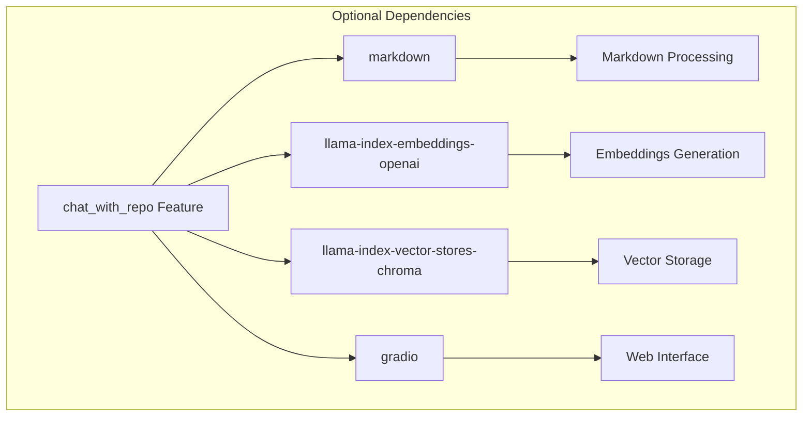

Sources: [pyproject.toml:40-45]()

### Development Dependencies

Development dependencies are tools used during development and testing but not required for end users.

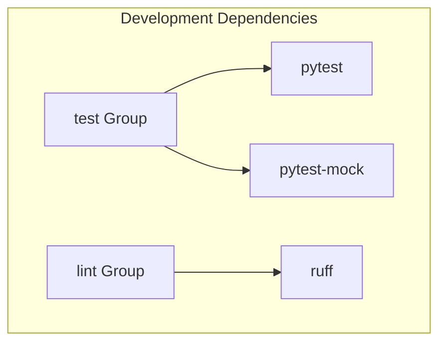

Sources: [pyproject.toml:62-68]()

## Package Management with PDM

PDM is used as both the dependency manager and build system for RepoAgent. It manages the dependency resolution, virtual environments, and package installation.

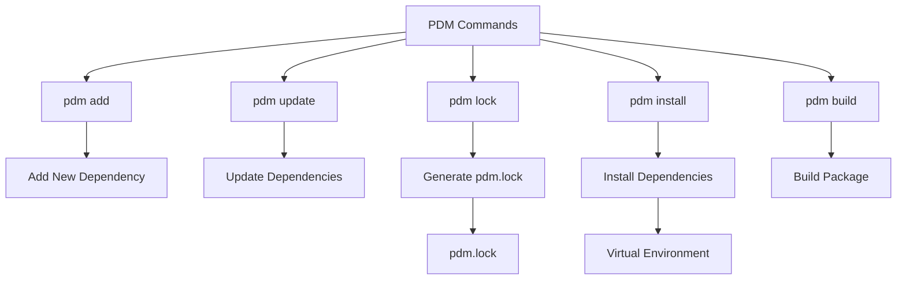

Sources: [pyproject.toml:47-49]()

## Python Version Requirements

RepoAgent requires Python 3.11 or higher, but less than 4.0, as specified in the `requires-python` field in the `pyproject.toml` file.

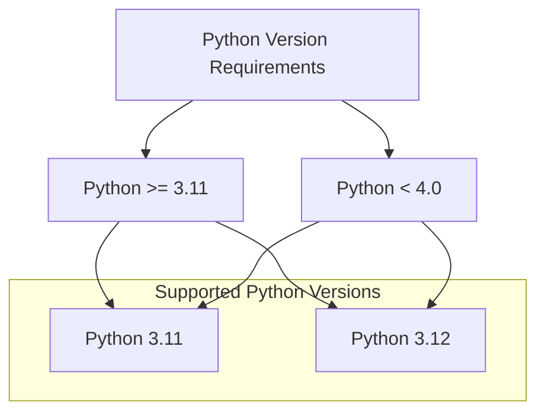

Sources: [pyproject.toml:9](), [pyproject.toml:26-31]()

## Lock File Structure

The `pdm.lock` file contains detailed information about all resolved dependencies, including their versions, hashes, and dependencies. This ensures reproducible builds and installations.

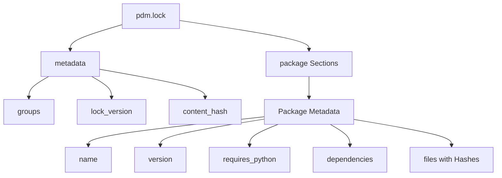

Sources: [pdm.lock:1-22]()

## Requirements File Generation

PDM can generate a `requirements.txt` file from the lock file, which contains pinned versions with hashes for all packages. This file is useful for deployment in environments that don't use PDM directly.

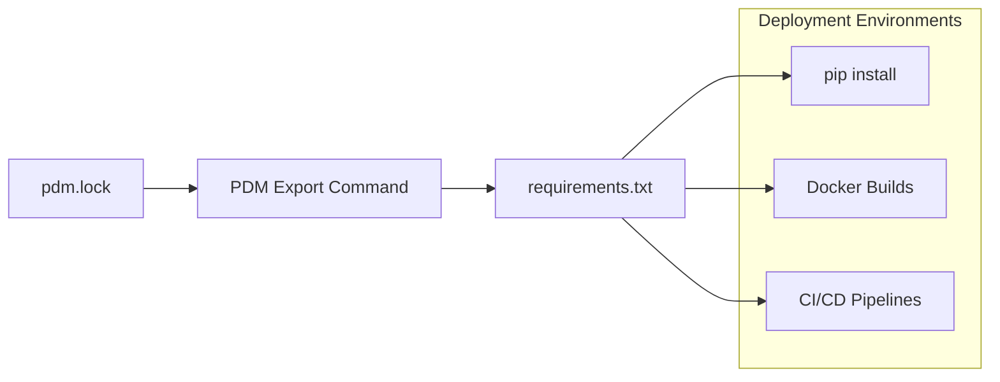

Sources: [requirements.txt:1-3]()

## Integration with Build System

PDM serves as both the dependency manager and build backend for the project, as specified in the `build-system` section of `pyproject.toml`. This integration simplifies the build process and ensures that dependencies are correctly incorporated into the package.

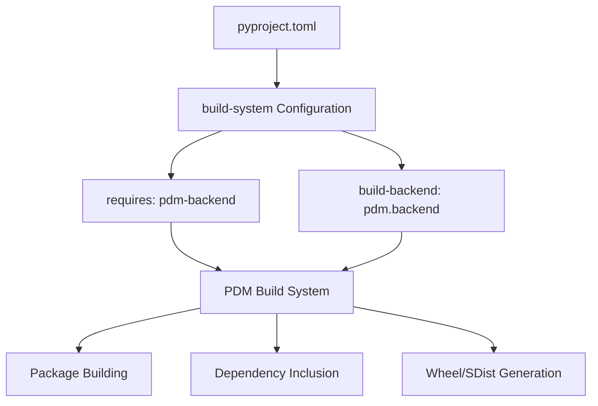

Sources: [pyproject.toml:47-49](), [pyproject.toml:70-73]()

## Dependency Resolution Flow

When installing or updating dependencies, PDM follows a specific flow to resolve and install packages.

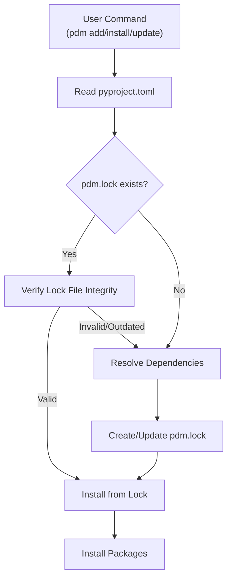

Sources: [pdm.lock](), [pyproject.toml]()

## Dependency Groups

PDM organizes dependencies into groups, which can be selectively installed. The main groups in RepoAgent are:

1. `default` - Core dependencies
2. `chat_with_repo` - Chat interface dependencies  
3. `lint` - Code linting tools
4. `test` - Testing frameworks

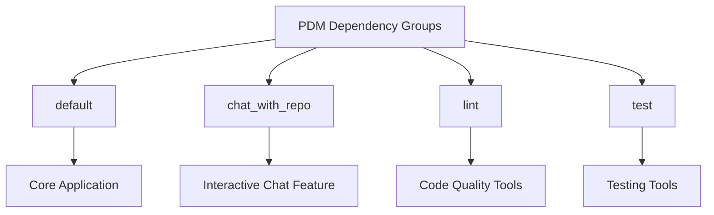

Sources: [pdm.lock:5](), [pyproject.toml:40-45](), [pyproject.toml:62-68]()

## Dependency Structure

The following diagram shows the high-level relationships between main components of RepoAgent and their primary dependencies:

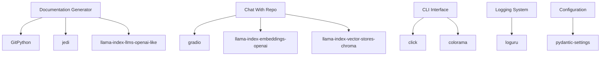

Sources: [pyproject.toml:10-21](), [pyproject.toml:40-45]()

## Version Management

RepoAgent follows semantic versioning principles. The current version is specified in the `pyproject.toml` file, and dependencies use various version specifiers to control compatibility.

| Dependency Type | Version Specifier Example | Meaning |
|-----------------|---------------------------|---------|
| Minimum Version | `loguru>=0.7.2` | Requires loguru 0.7.2 or higher |
| Version Range | `pytest<8.0.0,>=7.4.4` | Requires pytest between 7.4.4 and 8.0.0 (excluding 8.0.0) |
| Compatible Release | `^1.2.3` | Requires version compatible with 1.2.3 (same as >=1.2.3,<2.0.0) |
| Python Version | `>=3.11,<4.0` | Requires Python 3.11 or higher, but less than 4.0 |

Sources: [pyproject.toml:9-21](), [pyproject.toml:62-68]()

## Dependency Installation

Users can install RepoAgent with different dependency sets based on their needs:

1. Basic installation: `pip install repoagent`
2. With chat functionality: `pip install repoagent[chat_with_repo]`
3. Development installation: `pdm install -G:all`

Sources: [pyproject.toml:40-45](), [pyproject.toml:62-68]()

---

