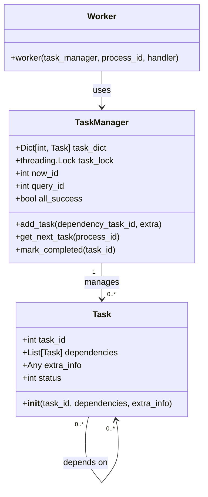
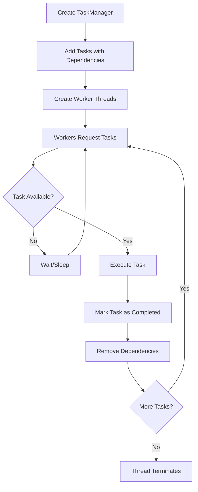
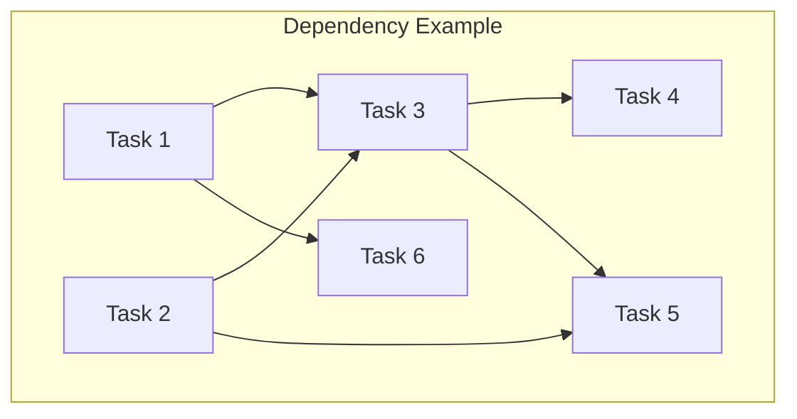
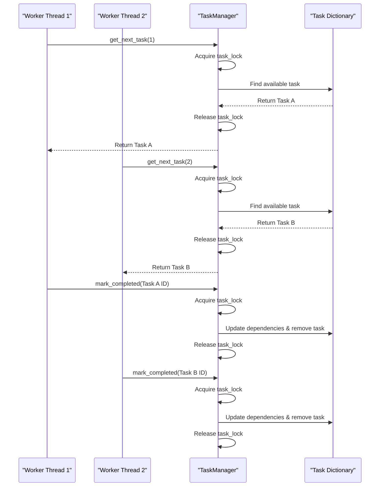
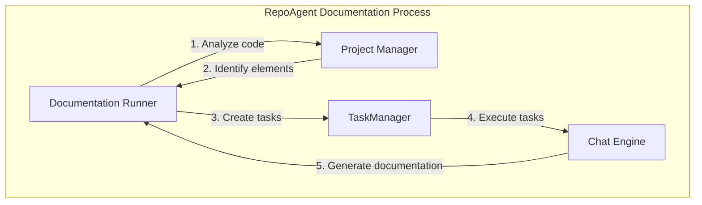

<!-- source: DeepWiki mcp.deepwiki.com · repo OpenBMB/RepoAgent · page 5.2 Task Management System · fetched 2026-10-26 -->

# Task Management System

<details>
<summary>Relevant source files</summary>

The following files were used as context for generating this wiki page:

- [repo_agent/multi_task_dispatch.py](repo_agent/multi_task_dispatch.py)
- [repo_agent/project_manager.py](repo_agent/project_manager.py)

</details>


## Purpose and Scope

The Task Management System in RepoAgent provides a concurrent task execution framework that enables efficient parallel processing of documentation generation tasks. This system is designed to handle dependencies between tasks and optimize resource utilization by distributing work across multiple threads. This documentation covers the architecture, components, and usage of the task management infrastructure.

For information about the overall documentation generation process, see [Documentation Generation System](#2.1).

Sources: [repo_agent/multi_task_dispatch.py:1-147]()

## System Architecture

The Task Management System consists of two primary components: the `Task` class representing individual units of work, and the `TaskManager` class that orchestrates task scheduling and execution. These components work together to implement a dependency-based concurrent execution model.



Sources: [repo_agent/multi_task_dispatch.py:11-102](), [repo_agent/multi_task_dispatch.py:103-126]()

## Core Components

### Task Class

The `Task` class represents an individual unit of work to be performed in the system. Each task has the following key attributes:

| Attribute | Type | Description |
|-----------|------|-------------|
| `task_id` | int | Unique identifier for the task |
| `dependencies` | List[Task] | List of tasks that must complete before this task can execute |
| `extra_info` | Any | Custom data associated with the task (typically contains the function to execute) |
| `status` | int | Current status of the task (0=not started, 1=in progress, 2=completed, 3=error) |

```mermaid
stateDiagram-v2
    [*] --> "Not Started"
    "Not Started" --> "In Progress" : Task scheduled
    "In Progress" --> "Completed" : Execution finished
    "In Progress" --> "Error" : Execution failed
    "Completed" --> [*]
    "Error" --> [*]
    
    state "Not Started" as s0 : status=0
    state "In Progress" as s1 : status=1  
    state "Completed" as s2 : status=2
    state "Error" as s3 : status=3
```

Sources: [repo_agent/multi_task_dispatch.py:11-17]()

### TaskManager Class

The `TaskManager` class orchestrates the execution of tasks with dependencies. It maintains a dictionary of tasks and provides methods to add tasks, retrieve the next available task, and mark tasks as completed.

Key functionalities:
- Thread-safe task management with locks
- Dependency resolution
- Task scheduling
- Task completion handling

Sources: [repo_agent/multi_task_dispatch.py:19-101]()

## Task Execution Workflow

The task execution process follows a specific workflow that ensures tasks are executed only when their dependencies are satisfied:



Sources: [repo_agent/multi_task_dispatch.py:103-126](), [repo_agent/multi_task_dispatch.py:62-85](), [repo_agent/multi_task_dispatch.py:87-101]()

## Dependency Management

The Task Management System implements a directed acyclic graph (DAG) of task dependencies. Tasks can only be executed when all their dependencies have been completed.



When a task is completed:
1. The `mark_completed` method removes the task from all dependency lists
2. Tasks that previously depended on the completed task can now be executed if all their other dependencies are also complete
3. The completed task is removed from the task dictionary

Sources: [repo_agent/multi_task_dispatch.py:87-101]()

## Thread Synchronization

The TaskManager uses a threading lock to ensure thread-safe access to the shared task dictionary:



Sources: [repo_agent/multi_task_dispatch.py:34-36](), [repo_agent/multi_task_dispatch.py:54-60](), [repo_agent/multi_task_dispatch.py:73-85](), [repo_agent/multi_task_dispatch.py:95-100]()

## Usage Example

Here's how the Task Management System is typically used:

1. Create a TaskManager instance
2. Define tasks with their dependencies
3. Create worker threads to process tasks
4. Wait for all tasks to complete

```python
# Create a task manager
task_manager = TaskManager()

# Define a handler function for tasks
def my_handler(task_data):
    # Process the task data
    pass

# Add tasks with dependencies
task1_id = task_manager.add_task(dependency_task_id=[], extra=task1_data)
task2_id = task_manager.add_task(dependency_task_id=[], extra=task2_data)
task3_id = task_manager.add_task(dependency_task_id=[task1_id], extra=task3_data)
task4_id = task_manager.add_task(dependency_task_id=[task2_id, task3_id], extra=task4_data)

# Create and start worker threads
threads = [
    threading.Thread(target=worker, args=(task_manager, i, my_handler)) 
    for i in range(4)
]

for thread in threads:
    thread.start()

# Wait for all threads to complete
for thread in threads:
    thread.join()
```

Sources: [repo_agent/multi_task_dispatch.py:128-146](), [repo_agent/multi_task_dispatch.py:103-126]()

## Integration with Documentation Generation

In the RepoAgent system, the Task Management System is primarily used to parallelize the documentation generation process. Each code element that needs documentation becomes a task, with dependencies determined by the code's structure.



The Task Management System enables efficient processing by:

1. Allowing independent code elements to be documented concurrently
2. Ensuring dependent elements are documented in the correct order
3. Utilizing available CPU cores through multi-threading
4. Managing the workload to prevent system overload

Sources: [repo_agent/multi_task_dispatch.py:1-147]()

## Performance Considerations

When using the Task Management System, consider the following performance aspects:

1. **Thread count**: The optimal number of worker threads typically matches the available CPU cores
2. **Task granularity**: Smaller tasks enable better parallelization but increase overhead
3. **Dependency structure**: Highly interconnected tasks reduce parallelization opportunities
4. **Resource contention**: Workers may compete for resources like network or CPU

The system includes built-in waiting mechanisms (sleep) when no tasks are available to prevent CPU thrashing while polling for work.

Sources: [repo_agent/multi_task_dispatch.py:115-121]()

---

