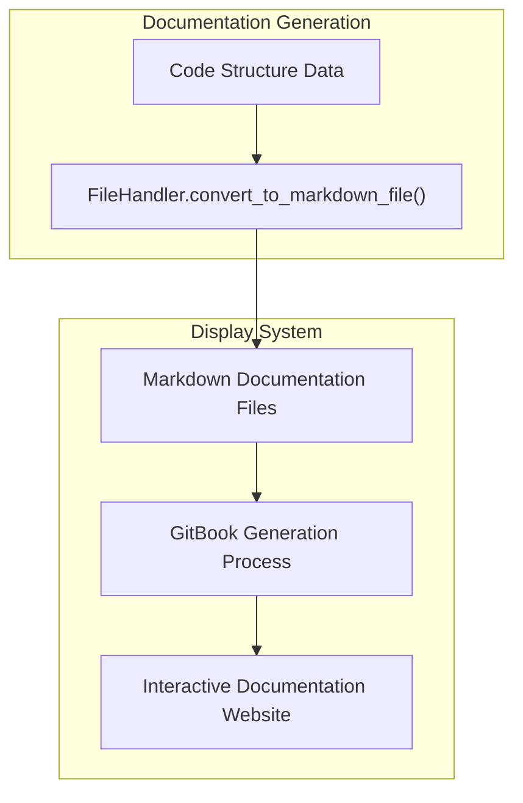
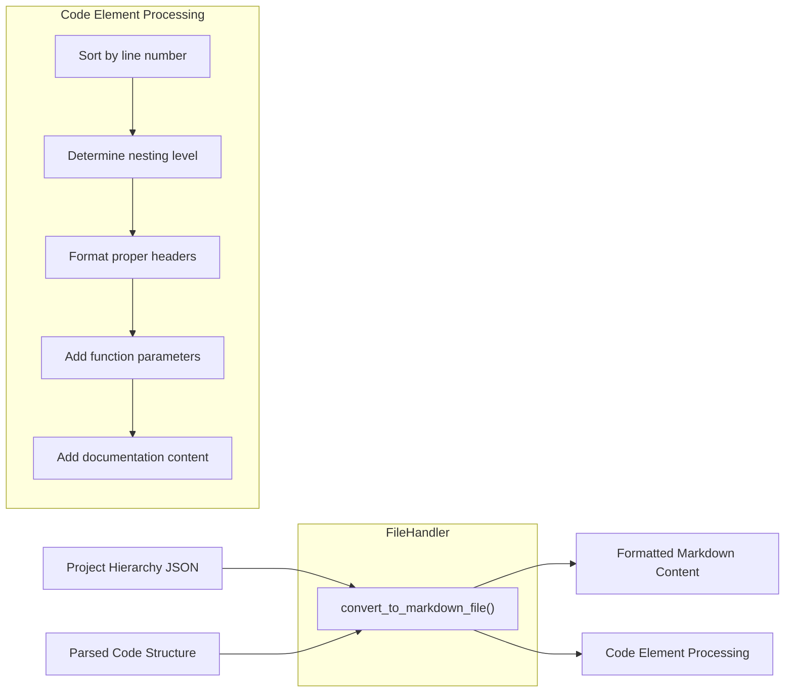
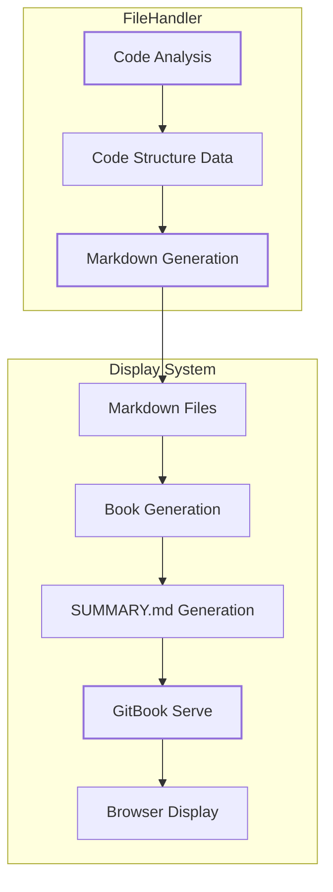

<!-- source: DeepWiki mcp.deepwiki.com · repo OpenBMB/RepoAgent · page 6 Display and Output · fetched 2026-10-26 -->

# Display and Output

Relevant source files

The following files were used as context for generating this wiki page:

- [display/Makefile](display/Makefile)
- [display/README_DISPLAY.md](display/README_DISPLAY.md)
- [display/scripts/install_nodejs.sh](display/scripts/install_nodejs.sh)
- [repo_agent/file_handler.py](repo_agent/file_handler.py)

This document describes the display and output components of RepoAgent, focusing on how the system formats and presents generated documentation. The display system takes the raw documentation generated by the core documentation system and transforms it into a user-friendly, navigable format.

For information about how the documentation content is generated, see [Documentation Generation System](#2.1). For details on markdown formatting specifics, see [Markdown Generation](#6.1).

## Overview

RepoAgent's display system transforms the generated documentation into a browsable GitBook-based website. This process involves converting parsed code structures into markdown files, organizing them in a hierarchical structure, and then rendering them as an interactive documentation website.

Sources: [repo_agent/file_handler.py:307-362](), [display/Makefile:67-86]()

## Markdown Generation System

The foundation of the display system is the conversion of code structures into properly formatted markdown files. This is primarily handled by the `FileHandler` class.

Sources: [repo_agent/file_handler.py:307-362]()

The `convert_to_markdown_file` method (lines 307-362 in `file_handler.py`) performs the following steps:

1. Loads the project hierarchy from the JSON file
2. Identifies the file object that matches the provided file path
3. Generates markdown with proper header levels based on nesting structure
4. Formats function definitions with parameters
5. Adds documentation content under each header

The markdown output follows a hierarchical structure that mirrors the code's organization, with appropriate heading levels (H1, H2, etc.) based on nesting depth.

## GitBook Integration

RepoAgent uses GitBook to transform the markdown files into a browsable documentation website. The GitBook integration is managed through a Makefile system that provides several automation commands.

```mermaid
flowchart TD
    MakeInit["make init"] --> InstallNodeJS["Install Node.js 10.x"]
    InstallNodeJS --> InstallGitbook["Install GitBook CLI"]
    InstallGitbook --> CopyBookJSON["Copy book.json template"]
    CopyBookJSON --> InstallPlugins["Install GitBook plugins"]
    
    MakeGenerate["make generate"] --> ClearSrc["Clear previous source"]
    ClearSrc --> GenerateBooks["Generate books from markdown"]
    GenerateBooks --> GenerateSummary["Generate SUMMARY.md"]
    
    MakeServe["make serve"] --> RunGenerate["Run generate process"]
    RunGenerate --> ServeGitbook["Serve GitBook on port 4000"]
    
    subgraph "Setup Process"
        MakeInit
        InstallNodeJS
        InstallGitbook
        CopyBookJSON
        InstallPlugins
    end
    
    subgraph "Documentation Generation"
        MakeGenerate
        ClearSrc
        GenerateBooks
        GenerateSummary
    end
    
    subgraph "Serving Documentation"
        MakeServe
        RunGenerate
        ServeGitbook
    end
```

Sources: [display/Makefile:1-86](), [display/README_DISPLAY.md:1-62]()

### Key Makefile Commands

The GitBook display system offers several commands through the Makefile:

| Command | Description |
|---------|-------------|
| `make init_env` | Sets up Node.js 10.x environment |
| `make clear_book` | Clears previously generated book |
| `make init` | Initializes GitBook and installs plugins |
| `make generate` | Generates the book from markdown files |
| `make serve` | Serves the GitBook on http://localhost:4000 |
| `make help` | Displays help information |

Sources: [display/Makefile:20-106]()

### Environment Setup

The display system requires Node.js 10.x, which is automated through the `install_nodejs.sh` script. This script:

1. Checks if nvm (Node Version Manager) is installed
2. Installs nvm if needed, with OS-specific installation methods
3. Installs Node.js version 10
4. Verifies the installation was successful

Sources: [display/scripts/install_nodejs.sh:1-86]()

## Markdown to Documentation Conversion Flow

This diagram illustrates the complete flow from code parsing to final documentation display:

Sources: [repo_agent/file_handler.py:307-362](), [display/Makefile:67-86]()

## Key Files and Components

### FileHandler Markdown Conversion

The `FileHandler.convert_to_markdown_file` method in `file_handler.py` is responsible for:

- Reading the project hierarchy JSON
- Finding the appropriate file object
- Formatting markdown headers based on code hierarchy
- Adding function parameters and documentation content
- Organizing output with proper section dividers

The method generates different header levels (`#`, `##`, etc.) based on the nesting level of the code elements, which creates a structured documentation format.

Sources: [repo_agent/file_handler.py:307-362]()

### Display System Build Process

The build process for the display system involves:

1. Python scripts that generate the book structure from markdown files
2. GitBook's build system that converts markdown into HTML
3. A web server that serves the resulting documentation

The `Makefile` automates this process with a series of commands that handle each step, from environment setup to serving the documentation.

Sources: [display/Makefile:1-86]()

## Integration with Other Systems

The display system integrates with several other components of RepoAgent:

1. It consumes the output of the documentation generation system
2. It uses the file handler's parsing capabilities to understand code structure
3. It transforms the documentation metadata into a navigable format

This integration ensures that the documentation remains in sync with code changes and properly reflects the structure of the codebase.

Sources: [repo_agent/file_handler.py:307-362](), [display/Makefile:1-86]()

---

