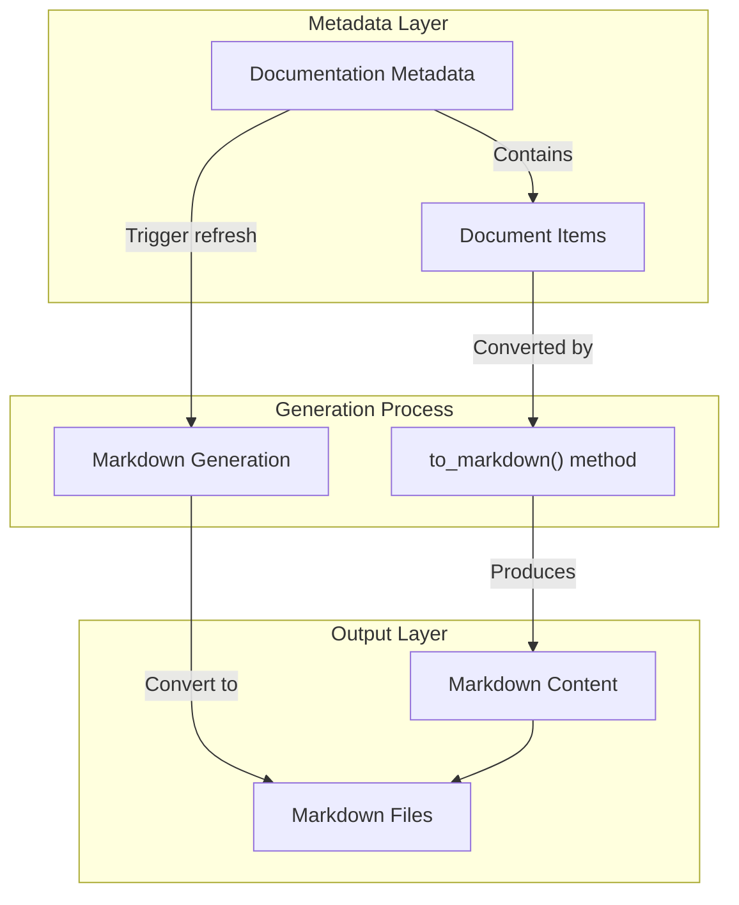
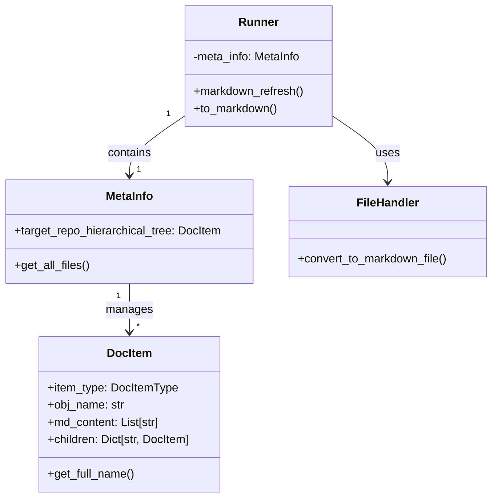
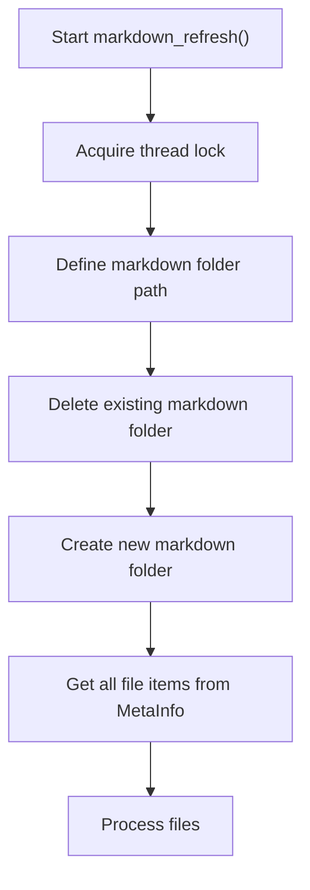
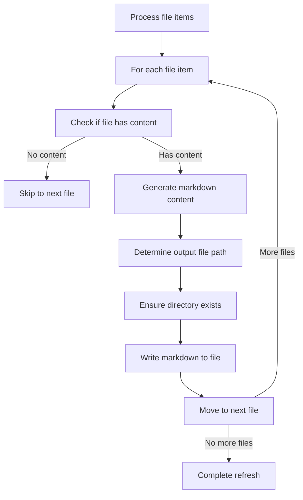
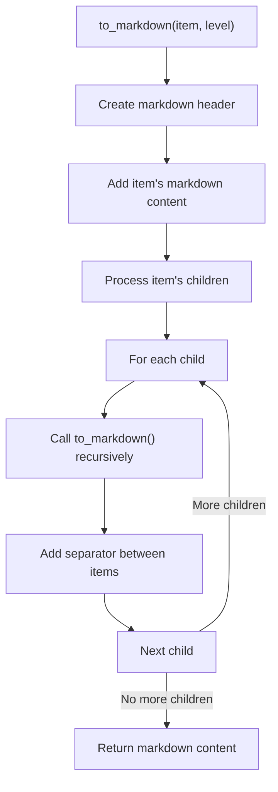
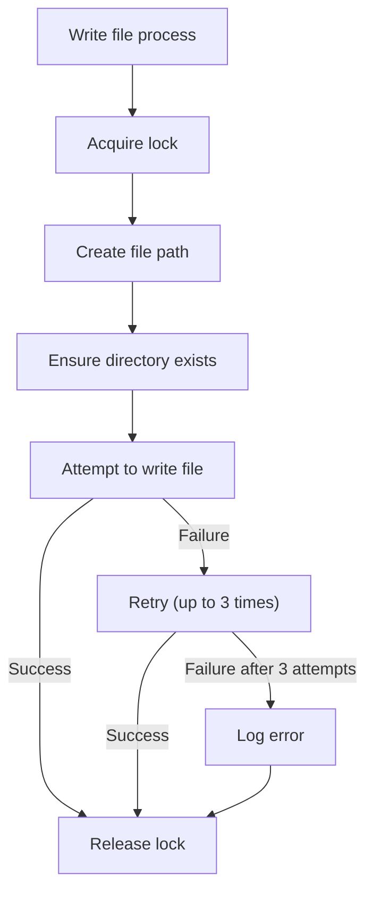
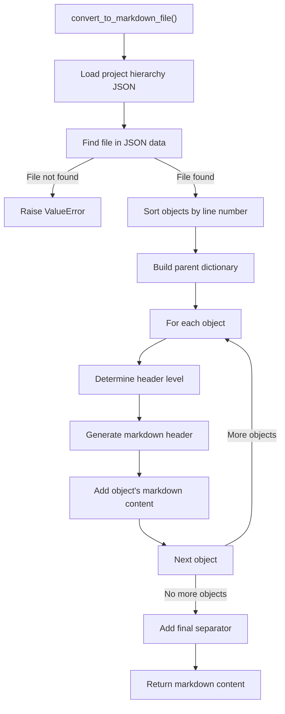
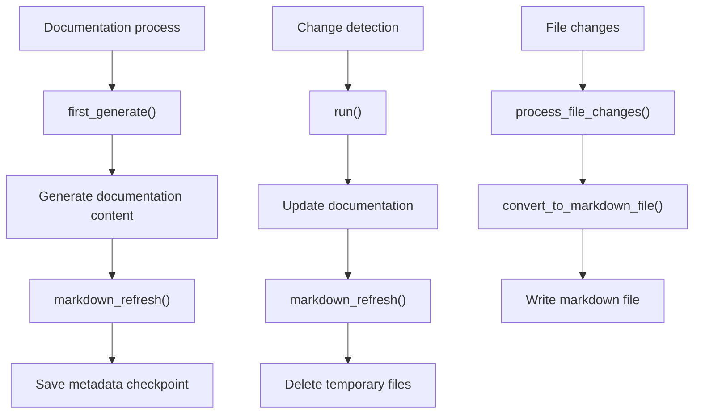

<!-- source: DeepWiki mcp.deepwiki.com · repo OpenBMB/RepoAgent · page 6.1 Markdown Generation · fetched 2026-10-26 -->

# Markdown Generation

<details>
<summary>Relevant source files</summary>

The following files were used as context for generating this wiki page:

- [repo_agent/doc_meta_info.py](repo_agent/doc_meta_info.py)
- [repo_agent/file_handler.py](repo_agent/file_handler.py)
- [repo_agent/runner.py](repo_agent/runner.py)

</details>


This page explains how RepoAgent generates and formats Markdown documentation from the repository's code structure. The Markdown generation system converts the internal document metadata structure into human-readable Markdown files that document the codebase.

## Purpose and Scope

The Markdown generation system is responsible for:

1. Transforming internal document metadata into formatted Markdown files
2. Structuring documentation hierarchically based on code organization
3. Refreshing documentation when code changes are detected
4. Organizing output files to match the repository structure

For information about displaying this documentation as a Gitbook, see [Gitbook Integration](#6.2).

## Overview

The Markdown generation process occurs after the documentation content has been generated using LLMs. It transforms the structured document metadata into formatted Markdown files that follow a consistent layout and hierarchy, reflecting the structure of the codebase itself.



Sources: [repo_agent/runner.py:157-231](), [repo_agent/runner.py:233-248]()

## Key Components

The Markdown generation system consists of several key components that work together:

1. **Runner**: Orchestrates the Markdown generation process through its `markdown_refresh()` and `to_markdown()` methods
2. **DocItem**: Represents a documentation item (file, class, function, etc.) and contains its metadata
3. **MetaInfo**: Manages the hierarchical structure of the documentation
4. **FileHandler**: Provides utilities for file operations and alternative Markdown conversion



Sources: [repo_agent/runner.py:25-43](), [repo_agent/doc_meta_info.py:110-226](), [repo_agent/file_handler.py:307-362]()

## Markdown Generation Process

### 1. Initialization and Refresh

The Markdown generation process begins with the `markdown_refresh()` method in the `Runner` class. This method is called after documentation content has been generated or updated.



Sources: [repo_agent/runner.py:157-171]()

The method first acquires a lock to ensure thread safety, then defines the path to the markdown folder, deletes any existing markdown folder, and creates a new one.

### 2. File Processing

The system then processes each file item retrieved from the document metadata:



Sources: [repo_agent/runner.py:174-203]()

### 3. Document Item Conversion

The heart of the Markdown generation process is the `to_markdown()` method, which converts a document item to Markdown format:



Sources: [repo_agent/runner.py:233-248]()

The method creates a markdown header with the appropriate level, adds the item's markdown content, and recursively processes the item's children. It formats the output based on the item's type (file, class, function, etc.) and adds separators between items.

## Markdown Document Structure

The generated Markdown documents follow a specific structure:

1. **File Level**: Each file in the repository corresponds to a Markdown file
2. **Hierarchy**: The Markdown document reflects the code's hierarchical structure using header levels
3. **Content**: Each documentation item includes:
   - Header with item type and name (e.g., `## ClassDef MyClass`)
   - Documentation content generated by LLM
   - Horizontal separators between peer items

### Sample Markdown Structure

The following is an example of the structure of a generated Markdown document:

```
## ClassDef MyClass
Documentation for MyClass...

### FunctionDef __init__(self, param1, param2)
Documentation for the constructor...

### FunctionDef my_method(self, param)
Documentation for my_method...
***

## FunctionDef standalone_function(param1, param2)
Documentation for standalone_function...
***
```

The header level indicates the nesting level of the code element, with classes, methods, and functions appearing at appropriate levels in the hierarchy.

## File Writing Process

Once the Markdown content is generated, it is written to disk:



Sources: [repo_agent/runner.py:215-228]()

The system uses a lock to ensure thread safety during file writing, creates the necessary directories, and attempts to write the file. If the write operation fails, it retries up to 3 times with a delay between attempts.

## Alternative Markdown Generation

In addition to the primary `to_markdown()` method in the `Runner` class, the `FileHandler` class also provides a `convert_to_markdown_file()` method that offers an alternative approach to generating Markdown documents.



Sources: [repo_agent/file_handler.py:307-362]()

This method generates Markdown content by loading the project hierarchy JSON file, finding the relevant file, and converting its objects to Markdown format. It determines the header level based on the object's hierarchy and sorts objects by line number to maintain the original code order.

## Integration with Documentation Workflow

The Markdown generation process is integrated into the larger documentation workflow:



Sources: [repo_agent/runner.py:101-152](), [repo_agent/runner.py:259-344](), [repo_agent/runner.py:410-472]()

The Markdown generation is triggered in several scenarios:
1. After initial generation of all documentation
2. After incremental updates to documentation due to code changes
3. When processing specific file changes

## Summary

The Markdown generation system in RepoAgent transforms internal document metadata into readable Markdown files that document the codebase. It maintains a hierarchical structure that reflects the code organization, formats documentation content consistently, and integrates with the broader documentation workflow to ensure documentation stays in sync with code changes.

The system uses a combination of methods in the `Runner` and `FileHandler` classes to generate Markdown content and write it to disk, with safeguards for thread safety and error handling.

---

