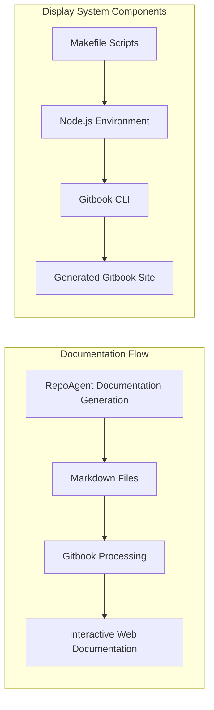
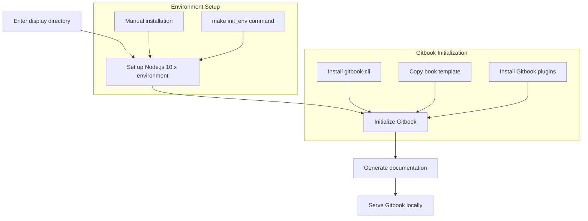
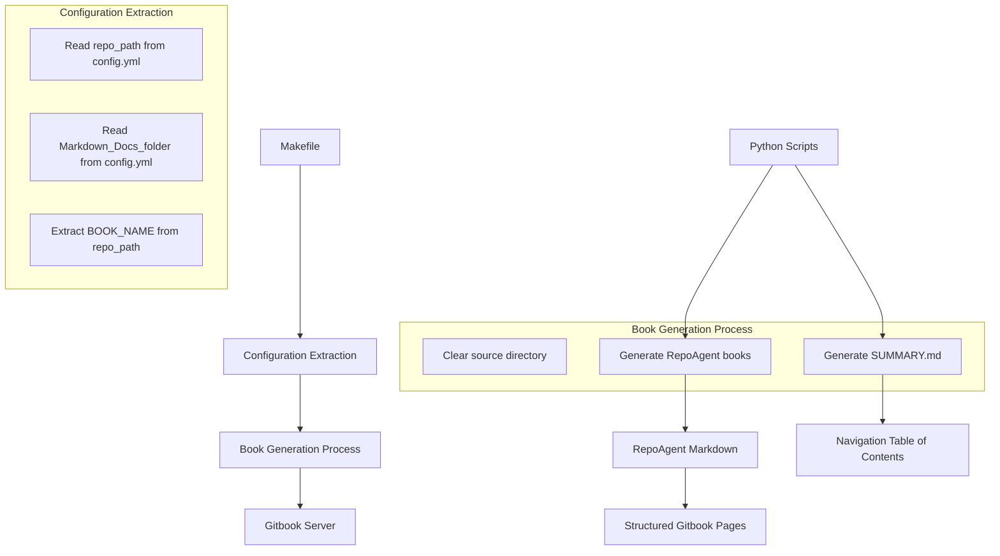
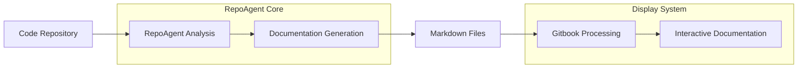

<!-- source: DeepWiki mcp.deepwiki.com · repo OpenBMB/RepoAgent · page 6.2 Gitbook Integration · fetched 2026-10-26 -->

# Gitbook Integration

<details>
<summary>Relevant source files</summary>

The following files were used as context for generating this wiki page:

- [display/Makefile](display/Makefile)
- [display/README_DISPLAY.md](display/README_DISPLAY.md)
- [display/scripts/install_nodejs.sh](display/scripts/install_nodejs.sh)

</details>


This page documents how RepoAgent's documentation output can be transformed into a navigable Gitbook website for enhanced readability and accessibility. The Gitbook integration provides a polished presentation layer for the Markdown documentation that RepoAgent generates. For information about the initial Markdown generation process, see [Markdown Generation](#6.1).

## Overview

The Gitbook integration system serves as the final step in the documentation pipeline, converting the raw Markdown files into an interactive web-based documentation site with search capabilities, navigation, and a professional appearance.



Sources: [display/README_DISPLAY.md:1-62](), [display/Makefile:1-105]()

## Requirements

Before using the Gitbook integration feature, you need to ensure your system meets the following requirements:

- RepoAgent must have already generated Markdown documentation for your repository
- Node.js version 10.x (specifically required for Gitbook compatibility)
- Access to the command line interface

The system provides automated script support for setting up these requirements across different operating systems.

Sources: [display/README_DISPLAY.md:9-10](), [display/scripts/install_nodejs.sh:1-86]()

## Setup Process

Setting up the Gitbook integration involves a few key steps, which are automated through the provided Makefile.



Sources: [display/README_DISPLAY.md:3-38](), [display/Makefile:30-63]()

## Makefile Commands

The Gitbook integration provides a set of Makefile commands to streamline the process. These commands can be viewed by running `make help` in the `display` directory.

| Command | Description | Implementation Reference |
|---------|-------------|--------------------------|
| `make init_env` | Initialize Node.js 10.x environment | [display/Makefile:30-36]() |
| `make clear_book` | Clear previously generated book | [display/Makefile:46-48]() |
| `make init` | Initialize Gitbook (install plugins) | [display/Makefile:62-63]() |
| `make generate` | Generate Gitbook from documentation | [display/Makefile:81-82]() |
| `make serve` | Start a local server to preview the Gitbook | [display/Makefile:85-86]() |

Sources: [display/README_DISPLAY.md:11-31](), [display/Makefile:21-105]()

## Usage Workflow

The typical workflow for using the Gitbook integration follows these steps:

1. Navigate to the display directory after generating documentation:
   ```bash
   cd display
   ```

2. Set up the Node.js environment (one-time setup):
   ```bash
   make init_env
   ```

3. Initialize the Gitbook environment (one-time setup):
   ```bash
   make init
   ```

4. Generate and serve the Gitbook (can be run repeatedly after documentation changes):
   ```bash
   make serve
   ```

5. Access the Gitbook at http://localhost:4000

Sources: [display/README_DISPLAY.md:32-51](), [display/Makefile:85-86]()

## Technical Implementation

The Gitbook integration system works through several interconnected components:



Sources: [display/Makefile:1-13](), [display/Makefile:69-82]()

### Configuration and Directory Structure

The Gitbook integration relies on a specific directory structure and configuration:

1. It reads the repository path and Markdown documentation folder from the main RepoAgent `config.yml` file
2. The book name is derived from the repository name (the last part of the repository path)
3. Generated books are stored in the `display/books/{BOOK_NAME}/` directory
4. The system copies a template `book.json` configuration file to customize the Gitbook appearance and functionality

The `book.json` file controls various aspects of the Gitbook output, including:
- Theme and styling
- Navigation structure
- Enabled plugins
- Search functionality

Sources: [display/Makefile:1-13](), [display/Makefile:46-55]()

### Book Generation Process

The book generation process involves several steps:

1. **Directory Preparation**: 
   - Clearing previous book content
   - Creating necessary directory structure
   - Copying the book template

2. **Content Processing**:
   - Python scripts convert the RepoAgent Markdown files into a structure suitable for Gitbook
   - The system generates a `SUMMARY.md` file which defines the table of contents and navigation structure

3. **Gitbook Conversion**:
   - The gitbook-cli tool processes the Markdown and configuration
   - It generates HTML, JavaScript, and CSS for the interactive documentation

Sources: [display/Makefile:69-82]()

## Environment Setup Details

The environment setup process is automated through the `install_nodejs.sh` script, which:

1. Detects the operating system (Linux, macOS, or Windows)
2. Installs Node Version Manager (nvm) appropriate for the detected OS
3. Uses nvm to install and configure Node.js version 10
4. Verifies the installation was successful

The script handles different installation methods for each supported operating system, providing a consistent setup experience across platforms.

Sources: [display/scripts/install_nodejs.sh:8-86]()

## Future Enhancements

The README indicates several planned enhancements for the Gitbook integration:

1. ✅ One-click environment creation (implemented)
2. Docker-based deployment for easier setup across different environments
3. Automatic deployment to GitHub Pages or Gitee Pages for public access to documentation

These future enhancements aim to make documentation hosting and sharing even more streamlined.

Sources: [display/README_DISPLAY.md:54-60]()

## Troubleshooting

If you encounter issues with the Gitbook integration:

1. **Node.js Version Issues**: Ensure you're using Node.js 10.x specifically, as Gitbook is not compatible with newer versions. Use `node -v` to verify your active Node.js version.

2. **Installation Problems**: If `make init_env` fails, you can manually install Node.js 10 using nvm:
   ```bash
   curl -o- https://raw.githubusercontent.com/nvm-sh/nvm/v0.39.1/install.sh | bash
   source ~/.nvm/nvm.sh
   nvm install 10
   nvm use 10
   ```

3. **Port Conflicts**: The default port for the Gitbook server is 4000. If this port is already in use, you can modify the `GITBOOK_PORT` variable in the Makefile.

Sources: [display/README_DISPLAY.md:9-10](), [display/scripts/install_nodejs.sh:42-57](), [display/Makefile:11-12]()

## Integration with Documentation Generation

The Gitbook integration is the final stage in the RepoAgent documentation pipeline:



When a repository's documentation is updated (either fully or incrementally), running `make serve` in the display directory will regenerate the Gitbook with the latest content.

Sources: [display/README_DISPLAY.md:36-38](), [display/Makefile:81-86]()