# Page: Overview

# Overview

<details>
<summary>Relevant source files</summary>

The following files were used as context for generating this wiki page:

- [README.md](README.md)
- [README_CN.md](README_CN.md)
- [assets/images/8_documents.png](assets/images/8_documents.png)
- [assets/images/Doc_example.png](assets/images/Doc_example.png)
- [assets/images/ExecutionResult.png](assets/images/ExecutionResult.png)
- [assets/images/RepoAgent.png](assets/images/RepoAgent.png)
- [repo_agent/chat_with_repo/__init__.py](repo_agent/chat_with_repo/__init__.py)

</details>


RepoAgent is an LLM-powered framework designed to automate repository-level code documentation generation. This system analyzes code repositories, understands their structure, generates comprehensive documentation using large language models (LLMs), and maintains that documentation as the codebase evolves. RepoAgent aims to solve the challenge of keeping technical documentation up-to-date with minimal manual effort.

This overview introduces the RepoAgent system architecture, core components, and operational workflows. For installation instructions, see [Installation and Setup](#1.1), and for a step-by-step guide on using the system, see [Quick Start Guide](#1.2).

Sources: [README.md:36-41](), [README.md:44-52]()

## System Architecture

RepoAgent is organized into two main functional systems:

1. **Documentation Generation System** - Analyzes repository structure and creates documentation
2. **Chat with Repository Feature** - Enables interactive querying of repository content

### High-Level Architecture

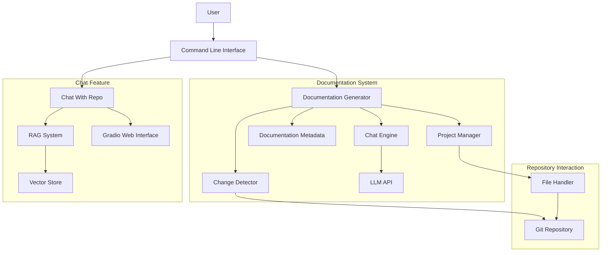

The system is designed with a clear separation of concerns, with specialized components for repository analysis, metadata management, change detection, and documentation generation.

Sources: [README.md:44-52]()

## Core Components

### Runner (Documentation Generator)

The central orchestrator of the documentation generation process. It coordinates between metadata management, change detection, and document generation.

### MetaInfo (Documentation Metadata)

Maintains the hierarchical structure of the repository and tracks documentation status of each code element. It is critical for both initial documentation and incremental updates.

### ChatEngine

Leverages LLMs to generate documentation for code elements. It constructs prompts containing context about the code and its relationships.

### ChangeDetector

Identifies modified files and code structures by analyzing Git diffs, enabling efficient incremental documentation updates.

### Project Manager

Responsible for analyzing and representing the hierarchical structure of a repository.

### Chat with Repo

A separate feature that allows interactive exploration of the codebase through a conversational interface using Retrieval-Augmented Generation (RAG).

Sources: [README.md:35-52]()

## Documentation Generation Workflow

RepoAgent supports two main workflows: initial documentation generation and incremental updates.

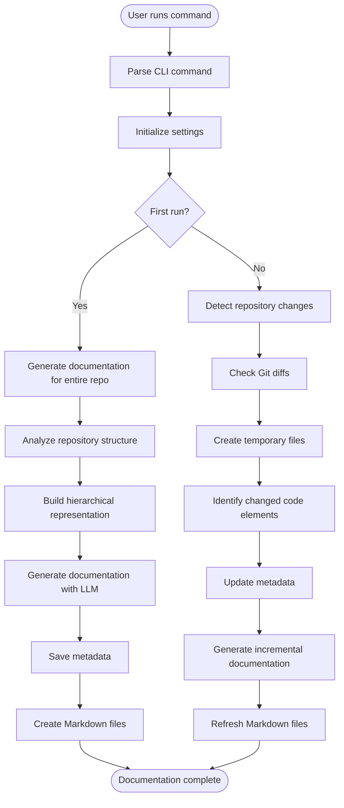

### Initial Documentation Process

1. **Repository Analysis**: The system scans the entire repository and builds a hierarchical representation of its structure.
2. **Documentation Generation**: The ChatEngine generates documentation for each code element using carefully crafted prompts for the LLM.
3. **Metadata Storage**: Information about the repository structure and documentation status is saved for future reference.
4. **Markdown Creation**: The generated documentation is formatted and saved as Markdown files.

### Incremental Update Process

1. **Change Detection**: The ChangeDetector identifies what has changed in the repository since the last documentation update.
2. **Metadata Update**: The metadata is updated to reflect the changes in the repository.
3. **Incremental Documentation**: The system only regenerates documentation for changed code elements.
4. **Markdown Refresh**: Only the affected Markdown files are updated.

Sources: [README.md:114-121](), [README.md:132-136]()

## Component Integration

The integration between components is designed to be loosely coupled, allowing for extensibility and maintainability.

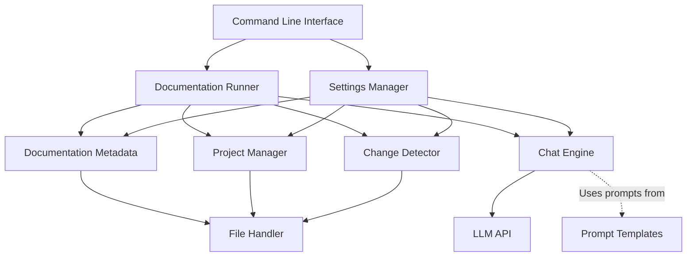

The system uses a configuration-driven approach, with settings that control various aspects of the documentation generation process.

Sources: [README.md:124-134]()

## Chat with Repository Feature

The Chat with Repository feature provides an interactive interface for exploring and understanding the codebase through natural language queries.

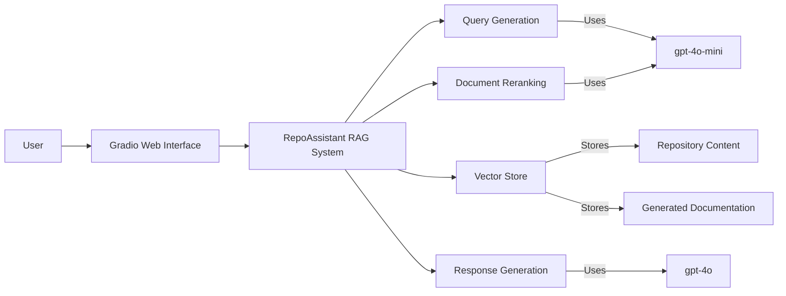

This feature leverages different LLM models for various tasks in the RAG pipeline, using a lightweight model for query processing and document reranking, and a more powerful model for generating comprehensive responses.

Sources: [README.md:199-208](), [repo_agent/chat_with_repo/__init__.py:1-3]()

## Usage Patterns

RepoAgent is designed to be integrated into the development workflow, with several common usage patterns:

1. **Manual Documentation Generation**: Running the documentation generation command manually.
   ```
   repoagent run
   ```

2. **Pre-commit Hook Integration**: Automatically detecting and documenting changes during the git commit process.

3. **Repository Exploration**: Using the chat interface to ask questions about the codebase.
   ```
   repoagent chat-with-repo
   ```

### Command Line Options

The `run` command supports various options for customizing the documentation generation process:

| Option | Description | Default |
|--------|-------------|---------|
| `-m`, `--model` | Specifies the model to use for completion | `gpt-3.5-turbo` |
| `-t`, `--temperature` | Sets the generation temperature for the model | `0.2` |
| `-r`, `--request-timeout` | Defines the timeout in seconds for the API request | `60` |
| `-b`, `--base-url` | The base URL for the API calls | `https://api.openai.com/v1` |
| `-tp`, `--target-repo-path` | The file system path to the target repository | Current path |
| `-hp`, `--hierarchy-path` | The name or path for the project hierarchy file | `.project_doc_record` |
| `-mdp`, `--markdown-docs-path` | The folder path for Markdown documentation | `markdown_docs` |
| `-i`, `--ignore-list` | Files or directories to ignore | - |
| `-l`, `--language` | The ISO 639 code or language name for the documentation | `Chinese` |
| `-ll`, `--log-level` | Sets the logging level | `INFO` |

Sources: [README.md:124-134](), [README.md:138-143]()

## Integration with Development Workflow

RepoAgent can be integrated into the development workflow using Git's pre-commit hooks, enabling automatic documentation updates whenever code changes are committed.

### Pre-commit Hook Configuration

```yaml
repos:
  - repo: local
    hooks:
    - id: repo-agent
      name: RepoAgent
      entry: repoagent
      language: system
      pass_filenames: false
      types: [python]
```

This configuration triggers RepoAgent automatically during the commit process, ensuring that documentation remains in sync with code changes.

Sources: [README.md:156-174](), [README.md:178-188]()

## Key Features and Capabilities

RepoAgent offers several key capabilities that make it a powerful tool for code documentation:

1. **Automatic Change Detection**: Tracks additions, deletions, and modifications of files in Git repositories.
2. **Code Structure Analysis**: Uses AST (Abstract Syntax Tree) analysis to understand code structure.
3. **Bidirectional Relationship Identification**: Maps relationships between code objects for richer documentation.
4. **Seamless Markdown Updates**: Maintains documentation consistency with code changes.
5. **Multi-threaded Operation**: Enhances efficiency through concurrent processing.
6. **Team Collaboration Support**: Provides sustainable, automated documentation updates for teams.
7. **Visual Documentation Display**: Presents documentation in an appealing way using Gitbook.

Sources: [README.md:44-52]()

## Summary

RepoAgent represents a significant step forward in automating the creation and maintenance of code documentation. By leveraging LLMs and integrating with existing development workflows, it reduces the burden of documentation on development teams and helps maintain up-to-date, comprehensive documentation with minimal manual effort.

Sources: [README.md:36-41](), [README.md:195-197]()

---

# Page: Installation and Setup

# Installation and Setup

<details>
<summary>Relevant source files</summary>

The following files were used as context for generating this wiki page:

- [README.md](README.md)
- [README_CN.md](README_CN.md)
- [pdm.lock](pdm.lock)
- [pyproject.toml](pyproject.toml)
- [repo_agent/chat_with_repo/__init__.py](repo_agent/chat_with_repo/__init__.py)
- [requirements.txt](requirements.txt)

</details>


This document provides detailed instructions for installing RepoAgent and configuring the necessary environment variables and settings. RepoAgent is an LLM-powered framework for automating repository-level code documentation generation. For information about using RepoAgent after installation, see the [Quick Start Guide](#1.2).

## System Requirements

RepoAgent requires:

* **Python**: 3.11 or higher (but less than 4.0)
* **Git**: Required for repository tracking and change detection
* **OpenAI API Key**: Or compatible LLM provider
* **Disk Space**: Sufficient for repository and documentation storage

## Core Dependencies

RepoAgent depends on several Python packages as defined in the project configuration:

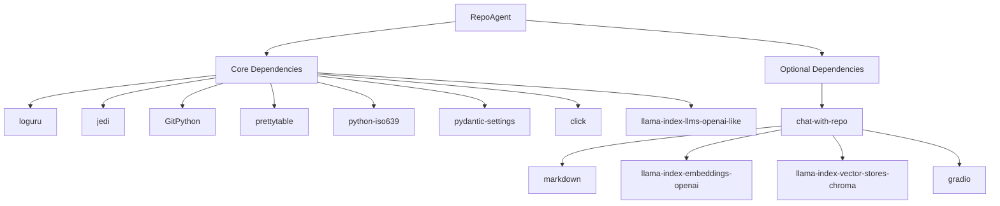

Sources: [pyproject.toml:9-21](), [pyproject.toml:40-45]()

## Installation Methods

RepoAgent provides multiple installation methods, each suited for different use cases.

### Using pip (Recommended for Users)

This is the simplest method for most users who want to use RepoAgent without modifying its code.

1. Install the base package:
   ```bash
   pip install repoagent
   ```

2. Optional: Install with chat-with-repo support:
   ```bash
   pip install repoagent[chat-with-repo]
   ```

Sources: [README.md:64-68](), [README.md:205-208]()

### Using GitHub Actions

For automated documentation in CI/CD workflows:

1. Add the RepoAgent GitHub Action to your project.
2. See the GitHub Marketplace: [actions/run-repoagent](https://github.com/marketplace/actions/run-repoagent) for setup instructions.

Sources: [README.md:58-60]()

### Development Setup Using PDM

For contributors or those wanting to modify RepoAgent:

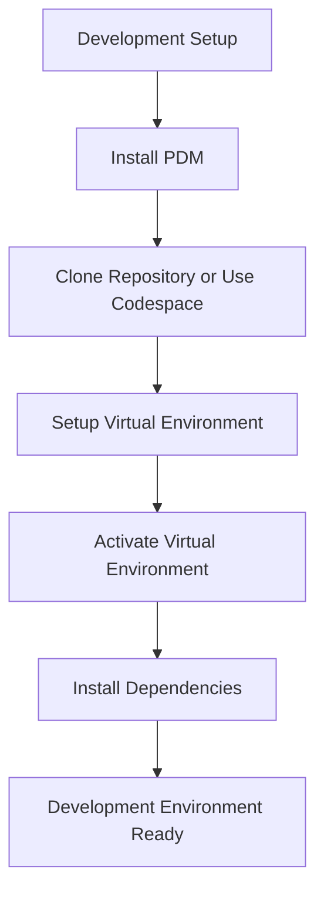

1. Install PDM following the [PDM installation guide](https://pdm-project.org/latest/#installation)
2. Get the code:
   - **Option A**: Use GitHub Codespace (easiest method)
     ```
     https://codespaces.new/OpenBMB/RepoAgent?quickstart=1
     ```
   - **Option B**: Clone the repository
     ```bash
     git clone https://github.com/OpenBMB/RepoAgent.git
     cd RepoAgent
     ```
3. Setup the Python virtual environment:
   ```bash
   pdm venv create --name repoagent
   ```
4. Activate the virtual environment (platform-specific)
5. Install dependencies:
   ```bash
   pdm install
   ```

Sources: [README.md:70-103]()

## Configuration

### Setting up API Key

Before using RepoAgent, you **must** configure the OpenAI API key as an environment variable:

```bash
# On Linux/Mac
export OPENAI_API_KEY=YOUR_API_KEY

# On Windows (Command Prompt)
set OPENAI_API_KEY=YOUR_API_KEY

# On Windows (PowerShell)
$Env:OPENAI_API_KEY = "YOUR_API_KEY"
```

Sources: [README.md:106-113]()

### Command Line Options

RepoAgent provides several command-line options to customize its behavior:

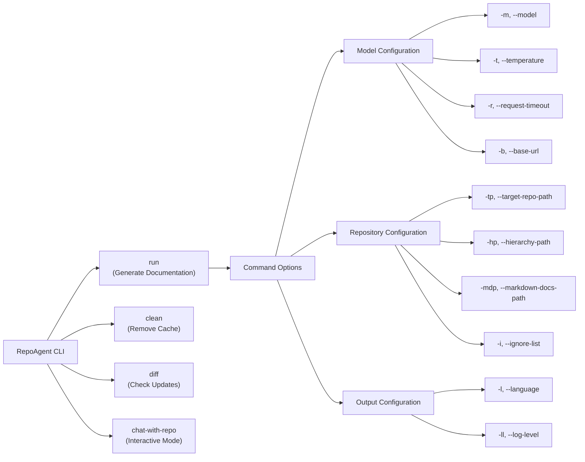

The following options are available:

| Option | Flag | Description | Default Value |
|--------|------|-------------|---------------|
| Model | `-m`, `--model` | LLM model for completion | `gpt-3.5-turbo` |
| Temperature | `-t`, `--temperature` | Generation temperature | `0.2` |
| Request Timeout | `-r`, `--request-timeout` | API request timeout (seconds) | `60` |
| Base URL | `-b`, `--base-url` | API base URL | `https://api.openai.com/v1` |
| Target Repo Path | `-tp`, `--target-repo-path` | Path to target repository | Current directory |
| Hierarchy Path | `-hp`, `--hierarchy-path` | Project hierarchy file path | `.project_doc_record` |
| Markdown Docs Path | `-mdp`, `--markdown-docs-path` | Documentation output folder | `markdown_docs` |
| Ignore List | `-i`, `--ignore-list` | Files/directories to ignore | None |
| Language | `-l`, `--language` | Documentation language | `Chinese` |
| Log Level | `-ll`, `--log-level` | Logging level | `INFO` |

Example usage:
```bash
repoagent run --model gpt-4-turbo --temperature 0.3 --language English
```

Sources: [README.md:115-135]()

## Verification of Installation

Verify your installation with these commands:

```bash
# Generate documentation for current repository
repoagent run

# Show repository structure as parsed by RepoAgent
repoagent run --print-hierarchy

# Check what documentation will be updated based on recent changes
repoagent diff

# Remove RepoAgent-related cache files
repoagent clean
```

If you installed the chat-with-repo feature:
```bash
# Start interactive chat interface
repoagent chat-with-repo
```

Sources: [README.md:118-121](), [README.md:135-141](), [README.md:205-208]()

## Setting Up Pre-commit Hook

For automatic documentation updates with each commit, set up RepoAgent as a pre-commit hook:

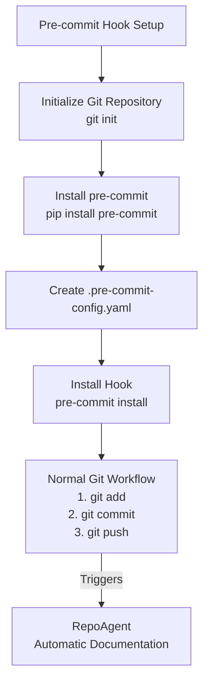

1. Initialize your repository (if not already done):
   ```bash
   git init
   ```

2. Install pre-commit:
   ```bash
   pip install pre-commit
   ```

3. Create a `.pre-commit-config.yaml` file in your repository root:
   ```yaml
   repos:
     - repo: local
       hooks:
       - id: repo-agent
         name: RepoAgent
         entry: repoagent
         language: system
         pass_filenames: false
         types: [python]
   ```

4. Install the hook:
   ```bash
   pre-commit install
   ```

Now RepoAgent will automatically run when you commit changes, detecting modifications and generating appropriate documentation.

Sources: [README.md:147-187]()

## Troubleshooting

If you encounter issues:

1. **API Key Issues**: Verify your API key is correctly set as an environment variable
2. **Dependencies Problems**: Ensure all dependencies are installed with the correct versions
3. **Git Setup**: Verify that your repository is a valid Git repository
4. **Pre-commit Hook**: Check the hook is properly installed in `.git/hooks/`

If problems persist, check the GitHub repository for open issues or create a new one.

Sources: [README.md:106-113](), [README.md:146-182]()

---

# Page: Quick Start Guide

# Quick Start Guide

<details>
<summary>Relevant source files</summary>

The following files were used as context for generating this wiki page:

- [README.md](README.md)
- [README_CN.md](README_CN.md)
- [repo_agent/chat_with_repo/__init__.py](repo_agent/chat_with_repo/__init__.py)
- [repo_agent/main.py](repo_agent/main.py)
- [repo_agent/settings.py](repo_agent/settings.py)

</details>


This guide provides step-by-step instructions for getting started with RepoAgent. You'll learn how to install the tool, configure your environment, generate documentation for a repository, and set up automatic documentation updates using pre-commit hooks. This page focuses on basic usage; for detailed information about the underlying architecture, see [Core Architecture](#2).

## Installation

RepoAgent can be installed using pip, which is the recommended method for most users.

```bash
pip install repoagent
```

If you want to use the Chat with Repository feature, install with:

```bash
pip install repoagent[chat-with-repo]
```

For developers who wish to contribute to RepoAgent, you can set up a development environment using PDM:

```bash
git clone https://github.com/OpenBMB/RepoAgent.git
cd RepoAgent
pdm venv create --name repoagent
# Activate virtual environment (platform specific)
pdm install
```

Sources: [README.md:62-92]()

## Environment Configuration

Before using RepoAgent, you need to configure your OpenAI API key:

```bash
# For Linux/Mac
export OPENAI_API_KEY=YOUR_API_KEY

# For Windows (Command Prompt)
set OPENAI_API_KEY=YOUR_API_KEY

# For Windows (PowerShell)
$Env:OPENAI_API_KEY = "YOUR_API_KEY"
```

Sources: [README.md:106-113]()

## Basic Usage

### Generating Documentation

The primary command for generating documentation is `repoagent run`. By default, this will analyze the current repository and generate comprehensive documentation.

```bash
repoagent run
```

On first run, this command will:
1. Analyze the repository structure
2. Create a JSON file to store metadata (`.project_doc_record` by default)
3. Generate documentation for the entire repository
4. Save the documentation in Markdown format (in `markdown_docs` directory by default)

For subsequent runs, RepoAgent will detect changes and only update the documentation for modified files.

Sources: [README.md:118-134](), [repo_agent/main.py:47-182]()

### Documentation Generation Workflow

```mermaid
flowchart TD
    Start([User runs "repoagent run"]) --> CheckFirstRun{"First run?"}
    
    CheckFirstRun -->|"Yes"| InitialSetup["Create metadata storage"]
    InitialSetup --> FullAnalysis["Analyze entire repository"]
    FullAnalysis --> GenerateAllDocs["Generate documentation for all files"]
    GenerateAllDocs --> SaveOutput["Save to markdown_docs directory"]
    
    CheckFirstRun -->|"No"| DetectChanges["Detect repository changes"]
    DetectChanges --> Changed{"Changes detected?"}
    Changed -->|"Yes"| PartialUpdate["Update documentation for changed files"]
    Changed -->|"No"| NoAction["No action needed"]
    PartialUpdate --> SaveOutput
    NoAction --> End
    
    SaveOutput --> End([Documentation complete])
```

Sources: [README.md:118-134](), [repo_agent/main.py:140-182]()

## Command Options

The `run` command supports several options for customization:

| Option | Flag | Default | Description |
|--------|------|---------|-------------|
| Model | `-m, --model` | `gpt-4o-mini` | Specifies the LLM to use |
| Temperature | `-t, --temperature` | `0.2` | Controls randomness in generation |
| Request timeout | `-r, --request-timeout` | `60` | API request timeout in seconds |
| Base URL | `-b, --base-url` | `https://api.openai.com/v1` | API endpoint URL |
| Target repo path | `-tp, --target-repo-path` | Current directory | Path to repository |
| Hierarchy path | `-hp, --hierarchy-path` | `.project_doc_record` | Path for metadata file |
| Markdown docs path | `-mdp, --markdown-docs-path` | `markdown_docs` | Output directory |
| Ignore list | `-i, --ignore-list` | Empty | Comma-separated files/directories to ignore |
| Language | `-l, --language` | `English` | Documentation language |
| Max thread count | `-mtc, --max-thread-count` | `4` | Parallel execution threads |
| Log level | `-ll, --log-level` | `INFO` | Logging verbosity |
| Print hierarchy | `-pr, --print-hierarchy` | `False` | Print repository structure |

Example with options:

```bash
repoagent run --model gpt-4o --temperature 0.1 --language Chinese --ignore-list "tests,docs"
```

Sources: [repo_agent/main.py:47-153](), [repo_agent/settings.py:26-55](), [README.md:125-135]()

## System Components and Data Flow

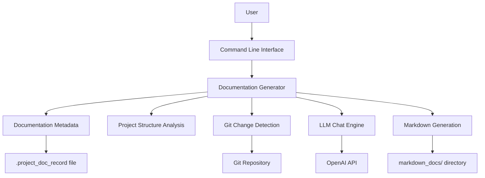

Sources: [repo_agent/main.py:174-182]()

## Additional Commands

RepoAgent provides several other useful commands:

### Check Pending Documentation Updates

```bash
repoagent diff
```

This shows which documents will be updated based on your current code changes without actually generating them.

### Clean Temporary Files

```bash
repoagent clean
```

Removes temporary files created during the documentation process.

### Interactive Repository Chat

```bash
repoagent chat-with-repo
```

Starts an interactive chat session for querying and exploring the repository (requires installing with `repoagent[chat-with-repo]`).

Sources: [repo_agent/main.py:184-239](), [README.md:136-139](), [README.md:198-207]()

## Automatic Documentation with Pre-commit Hooks

You can integrate RepoAgent with Git to automatically update documentation when committing changes:

1. Ensure your target repository is a Git repository:
   ```bash
   git init
   ```

2. Install pre-commit:
   ```bash
   pip install pre-commit
   ```

3. Create a `.pre-commit-config.yaml` file in your repository root:
   ```yaml
   repos:
     - repo: local
       hooks:
       - id: repo-agent
         name: RepoAgent
         entry: repoagent
         language: system
         pass_filenames: false
         types: [python]
   ```

4. Install the hook:
   ```bash
   pre-commit install
   ```

Now, each time you commit changes, RepoAgent will automatically generate or update documentation for the modified files.

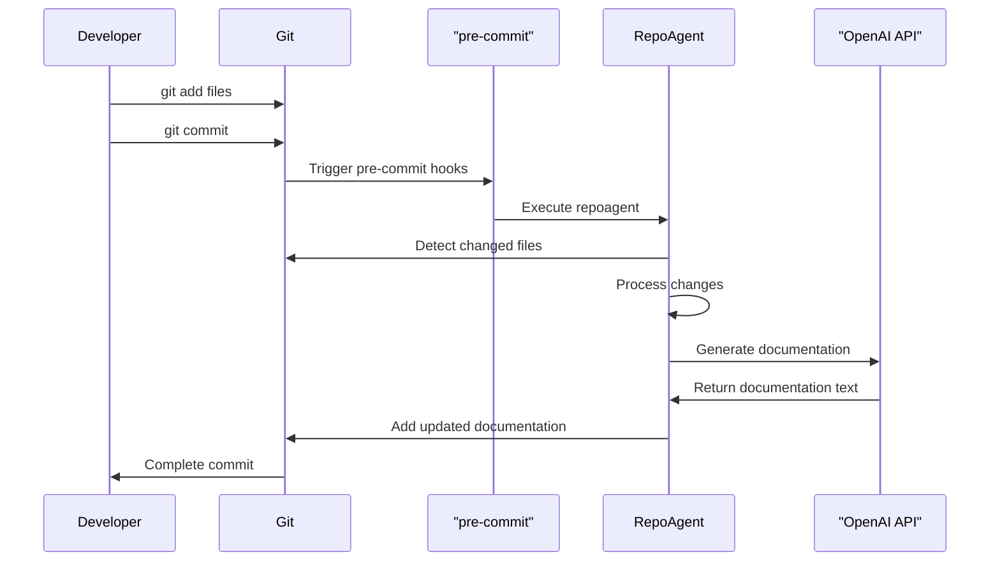

Sources: [README.md:140-183]()

## Configuration File

Instead of specifying options on the command line, you can configure RepoAgent through environment variables following the pydantic settings format.

Common environment variables you might want to set:

```bash
# OpenAI API settings
export OPENAI_API_KEY=your_api_key
export CHAT_COMPLETION_MODEL=gpt-4o
export CHAT_COMPLETION_TEMPERATURE=0.1

# Project settings
export PROJECT_LANGUAGE=English
export PROJECT_IGNORE_LIST=tests,docs,examples
```

Sources: [repo_agent/settings.py:26-67]()

## Next Steps

After generating documentation for your repository, you can:

1. Explore the documentation in the `markdown_docs` directory
2. Share the documentation with your team
3. Set up pre-commit hooks for automatic updates
4. Customize the documentation generation process with different models or settings
5. Use the chat-with-repo feature to interactively explore the repository

For more information about the core architecture and components of RepoAgent, see [Core Architecture](#2) and [Key Components](#3).

---

# Page: Core Architecture

# Core Architecture

<details>
<summary>Relevant source files</summary>

The following files were used as context for generating this wiki page:

- [README.md](README.md)
- [README_CN.md](README_CN.md)
- [repo_agent/chat_engine.py](repo_agent/chat_engine.py)
- [repo_agent/chat_with_repo/__init__.py](repo_agent/chat_with_repo/__init__.py)
- [repo_agent/doc_meta_info.py](repo_agent/doc_meta_info.py)
- [repo_agent/runner.py](repo_agent/runner.py)

</details>


This document provides a comprehensive overview of RepoAgent's architectural design and core systems. It describes the high-level components, their responsibilities, and how they interact to generate documentation for code repositories using Large Language Models (LLMs). For specific details about the documentation generation process, see [Documentation Generation System](#2.1). For information about how the system tracks documentation state, see [Metadata Management](#2.2).

## System Overview

RepoAgent is designed around a modular architecture that separates concerns between repository analysis, documentation generation, and change detection. The system is built to efficiently generate documentation for entire repositories and to update documentation incrementally as code changes occur.

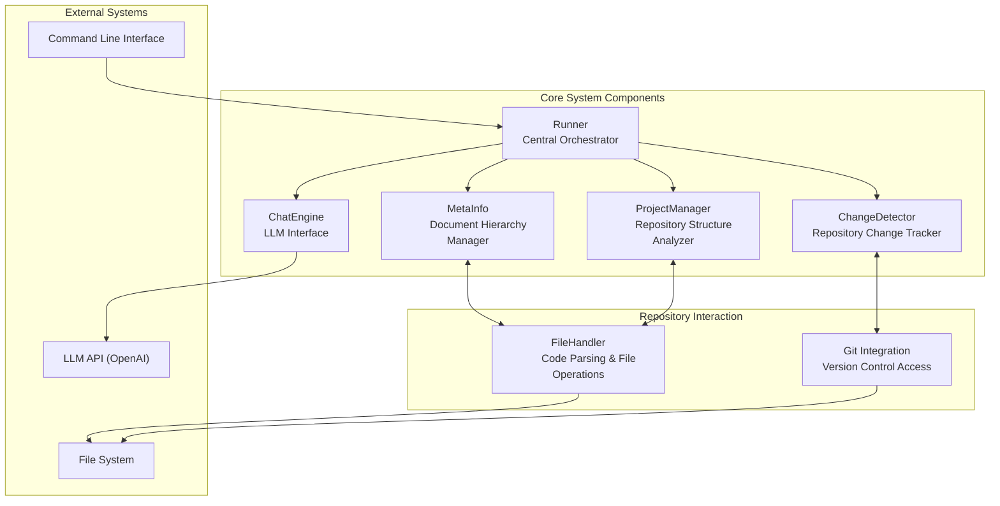

Sources: [repo_agent/runner.py:24-39](). [repo_agent/doc_meta_info.py:25-56](). [repo_agent/chat_engine.py:9-25]().

## Component Responsibilities

### Runner - Central Orchestrator

The Runner is the central component that coordinates the entire documentation generation process. It orchestrates the workflow between all other components and manages both initial full-repository documentation and incremental updates.

Key responsibilities:
- Initializing all system components
- Managing the documentation generation workflow
- Coordinating multi-threaded documentation tasks
- Refreshing Markdown output files
- Handling Git integration for detecting and committing changes

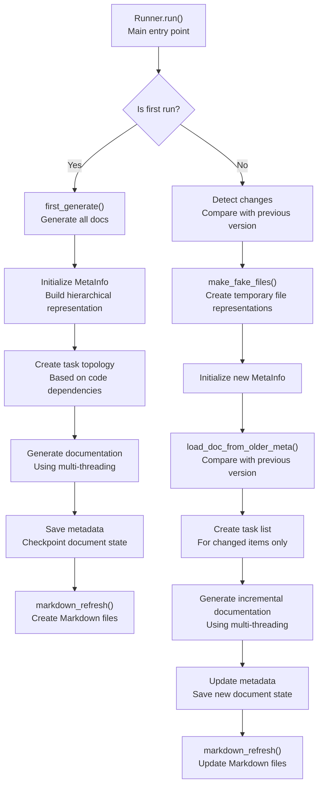

Sources: [repo_agent/runner.py:259-343](). [repo_agent/runner.py:101-156]().

### MetaInfo - Documentation Hierarchy Manager

The MetaInfo system maintains the hierarchical representation of the repository and tracks the documentation status of each code element. It's critical for both building the initial structure and managing incremental updates.

Key responsibilities:
- Representing the repository structure as a hierarchical tree
- Tracking documentation status (up-to-date, changed, etc.)
- Managing bidirectional reference relationships between code elements
- Determining the topological order for documentation generation
- Persisting metadata between runs

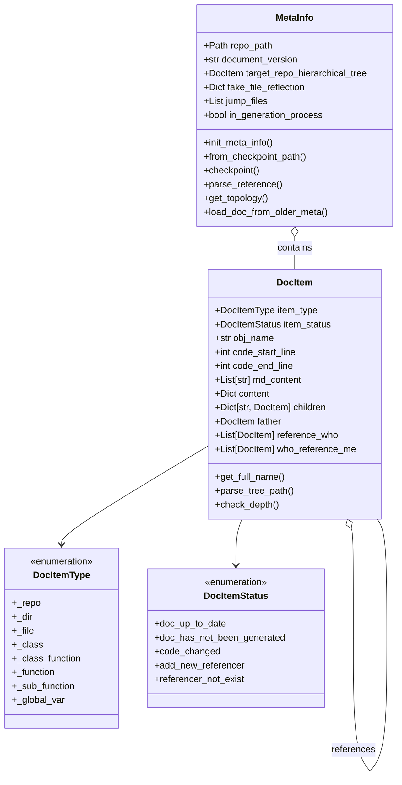

Sources: [repo_agent/doc_meta_info.py:24-135](). [repo_agent/doc_meta_info.py:327-1019]().

### ChatEngine - LLM Interface

The ChatEngine interfaces with Large Language Models (LLMs) to generate documentation for code elements. It constructs context-rich prompts containing information about the code and its relationships.

Key responsibilities:
- Building prompts with appropriate context about code elements
- Managing API calls to the LLM
- Handling response processing and error handling

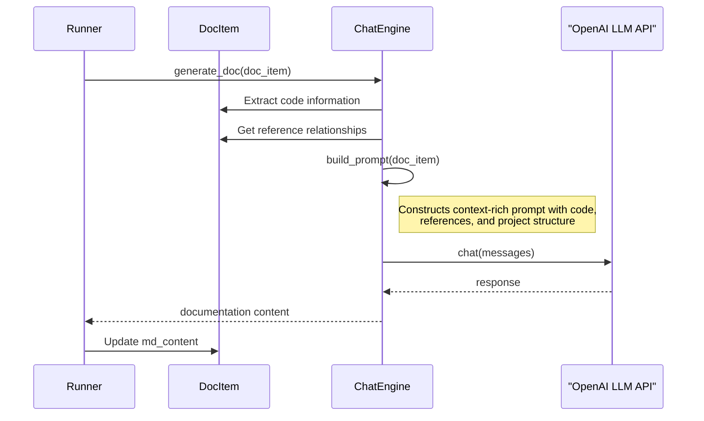

Sources: [repo_agent/chat_engine.py:9-25](). [repo_agent/chat_engine.py:116-132]().

### Change Detection System

The Change Detection system identifies changes in the repository by analyzing Git diffs and determines which documentation needs to be updated.

Key responsibilities:
- Accessing Git repository information
- Detecting file additions, modifications, and deletions
- Identifying changed code elements within files
- Determining which documentation needs to be regenerated

```mermaid
flowchart TD
    subgraph "Change Detection Process"
        StartRun["Runner.run()"]
        CheckFirst{"First run?"}
        MakeFake["make_fake_files()
        Create temporary representations"]
        InitNew["MetaInfo.init_meta_info()
        Create new hierarchical structure"]
        LoadOld["load_doc_from_older_meta()
        Merge with previous version"]
        
        StartRun --> CheckFirst
        CheckFirst -->|"No"| MakeFake
        MakeFake --> InitNew
        InitNew --> LoadOld
        
        subgraph "Change Identification"
            CompareCode["Compare code content
            Check if source code modified"]
            CompareRefs["Compare references
            Check if references changed"]
            MarkChanges["Mark items for regeneration
            Set appropriate DocItemStatus"]
        end
        
        LoadOld --> CompareCode
        CompareCode --> CompareRefs
        CompareRefs --> MarkChanges
    end
```

Sources: [repo_agent/runner.py:277-299](). [repo_agent/doc_meta_info.py:716-806]().

## System Architecture Patterns

RepoAgent's architecture follows several important design patterns:

### Hierarchical Tree Representation

The system represents the repository as a hierarchical tree structure, with the repository as the root node, followed by directories, files, classes, and methods/functions. This structure enables efficient navigation and maintenance of parent-child relationships.

```mermaid
graph TD
    Repo["Repository Root"] --> Dir1["Directory"]
    Repo --> Dir2["Directory"]
    Dir1 --> File1["Python File"]
    Dir1 --> File2["Python File"]
    File1 --> Class1["Class"]
    File1 --> Func1["Function"]
    Class1 --> Method1["Method"]
    Class1 --> Method2["Method"]
    
    classDef repo fill:#f9f,stroke:#333;
    classDef dir fill:#afa,stroke:#333;
    classDef file fill:#aaf,stroke:#333;
    classDef class fill:#faa,stroke:#333;
    classDef func fill:#ffa,stroke:#333;
```

Sources: [repo_agent/doc_meta_info.py:110-226](). [repo_agent/doc_meta_info.py:873-1019]().

### Topological Dependency Resolution

RepoAgent uses a topological sorting approach to determine the order in which documentation should be generated, ensuring that dependencies (such as references between code elements) are respected.

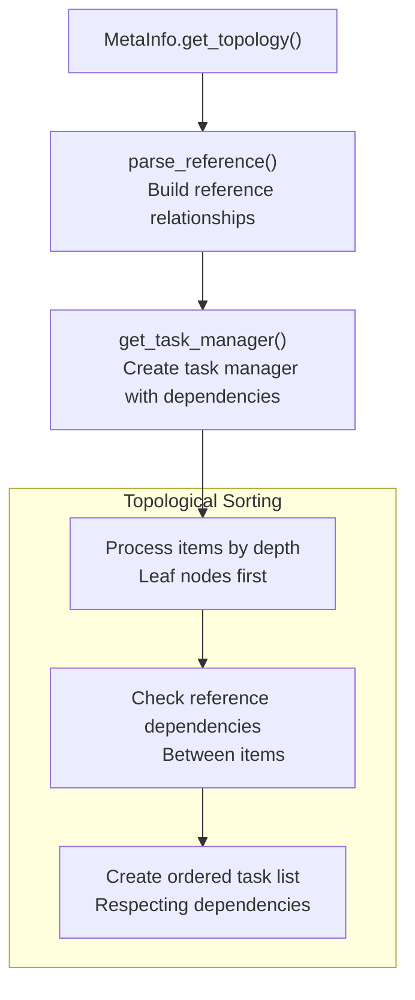

Sources: [repo_agent/doc_meta_info.py:698-704](). [repo_agent/doc_meta_info.py:617-696]().

### Concurrent Task Processing

For efficient documentation generation, RepoAgent employs a multi-threaded approach to process documentation tasks concurrently.

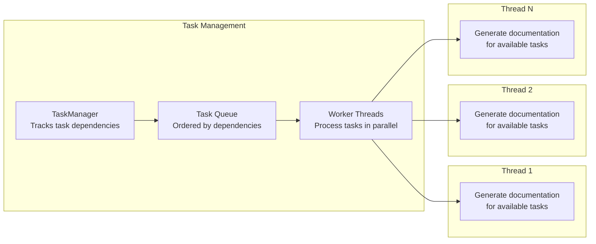

Sources: [repo_agent/runner.py:120-135](). [repo_agent/runner.py:321-335]().

### Incremental Generation

Rather than regenerating all documentation when changes occur, RepoAgent implements an incremental approach that only updates documentation for changed code elements and their dependents.

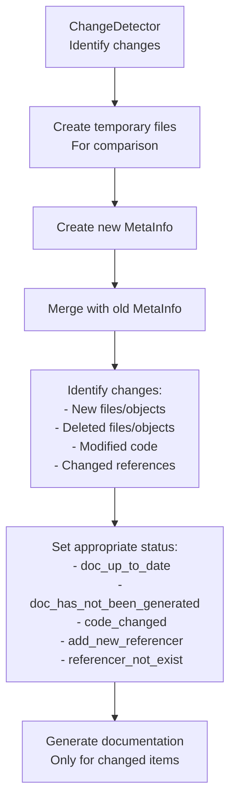

Sources: [repo_agent/runner.py:277-343](). [repo_agent/doc_meta_info.py:716-806]().

## System Configuration

The system is configured through a Settings Manager that maintains configuration for various components, including API keys, model parameters, and repository paths.

```mermaid
classDiagram
    class SettingsManager {
        +get_setting()
        +set_setting()
    }
    
    class Settings {
        +ChatCompletionSettings chat_completion
        +ProjectSettings project
    }
    
    class ChatCompletionSettings {
        +str model
        +float temperature
        +int request_timeout
        +str openai_api_key
        +str openai_base_url
    }
    
    class ProjectSettings {
        +Path target_repo
        +str hierarchy_name
        +str markdown_docs_name
        +List[str] ignore_list
        +str language
        +int max_thread_count
    }
    
    SettingsManager --> Settings
    Settings o-- ChatCompletionSettings
    Settings o-- ProjectSettings
```

Sources: [repo_agent/chat_engine.py:15-25](). [repo_agent/runner.py:26-40]().

## Integration with External Systems

RepoAgent integrates with several external systems:

1. **Git Version Control**: For detecting repository changes and tracking document versions
2. **OpenAI API**: For generating documentation using LLMs
3. **File System**: For reading code files and writing documentation 

This integration enables automatic documentation generation triggered by code changes and ensures documentation remains synchronized with the codebase.

## System Initialization Flow

```mermaid
sequenceDiagram
    participant CLI as "Command Line Interface"
    participant Runner
    participant SettingsManager
    participant ProjectManager
    participant ChangeDetector
    participant ChatEngine
    participant MetaInfo
    
    CLI->>Runner: Initialize Runner
    Runner->>SettingsManager: get_setting()
    SettingsManager-->>Runner: settings
    
    Runner->>ProjectManager: Initialize(repo_path, hierarchy_name)
    Runner->>ChangeDetector: Initialize(repo_path)
    Runner->>ChatEngine: Initialize(project_manager)
    
    Runner->>Runner: Check if hierarchy exists
    
    alt First run
        Runner->>Runner: make_fake_files()
        Runner->>MetaInfo: init_meta_info()
        MetaInfo-->>Runner: new metaInfo
    else Existing project
        Runner->>MetaInfo: from_checkpoint_path()
        MetaInfo-->>Runner: loaded metaInfo
    end
    
    Runner->>MetaInfo: checkpoint()
    Runner->>Runner: run()
```

Sources: [repo_agent/runner.py:25-55](). [repo_agent/runner.py:259-276]().

## Conclusion

RepoAgent's core architecture is designed around modular components with clear separation of concerns. The system efficiently manages the complexity of repository-level code documentation through its hierarchical representation, reference tracking, and incremental update capabilities. The architecture supports both full repository documentation generation and efficient incremental updates as code changes occur.

This design enables RepoAgent to scale to large repositories while maintaining documentation accuracy and freshness with minimal computational overhead. The system's integration with Git allows it to automatically detect changes and update documentation as part of the normal development workflow.

---

# Page: Documentation Generation System

# Documentation Generation System

<details>
<summary>Relevant source files</summary>

The following files were used as context for generating this wiki page:

- [repo_agent/chat_engine.py](repo_agent/chat_engine.py)
- [repo_agent/doc_meta_info.py](repo_agent/doc_meta_info.py)
- [repo_agent/prompt.py](repo_agent/prompt.py)
- [repo_agent/runner.py](repo_agent/runner.py)

</details>


The Documentation Generation System is a core component of RepoAgent that automates the creation of documentation for code repositories using Large Language Models (LLMs). This system processes code files, extracts structural information, identifies relationships between code elements, and generates detailed documentation for each component. It supports both full repository documentation and incremental updates when code changes occur.

For information about how the system manages code changes and updates documentation accordingly, see [Change Detection System](#2.3). For details on metadata management, see [Metadata Management](#2.2).

## System Architecture

The Documentation Generation System consists of several interconnected components that work together to analyze code and generate documentation.

```mermaid
flowchart TB
    subgraph "Documentation Generation System"
        Runner["Runner"]
        ChatEngine["ChatEngine"]
        MetaInfo["MetaInfo"]
        ChangeDetector["ChangeDetector"]
        ProjectManager["ProjectManager"]
        FileHandler["FileHandler"]
    end
    
    Runner --> ChatEngine
    Runner --> MetaInfo
    Runner --> ChangeDetector
    Runner --> ProjectManager
    
    ChatEngine --> LLM["LLM API"]
    ChatEngine --> DocPrompt["Documentation Prompt"]
    
    MetaInfo --> FileHandler
    ProjectManager --> FileHandler
    ChangeDetector --> FileHandler
    
    FileHandler --> GitRepo["Git Repository"]
    
    Runner --> MarkdownOutput["Markdown Documentation"]
```

Sources: [repo_agent/runner.py:25-58](), [repo_agent/chat_engine.py:9-26]()

## Documentation Generation Process

The system handles two primary scenarios: initial documentation generation for a repository and incremental updates when code changes occur.

```mermaid
sequenceDiagram
    participant User
    participant Runner
    participant MetaInfo
    participant ChatEngine
    participant ChangeDetector
    participant FileSystem
    
    User->>Runner: Run documentation command
    Runner->>MetaInfo: Check document version
    
    alt First Run
        Runner->>FileHandler: Create fake files
        Runner->>MetaInfo: Initialize metadata structure
        Runner->>MetaInfo: Get topology of code elements
        loop For each code element
            Runner->>ChatEngine: Generate documentation
            ChatEngine->>LLM: Send prompts with code context
            LLM-->>ChatEngine: Documentation content
            ChatEngine-->>Runner: Documentation result
            Runner->>MetaInfo: Update doc status
        end
    else Incremental Update
        Runner->>ChangeDetector: Detect repository changes
        ChangeDetector-->>Runner: Changed files/elements
        Runner->>MetaInfo: Create new metadata structure
        Runner->>MetaInfo: Load docs from older meta
        Runner->>MetaInfo: Update doc status for changed elements
        loop For each changed element
            Runner->>ChatEngine: Generate documentation
            ChatEngine->>LLM: Send prompts with code context
            LLM-->>ChatEngine: Documentation content
            ChatEngine-->>Runner: Documentation result
            Runner->>MetaInfo: Update doc status
        end
    end
    
    Runner->>FileSystem: Refresh markdown files
    Runner->>MetaInfo: Save checkpoint
```

Sources: [repo_agent/runner.py:101-151](), [repo_agent/runner.py:259-344]()

### Initial Documentation Generation

When the system runs for the first time on a repository, it analyzes the entire codebase, builds a hierarchical representation, and generates documentation for all code elements.

1. The system creates a hierarchical representation of the repository
2. It analyzes code elements (files, classes, functions) to detect relationships
3. Documentation is generated using the LLM in a topologically sorted order (from dependencies to dependents)
4. Metadata is saved to track the documentation status of each element
5. Markdown documentation files are created

Sources: [repo_agent/runner.py:101-151]()

### Incremental Documentation Updates

For subsequent runs, the system detects changes in the repository and only generates documentation for modified elements.

1. The system detects repository changes using Git diffs
2. It identifies which code elements have been added, modified, or deleted
3. Documentation is regenerated only for changed elements and elements affected by changes
4. Metadata is updated to reflect the current state of documentation
5. Markdown files are refreshed with the updated content

Sources: [repo_agent/runner.py:259-344]()

## Core Components

### Runner

The Runner is the central orchestrator of the documentation generation process.

**Key Responsibilities:**
- Initializes and coordinates other components
- Manages the documentation generation workflow
- Processes files and code elements
- Handles both initial and incremental documentation generation
- Creates and refreshes markdown documentation files

The Runner manages a task-based system to handle documentation generation in parallel using multiple threads.

Sources: [repo_agent/runner.py:25-58](), [repo_agent/runner.py:101-151](), [repo_agent/runner.py:259-344]()

### ChatEngine

The ChatEngine interfaces with Large Language Models to generate documentation for code elements.

```mermaid
flowchart LR
    subgraph "ChatEngine"
        BuildPrompt["build_prompt()"]
        GenerateDoc["generate_doc()"]
    end
    
    DocItem["DocItem"] --> BuildPrompt
    BuildPrompt --> Messages["LLM Messages"]
    Messages --> GenerateDoc
    GenerateDoc --> LLM["OpenAI/LLM API"]
    LLM --> Documentation["Documentation Content"]
```

**Key Features:**
- Constructs context-rich prompts for the LLM
- Includes code content, references, and project structure
- Handles LLM API communication
- Formats documentation according to templates

The ChatEngine builds prompts that include:
- The code content of the element being documented
- References to other code elements it calls or is called by
- Project structure context
- Documentation formatting guidelines

Sources: [repo_agent/chat_engine.py:9-133](), [repo_agent/prompt.py:1-50]()

### Documentation Metadata (MetaInfo)

The MetaInfo component manages metadata about documentation and code relationships.

```mermaid
flowchart TB
    subgraph "MetaInfo Structure"
        Root["DocItem (_repo)"]
        Dir1["DocItem (_dir)"]
        Dir2["DocItem (_dir)"]
        File1["DocItem (_file)"]
        File2["DocItem (_file)"]
        Class1["DocItem (_class)"]
        Function1["DocItem (_function)"]
        ClassFunction["DocItem (_class_function)"]
        
        Root --> Dir1
        Root --> Dir2
        Dir1 --> File1
        Dir2 --> File2
        File1 --> Class1
        File1 --> Function1
        Class1 --> ClassFunction
    end
```

**Key Features:**
- Maintains a hierarchical representation of the repository
- Tracks documentation status of each code element
- Manages reference relationships between code elements
- Handles checkpointing and loading of metadata

The MetaInfo uses DocItem objects to represent code elements, with properties such as:
- Item type (repository, directory, file, class, function)
- Documentation status (up-to-date, needs generation, code changed)
- Code content and references
- Documentation content

Sources: [repo_agent/doc_meta_info.py:25-54](), [repo_agent/doc_meta_info.py:77-83](), [repo_agent/doc_meta_info.py:110-294](), [repo_agent/doc_meta_info.py:326-1026]()

### Change Detection

The ChangeDetector component identifies changes in the repository and determines which code elements need documentation updates.

**Key Operations:**
- Detects file changes using Git diffs
- Identifies modifications to specific code elements
- Determines which documentation needs to be regenerated
- Supports incremental documentation updates

Sources: [repo_agent/runner.py:257-344]()

## Documentation Generation with LLMs

The system uses LLMs to generate documentation by constructing context-rich prompts.

### Prompt Construction

The ChatEngine builds prompts that include:

1. Code context
   - The code content of the element being documented
   - Code location and type information
   
2. Reference information
   - Other code elements that reference this element
   - Elements that this element references
   
3. Documentation guidelines
   - Format specifications
   - Content requirements

```
Table: Prompt Components

| Component              | Description                                   | Source                        |
|------------------------|-----------------------------------------------|-------------------------------|
| Code Content           | Raw code of the element being documented      | DocItem content               |
| Code Type              | Type of code element (class, function)        | DocItem item_type             |
| References             | Elements that reference or are referenced     | DocItem reference_who/who_reference_me |
| Project Structure      | Hierarchical structure of the project         | MetaInfo tree                 |
| Documentation Format   | Format guidelines for consistency             | Prompt template               |
```

Sources: [repo_agent/chat_engine.py:27-115](), [repo_agent/prompt.py:4-39]()

### Documentation Output

The documentation generated by the system is formatted in Markdown and includes:

1. Function/class purpose description
2. Parameter details
3. Code description
4. Usage notes
5. Return value examples (when applicable)
6. Reference relationships

The system generates documentation files that mirror the structure of the repository, with each Python file having a corresponding Markdown documentation file.

Sources: [repo_agent/runner.py:157-248]()

## Integration with Repository Management

The Documentation Generation System integrates with Git to:

1. Detect changes in the repository
2. Track documentation versions
3. Handle incremental updates efficiently
4. Support documentation versioning aligned with code commits

This integration enables the system to maintain documentation that stays in sync with the codebase as it evolves.

Sources: [repo_agent/runner.py:250-256](), [repo_agent/runner.py:259-344]()

## Conclusion

The Documentation Generation System provides a sophisticated approach to automating code documentation using LLMs. By analyzing repository structure, code relationships, and changes over time, it generates comprehensive documentation that remains synchronized with the codebase. The system's modular architecture and incremental update capabilities make it efficient and adaptable for various repository sizes and structures.

---

# Page: Metadata Management

# Metadata Management

<details>
<summary>Relevant source files</summary>

The following files were used as context for generating this wiki page:

- [repo_agent/doc_meta_info.py](repo_agent/doc_meta_info.py)
- [repo_agent/runner.py](repo_agent/runner.py)

</details>


The Metadata Management system in RepoAgent tracks the hierarchical structure of code repositories, maintains documentation status for code elements, and manages reference relationships between components. This core subsystem allows RepoAgent to efficiently generate and update documentation by tracking what needs to be updated when code changes.

For information about detecting changes in a repository, see [Change Detection System](#2.3). For information about how the repository's structure is analyzed, see [Project Structure Management](#2.4).

## Overview of Metadata Management

The Metadata Management system serves the following key purposes:

1. Represents the repository's hierarchical structure as a tree
2. Tracks documentation status of each code element
3. Manages bidirectional references between code elements
4. Facilitates incremental documentation updates by tracking changes
5. Provides checkpointing for persistent storage of metadata

```mermaid
flowchart TD
    subgraph "Metadata Management System"
        MetaInfo["MetaInfo Class"]
        DocItem["DocItem Class"]
        StatusTracking["Documentation Status Tracking"]
        ReferenceTracking["Reference Relationship Tracking"]
        Checkpointing["Metadata Checkpointing"]
        TaskGeneration["Documentation Task Generation"]
    end

    MetaInfo --> DocItem
    MetaInfo --> StatusTracking
    MetaInfo --> ReferenceTracking
    MetaInfo --> Checkpointing
    MetaInfo --> TaskGeneration

    Runner["Runner"] --> MetaInfo
    ChangeDetector["Change Detector"] --> MetaInfo
    FileHandler["File Handler"] <--> MetaInfo
    ProjectManager["Project Manager"] --> MetaInfo
    MetaInfo --> MarkdownGeneration["Markdown Generation"]
```

Sources: [repo_agent/doc_meta_info.py:326-442](). [repo_agent/runner.py:24-56]()

## Core Metadata Classes

The Metadata Management system is built around several key classes and enums that work together to represent and track a repository's structure and documentation status.

### DocItem Class

`DocItem` is the fundamental building block that represents any element in the repository - from the repository itself down to individual functions and variables. It creates a hierarchical tree structure mirroring the repository organization.

```mermaid
classDiagram
    class DocItem {
        +item_type: DocItemType
        +item_status: DocItemStatus
        +obj_name: str
        +code_start_line: int
        +code_end_line: int
        +md_content: List[str]
        +content: Dict
        +children: Dict[str, DocItem]
        +father: DocItem
        +reference_who: List[DocItem]
        +who_reference_me: List[DocItem]
        +get_full_name()
        +find()
        +parse_tree_path()
    }
```

Sources: [repo_agent/doc_meta_info.py:110-226]()

### DocItemType and DocItemStatus

The system uses enumerations to track the type and status of each documentation item:

```mermaid
classDiagram
    class DocItemType {
        <<enumeration>>
        _repo
        _dir
        _file
        _class
        _class_function
        _function
        _sub_function
        _global_var
        +to_str()
        +print_self()
    }
    
    class DocItemStatus {
        <<enumeration>>
        doc_up_to_date
        doc_has_not_been_generated
        code_changed
        add_new_referencer
        referencer_not_exist
    }
    
    DocItem --> DocItemType : has type
    DocItem --> DocItemStatus : has status
```

Sources: [repo_agent/doc_meta_info.py:25-83]()

### MetaInfo Class

The `MetaInfo` class is the central component of the Metadata Management system. It orchestrates the entire metadata representation and provides methods for loading, saving, and updating the repository metadata.

```mermaid
classDiagram
    class MetaInfo {
        +repo_path: Path
        +document_version: str
        +target_repo_hierarchical_tree: DocItem
        +in_generation_process: bool
        +init_meta_info(file_path_reflections, jump_files)
        +from_checkpoint_path(checkpoint_dir_path)
        +checkpoint(target_dir_path, flash_reference_relation)
        +parse_reference()
        +get_topology(task_available_func)
        +load_doc_from_older_meta(older_meta)
        +to_hierarchy_json(flash_reference_relation)
    }
    
    MetaInfo --> DocItem : contains
```

Sources: [repo_agent/doc_meta_info.py:326-1020]()

## Metadata Lifecycle

### Initialization

When RepoAgent is run for the first time on a repository, it creates a new metadata representation of the codebase:

```mermaid
flowchart TD
    Start([Initialize Runner]) --> CheckExists{Metadata Exists?}
    
    CheckExists -->|No| CreateFakeFiles["Make temporary fake files"]
    CreateFakeFiles --> InitMetaInfo["Initialize MetaInfo"]
    InitMetaInfo --> SaveCheckpoint["Save metadata checkpoint"]
    
    CheckExists -->|Yes| LoadCheckpoint["Load metadata from checkpoint"]
    
    SaveCheckpoint --> End([Proceed with documentation])
    LoadCheckpoint --> End
```

Sources: [repo_agent/runner.py:25-54](), [repo_agent/doc_meta_info.py:346-363]()

### Reference Parsing

The metadata system tracks bidirectional references between code elements to understand dependencies and ensure accurate documentation when code changes:

```mermaid
flowchart LR
    Start([Parse References]) --> GetFiles["Get all file nodes"]
    
    GetFiles --> ProcessFiles["Process each file"]
    ProcessFiles --> ProcessObjects["Process each object in file"]
    
    ProcessObjects --> FindReferences["Find all references to object"]
    FindReferences --> FilterReferences["Filter valid references"]
    FilterReferences --> AddBidirectional["Add bidirectional references"]
    
    AddBidirectional --> End([References parsed])
    
    subgraph "For each reference"
        FindReferences
        FilterReferences
        AddBidirectional
    end
```

Sources: [repo_agent/doc_meta_info.py:500-616]()

### Metadata Checkpointing

MetaInfo provides checkpointing functionality to save and load metadata state to/from disk:

```mermaid
flowchart TD
    Start([Checkpoint MetaInfo]) --> AcquireLock["Acquire checkpoint lock"]
    
    AcquireLock --> CreateDir["Create directory if needed"]
    CreateDir --> PrepareHierarchy["Prepare hierarchy JSON"]
    PrepareHierarchy --> SaveHierarchy["Save project_hierarchy.json"]
    
    SaveHierarchy --> PrepareMetadata["Prepare meta-info.json"]
    PrepareMetadata --> SaveMetadata["Save meta-info.json"]
    
    SaveMetadata --> ReleaseLock["Release checkpoint lock"]
    ReleaseLock --> End([Checkpoint complete])
```

Sources: [repo_agent/doc_meta_info.py:393-441]()

## Documentation Status Tracking

The metadata system tracks the status of each documentation item to determine which items need documentation updates:

| Status | Description | When Applied |
|--------|-------------|--------------|
| `doc_up_to_date` | Documentation is current | After successful generation |
| `doc_has_not_been_generated` | No documentation exists | For new code elements |
| `code_changed` | Source code was modified | When code content changes detected |
| `add_new_referencer` | New objects reference this item | When reference relationships change |
| `referencer_not_exist` | Former references no longer exist | When referencing objects are removed |

Sources: [repo_agent/doc_meta_info.py:77-83]()

## Reference Relationship Management

The metadata system tracks bidirectional references between code elements, which is crucial for:

1. Determining the correct order for documentation generation
2. Updating documentation when referenced items change
3. Understanding dependencies between code components

```mermaid
flowchart TD
    ClassA["Class A"] -->|"references"| FunctionB["Function B"]
    FunctionB -->|"referenced by"| ClassA
    
    FunctionB -->|"references"| ClassC["Class C"]
    ClassC -->|"referenced by"| FunctionB
    
    ClassA -->|"references"| ClassC
    ClassC -->|"referenced by"| ClassA
```

The system stores bidirectional references in the `DocItem` class:
- `reference_who`: List of items this item references
- `who_reference_me`: List of items that reference this item

Sources: [repo_agent/doc_meta_info.py:128-137](), [repo_agent/doc_meta_info.py:500-616]()

## Task Generation and Management

The metadata system generates documentation tasks based on the repository structure and reference relationships:

```mermaid
flowchart TD
    Start([Generate Tasks]) --> ParseReferences["Parse bidirectional references"]
    
    ParseReferences --> GetDocItems["Get all doc items"]
    GetDocItems --> FilterItems["Filter items that need generation"]
    FilterItems --> SortByDepth["Sort items by depth (leaf nodes first)"]
    
    SortByDepth --> CreateTasks["Create tasks with dependencies"]
    CreateTasks --> ResolveDependencies["Resolve circular dependencies"]
    
    ResolveDependencies --> End([Return TaskManager])
```

The system uses a topological ordering algorithm that tries to resolve circular dependencies when they occur, ensuring that documentation is generated in the correct order.

Sources: [repo_agent/doc_meta_info.py:617-696]()

## Metadata Update Process

When code changes are detected, the metadata system updates its representation of the repository:

```mermaid
flowchart TD
    Start([Update Metadata]) --> CreateNew["Create new metadata structure"]
    
    CreateNew --> LoadOld["Load documentation from old metadata"]
    LoadOld --> CompareCode["Compare code content"]
    CompareCode --> MarkChanged["Mark changed items"]
    
    MarkChanged --> ParseReferences["Parse reference relationships"]
    ParseReferences --> CompareReferences["Compare references with old version"]
    CompareReferences --> UpdateStatuses["Update documentation statuses"]
    
    UpdateStatuses --> End([Updated metadata])
```

Sources: [repo_agent/runner.py:259-343](), [repo_agent/doc_meta_info.py:716-806]()

## Metadata Storage Format

The metadata is stored on disk in two main files:

1. `project_hierarchy.json`: Contains the hierarchical structure of the repository with documentation content
2. `meta-info.json`: Contains metadata about the documentation process itself

The JSON representation is a flattened version of the hierarchical tree structure, with file paths as keys and lists of contained objects as values.

Sources: [repo_agent/doc_meta_info.py:820-869](), [repo_agent/doc_meta_info.py:393-441]()

## Integration with Other Components

The Metadata Management system integrates with several other components of RepoAgent:

```mermaid
flowchart TD
    subgraph "Metadata Management"
        MetaInfo["MetaInfo"]
    end
    
    subgraph "Runner"
        Runner["Runner"] <--> MetaInfo
        Runner --> FirstGenerate["first_generate()"]
        Runner --> Run["run()"]
    end
    
    subgraph "Change Detection"
        ChangeDetector["ChangeDetector"] --> Runner
    end
    
    subgraph "Documentation Generation"
        ChatEngine["ChatEngine"] --> Runner
    end
    
    subgraph "File Handling"
        FileHandler["FileHandler"] <--> MetaInfo
    end
    
    subgraph "Project Management"
        ProjectManager["ProjectManager"] <--> MetaInfo
    end
    
    MetaInfo --> MarkdownRefresh["markdown_refresh()"]
    MarkdownRefresh --> MarkdownDocs["Markdown Documentation"]
```

Sources: [repo_agent/runner.py:24-56](), [repo_agent/runner.py:157-231]()

## Summary

The Metadata Management system is a critical component of RepoAgent that enables:

1. Efficient tracking of repository structure and documentation status
2. Detection of what documentation needs to be updated when code changes
3. Understanding of reference relationships between code elements
4. Persistence of documentation state across runs
5. Topological ordering of documentation tasks to respect dependencies

This system allows RepoAgent to efficiently generate and maintain documentation for large code repositories with complex interdependencies while minimizing unnecessary document regeneration.

---

# Page: Change Detection System

# Change Detection System

<details>
<summary>Relevant source files</summary>

The following files were used as context for generating this wiki page:

- [.gitignore](.gitignore)
- [repo_agent/__main__.py](repo_agent/__main__.py)
- [repo_agent/change_detector.py](repo_agent/change_detector.py)
- [repo_agent/doc_meta_info.py](repo_agent/doc_meta_info.py)
- [repo_agent/runner.py](repo_agent/runner.py)
- [repo_agent/utils/meta_info_utils.py](repo_agent/utils/meta_info_utils.py)

</details>


The Change Detection System in RepoAgent is responsible for identifying modifications in a Git repository and determining which documentation needs to be updated. This system enables efficient incremental documentation updates by detecting code changes and triggering regeneration only for affected components rather than the entire codebase.

For information about the overall documentation generation process, see [Documentation Generation System](#2.1).

## System Overview

The Change Detection System monitors repository modifications through Git integration and determines what files or code objects have been changed since the last documentation update. It analyzes Git diffs to identify added, modified, and deleted code structures (such as classes, functions, and methods), enabling precise targeting of documentation updates.

```mermaid
flowchart TB
    subgraph "Change Detection System"
        ChangeDetector["ChangeDetector Class"]
        GitRepo["Git Repository"]
        TempFileManager["Temporary File Manager"]
        DiffAnalyzer["Diff Analyzer"]
    end

    ChangeDetector --> GitRepo
    ChangeDetector --> TempFileManager
    ChangeDetector --> DiffAnalyzer
    
    Runner["Runner"] --> ChangeDetector
    ChangeDetector --> MetaInfo["Documentation Metadata"]
    
    TempFileManager --> FakeFiles["Fake Files"]
    DiffAnalyzer --> ChangedStructures["Changed Code Structures"]
    
    class ChangeDetector,GitRepo,TempFileManager,DiffAnalyzer,FakeFiles,ChangedStructures emphasis
```

Sources: [repo_agent/change_detector.py:1-287](), [repo_agent/runner.py:278-281]()

## Key Components

### ChangeDetector Class

The `ChangeDetector` class is the central component responsible for interfacing with Git repositories and analyzing changes. It provides methods to detect staged files, retrieve file diffs, parse those diffs, and identify which code structures have been affected by changes.

```mermaid
classDiagram
    class ChangeDetector {
        -repo_path: str
        -repo: GitRepo
        +__init__(repo_path)
        +get_staged_pys()
        +get_file_diff(file_path, is_new_file)
        +parse_diffs(diffs)
        +identify_changes_in_structure(changed_lines, structures)
        +get_to_be_staged_files()
        +add_unstaged_files()
    }
    
    ChangeDetector --> GitRepo: Uses
    ChangeDetector --> FileHandler: Uses
```

Sources: [repo_agent/change_detector.py:12-286]()

Key methods in the `ChangeDetector` class:

- `get_staged_pys()`: Identifies Python files that have been staged in Git, returning a dictionary of file paths and a boolean indicating whether each file is new
- `get_file_diff(file_path, is_new_file)`: Retrieves the Git diff for a specific file
- `parse_diffs(diffs)`: Parses diff content to extract added and removed line information
- `identify_changes_in_structure(changed_lines, structures)`: Determines which functions or classes have been modified based on changed lines
- `add_unstaged_files()`: Adds unstaged documentation files to the Git staging area

Sources: [repo_agent/change_detector.py:31-268]()

### Temporary File Management

To handle unstaged changes in the repository, the system uses a temporary file mechanism implemented in the utility functions `make_fake_files()` and `delete_fake_files()`. This approach allows the system to preserve the original repository state while processing changes.

```mermaid
flowchart LR
    Start["Begin Change Detection"] --> MakeFakeFiles["make_fake_files()"]
    MakeFakeFiles --> DetectChanges["Process Changes"]
    DetectChanges --> DeleteFakeFiles["delete_fake_files()"]
    DeleteFakeFiles --> End["End Change Detection"]
    
    subgraph "make_fake_files()"
        SaveOriginal["Save Original Files"]
        RenameToFake["Rename to _latest_version.py"]
        CreateNewFile["Create File with HEAD Content"]
    end
    
    subgraph "delete_fake_files()"
        RestoreOriginal["Restore Original Files"]
        DeleteTemp["Delete Temporary Files"]
    end
```

Sources: [repo_agent/utils/meta_info_utils.py:13-107]()

The temporary file system works as follows:

1. When changes are detected, the original file is renamed to include a `_latest_version.py` suffix
2. A new file with the original name is created containing the version from Git HEAD
3. This allows the system to compare the staged version with the working directory version
4. After processing, temporary files are deleted and original files are restored

Sources: [repo_agent/utils/meta_info_utils.py:13-79](), [repo_agent/utils/meta_info_utils.py:82-107]()

### Change Processing Workflow

The change detection process is integrated into the documentation generation workflow through the `Runner` class. When running a documentation update, the system follows these steps:

```mermaid
sequenceDiagram
    participant Runner
    participant ChangeDetector
    participant MetaInfo
    participant FileHandler
    
    Runner->>ChangeDetector: Create instance
    
    alt First Run
        Runner->>Runner: first_generate()
        Runner->>MetaInfo: Update document_version
    else Incremental Update
        Runner->>ChangeDetector: Detect changes
        Runner->>FileHandler: make_fake_files()
        Runner->>MetaInfo: Create new_meta_info
        Runner->>MetaInfo: load_doc_from_older_meta()
        Runner->>MetaInfo: Set in_generation_process = true
        Runner->>Runner: Process task queue
        Runner->>MetaInfo: Update document_version
        Runner->>FileHandler: delete_fake_files()
    end
```

Sources: [repo_agent/runner.py:259-343]()

## Detection of Changed Code Structures

One of the most important features of the Change Detection System is its ability to identify which specific code structures (functions, classes, methods) have been modified. This is done through the following process:

1. Retrieve file diffs from Git
2. Parse diffs to identify added and removed lines
3. Map these lines to code structures using line number information
4. Determine which documentation needs to be regenerated

```mermaid
flowchart TD
    GetDiff["Get File Diff"] --> ParseDiff["Parse Diffs"]
    ParseDiff --> ChangedLines["Identify Changed Lines"]
    ChangedLines --> MapToStructures["Map to Code Structures"]
    MapToStructures --> IdentifyChanges["Identify Changed Structures"]
    
    subgraph "parse_diffs"
        ParseLineInfo["Parse Line Number Info"]
        DetectAddedLines["Detect Added Lines"]
        DetectRemovedLines["Detect Removed Lines"]
    end
    
    subgraph "identify_changes_in_structure"
        MatchLineNumbers["Match Line Numbers to Structures"]
        AddToChangeSet["Add to Change Set"]
    end
```

Sources: [repo_agent/change_detector.py:81-151]()

The output of this process is a dictionary of added and removed code structures, which is used to determine which documentation needs to be updated:

```
{'added': {('ClassName', None), ('FunctionName', 'ParentClass')}, 'removed': set()}
```

Sources: [repo_agent/change_detector.py:124-151]()

## Integration with Metadata System

The Change Detection System works closely with the `MetaInfo` class to track documentation status and manage incremental updates. Each code element in the metadata has a status that indicates whether its documentation is up-to-date or needs regeneration.

The `DocItemStatus` enum defines several states related to change detection:
- `doc_up_to_date`: Documentation is current and doesn't need updates
- `doc_has_not_been_generated`: Documentation hasn't been generated yet
- `code_changed`: Source code has been modified, requiring documentation updates
- `add_new_referencer`: New references to this object have been added
- `referencer_not_exist`: Previously existing references no longer exist

Sources: [repo_agent/doc_meta_info.py:76-82]()

When changes are detected, the system updates the status of affected code elements in the metadata, which then drives the documentation generation process.

## Change Detection in the Runner

The `Runner` class's `run()` method orchestrates the change detection and documentation update process:

1. Check if it's the first run by examining the `document_version` in metadata
2. If not the first run, create temporary files using `make_fake_files()`
3. Build new metadata from the current repository state
4. Load documentation from the older metadata
5. Compare old and new metadata to identify changes
6. Create a task queue for documentation regeneration
7. Process the task queue to update affected documentation
8. Update the document version to the current Git commit hash
9. Clean up temporary files

Sources: [repo_agent/runner.py:259-343]()

## Handling Special Cases

The Change Detection System also handles several special cases:

1. **New Files**: For entirely new files, the system generates documentation for all objects in the file
2. **Deleted Files**: When files are deleted, their documentation is automatically removed
3. **Unstaged Changes**: The system can detect and process changes that haven't been staged in Git yet
4. **Reference Changes**: When the references to a code object change, its documentation is updated even if the code itself hasn't changed

Sources: [repo_agent/runner.py:410-472](), [repo_agent/doc_meta_info.py:716-807]()

## Conclusion

The Change Detection System is a crucial component of RepoAgent that enables efficient incremental documentation updates. By detecting precisely which parts of the codebase have changed, it allows the system to regenerate only the necessary documentation, saving time and computational resources.

---

# Page: Project Structure Management

# Project Structure Management

<details>
<summary>Relevant source files</summary>

The following files were used as context for generating this wiki page:

- [repo_agent/file_handler.py](repo_agent/file_handler.py)
- [repo_agent/multi_task_dispatch.py](repo_agent/multi_task_dispatch.py)
- [repo_agent/project_manager.py](repo_agent/project_manager.py)

</details>


The Project Structure Management component in RepoAgent is responsible for analyzing and representing the hierarchical structure of a repository. This system extracts code entities (such as classes and functions), their relationships, and organizes them into a structured representation that can be used by other components, particularly the Documentation Generation System. This page explains how RepoAgent analyzes code repositories and builds their structural representation.

For information about how changes to this structure are detected, see [Change Detection System](#2.3). For details on how this structure is stored as metadata, see [Metadata Management](#2.2).

## 1. Overview

Project Structure Management provides a hierarchical view of a code repository by examining files, parsing code, and extracting relevant code entities. It builds a structured representation that serves as the foundation for documentation generation.

```mermaid
graph TD
    User["User"] --> CLI["Command Line Interface"]
    CLI --> Runner["Documentation Generator"]
    Runner --> ProjectManager["Project Manager"]
    ProjectManager --> FileHandler["File Handler"]
    FileHandler --> Git["Git Repository"]
    
    ProjectManager --> Parsing["AST Parsing"]
    ProjectManager --> Hierarchy["Hierarchy Building"]
    
    FileHandler --> GitignoreChecker["Gitignore Checker"]
    
    subgraph "Project Structure Management"
        ProjectManager
        FileHandler
        Parsing
        Hierarchy
        GitignoreChecker
    end
    
    style ProjectManager stroke-width:2px
    style FileHandler stroke-width:2px
    style Parsing stroke-width:2px
    style Hierarchy stroke-width:2px
```

Sources: [repo_agent/project_manager.py:6-13](), [repo_agent/file_handler.py:17-31]()

## 2. Core Components

### 2.1 FileHandler

The `FileHandler` class is responsible for reading and writing files, parsing code content, and generating file structure information. It plays a critical role in analyzing individual files to extract their code structure.

Key responsibilities:
- Reading file content from the repository
- Parsing Python files to extract classes, functions, and their metadata
- Generating a structured representation of code entities
- Managing file operations for markdown generation

```mermaid
classDiagram
    class FileHandler {
        +file_path: str
        +repo_path: str
        +project_hierarchy: Path
        +read_file()
        +write_file(file_path, content)
        +get_obj_code_info(code_type, code_name, start_line, end_line, params, file_path)
        +get_functions_and_classes(code_content)
        +generate_file_structure(file_path)
        +generate_overall_structure(file_path_reflections, jump_files)
        +convert_to_markdown_file(file_path)
    }
```

Sources: [repo_agent/file_handler.py:17-31](), [repo_agent/file_handler.py:32-43](), [repo_agent/file_handler.py:176-215](), [repo_agent/file_handler.py:217-256]()

### 2.2 ProjectManager

The `ProjectManager` class provides high-level repository structure management. It uses the Jedi library for Python code analysis and builds representations of the project's directory structure.

Key responsibilities:
- Walking through directories to build a project structure
- Building path trees to represent relationships between code elements
- Managing the project's overall hierarchical representation

```mermaid
classDiagram
    class ProjectManager {
        +repo_path: str
        +project: JediProject
        +project_hierarchy: str
        +get_project_structure()
        +build_path_tree(who_reference_me, reference_who, doc_item_path)
    }
```

Sources: [repo_agent/project_manager.py:6-13](), [repo_agent/project_manager.py:14-36](), [repo_agent/project_manager.py:38-69]()

## 3. Code Structure Analysis Process

RepoAgent analyzes code repositories through a systematic process to extract the hierarchical structure and metadata of code elements.

```mermaid
flowchart TD
    Start["Start Analysis"] --> FilterFiles["Filter Repository Files"]
    FilterFiles --> ParseFiles["Parse Files with AST"]
    ParseFiles --> ExtractEntities["Extract Code Entities"]
    ExtractEntities --> BuildHierarchy["Build Hierarchical Structure"]
    BuildHierarchy --> StoreStructure["Store Project Structure"]
    
    subgraph "File Filtering"
        FilterFiles --> CheckGitignore["Check .gitignore rules"]
        CheckGitignore --> ExcludeFiles["Exclude ignored files"]
    end
    
    subgraph "Code Entity Extraction"
        ParseFiles --> ExtractClasses["Extract classes"]
        ParseFiles --> ExtractFunctions["Extract functions"]
        ExtractClasses --> GetClassInfo["Get class metadata"]
        ExtractFunctions --> GetFunctionInfo["Get function metadata"]
    end
```

Sources: [repo_agent/file_handler.py:258-305](), [repo_agent/file_handler.py:176-215]()

### 3.1 Repository File Analysis

The system walks through the repository, filtering files based on Git rules and file extensions:

1. **File Traversal**: The system recursively walks through the repository directory
2. **Filter Application**: Files are filtered based on `.gitignore` rules and file extensions
3. **File Processing**: Each valid file is processed to extract its code structure

Sources: [repo_agent/file_handler.py:258-305](), [repo_agent/project_manager.py:14-36]()

### 3.2 Code Parsing and Entity Extraction

For each file, the system uses Python's Abstract Syntax Tree (AST) to parse the code and extract relevant entities:

```mermaid
flowchart LR
    CodeFile["Python File"] --> ASTParse["AST Parse"]
    ASTParse --> ASTWalk["AST Walk"]
    ASTWalk --> ExtractFunctions["Extract Functions"]
    ASTWalk --> ExtractClasses["Extract Classes"]
    ExtractFunctions --> CollectMetadata["Collect Metadata"]
    ExtractClasses --> CollectMetadata
    CollectMetadata --> StoreStructure["Store in Structure"]
```

The `get_functions_and_classes` method in `FileHandler` extracts:
- Function and class definitions
- Start and end line numbers
- Function parameters
- Hierarchical relationships between elements

Sources: [repo_agent/file_handler.py:176-215](), [repo_agent/file_handler.py:142-160]()

## 4. Data Structures

### 4.1 Repository Structure Representation

The project structure is represented as a nested dictionary with the following key elements:

| Level | Description | Example |
|-------|-------------|---------|
| File Path | Path to the file relative to repo root | `"repo_agent/file_handler.py"` |
| Code Entities | List of dictionaries representing functions/classes | List of code information dictionaries |
| Entity Metadata | Information about each code entity | Type, name, line numbers, parameters, etc. |

Example structure (simplified):

```
{
  "repo_agent/file_handler.py": [
    {
      "type": "ClassDef",
      "name": "FileHandler",
      "code_start_line": 17,
      "code_end_line": 362,
      "params": [],
      "md_content": [...]
    },
    {
      "type": "FunctionDef",
      "name": "read_file",
      "code_start_line": 32,
      "code_end_line": 43,
      "params": ["self"],
      "md_content": [...]
    }
    // ... other functions
  ],
  // ... other files
}
```

Sources: [repo_agent/file_handler.py:217-256](), [repo_agent/file_handler.py:45-94]()

### 4.2 File Structure Generation

The `generate_file_structure` method creates a detailed representation of a single file's structure:

1. Reads the file content
2. Parses the content to extract functions and classes
3. Collects metadata for each code entity
4. Returns a list of code entity information dictionaries

The resulting structure captures essential information about each code entity, including:
- Entity type (function, class, async function)
- Entity name
- Start and end line numbers
- Parameters (for functions)
- Code content

Sources: [repo_agent/file_handler.py:217-256](), [repo_agent/file_handler.py:45-94]()

## 5. Integration with Task Management

For large repositories, structure analysis can be computationally intensive. RepoAgent uses a task management system to parallelize this work.

```mermaid
flowchart TD
    Runner["Documentation Generator"] --> TaskManager["Task Manager"]
    TaskManager --> Worker1["Worker 1"]
    TaskManager --> Worker2["Worker 2"]
    TaskManager --> WorkerN["Worker N"]
    
    Worker1 --> FileHandler1["FileHandler Instance"]
    Worker2 --> FileHandler2["FileHandler Instance"]
    WorkerN --> FileHandlerN["FileHandler Instance"]
    
    FileHandler1 --> FileParsing1["Parse Files"]
    FileHandler2 --> FileParsing2["Parse Files"]
    FileHandlerN --> FileParsingN["Parse Files"]
```

The `TaskManager` class:
- Manages dependencies between tasks
- Distributes file processing work across multiple workers
- Coordinates the completion of tasks
- Ensures all files are processed efficiently

Sources: [repo_agent/multi_task_dispatch.py:11-101](), [repo_agent/multi_task_dispatch.py:103-126]()

## 6. Usage in Documentation Generation

The project structure information produced by this system forms the foundation for documentation generation:

1. **Structure Discovery**: The system analyzes the repository to identify all code entities
2. **Metadata Creation**: Detailed information about each entity is collected
3. **Hierarchical Organization**: Entities are organized into a hierarchical structure
4. **Documentation Generation**: The structured information is used to generate documentation with appropriate context

This structured approach ensures that documentation accurately reflects the codebase's organization and captures important relationships between code elements.

Sources: [repo_agent/file_handler.py:258-305](), [repo_agent/file_handler.py:307-362]()

## 7. Summary

Project Structure Management is a critical component of RepoAgent that:
- Analyzes repository content to extract code structure
- Builds a hierarchical representation of the codebase
- Provides detailed metadata about code entities
- Supports the documentation generation process

By creating a comprehensive representation of the repository's structure, this system enables more accurate and contextually relevant documentation generation.

---

# Page: Key Components

# Key Components

<details>
<summary>Relevant source files</summary>

The following files were used as context for generating this wiki page:

- [README.md](README.md)
- [README_CN.md](README_CN.md)
- [repo_agent/chat_engine.py](repo_agent/chat_engine.py)
- [repo_agent/chat_with_repo/__init__.py](repo_agent/chat_with_repo/__init__.py)
- [repo_agent/doc_meta_info.py](repo_agent/doc_meta_info.py)
- [repo_agent/runner.py](repo_agent/runner.py)

</details>


This page provides an overview of the primary components that make up the RepoAgent system and how they interact to enable automated documentation generation for code repositories. For information about the detailed architecture, see [Core Architecture](#2) and for specific processes like document generation, see [Documentation Generation System](#2.1).

## System Component Overview

RepoAgent is structured around several key components that work together to analyze code, generate documentation, and track changes. The following diagram illustrates the main components and their relationships:

```mermaid
graph TD
    Runner["Runner"]
    ChatEngine["ChatEngine"]
    MetaInfo["MetaInfo"]
    ChangeDetector["ChangeDetector"]
    ProjectManager["ProjectManager"]
    FileHandler["FileHandler"]
    TaskManager["TaskManager"]
    Settings["SettingsManager"]
    LLM["Large Language Model"]
    Git["Git Repository"]

    Runner --> ChatEngine["ChatEngine"]
    Runner --> MetaInfo["MetaInfo"]
    Runner --> ChangeDetector["ChangeDetector"]
    Runner --> ProjectManager["ProjectManager"]
    Runner --> TaskManager["TaskManager"]
    
    MetaInfo --> FileHandler
    ProjectManager --> FileHandler
    ChangeDetector --> Git
    FileHandler --> Git
    
    ChatEngine --> LLM
    
    Settings --> |"Configures"| Runner
    Settings --> |"Configures"| ChatEngine
    Settings --> |"Configures"| ProjectManager
    Settings --> |"Configures"| ChangeDetector
```

Sources:
- [repo_agent/runner.py:25-56](repo_agent/runner.py:25-56)
- [repo_agent/chat_engine.py:9-26](repo_agent/chat_engine.py:9-26)
- [repo_agent/doc_meta_info.py:327-344](repo_agent/doc_meta_info.py:327-344)

## Core Components and Their Functions

### Runner

The Runner serves as the central orchestrator of the documentation generation process. It initializes all other components, manages the workflow, and coordinates between different systems.

Key responsibilities:
- Initializes the project structure and metadata
- Detects repository changes
- Manages documentation generation tasks
- Refreshes markdown output files
- Coordinates with Git for version tracking

```mermaid
flowchart TD
    Run["Runner.run()"]
    FirstGen["First Generation"]
    IncrementalGen["Incremental Generation"]
    TaskManager["Task Management"]
    DocGen["Document Generation"]
    MarkdownRefresh["Markdown Refresh"]
    GitIntegration["Git Integration"]
    
    Run --> CheckFirstRun{"First run?"}
    CheckFirstRun -->|"Yes"| FirstGen
    CheckFirstRun -->|"No"| IncrementalGen
    
    FirstGen --> TaskManager
    IncrementalGen --> TaskManager
    
    TaskManager --> DocGen
    DocGen --> MarkdownRefresh
    MarkdownRefresh --> GitIntegration
```

Sources:
- [repo_agent/runner.py:25-56](repo_agent/runner.py:25-56)
- [repo_agent/runner.py:259-343](repo_agent/runner.py:259-343)

### MetaInfo

The MetaInfo component maintains the hierarchical structure of the repository and tracks the documentation status of each code element. It's essential for both initial documentation generation and incremental updates.

Key features:
- Represents repository structure as a tree hierarchy (DocItem objects)
- Tracks documentation status for each code element
- Manages bidirectional reference relationships between code objects
- Creates topological ordering for dependency-aware documentation generation
- Persists metadata between runs through checkpointing

```mermaid
classDiagram
    class MetaInfo {
        +target_repo_hierarchical_tree: DocItem
        +document_version: str
        +in_generation_process: bool
        +checkpoint()
        +parse_reference()
        +get_topology()
        +get_task_manager()
    }
    
    class DocItem {
        +item_type: DocItemType
        +item_status: DocItemStatus
        +md_content: List[str]
        +reference_who: List[DocItem]
        +who_reference_me: List[DocItem]
        +children: Dict[str, DocItem]
        +father: DocItem
    }
    
    MetaInfo "1" --> "1" DocItem: target_repo_hierarchical_tree
    DocItem "1" --> "*" DocItem: children
    DocItem "1" --> "0..1" DocItem: father
    DocItem "1" --> "*" DocItem: reference_who
    DocItem "1" --> "*" DocItem: who_reference_me
```

Sources:
- [repo_agent/doc_meta_info.py:327-344](repo_agent/doc_meta_info.py:327-344)
- [repo_agent/doc_meta_info.py:346-419](repo_agent/doc_meta_info.py:346-419)
- [repo_agent/doc_meta_info.py:500-615](repo_agent/doc_meta_info.py:500-615)

### ChatEngine

The ChatEngine is responsible for interacting with Large Language Models (LLMs) to generate documentation for code elements. It constructs prompts with relevant context about the code and its relationships.

Key functions:
- Initializes connection to LLM API
- Builds prompts containing code content and context
- Includes reference relationships in prompts to improve documentation quality
- Processes LLM responses into documentation content

```mermaid
sequenceDiagram
    participant Runner
    participant ChatEngine
    participant PromptTemplate
    participant LLM
    
    Runner->>ChatEngine: generate_doc(doc_item)
    ChatEngine->>ChatEngine: build_prompt(doc_item)
    ChatEngine->>PromptTemplate: format_messages()
    PromptTemplate-->>ChatEngine: formatted_prompt
    ChatEngine->>LLM: chat(messages)
    LLM-->>ChatEngine: response
    ChatEngine-->>Runner: documentation_content
```

Sources:
- [repo_agent/chat_engine.py:9-26](repo_agent/chat_engine.py:9-26)
- [repo_agent/chat_engine.py:27-115](repo_agent/chat_engine.py:27-115)
- [repo_agent/chat_engine.py:116-132](repo_agent/chat_engine.py:116-132)

### ChangeDetector

The ChangeDetector identifies modified files and code structures by analyzing Git diffs. This enables efficient incremental documentation updates by focusing only on changed elements.

Key capabilities:
- Integrates with Git to retrieve repository changes
- Parses Git diffs to identify changed lines
- Maps changed lines to code structures (functions, classes)
- Identifies which documentation needs to be updated

Sources:
- [repo_agent/runner.py:429-436](repo_agent/runner.py:429-436)

### ProjectManager

The ProjectManager analyzes and represents the hierarchical structure of a repository. It's responsible for generating a tree-like representation of the codebase.

Key responsibilities:
- Analyzes repository structure
- Builds hierarchical representation of files and code objects
- Helps identify reference relationships between code elements

Sources:
- [repo_agent/runner.py:32-35](repo_agent/runner.py:32-35)

### FileHandler

The FileHandler component handles file operations, including reading and parsing code files, and writing documentation output.

Key functions:
- Reads and processes code files
- Parses Python code to identify functions and classes
- Extracts code structure information
- Writes generated documentation to markdown files

Sources:
- [repo_agent/runner.py:157-232](repo_agent/runner.py:157-232)

### TaskManager

The TaskManager component handles the coordination of parallel documentation tasks, ensuring that dependencies between code elements are respected during documentation generation.

Key capabilities:
- Manages task dependencies based on code references
- Provides parallel execution of documentation generation
- Ensures documentation is generated in the correct order

Sources:
- [repo_agent/doc_meta_info.py:617-696](repo_agent/doc_meta_info.py:617-696)

## Component Interactions for Documentation Generation

The following diagram illustrates how the key components interact during the documentation generation process:

```mermaid
sequenceDiagram
    participant User
    participant Runner
    participant MetaInfo
    participant ChangeDetector
    participant ChatEngine
    participant TaskManager
    participant FileSystem
    
    User->>Runner: run command
    
    alt First Run
        Runner->>MetaInfo: init_meta_info()
        MetaInfo-->>Runner: meta_info
        Runner->>MetaInfo: get_topology()
        MetaInfo->>MetaInfo: parse_reference()
        MetaInfo-->>Runner: task_manager
    else Incremental Update
        Runner->>ChangeDetector: detect_changes()
        ChangeDetector-->>Runner: changed_files
        Runner->>MetaInfo: load_doc_from_older_meta()
        MetaInfo-->>Runner: updated_meta_info
        Runner->>MetaInfo: get_task_manager()
        MetaInfo-->>Runner: task_manager
    end
    
    Runner->>TaskManager: process_tasks()
    
    loop For each task
        TaskManager->>ChatEngine: generate_doc(doc_item)
        ChatEngine-->>TaskManager: documentation
        TaskManager->>MetaInfo: update_doc_item
    end
    
    Runner->>Runner: markdown_refresh()
    Runner->>FileSystem: write_markdown_files()
    Runner->>MetaInfo: checkpoint()
```

Sources:
- [repo_agent/runner.py:101-151](repo_agent/runner.py:101-151)
- [repo_agent/runner.py:259-343](repo_agent/runner.py:259-343)

## Path From Repository to Documentation

The following diagram shows the complete path from a code repository to generated documentation:

```mermaid
flowchart LR
    Repository["Git Repository"] --> ChangeDetector
    ChangeDetector --> |"Changed Files"| Runner
    Runner --> ProjectManager
    ProjectManager --> |"Repository Structure"| MetaInfo
    MetaInfo --> |"Documentation Tasks"| TaskManager
    TaskManager --> |"Doc Items"| ChatEngine
    ChatEngine --> |"Prompts"| LLM["LLM API"]
    LLM --> |"Generated Text"| ChatEngine
    ChatEngine --> |"Documentation"| MetaInfo
    MetaInfo --> Runner
    Runner --> |"Markdown"| Documentation["Markdown Documentation"]
```

Sources:
- [repo_agent/runner.py:101-151](repo_agent/runner.py:101-151)
- [repo_agent/runner.py:157-232](repo_agent/runner.py:157-232)
- [repo_agent/runner.py:259-343](repo_agent/runner.py:259-343)

## Document Object Model

The core data structure in RepoAgent is the DocItem class, which represents code elements in a hierarchical tree. The following table shows the key attributes of a DocItem:

| Attribute | Type | Description |
|-----------|------|-------------|
| item_type | DocItemType | Type of the code element (file, class, function, etc.) |
| item_status | DocItemStatus | Current documentation status (up-to-date, changed, etc.) |
| obj_name | str | Name of the code object |
| md_content | List[str] | Generated documentation content |
| children | Dict[str, DocItem] | Child objects within this element |
| father | DocItem | Parent element |
| reference_who | List[DocItem] | Objects this element references |
| who_reference_me | List[DocItem] | Objects that reference this element |

Sources:
- [repo_agent/doc_meta_info.py:110-141](repo_agent/doc_meta_info.py:110-141)

## Task Coordination and Dependencies

RepoAgent uses a topological ordering algorithm to determine the sequence of documentation generation, ensuring that code objects are documented in the correct order based on their dependencies. This approach:

1. Identifies all reference relationships between code elements
2. Creates a directed graph of dependencies
3. Sorts objects topologically to determine generation order
4. Handles cycles in reference relationships with a best-effort approach

This ensures that when documenting a particular code element, documentation for all referenced elements is already available, resulting in more comprehensive and contextually aware documentation.

Sources:
- [repo_agent/doc_meta_info.py:617-696](repo_agent/doc_meta_info.py:617-696)

## Conclusion

RepoAgent's key components form a well-structured system for automated code documentation. The Runner orchestrates the overall process, while the MetaInfo maintains the repository structure and documentation status. The ChatEngine handles interaction with LLMs for document generation, and the ChangeDetector identifies which parts of the code base need documentation updates. Together, these components enable efficient, context-aware documentation generation that stays synchronized with the codebase as it evolves.

---

# Page: Chat Engine

# Chat Engine

<details>
<summary>Relevant source files</summary>

The following files were used as context for generating this wiki page:

- [repo_agent/chat_engine.py](repo_agent/chat_engine.py)
- [repo_agent/prompt.py](repo_agent/prompt.py)

</details>


The Chat Engine is a core component of RepoAgent that interfaces with Large Language Models (LLMs) to generate documentation for code elements such as functions and classes. It is responsible for constructing context-rich prompts and managing interactions with the LLM API to produce high-quality code documentation.

For information about RAG-based chat interactions with repositories, see [Chat with Repository Feature](#4) and [RAG System](#4.1).

## Overview

The Chat Engine serves as the bridge between RepoAgent's code analysis components and external LLM services. It takes structured code information as input and returns natural language documentation that explains the purpose, parameters, and behavior of code elements.

```mermaid
flowchart TB
    subgraph "RepoAgent System"
        Runner["Documentation Generator"]
        Meta["Metadata Management"]
        Project["Project Manager"]
    end
    
    subgraph "Chat Engine"
        direction TB
        Engine["ChatEngine Class"]
        Prompt["Prompt Builder"]
        LLMClient["LLM Client (OpenAILike)"]
    end
    
    subgraph "External Services"
        OpenAI["OpenAI API/Compatible Endpoint"]
    end
    
    Runner -->|"Provides DocItem"| Engine
    Meta -->|"Reference Relationships"| Engine
    Project -->|"Project Structure"| Engine
    
    Engine -->|"Builds context"| Prompt
    Prompt -->|"Formatted message"| LLMClient
    LLMClient -->|"API Request"| OpenAI
    OpenAI -->|"Response"| LLMClient
    LLMClient -->|"Generated Doc"| Engine
    Engine -->|"Documentation"| Runner
```

Sources: [repo_agent/chat_engine.py:9-133]()

## Architecture

The Chat Engine is implemented as a Python class that encapsulates LLM communication logic and prompt engineering techniques. It works closely with the Documentation Generator (Runner) and uses predefined prompt templates to create effective LLM instructions.

### Key Components

| Component | Description | Implementation |
|-----------|-------------|----------------|
| ChatEngine | Main class that orchestrates documentation generation | [repo_agent/chat_engine.py:9-133]() |
| OpenAILike | Client for communicating with LLM APIs | Initialized in [repo_agent/chat_engine.py:17-25]() |
| Prompt Templates | Structured templates for LLM interactions | Defined in [repo_agent/prompt.py:4-49]() |

### Initialization Process

The Chat Engine is initialized with a reference to the project manager and establishes a connection to the LLM API using configuration from the Settings Manager:

```mermaid
sequenceDiagram
    participant Runner as "Documentation Generator"
    participant ChatEngine
    participant Settings as "SettingsManager"
    participant LLM as "OpenAILike Client"
    
    Runner->>ChatEngine: Initialize(project_manager)
    ChatEngine->>Settings: get_setting()
    Settings-->>ChatEngine: API configuration
    ChatEngine->>LLM: Initialize connection
    Note over ChatEngine,LLM: Sets API key, base URL, timeout, model, etc.
    ChatEngine-->>Runner: Ready for doc generation
```

Sources: [repo_agent/chat_engine.py:14-25]()

## Core Functionality

The Chat Engine provides two primary functions:

1. Building context-rich prompts that incorporate code content and relationships
2. Generating documentation by sending these prompts to the LLM and handling responses

### Documentation Generation Process

```mermaid
flowchart TD
    Start[["generate_doc() called"]] --> BuildPrompt["build_prompt(doc_item)"]
    BuildPrompt --> ExtractCodeInfo["Extract code information"]
    ExtractCodeInfo --> GetReferences["Get reference relationships"]
    GetReferences --> FormatPrompt["Format complete prompt"]
    FormatPrompt --> SendToLLM["Send to LLM via chat()"]
    SendToLLM --> HandleResponse["Process LLM response"]
    HandleResponse --> Return["Return markdown content"]
    
    subgraph "Error Handling"
        SendToLLM -->|"Exception"| LogError["Log error"]
        LogError --> RaiseException["Raise exception"]
    end
```

Sources: [repo_agent/chat_engine.py:116-132]()

### Code Structure

The `ChatEngine` class contains these key methods:

1. `__init__`: Initializes the LLM client with settings from the configuration.
2. `build_prompt`: Constructs detailed prompts with code context and relationships.
3. `generate_doc`: Sends prompts to the LLM and returns documentation content.

Auxiliary methods within `build_prompt` handle the extraction of reference relationships:
- `get_referenced_prompt`: Builds context about objects that the current code references.
- `get_referencer_prompt`: Builds context about objects that reference the current code.
- `get_relationship_description`: Creates appropriate instructions about relationship documentation.

Sources: [repo_agent/chat_engine.py:9-133]()

## Prompt Construction

The prompt construction process is a critical aspect of the Chat Engine's functionality. It determines the quality and relevance of the generated documentation by providing the LLM with sufficient context about the code and its relationships.

### Prompt Components

```mermaid
flowchart TD
    DocItem["DocItem"] --> CodeInfo["Code Information"]
    DocItem --> References["Reference Relationships"]
    
    CodeInfo --> CodeType["Code Type (Class/Function)"]
    CodeInfo --> CodeName["Code Name"]
    CodeInfo --> CodeContent["Code Content"]
    CodeInfo --> ReturnValue["Return Value Info"]
    
    References --> Callers["Objects that call this code"]
    References --> Callees["Objects called by this code"]
    
    CodeType --> PromptBuilder["Prompt Builder"]
    CodeName --> PromptBuilder
    CodeContent --> PromptBuilder
    ReturnValue --> PromptBuilder
    Callers --> PromptBuilder
    Callees --> PromptBuilder
    
    PromptBuilder --> SystemPrompt["System Prompt"]
    PromptBuilder --> UserPrompt["User Prompt"]
    
    SystemPrompt --> FinalPrompt["Final Formatted Messages"]
    UserPrompt --> FinalPrompt
```

Sources: [repo_agent/chat_engine.py:27-114](), [repo_agent/prompt.py:4-49]()

### Prompt Template Structure

The prompt template is divided into two main parts:

1. **System Prompt**: Contains detailed instructions for documentation generation, including:
   - The role and task for the AI
   - Project structure context
   - File path and code element information
   - Formatting requirements for the documentation

2. **User Prompt**: Contains additional guidelines for tone and approach

The template is designed to produce standardized documentation with the following sections:
- Function summary (code name and description)
- Parameters or attributes
- Detailed code description
- Usage notes
- Output examples (when applicable)

Sources: [repo_agent/prompt.py:4-49]()

## Integration with Other Components

The Chat Engine integrates with several other components within the RepoAgent system:

```mermaid
flowchart LR
    subgraph "Documentation Process"
        Runner["Documentation Generator"]
        Project["Project Manager"]
        MetaInfo["Metadata Manager"]
        Settings["Settings Manager"]
    end
    
    subgraph "Chat Engine System"
        ChatEngine["ChatEngine"]
        PromptTemplate["Chat Prompt Template"]
        LLMClient["OpenAILike Client"]
    end
    
    Runner -->|"Calls"| ChatEngine
    Project -->|"Provides context"| ChatEngine
    MetaInfo -->|"Provides DocItem"| ChatEngine
    Settings -->|"Configures"| ChatEngine
    
    ChatEngine -->|"Uses"| PromptTemplate
    ChatEngine -->|"Calls"| LLMClient
    LLMClient -->|"Returns content"| ChatEngine
    ChatEngine -->|"Returns documentation"| Runner
```

### Integration Points

1. **Documentation Generator (Runner)**:
   - Passes DocItems to the Chat Engine for documentation generation
   - Receives generated documentation for storage and display

2. **Project Manager**:
   - Provides project structure information for context enrichment

3. **Metadata Manager**:
   - Supplies DocItems with reference relationships information
   - Stores generated documentation

4. **Settings Manager**:
   - Provides configuration for LLM connections
   - Controls language and other documentation settings

Sources: [repo_agent/chat_engine.py:14-25](), [repo_agent/chat_engine.py:27-29]()

## Error Handling and Logging

The Chat Engine implements error handling to manage potential issues with LLM API communication:

1. All LLM interactions are wrapped in try-except blocks
2. Errors are logged with detailed information
3. Token usage is logged for debugging and monitoring purposes

This approach helps diagnose issues with prompt construction or API communication.

Sources: [repo_agent/chat_engine.py:120-132]()

## Usage Example

When the Documentation Generator needs documentation for a specific code element:

1. It creates a DocItem containing code content and reference relationships
2. Passes this DocItem to `ChatEngine.generate_doc()`
3. Chat Engine builds a context-rich prompt using `build_prompt()`
4. The prompt is sent to the LLM via the OpenAILike client
5. The response is processed and returned as formatted documentation text
6. The generated documentation is stored in the DocItem's metadata

Sources: [repo_agent/chat_engine.py:116-132]()

---

# Page: File Handler and Parsing

# File Handler and Parsing

<details>
<summary>Relevant source files</summary>

The following files were used as context for generating this wiki page:

- [repo_agent/doc_meta_info.py](repo_agent/doc_meta_info.py)
- [repo_agent/file_handler.py](repo_agent/file_handler.py)
- [repo_agent/runner.py](repo_agent/runner.py)

</details>


The File Handler component in RepoAgent is responsible for reading, parsing, and processing code files within a repository. It serves as the foundational layer that extracts code structure and content, which is essential for the documentation generation process. This page covers how RepoAgent interacts with repository files, parses code to identify functions, classes, and their relationships, and provides this information to higher-level components.

For information about how the extracted code structures are represented in the documentation metadata system, see [Metadata Management](#2.2).

## 1. Component Overview

The File Handler acts as a bridge between the raw code files in a repository and the structured representation needed for documentation generation. Its primary responsibilities include:

- Reading and writing files in the repository
- Parsing Python code to extract functions, classes, and other structures
- Generating hierarchical representations of file and repository structure
- Supporting Git operations to detect and handle file changes
- Converting code structures to Markdown documentation

```mermaid
flowchart TD
    subgraph "File Handler System"
        FileHandler["FileHandler Class"]
        AST["Python AST Module"]
        Git["Git Interface"]
        
        FileHandler -- "uses" --> AST
        FileHandler -- "uses" --> Git
    end
    
    subgraph "Input"
        RepoFiles["Repository Files"]
        GitChanges["Git Changes"]
    end
    
    subgraph "Output"
        CodeStructure["Code Structure"]
        FileStructure["File Structure"]
        MarkdownDocs["Markdown Documentation"]
    end
    
    RepoFiles --> FileHandler
    GitChanges --> FileHandler
    FileHandler --> CodeStructure
    FileHandler --> FileStructure
    FileHandler --> MarkdownDocs
    
    Runner["Runner"] -- "creates/uses" --> FileHandler
    MetaInfo["MetaInfo"] -- "uses" --> FileHandler
    ProjectManager["Project Manager"] -- "uses" --> FileHandler
```

Sources: [repo_agent/file_handler.py:17-18](), [repo_agent/runner.py:17](), [repo_agent/doc_meta_info.py:18]()

## 2. Core Implementation

The `FileHandler` class is implemented in `file_handler.py` and serves as the primary interface for interacting with files in the repository.

### 2.1 Class Initialization

The `FileHandler` is initialized with a repository path and a file path. The file path is relative to the repository root.

```mermaid
classDiagram
    class FileHandler {
        +repo_path
        +file_path
        +project_hierarchy
        +__init__(repo_path, file_path)
        +read_file()
        +write_file(file_path, content)
        +get_functions_and_classes(code_content)
        +generate_file_structure(file_path)
        +generate_overall_structure(file_path_reflections, jump_files)
        +convert_to_markdown_file(file_path)
        +get_modified_file_versions()
        +get_obj_code_info(code_type, code_name, start_line, end_line, params, file_path)
    }
```

Sources: [repo_agent/file_handler.py:17-31]()

### 2.2 File Operations

The `FileHandler` provides methods for reading from and writing to files in the repository:

- `read_file()`: Reads the content of the specified file
- `write_file(file_path, content)`: Writes content to a specified file, creating directories if needed
- `get_modified_file_versions()`: Retrieves both current and previous versions of a file using Git

Sources: [repo_agent/file_handler.py:32-44](), [repo_agent/file_handler.py:96-113](), [repo_agent/file_handler.py:114-140]()

## 3. Code Parsing and Structure Extraction

One of the most critical functions of the `FileHandler` is parsing Python code to extract its structure.

### 3.1 AST-Based Parsing

The `FileHandler` uses Python's Abstract Syntax Tree (AST) module to parse code and identify functions, classes, and their hierarchical relationships.

```mermaid
flowchart TD
    CodeContent["Python Code Content"] --> ASTParse["ast.parse()"]
    ASTParse --> ASTTree["AST Tree"]
    ASTTree --> AddParentRefs["add_parent_references()"]
    AddParentRefs --> WalkTree["Walk AST Tree"]
    
    WalkTree --> IdentifyFunctions["Identify Functions"]
    WalkTree --> IdentifyClasses["Identify Classes"]
    WalkTree --> IdentifyRelationships["Identify Relationships"]
    
    IdentifyFunctions --> CodeStructure["Code Structure"]
    IdentifyClasses --> CodeStructure
    IdentifyRelationships --> CodeStructure
```

Sources: [repo_agent/file_handler.py:176-215](), [repo_agent/file_handler.py:162-174]()

### 3.2 Function and Class Extraction

The `get_functions_and_classes` method extracts all functions and classes from a Python file, including:
- Function/class name
- Start and end line numbers
- Parameters for functions
- Type of the construct (FunctionDef, ClassDef, AsyncFunctionDef)

This extracted information is crucial for generating accurate documentation about code elements.

Example output format:
```
[
    ('FunctionDef', 'function_name', 10, 20, ['param1', 'param2']),
    ('ClassDef', 'ClassName', 25, 50, [])
]
```

Sources: [repo_agent/file_handler.py:176-215]()

### 3.3 Line Number Determination

The `get_end_lineno` method determines the ending line number for a code construct by recursively examining its child nodes:

Sources: [repo_agent/file_handler.py:142-160]()

## 4. File and Repository Structure Generation

The `FileHandler` builds structured representations of individual files and the entire repository.

### 4.1 File Structure Generation

The `generate_file_structure` method creates a structured representation of a single file, extracting all code objects (functions and classes) with their metadata.

Example output:
```json
{
    "function_name": {
        "type": "function",
        "start_line": 10,
        "end_line": 20,
        "parent": "class_name",
        "params": ["param1", "param2"]
    },
    "class_name": {
        "type": "class",
        "start_line": 5,
        "end_line": 25,
        "parent": null
    }
}
```

Sources: [repo_agent/file_handler.py:217-256]()

### 4.2 Repository-Wide Structure Generation

The `generate_overall_structure` method creates a comprehensive representation of the entire repository by processing all relevant files. It handles special cases like:

- Respecting `.gitignore` rules to skip ignored files
- Handling unstaged changes
- Skipping special files (such as temporary or generated files)

```mermaid
flowchart TD
    RepoPath["Repository Path"] --> GitignoreChecker["GitignoreChecker"]
    GitignoreChecker --> NotIgnoredFiles["Not Ignored Files"]
    
    NotIgnoredFiles --> FilterSpecialFiles["Filter Special Files"]
    FilterSpecialFiles --> ProcessEachFile["Process Each File"]
    
    ProcessEachFile --> GenerateFileStructure["generate_file_structure()"]
    GenerateFileStructure --> CombineResults["Combine Results"]
    
    CombineResults --> RepositoryStructure["Complete Repository Structure"]
```

Sources: [repo_agent/file_handler.py:258-305]()

## 5. Code Object Information Extraction

The `get_obj_code_info` method extracts detailed information about a specific code object (function or class):

| Information | Description |
|-------------|-------------|
| type | The type of the code construct (FunctionDef, ClassDef, etc.) |
| name | The name of the function or class |
| code_start_line | The line number where the construct begins |
| code_end_line | The line number where the construct ends |
| params | List of parameters for functions |
| have_return | Boolean indicating if a function has a return statement |
| code_content | The actual code content of the construct |
| name_column | The column position where the name appears |

This detailed information provides the context needed for LLMs to generate meaningful documentation.

Sources: [repo_agent/file_handler.py:45-94]()

## 6. Markdown Conversion

The `convert_to_markdown_file` method transforms the structured representation of a file into Markdown documentation:

1. Reads the file structure from the project hierarchy JSON
2. Determines the hierarchical level of each code construct
3. Formats the documentation with appropriate Markdown headings and content
4. Adds separators between top-level objects

The generated Markdown preserves the hierarchical structure of the code, making the documentation intuitive to navigate.

Sources: [repo_agent/file_handler.py:307-362]()

## 7. Integration with Other Components

The `FileHandler` integrates with multiple core components of RepoAgent:

```mermaid
flowchart TD
    subgraph "Core Components"
        Runner["Runner"]
        MetaInfo["MetaInfo"]
        ChangeDetector["ChangeDetector"]
        ProjectManager["ProjectManager"]
    end
    
    subgraph "File Handling"
        FileHandler["FileHandler"]
        GitOps["Git Operations"]
        ASTParsing["AST Parsing"]
        FileSystem["File System Operations"]
    end
    
    Runner -- "creates" --> FileHandler
    ChangeDetector -- "identifies changes for" --> FileHandler
    FileHandler -- "provides file structure to" --> MetaInfo
    FileHandler -- "provides file content to" --> ProjectManager
    
    FileHandler -- "uses" --> GitOps
    FileHandler -- "uses" --> ASTParsing
    FileHandler -- "uses" --> FileSystem
```

Sources: [repo_agent/runner.py:424-427](), [repo_agent/doc_meta_info.py:355-356]()

### 7.1 Runner Interaction

The `Runner` component creates `FileHandler` instances to process files that have changed:
- For processing file changes detected by the `ChangeDetector`
- To generate documentation for new files
- To update documentation for modified files

Sources: [repo_agent/runner.py:424-427](), [repo_agent/runner.py:294-305]()

### 7.2 MetaInfo Interaction

The `MetaInfo` component uses `FileHandler` to:
- Initialize the metadata representation of the repository
- Generate the overall repository structure
- Parse code for detecting reference relationships between code elements

Sources: [repo_agent/doc_meta_info.py:355-356]()

## 8. Git Integration

The `FileHandler` leverages Git to:
1. Retrieve previous versions of files for comparison
2. Support the change detection process
3. Work with both committed and uncommitted changes

This Git integration enables RepoAgent to identify precisely what has changed in the code and update documentation accordingly.

Sources: [repo_agent/file_handler.py:114-140]()

## Summary

The File Handler component serves as the foundation for RepoAgent's documentation generation system by:
1. Extracting code structure through AST parsing
2. Building hierarchical representations of files and the repository
3. Providing detailed code information needed for documentation generation
4. Converting code structures to Markdown documentation
5. Integrating with Git to handle code changes

This component bridges the gap between raw code files and the structured information needed by higher-level components to generate meaningful documentation.

---

# Page: Settings and Configuration

# Settings and Configuration

<details>
<summary>Relevant source files</summary>

The following files were used as context for generating this wiki page:

- [pdm.lock](pdm.lock)
- [pyproject.toml](pyproject.toml)
- [repo_agent/log.py](repo_agent/log.py)
- [repo_agent/main.py](repo_agent/main.py)
- [repo_agent/settings.py](repo_agent/settings.py)
- [requirements.txt](requirements.txt)

</details>


This document describes the configuration framework of RepoAgent, which controls the behavior of documentation generation, language model interactions, and output formats. The configuration system is designed to be flexible and accessible through both command-line arguments and environment variables.

## Overview

RepoAgent uses a Pydantic-based settings system that validates all configuration inputs to ensure they meet required constraints before the application runs. The settings are organized into logical categories that control different aspects of the application.

```mermaid
graph TD
    subgraph "Configuration Sources"
        CLI["Command Line Interface"]
        ENV["Environment Variables"]
        DEFAULTS["Default Values"]
    end

    subgraph "Settings Classes"
        Setting["Setting"]
        ProjectSettings["ProjectSettings"]
        ChatCompletionSettings["ChatCompletionSettings"]
    end

    subgraph "Settings Manager"
        SettingsManager["SettingsManager Class"]
    end

    CLI --> SettingsManager
    ENV --> SettingsManager
    DEFAULTS --> SettingsManager
    
    SettingsManager --> Setting
    Setting --> ProjectSettings
    Setting --> ChatCompletionSettings
    
    SettingsManager --> |"Used by"| Components

    subgraph "Components"
        Runner["Documentation Runner"]
        MetaInfo["Documentation Metadata"]
        ChatEngine["Chat Engine"]
        ProjectManager["Project Manager"]
        ChangeDetector["Change Detector"]
    end

    style CLI fill:#f9f9f9,stroke:#333,stroke-width:1px
    style ENV fill:#f9f9f9,stroke:#333,stroke-width:1px
    style DEFAULTS fill:#f9f9f9,stroke:#333,stroke-width:1px
    style Setting fill:#f9f9f9,stroke:#333,stroke-width:1px
    style ProjectSettings fill:#f9f9f9,stroke:#333,stroke-width:1px
    style ChatCompletionSettings fill:#f9f9f9,stroke:#333,stroke-width:1px
    style SettingsManager fill:#f9f9f9,stroke:#333,stroke-width:1px
    style Components fill:#f9f9f9,stroke:#333,stroke-width:1px
```

Sources: [repo_agent/settings.py:1-128](), [repo_agent/main.py:1-244]()

## Settings Structure

RepoAgent's configuration is divided into two primary categories:

1. **Project Settings**: Control repository-specific configurations like target paths, documentation organization, and processing preferences.
2. **Chat Completion Settings**: Configure the behavior of the language model, including model selection, temperature, and API endpoints.

These settings are managed by the `SettingsManager` class, which implements a singleton-like pattern to ensure consistent configuration access throughout the application.

```mermaid
classDiagram
    class Setting {
        +ProjectSettings project
        +ChatCompletionSettings chat_completion
    }
    
    class ProjectSettings {
        +DirectoryPath target_repo
        +str hierarchy_name
        +str markdown_docs_name
        +list[str] ignore_list
        +str language
        +PositiveInt max_thread_count
        +LogLevel log_level
        +validate_language_code()
        +set_log_level()
    }
    
    class ChatCompletionSettings {
        +str model
        +PositiveFloat temperature
        +PositiveInt request_timeout
        +str openai_base_url
        +SecretStr openai_api_key
        +convert_base_url_to_str()
    }
    
    class SettingsManager {
        -Optional[Setting] _setting_instance
        +get_setting()
        +initialize_with_params()
    }
    
    class LogLevel {
        <<enumeration>>
        DEBUG
        INFO
        WARNING
        ERROR
        CRITICAL
    }
    
    Setting o-- ProjectSettings : contains
    Setting o-- ChatCompletionSettings : contains
    SettingsManager --> Setting : manages
    ProjectSettings --> LogLevel : uses
```

Sources: [repo_agent/settings.py:18-78]()

## Configuration Sources

RepoAgent supports multiple configuration sources with the following precedence order (highest to lowest):

1. Command-line arguments
2. Environment variables
3. Default values

### Command-Line Interface

The CLI provides a comprehensive set of options to configure RepoAgent:

```
repoagent run [OPTIONS]
```

Key options include:

| Option | Default | Description |
|--------|---------|-------------|
| `--model`, `-m` | gpt-4o-mini | LLM model to use for completion |
| `--temperature`, `-t` | 0.2 | Generation temperature |
| `--request-timeout`, `-r` | 60 | API request timeout in seconds |
| `--base-url`, `-b` | https://api.openai.com/v1 | Base URL for API calls |
| `--target-repo-path`, `-tp` | "" | Path to target repository |
| `--hierarchy-path`, `-hp` | .project_doc_record | Path for project hierarchy file |
| `--markdown-docs-path`, `-mdp` | markdown_docs | Path for Markdown documentation |
| `--ignore-list`, `-i` | "" | Comma-separated list of files/dirs to ignore |
| `--language`, `-l` | English | Language for documentation |
| `--max-thread-count`, `-mtc` | 4 | Maximum thread count for parallel processing |
| `--log-level`, `-ll` | INFO | Logging level |
| `--print-hierarchy`, `-pr` | False | Print hierarchy after task completion |

Sources: [repo_agent/main.py:47-182]()

### Environment Variables

All settings can also be configured via environment variables. The naming convention follows Pydantic's pattern:

- For project settings: `PROJECT_*` (e.g., `PROJECT_TARGET_REPO`)
- For chat completion settings: `CHAT_COMPLETION_*` (e.g., `CHAT_COMPLETION_MODEL`)

The OpenAI API key must be provided via the `CHAT_COMPLETION_OPENAI_API_KEY` environment variable.

Sources: [repo_agent/settings.py:26-58]()

## Using the Settings Manager

The `SettingsManager` provides two primary methods to access and initialize settings:

### Getting Existing Settings

```python
from repo_agent.settings import SettingsManager

# Get the current settings instance
settings = SettingsManager.get_setting()

# Access specific setting categories
project_settings = settings.project
chat_settings = settings.chat_completion

# Access individual settings
target_repo = settings.project.target_repo
model_name = settings.chat_completion.model
```

### Initializing Settings with Parameters

```python
SettingsManager.initialize_with_params(
    target_repo="/path/to/repo",
    hierarchy_name=".doc_record",
    markdown_docs_name="docs",
    ignore_list=["venv", "node_modules"],
    language="Japanese",
    max_thread_count=8,
    log_level="DEBUG",
    model="gpt-4o",
    temperature=0.1,
    request_timeout=120,
    openai_base_url="https://api.example.com/v1"
)
```

Sources: [repo_agent/settings.py:76-123](), [repo_agent/main.py:155-173]()

## Project Settings Details

The `ProjectSettings` class contains settings related to the repository and documentation organization:

| Setting | Type | Default | Description |
|---------|------|---------|-------------|
| `target_repo` | DirectoryPath | "" | Path to the target repository |
| `hierarchy_name` | str | ".project_doc_record" | Name of the hierarchy file |
| `markdown_docs_name` | str | "markdown_docs" | Name of the markdown docs folder |
| `ignore_list` | list[str] | [] | List of files/paths to ignore |
| `language` | str | "English" | Documentation language |
| `max_thread_count` | PositiveInt | 4 | Maximum number of threads for parallelization |
| `log_level` | LogLevel | INFO | Logging level |

The `language` setting is validated against ISO 639 codes, allowing both language codes and names (e.g., "en", "English", "ja", "Japanese").

Sources: [repo_agent/settings.py:26-56]()

## Chat Completion Settings Details

The `ChatCompletionSettings` class configures the language model behavior:

| Setting | Type | Default | Description |
|---------|------|---------|-------------|
| `model` | str | "gpt-4o-mini" | Model identifier |
| `temperature` | PositiveFloat | 0.2 | Generation temperature (0.0-1.0) |
| `request_timeout` | PositiveInt | 60 | API request timeout in seconds |
| `openai_base_url` | str | "https://api.openai.com/v1" | Base URL for API calls |
| `openai_api_key` | SecretStr | (required) | API key for OpenAI or compatible service |

Sources: [repo_agent/settings.py:58-68]()

## Configuration Flow in RepoAgent

The following diagram illustrates how settings flow through RepoAgent's components:

```mermaid
flowchart TD
    CLI["CLI Commands"]
    ENV["Environment Variables"]
    
    CLI -->|"Command Line Args"| MainRun["main.py:run()"]
    ENV -->|"Environment Vars"| MainRun
    
    MainRun -->|"initialize_with_params()"| SettingsMgr["SettingsManager"]
    SettingsMgr -->|"get_setting()"| Setting["Setting Instance"]
    
    Setting -->|"project settings"| Runner["Runner"]
    Setting -->|"chat_completion settings"| ChatEngine["ChatEngine"]
    Setting -->|"project settings"| MetaInfo["MetaInfo"]
    Setting -->|"project settings"| ProjMgr["ProjectManager"]
    
    Runner --> |"run()"| DocGeneration["Documentation Generation"]
    Runner --> |"configure logging"| LogSetup["set_logger_level_from_config()"]
    
    subgraph "Component Configuration"
        ChatEngine --> LLM["Language Model API"]
        MetaInfo --> DocOrg["Documentation Organization"]
        ProjMgr --> RepoAnalysis["Repository Analysis"]
    end
```

Sources: [repo_agent/main.py:140-182](), [repo_agent/settings.py:76-123](), [repo_agent/log.py:64-88]()

## Validation and Error Handling

The configuration system implements robust validation and error handling:

1. Pydantic validation ensures all settings have proper types and meet constraints.
2. Field validators provide custom validation for specific fields:
   - `language` is validated against ISO 639 codes
   - `log_level` is converted to the appropriate enum value
   - URLs are properly formatted

When validation errors occur, the CLI provides user-friendly error messages:

```python
def handle_setting_error(e: ValidationError):
    """Handle configuration errors for settings."""
    for error in e.errors():
        field = error["loc"][-1]
        if error["type"] == "missing":
            message = click.style(
                f"Missing required field `{field}`. Please set the `{field}` environment variable.",
                fg="yellow",
            )
        else:
            message = click.style(error["msg"], fg="yellow")
        click.echo(message, err=True, color=True)

    raise click.ClickException(
        click.style(
            "Program terminated due to configuration errors.", fg="red", bold=True
        )
    )
```

Sources: [repo_agent/main.py:25-45](), [repo_agent/settings.py:35-54]()

## Logging Configuration

RepoAgent uses the Loguru library for logging, which is configured based on the `log_level` setting:

```python
def set_logger_level_from_config(log_level):
    """
    Configures the loguru logger with specified log level and integrates it with the standard logging module.
    """
    logger.remove()
    logger.add(
        sys.stderr, level=log_level, enqueue=True, backtrace=False, diagnose=False
    )

    # Intercept standard logging
    logging.basicConfig(handlers=[InterceptHandler()], level=0, force=True)

    logger.success(f"Log level set to {log_level}!")
```

The logging system supports multiple levels (DEBUG, INFO, WARNING, ERROR, CRITICAL) and includes thread-safe operation with queue-based logging.

Sources: [repo_agent/log.py:64-88]()

## Best Practices

When configuring RepoAgent, consider the following best practices:

1. **API Key Security**: Always use environment variables or secure credential management for the OpenAI API key.
2. **Thread Count Optimization**: Set `max_thread_count` based on your machine's capabilities and available CPU cores.
3. **Temperature Settings**: Lower temperature (0.0-0.3) for more deterministic documentation, higher (0.4-0.8) for more creative outputs.
4. **Model Selection**: Choose larger models (like gpt-4o) for complex codebases and smaller models (like gpt-4o-mini) for simpler projects.
5. **Logging Level**: Use INFO for normal operation, DEBUG for troubleshooting issues, and ERROR for minimal output.

Sources: [repo_agent/settings.py:1-128](), [repo_agent/main.py:47-182]()

## Common Configuration Examples

### Basic Configuration for Local Repository

```bash
# Set required environment variable
export CHAT_COMPLETION_OPENAI_API_KEY=your_api_key_here

# Run RepoAgent with minimal customization
repoagent run --target-repo-path ./my-project --language English
```

### Advanced Configuration with Custom LLM Endpoint

```bash
# Using a different LLM provider or self-hosted endpoint
export CHAT_COMPLETION_OPENAI_API_KEY=your_api_key_here

repoagent run \
  --target-repo-path ./complex-project \
  --model gpt-4o \
  --temperature 0.1 \
  --base-url https://custom-llm-provider.example.com/v1 \
  --max-thread-count 12 \
  --log-level DEBUG \
  --ignore-list node_modules,.git,build,dist \
  --language Japanese
```

Sources: [repo_agent/main.py:47-182](), [repo_agent/settings.py:1-128]()

---

# Page: Chat with Repository Feature

# Chat with Repository Feature

<details>
<summary>Relevant source files</summary>

The following files were used as context for generating this wiki page:

- [README.md](README.md)
- [README_CN.md](README_CN.md)
- [repo_agent/chat_with_repo/__init__.py](repo_agent/chat_with_repo/__init__.py)
- [repo_agent/chat_with_repo/main.py](repo_agent/chat_with_repo/main.py)
- [repo_agent/chat_with_repo/prompt.py](repo_agent/chat_with_repo/prompt.py)
- [repo_agent/chat_with_repo/rag.py](repo_agent/chat_with_repo/rag.py)

</details>


## Introduction

The Chat with Repository Feature is an interactive component of RepoAgent that enables users to query and explore codebases through natural language conversations. This feature serves as a unified gateway connecting RepoAgent to human users and other AI agents, allowing for intuitive exploration of repository content and documentation.

This page focuses on the implementation and architecture of the chat interface and its underlying Retrieval-Augmented Generation (RAG) system. For information about the core documentation generation capabilities of RepoAgent, see [Documentation Generation System](#2.1).

Sources: [README.md:199-203](), [README_CN.md:185-189]()

## System Architecture

The Chat with Repository feature consists of several key components working together to enable natural language interaction with a codebase:

```mermaid
flowchart TD
    User["User"] --> WebUI["Gradio Web Interface"]
    WebUI --> RAGSystem["RepoAssistant RAG System"]
    
    subgraph "Repository Content Layer"
        JsonHandler["JsonFileProcessor"] --> RepoContent["Repository Content"]
        JsonHandler --> Documentation["Generated Documentation"]
    end
    
    subgraph "Vector Storage Layer"
        VectorStore["VectorStoreManager"] 
        RepoContent --> VectorStore
        Documentation --> VectorStore
    end
    
    subgraph "Query Processing Layer"
        RAGSystem --> QueryGeneration["QueryGeneration"]
        RAGSystem --> Reranking["DocumentReranking"]
        RAGSystem --> ResponseGeneration["ResponseGeneration"]
    end
    
    VectorStore <--> QueryGeneration
    VectorStore <--> Reranking
    
    QueryGeneration --> |"Uses"| WeakLLM["OpenAI(gpt-4o-mini)"]
    Reranking --> |"Uses"| WeakLLM
    ResponseGeneration --> |"Uses"| StrongLLM["OpenAI(gpt-4o)"]
    
    ResponseGeneration --> WebUI
```

The system implements a Retrieval-Augmented Generation (RAG) approach that combines document retrieval with generative AI to provide contextually accurate answers about the repository.

Sources: [repo_agent/chat_with_repo/rag.py:15-32](), [repo_agent/chat_with_repo/main.py:1-43]()

## RAG System Components

The RAG system consists of four main components:

### 1. Query Generation

```mermaid
sequenceDiagram
    participant User as "User"
    participant System as "RepoAssistant"
    participant WeakLLM as "OpenAI(gpt-4o-mini)"
    
    User->>System: "How does the documentation generation work?"
    System->>WeakLLM: "Generate multiple search queries for: 'How does the documentation generation work?'"
    WeakLLM->>System: Returns expanded queries:
    Note over System: - "How does the documentation generation work?"
    Note over System: - "What is the process of generating documentation in this repository?"
    Note over System: - "Explain the documentation generation workflow"
    Note over System: - "How does RepoAgent create and update documentation?"
```

The Query Generation component expands the user's original query into multiple related queries to improve retrieval quality. It uses gpt-4o-mini to rewrite and diversify the original question, improving the chances of finding relevant content in the vector store.

Sources: [repo_agent/chat_with_repo/rag.py:36-42](), [repo_agent/chat_with_repo/prompt.py:4-12]()

### 2. Vector Store

The Vector Store component indexes and stores repository content including:
- Generated documentation
- Code content
- Repository metadata

It uses embeddings to convert text into vector representations, allowing for semantic search by measuring similarity between query vectors and document vectors.

```mermaid
flowchart TD
    JsonProcessor["JsonFileProcessor"] -->|"Extracts"| RepoData["Repository Data"]
    RepoData -->|"Process"| MdContents["Markdown Contents"]
    RepoData -->|"Process"| MetaData["Metadata"]
    
    MdContents --> VectorStore["VectorStoreManager"]
    MetaData --> VectorStore
    
    VectorStore -->|"Stores"| IndexedContent["Indexed Repository Content"]
    
    QueryVector["Query Vector"] -->|"Similarity Search"| IndexedContent
    IndexedContent -->|"Return Top-k Results"| RetrievedDocs["Retrieved Documents"]
```

The Vector Store enables efficient semantic search across the repository's content, returning the most relevant documents to a given query based on vector similarity.

Sources: [repo_agent/chat_with_repo/main.py:26-36](), [repo_agent/chat_with_repo/rag.py:33-34]()

### 3. Document Reranking

```mermaid
flowchart LR
    Query["User Query"] --> Reranker["RelevanceRanker"]
    Documents["Retrieved Documents"] --> Reranker
    
    Reranker -->|"Uses"| WeakLLM["OpenAI(gpt-4o-mini)"]
    WeakLLM -->|"Returns"| ScoredDocs["Scored Documents"]
    
    ScoredDocs -->|"Sort by relevance_score"| SortedDocs["Sorted Documents"]
    SortedDocs -->|"Select Top 5"| FinalDocs["Final Documents"]
```

The Document Reranking component improves retrieval quality by:
1. Taking the initial set of retrieved documents
2. Using gpt-4o-mini to score each document's relevance to the original query
3. Sorting documents by relevance score
4. Selecting the top most relevant documents

This step helps filter out irrelevant content and prioritize the most useful information.

Sources: [repo_agent/chat_with_repo/rag.py:44-56](), [repo_agent/chat_with_repo/prompt.py:14-31]()

### 4. Response Generation

```mermaid
flowchart TD
    Query["User Query"] --> FinalResponse["Final Response"]
    RerankedDocs["Reranked Documents"] --> FinalResponse
    RelevantCode["Relevant Code"] --> FinalResponse
    
    FinalResponse -->|"Uses"| StrongLLM["OpenAI(gpt-4o)"]
    StrongLLM -->|"Returns"| FormattedResponse["Formatted Response"]
    
    subgraph "RAG_AR Process"
        RAGPrompt["RAG_AR Template"]
        RAGPrompt -->|"Formats with"| QueryInfo["Query"]
        RAGPrompt -->|"Formats with"| CodeInfo["Code Context"]
        RAGPrompt -->|"Formats with"| DocInfo["Document Context"]
        RAGPrompt -->|"Formats with"| ProjectInfo["Project Info"]
    end
```

The Response Generation component synthesizes information from the retrieved documents and code snippets to create a comprehensive answer to the user's query. It uses a more powerful model (gpt-4o) for this task to ensure high-quality responses. The system employs an advanced RAG template (RAG_AR) that structures the input to the model with:

- The original query
- Relevant code snippets
- Relevant document sections
- Project context

Sources: [repo_agent/chat_with_repo/rag.py:74-82](), [repo_agent/chat_with_repo/prompt.py:42-64]()

## Complete RAG Workflow

The full RAG workflow combines all components to process user queries and generate responses:

```mermaid
sequenceDiagram
    participant User as "User"
    participant Interface as "Gradio Interface"
    participant RAG as "RepoAssistant"
    participant WeakLLM as "gpt-4o-mini"
    participant StrongLLM as "gpt-4o"
    participant VectorStore as "Vector Store"
    
    User->>Interface: Submit query
    Interface->>RAG: Forward query
    
    RAG->>WeakLLM: Generate multiple search queries
    WeakLLM-->>RAG: Return expanded queries
    
    loop For each expanded query
        RAG->>VectorStore: Query vector store
        VectorStore-->>RAG: Return relevant documents
    end
    
    RAG->>RAG: Deduplicate results
    
    RAG->>WeakLLM: Rerank documents by relevance
    WeakLLM-->>RAG: Return scored documents
    
    RAG->>RAG: Extract keywords and code blocks
    
    RAG->>StrongLLM: Generate response with RAG_AR
    StrongLLM-->>RAG: Return final response
    
    RAG-->>Interface: Return formatted response
    Interface-->>User: Display response
```

The workflow processes the query through several steps:
1. Query expansion
2. Vector store retrieval
3. Result deduplication
4. Document reranking
5. Keyword extraction
6. Final response generation

This multi-stage approach ensures high-quality, contextually relevant responses.

Sources: [repo_agent/chat_with_repo/rag.py:84-176]()

## Web Interface

The Chat with Repository feature provides a user-friendly Gradio web interface for interacting with the system:

```mermaid
flowchart LR
    User["User"] -->|"Access via Browser"| WebUI["Gradio Web Interface"]
    WebUI -->|"Send Query"| RAGSystem["RepoAssistant.respond()"]
    RAGSystem -->|"Return Response"| WebUI
    WebUI -->|"Display to"| User
    
    subgraph "Interface Components"
        ChatHistory["Chat History Display"]
        InputBox["User Input Box"]
        ResponseDisplay["Response Display"]
        CodeDisplay["Code Snippet Display"]
        DocumentDisplay["Document Reference Display"]
    end
```

The Gradio interface provides a chat-like experience where users can:
- Submit natural language queries about the repository
- View responses generated by the RAG system
- See relevant code snippets and documentation references
- Maintain conversation history for context

Sources: [repo_agent/chat_with_repo/main.py:38-39]()

## Usage Guide

### Installation

To use the Chat with Repository feature, you must first install the required dependencies:

```bash
pip install repoagent[chat-with-repo]
```

### Configuration

Before using the feature, ensure your OpenAI API key is set:

```bash
export OPENAI_API_KEY=YOUR_API_KEY  # on Linux/Mac
set OPENAI_API_KEY=YOUR_API_KEY  # on Windows
$Env:OPENAI_API_KEY = "YOUR_API_KEY"  # on Windows (PowerShell)
```

### Running the Feature

To start the chat interface:

```bash
repoagent chat-with-repo
```

This command will:
1. Initialize the RepoAssistant system
2. Load the repository data
3. Create a vector store from the repository content and documentation
4. Launch the Gradio web interface

Sources: [README.md:204-207](), [README_CN.md:190-194](), [repo_agent/chat_with_repo/main.py:9-43]()

## Implementation Details

### Key Classes

1. **RepoAssistant**: The core class that implements the RAG system
   - Manages query generation, reranking, and response generation
   - Coordinates interaction between different components

2. **JsonFileProcessor**: Extracts data from repository JSON files
   - Processes project hierarchy and documentation

3. **VectorStoreManager**: Manages the vector store for document retrieval
   - Creates and queries the vector index

4. **TextAnalysisTool**: Provides text analysis functionality
   - Extracts keywords and processes text for improved retrieval

5. **GradioInterface**: Implements the web interface
   - Provides the user-facing chat interface

Sources: [repo_agent/chat_with_repo/rag.py:17-177](), [repo_agent/chat_with_repo/main.py:1-43]()

### Prompt Templates

The system uses several prompt templates to guide the LLM's behavior:

1. **Query Generation Template**: Expands the original query into multiple search queries
2. **Relevance Ranking Template**: Scores document relevance to the query
3. **RAG Template**: Basic retrieval and generation prompt
4. **RAG_AR Template**: Advanced template that structures input with code, documents, and context

These templates ensure consistent and high-quality interactions with the LLMs.

Sources: [repo_agent/chat_with_repo/prompt.py:1-64]()

## Conclusion

The Chat with Repository feature provides an intuitive natural language interface for interacting with repositories. By combining document retrieval with generative AI, it enables users to efficiently explore and understand codebases through conversational interaction.

This feature represents an initial prototype of RepoAgent's vision to serve as a unified gateway for downstream applications, connecting repository content with human users and other AI agents.

---

# Page: RAG System

# RAG System

<details>
<summary>Relevant source files</summary>

The following files were used as context for generating this wiki page:

- [repo_agent/chat_with_repo/main.py](repo_agent/chat_with_repo/main.py)
- [repo_agent/chat_with_repo/prompt.py](repo_agent/chat_with_repo/prompt.py)
- [repo_agent/chat_with_repo/rag.py](repo_agent/chat_with_repo/rag.py)

</details>


This document provides a detailed technical description of the Retrieval-Augmented Generation (RAG) System in RepoAgent. The RAG System powers the "Chat with Repository" feature, enabling users to query a codebase using natural language and receive contextually relevant responses based on both code content and generated documentation.

For information about the web-based user interface that exposes this functionality, see [Web Interface](#4.2).

## System Architecture

The RAG System implements a multi-stage retrieval and generation pipeline that combines vector search with language model processing. The system is designed to retrieve relevant code snippets and documentation from a repository, then use this information to generate accurate and helpful responses.

```mermaid
flowchart TD
    UserQuery["User Query"] --> RepoAssistant["RepoAssistant"]
    RepoAssistant --> QueryGeneration["Query Generation"]
    RepoAssistant --> VectorStore["Vector Store"]
    RepoAssistant --> Reranking["Document Reranking"]
    RepoAssistant --> ResponseGeneration["Response Generation"]
    
    QueryGeneration --> WeakLLM["gpt-4o-mini"]
    Reranking --> WeakLLM
    ResponseGeneration --> StrongLLM["gpt-4o"]
    
    VectorStore --> RepoContent["Repository Content"]
    VectorStore --> Documentation["Generated Documentation"]
```

Sources: [repo_agent/chat_with_repo/rag.py:17-35](), [repo_agent/chat_with_repo/main.py:9-40]()

## Core Components

### RepoAssistant Class

The `RepoAssistant` class ([repo_agent/chat_with_repo/rag.py:17-176]()) serves as the central controller of the RAG system, orchestrating the entire query-response process:

```mermaid
classDiagram
    class RepoAssistant {
        -weak_model: OpenAI
        -strong_model: OpenAI
        -textanslys: TextAnalysisTool
        -json_data: JsonFileProcessor
        -vector_store_manager: VectorStoreManager
        
        +generate_queries(query_str, num_queries)
        +rerank(query, docs)
        +rag(query, retrieved_documents)
        +rag_ar(query, related_code, embedding_recall, project_name)
        +respond(message, instruction)
    }
```

The class initializes with:
- API credentials for language model access
- Database path to the repository structure
- Two OpenAI model instances:
  - `weak_model`: gpt-4o-mini for query generation and reranking
  - `strong_model`: gpt-4o for final response generation
- Supporting components for text analysis, file processing, and vector search

Sources: [repo_agent/chat_with_repo/rag.py:17-35]()

### Vector Store Management

The `VectorStoreManager` handles document embedding and retrieval, creating a searchable vector representation of repository content. It's initialized with a configurable `top_k` parameter that determines how many results to return from each query.

Sources: [repo_agent/chat_with_repo/rag.py:34]()

### Query Processing Pipeline

The RAG system processes user queries through a multi-stage pipeline coordinated by the `respond` method:

```mermaid
flowchart TD
    UserQuery["User Query"] --> FormatPrompt["Format Chat Prompt"]
    FormatPrompt --> KeywordExtraction["Extract Keywords"]
    FormatPrompt --> QueryExpansion["Generate Additional Queries"]
    
    QueryExpansion --> VectorSearch["Vector Store Search"]
    VectorSearch --> Deduplicate["Deduplicate Results"]
    
    Deduplicate --> InitialRerank["Initial Reranking"]
    InitialRerank --> InitialResponse["Generate Initial Response"]
    
    InitialResponse --> EntityExtraction["Named Entity Recognition"]
    EntityExtraction --> CodeRetrieval["Retrieve Code Blocks"]
    EntityExtraction --> DocRetrieval["Retrieve Doc Blocks"]
    
    CodeRetrieval --> MergeResults["Merge Results"]
    DocRetrieval --> MergeResults
    
    MergeResults --> FinalRerank["Final Reranking"]
    FinalRerank --> FinalResponse["Generate Final Response"]
    FinalResponse --> ReturnToUser["Return to User"]
```

Sources: [repo_agent/chat_with_repo/rag.py:84-176]()

## Technical Implementation

### Query Generation

The `generate_queries` method ([repo_agent/chat_with_repo/rag.py:36-42]()) expands a single user query into multiple search queries:

```python
def generate_queries(self, query_str: str, num_queries: int = 4):
    fmt_prompt = query_generation_template.format(
        num_queries=num_queries - 1, query=query_str
    )
    response = self.weak_model.complete(fmt_prompt)
    queries = response.text.split("\n")
    return queries
```

This query expansion improves retrieval by capturing different aspects or phrasings of the original question.

Sources: [repo_agent/chat_with_repo/rag.py:36-42](), [repo_agent/chat_with_repo/prompt.py:5-12]()

### Document Reranking

The `rerank` method ([repo_agent/chat_with_repo/rag.py:44-56]()) uses the language model to score and sort retrieved documents based on their relevance to the query:

```mermaid
flowchart LR
    Query["Query"] --> RankingPrompt["Ranking Prompt"]
    Documents["Documents"] --> RankingPrompt
    RankingPrompt --> WeakLLM["gpt-4o-mini"]
    WeakLLM --> JsonScores["JSON Scores"]
    JsonScores --> SortByScore["Sort by Relevance Score"]
    SortByScore --> TopDocuments["Top 5 Documents"]
```

The method uses a specialized prompt template (`relevance_ranking_chat_template`) that instructs the model to output a JSON structure with relevance scores for each document.

Sources: [repo_agent/chat_with_repo/rag.py:44-56](), [repo_agent/chat_with_repo/prompt.py:15-31]()

### Response Generation

The system provides two methods for response generation:

1. **Basic RAG** (`rag` method, [repo_agent/chat_with_repo/rag.py:58-63]())
   - Uses the weak model with retrieved documents
   - Applied for initial response generation

2. **Advanced RAG** (`rag_ar` method, [repo_agent/chat_with_repo/rag.py:74-82]())
   - Uses the strong model with both code snippets and documentation
   - Incorporates more context for final, comprehensive responses
   - Follows specific formatting and language guidelines

Sources: [repo_agent/chat_with_repo/rag.py:58-63](), [repo_agent/chat_with_repo/rag.py:74-82](), [repo_agent/chat_with_repo/prompt.py:34-64]()

### Main Response Pipeline

The `respond` method ([repo_agent/chat_with_repo/rag.py:84-176]()) orchestrates the complete RAG pipeline:

1. **Format chat prompt and extract keywords** ([repo_agent/chat_with_repo/rag.py:92-96]())
2. **Generate additional queries** ([repo_agent/chat_with_repo/rag.py:99-100]())
3. **Query vector store for each query** ([repo_agent/chat_with_repo/rag.py:106-110]())
4. **Deduplicate results** ([repo_agent/chat_with_repo/rag.py:113-120]())
5. **Rerank documents by relevance** ([repo_agent/chat_with_repo/rag.py:123-124]())
6. **Generate initial response** ([repo_agent/chat_with_repo/rag.py:127-130]())
7. **Extract named entities from response and query** ([repo_agent/chat_with_repo/rag.py:136-138]())
8. **Retrieve additional code and documentation** ([repo_agent/chat_with_repo/rag.py:140-154]())
9. **Rerank final selection of documents and code** ([repo_agent/chat_with_repo/rag.py:161-167]())
10. **Generate comprehensive final response** ([repo_agent/chat_with_repo/rag.py:173]())
11. **Return results to user** ([repo_agent/chat_with_repo/rag.py:176]())

Sources: [repo_agent/chat_with_repo/rag.py:84-176]()

## Prompt Templates

The RAG System relies on specialized prompt templates to guide the language models:

| Template | Purpose | Model | File Location |
|----------|---------|-------|--------------|
| `query_generation_template` | Generate query variations | gpt-4o-mini | [repo_agent/chat_with_repo/prompt.py:5-12]() |
| `relevance_ranking_chat_template` | Score document relevance | gpt-4o-mini | [repo_agent/chat_with_repo/prompt.py:15-31]() |
| `rag_template` | Basic response generation | gpt-4o-mini | [repo_agent/chat_with_repo/prompt.py:34-40]() |
| `rag_ar_template` | Advanced response generation | gpt-4o | [repo_agent/chat_with_repo/prompt.py:43-64]() |

These templates provide specific instructions to the language models for each processing stage, guiding their behavior and output format.

Sources: [repo_agent/chat_with_repo/prompt.py:1-64]()

## System Initialization

The RAG System initialization process in `main.py` includes:

```mermaid
flowchart TD
    LoadSettings["Load Settings"] --> InitAssistant["Initialize RepoAssistant"]
    InitAssistant --> ExtractData["Extract Data from JSON"]
    ExtractData --> CreateVectorStore["Create Vector Store"]
    CreateVectorStore --> LaunchInterface["Launch Gradio Interface"]
```

The process measures and logs the time required to create the vector store, as this is typically the most time-consuming initialization step.

Sources: [repo_agent/chat_with_repo/main.py:9-40]()

## Integration with Repository Data

The RAG System integrates with repository data through the following components:

1. **JsonFileProcessor**: Extracts content and metadata from repository JSON files
2. **VectorStoreManager**: Creates and manages embeddings for efficient semantic search
3. **TextAnalysisTool**: Provides text analysis capabilities including named entity recognition and keyword extraction

This integration enables the system to access both the content of code files and the metadata that describes their structure and relationships.

Sources: [repo_agent/chat_with_repo/rag.py:33-34]()

## Technical Performance Considerations

The RAG System balances performance and response quality through:

- Using a lighter model (gpt-4o-mini) for tasks that don't require deep reasoning
- Using a stronger model (gpt-4o) only for final response generation
- Employing multiple query expansion to improve retrieval recall
- Using reranking to improve precision of retrieved documents
- Caching vector embeddings to speed up repeated queries

Sources: [repo_agent/chat_with_repo/rag.py:22-31](), [repo_agent/chat_with_repo/main.py:30-36]()

---

# Page: Web Interface

# Web Interface

<details>
<summary>Relevant source files</summary>

The following files were used as context for generating this wiki page:

- [repo_agent/chat_with_repo/gradio_interface.py](repo_agent/chat_with_repo/gradio_interface.py)
- [repo_agent/chat_with_repo/json_handler.py](repo_agent/chat_with_repo/json_handler.py)

</details>


## Purpose and Scope

This document details the Web Interface component of RepoAgent's "Chat with Repository" feature. The web interface provides a user-friendly, browser-based way to interact with codebases through natural language queries and view contextually relevant responses, code snippets, and documentation.

For information about the underlying retrieval and generation system that powers the interface, see [RAG System](#4.1).

## Overview

The Web Interface is built using Gradio, a Python library for creating customizable web interfaces for machine learning models. It serves as the visual front-end that connects users to the repository assistant functionality, displaying query results in organized, formatted panels.

```mermaid
flowchart TD
    User["User"] --> WebUI["Gradio Web Interface\n(GradioInterface class)"]
    WebUI --> QueryProcessor["respond_function\n(RAG System callback)"]
    
    QueryProcessor --> WebUI
    
    WebUI --> DisplayComponents["Display Components"]
    
    subgraph DisplayComponents
        ResponsePanel["Response Panel\n(LLM Answer)"]
        EmbeddingPanel["Embedding Recall Panel\n(Retrieved Content)"]
        CodePanel["Code Panel\n(Relevant Source Code)"]
        KeywordsPanel["Keywords Panel\n(Key Terms)"]
    end
    
    style User fill:white,stroke:#333
    style WebUI fill:white,stroke:#333,stroke-width:2px
    style QueryProcessor fill:white,stroke:#333
    style DisplayComponents fill:white,stroke:#333
```

Sources: [repo_agent/chat_with_repo/gradio_interface.py:7-196]()

## Interface Architecture

The Web Interface consists of a `GradioInterface` class that wraps around the RAG system's response function, providing styled HTML outputs and input handling.

```mermaid
classDiagram
    class GradioInterface {
        -respond_function
        -cssa: str
        -cssb: str
        +__init__(respond_function)
        +wrapper_respond(msg_input, system_input)
        +clean()
        +setup_gradio_interface()
    }
    
    GradioInterface --> RespondFunction: calls
    
    class RespondFunction {
        <<function>>
        +respond(msg, system)
    }
    
    GradioInterface --> GradioBlocks: creates
    
    class GradioBlocks {
        <<Gradio Component>>
        +Textbox
        +Button
        +HTML
        +launch()
    }
    
    GradioBlocks --> OutputFormatting: uses
    
    class OutputFormatting {
        <<process>>
        +markdown parsing
        +HTML styling
    }
```

Sources: [repo_agent/chat_with_repo/gradio_interface.py:7-44](), [repo_agent/chat_with_repo/gradio_interface.py:126-196]()

## Interface Components

The web interface is organized into several key components:

| Component | Purpose | Implementation |
|-----------|---------|----------------|
| Question Input | Text field for user queries | Gradio Textbox with 4 lines |
| System Instruction | Optional field to customize RAG behavior | Gradio Textbox with 4 lines |
| Submit Button | Triggers query processing | Gradio Button |
| Clear Button | Resets all fields | Gradio ClearButton |
| Response Panel | Displays formatted LLM answer | HTML panel with custom styling |
| Embedding Recall Panel | Shows retrieved context | HTML panel with custom styling |
| Code Panel | Displays relevant code | HTML panel with custom styling |
| Keywords Panels | Shows key terms from analysis | Gradio Textboxes |

The interface layout follows a multi-column design with tabs for organization:

```mermaid
flowchart TD
    MainWindow["Gradio Interface Window"] --> Heading["# RepoAgent: Chat with doc"]
    Heading --> MainTab["main chat tab"]
    
    MainTab --> Row1["Row 1"]
    Row1 --> InputColumn["Input Column"]
    Row1 --> ResponseColumn["Response Column"]
    
    InputColumn --> QuestionBox["Question Input Box"]
    InputColumn --> SystemBox["Instruction Editing Box"]
    InputColumn --> Buttons["Submit & Clear Buttons"]
    
    ResponseColumn --> ResponseOutput["Response Output\n(HTML Panel)"]
    
    MainTab --> Row2["Row 2"]
    Row2 --> EmbeddingColumn["Embedding Column"]
    Row2 --> CodeColumn["Code Column"]
    Row2 --> KeywordsColumn["Keywords Column"]
    
    EmbeddingColumn --> EmbeddingOutput["Embedding Recall\n(HTML Panel)"]
    CodeColumn --> CodeOutput["Code\n(HTML Panel)"]
    KeywordsColumn --> KeywordsOutput["Keywords\n(Textboxes)"]
```

Sources: [repo_agent/chat_with_repo/gradio_interface.py:127-178]()

## Implementation Details

### Initialization and Setup

The `GradioInterface` class is initialized with a response function (`respond_function`) that connects to the underlying RAG system:

```python
def __init__(self, respond_function):
    self.respond = respond_function
    self.cssa = """..."""  # CSS styles for panel start
    self.cssb = """..."""  # CSS styles for panel end
    self.setup_gradio_interface()
```

The response function is expected to return multiple values that will be displayed in different panels of the interface.

Sources: [repo_agent/chat_with_repo/gradio_interface.py:7-43]()

### Response Processing Workflow

When a user submits a query, the following happens:

1. The `wrapper_respond` method is called with the user's query and optional system instructions
2. It calls the underlying RAG system's respond function
3. The response is processed and formatted with Markdown and HTML styling
4. The formatted responses are returned to update the interface panels

```mermaid
sequenceDiagram
    participant User
    participant Interface as "GradioInterface"
    participant RAG as "RAG System"
    participant Formatting as "Markdown/HTML Formatting"
    
    User->>Interface: Input query
    Interface->>RAG: Call respond_function(query, system_instructions)
    RAG->>Interface: Return results (response, recall, keywords, code)
    Interface->>Formatting: Process with markdown.markdown()
    Formatting->>Interface: Return formatted content
    Interface->>Interface: Wrap content in HTML styling
    Interface->>User: Display formatted results in panels
```

Sources: [repo_agent/chat_with_repo/gradio_interface.py:45-88](), [repo_agent/chat_with_repo/gradio_interface.py:180-192]()

### Panel Styling and Structure

Each output panel has a consistent structure with styled HTML:

1. An outer box container
2. A title section
3. An inner box with scrollable content
4. Formatted content (Markdown converted to HTML)

The styling is defined using CSS that controls borders, padding, font sizes, and other visual aspects.

Sources: [repo_agent/chat_with_repo/gradio_interface.py:10-42](), [repo_agent/chat_with_repo/gradio_interface.py:53-86]()

## Data Handling

The interface indirectly works with the `JsonFileProcessor` class to retrieve and display repository data:

```mermaid
flowchart LR
    GradioInterface["GradioInterface"] --> RespondFunction["respond_function"]
    RespondFunction --> RAGSystem["RAG System"]
    RAGSystem --> JsonFileProcessor["JsonFileProcessor"]
    JsonFileProcessor --> RepositoryData["JSON Repository Data"]
    
    JsonFileProcessor --> ExtractedData["Extracted Data"]
    ExtractedData --> MDContents["Markdown Content"]
    ExtractedData --> CodeContents["Code Content"]
    
    MDContents --> RAGSystem
    CodeContents --> RAGSystem
    RAGSystem --> FormattedResults["Formatted Results"]
    FormattedResults --> GradioInterface
```

The `JsonFileProcessor` class handles:
- Reading structured JSON data about the repository
- Extracting markdown documentation and code snippets
- Searching for specific elements by name
- Providing this data to the RAG system for query processing

Sources: [repo_agent/chat_with_repo/json_handler.py:7-86]()

## Launching the Interface

The interface is launched using Gradio's built-in server with the following configuration:

```python
demo.queue().launch(share=False, height=800)
```

This starts a local web server that hosts the interface with a fixed height of 800 pixels and without public sharing.

Sources: [repo_agent/chat_with_repo/gradio_interface.py:194-195]()

## Usage Example

The following example demonstrates how to instantiate and use the `GradioInterface`:

1. Define a response function that follows the expected signature
2. Create a `GradioInterface` instance with this function
3. The interface automatically launches in a browser window

```python
def respond_function(msg, system):
    # Process the query and generate response components
    response = "Generated response..."
    embedding_recall = "Retrieved context..."
    keywords = "key1, key2, key3"
    code_snippet = "def example_function():\n    return 'example'"
    
    return msg, response, embedding_recall, keywords, code_snippet, "additional_info"

gradio_interface = GradioInterface(respond_function)
```

When users interact with the interface, they can:
1. Enter a natural language question about the repository
2. Optionally provide custom instructions
3. Submit the query using the button or Enter key
4. View the formatted response, context, and code in separate panels
5. Clear all fields to start a new query

Sources: [repo_agent/chat_with_repo/gradio_interface.py:198-208]()

---

# Page: Developer Guide

# Developer Guide

<details>
<summary>Relevant source files</summary>

The following files were used as context for generating this wiki page:

- [README.md](README.md)
- [README_CN.md](README_CN.md)
- [pdm.lock](pdm.lock)
- [pyproject.toml](pyproject.toml)
- [repo_agent/chat_with_repo/__init__.py](repo_agent/chat_with_repo/__init__.py)
- [requirements.txt](requirements.txt)

</details>


This document provides technical information for developers who want to contribute to or extend RepoAgent. It covers development environment setup, project structure, dependency management, and the task management system. For information about the core architecture and components, see [Core Architecture](#2).

## Development Environment Setup

RepoAgent uses PDM (Python Development Master) for dependency management. The repository is structured to support both end-user installation via pip and development setup through PDM.

```mermaid
flowchart TD
    Start["Set Up Development Environment"]
    PDM["Install PDM"]
    Clone["Clone Repository"]
    Venv["Create Virtual Environment"]
    Install["Install Dependencies"]
    Activate["Activate Virtual Environment"]
    End["Development Ready"]

    Start --> PDM
    PDM --> Clone
    Clone --> Venv
    Venv --> Activate
    Activate --> Install
    Install --> End

    subgraph "Optional: Feature Development"
        ChatRepo["Install chat_with_repo dependencies"]
    end

    Install --> ChatRepo
    ChatRepo --> End
```

### Setup Steps

1. **Install PDM** if not already installed
   ```bash
   # Install PDM using pip or your system package manager
   pip install pdm
   ```

2. **Clone the repository**
   ```bash
   git clone https://github.com/OpenBMB/RepoAgent.git
   cd RepoAgent
   ```

3. **Create a Python virtual environment**
   ```bash
   pdm venv create --name repoagent
   ```

4. **Activate the virtual environment** (platform-specific)
   - For detailed activation instructions, see the [PDM documentation](https://pdm-project.org/latest/usage/venv/#activate-a-virtualenv)

5. **Install dependencies**
   ```bash
   pdm install
   ```

6. **For "chat with repo" feature development**
   ```bash
   pdm install -G chat_with_repo
   ```

Sources: [README.md:71-103](), [pyproject.toml:40-45]()

## Project Structure

RepoAgent is organized into several core modules that work together to generate documentation. The following diagram illustrates the key components and their relationships:

```mermaid
graph TD
    CLI["Command Line Interface"]
    Runner["Runner<br>(Documentation Orchestrator)"]
    MetaInfo["MetaInfo<br>(Documentation Metadata)"]
    ChatEngine["ChatEngine<br>(LLM Interface)"]
    FileHandler["FileHandler<br>(File Operations)"]
    ProjectManager["ProjectManager<br>(Repository Analysis)"]
    ChangeDetector["ChangeDetector<br>(Git Diff Detection)"]
    TaskManager["TaskManager<br>(Parallel Processing)"]
    CWR["ChatWithRepo<br>(Interactive Repository Chat)"]
    
    CLI --> Runner
    CLI --> CWR
    
    Runner --> MetaInfo
    Runner --> ChatEngine
    Runner --> ChangeDetector
    Runner --> ProjectManager
    Runner --> TaskManager
    
    MetaInfo --> FileHandler
    ProjectManager --> FileHandler
    ChangeDetector --> FileHandler
    CWR --> FileHandler
    
    ChatEngine --> LLM["LLM API"]
    
    subgraph "Core Documentation System"
        Runner
        MetaInfo
        ChatEngine
        ChangeDetector
        ProjectManager
        TaskManager
        FileHandler
    end
    
    subgraph "Interactive Features"
        CWR
    end
```

### Main Components
- **CLI**: Entry point for user commands
- **Runner**: Central orchestrator for documentation generation
- **MetaInfo**: Manages repository structural information and documentation status
- **ChatEngine**: Interfaces with LLMs to generate documentation
- **ChangeDetector**: Analyzes Git diffs to identify modified files
- **ProjectManager**: Analyzes repository structure through AST parsing
- **FileHandler**: Handles file I/O operations
- **TaskManager**: Manages parallel documentation tasks
- **ChatWithRepo**: Provides conversational interface to repository

Sources: [README.md:44-52](), [repo_agent/chat_with_repo/__init__.py:1-4]()

## Dependency Management

RepoAgent uses a structured approach to manage dependencies, separating core requirements from optional features.

### Core Dependencies

The project relies on the following main dependencies:

| Dependency | Purpose | Version |
|------------|---------|---------|
| loguru | Logging system | ≥0.7.2 |
| jedi | Python code analysis | ≥0.19.1 |
| GitPython | Git repository interaction | ≥3.1.41 |
| prettytable | Terminal table display | ≥3.9.0 |
| python-iso639 | Language code handling | ≥2024.2.7 |
| pydantic-settings | Configuration management | ≥2.2.1 |
| click | Command-line interface | ≥8.1.7 |
| colorama | Terminal color support | ≥0.4.6 |
| llama-index-llms-openai-like | LLM interface | ≥0.3.3 |

### Optional Dependencies

For the "chat with repo" feature, additional dependencies are required:

| Dependency | Purpose | Version |
|------------|---------|---------|
| markdown | Markdown parsing | ≥3.7 |
| llama-index-embeddings-openai | Text embeddings | ≥0.2.5 |
| llama-index-vector-stores-chroma | Vector storage | ≥0.3.0 |
| gradio | Web interface | ≥5.6.0 |

### Development Dependencies

Development-specific dependencies are organized into groups:

**Test dependencies:**
```
pytest<8.0.0,>=7.4.4
pytest-mock<4.0.0,>=3.12.0
```

**Lint dependencies:**
```
ruff>=0.7.4
```

Sources: [pyproject.toml:10-21](), [pyproject.toml:40-45](), [pyproject.toml:62-68]()

## Task Management System

The Task Management System enables efficient multi-threaded processing of documentation tasks. This system is crucial for handling large repositories with many files.

```mermaid
flowchart TD
    TM["TaskManager"]
    TD["Task Definition"]
    TS["Task Scheduler"]
    TE["Task Executor"]
    WQ["Work Queue"]
    TR["Task Result"]
    
    TM --> TD
    TD --> TS
    TS --> WQ
    WQ --> TE
    TE --> TR
    TR --> TM
    
    subgraph "Task Dependencies"
        TD1["Task 1"] --> TD2["Task 2"]
        TD2 --> TD4["Task 4"]
        TD1 --> TD3["Task 3"]
    end
    
    subgraph "Parallel Execution"
        Worker1["Worker Thread 1"]
        Worker2["Worker Thread 2"]
        Worker3["Worker Thread 3"]
        
        TE --> Worker1
        TE --> Worker2
        TE --> Worker3
    end
```

### Key Components

1. **Task Definition**: Tasks represent units of work for documenting specific code elements (files, classes, functions)

2. **Task Dependencies**: 
   - File-level tasks depend on repository structure analysis
   - Class-level tasks depend on their containing file tasks
   - Method-level tasks depend on their containing class tasks

3. **Task Scheduler**:
   - Analyzes dependencies between tasks
   - Creates a directed acyclic graph (DAG) of tasks
   - Determines which tasks can be executed in parallel

4. **Task Executor**:
   - Manages worker threads
   - Distributes tasks to available workers
   - Collects and processes results

5. **Error Handling**:
   - Implements retry mechanisms for failed tasks
   - Logs errors for debugging
   - Ensures failures don't block the entire process

Sources: [README.md:48-49]()

## Contributing to RepoAgent

RepoAgent welcomes contributions in several areas:

### Extension Areas

1. **Multi-language Support**
   - Currently supporting Python
   - Planned support for Java, C, C++, and other languages
   - Requires implementing language-specific parsers

2. **LLM Provider Integration**
   - Currently supporting OpenAI models and compatible APIs
   - Integration with local models (Llama, ChatGLM, Qwen, GLM4)

3. **Documentation Features**
   - README.md generation
   - Enhanced documentation formatting
   - Additional output formats

```mermaid
flowchart LR
    Developer["Developer"]
    Fork["Fork Repository"]
    Branch["Create Branch"]
    Code["Implement Changes"]
    Test["Write/Run Tests"]
    PR["Submit Pull Request"]
    
    Developer --> Fork
    Fork --> Branch
    Branch --> Code
    Code --> Test
    Test --> PR
    
    subgraph "Extension Points"
        direction TB
        Lang["New Language Support"]
        LLM["LLM Provider Integration"]
        Doc["Documentation Features"]
        Chat["Chat Interface Enhancements"]
    end
    
    Code --> Lang
    Code --> LLM
    Code --> Doc
    Code --> Chat
```

### Development Workflow

1. Fork the repository
2. Create a feature branch
3. Implement changes following project conventions
4. Add tests for new functionality
5. Ensure all tests pass
6. Submit a pull request

### Testing Your Changes

Run the test suite to verify your changes:

```bash
pdm run pytest
```

For testing documentation generation:

```bash
pdm run repoagent run --target-repo-path /path/to/test/repo
```

Sources: [README.md:210-214]()

## Building and Packaging

RepoAgent uses PDM for building and packaging:

```bash
# Build the package
pdm build

# Install in development mode
pdm install -e
```

The package can be published to PyPI:

```bash
pdm publish
```

Sources: [pyproject.toml:47-73]()

---

# Page: Dependency Management

# Dependency Management

<details>
<summary>Relevant source files</summary>

The following files were used as context for generating this wiki page:

- [pdm.lock](pdm.lock)
- [pyproject.toml](pyproject.toml)
- [requirements.txt](requirements.txt)

</details>


This page documents how RepoAgent manages its dependencies, including the package management system, dependency types, and the structure of dependency files. The document focuses on the tools and configurations used to maintain project dependencies.

## Overview

RepoAgent uses PDM (Python Dependency Manager) to handle package dependencies. PDM is a modern Python package manager that supports PEP 621 standards and provides efficient dependency resolution. The project's dependency configuration is primarily defined in `pyproject.toml` with locked versions in `pdm.lock`.

```mermaid
flowchart TD
    A["pyproject.toml"] --> B["PDM"]
    B --> C["pdm.lock"]
    B --> D["requirements.txt"]
    
    subgraph "Dependency Configuration"
        A
    end
    
    subgraph "Package Manager"
        B
    end
    
    subgraph "Locked Dependencies"
        C
        D
    end
```

Sources: [pyproject.toml](), [pdm.lock](), [requirements.txt]()

## Dependency Types

RepoAgent organizes dependencies into several categories:

1. **Core Dependencies**: Required for the base functionality of RepoAgent
2. **Optional Dependencies**: Additional packages needed for specific features
3. **Development Dependencies**: Tools used during development but not required for users

### Core Dependencies

Core dependencies are essential for RepoAgent's main documentation generation functionality. These are specified in the `dependencies` section of `pyproject.toml`.

```mermaid
graph TD
    subgraph "Core Dependencies"
        A["loguru"] --> B["Logging System"]
        C["jedi"] --> D["Code Parsing"]
        E["GitPython"] --> F["Repository Analysis"]
        G["pydantic-settings"] --> H["Configuration Management"]
        I["click"] --> J["Command Line Interface"]
        K["llama-index-llms-openai-like"] --> L["LLM Integration"]
        M["prettytable"] --> N["Formatted Output"]
        O["python-iso639"] --> P["Language Support"]
        Q["colorama"] --> R["Terminal Coloring"]
    end
```

Sources: [pyproject.toml:10-21]()

### Optional Dependencies

Optional dependencies are organized as feature groups that users can install based on their needs. The "chat_with_repo" feature provides additional functionality for interactive repository exploration.

```mermaid
graph TD
    subgraph "Optional Dependencies"
        A["chat_with_repo Feature"] --> B["markdown"]
        A --> C["llama-index-embeddings-openai"]
        A --> D["llama-index-vector-stores-chroma"]
        A --> E["gradio"]
        
        B --> F["Markdown Processing"]
        C --> G["Embeddings Generation"]
        D --> H["Vector Storage"]
        E --> I["Web Interface"]
    end
```

Sources: [pyproject.toml:40-45]()

### Development Dependencies

Development dependencies are tools used during development and testing but not required for end users.

```mermaid
graph TD
    subgraph "Development Dependencies"
        A["test Group"] --> B["pytest"]
        A --> C["pytest-mock"]
        D["lint Group"] --> E["ruff"]
    end
```

Sources: [pyproject.toml:62-68]()

## Package Management with PDM

PDM is used as both the dependency manager and build system for RepoAgent. It manages the dependency resolution, virtual environments, and package installation.

```mermaid
flowchart TD
    A["PDM Commands"] --> B["pdm add"]
    A --> C["pdm update"]
    A --> D["pdm lock"]
    A --> E["pdm install"]
    A --> F["pdm build"]
    
    B --> G["Add New Dependency"]
    C --> H["Update Dependencies"]
    D --> I["Generate pdm.lock"]
    E --> J["Install Dependencies"]
    F --> K["Build Package"]
    
    I --> L["pdm.lock"]
    J --> M["Virtual Environment"]
```

Sources: [pyproject.toml:47-49]()

## Python Version Requirements

RepoAgent requires Python 3.11 or higher, but less than 4.0, as specified in the `requires-python` field in the `pyproject.toml` file.

```mermaid
graph TD
    A["Python Version Requirements"] --> B["Python >= 3.11"]
    A --> C["Python < 4.0"]
    
    subgraph "Supported Python Versions"
        D["Python 3.11"]
        E["Python 3.12"]
    end
    
    B --> D
    B --> E
    C --> D
    C --> E
```

Sources: [pyproject.toml:9](), [pyproject.toml:26-31]()

## Lock File Structure

The `pdm.lock` file contains detailed information about all resolved dependencies, including their versions, hashes, and dependencies. This ensures reproducible builds and installations.

```mermaid
flowchart TD
    A["pdm.lock"] --> B["metadata"]
    A --> C["package Sections"]
    
    B --> D["groups"]
    B --> E["lock_version"]
    B --> F["content_hash"]
    
    C --> G["Package Metadata"]
    G --> H["name"]
    G --> I["version"]
    G --> J["requires_python"]
    G --> K["dependencies"]
    G --> L["files with Hashes"]
```

Sources: [pdm.lock:1-22]()

## Requirements File Generation

PDM can generate a `requirements.txt` file from the lock file, which contains pinned versions with hashes for all packages. This file is useful for deployment in environments that don't use PDM directly.

```mermaid
flowchart LR
    A["pdm.lock"] --> B["PDM Export Command"]
    B --> C["requirements.txt"]
    
    subgraph "Deployment Environments"
        D["pip install"]
        E["Docker Builds"]
        F["CI/CD Pipelines"]
    end
    
    C --> D
    C --> E
    C --> F
```

Sources: [requirements.txt:1-3]()

## Integration with Build System

PDM serves as both the dependency manager and build backend for the project, as specified in the `build-system` section of `pyproject.toml`. This integration simplifies the build process and ensures that dependencies are correctly incorporated into the package.

```mermaid
flowchart TD
    A["pyproject.toml"] --> B["build-system Configuration"]
    B --> C["requires: pdm-backend"]
    B --> D["build-backend: pdm.backend"]
    
    C --> E["PDM Build System"]
    D --> E
    
    E --> F["Package Building"]
    E --> G["Dependency Inclusion"]
    E --> H["Wheel/SDist Generation"]
```

Sources: [pyproject.toml:47-49](), [pyproject.toml:70-73]()

## Dependency Resolution Flow

When installing or updating dependencies, PDM follows a specific flow to resolve and install packages.

```mermaid
flowchart TD
    A["User Command\n(pdm add/install/update)"] --> B["Read pyproject.toml"]
    B --> C{"pdm.lock exists?"}
    
    C -->|"Yes"| D["Verify Lock File Integrity"]
    C -->|"No"| E["Resolve Dependencies"]
    
    D -->|"Valid"| F["Install from Lock"]
    D -->|"Invalid/Outdated"| E
    
    E --> G["Create/Update pdm.lock"]
    G --> F
    
    F --> H["Install Packages"]
```

Sources: [pdm.lock](), [pyproject.toml]()

## Dependency Groups

PDM organizes dependencies into groups, which can be selectively installed. The main groups in RepoAgent are:

1. `default` - Core dependencies
2. `chat_with_repo` - Chat interface dependencies  
3. `lint` - Code linting tools
4. `test` - Testing frameworks

```mermaid
graph TD
    A["PDM Dependency Groups"] --> B["default"]
    A --> C["chat_with_repo"]
    A --> D["lint"]
    A --> E["test"]
    
    B --> F["Core Application"]
    C --> G["Interactive Chat Feature"]
    D --> H["Code Quality Tools"]
    E --> I["Testing Tools"]
```

Sources: [pdm.lock:5](), [pyproject.toml:40-45](), [pyproject.toml:62-68]()

## Dependency Structure

The following diagram shows the high-level relationships between main components of RepoAgent and their primary dependencies:

```mermaid
graph TD
    A["Documentation Generator"] --> B["GitPython"]
    A --> C["jedi"]
    A --> D["llama-index-llms-openai-like"]
    
    E["Chat With Repo"] --> F["gradio"]
    E --> G["llama-index-embeddings-openai"]
    E --> H["llama-index-vector-stores-chroma"]
    
    I["CLI Interface"] --> J["click"]
    I --> K["colorama"]
    
    L["Logging System"] --> M["loguru"]
    
    N["Configuration"] --> O["pydantic-settings"]
```

Sources: [pyproject.toml:10-21](), [pyproject.toml:40-45]()

## Version Management

RepoAgent follows semantic versioning principles. The current version is specified in the `pyproject.toml` file, and dependencies use various version specifiers to control compatibility.

| Dependency Type | Version Specifier Example | Meaning |
|-----------------|---------------------------|---------|
| Minimum Version | `loguru>=0.7.2` | Requires loguru 0.7.2 or higher |
| Version Range | `pytest<8.0.0,>=7.4.4` | Requires pytest between 7.4.4 and 8.0.0 (excluding 8.0.0) |
| Compatible Release | `^1.2.3` | Requires version compatible with 1.2.3 (same as >=1.2.3,<2.0.0) |
| Python Version | `>=3.11,<4.0` | Requires Python 3.11 or higher, but less than 4.0 |

Sources: [pyproject.toml:9-21](), [pyproject.toml:62-68]()

## Dependency Installation

Users can install RepoAgent with different dependency sets based on their needs:

1. Basic installation: `pip install repoagent`
2. With chat functionality: `pip install repoagent[chat_with_repo]`
3. Development installation: `pdm install -G:all`

Sources: [pyproject.toml:40-45](), [pyproject.toml:62-68]()

---

# Page: Task Management System

# Task Management System

<details>
<summary>Relevant source files</summary>

The following files were used as context for generating this wiki page:

- [repo_agent/multi_task_dispatch.py](repo_agent/multi_task_dispatch.py)
- [repo_agent/project_manager.py](repo_agent/project_manager.py)

</details>


## Purpose and Scope

The Task Management System in RepoAgent provides a concurrent task execution framework that enables efficient parallel processing of documentation generation tasks. This system is designed to handle dependencies between tasks and optimize resource utilization by distributing work across multiple threads. This documentation covers the architecture, components, and usage of the task management infrastructure.

For information about the overall documentation generation process, see [Documentation Generation System](#2.1).

Sources: [repo_agent/multi_task_dispatch.py:1-147]()

## System Architecture

The Task Management System consists of two primary components: the `Task` class representing individual units of work, and the `TaskManager` class that orchestrates task scheduling and execution. These components work together to implement a dependency-based concurrent execution model.

```mermaid
classDiagram
    class Task {
        +int task_id
        +List[Task] dependencies
        +Any extra_info
        +int status
        +__init__(task_id, dependencies, extra_info)
    }
    
    class TaskManager {
        +Dict[int, Task] task_dict
        +threading.Lock task_lock
        +int now_id
        +int query_id
        +bool all_success
        +add_task(dependency_task_id, extra)
        +get_next_task(process_id)
        +mark_completed(task_id)
    }
    
    class Worker {
        +worker(task_manager, process_id, handler)
    }
    
    TaskManager "1" --> "0..*" Task : manages
    Worker --> TaskManager : uses
    Task "0..*" --> "0..*" Task : depends on
```

Sources: [repo_agent/multi_task_dispatch.py:11-102](), [repo_agent/multi_task_dispatch.py:103-126]()

## Core Components

### Task Class

The `Task` class represents an individual unit of work to be performed in the system. Each task has the following key attributes:

| Attribute | Type | Description |
|-----------|------|-------------|
| `task_id` | int | Unique identifier for the task |
| `dependencies` | List[Task] | List of tasks that must complete before this task can execute |
| `extra_info` | Any | Custom data associated with the task (typically contains the function to execute) |
| `status` | int | Current status of the task (0=not started, 1=in progress, 2=completed, 3=error) |

```mermaid
stateDiagram-v2
    [*] --> "Not Started"
    "Not Started" --> "In Progress" : Task scheduled
    "In Progress" --> "Completed" : Execution finished
    "In Progress" --> "Error" : Execution failed
    "Completed" --> [*]
    "Error" --> [*]
    
    state "Not Started" as s0 : status=0
    state "In Progress" as s1 : status=1  
    state "Completed" as s2 : status=2
    state "Error" as s3 : status=3
```

Sources: [repo_agent/multi_task_dispatch.py:11-17]()

### TaskManager Class

The `TaskManager` class orchestrates the execution of tasks with dependencies. It maintains a dictionary of tasks and provides methods to add tasks, retrieve the next available task, and mark tasks as completed.

Key functionalities:
- Thread-safe task management with locks
- Dependency resolution
- Task scheduling
- Task completion handling

Sources: [repo_agent/multi_task_dispatch.py:19-101]()

## Task Execution Workflow

The task execution process follows a specific workflow that ensures tasks are executed only when their dependencies are satisfied:

```mermaid
flowchart TD
    A["Create TaskManager"] --> B["Add Tasks with Dependencies"]
    B --> C["Create Worker Threads"]
    C --> D["Workers Request Tasks"]
    
    D --> E{"Task Available?"}
    E -->|"No"| F["Wait/Sleep"]
    F --> D
    
    E -->|"Yes"| G["Execute Task"]
    G --> H["Mark Task as Completed"]
    H --> I["Remove Dependencies"]
    I --> J{"More Tasks?"}
    J -->|"Yes"| D
    J -->|"No"| K["Thread Terminates"]
```

Sources: [repo_agent/multi_task_dispatch.py:103-126](), [repo_agent/multi_task_dispatch.py:62-85](), [repo_agent/multi_task_dispatch.py:87-101]()

## Dependency Management

The Task Management System implements a directed acyclic graph (DAG) of task dependencies. Tasks can only be executed when all their dependencies have been completed.

```mermaid
graph TD
    subgraph "Dependency Example"
        T1["Task 1"]
        T2["Task 2"]
        T3["Task 3"]
        T4["Task 4"]
        T5["Task 5"]
        T6["Task 6"]
        
        T1 --> T3
        T1 --> T6
        T2 --> T3
        T2 --> T5
        T3 --> T4
        T3 --> T5
    end
```

When a task is completed:
1. The `mark_completed` method removes the task from all dependency lists
2. Tasks that previously depended on the completed task can now be executed if all their other dependencies are also complete
3. The completed task is removed from the task dictionary

Sources: [repo_agent/multi_task_dispatch.py:87-101]()

## Thread Synchronization

The TaskManager uses a threading lock to ensure thread-safe access to the shared task dictionary:

```mermaid
sequenceDiagram
    participant Worker1 as "Worker Thread 1"
    participant Worker2 as "Worker Thread 2"
    participant TM as "TaskManager"
    participant Tasks as "Task Dictionary"
    
    Worker1->>TM: get_next_task(1)
    TM->>TM: Acquire task_lock
    TM->>Tasks: Find available task
    Tasks-->>TM: Return Task A
    TM->>TM: Release task_lock
    TM-->>Worker1: Return Task A
    
    Worker2->>TM: get_next_task(2)
    TM->>TM: Acquire task_lock
    TM->>Tasks: Find available task
    Tasks-->>TM: Return Task B
    TM->>TM: Release task_lock
    TM-->>Worker2: Return Task B
    
    Worker1->>TM: mark_completed(Task A ID)
    TM->>TM: Acquire task_lock
    TM->>Tasks: Update dependencies & remove task
    TM->>TM: Release task_lock
    
    Worker2->>TM: mark_completed(Task B ID)
    TM->>TM: Acquire task_lock
    TM->>Tasks: Update dependencies & remove task
    TM->>TM: Release task_lock
```

Sources: [repo_agent/multi_task_dispatch.py:34-36](), [repo_agent/multi_task_dispatch.py:54-60](), [repo_agent/multi_task_dispatch.py:73-85](), [repo_agent/multi_task_dispatch.py:95-100]()

## Usage Example

Here's how the Task Management System is typically used:

1. Create a TaskManager instance
2. Define tasks with their dependencies
3. Create worker threads to process tasks
4. Wait for all tasks to complete

```python
# Create a task manager
task_manager = TaskManager()

# Define a handler function for tasks
def my_handler(task_data):
    # Process the task data
    pass

# Add tasks with dependencies
task1_id = task_manager.add_task(dependency_task_id=[], extra=task1_data)
task2_id = task_manager.add_task(dependency_task_id=[], extra=task2_data)
task3_id = task_manager.add_task(dependency_task_id=[task1_id], extra=task3_data)
task4_id = task_manager.add_task(dependency_task_id=[task2_id, task3_id], extra=task4_data)

# Create and start worker threads
threads = [
    threading.Thread(target=worker, args=(task_manager, i, my_handler)) 
    for i in range(4)
]

for thread in threads:
    thread.start()

# Wait for all threads to complete
for thread in threads:
    thread.join()
```

Sources: [repo_agent/multi_task_dispatch.py:128-146](), [repo_agent/multi_task_dispatch.py:103-126]()

## Integration with Documentation Generation

In the RepoAgent system, the Task Management System is primarily used to parallelize the documentation generation process. Each code element that needs documentation becomes a task, with dependencies determined by the code's structure.

```mermaid
graph TD
    subgraph "RepoAgent Documentation Process"
        Runner["Documentation Runner"]
        PM["Project Manager"]
        TM["TaskManager"]
        CE["Chat Engine"]
        
        Runner -->|"1. Analyze code"| PM
        PM -->|"2. Identify elements"| Runner
        Runner -->|"3. Create tasks"| TM
        TM -->|"4. Execute tasks"| CE
        CE -->|"5. Generate documentation"| Runner
    end
```

The Task Management System enables efficient processing by:

1. Allowing independent code elements to be documented concurrently
2. Ensuring dependent elements are documented in the correct order
3. Utilizing available CPU cores through multi-threading
4. Managing the workload to prevent system overload

Sources: [repo_agent/multi_task_dispatch.py:1-147]()

## Performance Considerations

When using the Task Management System, consider the following performance aspects:

1. **Thread count**: The optimal number of worker threads typically matches the available CPU cores
2. **Task granularity**: Smaller tasks enable better parallelization but increase overhead
3. **Dependency structure**: Highly interconnected tasks reduce parallelization opportunities
4. **Resource contention**: Workers may compete for resources like network or CPU

The system includes built-in waiting mechanisms (sleep) when no tasks are available to prevent CPU thrashing while polling for work.

Sources: [repo_agent/multi_task_dispatch.py:115-121]()

---

# Page: Display and Output

# Display and Output

<details>
<summary>Relevant source files</summary>

The following files were used as context for generating this wiki page:

- [display/Makefile](display/Makefile)
- [display/README_DISPLAY.md](display/README_DISPLAY.md)
- [display/scripts/install_nodejs.sh](display/scripts/install_nodejs.sh)
- [repo_agent/file_handler.py](repo_agent/file_handler.py)

</details>


This document describes the display and output components of RepoAgent, focusing on how the system formats and presents generated documentation. The display system takes the raw documentation generated by the core documentation system and transforms it into a user-friendly, navigable format.

For information about how the documentation content is generated, see [Documentation Generation System](#2.1). For details on markdown formatting specifics, see [Markdown Generation](#6.1).

## Overview

RepoAgent's display system transforms the generated documentation into a browsable GitBook-based website. This process involves converting parsed code structures into markdown files, organizing them in a hierarchical structure, and then rendering them as an interactive documentation website.

```mermaid
flowchart TD
    CodeStructure["Code Structure Data"] --> FileHandler["FileHandler.convert_to_markdown_file()"]
    FileHandler --> MarkdownFiles["Markdown Documentation Files"]
    MarkdownFiles --> GitbookGeneration["GitBook Generation Process"]
    GitbookGeneration --> ServedDocs["Interactive Documentation Website"]
    
    subgraph "Documentation Generation"
        CodeStructure
        FileHandler
    end
    
    subgraph "Display System"
        MarkdownFiles
        GitbookGeneration
        ServedDocs
    end
```

Sources: [repo_agent/file_handler.py:307-362](), [display/Makefile:67-86]()

## Markdown Generation System

The foundation of the display system is the conversion of code structures into properly formatted markdown files. This is primarily handled by the `FileHandler` class.

```mermaid
flowchart LR
    ProjectHierarchy["Project Hierarchy JSON"] --> MarkdownConverter["convert_to_markdown_file()"]
    FileStructure["Parsed Code Structure"] --> MarkdownConverter
    MarkdownConverter --> FormattedMarkdown["Formatted Markdown Content"]
    
    subgraph "FileHandler"
        MarkdownConverter
    end
    
    subgraph "Code Element Processing"
        direction TB
        SortObjects["Sort by line number"] --> DetermineHierarchy["Determine nesting level"]
        DetermineHierarchy --> FormatHeaders["Format proper headers"]
        FormatHeaders --> AddParameters["Add function parameters"]
        AddParameters --> AddContent["Add documentation content"]
    end
    
    MarkdownConverter --> CodeElementProcessing["Code Element Processing"]
```

Sources: [repo_agent/file_handler.py:307-362]()

The `convert_to_markdown_file` method (lines 307-362 in `file_handler.py`) performs the following steps:

1. Loads the project hierarchy from the JSON file
2. Identifies the file object that matches the provided file path
3. Generates markdown with proper header levels based on nesting structure
4. Formats function definitions with parameters
5. Adds documentation content under each header

The markdown output follows a hierarchical structure that mirrors the code's organization, with appropriate heading levels (H1, H2, etc.) based on nesting depth.

## GitBook Integration

RepoAgent uses GitBook to transform the markdown files into a browsable documentation website. The GitBook integration is managed through a Makefile system that provides several automation commands.

```mermaid
flowchart TD
    MakeInit["make init"] --> InstallNodeJS["Install Node.js 10.x"]
    InstallNodeJS --> InstallGitbook["Install GitBook CLI"]
    InstallGitbook --> CopyBookJSON["Copy book.json template"]
    CopyBookJSON --> InstallPlugins["Install GitBook plugins"]
    
    MakeGenerate["make generate"] --> ClearSrc["Clear previous source"]
    ClearSrc --> GenerateBooks["Generate books from markdown"]
    GenerateBooks --> GenerateSummary["Generate SUMMARY.md"]
    
    MakeServe["make serve"] --> RunGenerate["Run generate process"]
    RunGenerate --> ServeGitbook["Serve GitBook on port 4000"]
    
    subgraph "Setup Process"
        MakeInit
        InstallNodeJS
        InstallGitbook
        CopyBookJSON
        InstallPlugins
    end
    
    subgraph "Documentation Generation"
        MakeGenerate
        ClearSrc
        GenerateBooks
        GenerateSummary
    end
    
    subgraph "Serving Documentation"
        MakeServe
        RunGenerate
        ServeGitbook
    end
```

Sources: [display/Makefile:1-86](), [display/README_DISPLAY.md:1-62]()

### Key Makefile Commands

The GitBook display system offers several commands through the Makefile:

| Command | Description |
|---------|-------------|
| `make init_env` | Sets up Node.js 10.x environment |
| `make clear_book` | Clears previously generated book |
| `make init` | Initializes GitBook and installs plugins |
| `make generate` | Generates the book from markdown files |
| `make serve` | Serves the GitBook on http://localhost:4000 |
| `make help` | Displays help information |

Sources: [display/Makefile:20-106]()

### Environment Setup

The display system requires Node.js 10.x, which is automated through the `install_nodejs.sh` script. This script:

1. Checks if nvm (Node Version Manager) is installed
2. Installs nvm if needed, with OS-specific installation methods
3. Installs Node.js version 10
4. Verifies the installation was successful

Sources: [display/scripts/install_nodejs.sh:1-86]()

## Markdown to Documentation Conversion Flow

This diagram illustrates the complete flow from code parsing to final documentation display:

```mermaid
flowchart TD
    CodeAnalysis["Code Analysis"] --> CodeStructure["Code Structure Data"]
    CodeStructure --> MarkdownGeneration["Markdown Generation"]
    MarkdownGeneration --> MarkdownFiles["Markdown Files"]
    MarkdownFiles --> BookGeneration["Book Generation"]
    BookGeneration --> SummaryGeneration["SUMMARY.md Generation"]
    SummaryGeneration --> GitbookServe["GitBook Serve"]
    GitbookServe --> BrowserDisplay["Browser Display"]
    
    subgraph "FileHandler"
        CodeAnalysis
        CodeStructure
        MarkdownGeneration
    end
    
    subgraph "Display System"
        MarkdownFiles
        BookGeneration
        SummaryGeneration
        GitbookServe
        BrowserDisplay
    end
    
    style CodeAnalysis stroke-width:2px
    style MarkdownGeneration stroke-width:2px
    style GitbookServe stroke-width:2px
```

Sources: [repo_agent/file_handler.py:307-362](), [display/Makefile:67-86]()

## Key Files and Components

### FileHandler Markdown Conversion

The `FileHandler.convert_to_markdown_file` method in `file_handler.py` is responsible for:

- Reading the project hierarchy JSON
- Finding the appropriate file object
- Formatting markdown headers based on code hierarchy
- Adding function parameters and documentation content
- Organizing output with proper section dividers

The method generates different header levels (`#`, `##`, etc.) based on the nesting level of the code elements, which creates a structured documentation format.

Sources: [repo_agent/file_handler.py:307-362]()

### Display System Build Process

The build process for the display system involves:

1. Python scripts that generate the book structure from markdown files
2. GitBook's build system that converts markdown into HTML
3. A web server that serves the resulting documentation

The `Makefile` automates this process with a series of commands that handle each step, from environment setup to serving the documentation.

Sources: [display/Makefile:1-86]()

## Integration with Other Systems

The display system integrates with several other components of RepoAgent:

1. It consumes the output of the documentation generation system
2. It uses the file handler's parsing capabilities to understand code structure
3. It transforms the documentation metadata into a navigable format

This integration ensures that the documentation remains in sync with code changes and properly reflects the structure of the codebase.

Sources: [repo_agent/file_handler.py:307-362](), [display/Makefile:1-86]()

---

# Page: Markdown Generation

# Markdown Generation

<details>
<summary>Relevant source files</summary>

The following files were used as context for generating this wiki page:

- [repo_agent/doc_meta_info.py](repo_agent/doc_meta_info.py)
- [repo_agent/file_handler.py](repo_agent/file_handler.py)
- [repo_agent/runner.py](repo_agent/runner.py)

</details>


This page explains how RepoAgent generates and formats Markdown documentation from the repository's code structure. The Markdown generation system converts the internal document metadata structure into human-readable Markdown files that document the codebase.

## Purpose and Scope

The Markdown generation system is responsible for:

1. Transforming internal document metadata into formatted Markdown files
2. Structuring documentation hierarchically based on code organization
3. Refreshing documentation when code changes are detected
4. Organizing output files to match the repository structure

For information about displaying this documentation as a Gitbook, see [Gitbook Integration](#6.2).

## Overview

The Markdown generation process occurs after the documentation content has been generated using LLMs. It transforms the structured document metadata into formatted Markdown files that follow a consistent layout and hierarchy, reflecting the structure of the codebase itself.

```mermaid
flowchart TD
    DocMeta["Documentation Metadata"] --> |"Trigger refresh"| MdGen["Markdown Generation"]
    MdGen --> |"Convert to"| MdFiles["Markdown Files"]
    
    DocMeta --> |"Contains"| DocItems["Document Items"]
    DocItems --> |"Converted by"| ToMd["to_markdown() method"]
    ToMd --> |"Produces"| MdContent["Markdown Content"]
    MdContent --> MdFiles
    
    subgraph "Metadata Layer"
        DocMeta
        DocItems
    end
    
    subgraph "Generation Process"
        MdGen
        ToMd
    end
    
    subgraph "Output Layer"
        MdContent
        MdFiles
    end
```

Sources: [repo_agent/runner.py:157-231](), [repo_agent/runner.py:233-248]()

## Key Components

The Markdown generation system consists of several key components that work together:

1. **Runner**: Orchestrates the Markdown generation process through its `markdown_refresh()` and `to_markdown()` methods
2. **DocItem**: Represents a documentation item (file, class, function, etc.) and contains its metadata
3. **MetaInfo**: Manages the hierarchical structure of the documentation
4. **FileHandler**: Provides utilities for file operations and alternative Markdown conversion

```mermaid
classDiagram
    class Runner {
        -meta_info: MetaInfo
        +markdown_refresh()
        +to_markdown()
    }
    
    class DocItem {
        +item_type: DocItemType
        +obj_name: str
        +md_content: List[str]
        +children: Dict[str, DocItem]
        +get_full_name()
    }
    
    class MetaInfo {
        +target_repo_hierarchical_tree: DocItem
        +get_all_files()
    }
    
    class FileHandler {
        +convert_to_markdown_file()
    }
    
    Runner "1" --> "1" MetaInfo: contains
    MetaInfo "1" --> "*" DocItem: manages
    Runner --> FileHandler: uses
```

Sources: [repo_agent/runner.py:25-43](), [repo_agent/doc_meta_info.py:110-226](), [repo_agent/file_handler.py:307-362]()

## Markdown Generation Process

### 1. Initialization and Refresh

The Markdown generation process begins with the `markdown_refresh()` method in the `Runner` class. This method is called after documentation content has been generated or updated.

```mermaid
flowchart TD
    Start["Start markdown_refresh()"] --> Lock["Acquire thread lock"]
    Lock --> DefineFolder["Define markdown folder path"]
    DefineFolder --> DeleteFolder["Delete existing markdown folder"]
    DeleteFolder --> CreateFolder["Create new markdown folder"]
    CreateFolder --> GetFiles["Get all file items from MetaInfo"]
    GetFiles --> ProcessFiles["Process files"]
```

Sources: [repo_agent/runner.py:157-171]()

The method first acquires a lock to ensure thread safety, then defines the path to the markdown folder, deletes any existing markdown folder, and creates a new one.

### 2. File Processing

The system then processes each file item retrieved from the document metadata:

```mermaid
flowchart TD
    Start["Process file items"] --> ForEach["For each file item"]
    ForEach --> CheckContent["Check if file has content"]
    CheckContent --> |"No content"| Skip["Skip to next file"]
    CheckContent --> |"Has content"| Generate["Generate markdown content"]
    Generate --> DetermineFile["Determine output file path"]
    DetermineFile --> CreateDir["Ensure directory exists"]
    CreateDir --> WriteFile["Write markdown to file"]
    WriteFile --> NextFile["Move to next file"]
    NextFile --> |"More files"| ForEach
    NextFile --> |"No more files"| Complete["Complete refresh"]
```

Sources: [repo_agent/runner.py:174-203]()

### 3. Document Item Conversion

The heart of the Markdown generation process is the `to_markdown()` method, which converts a document item to Markdown format:

```mermaid
flowchart TD
    Start["to_markdown(item, level)"] --> CreateHeader["Create markdown header"]
    CreateHeader --> AddContent["Add item's markdown content"]
    AddContent --> ProcessChildren["Process item's children"]
    ProcessChildren --> ForEach["For each child"]
    ForEach --> RecursiveCall["Call to_markdown() recursively"]
    RecursiveCall --> AddSeparator["Add separator between items"]
    AddSeparator --> NextChild["Next child"]
    NextChild --> |"More children"| ForEach
    NextChild --> |"No more children"| Return["Return markdown content"]
```

Sources: [repo_agent/runner.py:233-248]()

The method creates a markdown header with the appropriate level, adds the item's markdown content, and recursively processes the item's children. It formats the output based on the item's type (file, class, function, etc.) and adds separators between items.

## Markdown Document Structure

The generated Markdown documents follow a specific structure:

1. **File Level**: Each file in the repository corresponds to a Markdown file
2. **Hierarchy**: The Markdown document reflects the code's hierarchical structure using header levels
3. **Content**: Each documentation item includes:
   - Header with item type and name (e.g., `## ClassDef MyClass`)
   - Documentation content generated by LLM
   - Horizontal separators between peer items

### Sample Markdown Structure

The following is an example of the structure of a generated Markdown document:

```
## ClassDef MyClass
Documentation for MyClass...

### FunctionDef __init__(self, param1, param2)
Documentation for the constructor...

### FunctionDef my_method(self, param)
Documentation for my_method...
***

## FunctionDef standalone_function(param1, param2)
Documentation for standalone_function...
***
```

The header level indicates the nesting level of the code element, with classes, methods, and functions appearing at appropriate levels in the hierarchy.

## File Writing Process

Once the Markdown content is generated, it is written to disk:

```mermaid
flowchart TD
    Start["Write file process"] --> Lock["Acquire lock"]
    Lock --> CreatePath["Create file path"]
    CreatePath --> CreateDir["Ensure directory exists"]
    CreateDir --> WriteAttempt["Attempt to write file"]
    WriteAttempt --> |"Success"| Release["Release lock"]
    WriteAttempt --> |"Failure"| Retry["Retry (up to 3 times)"]
    Retry --> |"Success"| Release
    Retry --> |"Failure after 3 attempts"| LogError["Log error"]
    LogError --> Release
```

Sources: [repo_agent/runner.py:215-228]()

The system uses a lock to ensure thread safety during file writing, creates the necessary directories, and attempts to write the file. If the write operation fails, it retries up to 3 times with a delay between attempts.

## Alternative Markdown Generation

In addition to the primary `to_markdown()` method in the `Runner` class, the `FileHandler` class also provides a `convert_to_markdown_file()` method that offers an alternative approach to generating Markdown documents.

```mermaid
flowchart TD
    Start["convert_to_markdown_file()"] --> LoadJson["Load project hierarchy JSON"]
    LoadJson --> FindFile["Find file in JSON data"]
    FindFile --> |"File not found"| Error["Raise ValueError"]
    FindFile --> |"File found"| SortObjects["Sort objects by line number"]
    SortObjects --> BuildParentDict["Build parent dictionary"]
    BuildParentDict --> ForEach["For each object"]
    ForEach --> DetermineLevel["Determine header level"]
    DetermineLevel --> GenerateHeader["Generate markdown header"]
    GenerateHeader --> AddContent["Add object's markdown content"]
    AddContent --> NextObject["Next object"]
    NextObject --> |"More objects"| ForEach
    NextObject --> |"No more objects"| AddFinalSeparator["Add final separator"]
    AddFinalSeparator --> Return["Return markdown content"]
```

Sources: [repo_agent/file_handler.py:307-362]()

This method generates Markdown content by loading the project hierarchy JSON file, finding the relevant file, and converting its objects to Markdown format. It determines the header level based on the object's hierarchy and sorts objects by line number to maintain the original code order.

## Integration with Documentation Workflow

The Markdown generation process is integrated into the larger documentation workflow:

```mermaid
flowchart TD
    Start["Documentation process"] --> FirstGen["first_generate()"]
    FirstGen --> DocGen["Generate documentation content"]
    DocGen --> MdRefresh["markdown_refresh()"]
    MdRefresh --> CheckPoint["Save metadata checkpoint"]
    
    ChangeDetection["Change detection"] --> Run["run()"]
    Run --> DocUpdate["Update documentation"]
    DocUpdate --> MdRefresh2["markdown_refresh()"]
    MdRefresh2 --> DeleteFake["Delete temporary files"]
    
    FileChanges["File changes"] --> Process["process_file_changes()"]
    Process --> Convert["convert_to_markdown_file()"]
    Convert --> WriteFile["Write markdown file"]
```

Sources: [repo_agent/runner.py:101-152](), [repo_agent/runner.py:259-344](), [repo_agent/runner.py:410-472]()

The Markdown generation is triggered in several scenarios:
1. After initial generation of all documentation
2. After incremental updates to documentation due to code changes
3. When processing specific file changes

## Summary

The Markdown generation system in RepoAgent transforms internal document metadata into readable Markdown files that document the codebase. It maintains a hierarchical structure that reflects the code organization, formats documentation content consistently, and integrates with the broader documentation workflow to ensure documentation stays in sync with code changes.

The system uses a combination of methods in the `Runner` and `FileHandler` classes to generate Markdown content and write it to disk, with safeguards for thread safety and error handling.

---

# Page: Gitbook Integration

# Gitbook Integration

<details>
<summary>Relevant source files</summary>

The following files were used as context for generating this wiki page:

- [display/Makefile](display/Makefile)
- [display/README_DISPLAY.md](display/README_DISPLAY.md)
- [display/scripts/install_nodejs.sh](display/scripts/install_nodejs.sh)

</details>


This page documents how RepoAgent's documentation output can be transformed into a navigable Gitbook website for enhanced readability and accessibility. The Gitbook integration provides a polished presentation layer for the Markdown documentation that RepoAgent generates. For information about the initial Markdown generation process, see [Markdown Generation](#6.1).

## Overview

The Gitbook integration system serves as the final step in the documentation pipeline, converting the raw Markdown files into an interactive web-based documentation site with search capabilities, navigation, and a professional appearance.

```mermaid
flowchart LR
    subgraph "Documentation Flow"
        A["RepoAgent Documentation Generation"] --> B["Markdown Files"]
        B --> C["Gitbook Processing"]
        C --> D["Interactive Web Documentation"]
    end
    
    subgraph "Display System Components"
        E["Makefile Scripts"] --> F["Node.js Environment"]
        F --> G["Gitbook CLI"]
        G --> H["Generated Gitbook Site"]
    end
```

Sources: [display/README_DISPLAY.md:1-62](), [display/Makefile:1-105]()

## Requirements

Before using the Gitbook integration feature, you need to ensure your system meets the following requirements:

- RepoAgent must have already generated Markdown documentation for your repository
- Node.js version 10.x (specifically required for Gitbook compatibility)
- Access to the command line interface

The system provides automated script support for setting up these requirements across different operating systems.

Sources: [display/README_DISPLAY.md:9-10](), [display/scripts/install_nodejs.sh:1-86]()

## Setup Process

Setting up the Gitbook integration involves a few key steps, which are automated through the provided Makefile.

```mermaid
flowchart TD
    A["Enter display directory"] --> B["Set up Node.js 10.x environment"]
    B --> C["Initialize Gitbook"]
    C --> D["Generate documentation"] 
    D --> E["Serve Gitbook locally"]
    
    subgraph "Environment Setup"
        B1["Manual installation"] --> B
        B2["make init_env command"] --> B
    end
    
    subgraph "Gitbook Initialization"
        C1["Install gitbook-cli"] --> C
        C2["Copy book template"] --> C
        C3["Install Gitbook plugins"] --> C
    end
```

Sources: [display/README_DISPLAY.md:3-38](), [display/Makefile:30-63]()

## Makefile Commands

The Gitbook integration provides a set of Makefile commands to streamline the process. These commands can be viewed by running `make help` in the `display` directory.

| Command | Description | Implementation Reference |
|---------|-------------|--------------------------|
| `make init_env` | Initialize Node.js 10.x environment | [display/Makefile:30-36]() |
| `make clear_book` | Clear previously generated book | [display/Makefile:46-48]() |
| `make init` | Initialize Gitbook (install plugins) | [display/Makefile:62-63]() |
| `make generate` | Generate Gitbook from documentation | [display/Makefile:81-82]() |
| `make serve` | Start a local server to preview the Gitbook | [display/Makefile:85-86]() |

Sources: [display/README_DISPLAY.md:11-31](), [display/Makefile:21-105]()

## Usage Workflow

The typical workflow for using the Gitbook integration follows these steps:

1. Navigate to the display directory after generating documentation:
   ```bash
   cd display
   ```

2. Set up the Node.js environment (one-time setup):
   ```bash
   make init_env
   ```

3. Initialize the Gitbook environment (one-time setup):
   ```bash
   make init
   ```

4. Generate and serve the Gitbook (can be run repeatedly after documentation changes):
   ```bash
   make serve
   ```

5. Access the Gitbook at http://localhost:4000

Sources: [display/README_DISPLAY.md:32-51](), [display/Makefile:85-86]()

## Technical Implementation

The Gitbook integration system works through several interconnected components:

```mermaid
flowchart TD
    A["Makefile"] --> B["Configuration Extraction"]
    B --> C["Book Generation Process"]
    C --> D["Gitbook Server"]
    
    subgraph "Configuration Extraction"
        B1["Read repo_path from config.yml"]
        B2["Read Markdown_Docs_folder from config.yml"]
        B3["Extract BOOK_NAME from repo_path"]
    end
    
    subgraph "Book Generation Process"
        C1["Clear source directory"]
        C2["Generate RepoAgent books"]
        C3["Generate SUMMARY.md"]
    end
    
    E["Python Scripts"] --> C2
    E --> C3
    
    C2 --> F["RepoAgent Markdown"]
    F --> G["Structured Gitbook Pages"]
    C3 --> H["Navigation Table of Contents"]
```

Sources: [display/Makefile:1-13](), [display/Makefile:69-82]()

### Configuration and Directory Structure

The Gitbook integration relies on a specific directory structure and configuration:

1. It reads the repository path and Markdown documentation folder from the main RepoAgent `config.yml` file
2. The book name is derived from the repository name (the last part of the repository path)
3. Generated books are stored in the `display/books/{BOOK_NAME}/` directory
4. The system copies a template `book.json` configuration file to customize the Gitbook appearance and functionality

The `book.json` file controls various aspects of the Gitbook output, including:
- Theme and styling
- Navigation structure
- Enabled plugins
- Search functionality

Sources: [display/Makefile:1-13](), [display/Makefile:46-55]()

### Book Generation Process

The book generation process involves several steps:

1. **Directory Preparation**: 
   - Clearing previous book content
   - Creating necessary directory structure
   - Copying the book template

2. **Content Processing**:
   - Python scripts convert the RepoAgent Markdown files into a structure suitable for Gitbook
   - The system generates a `SUMMARY.md` file which defines the table of contents and navigation structure

3. **Gitbook Conversion**:
   - The gitbook-cli tool processes the Markdown and configuration
   - It generates HTML, JavaScript, and CSS for the interactive documentation

Sources: [display/Makefile:69-82]()

## Environment Setup Details

The environment setup process is automated through the `install_nodejs.sh` script, which:

1. Detects the operating system (Linux, macOS, or Windows)
2. Installs Node Version Manager (nvm) appropriate for the detected OS
3. Uses nvm to install and configure Node.js version 10
4. Verifies the installation was successful

The script handles different installation methods for each supported operating system, providing a consistent setup experience across platforms.

Sources: [display/scripts/install_nodejs.sh:8-86]()

## Future Enhancements

The README indicates several planned enhancements for the Gitbook integration:

1. ✅ One-click environment creation (implemented)
2. Docker-based deployment for easier setup across different environments
3. Automatic deployment to GitHub Pages or Gitee Pages for public access to documentation

These future enhancements aim to make documentation hosting and sharing even more streamlined.

Sources: [display/README_DISPLAY.md:54-60]()

## Troubleshooting

If you encounter issues with the Gitbook integration:

1. **Node.js Version Issues**: Ensure you're using Node.js 10.x specifically, as Gitbook is not compatible with newer versions. Use `node -v` to verify your active Node.js version.

2. **Installation Problems**: If `make init_env` fails, you can manually install Node.js 10 using nvm:
   ```bash
   curl -o- https://raw.githubusercontent.com/nvm-sh/nvm/v0.39.1/install.sh | bash
   source ~/.nvm/nvm.sh
   nvm install 10
   nvm use 10
   ```

3. **Port Conflicts**: The default port for the Gitbook server is 4000. If this port is already in use, you can modify the `GITBOOK_PORT` variable in the Makefile.

Sources: [display/README_DISPLAY.md:9-10](), [display/scripts/install_nodejs.sh:42-57](), [display/Makefile:11-12]()

## Integration with Documentation Generation

The Gitbook integration is the final stage in the RepoAgent documentation pipeline:

```mermaid
flowchart LR
    A["Code Repository"] --> B["RepoAgent Analysis"]
    B --> C["Documentation Generation"]
    C --> D["Markdown Files"]
    D --> E["Gitbook Processing"]
    E --> F["Interactive Documentation"]
    
    subgraph "RepoAgent Core"
        B
        C
    end
    
    subgraph "Display System"
        E
        F
    end
```

When a repository's documentation is updated (either fully or incrementally), running `make serve` in the display directory will regenerate the Gitbook with the latest content.

Sources: [display/README_DISPLAY.md:36-38](), [display/Makefile:81-86]()