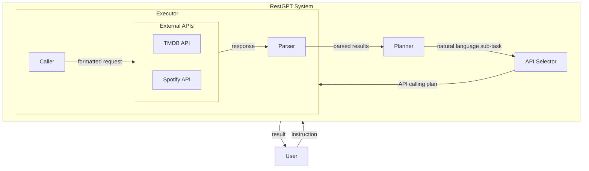
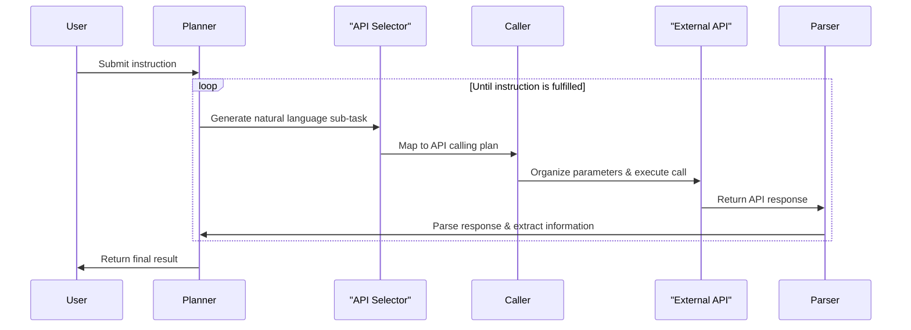
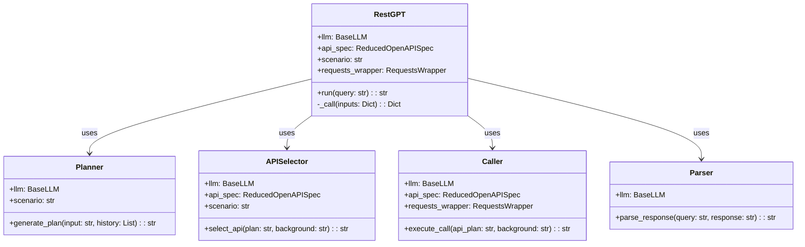
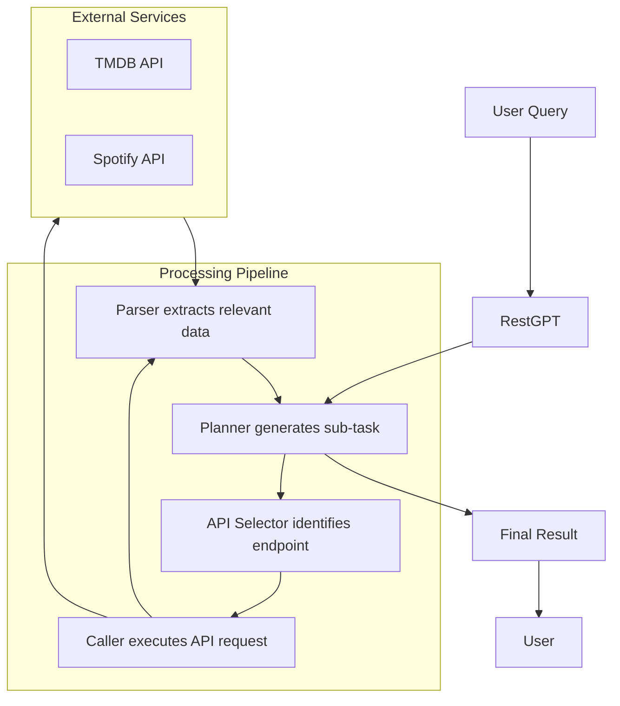

<!-- source: DeepWiki mcp.deepwiki.com · repo Yifan-Song793/RestGPT · page 1 Overview · fetched 2026-10-26 -->

# Overview

Relevant source files

The following files were used as context for generating this wiki page:

- [README.md](README.md)
- [imgs/example.gif](imgs/example.gif)
- [imgs/intro.png](imgs/intro.png)

RestGPT is an autonomous agent system that connects Large Language Models (LLMs) with real-world RESTful APIs. It enables natural language control of applications like movie databases and music players by addressing the challenges of planning, API calling, and response parsing in a structured framework.

This document provides a high-level overview of RestGPT's architecture, components, and functionality. For detailed information about setting up and running the system, see [Getting Started](#2).

## System Purpose

RestGPT bridges the gap between natural language instructions and structured API interactions by:

1. Breaking down complex user instructions into manageable sub-tasks
2. Mapping these sub-tasks to appropriate API calls
3. Executing the calls with proper parameters
4. Parsing the responses for further planning

The system implements an iterative coarse-to-fine planning approach that allows it to handle multi-step tasks requiring sequences of API calls.

Sources: [README.md:3-5](), [README.md:18-20]()

## Architecture Overview

RestGPT adopts an iterative planning framework where natural language instructions are progressively refined into concrete API calls and their responses inform subsequent steps.

### High-Level System Architecture

The system follows a cyclic workflow where the Planner determines the next step, the API Selector identifies the appropriate API call, the Caller executes the call, and the Parser processes the response for the next planning iteration.

Sources: [README.md:22-28]()

### Component Interaction Flow

This sequence diagram illustrates how RestGPT processes user instructions through multiple iterations of planning, API selection, execution, and parsing until the task is completed.

Sources: [README.md:18-20](), [README.md:22-28]()

## Key Components

RestGPT consists of four main components that work together to process user instructions and interact with external APIs:

### 1. Planner

The Planner is responsible for generating natural language sub-tasks based on the current state and user instruction. It determines what actions need to be taken next to fulfill the user's request.

### 2. API Selector

The API Selector maps high-level natural language sub-tasks from the Planner into specific API calling plans. It identifies which API endpoints to call and what parameters to use.

### 3. Executor

The Executor component consists of two sub-components:

#### Caller

The Caller organizes API parameters based on the API plan and documentation, formats the request correctly, and makes the actual API call.

#### Parser

The Parser processes the API response, extracts relevant information, and prepares it for the next planning iteration.

Sources: [README.md:22-28]()

## System Implementation

RestGPT is implemented as a modular system with clear separation of concerns across its components.

### Class Structure

Each component has access to a language model and plays a specific role in the processing pipeline. The RestGPT class acts as the main entry point, orchestrating the interaction between components.

Sources: [README.md:22-28]()

## Example Workflow

Here's an example of how RestGPT processes a user instruction:

1. A user asks: "Who is the director of today's most trending movie?"
2. The Planner generates a sub-task: "Find today's most trending movie"
3. The API Selector maps this to the TMDB API endpoint `GET /trending/{media_type}/{time_window}`
4. The Caller executes this API call with appropriate parameters
5. The Parser processes the response to extract the movie ID
6. The Planner generates the next sub-task: "Find the director of this movie"
7. The API Selector maps this to `GET /movie/{movie_id}/credits`
8. The Caller executes this call
9. The Parser extracts the director information
10. The Planner formulates the final answer and returns it to the user

This example demonstrates how RestGPT breaks down a complex query into sequential API calls, using the response from one call to inform the next.

Sources: [README.md:38-44]()

## Supported Scenarios

RestGPT currently supports two main scenarios:

1. **TMDB Movie Database**: Allows users to query information about movies, directors, actors, and related data using The Movie Database API.

2. **Spotify Music Player**: Enables users to control a Spotify account, search for music, create playlists, and more using the Spotify Web API.

The system was evaluated using RestBench, a benchmark containing realistic user instructions with human-annotated gold solution paths for these scenarios.

| Scenario | #APIs | Avg. Solution Path Length | Total Test Cases |
|----------|-------|--------------------------|------------------|
| TMDB     | 54    | 2.3                      | 100              |
| Spotify  | 40    | 2.6                      | 57               |

Sources: [README.md:36-59]()

## Data Flow

The following diagram illustrates how data flows through the system when processing a query:

This flowchart highlights the iterative nature of the planning process and the interaction with external APIs.

Sources: [README.md:18-20](), [README.md:22-28]()

## Key Features and Benefits

RestGPT offers several advantages for connecting LLMs with real-world applications:

1. **Natural Language Interface**: Users can control applications through natural language instructions without understanding API details.

2. **Modular Design**: Clear separation of concerns across components makes the system extensible and maintainable.

3. **Iterative Planning**: The coarse-to-fine approach allows handling complex tasks requiring multiple API calls.

4. **API Abstraction**: The system abstracts away the complexity of working with different RESTful APIs.

5. **Flexible Architecture**: The framework can be adapted to work with different APIs by changing the scenario and loading appropriate API specifications.

Sources: [README.md:3-5](), [README.md:18-20](), [README.md:22-28]()

## Conclusion

RestGPT demonstrates an effective approach to bridging natural language instructions with RESTful API interactions. By implementing an iterative planning framework and structured API interaction components, it enables LLMs to control real-world applications through API calls in a systematic and reliable manner.

For more details about specific components and implementation, see [Core Components](#3).

---

