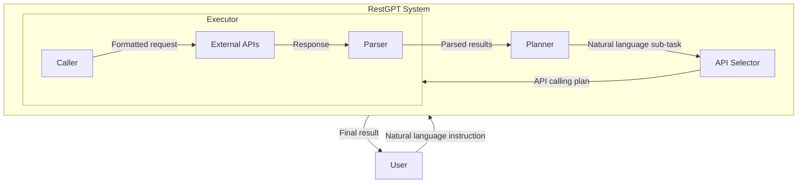
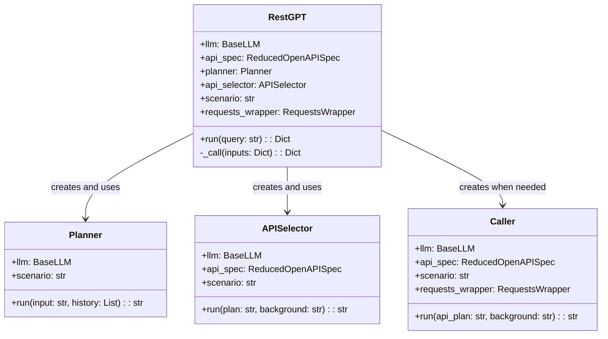
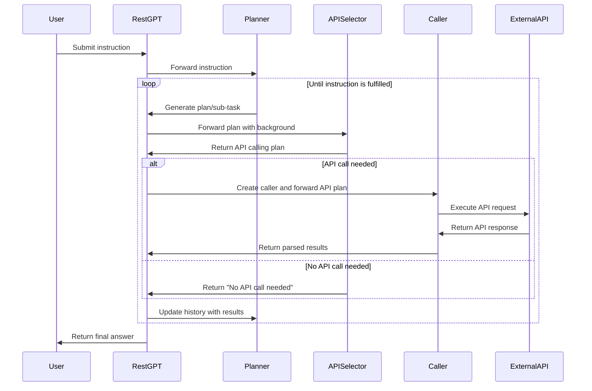
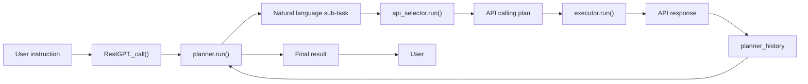
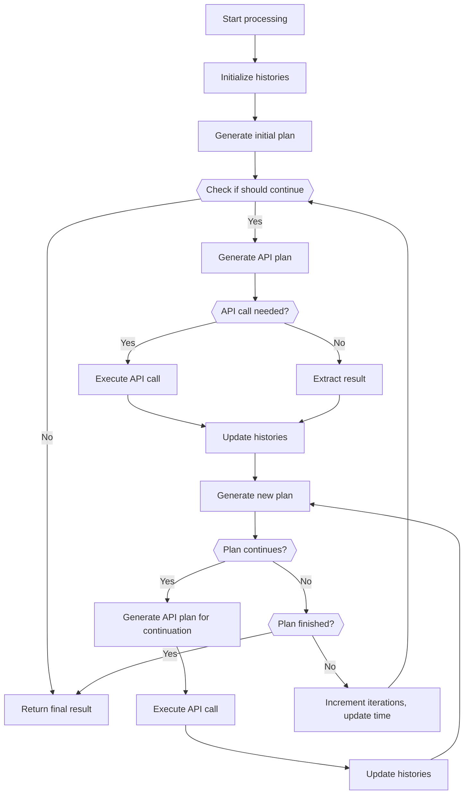

<!-- source: DeepWiki mcp.deepwiki.com · repo Yifan-Song793/RestGPT · page 1.1 System Architecture · fetched 2026-10-26 -->

# System Architecture

Relevant source files

The following files were used as context for generating this wiki page:

- [README.md](README.md)
- [imgs/model.png](imgs/model.png)
- [model/rest_gpt.py](model/rest_gpt.py)

This document describes the system architecture of RestGPT, a large language model-based autonomous agent designed to connect LLMs with real-world RESTful APIs. It explains the coarse-to-fine planning framework, component interactions, and the iterative workflow that enables RestGPT to break down complex user instructions into manageable API calls.

For information on installation and setup, see [Installation and Setup](#2.1). For details about individual components, see [Core Components](#3).

## Overview of RestGPT Architecture

RestGPT implements an iterative coarse-to-fine planning framework that enables large language models to control real-world applications through RESTful APIs. The system consists of four main components that work together to process user instructions, plan API calls, execute them, and use the results to make further decisions.

**Diagram: High-level architecture of RestGPT**

Sources: [README.md:17-28](), [model/rest_gpt.py:19-35]()

## Core Components

RestGPT's architecture consists of four main components, each with a specific role in the processing pipeline:

1. **Planner**: Generates natural language sub-tasks for the current step in solving the user's instruction.
2. **API Selector**: Maps high-level natural language sub-tasks to specific API calling plans.
3. **Executor**: Consists of two sub-components:
   - **Caller**: Organizes API parameters based on the API plan and makes the actual requests.
   - **Parser**: Processes API responses and extracts relevant information.

Each component leverages a large language model to handle its specific task, enabling natural language understanding throughout the pipeline.

Sources: [README.md:22-28](), [model/rest_gpt.py:26-30]()

## Implementation Details

RestGPT is implemented as a `Chain` class in the LangChain framework. The main class is `RestGPT`, which orchestrates the entire workflow.

**Diagram: Key classes in RestGPT implementation**

Sources: [model/rest_gpt.py:22-35](), [model/rest_gpt.py:56-62]()

## Interaction Flow

The RestGPT system processes user instructions through an iterative workflow, where each iteration refines the understanding and execution of the task:

**Diagram: Sequence diagram showing the interaction flow in RestGPT**

Sources: [model/rest_gpt.py:131-188]()

## Data Flow and Processing Pipeline

The following diagram illustrates how data flows through the RestGPT system during the processing of a user instruction:

**Diagram: Data flow in RestGPT**

Sources: [model/rest_gpt.py:131-188]()

## Iteration Control Logic

RestGPT controls its iterative process through several mechanisms:

1. **Continuation Check**: Determines if more API calls are needed for the current sub-task
2. **Completion Check**: Identifies when the entire task has been completed
3. **Resource Limits**: Enforces maximum iterations and execution time

**Diagram: Iteration control logic in RestGPT**

Sources: [model/rest_gpt.py:96-188]()

## Integration with External APIs

RestGPT is designed to work with different RESTful APIs. Currently, it supports two scenarios:

1. **TMDB** (The Movie Database): Allows searching and retrieving information about movies and TV shows
2. **Spotify**: Enables interaction with the Spotify music streaming platform

The system uses a `ReducedOpenAPISpec` to understand API structure and a `RequestsWrapper` to handle HTTP requests to these external services.

| Component | Function | Implementation |
|-----------|----------|----------------|
| `ReducedOpenAPISpec` | Stores simplified OpenAPI specifications | Imported from utils |
| `RequestsWrapper` | Handles HTTP requests to APIs | Imported from langchain.requests |
| `Scenario` | Determines which API to use | String value ("tmdb" or "spotify") |

Sources: [model/rest_gpt.py:12-17](), [model/rest_gpt.py:26-30]()

## Example Workflow

Below is an example of how RestGPT would process a typical user instruction:

1. User asks: "Who is the director of today's most trending movie?"
2. **Planner**: "First, I need to find today's most trending movie."
3. **API Selector**: Maps to `GET /trending/{media_type}/{time_window}` API
4. **Caller**: Executes API call with parameters `media_type=movie` and `time_window=day`
5. **Parser**: Extracts the top movie's ID
6. **Planner**: "Now I need to find the director of movie ID 12345."
7. **API Selector**: Maps to `GET /movie/{movie_id}/credits`
8. **Caller**: Executes API call with the movie ID
9. **Parser**: Extracts director information from credits
10. **Planner**: "Final Answer: The director of today's most trending movie 'Example Movie' is John Doe."

This iterative process demonstrates how RestGPT breaks down complex instructions into manageable steps and uses API calls to fulfill the user's request.

Sources: [README.md:36-44]()

---

