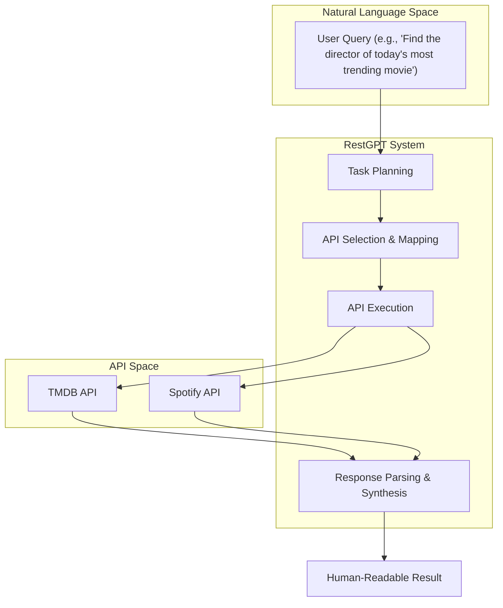
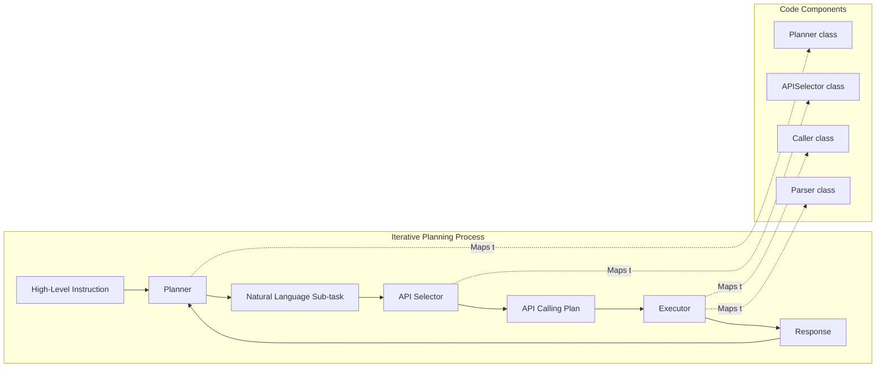
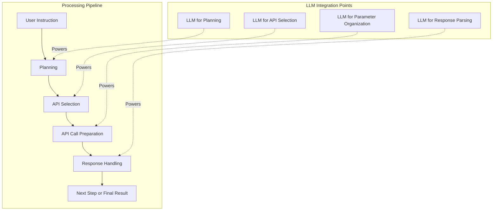
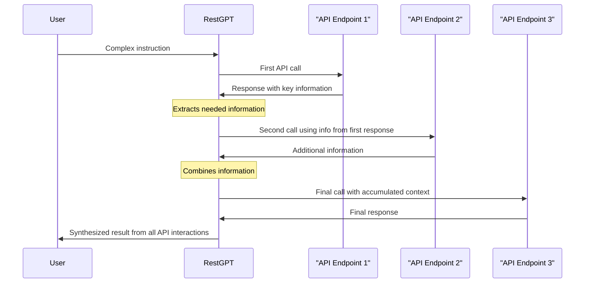

<!-- source: DeepWiki mcp.deepwiki.com · repo Yifan-Song793/RestGPT · page 1.2 Key Features and Capabilities · fetched 2026-10-26 -->

# Key Features and Capabilities

Relevant source files

The following files were used as context for generating this wiki page:

- [README.md](README.md)
- [imgs/example.gif](imgs/example.gif)

This document outlines the key features and capabilities of RestGPT, focusing on what the system can do and its main technical advantages. For information about the overall system architecture, see [System Architecture](#1.1).

## Core Capabilities

RestGPT serves as a bridge between natural language instructions and RESTful APIs, allowing users to control real-world applications through conversational language. The system can:

1. **Interpret Complex Natural Language Instructions**: Convert user queries into executable API sequences
2. **Perform Multi-Step Task Planning**: Break down complex tasks into sequential API operations
3. **Execute API Calls**: Organize parameters, make requests, and handle responses from external services
4. **Extract and Synthesize Information**: Parse API responses and generate human-readable results

Currently, RestGPT is integrated with two API ecosystems:

| API Ecosystem | Description | Example Capabilities |
|---------------|-------------|----------------------|
| TMDB | The Movie Database API | Search movies, find trending content, get movie details, query actor/director information |
| Spotify | Spotify Music Player API | Search tracks, create playlists, manage playback, retrieve artist information |

Sources: [README.md:16-32]()

## Technical Features

### 1. Iterative Coarse-to-Fine Planning

RestGPT employs a planning approach that progressively refines high-level goals into specific API calls:

This approach enables:
- Breaking down complex instructions into manageable steps
- Building on previous results in each iteration
- Dynamic adaptation based on API responses

Sources: [README.md:18-28]()

### 2. Modular Component Architecture

RestGPT features a modular design with specialized components:

| Component | Purpose | Key Function |
|-----------|---------|--------------|
| Planner | High-level task planning | Generates natural language sub-tasks for each step |
| API Selector | API endpoint identification | Maps high-level tasks to specific API endpoints and parameters |
| Caller | API interaction | Organizes parameters and executes API calls |
| Parser | Response processing | Processes API responses into usable information |

This modularity enables:
- Independent development and improvement of components
- Clear separation of concerns
- Easier debugging and maintenance

Sources: [README.md:22-28]()

### 3. LLM Integration Throughout Pipeline

Large Language Models are integrated at each step of the process:

This enables:
- Natural language understanding throughout the process
- Intelligent decision-making at each step
- Adaptive handling of unexpected responses

Sources: [README.md:16-32]()

## Advanced Capabilities

### Multi-Turn API Interaction

RestGPT can handle complex tasks requiring multiple API calls in sequence. The system tracks context across calls, allowing it to:

1. Use information from previous API responses in subsequent calls
2. Build up complex operations through multiple simple API interactions
3. Maintain state across the interaction lifecycle

This capability is demonstrated in examples like finding "the director of today's most trending movie" where RestGPT needs to:
1. First find the trending movie
2. Then look up its director information

Sources: [README.md:36-53]()

### Contextual API Parameter Selection

RestGPT intelligently selects API parameters based on:
- The user's instruction
- API documentation
- Previous API call results
- Required and optional parameters for each endpoint

This allows efficient API usage with only necessary parameters.

Sources: [README.md:22-28]()

## Advantages and Distinctive Features

### 1. Natural Language Interface to Structured APIs

RestGPT removes the technical barrier between users and APIs by:
- Accepting natural language instructions
- Handling the complexity of API endpoint selection
- Managing parameter formatting and authentication
- Converting technical API responses into readable results

### 2. Autonomous Multi-Step Planning

The system autonomously:
- Determines the necessary sequence of API calls
- Manages dependencies between calls
- Extracts relevant information from each step
- Adapts to unexpected responses or errors

### 3. Benchmark-Driven Development (RestBench)

RestGPT is evaluated using RestBench, a high-quality benchmark with:
- Real-world scenarios from TMDB and Spotify
- Human-annotated instructions with gold solution paths
- Tasks requiring 1-4 API calls to complete
- Diverse instruction types and complexity levels

| Scenario | #APIs | Avg. API Calls Per Task | Task Count |
|----------|-------|------------------------|------------|
| TMDB     | 54    | 2.3                    | 100        |
| Spotify  | 40    | 2.6                    | 57         |

This benchmark-driven approach ensures the system can handle realistic tasks in production environments.

Sources: [README.md:36-59]()

## Practical Applications

RestGPT can be applied to various scenarios where natural language control of APIs is beneficial:

1. **Content Discovery**: Finding movies, music, or other content based on complex criteria
2. **Media Management**: Creating and modifying playlists or collections
3. **Information Retrieval**: Gathering specific details about content (directors, actors, artists)
4. **Automation**: Performing sequences of operations without manual API interaction

The modular design also allows for extension to additional API ecosystems beyond the current TMDB and Spotify implementations.

Sources: [README.md:3-7](), [README.md:36-59]()

---

