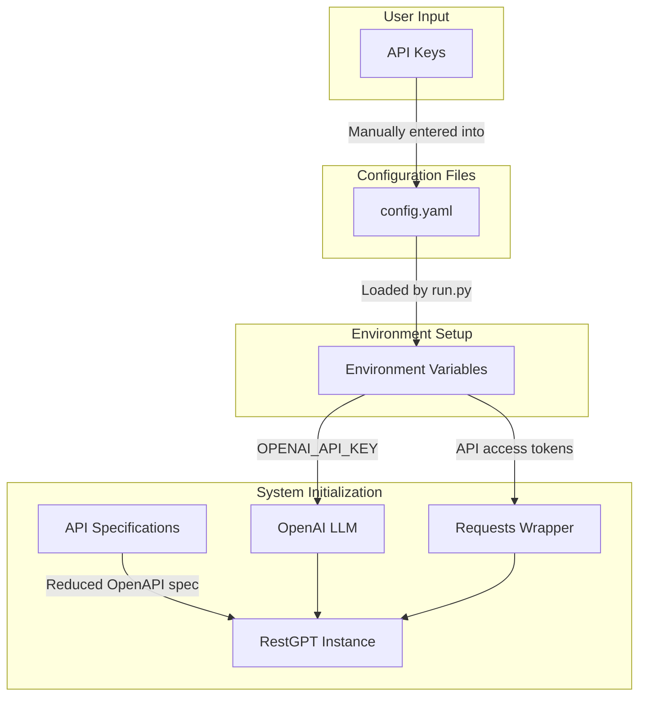
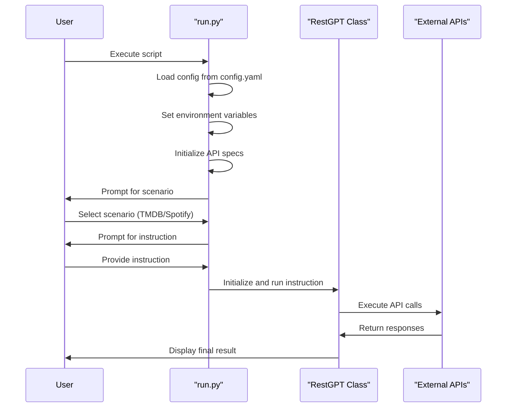
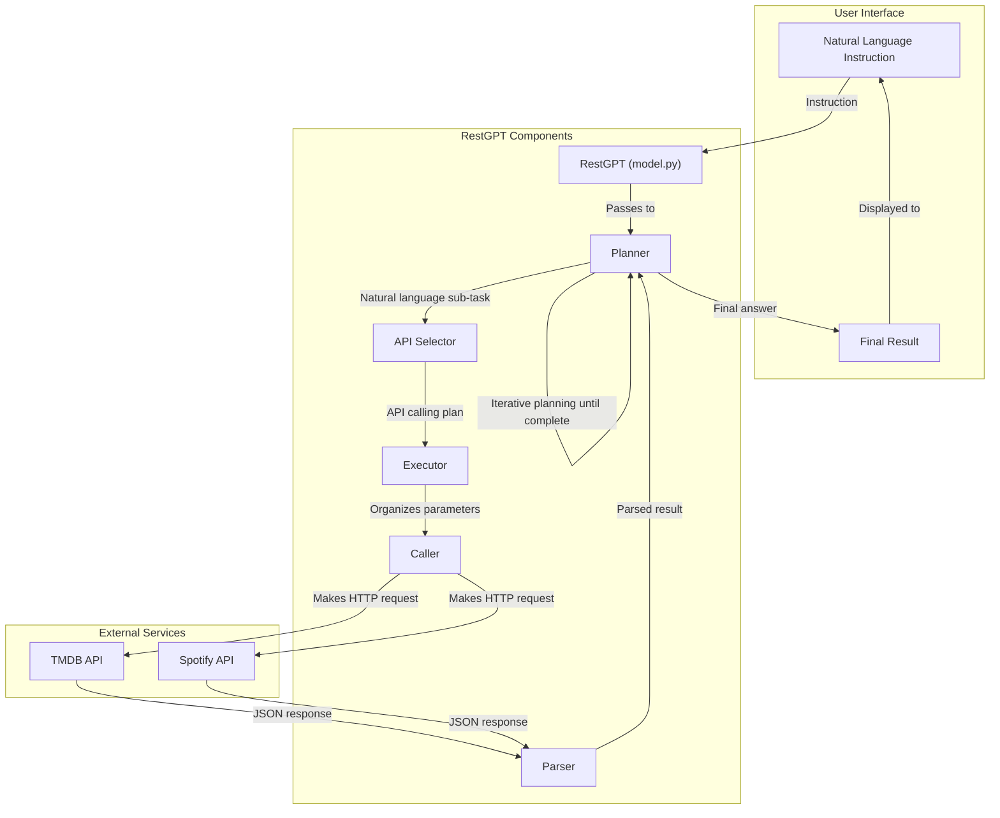

<!-- source: DeepWiki mcp.deepwiki.com · repo Yifan-Song793/RestGPT · page 2 Getting Started · fetched 2026-10-26 -->

# Getting Started

<details>
<summary>Relevant source files</summary>

The following files were used as context for generating this wiki page:

- [README.md](README.md)
- [config.yaml](config.yaml)
- [run.py](run.py)

</details>


This page provides an essential guide for setting up and using RestGPT, a system that connects Large Language Models with RESTful APIs. Here, you'll learn how to install dependencies, configure API keys, and run your first RestGPT instructions. For a high-level overview of the system architecture, see [Overview](#1), and for detailed information about core components, see [Core Components](#3).

## Prerequisites

Before starting with RestGPT, ensure you have:
- Python 3.7 or higher installed
- Access to API keys for OpenAI, TMDB, and/or Spotify (depending on which scenario you want to use)
- Basic familiarity with RESTful APIs

## Installation

To install RestGPT and its dependencies, follow these steps:

1. Clone the RestGPT repository:
   ```bash
   git clone https://github.com/Yifan-Song793/RestGPT
   cd RestGPT
   ```

2. Install required Python packages:
   ```bash
   pip install langchain colorama tiktoken spotipy openai
   ```

3. Create a logs directory for system output:
   ```bash
   mkdir logs
   ```

Sources: [README.md:61-65]()

## Configuration

RestGPT requires API keys to interact with external services. Follow these steps to configure your environment:

1. Obtain the necessary API keys:
   - OpenAI API key from [OpenAI](https://platform.openai.com/)
   - TMDB API key from [TMDB Developer Portal](https://developer.themoviedb.org/docs/getting-started)
   - Spotify API credentials from [Spotify Developer Dashboard](https://developer.spotify.com/documentation/web-api)

2. Open the `config.yaml` file and fill in your API keys:

```yaml
openai_api_key: your_openai_key_here

tmdb_access_token: your_tmdb_token_here

spotipy_client_id: your_spotify_client_id_here
spotipy_client_secret: your_spotify_client_secret_here
spotipy_redirect_uri: your_spotify_redirect_uri_here
```

Sources: [README.md:69-71](), [config.yaml:1-7]()

### Configuration Flow



Sources: [run.py:18-61]()

## Optional: Initialize Spotify Environment

If you're planning to use the Spotify scenario, you can initialize the Spotify environment. This step is optional but **be warned that it will remove all your existing data from Spotify**:

```bash
python init_spotify.py
```

Sources: [README.md:73-79]()

## Running RestGPT

RestGPT supports two scenarios: TMDB (movie database) and Spotify (music player). Here's how to run the system:

### Basic Usage

1. Run the main script:
   ```bash
   python run.py
   ```

2. When prompted, select a scenario by typing either "TMDB" or "Spotify"

3. Enter your instruction or press Enter to use the example instruction

The system will process your instruction and return the results.



Sources: [run.py:18-79](), [README.md:81-90]()

### Example Workflow

When you run RestGPT, the system:

1. Loads your configuration from `config.yaml`
2. Sets up the environment with your API keys
3. Prompts you to select a scenario (TMDB or Spotify)
4. Prompts you for an instruction
5. Processes your instruction through its iterative planning framework
6. Returns results from the external API

Example instructions:
- TMDB: "Give me the number of movies directed by Sofia Coppola"
- Spotify: "Add Summertime Sadness by Lana Del Rey in my first playlist"

Sources: [run.py:61-77](), [README.md:30-32]()

## System Execution Flow



Sources: [README.md:16-32](), [run.py:74-77]()

## Running Benchmark Tests

RestGPT includes scripts to run against the RestBench benchmark datasets:

### TMDB Benchmark

```bash
python run_tmdb.py
```
This script sequentially executes all instructions in RestBench-TMDB.

### Spotify Benchmark

```bash
python run_spotify.py
```
For Spotify benchmark tests, ensure Spotify is open on your device and manually modify the `query_idx` variable in the script before execution to test specific instructions.

Sources: [README.md:91-101]()

## Next Steps

Now that you've set up RestGPT and run your first instructions, you can:

- Explore the [Core Components](#3) to understand how the system works internally
- Learn about the [Evaluation Framework (RestBench)](#4) to test RestGPT's capabilities
- Review the [Technical Reference](#5) for more advanced usage

For questions or issues, refer to the project's GitHub repository.

---

