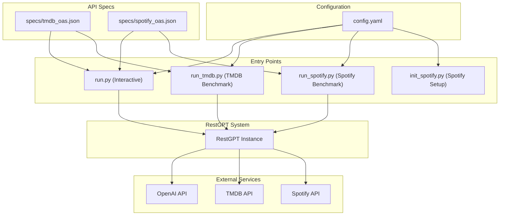
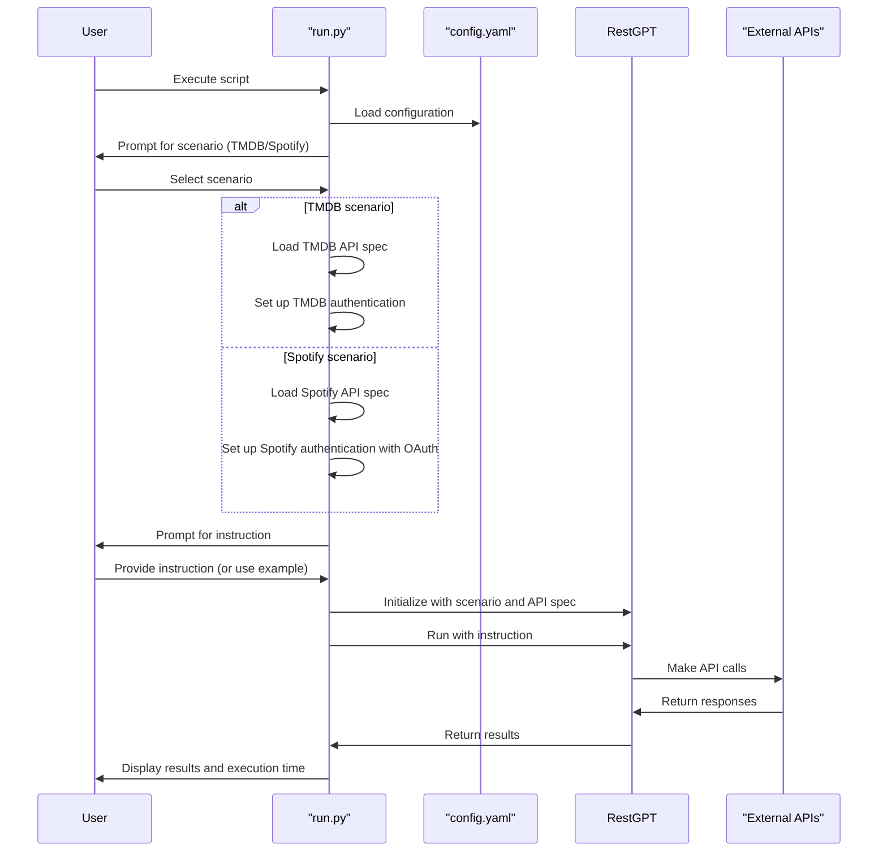
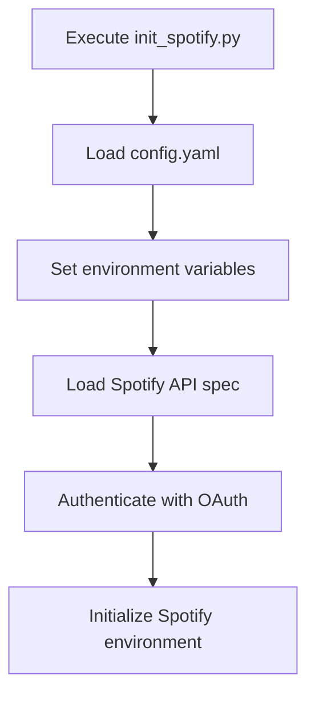
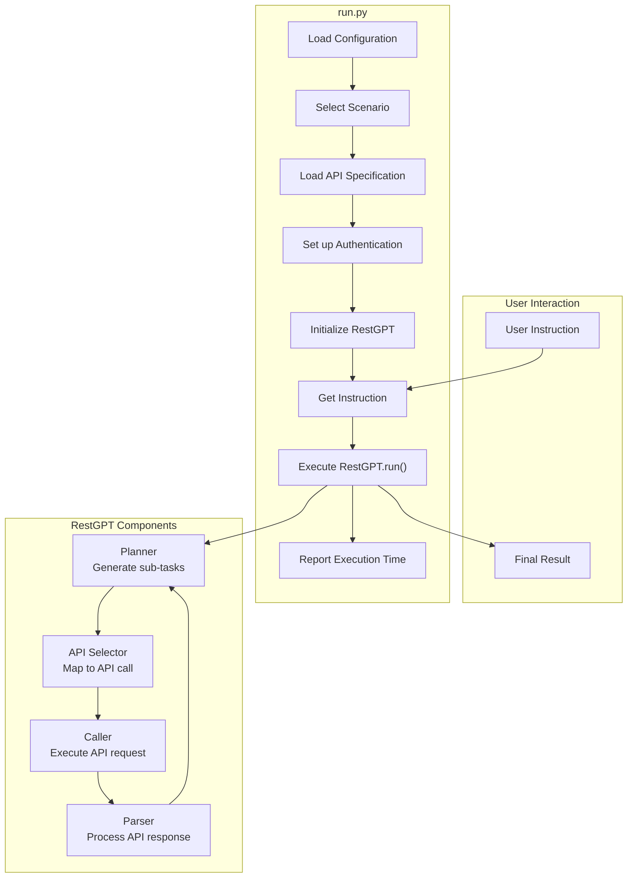

<!-- source: DeepWiki mcp.deepwiki.com · repo Yifan-Song793/RestGPT · page 2.2 Running the System · fetched 2026-10-26 -->

# Running the System

<details>
<summary>Relevant source files</summary>

The following files were used as context for generating this wiki page:

- [README.md](README.md)
- [init_spotify.py](init_spotify.py)
- [run.py](run.py)

</details>


This page provides detailed instructions on how to execute RestGPT with different scenarios. It covers interactive running, batch processing with predefined instructions, and scenario-specific setup. For initial installation and dependency setup, see [Installation and Setup](#2.1).

## Overview

RestGPT supports two primary scenarios: TMDB (The Movie Database) and Spotify. Each scenario allows the system to interact with different API endpoints through natural language instructions. The system can be run interactively or with predefined instructions from the RestBench benchmark.



Sources: [run.py:1-80](), [README.md:61-101]()

## Prerequisites

Before running RestGPT, ensure you have:

1. Installed all dependencies (see [Installation and Setup](#2.1))
2. Created a `logs` folder in the project root
3. Obtained necessary API keys
4. Configured `config.yaml` with your API keys

### API Key Configuration

RestGPT requires the following API keys configured in `config.yaml`:

| API | Key/Token Name | Purpose |
|-----|----------------|---------|
| OpenAI | `openai_api_key` | Powers the language model components |
| TMDB | `tmdb_access_token` | Authenticates with The Movie Database API |
| Spotify | `spotipy_client_id` | Client ID for Spotify API |
| Spotify | `spotipy_client_secret` | Client secret for Spotify API |
| Spotify | `spotipy_redirect_uri` | Redirect URI for OAuth flow |

Sources: [README.md:61-71](), [run.py:18-24]()

## Running Interactively

The simplest way to run RestGPT is using the interactive mode through `run.py`.

### Interactive Execution Flow



Sources: [run.py:18-77]()

### Steps to Run Interactively

1. Open a terminal in the project root directory
2. Execute the script:
   ```bash
   python run.py
   ```
3. When prompted, select a scenario (TMDB or Spotify)
4. Enter an instruction or press Enter to use the example instruction
5. The system will process your instruction and display results

Example:

```
Please select a scenario (TMDB/Spotify): TMDB
Example instruction: Give me the number of movies directed by Sofia Coppola
Please input an instruction (Press ENTER to use the example instruction): 
Query: Give me the number of movies directed by Sofia Coppola
... [RestGPT execution and results]
Execution Time: 12.34
```

Sources: [run.py:32-77](), [README.md:82-89]()

## Running Benchmark Scenarios

RestGPT includes scripts to run predefined instructions from the RestBench benchmark.

### TMDB Benchmark

```bash
python run_tmdb.py
```

This script runs all instructions in the RestBench-TMDB dataset sequentially, which includes 100 instructions with varying complexity (1-4 API calls per instruction).

Sources: [README.md:91-101]()

### Spotify Benchmark

```bash
python run_spotify.py
```

For the Spotify benchmark, you need to:
1. Open Spotify on your device (to see the effects of commands)
2. Manually modify the `query_idx` in the script to select specific instructions

The RestBench-Spotify dataset includes 57 instructions with varying complexity.

Sources: [README.md:91-101]()

## Setting Up Spotify Environment

If you're using the Spotify scenario, you can initialize the Spotify environment with:

```bash
python init_spotify.py
```

**Warning**: This will remove all your existing data from Spotify!

The initialization process:



Sources: [init_spotify.py:1-34](), [README.md:73-79]()

## System Parameters

When running RestGPT, the following key parameters are set:

### Language Model Configuration

The system uses OpenAI's text-davinci-003 model with these parameters:

```python
llm = OpenAI(model_name="text-davinci-003", temperature=0.0, max_tokens=700)
```

- `model_name`: The specific OpenAI model to use
- `temperature`: Set to 0.0 for deterministic outputs
- `max_tokens`: Maximum tokens in the model's response

### RestGPT Initialization

```python
rest_gpt = RestGPT(llm, api_spec=api_spec, scenario=scenario, 
                  requests_wrapper=requests_wrapper, simple_parser=False)
```

- `llm`: Language model instance
- `api_spec`: Processed OpenAPI specification for the selected scenario
- `scenario`: Selected scenario ("tmdb" or "spotify")
- `requests_wrapper`: HTTP request handler with authentication headers
- `simple_parser`: Boolean flag for parser complexity (set to False for advanced parsing)

Sources: [run.py:61-62]()

## Understanding the Execution Flow

When running RestGPT, the system follows this process:



Sources: [run.py:18-77](), [README.md:16-31]()

## Example Workflow

Here's an example of RestGPT executing a TMDB scenario instruction:

1. **User provides instruction**: "Give me the number of movies directed by Sofia Coppola"
2. **RestGPT planning process**:
   - Planner generates sub-task: "Search for Sofia Coppola as a person"
   - API Selector identifies appropriate endpoint: `GET /search/person`
   - Caller executes API request with parameters
   - Parser processes response to extract person ID
   
   - Planner generates next sub-task: "Get movies directed by Sofia Coppola"
   - API Selector identifies endpoint: `GET /person/{person_id}/movie_credits`
   - Caller executes API request with extracted person ID
   - Parser counts director credits and returns final result

3. **System returns answer**: "Sofia Coppola has directed X movies."

Sources: [README.md:30-32]()

With this approach, RestGPT can handle complex instructions that require multiple API calls across different scenarios.

---

