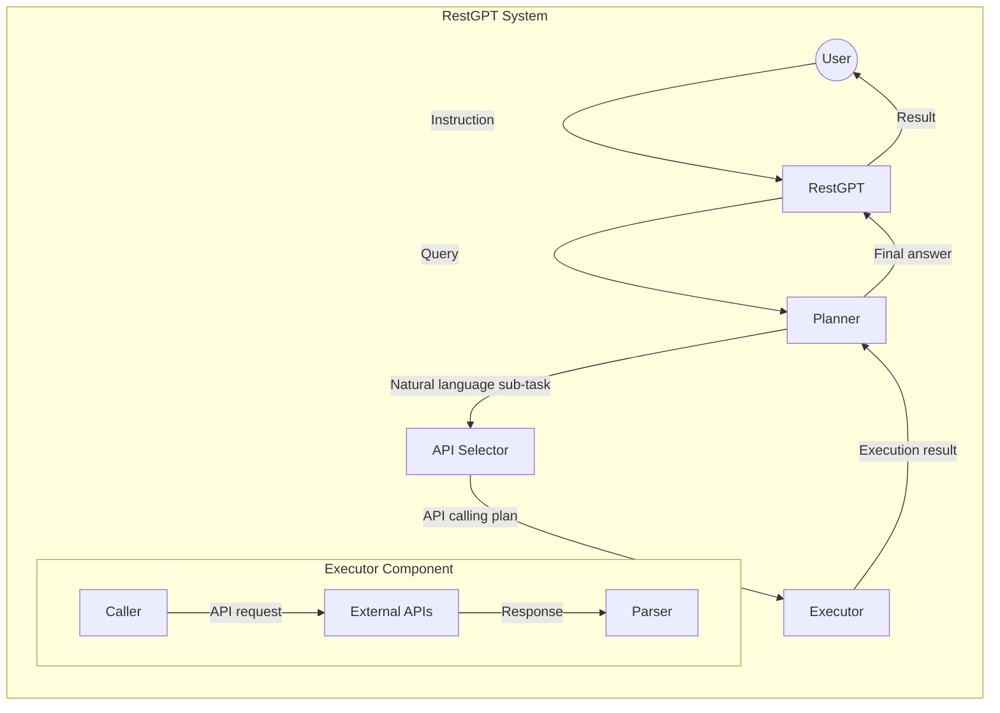
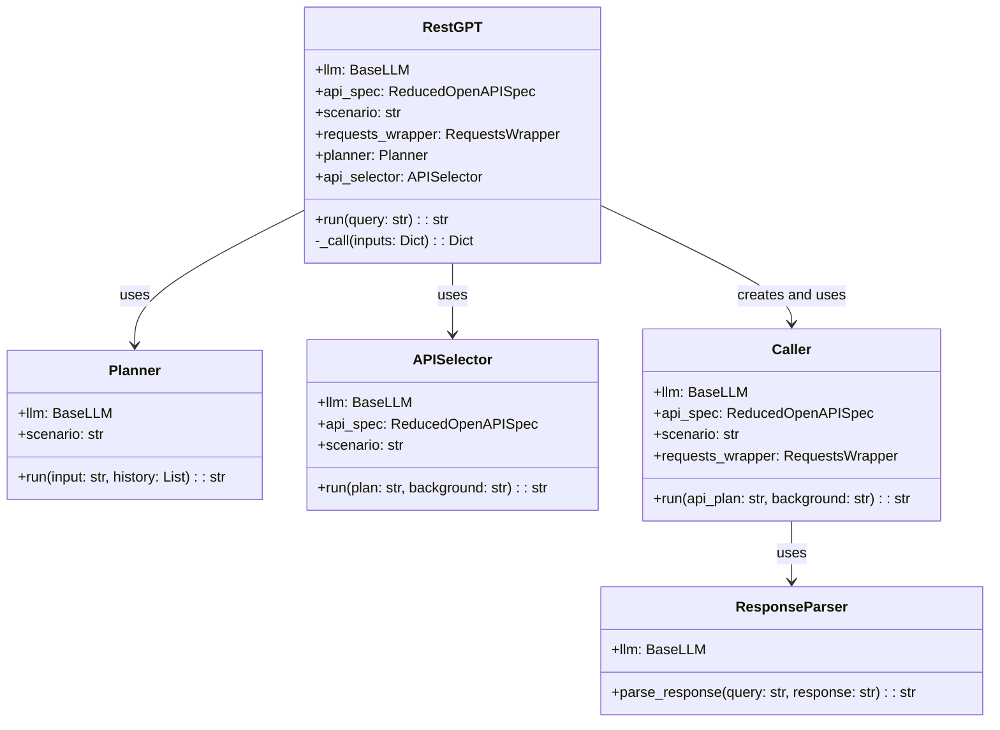
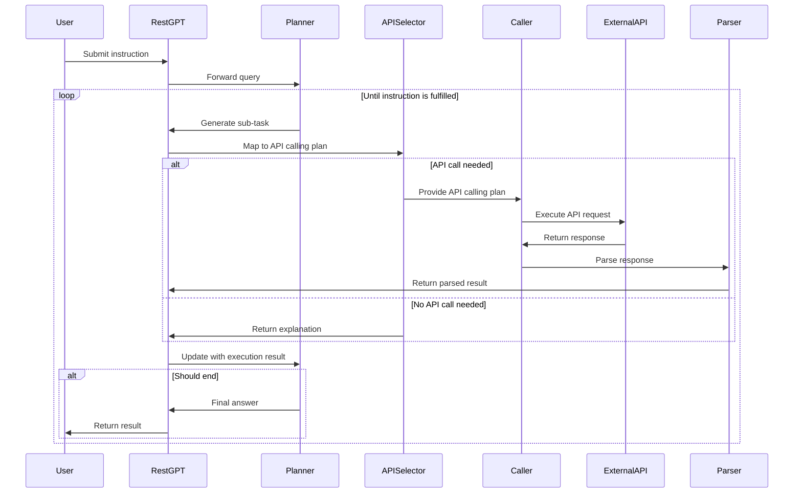
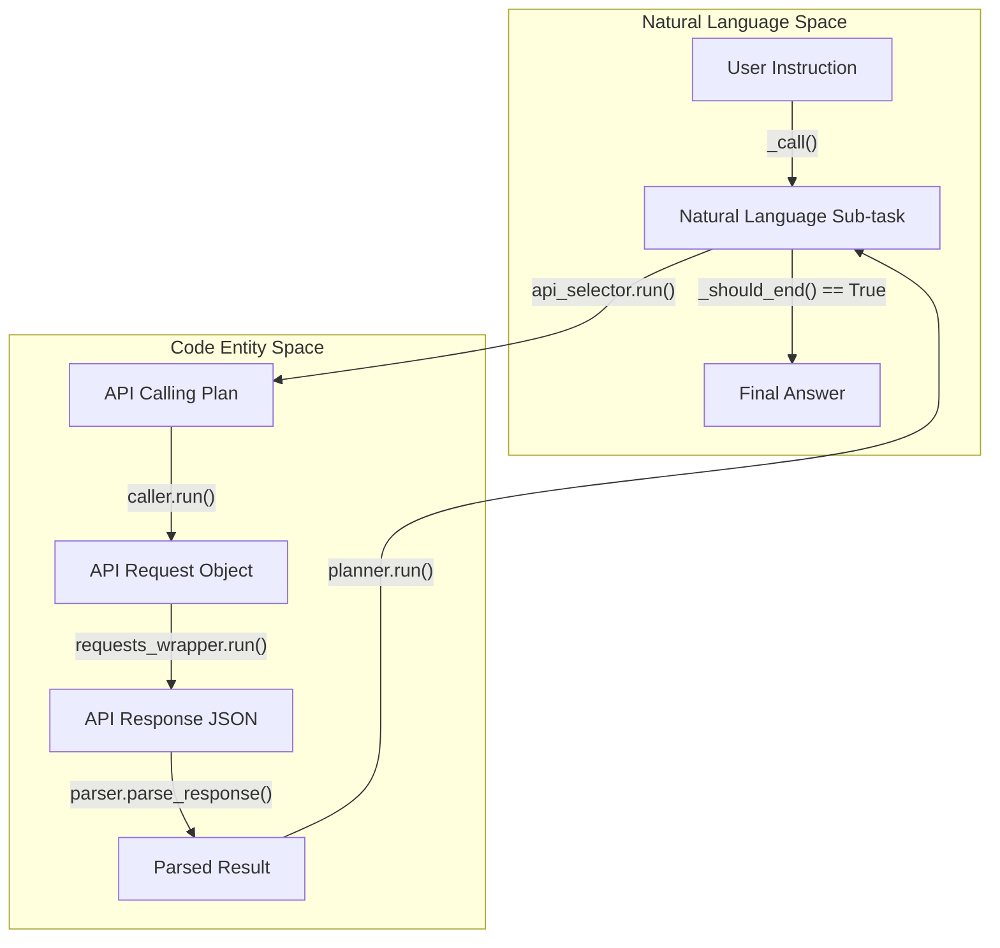
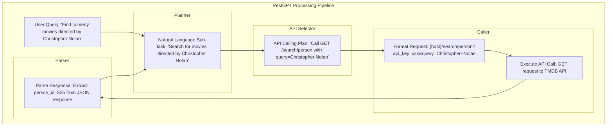

<!-- source: DeepWiki mcp.deepwiki.com · repo Yifan-Song793/RestGPT · page 3 Core Components · fetched 2026-10-26 -->

# Core Components

Relevant source files

The following files were used as context for generating this wiki page:

- [README.md](README.md)
- [model/__init__.py](model/__init__.py)
- [model/rest_gpt.py](model/rest_gpt.py)

This page provides a comprehensive overview of the main components that make up the RestGPT system architecture. RestGPT uses a modular design with clear separation of concerns to connect Large Language Models with RESTful APIs. For information about system installation and setup, see [Getting Started](#2).

## Component Overview

RestGPT follows a coarse-to-fine planning framework that breaks down complex user instructions into manageable sub-tasks and executes them by interacting with external APIs. The system consists of four core components that work together to achieve this goal.

Sources: [README.md:22-28](), [model/rest_gpt.py:22-35]()

## Component Roles and Responsibilities

RestGPT's architecture is designed with each component having a specific role in the processing pipeline:

| Component | Description | Responsibility |
|-----------|-------------|----------------|
| **Planner** | High-level task planner | Generates natural language sub-tasks based on the user query and execution history |
| **API Selector** | API mapping module | Translates natural language sub-tasks into specific API calling plans |
| **Executor** | API execution engine | Handles the actual API interactions |
| **Caller** | Request formatter | Organizes parameters and executes API calls based on API documentation |
| **Parser** | Response processor | Parses API responses and extracts relevant information |

Sources: [README.md:22-28](), [model/rest_gpt.py:19-33]()

## Code Structure

The RestGPT system architecture is implemented through several interconnected classes:

Sources: [model/__init__.py:1-6](), [model/rest_gpt.py:22-35]()

## Execution Flow

RestGPT processes user instructions through an iterative workflow:

Sources: [model/rest_gpt.py:131-188]()

## Data Flow Between Components

The flow of data through the RestGPT system demonstrates how natural language instructions are transformed into API calls and back into meaningful responses:

Sources: [model/rest_gpt.py:131-188]()

## Detailed Component Descriptions

### RestGPT

The `RestGPT` class acts as the central orchestrator that coordinates all components. It's implemented as a Langchain `Chain` class and manages the iterative process of planning, API selection, and execution.

Key methods:
- `_call`: Main method that processes the input query
- `_should_continue`: Determines if the iteration process should continue
- `_should_continue_plan`: Checks if additional API calls are needed for the current plan
- `_should_end`: Determines if the final answer has been reached

Sources: [model/rest_gpt.py:22-188]()

### Planner

The Planner component generates natural language sub-tasks based on the user's query and the history of previous API calls and their results. It determines when the system has gathered enough information to provide a final answer.

Key responsibilities:
- Breaking down complex queries into manageable sub-tasks
- Tracking progress toward fulfilling the user's request
- Deciding when to stop and provide a final answer

Sources: [model/rest_gpt.py:56](), [README.md:24]()

### API Selector

The API Selector maps natural language sub-tasks to specific API calling plans. It references the API documentation (provided through the `ReducedOpenAPISpec` object) to determine which API endpoint to call and how to structure the request.

Key responsibilities:
- Understanding the natural language sub-task
- Identifying the appropriate API endpoint
- Deciding on required parameters for the API call

Sources: [model/rest_gpt.py:57-58](), [README.md:25]()

### Executor

The Executor is composed of the Caller and Parser components that handle the actual API interactions.

#### Caller

The Caller organizes API parameters based on the API plan and documentation, then executes the API request using the `RequestsWrapper`.

Key responsibilities:
- Formatting API requests according to the API specification
- Handling authentication and request headers
- Executing the HTTP request
- Receiving the response from the external API

Sources: [model/rest_gpt.py:154](), [README.md:27]()

#### Parser

The Parser processes API responses, extracting relevant information and converting it into a format that can be used by the Planner in subsequent iterations.

Key responsibilities:
- Parsing API response JSON
- Extracting relevant data points
- Formatting the results for use by the Planner
- Sometimes generating Python code to parse complex responses based on the response schema

Sources: [model/rest_gpt.py:154](), [README.md:28]()

## Component Interactions in Processing Pipeline

This diagram illustrates how the RestGPT components interact during the processing of a user instruction:

Sources: [model/rest_gpt.py:131-188](), [README.md:30-32]()

## Iteration Process

RestGPT uses an iterative approach to fulfill user instructions. Each iteration builds on the results of previous API calls, gradually collecting the information needed to answer the user's query.

The system supports several termination conditions:
- Maximum number of iterations reached (default: 15)
- Maximum execution time exceeded
- Final answer determined by the Planner

These conditions are managed by the `_should_continue()` method in the `RestGPT` class.

Sources: [model/rest_gpt.py:96-105](), [model/rest_gpt.py:131-188]()

For more detailed information about each core component, please refer to the corresponding sub-pages:
- [Planner](#3.1)
- [API Selector](#3.2)
- [Executor](#3.3)
  - [Caller](#3.3.1)
  - [Parser](#3.3.2)

---

