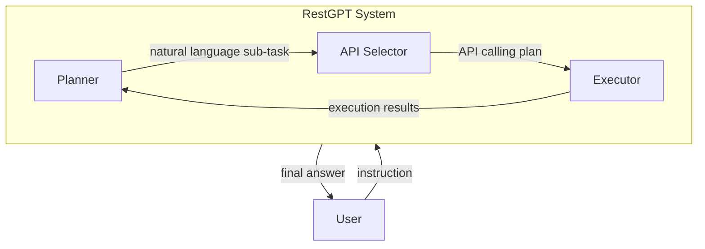
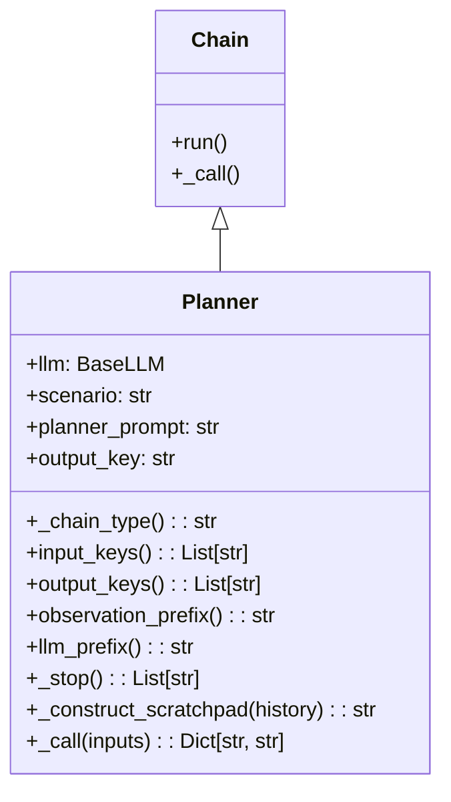
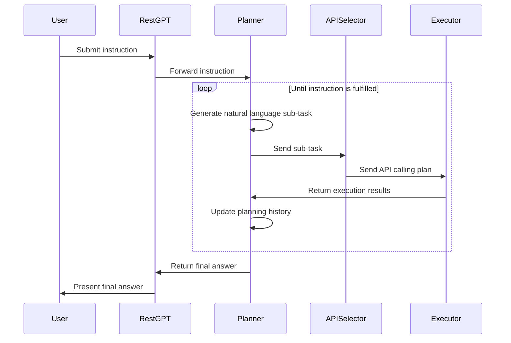
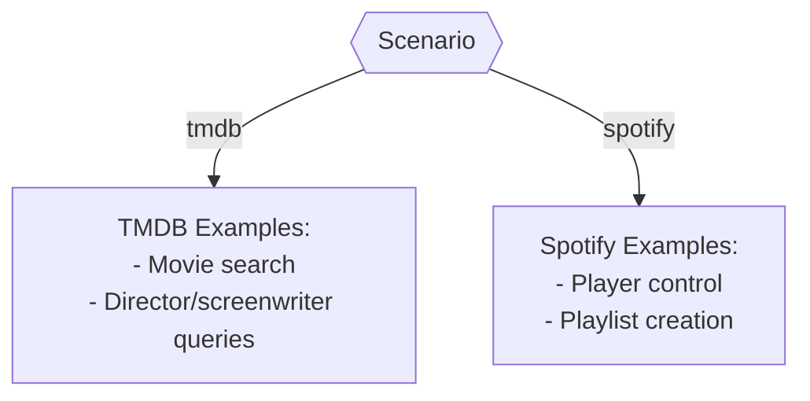
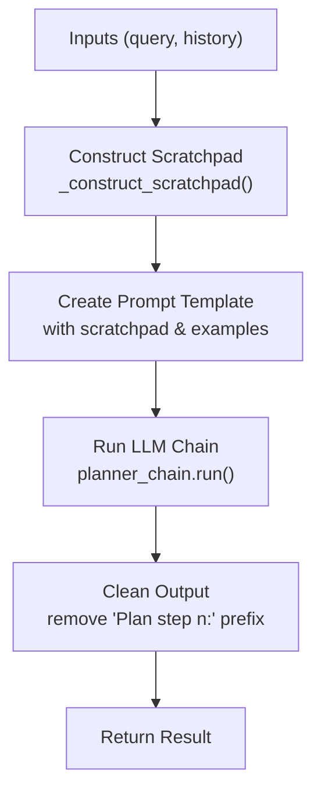

<!-- source: DeepWiki mcp.deepwiki.com · repo Yifan-Song793/RestGPT · page 3.1 Planner · fetched 2026-10-26 -->

# Planner

<details>
<summary>Relevant source files</summary>

The following files were used as context for generating this wiki page:

- [README.md](README.md)
- [model/planner.py](model/planner.py)

</details>


## Purpose and Role

The Planner is a critical core component in the RestGPT system responsible for generating natural language sub-tasks based on user instructions. Operating within the coarse-to-fine planning framework, the Planner functions as the strategic director of the system, breaking down complex user queries into manageable sub-tasks that can eventually be mapped to API calls by downstream components.

For information about how the Planner interacts with other components in the execution pipeline, see [System Architecture](#1.1).

Sources: [README.md:22-24](), [model/planner.py:88-96]()

## Position in RestGPT Architecture



The Planner sits at the center of RestGPT's iterative workflow, receiving user instructions initially and then continuously processing execution results from previous steps to plan the next actions.

Sources: [README.md:16-28]()

## Planner Class Implementation

The Planner is implemented as a LangChain Chain subclass in `model/planner.py`. It maintains a conversation history and produces natural language sub-tasks for the current planning step.



Sources: [model/planner.py:88-153]()

### Key Attributes and Methods

| Attribute/Method | Type | Description |
|------------------|------|-------------|
| `llm` | BaseLLM | Large language model used to generate plans |
| `scenario` | str | Current scenario (e.g., "tmdb" or "spotify") |
| `planner_prompt` | str | Prompt template for planning |
| `output_key` | str | Key for output (default: "result") |
| `_construct_scratchpad` | method | Builds a history of past plan steps and responses |
| `_call` | method | Main method that processes inputs and returns outputs |

Sources: [model/planner.py:88-153]()

## Planning Process Flow



The Planner works iteratively, generating a sub-task for each step based on the current state and previous execution results. It maintains a history of all previous steps and their outcomes, which it uses to make informed decisions about the next steps.

Sources: [model/planner.py:126-135](), [README.md:16-28]()

## Prompt Structure and Logic

The Planner uses a carefully crafted prompt template (`PLANNER_PROMPT`) with several key components:

1. **Task Instructions**: Guides the language model to act as an agent planning solutions
2. **Format Specification**: Defines the expected input-output format
3. **Guidelines**: Provides rules for plan creation (specificity, directness, etc.)
4. **In-Context Learning Examples**: Scenario-specific examples demonstrating desired planning behavior
5. **User Query and History**: The actual user instruction and interaction history

### Planning Guidelines

The Planner follows several important guidelines when generating plans:

- Plans should be in natural language, not API calls
- Plans should be as specific as possible, avoiding pronouns
- Plans should be straightforward with conditions directly in the plan
- When a plan step is incomplete, the Planner can output "Continue" to request further API calls

Sources: [model/planner.py:57-83]()

## In-Context Learning Examples

The Planner uses different sets of examples depending on the current scenario:



These examples demonstrate the expected planning pattern including:
- Breaking complex tasks into logical steps
- Using previous results in subsequent steps
- Determining when a task is complete

Sources: [model/planner.py:9-53]()

## Implementation Details

### Processing Flow



When called, the Planner:
1. Constructs a scratchpad from the planning history
2. Builds a prompt with the scratchpad, ICL examples, and user query
3. Runs the language model to generate the next plan step
4. Cleans the output and returns it

Sources: [model/planner.py:137-153]()

### Scratchpad Construction

The scratchpad is a key element that maintains the conversation history between planning steps. It's constructed by the `_construct_scratchpad` method, which formats each plan and its execution result with appropriate prefixes.

```
Plan step 1: [plan text]
API response: [execution result]
Plan step 2: [plan text]
API response: [execution result]
...
```

Sources: [model/planner.py:126-135]()

## Usage Example

A typical interaction with the Planner might look like:

1. User submits the query: "Give me some movies performed by Tony Leung"
2. Planner generates: "search person with name 'Tony Leung'"
3. API Selector and Executor provide response: "Tony Leung's person_id is 1337"
4. Planner plans next step: "collect the list of movies performed by Tony Leung whose person_id is 1337"
5. API Selector and Executor provide response with movie list
6. Planner recognizes task completion and formulates final answer

This iterative process continues until the Planner determines that the user's query has been fully addressed.

Sources: [model/planner.py:10-17]()

## Integration Points

The Planner primarily integrates with:

1. **RestGPT Main System**: Receives user queries and provides final answers
2. **API Selector**: Receives natural language sub-tasks and converts them to API calling plans
3. **Language Model**: Uses an LLM to generate plans based on the current state

Sources: [README.md:16-28](), [model/planner.py:88-96]()

---

