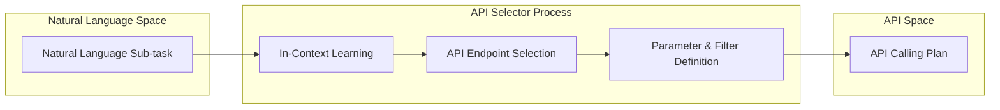
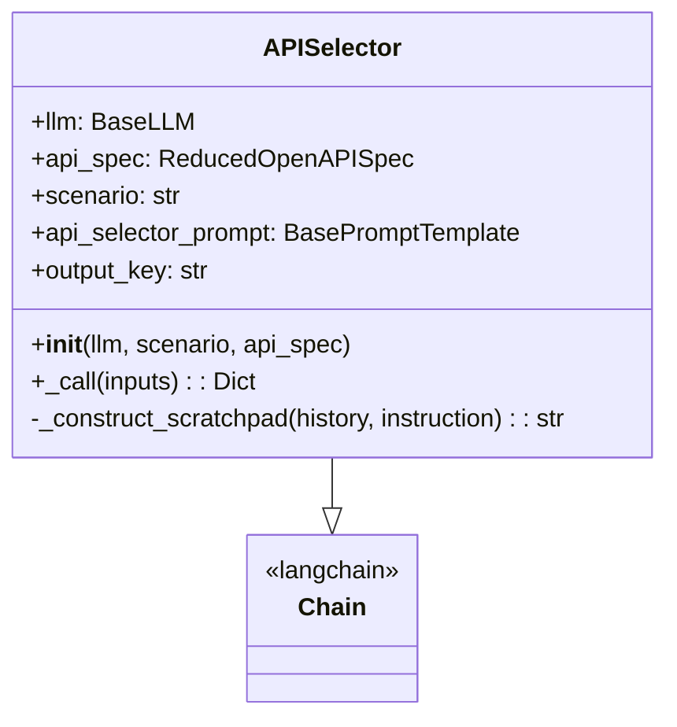
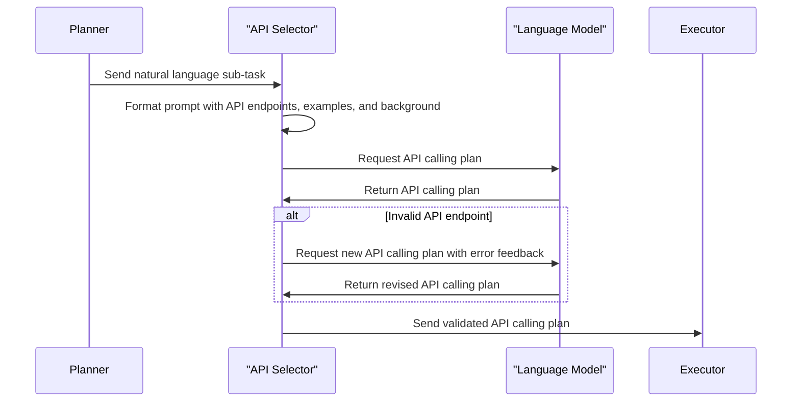
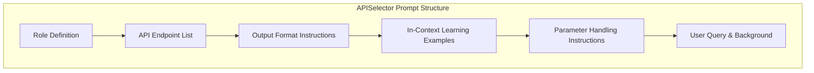
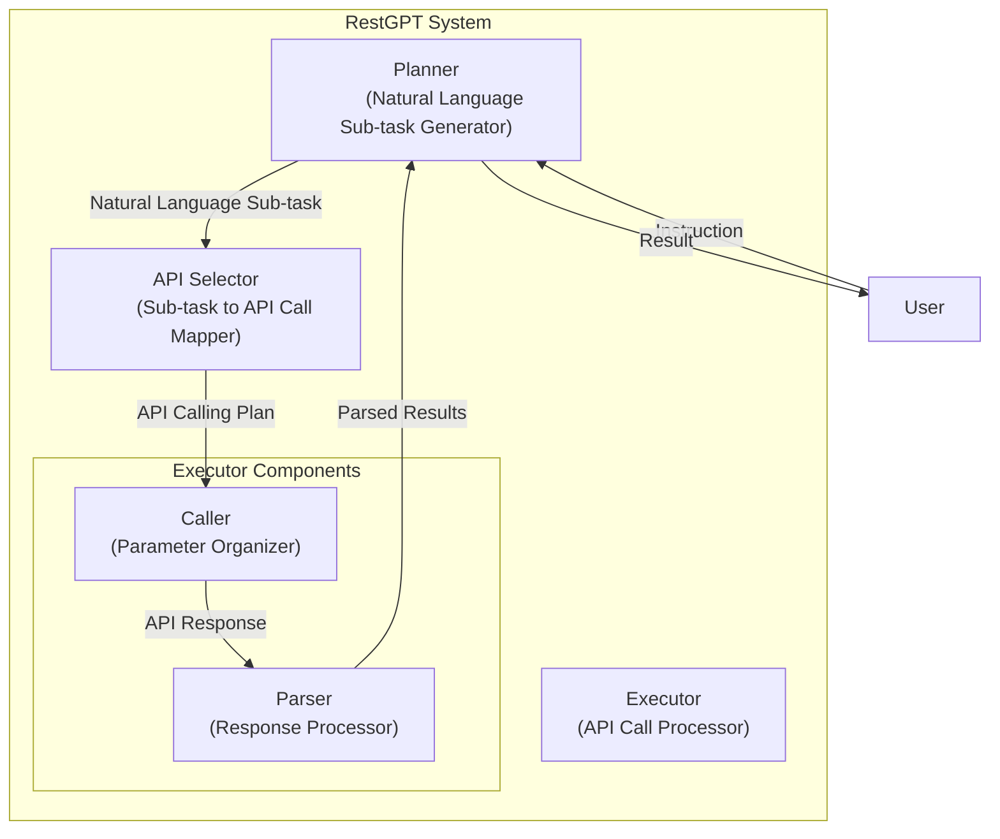

<!-- source: DeepWiki mcp.deepwiki.com · repo Yifan-Song793/RestGPT · page 3.2 API Selector · fetched 2026-10-26 -->

# API Selector

<details>
<summary>Relevant source files</summary>

The following files were used as context for generating this wiki page:

- [README.md](README.md)
- [model/api_selector.py](model/api_selector.py)

</details>


The API Selector is a core component in the RestGPT architecture responsible for translating high-level natural language sub-tasks generated by the Planner into concrete API calling plans. It bridges the gap between abstract user intentions and the specific RESTful API endpoints needed to fulfill those intentions.

For information about how the API Selector fits into the overall RestGPT system, see [System Architecture](#1.1). For details on how API calls are executed, see [Executor](#3.3).

## Purpose and Functionality

The API Selector takes natural language sub-tasks from the Planner and determines which specific API endpoint should be called, along with any necessary parameters or filtering conditions. It maps abstract instructions like "get information about a particular movie" into concrete API calls like "GET /movie/{movie_id}" with the appropriate movie ID.



Sources: [model/api_selector.py:109-169](). [README.md:23-26]()

## Architecture and Components

The API Selector is implemented as a LangChain Chain that leverages a language model to perform the translation from natural language to API calls. It maintains knowledge of available API endpoints and their descriptions to make informed decisions about which APIs to call.



Sources: [model/api_selector.py:110-119]()

## Data Flow

The API Selector receives input from the Planner and outputs an API calling plan that will be executed by the Executor. Here's the data flow within the API Selector component:



Sources: [model/api_selector.py:170-195]()

## Implementation Details

### Prompt Engineering

The API Selector uses a carefully crafted prompt to guide the language model in generating appropriate API calling plans. The prompt includes:

1. Instructions for the language model on how to plan API calls
2. A list of available API endpoints and their descriptions
3. The expected format for the output
4. In-context learning examples specific to the scenario (TMDB or Spotify)
5. Special instructions for handling path parameters



Sources: [model/api_selector.py:73-106]()

### In-Context Learning Examples

The API Selector uses scenario-specific examples to help the language model understand the task. These examples demonstrate:

- How to translate user queries into API calls
- How to handle multi-step API calling sequences
- How to reference IDs and other data from previous responses
- How to properly format API calls with parameters

For instance, here's a simplified example for the TMDB scenario:

```
User query: search for the director of Happy Together
API calling 1: GET /movie/18329/credits to get the director for the movie Happy Together
API response: The director of Happy Together is Wong Kar-Wai (12453)
```

Sources: [model/api_selector.py:17-69]()

### Error Handling and Validation

The API Selector includes a validation mechanism to ensure that the generated API calling plan references a valid endpoint. If the language model generates an invalid API call, the system:

1. Logs the issue
2. Provides feedback to the language model
3. Requests a new API calling plan until a valid endpoint is chosen

This ensures that only valid API calling plans are forwarded to the Executor.

Sources: [model/api_selector.py:188-194]()

## Input and Output

### Input
- **Plan**: The natural language sub-task generated by the Planner
- **Background**: Context information that helps inform the API selection (e.g., previously retrieved IDs or relevant data)
- **History** (optional): Record of previous API calls and responses
- **Instruction** (optional): Additional guidance for subsequent API calls

### Output
- **Result**: A concrete API calling plan that specifies the HTTP method, endpoint, and purpose

Examples of API calling plans:
- `GET /search/person to search for Wong Kar-Wai`
- `GET /movie/18329/credits to get the director for the movie Happy Together`
- `POST /users/{user_id}/playlists to create a new playlist`

Sources: [model/api_selector.py:136-137](), [model/api_selector.py:170-195]()

## Integration with Other Components

The API Selector sits between the Planner and the Executor in the RestGPT pipeline, converting natural language sub-tasks into executable API calling plans.



Sources: [README.md:18-29]()

## Key Features

1. **Scenario Awareness**: Supports different API scenarios (currently TMDB and Spotify) with scenario-specific examples.
2. **Iterative Refinement**: Can refine API calling plans when invalid endpoints are selected.
3. **Context Utilization**: Uses background information and previous API calls to make informed decisions.
4. **Parameter Handling**: Identifies when path parameters need to be replaced with actual values.
5. **Filter Condition Support**: Preserves filter conditions (latest, most popular, etc.) from the original user query.

Sources: [model/api_selector.py:109-195]()

## Technical Implementation

The API Selector is implemented as a class that inherits from LangChain's Chain interface, with the following key methods:

1. `__init__`: Initializes the API Selector with a language model, scenario, and API specification
2. `_call`: The main method that generates the API calling plan
3. `_construct_scratchpad`: Formats the history of API calls for inclusion in the prompt

The class uses LangChain's `LLMChain` to interact with the language model and relies on regular expressions to process the output.

Sources: [model/api_selector.py:117-129](), [model/api_selector.py:156-169](), [model/api_selector.py:170-195]()

---

