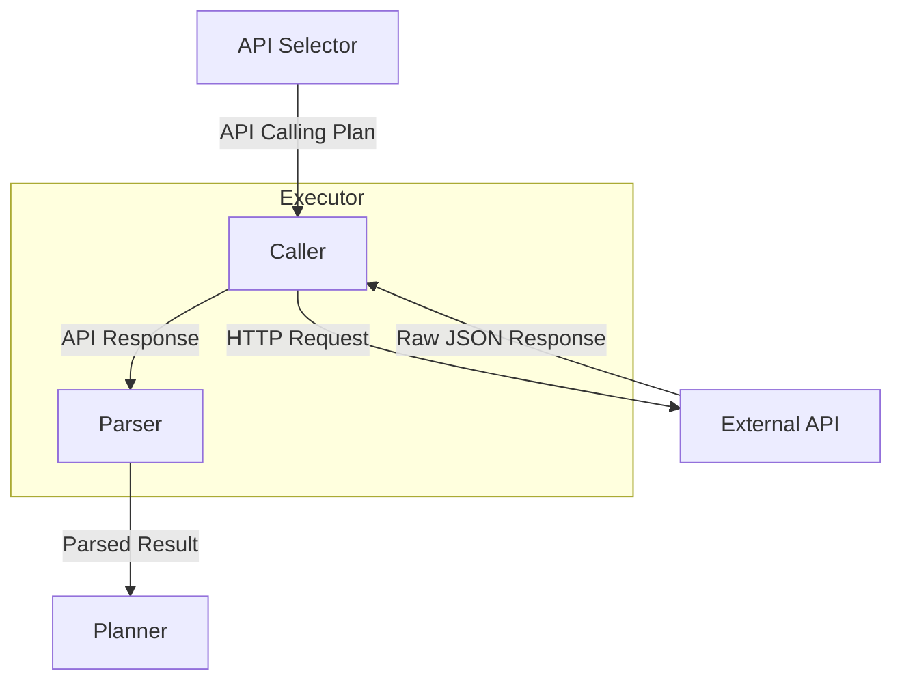
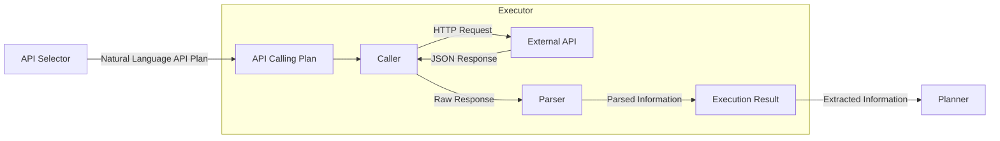
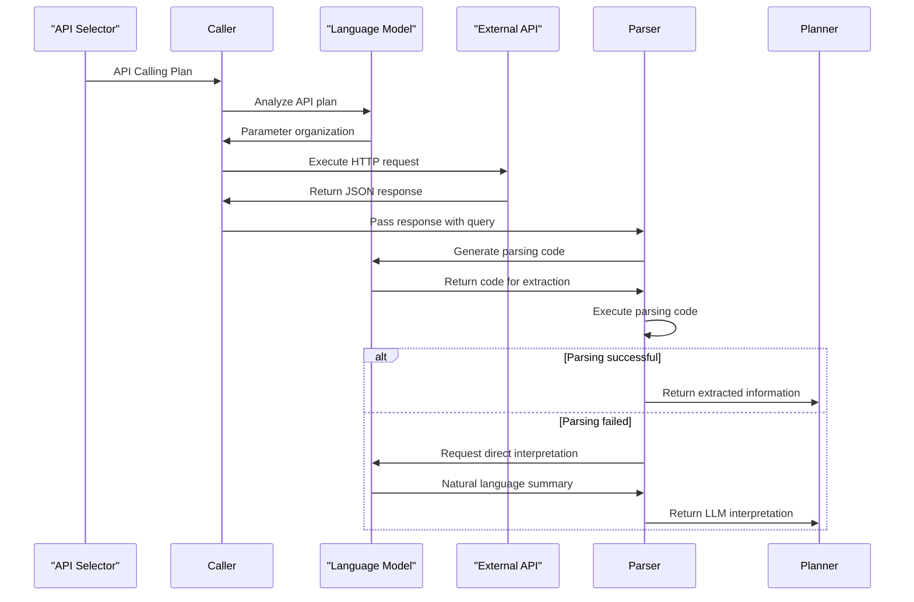
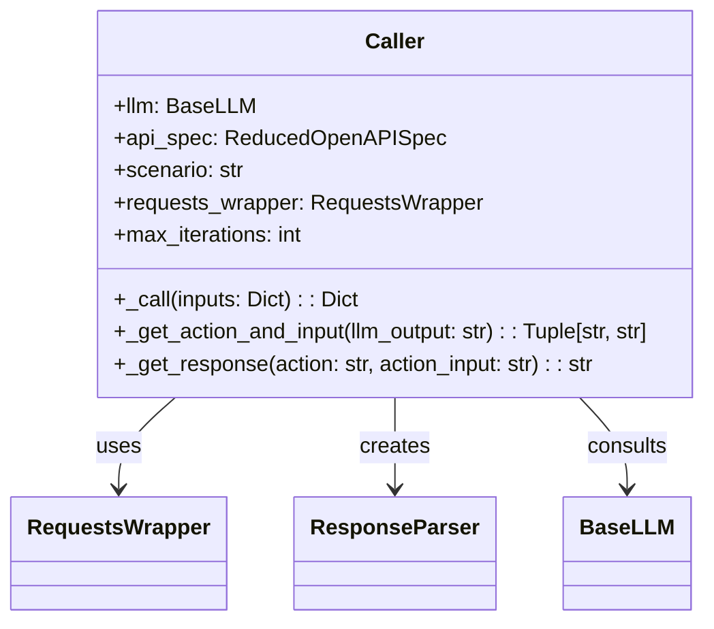
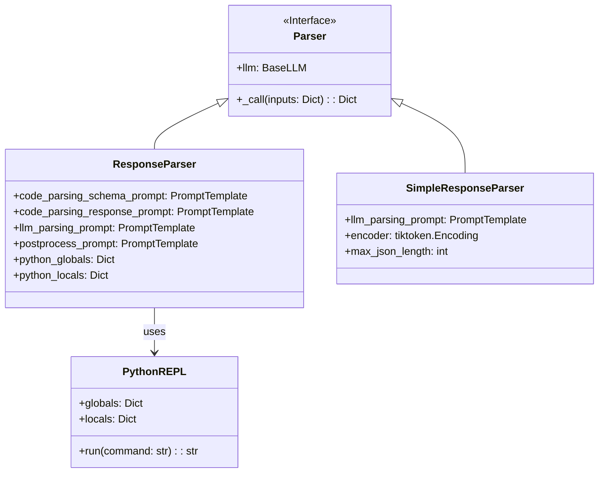
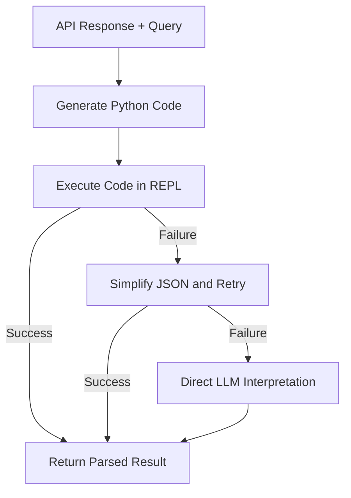
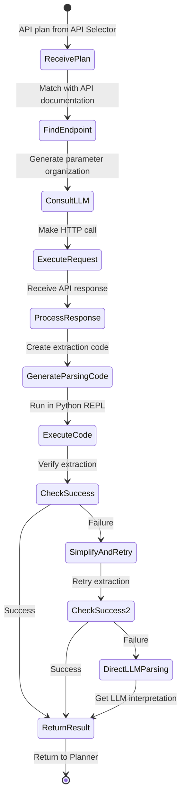

<!-- source: DeepWiki mcp.deepwiki.com · repo Yifan-Song793/RestGPT · page 3.3 Executor · fetched 2026-10-26 -->

# Executor

Relevant source files

The following files were used as context for generating this wiki page:

- [README.md](README.md)
- [model/caller.py](model/caller.py)
- [model/parser.py](model/parser.py)

The Executor is a crucial component in the RestGPT system responsible for executing API calling plans against external RESTful services. It bridges the gap between high-level natural language sub-tasks from the API Selector and the actual execution of HTTP requests to external APIs. This document explains the Executor's architecture, components, and how it processes API calls within the RestGPT system. For information about the API Selector that precedes the Executor in the workflow, see [API Selector](#3.2).

## Overview

The Executor takes an API calling plan from the API Selector and performs the following functions:
1. Constructs proper HTTP requests with appropriate parameters and headers
2. Executes calls to external RESTful APIs (like TMDB or Spotify)
3. Processes and parses the responses to extract relevant information
4. Returns the extracted information in a format useful for the Planner

Sources: [README.md:26-28]()

## Architecture

The Executor consists of two main components that work together to process API calls:

1. **Caller**: Organizes parameters based on the API plan and documentation, then executes HTTP requests
2. **Parser**: Processes the API responses, extracting relevant information based on the intended query

Sources: [model/caller.py](), [model/parser.py]()

## Component Interaction

The Executor operation follows a sequence of steps where the Caller and Parser work together:

Sources: [model/caller.py:244-332](), [model/parser.py:286-328]()

## Caller Component

### Purpose and Function

The Caller component is responsible for:
- Taking an API calling plan and translating it into actual HTTP requests
- Determining the appropriate HTTP method (GET, POST, PUT, DELETE)
- Constructing URL parameters and request bodies
- Executing the request via the RequestsWrapper
- Handling the response and directing it to the Parser

### Implementation Details

The Caller is implemented as a Langchain Chain subclass that uses an LLM to interpret API calling plans and organize API parameters. It handles iterative API calls with a maximum iteration limit.

Key methods:
- `_call`: Main entry point that processes inputs and executes the API calling plan
- `_get_action_and_input`: Extracts HTTP method and parameters from LLM output
- `_get_response`: Executes the HTTP request and processes the response

Sources: [model/caller.py:112-332]()

## Parser Component

### Purpose and Function

The Parser component handles the complex task of extracting useful information from API responses. It offers two approaches:

1. **ResponseParser**: Uses Python code generation to precisely extract information from JSON responses
2. **SimpleResponseParser**: Uses direct LLM interpretation for simpler parsing needs

### Implementation Details

#### Response Parsing Approaches

The Executor employs two main approaches for parsing API responses:

1. **Code Generation Approach**
   - Generates Python code to extract specific information from JSON responses
   - Executes the generated code in a controlled Python REPL environment
   - Handles complex data extraction with precise filtering and conditions
   - Falls back to simpler methods if code generation fails

2. **LLM Interpretation Approach**
   - Sends the API response directly to the LLM with query instructions
   - Gets natural language interpretation of the response
   - Used when the response schema is missing or when code generation fails

Sources: [model/parser.py:177-406]()

## Code Generation for API Response Parsing

One of the most sophisticated aspects of the Executor is its ability to generate Python code that precisely extracts information from JSON responses. The process follows these steps:

The Python code generation is guided by templates that instruct the LLM on how to generate extraction code based on:
- The API schema
- The specific query being asked
- Examples of expected output formats

Example parsing tasks:
- Extracting specific fields from a complex JSON structure
- Filtering lists of items based on criteria
- Formatting the output as natural language

Sources: [model/parser.py:23-58](), [model/parser.py:286-328]()

## Request Execution Workflow

The complete workflow of the Executor from receiving an API plan to returning parsed results follows these steps:

Sources: [model/caller.py:244-332](), [model/parser.py:286-328]()

## Integration with External APIs

The Executor is designed to work with various RESTful APIs by using their OpenAPI specifications. It currently supports:

| API | Scenario | Description |
|-----|----------|-------------|
| TMDB | Movie Database | Search for movies, directors, credits, etc. |
| Spotify | Music Player | Create playlists, search for tracks, control playback |

The Executor adapts to different APIs through:
1. API specification loaded during initialization
2. Requests wrapper configured with appropriate authentication
3. Scenario-specific handling for certain API endpoints

Sources: [model/caller.py:249-305]()

## Error Handling

The Executor implements several layers of error handling:

1. **HTTP Error Detection**: Checks response status codes and returns error messages when non-200 codes are received
2. **Parsing Fallbacks**: Multiple fallback mechanisms if initial parsing attempts fail
3. **Iteration Limits**: Prevents infinite loops with configurable maximum iterations
4. **Timeout Handling**: Configurable maximum execution time

Additionally, the response parser includes post-processing for truncated outputs to ensure grammatically correct results.

Sources: [model/caller.py:232-241](), [model/parser.py:321-328]()

## Table of Key Components and Classes

| Component | Class | File | Primary Responsibility |
|-----------|-------|------|------------------------|
| Caller | `Caller` | model/caller.py | Organizing API parameters and executing HTTP requests |
| Parser | `ResponseParser` | model/parser.py | Processing API responses through code generation |
| Parser | `SimpleResponseParser` | model/parser.py | Processing API responses through direct LLM interpretation |
| Helper | `PythonREPL` | model/parser.py | Executing generated Python code in a controlled environment |

Sources: [model/caller.py](), [model/parser.py]()

The Executor component sits at the critical junction between natural language planning and actual API interaction, enabling RestGPT to connect LLMs with real-world services while handling the complexity of API parameter organization and response parsing.

---

