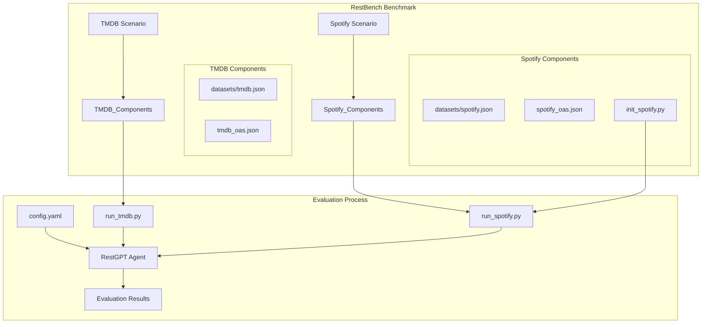
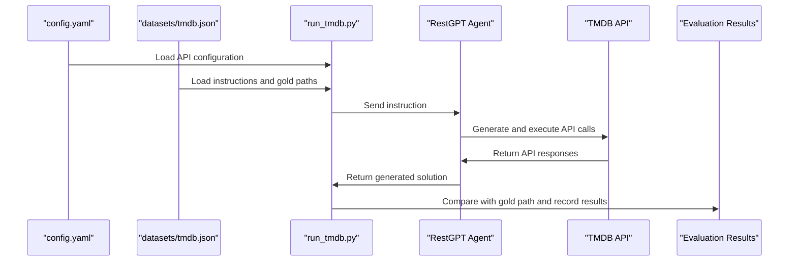

<!-- source: DeepWiki mcp.deepwiki.com · repo Yifan-Song793/RestGPT · page 4 Evaluation Framework (RestBench) · fetched 2026-10-26 -->

# Evaluation Framework (RestBench)

<details>
<summary>Relevant source files</summary>

The following files were used as context for generating this wiki page:

- [README.md](README.md)
- [imgs/restbench_example.png](imgs/restbench_example.png)

</details>


RestBench is a high-quality benchmark designed to evaluate the performance of RestGPT in connecting Large Language Models with real-world RESTful APIs. It provides a standardized testing environment consisting of two real-world scenarios with human-annotated instructions and gold solution paths to measure how effectively RestGPT can understand user instructions and translate them into appropriate API calls.

For information about specific scenario implementations, see [TMDB Scenario](#4.1) and [Spotify Scenario](#4.2).

## Architecture Overview

RestBench is structured around scenarios, each representing a real-world API interaction context. Each scenario contains a set of instructions with their corresponding gold solution paths that define the ideal sequence of API calls needed to fulfill the instruction.

### RestBench System Structure Diagram



Sources: README.md

## Dataset Structure

RestBench datasets are stored in JSON format with separate files for each scenario:

- `datasets/tmdb.json`: Contains TMDB scenario instructions and gold solution paths
- `datasets/spotify.json`: Contains Spotify scenario instructions and gold solution paths

Each instruction in the dataset includes:
1. A natural language instruction
2. A gold solution path (sequence of API calls)
3. Additional metadata for evaluation

Sources: README.md

## Dataset Statistics

The benchmark provides a comprehensive set of test cases with varying complexity levels:

| Scenario | #APIs | Len-1 | Len-2 | Len-3 | Len-4 | Avg. Len. | Total |
| -------- | ----- | ----- | ----- | ----- | ----- | --------- | ----- |
| TMDB     | 54    | 5     | 66    | 27    | 2     | 2.3       | 100   |
| Spotify  | 40    | 8     | 18    | 22    | 9     | 2.6       | 57    |

This table shows the distribution of instructions by the length of their gold solution paths, where Len-X represents the number of instructions requiring X API calls to fulfill. For example, the TMDB scenario has 66 instructions that require exactly 2 API calls to complete successfully.

Sources: README.md

## Evaluation Process

The evaluation process using RestBench follows a systematic approach to measure the performance of RestGPT against human-annotated ground truth:

### Evaluation Process Flow Diagram



The evaluation follows these steps:

1. The evaluation script (`run_tmdb.py` or `run_spotify.py`) loads API configuration from `config.yaml`
2. The script loads instructions and their gold solution paths from the RestBench dataset
3. For each instruction, the script sends it to the RestGPT agent
4. RestGPT generates a sequence of API calls to fulfill the instruction
5. The evaluation script compares RestGPT's solution with the gold solution path
6. Results are recorded for analysis

Sources: README.md

## Benchmark Scenarios

### TMDB Movie Database Scenario

The TMDB scenario focuses on interactions with The Movie Database API, which provides information about movies, TV shows, actors, and more. It includes 100 instructions with varying complexity, requiring between 1 and 4 API calls to fulfill.

Example instruction: "Who is the director of today's most trending movie?"
Gold solution path:
1. GET /trending/{media_type}/{time_window}
2. GET /movie/{movie_id}/credits

The TMDB scenario uses 54 different API endpoints and has an average solution path length of 2.3 API calls.

### Spotify Music Player Scenario

The Spotify scenario involves interactions with the Spotify API, which allows control over music playback, playlist management, and music discovery. This scenario includes 57 instructions, also with varying complexity.

Example instruction: "Make me a playlist containing three songs of Mariah Carey and name it 'Love Mariah'."
Gold solution path:
1. GET /search
2. GET /me
3. POST /users/{user_id}/playlists
4. POST /playlists/{playlist_id}/tracks

The Spotify scenario uses 40 different API endpoints and has an average solution path length of 2.6 API calls.

Sources: README.md

## Running Evaluations

### Prerequisites

Before running evaluations, you need to set up API keys in `config.yaml`:
- TMDB key from https://developer.themoviedb.org/docs/getting-started
- Spotify key from https://developer.spotify.com/documentation/web-api
- OpenAI key from OpenAI

### Spotify Environment Initialization (Optional)

For the Spotify scenario, you can initialize the Spotify environment:

```bash
python init_spotify.py
```

**WARNING**: This will remove all your data from Spotify!

### Running the Benchmark Scenarios

RestBench provides dedicated scripts to run evaluations on both scenarios:

For TMDB:
```bash
python run_tmdb.py
```

This script sequentially executes all 100 instructions in the RestBench-TMDB dataset.

For Spotify:
```bash
python run_spotify.py
```

For the Spotify scenario, you need to manually modify the `query_idx` parameter in the script before running to select which instruction to evaluate. You should also have Spotify open on your device for the execution to work properly.

The execution logs and results are saved to the `logs` folder, which should be created before running the evaluations.

Sources: README.md

---

