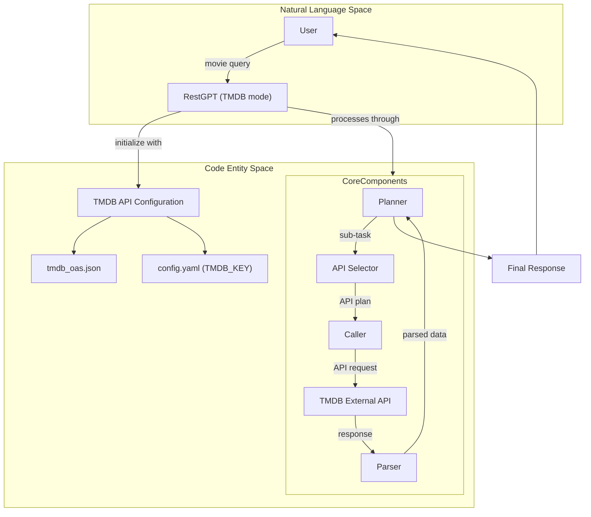
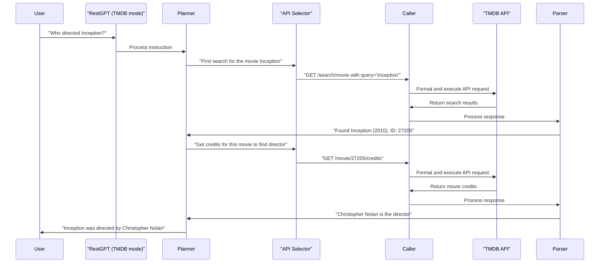
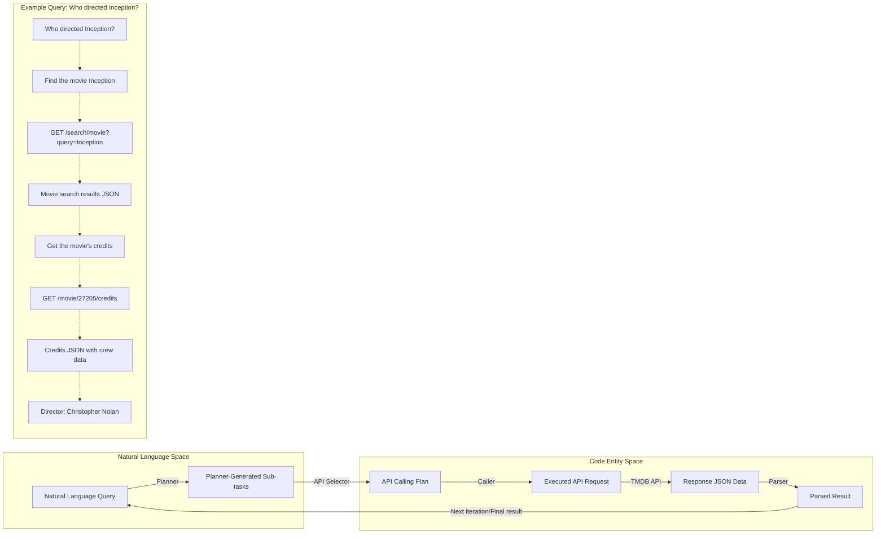

<!-- source: DeepWiki mcp.deepwiki.com · repo Yifan-Song793/RestGPT · page 4.1 TMDB Scenario · fetched 2026-10-26 -->

# TMDB Scenario

<details>
<summary>Relevant source files</summary>

The following files were used as context for generating this wiki page:

- [README.md](README.md)
- [datasets/tmdb.json](datasets/tmdb.json)

</details>


## Purpose and Scope

This document provides a comprehensive overview of the TMDB (The Movie Database) scenario in RestGPT. It details how RestGPT connects with the TMDB API to enable natural language interactions for movie and TV show information retrieval. This page focuses on the specific implementation, capabilities, and evaluation of the TMDB scenario within the RestGPT framework. For information about the Spotify scenario, see [Spotify Scenario](#4.2).

Sources: [README.md:34-59]()

## TMDB Overview

The TMDB scenario is one of the two primary evaluation frameworks in RestBench, designed to test RestGPT's ability to interact with RESTful APIs using natural language. TMDB provides access to a vast database of movies, TV shows, actors, directors, and related media information through its API.

The scenario includes 100 diverse natural language queries with human-annotated gold solution paths, ranging from simple one-step API calls to complex multi-step sequences requiring up to 4 API calls.

### Key Statistics

| Solution Path Length | Number of Queries | Percentage |
|----------------------|-------------------|------------|
| 1-step               | 5                 | 5%         |
| 2-step               | 66                | 66%        |
| 3-step               | 27                | 27%        |
| 4-step               | 2                 | 2%         |
| **Total**            | **100**           | **100%**   |
| **Average Length**   | **2.3 steps**     | -          |

Sources: [README.md:54-59](), [datasets/tmdb.json:1-727]()

## System Integration

The TMDB scenario integrates with the core RestGPT architecture through specific TMDB API specifications and authentication.

### TMDB Integration Flow



Sources: [README.md:16-28]()

## Query Types and Capabilities

The TMDB scenario supports a diverse range of natural language queries related to movies and TV shows, including:

1. **Movie Information**: Release dates, ratings, directors, cast, genres
2. **TV Show Details**: Seasons, episodes, networks, air dates
3. **Person Information**: Actors, directors, birthdays, filmographies
4. **Media Discovery**: Recommendations, similar content, trending items
5. **Visual Content**: Posters, images, logos
6. **Reviews and Keywords**: User reviews, associated keywords
7. **Companies and Collections**: Studio information, movie franchises

### TMDB API Endpoints

```mermaid
classDiagram
    class "TMDBEndpoints" {
        "/search/*"
        "/movie/*"
        "/tv/*"
        "/person/*"
        "/collection/*"
        "/company/*"
        "/network/*"
        "/trending/*"
        "/discover/*"
    }
    
    class "SearchEndpoints" {
        "/search/movie"
        "/search/tv"
        "/search/person"
        "/search/collection"
        "/search/company"
    }
    
    class "MovieEndpoints" {
        "/movie/{movie_id}"
        "/movie/{movie_id}/credits"
        "/movie/{movie_id}/images"
        "/movie/{movie_id}/keywords"
        "/movie/{movie_id}/recommendations"
        "/movie/{movie_id}/similar"
        "/movie/{movie_id}/reviews"
        "/movie/{movie_id}/release_dates"
        "/movie/popular"
        "/movie/top_rated"
        "/movie/latest"
        "/movie/now_playing"
    }
    
    class "TVEndpoints" {
        "/tv/{tv_id}"
        "/tv/{tv_id}/credits"
        "/tv/{tv_id}/images"
        "/tv/{tv_id}/keywords"
        "/tv/{tv_id}/recommendations"
        "/tv/{tv_id}/similar"
        "/tv/{tv_id}/reviews"
        "/tv/{tv_id}/season/{season_number}"
        "/tv/{tv_id}/season/{season_number}/credits"
        "/tv/{tv_id}/season/{season_number}/images"
        "/tv/{tv_id}/season/{season_number}/episode/{episode_number}"
        "/tv/{tv_id}/season/{season_number}/episode/{episode_number}/credits"
        "/tv/{tv_id}/season/{season_number}/episode/{episode_number}/images"
        "/tv/popular"
        "/tv/top_rated"
        "/tv/on_the_air"
    }
    
    "TMDBEndpoints" <|-- "SearchEndpoints"
    "TMDBEndpoints" <|-- "MovieEndpoints"
    "TMDBEndpoints" <|-- "TVEndpoints"
```

Sources: [datasets/tmdb.json:1-727]()

## Example Query Workflow

### Query Processing Sequence



Sources: [README.md:16-32](), [datasets/tmdb.json:1-200]()

## Common Query Patterns

The TMDB scenario exhibits several recurring query patterns that map to specific API call sequences:

### Example Solution Paths

| Query Type | Example Query | API Solution Path |
|------------|---------------|-------------------|
| Movie Details | "Who directed Inception?" | 1. GET /search/movie<br>2. GET /movie/{movie_id}/credits |
| Popular Content | "What is the most popular movie now?" | 1. GET /movie/popular |
| Person Filmography | "List movies by Christopher Nolan" | 1. GET /search/person<br>2. GET /person/{person_id}/movie_credits |
| Complex Person Info | "When is the birthday of the lead actor in Titanic?" | 1. GET /search/movie<br>2. GET /movie/{movie_id}/credits<br>3. GET /person/{person_id} |
| Collection Details | "What movies are in Star Wars collection?" | 1. GET /search/collection<br>2. GET /collection/{collection_id} |
| TV Show Info | "Who starred in Breaking Bad?" | 1. GET /search/tv<br>2. GET /tv/{tv_id}/credits |
| Trending Media | "What's the most trending TV show?" | 1. GET /trending/{media_type}/{time_window} |

Sources: [datasets/tmdb.json:1-727]()

## Query-to-API Mapping Process



Sources: [README.md:16-32](), [datasets/tmdb.json:1-727]()

## Running TMDB Evaluation

The RestGPT codebase includes a dedicated script for evaluating the system on the TMDB scenario:

```
python run_tmdb.py
```

This script sequentially processes all 100 instructions from the RestBench-TMDB dataset, making it easy to test and evaluate the system's performance against the benchmark.

Sources: [README.md:94-101]()

## Authentication and Setup

To use the TMDB scenario, you need to:

1. Obtain a TMDB API key from https://developer.themoviedb.org/docs/getting-started
2. Add your key to the `config.yaml` file
3. Ensure the required dependencies are installed:
   ```
   pip install langchain colorama tiktoken openai
   ```

Sources: [README.md:61-71]()

## Conclusion

The TMDB scenario provides a comprehensive benchmark for evaluating RestGPT's ability to bridge natural language understanding with structured API interactions. With 100 diverse queries and 54 distinct API endpoints, this scenario tests RestGPT's capabilities across a wide range of movie and TV show information retrieval tasks, from simple one-step queries to complex multi-step reasoning challenges.

The scenario demonstrates RestGPT's effectiveness in:
1. Breaking down complex natural language queries into sub-tasks
2. Selecting appropriate API endpoints based on these sub-tasks
3. Correctly formatting API requests with appropriate parameters
4. Parsing JSON responses to extract relevant information
5. Iteratively building toward a complete answer through multiple API calls

Sources: [README.md:34-59](), [datasets/tmdb.json:1-727]()

---

