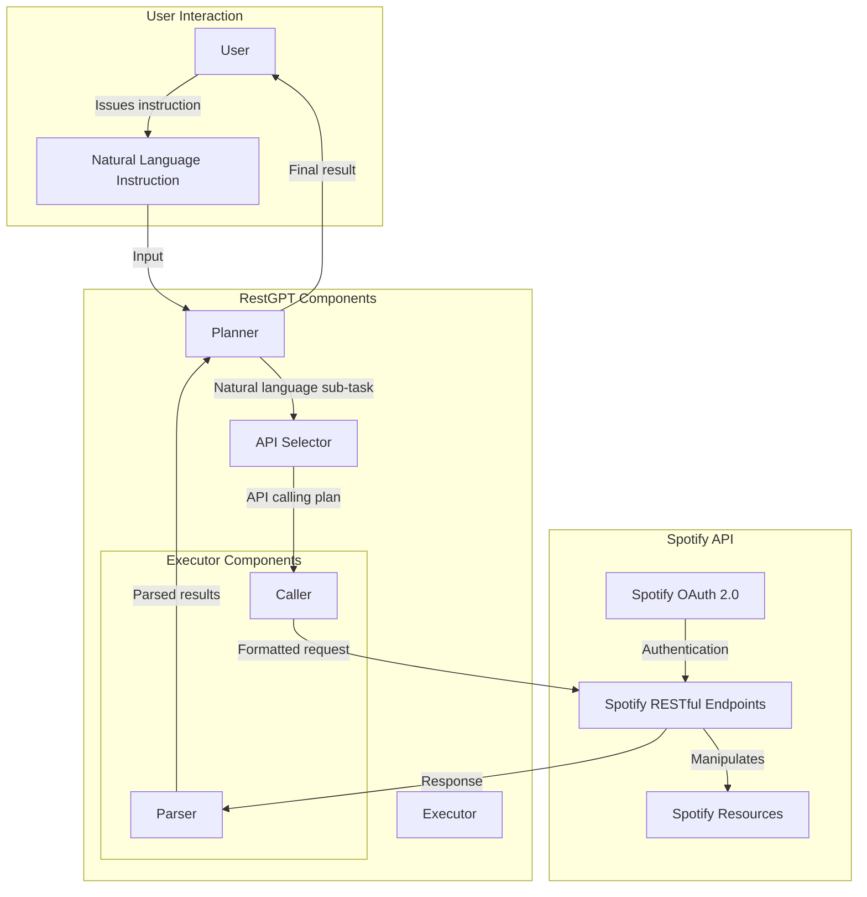
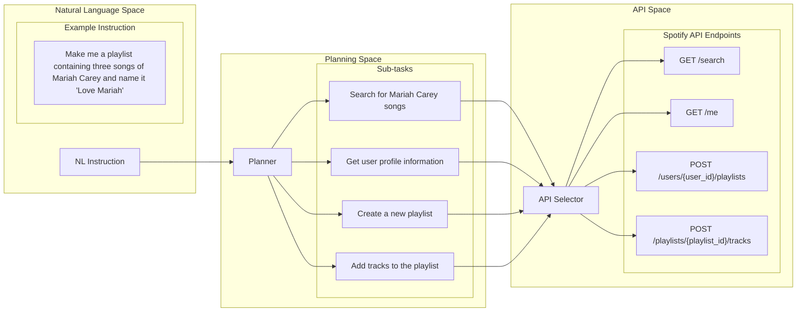
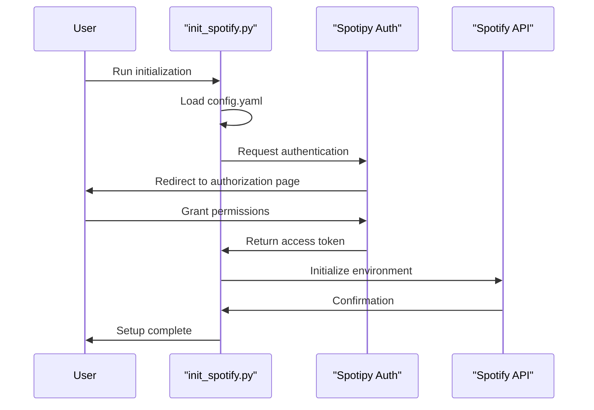
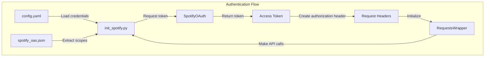

<!-- source: DeepWiki mcp.deepwiki.com · repo Yifan-Song793/RestGPT · page 4.2 Spotify Scenario · fetched 2026-10-26 -->

# Spotify Scenario

<details>
<summary>Relevant source files</summary>

The following files were used as context for generating this wiki page:

- [README.md](README.md)
- [datasets/spotify.json](datasets/spotify.json)
- [init_spotify.py](init_spotify.py)

</details>


## Purpose and Scope

This document details the Spotify scenario within the RestGPT evaluation framework (RestBench). The Spotify scenario demonstrates RestGPT's ability to control a music streaming service by connecting large language models with Spotify's RESTful APIs. This scenario focuses on enabling natural language control of music playback, playlist management, artist following, and other Spotify features.

For information about the overall evaluation framework, see [Evaluation Framework (RestBench)](#4). For details on the other scenario in RestBench, see [TMDB Scenario](#4.1).

Sources: [README.md:35-59]()

## Overview of the Spotify Scenario

The Spotify scenario is one of two real-world application scenarios in RestBench, designed to evaluate how effectively RestGPT can interpret natural language instructions and translate them into sequences of API calls to a music streaming service. It represents a practical use case where users want to control their music experience through conversational commands rather than manual interface interactions.

### Key Features

The Spotify scenario enables users to:
- Create and manage playlists
- Control music playback (play, pause, skip, queue songs)
- Search for artists, albums, and tracks
- Follow/unfollow artists
- Save tracks and albums to the user's library
- Adjust playback settings (volume, repeat mode)
- Get information about currently playing music

### Benchmark Dataset

The RestBench-Spotify dataset includes 57 diverse instructions with human-annotated gold solution paths. The instructions vary in complexity, requiring between 1 and 4 API calls to execute completely:

| Path Length | Number of Instructions |
|-------------|------------------------|
| 1-step      | 8                      |
| 2-step      | 18                     |
| 3-step      | 22                     |
| 4-step      | 9                      |
| **Total**   | **57**                 |

The average solution path length is 2.6 API calls.

Sources: [README.md:35-59](), [datasets/spotify.json:1-432]()

## Architecture and Integration

### System Integration Diagram



Sources: [README.md:16-32]()

### Natural Language to API Mapping Flow



Sources: [README.md:45-52](), [datasets/spotify.json:1-10]()

## Setting Up the Spotify Environment

Before using the Spotify scenario, you need to configure your environment and authenticate with the Spotify API.

### Configuration Requirements

1. Spotify Developer credentials:
   - Client ID
   - Client Secret
   - Redirect URI

2. Configuration in `config.yaml`:
   ```yaml
   spotipy_client_id: "your_client_id"
   spotipy_client_secret: "your_client_secret"
   spotipy_redirect_uri: "your_redirect_uri"
   ```

### Initialization Process

The system provides an initialization script that sets up a clean Spotify environment for testing. Note that this will remove all existing data from your Spotify account.



To initialize:
```bash
python init_spotify.py
```

Sources: [README.md:73-79](), [init_spotify.py:1-34]()

## Spotify API Operations

The Spotify scenario interacts with 40 different API endpoints covering various areas of functionality. Here's an overview of the main categories:

### API Operation Categories

| Category | Description | Example Endpoints |
|----------|-------------|-------------------|
| Playback Control | Manage the playback state | `/me/player/play`, `/me/player/pause`, `/me/player/next` |
| Playlist Management | Create and modify playlists | `/users/{user_id}/playlists`, `/playlists/{playlist_id}/tracks` |
| Search | Find music content | `/search` |
| Library Management | Manage saved items | `/me/tracks`, `/me/albums` |
| User Profile | Access user information | `/me` |
| Following | Manage artist following | `/me/following` |
| Browsing | Get recommendations | `/artists/{id}/related-artists` |

### Common Instruction Patterns

Based on the RestBench dataset, common instruction patterns include:

1. **Single-step operations**:
   - Pausing playback: `PUT /me/player/pause`
   - Setting volume: `PUT /me/player/volume`
   - Skipping tracks: `POST /me/player/next`

2. **Multi-step operations**:
   - Creating playlists with specific content (4 steps)
   - Finding and playing songs from specific artists (3 steps)
   - Managing followed artists (3 steps)

Sources: [datasets/spotify.json:1-432]()

## Example Scenarios

The RestBench-Spotify dataset includes a wide variety of user instructions. Here are some representative examples:

### Example 1: Playlist Creation

**Instruction**: "Make me a playlist containing three songs of Mariah Carey and name it 'Love Mariah'"

**Solution Path**:
1. `GET /search` - Search for Mariah Carey songs
2. `GET /me` - Get user profile information
3. `POST /users/{user_id}/playlists` - Create a new playlist
4. `POST /playlists/{playlist_id}/tracks` - Add tracks to the playlist

### Example 2: Playback Control

**Instruction**: "Skip to the next track and set the volume to 60"

**Solution Path**:
1. `POST /me/player/next` - Skip to the next track
2. `PUT /me/player/volume` - Set the volume level

### Example 3: Content Discovery

**Instruction**: "Recommend more artists base on my first following artist"

**Solution Path**:
1. `GET /me/following` - Get user's followed artists
2. `GET /artists/{id}/related-artists` - Get related artists

Sources: [datasets/spotify.json:1-35](), [datasets/spotify.json:223-235]()

## Running the Spotify Scenario

The Spotify scenario can be run either interactively or using the predefined benchmark instructions.

### Interactive Mode

To run the system interactively:
```bash
python run.py
```
Then select "Spotify" when prompted for the scenario, and enter your instruction.

### Benchmark Evaluation

To run the system on the benchmark dataset:
```bash
python run_spotify.py
```

Note: You should manually modify the `query_idx` in the script to select which instruction to execute, and you should have the Spotify application open on your device to observe the results.

Sources: [README.md:81-101]()

## Implementation Details

### API Specification

RestGPT utilizes a reduced OpenAPI specification (`spotify_oas.json`) that describes the Spotify API endpoints, parameters, and response schemas. This specification helps the system understand the available operations and required parameters for each API call.

### Authentication

The Spotify scenario uses OAuth 2.0 authentication. The `init_spotify.py` script extracts the required scopes from the API specification and requests authorization for all needed permissions:



Sources: [init_spotify.py:1-34]()

## Conclusion

The Spotify scenario provides a comprehensive test bed for evaluating RestGPT's ability to interpret natural language instructions and control a real-world music streaming service. By covering a diverse range of operations from simple playback controls to complex playlist management, it demonstrates the system's capability to bridge the gap between natural language and RESTful API interactions.

Sources: [README.md:35-59](), [datasets/spotify.json:1-432]()

---

