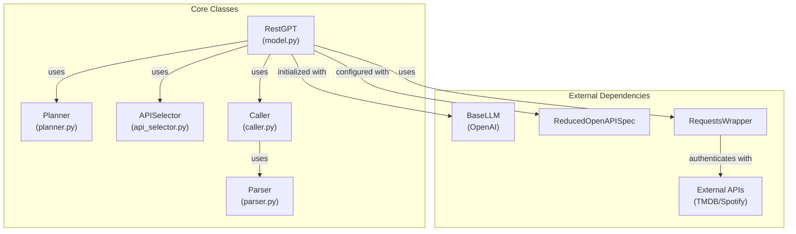
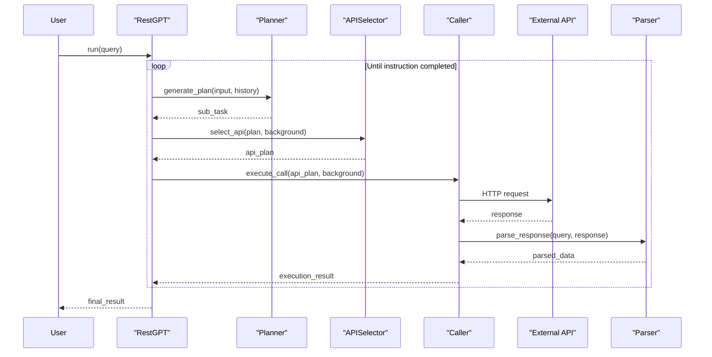
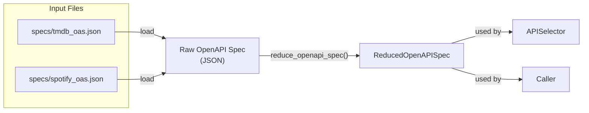
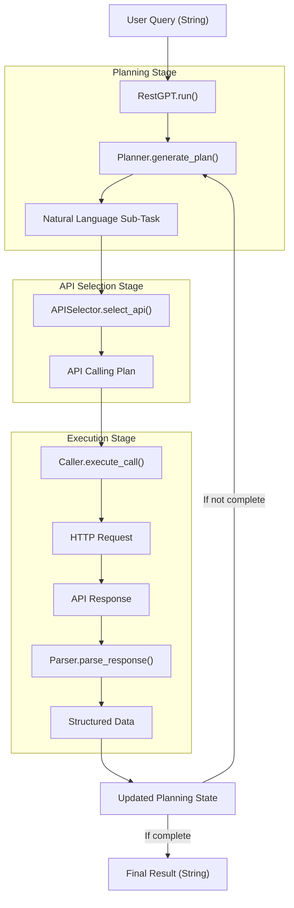

<!-- source: DeepWiki mcp.deepwiki.com · repo Yifan-Song793/RestGPT · page 5 Technical Reference · fetched 2026-10-26 -->

# Technical Reference

<details>
<summary>Relevant source files</summary>

The following files were used as context for generating this wiki page:

- [README.md](README.md)
- [run.py](run.py)

</details>


This document provides detailed technical information for developers working with the RestGPT system. It covers architecture details, key interfaces, configuration options, and technical implementation details necessary for understanding, modifying, or extending the system.

For information on basic usage and setup, see [Getting Started](#2). For explanations of individual components, see [Core Components](#3).

## System Architecture Implementation

The RestGPT system implements a modular architecture that connects large language models with RESTful APIs. The following diagram shows the primary code entities and their relationships:



Sources: [README.md:16-28](), [run.py:60-62]()

## Class Structure and Implementation

### RestGPT Class

The `RestGPT` class is the main entry point for the system. It coordinates the execution flow between all components.

**Key attributes:**
- `llm`: The language model instance (typically OpenAI)
- `api_spec`: Reduced OpenAPI specification for the target API
- `scenario`: The current scenario (e.g., "tmdb" or "spotify")
- `requests_wrapper`: Wrapper for making authenticated HTTP requests

**Key methods:**
- `run(query: str)`: Processes a user instruction and returns the result
- `_call(inputs: Dict)`: Internal method that manages the execution flow

Sources: [run.py:62](), [README.md:16-28]()

### Execution Flow

The following sequence diagram illustrates how the different components interact during the execution of a user instruction:



Sources: [README.md:18-28]()

## API Specification Integration

RestGPT uses a reduced form of OpenAPI specifications to understand the structure of external APIs. The system processes raw OpenAPI specs using the `reduce_openapi_spec` utility function to create a simplified format that contains only the information needed for API selection and calling.



Sources: [run.py:36-39](), [run.py:46-49]()

## Authentication and External API Integration

RestGPT supports two external API scenarios:

1. **TMDB (The Movie Database)**: Requires a bearer token for authentication
2. **Spotify**: Uses OAuth 2.0 authentication

The system handles authentication through the `RequestsWrapper` class, which attaches the appropriate headers to all API requests.

| Scenario | Authentication Method | Configuration Variable | Headers |
|----------|----------------------|---------------------|----------|
| TMDB | Bearer Token | `tmdb_access_token` | `Authorization: Bearer {token}` |
| Spotify | OAuth 2.0 | `spotipy_client_id`, `spotipy_client_secret`, `spotipy_redirect_uri` | `Authorization: Bearer {token}` |

Sources: [run.py:41-45](), [run.py:51-55]()

## Language Model Integration

RestGPT uses language models (LLMs) throughout its components to understand natural language, generate plans, select APIs, and parse responses. The system currently uses OpenAI's text-davinci-003 model with the following default parameters:

```
llm = OpenAI(
    model_name="text-davinci-003", 
    temperature=0.0, 
    max_tokens=700
)
```

Each component (Planner, APISelector, Caller, Parser) receives the LLM instance during initialization and uses it for different natural language processing tasks.

Sources: [run.py:61]()

## Technical Requirements

### Dependencies

RestGPT requires the following Python packages:

- `langchain`: Framework for language model integration
- `colorama`: Terminal color formatting
- `tiktoken`: OpenAI token counting utility
- `spotipy`: Spotify API client
- `openai`: OpenAI API client

Installation command:
```
pip install langchain colorama tiktoken spotipy openai
```

Sources: [README.md:63-65]()

### Configuration

RestGPT uses a YAML configuration file (`config.yaml`) to store API keys and authentication information. The following configuration parameters are required:

| Parameter | Description | Used For |
|-----------|-------------|----------|
| `openai_api_key` | OpenAI API key | Language model access |
| `tmdb_access_token` | TMDB API access token | TMDB API authentication |
| `spotipy_client_id` | Spotify client ID | Spotify API authentication |
| `spotipy_client_secret` | Spotify client secret | Spotify API authentication |
| `spotipy_redirect_uri` | Spotify redirect URI | Spotify OAuth flow |

Sources: [run.py:19-24](), [README.md:69-71]()

## Execution Environment

The RestGPT system includes several entry points for different use cases:

1. **run.py**: Interactive command-line interface for running arbitrary instructions
2. **run_tmdb.py**: Executes all instructions in the RestBench-TMDB test set
3. **run_spotify.py**: Executes instructions from the RestBench-Spotify test set
4. **init_spotify.py**: Initializes the Spotify environment (warning: removes existing data)

The execution environment uses a logging system with colored output for better readability. The log level is set to `INFO` to display execution details.

Sources: [README.md:81-101](), [run.py:26-30]()

## Data Flow in Query Processing

The following diagram illustrates how data flows through the system when processing a user query:



Sources: [README.md:18-28](), [README.md:30-32]()

## Additional Resources

For more detailed information on specific aspects of the system, refer to:

- [API Interfaces](#5.1): Details on how RestGPT interfaces with external APIs
- [Configuration Options](#5.2): Comprehensive reference of all configuration parameters
- [Advanced Usage](#5.3): Guidelines for advanced use cases and customization

---

