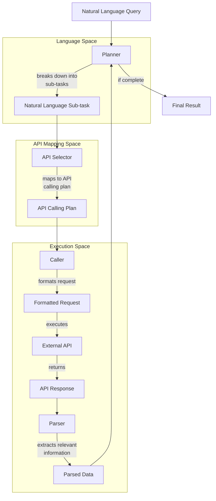
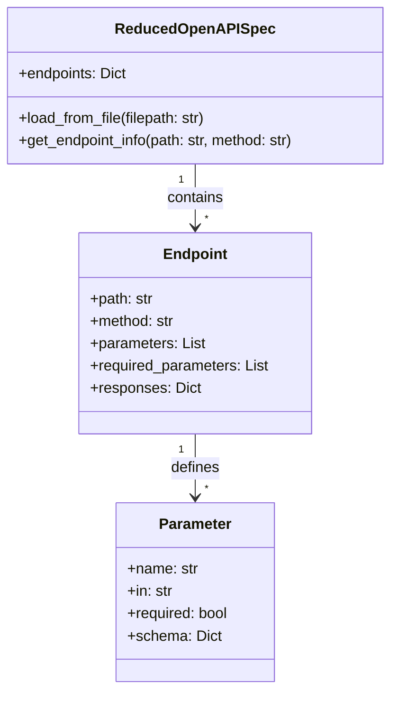
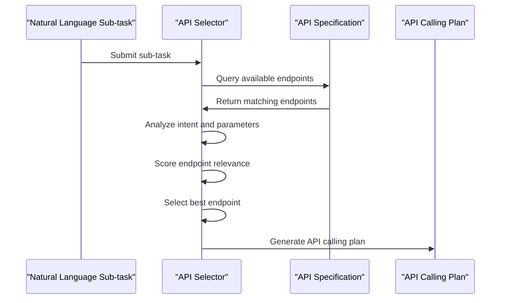
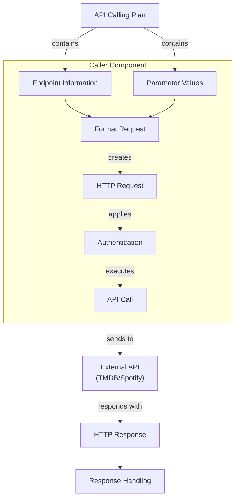
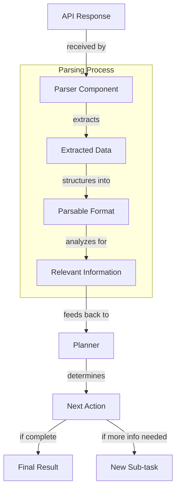
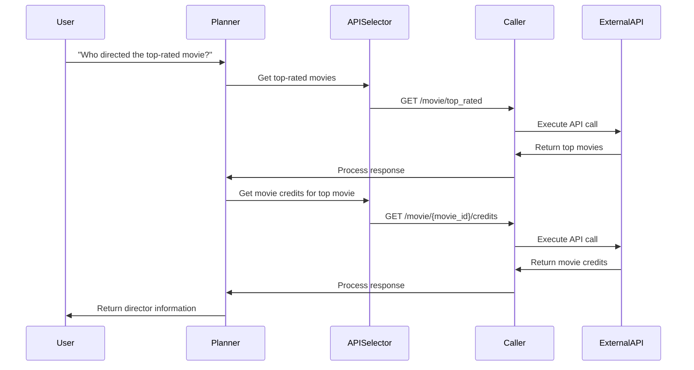
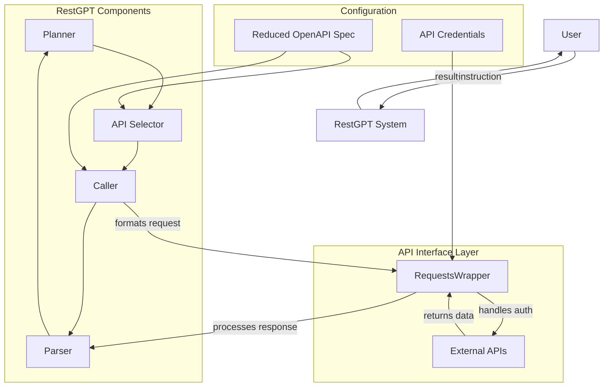

<!-- source: DeepWiki mcp.deepwiki.com · repo Yifan-Song793/RestGPT · page 5.1 API Interfaces · fetched 2026-10-26 -->

# API Interfaces

Relevant source files

The following files were used as context for generating this wiki page:

- [datasets/spotify.json](datasets/spotify.json)
- [datasets/tmdb.json](datasets/tmdb.json)

This document explains how RestGPT interfaces with external RESTful APIs, providing technical details on the connection between natural language queries and structured API calls. For information about core components and their general functionality, see [Core Components](#3).

## 1. API Interface Architecture

RestGPT implements a modular approach to API interaction, allowing the system to connect with various RESTful services through standardized interfaces. The system bridges the gap between natural language space and API endpoint space through a series of specialized components.

Sources: `datasets/spotify.json`, `datasets/tmdb.json`

## 2. API Specification Management

RestGPT consumes and processes API specifications in a reduced OpenAPI format to understand available endpoints, parameters, and expected responses for each external API.

### 2.1 Reduced OpenAPI Specification

The system uses a simplified version of the OpenAPI specification to manage API interfaces efficiently. These specifications include:

- Endpoint paths and methods
- Required and optional parameters
- Authentication requirements
- Response structure and schema

Sources: `datasets/spotify.json`, `datasets/tmdb.json`

## 3. API Selection Process

The API Selector component is responsible for mapping natural language sub-tasks to specific API endpoints by analyzing the intent and parameters in the natural language text.

### 3.1 Selection Workflow

Sources: `datasets/spotify.json`, `datasets/tmdb.json`

### 3.2 Example Mapping

The table below illustrates how natural language sub-tasks are mapped to API endpoints:

| Natural Language Sub-task | API Endpoint | Method |
|---------------------------|--------------|--------|
| Find movies directed by Sofia Coppola | /search/person | GET |
| Who was the lead actor in The Dark Knight? | /movie/{movie_id}/credits | GET |
| Make a playlist with songs by Mariah Carey | /users/{user_id}/playlists | POST |
| Skip to the next track | /me/player/next | POST |

Sources: `datasets/spotify.json`, `datasets/tmdb.json`

## 4. API Call Execution

The Caller component handles the execution of API calls by organizing parameters, formatting requests, and managing authentication.

### 4.1 Parameter Organization

RestGPT extracts and formats parameters from natural language according to API specifications. Parameters can be:

- Path parameters (e.g., `{movie_id}`, `{playlist_id}`)
- Query parameters (e.g., `?query=Titanic`)
- Request body parameters for POST/PUT requests

### 4.2 Request Execution Flow

Sources: `datasets/spotify.json`, `datasets/tmdb.json`

## 5. Response Processing

The Parser component processes API responses and extracts relevant information to be used in subsequent planning steps.

### 5.1 Response Parsing

Sources: `datasets/spotify.json`, `datasets/tmdb.json`

## 6. Supported API Scenarios

RestGPT currently supports the following API scenarios:

### 6.1 TMDB (The Movie Database)

TMDB API provides access to movie, TV show, actor, and production company information. Common endpoint patterns include:

| Endpoint Pattern | Purpose | Example |
|------------------|---------|---------|
| /search/{type} | Search for movies, TV shows, people | GET /search/movie?query=Titanic |
| /movie/{movie_id}/... | Get details about specific movies | GET /movie/550/credits |
| /person/{person_id}/... | Get details about people | GET /person/123/movie_credits |
| /tv/{tv_id}/... | Get details about TV shows | GET /tv/1396/season/1 |

Sources: `datasets/tmdb.json`

### 6.2 Spotify

Spotify API provides access to music, playlist, and user account functionality. Common endpoint patterns include:

| Endpoint Pattern | Purpose | Example |
|------------------|---------|---------|
| /search | Search for tracks, artists, albums | GET /search?q=Mariah%20Carey&type=artist |
| /me/... | Access user-specific features | GET /me/playlists |
| /playlists/{playlist_id}/... | Modify playlists | POST /playlists/123/tracks |
| /me/player/... | Control playback | PUT /me/player/volume?volume_percent=60 |

Sources: `datasets/spotify.json`

## 7. Multi-Step API Interactions

Many user queries require multiple API calls to fulfill. RestGPT handles these through iterative planning and execution.

### 7.1 API Call Chaining

Sources: `datasets/tmdb.json`

### 7.2 Example Complex Workflows

| User Query | API Call Sequence |
|------------|-------------------|
| "Make a playlist with Mariah Carey songs named 'Love Mariah'" | 1. GET /search 2. GET /me 3. POST /users/{user_id}/playlists 4. POST /playlists/{playlist_id}/tracks |
| "Who directed the movie Titanic?" | 1. GET /search/movie 2. GET /movie/{movie_id}/credits |
| "Follow the artist of the song currently playing" | 1. GET /me/player/currently-playing 2. GET /tracks/{id} 3. PUT /me/following |

Sources: `datasets/spotify.json`, `datasets/tmdb.json`

## 8. API Interface Integration

The following diagram shows how API interfaces integrate with the overall RestGPT system architecture:

Sources: `datasets/spotify.json`, `datasets/tmdb.json`

## 9. Summary

RestGPT's API interface design allows it to connect natural language instructions with structured API calls through a modular and extensible architecture. The key components involved in this process include:

1. **API Selector**: Maps natural language sub-tasks to API endpoints
2. **Caller**: Formats and executes API calls with appropriate parameters
3. **Parser**: Processes API responses and extracts relevant information
4. **API Specifications**: Provide structured information about available endpoints

This architecture enables RestGPT to interact with various RESTful services while maintaining a consistent natural language interface for users.

---

