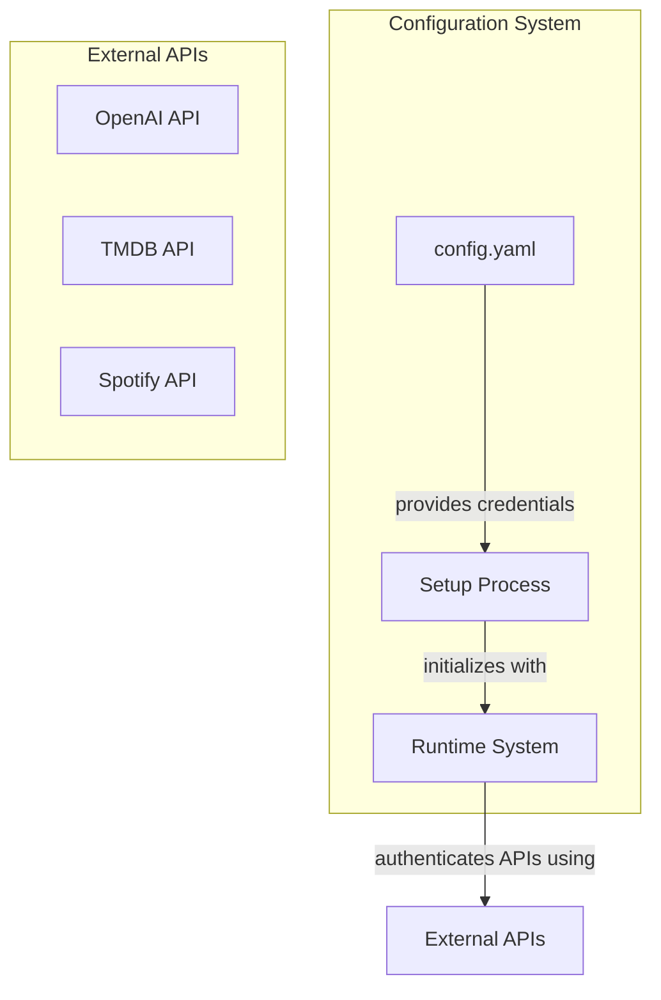
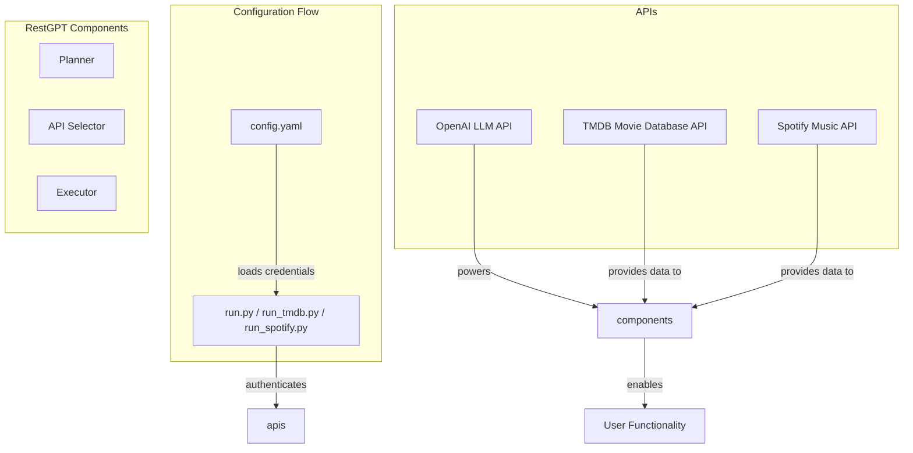
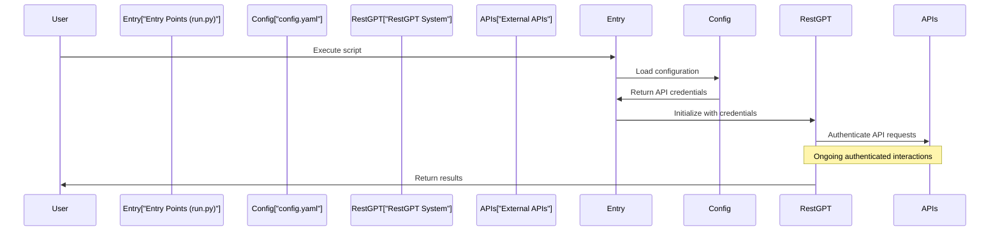
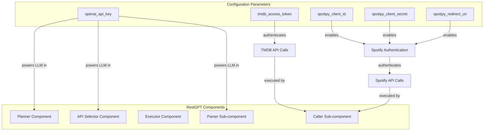

<!-- source: DeepWiki mcp.deepwiki.com · repo Yifan-Song793/RestGPT · page 5.2 Configuration Options · fetched 2026-10-26 -->

# Configuration Options

<details>
<summary>Relevant source files</summary>

The following files were used as context for generating this wiki page:

- [README.md](README.md)
- [config.yaml](config.yaml)

</details>


This document provides a comprehensive reference for all configuration parameters available in RestGPT. It covers the core configuration file structure, API authentication setup, and how these configurations affect system behavior. For information about advanced usage scenarios and customization, see [Advanced Usage](#5.3).

## Core Configuration File

RestGPT uses a YAML configuration file to manage API keys and authentication parameters. The primary configuration file is located at the root directory of the project.



Sources: [config.yaml:1-7](), [README.md:61-71]()

### Configuration File Structure

The `config.yaml` file contains the following key configuration parameters:

| Parameter | Description | Required |
|-----------|-------------|----------|
| `openai_api_key` | Authentication key for OpenAI API access | Yes |
| `tmdb_access_token` | Access token for The Movie Database (TMDB) API | Required for TMDB scenario |
| `spotipy_client_id` | Client ID for Spotify API authentication | Required for Spotify scenario |
| `spotipy_client_secret` | Client secret for Spotify API authentication | Required for Spotify scenario |
| `spotipy_redirect_uri` | Redirect URI for Spotify OAuth flow | Required for Spotify scenario |

Example configuration file:

```yaml
openai_api_key: your_openai_key_here
tmdb_access_token: your_tmdb_token_here
spotipy_client_id: your_spotify_client_id
spotipy_client_secret: your_spotify_client_secret
spotipy_redirect_uri: your_spotify_redirect_uri
```

Sources: [config.yaml:1-7]()

## API Authentication Configuration

RestGPT interacts with multiple external APIs, each requiring different authentication methods. This section details how to properly configure authentication for each service.



Sources: [README.md:61-71](), [config.yaml:1-7]()

### OpenAI API Configuration

The OpenAI API key is required for all scenarios as it powers the language model capabilities of RestGPT.

- **Parameter**: `openai_api_key`
- **How to obtain**: Register at the [OpenAI platform](https://openai.com) and create an API key
- **Usage**: Powers all language model components including the Planner, API Selector, and Parser

Sources: [README.md:69](), [config.yaml:1]()

### TMDB API Configuration

The TMDB access token is required when using RestGPT with the movie database scenario.

- **Parameter**: `tmdb_access_token`
- **How to obtain**: Register at the [TMDB developer portal](https://developer.themoviedb.org/docs/getting-started) and create an access token
- **Usage**: Authenticates all requests to the TMDB API for movie information retrieval

Sources: [README.md:69](), [config.yaml:3]()

### Spotify API Configuration

Spotify requires three configuration parameters for OAuth authentication:

- **Parameters**: 
  - `spotipy_client_id`: Identifies your application to Spotify
  - `spotipy_client_secret`: Secret key for Spotify API authentication
  - `spotipy_redirect_uri`: URL where Spotify redirects after authentication
- **How to obtain**: Register an application in the [Spotify Developer Dashboard](https://developer.spotify.com/documentation/web-api)
- **Usage**: Enables RestGPT to interact with the Spotify API for music playback and playlist management

Sources: [README.md:69](), [config.yaml:5-7]()

## Environment Setup and Configuration Loading

When running RestGPT, the system loads configuration from the `config.yaml` file during initialization. The configuration is then used throughout the system's operation to authenticate API requests.



Sources: [README.md:83-90]()

## Scenario-Specific Configuration

RestGPT requires different configuration parameters depending on which scenario you're running.

### TMDB Scenario Configuration

When running the TMDB scenario, you must provide:
- OpenAI API key
- TMDB access token

This configuration supports querying the movie database for information about films, directors, actors, and other movie-related data.

### Spotify Scenario Configuration

When running the Spotify scenario, you must provide:
- OpenAI API key
- All three Spotify authentication parameters

Additionally, Spotify requires initialization to prepare the environment:

```bash
python init_spotify.py
```

**Warning**: The initialization process will remove all existing data from your Spotify account.

Sources: [README.md:73-79](), [README.md:97-99]()

## Configuration Best Practices

### Security Considerations

1. **Never commit your config.yaml with actual keys**: Add it to your `.gitignore` file
2. **Use environment variables** for production environments
3. **Restrict API key permissions** to only what RestGPT needs
4. **Regularly rotate API keys** for enhanced security

### Troubleshooting Configuration Issues

| Issue | Possible Solution |
|-------|------------------|
| "API key not valid" | Double-check your OpenAI API key in config.yaml |
| TMDB authentication errors | Ensure your TMDB access token has not expired |
| Spotify authentication fails | Verify all three Spotify parameters are correctly configured |
| Permission errors | Check if your API keys have the necessary scopes/permissions |

Sources: [README.md:61-71]()

## Configuration and System Integration

The configuration parameters directly affect RestGPT's components and their functionality:



Sources: [README.md:22-28](), [config.yaml:1-7]()

## Related Configuration Resources

For a deeper understanding of how these configuration options integrate with system components:

- For information on API interfaces and how they use these configurations, see [API Interfaces](#5.1)
- For advanced usage scenarios and customization options, see [Advanced Usage](#5.3)
- For running the system with different configurations, see [Running the System](#2.2)

---

