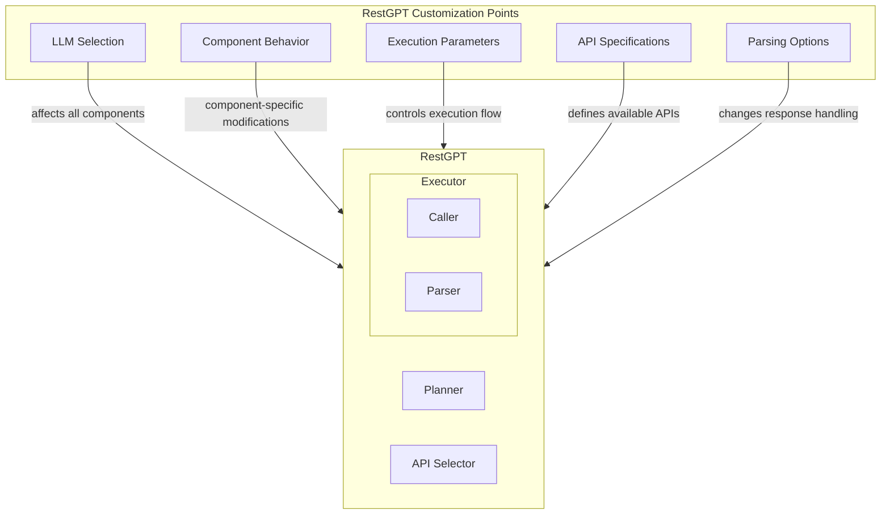
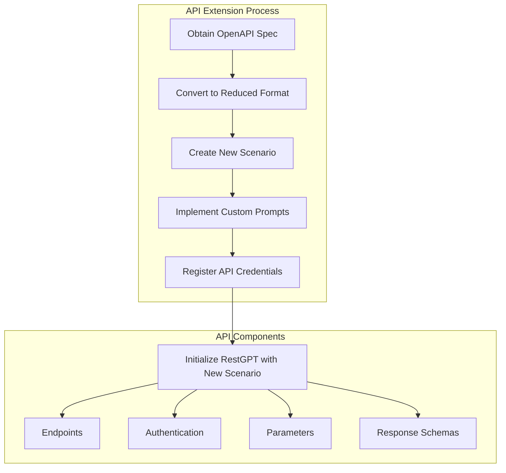
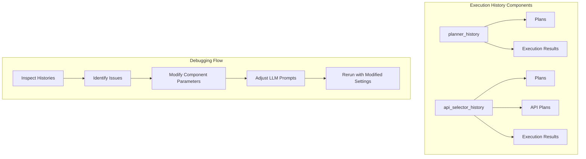

<!-- source: DeepWiki mcp.deepwiki.com · repo Yifan-Song793/RestGPT · page 5.3 Advanced Usage · fetched 2026-10-26 -->

# Advanced Usage

<details>
<summary>Relevant source files</summary>

The following files were used as context for generating this wiki page:

- [README.md](README.md)
- [model/rest_gpt.py](model/rest_gpt.py)

</details>


This document provides detailed information on advanced usage patterns, customization options, and extension points for the RestGPT system. It is intended for developers who want to go beyond basic usage and modify or extend the system's functionality to meet specific requirements. For basic setup and running instructions, see [Getting Started](#2) and [Running the System](#2.2).

## Customizing Component Behavior

RestGPT's modular architecture allows for customization of its core components to adapt to different use cases and scenarios beyond the default behavior.



Sources: [model/rest_gpt.py:37-62](), [README.md:16-29]()

### LLM Selection and Configuration

RestGPT uses LangChain's BaseLLM interface, allowing you to use different language models. By default, the system uses OpenAI's models, but you can substitute any compatible LLM.

```python
# Example of initializing RestGPT with a custom LLM
from langchain.llms import OpenAI

# Initialize with higher temperature for more creative responses
custom_llm = OpenAI(temperature=0.7)
rest_gpt = RestGPT(
    llm=custom_llm,
    api_spec=api_spec,
    scenario="tmdb",
    requests_wrapper=requests_wrapper
)
```

Sources: [model/rest_gpt.py:25-35]()

### Execution Control Parameters

RestGPT provides several parameters to control execution flow and behavior:

| Parameter | Description | Default |
|-----------|-------------|---------|
| `max_iterations` | Maximum number of planning iterations | 15 |
| `max_execution_time` | Maximum execution time in seconds | None (unlimited) |
| `early_stopping_method` | Method for early stopping | "force" |
| `return_intermediate_steps` | Whether to return intermediate planning steps | False |
| `simple_parser` | Use simplified response parsing | False |

These parameters can be set during initialization to control how RestGPT processes instructions:

```python
# Example with custom execution parameters
rest_gpt = RestGPT(
    llm=llm,
    api_spec=api_spec,
    scenario="spotify",
    requests_wrapper=requests_wrapper,
    max_iterations=10,
    max_execution_time=30.0,
    return_intermediate_steps=True
)
```

Sources: [model/rest_gpt.py:32-35](), [model/rest_gpt.py:96-105]()

## Extending for New API Services

RestGPT can be extended beyond the default TMDB and Spotify scenarios to work with any RESTful API service by providing the appropriate API specification.

### API Specification Requirements

The system uses a `ReducedOpenAPISpec` format to understand API endpoints, parameters, and response structures. To extend RestGPT to new APIs:

1. Obtain or create an OpenAPI specification file for the target API
2. Convert it to the reduced format used by RestGPT
3. Create a new scenario identifier and associated prompts



Sources: [model/rest_gpt.py:40-54](), [README.md:61-71]()

### Custom Scenario Implementation

To implement a new API scenario:

1. Create a new OpenAPI specification JSON file for your API
2. Add the API credentials to the `config.yaml` file
3. Extend the scenario handling in the RestGPT initialization:

```python
# Example extending scenario support in RestGPT
if scenario in ['MyCustomAPI']:
    scenario = 'mycustomapi'
if scenario not in ['tmdb', 'spotify', 'mycustomapi']:
    raise ValueError(f"Invalid scenario {scenario}")
```

The key is ensuring your OpenAPI specification accurately describes all endpoints, parameters, and response structures to allow the model to correctly formulate API calls.

Sources: [model/rest_gpt.py:49-54]()

## Advanced Execution Patterns

RestGPT uses a sophisticated planning and execution loop to process user instructions. Understanding this flow allows for more efficient usage and customization.

### Planning and Execution Cycle

The core execution loop follows this pattern:

```mermaid
sequenceDiagram
    participant User
    participant RestGPT
    participant Planner
    participant APISelector as "API Selector"
    participant Executor
    
    User->>RestGPT: query
    
    loop Until completion or max iterations
        RestGPT->>Planner: Generate plan
        Planner->>RestGPT: plan
        
        RestGPT->>APISelector: Select API
        APISelector->>RestGPT: api_plan
        
        alt API call needed
            RestGPT->>Executor: Execute call
            Executor->>RestGPT: execution_result
        else No API call needed
            RestGPT->>RestGPT: Extract result
        end
        
        RestGPT->>Planner: Update with result
        Planner->>RestGPT: Updated plan
        
        alt Continue plan is needed
            loop Continue plan execution
                RestGPT->>APISelector: Continue previous plan
                APISelector->>RestGPT: api_plan
                RestGPT->>Executor: Execute call
                Executor->>RestGPT: execution_result
                RestGPT->>Planner: Update with result
                Planner->>RestGPT: Updated plan
            end
        end
        
        alt Final answer reached
            RestGPT->>User: result
            break
        end
    end
```

Sources: [model/rest_gpt.py:131-188]()

### Continuation and Termination Conditions

RestGPT has several methods that control when to continue execution and when to terminate:

1. `_should_continue`: Checks if execution should continue based on iterations and elapsed time
2. `_should_continue_plan`: Checks if the current plan should continue execution
3. `_should_end`: Checks if the plan indicates a final answer has been reached

These methods can be overridden in a subclass to implement custom logic:

```python
# Example of customizing continuation logic
class CustomRestGPT(RestGPT):
    def _should_continue(self, iterations, time_elapsed):
        # Custom logic for continuing execution
        if iterations >= 20:  # More iterations allowed
            return False
        # Add domain-specific termination conditions
        return True
        
    def _should_end(self, plan):
        # Custom termination detection
        if "Final Result:" in plan or "Completed:" in plan:
            return True
        return False
```

Sources: [model/rest_gpt.py:96-129]()

## Debugging and Performance Monitoring

RestGPT provides several mechanisms for debugging execution and monitoring performance.

### Execution History

The system maintains several history objects during execution:

1. `planner_history`: Records plan steps and their results
2. `api_selector_history`: Tracks API selection decisions

These can be accessed and analyzed to understand the execution flow and identify issues:



Sources: [model/rest_gpt.py:138-141](), [model/rest_gpt.py:159-160]()

### Debugging Built-In Support

RestGPT includes a `debug_input` method that allows for interactive debugging during execution:

```python
def debug_input(self) -> str:
    print("Debug...")
    return input()
```

This can be called at strategic points in the execution cycle to examine the system state.

Sources: [model/rest_gpt.py:92-94]()

## Integration with External Systems

RestGPT can be integrated with external systems through its class interface. The `_call` method provides the core functionality that can be invoked from external systems.

### Custom Integration Example

To integrate RestGPT with a custom application:

```python
from model.rest_gpt import RestGPT
from utils import ReducedOpenAPISpec
from langchain.requests import RequestsWrapper
from langchain.llms import OpenAI

# Load API spec
api_spec = ReducedOpenAPISpec.from_file("path/to/api_spec.json")

# Initialize RestGPT
rest_gpt = RestGPT(
    llm=OpenAI(),
    api_spec=api_spec,
    scenario="tmdb",
    requests_wrapper=RequestsWrapper(headers={"Authorization": "Bearer YOUR_API_KEY"}),
    max_iterations=20
)

# Use in application
def process_user_query(query):
    result = rest_gpt({"query": query})
    return result["result"]
```

Sources: [model/rest_gpt.py:131-188]()

## Performance Optimization

To optimize RestGPT's performance for specific scenarios:

1. **LLM Selection**: Choose an appropriate LLM based on the complexity of your APIs and instructions
2. **Iteration Control**: Adjust `max_iterations` and `max_execution_time` based on your use case
3. **Parser Configuration**: Use `simple_parser=True` for simpler API responses to improve speed
4. **API Specification**: Ensure your OpenAPI specifications are accurate and include all necessary information
5. **Request Handling**: Configure appropriate timeout and retry logic in the `RequestsWrapper`

Sources: [model/rest_gpt.py:37-62]()

## Use Cases Beyond Standard Scenarios

While RestGPT comes with TMDB and Spotify as reference scenarios, the system can be applied to many other domains:

1. **E-commerce APIs**: Product search, inventory management, order processing
2. **Weather Services**: Current conditions, forecasts, historical data analysis
3. **Financial Services**: Account information, transaction history, payment processing
4. **Social Media Platforms**: Content posting, retrieving feeds, user interaction
5. **Travel Services**: Flight booking, hotel reservation, itinerary planning

Each use case requires proper API specification and potentially custom handling logic depending on the complexity of the APIs involved.

Sources: [README.md:34-52]()