# Page: Overview

# Overview

<details>
<summary>Relevant source files</summary>

The following files were used as context for generating this wiki page:

- [README.md](README.md)
- [imgs/example.gif](imgs/example.gif)
- [imgs/intro.png](imgs/intro.png)

</details>


RestGPT is an autonomous agent system that connects Large Language Models (LLMs) with real-world RESTful APIs. It enables natural language control of applications like movie databases and music players by addressing the challenges of planning, API calling, and response parsing in a structured framework.

This document provides a high-level overview of RestGPT's architecture, components, and functionality. For detailed information about setting up and running the system, see [Getting Started](#2).

## System Purpose

RestGPT bridges the gap between natural language instructions and structured API interactions by:

1. Breaking down complex user instructions into manageable sub-tasks
2. Mapping these sub-tasks to appropriate API calls
3. Executing the calls with proper parameters
4. Parsing the responses for further planning

The system implements an iterative coarse-to-fine planning approach that allows it to handle multi-step tasks requiring sequences of API calls.

Sources: [README.md:3-5](), [README.md:18-20]()

## Architecture Overview

RestGPT adopts an iterative planning framework where natural language instructions are progressively refined into concrete API calls and their responses inform subsequent steps.

### High-Level System Architecture

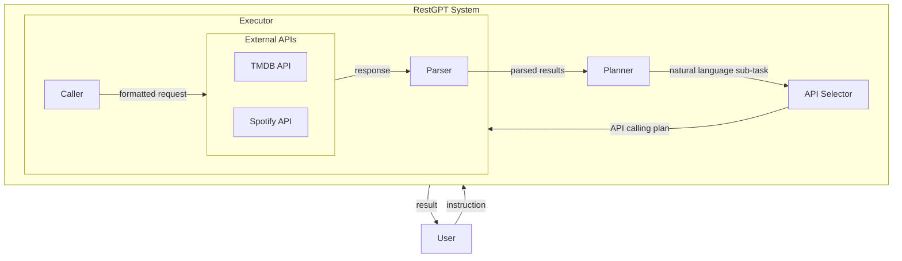

The system follows a cyclic workflow where the Planner determines the next step, the API Selector identifies the appropriate API call, the Caller executes the call, and the Parser processes the response for the next planning iteration.

Sources: [README.md:22-28]()

### Component Interaction Flow

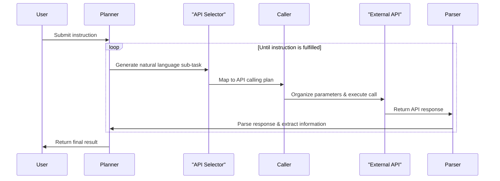

This sequence diagram illustrates how RestGPT processes user instructions through multiple iterations of planning, API selection, execution, and parsing until the task is completed.

Sources: [README.md:18-20](), [README.md:22-28]()

## Key Components

RestGPT consists of four main components that work together to process user instructions and interact with external APIs:

### 1. Planner

The Planner is responsible for generating natural language sub-tasks based on the current state and user instruction. It determines what actions need to be taken next to fulfill the user's request.

### 2. API Selector

The API Selector maps high-level natural language sub-tasks from the Planner into specific API calling plans. It identifies which API endpoints to call and what parameters to use.

### 3. Executor

The Executor component consists of two sub-components:

#### Caller

The Caller organizes API parameters based on the API plan and documentation, formats the request correctly, and makes the actual API call.

#### Parser

The Parser processes the API response, extracts relevant information, and prepares it for the next planning iteration.

Sources: [README.md:22-28]()

## System Implementation

RestGPT is implemented as a modular system with clear separation of concerns across its components.

### Class Structure

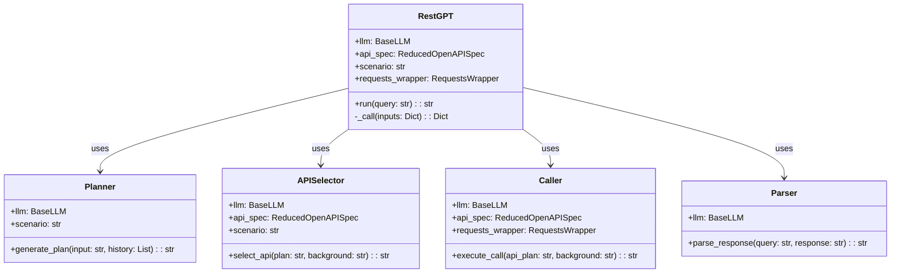

Each component has access to a language model and plays a specific role in the processing pipeline. The RestGPT class acts as the main entry point, orchestrating the interaction between components.

Sources: [README.md:22-28]()

## Example Workflow

Here's an example of how RestGPT processes a user instruction:

1. A user asks: "Who is the director of today's most trending movie?"
2. The Planner generates a sub-task: "Find today's most trending movie"
3. The API Selector maps this to the TMDB API endpoint `GET /trending/{media_type}/{time_window}`
4. The Caller executes this API call with appropriate parameters
5. The Parser processes the response to extract the movie ID
6. The Planner generates the next sub-task: "Find the director of this movie"
7. The API Selector maps this to `GET /movie/{movie_id}/credits`
8. The Caller executes this call
9. The Parser extracts the director information
10. The Planner formulates the final answer and returns it to the user

This example demonstrates how RestGPT breaks down a complex query into sequential API calls, using the response from one call to inform the next.

Sources: [README.md:38-44]()

## Supported Scenarios

RestGPT currently supports two main scenarios:

1. **TMDB Movie Database**: Allows users to query information about movies, directors, actors, and related data using The Movie Database API.

2. **Spotify Music Player**: Enables users to control a Spotify account, search for music, create playlists, and more using the Spotify Web API.

The system was evaluated using RestBench, a benchmark containing realistic user instructions with human-annotated gold solution paths for these scenarios.

| Scenario | #APIs | Avg. Solution Path Length | Total Test Cases |
|----------|-------|--------------------------|------------------|
| TMDB     | 54    | 2.3                      | 100              |
| Spotify  | 40    | 2.6                      | 57               |

Sources: [README.md:36-59]()

## Data Flow

The following diagram illustrates how data flows through the system when processing a query:

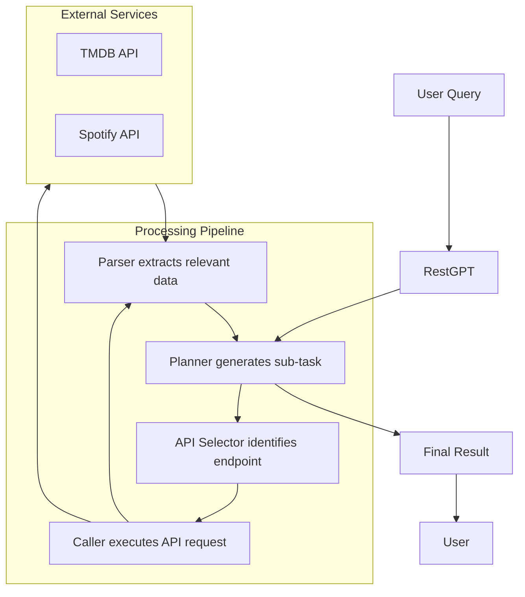

This flowchart highlights the iterative nature of the planning process and the interaction with external APIs.

Sources: [README.md:18-20](), [README.md:22-28]()

## Key Features and Benefits

RestGPT offers several advantages for connecting LLMs with real-world applications:

1. **Natural Language Interface**: Users can control applications through natural language instructions without understanding API details.

2. **Modular Design**: Clear separation of concerns across components makes the system extensible and maintainable.

3. **Iterative Planning**: The coarse-to-fine approach allows handling complex tasks requiring multiple API calls.

4. **API Abstraction**: The system abstracts away the complexity of working with different RESTful APIs.

5. **Flexible Architecture**: The framework can be adapted to work with different APIs by changing the scenario and loading appropriate API specifications.

Sources: [README.md:3-5](), [README.md:18-20](), [README.md:22-28]()

## Conclusion

RestGPT demonstrates an effective approach to bridging natural language instructions with RESTful API interactions. By implementing an iterative planning framework and structured API interaction components, it enables LLMs to control real-world applications through API calls in a systematic and reliable manner.

For more details about specific components and implementation, see [Core Components](#3).

---

# Page: System Architecture

# System Architecture

<details>
<summary>Relevant source files</summary>

The following files were used as context for generating this wiki page:

- [README.md](README.md)
- [imgs/model.png](imgs/model.png)
- [model/rest_gpt.py](model/rest_gpt.py)

</details>


This document describes the system architecture of RestGPT, a large language model-based autonomous agent designed to connect LLMs with real-world RESTful APIs. It explains the coarse-to-fine planning framework, component interactions, and the iterative workflow that enables RestGPT to break down complex user instructions into manageable API calls.

For information on installation and setup, see [Installation and Setup](#2.1). For details about individual components, see [Core Components](#3).

## Overview of RestGPT Architecture

RestGPT implements an iterative coarse-to-fine planning framework that enables large language models to control real-world applications through RESTful APIs. The system consists of four main components that work together to process user instructions, plan API calls, execute them, and use the results to make further decisions.

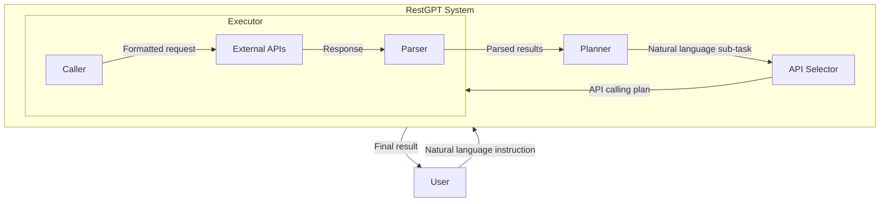

**Diagram: High-level architecture of RestGPT**

Sources: [README.md:17-28](), [model/rest_gpt.py:19-35]()

## Core Components

RestGPT's architecture consists of four main components, each with a specific role in the processing pipeline:

1. **Planner**: Generates natural language sub-tasks for the current step in solving the user's instruction.
2. **API Selector**: Maps high-level natural language sub-tasks to specific API calling plans.
3. **Executor**: Consists of two sub-components:
   - **Caller**: Organizes API parameters based on the API plan and makes the actual requests.
   - **Parser**: Processes API responses and extracts relevant information.

Each component leverages a large language model to handle its specific task, enabling natural language understanding throughout the pipeline.

Sources: [README.md:22-28](), [model/rest_gpt.py:26-30]()

## Implementation Details

RestGPT is implemented as a `Chain` class in the LangChain framework. The main class is `RestGPT`, which orchestrates the entire workflow.

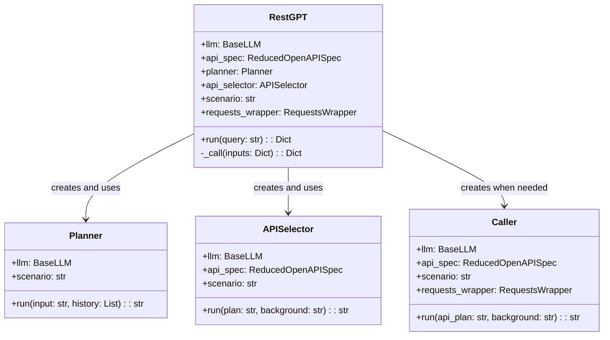

**Diagram: Key classes in RestGPT implementation**

Sources: [model/rest_gpt.py:22-35](), [model/rest_gpt.py:56-62]()

## Interaction Flow

The RestGPT system processes user instructions through an iterative workflow, where each iteration refines the understanding and execution of the task:

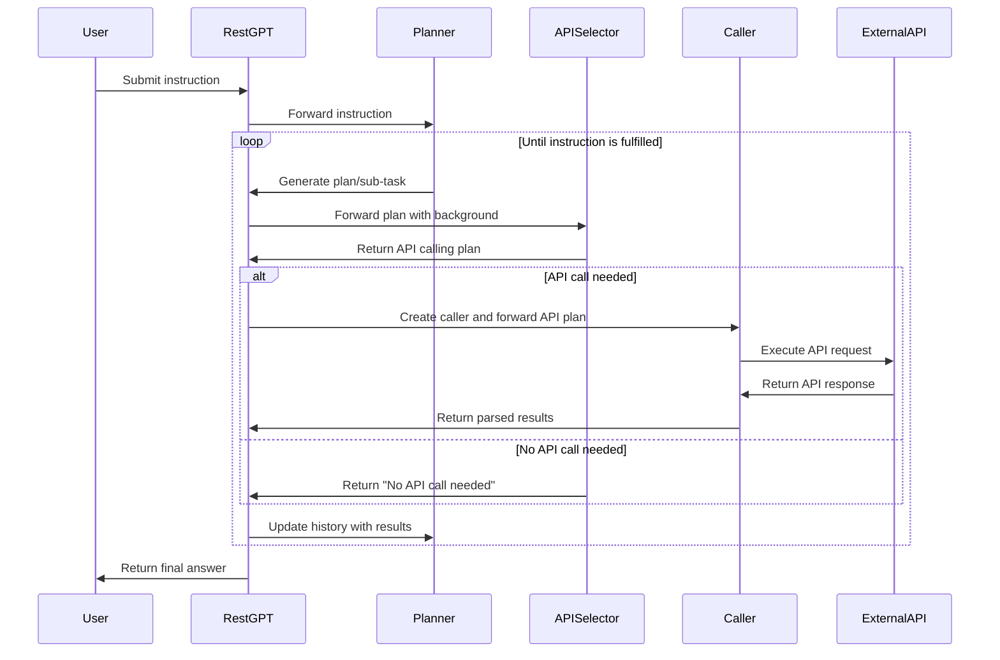

**Diagram: Sequence diagram showing the interaction flow in RestGPT**

Sources: [model/rest_gpt.py:131-188]()

## Data Flow and Processing Pipeline

The following diagram illustrates how data flows through the RestGPT system during the processing of a user instruction:

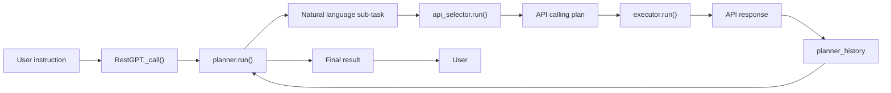

**Diagram: Data flow in RestGPT**

Sources: [model/rest_gpt.py:131-188]()

## Iteration Control Logic

RestGPT controls its iterative process through several mechanisms:

1. **Continuation Check**: Determines if more API calls are needed for the current sub-task
2. **Completion Check**: Identifies when the entire task has been completed
3. **Resource Limits**: Enforces maximum iterations and execution time

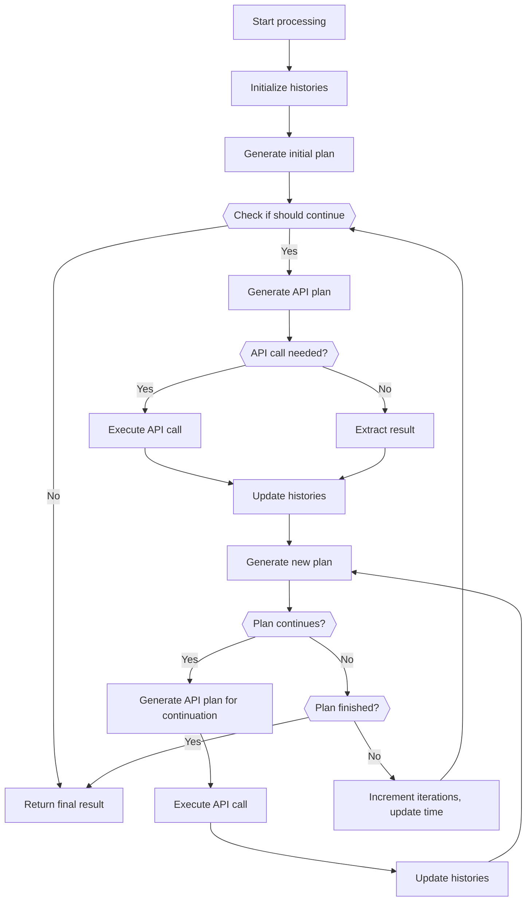

**Diagram: Iteration control logic in RestGPT**

Sources: [model/rest_gpt.py:96-188]()

## Integration with External APIs

RestGPT is designed to work with different RESTful APIs. Currently, it supports two scenarios:

1. **TMDB** (The Movie Database): Allows searching and retrieving information about movies and TV shows
2. **Spotify**: Enables interaction with the Spotify music streaming platform

The system uses a `ReducedOpenAPISpec` to understand API structure and a `RequestsWrapper` to handle HTTP requests to these external services.

| Component | Function | Implementation |
|-----------|----------|----------------|
| `ReducedOpenAPISpec` | Stores simplified OpenAPI specifications | Imported from utils |
| `RequestsWrapper` | Handles HTTP requests to APIs | Imported from langchain.requests |
| `Scenario` | Determines which API to use | String value ("tmdb" or "spotify") |

Sources: [model/rest_gpt.py:12-17](), [model/rest_gpt.py:26-30]()

## Example Workflow

Below is an example of how RestGPT would process a typical user instruction:

1. User asks: "Who is the director of today's most trending movie?"
2. **Planner**: "First, I need to find today's most trending movie."
3. **API Selector**: Maps to `GET /trending/{media_type}/{time_window}` API
4. **Caller**: Executes API call with parameters `media_type=movie` and `time_window=day`
5. **Parser**: Extracts the top movie's ID
6. **Planner**: "Now I need to find the director of movie ID 12345."
7. **API Selector**: Maps to `GET /movie/{movie_id}/credits`
8. **Caller**: Executes API call with the movie ID
9. **Parser**: Extracts director information from credits
10. **Planner**: "Final Answer: The director of today's most trending movie 'Example Movie' is John Doe."

This iterative process demonstrates how RestGPT breaks down complex instructions into manageable steps and uses API calls to fulfill the user's request.

Sources: [README.md:36-44]()

---

# Page: Key Features and Capabilities

# Key Features and Capabilities

<details>
<summary>Relevant source files</summary>

The following files were used as context for generating this wiki page:

- [README.md](README.md)
- [imgs/example.gif](imgs/example.gif)

</details>


This document outlines the key features and capabilities of RestGPT, focusing on what the system can do and its main technical advantages. For information about the overall system architecture, see [System Architecture](#1.1).

## Core Capabilities

RestGPT serves as a bridge between natural language instructions and RESTful APIs, allowing users to control real-world applications through conversational language. The system can:

1. **Interpret Complex Natural Language Instructions**: Convert user queries into executable API sequences
2. **Perform Multi-Step Task Planning**: Break down complex tasks into sequential API operations
3. **Execute API Calls**: Organize parameters, make requests, and handle responses from external services
4. **Extract and Synthesize Information**: Parse API responses and generate human-readable results

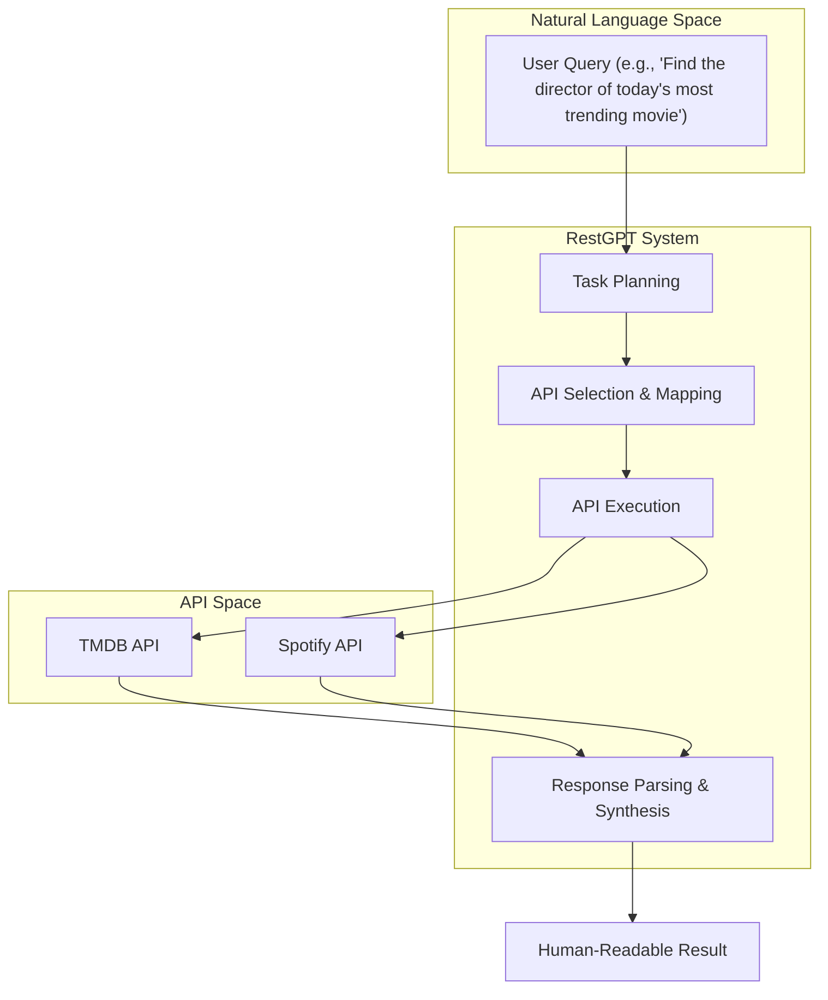

Currently, RestGPT is integrated with two API ecosystems:

| API Ecosystem | Description | Example Capabilities |
|---------------|-------------|----------------------|
| TMDB | The Movie Database API | Search movies, find trending content, get movie details, query actor/director information |
| Spotify | Spotify Music Player API | Search tracks, create playlists, manage playback, retrieve artist information |

Sources: [README.md:16-32]()

## Technical Features

### 1. Iterative Coarse-to-Fine Planning

RestGPT employs a planning approach that progressively refines high-level goals into specific API calls:

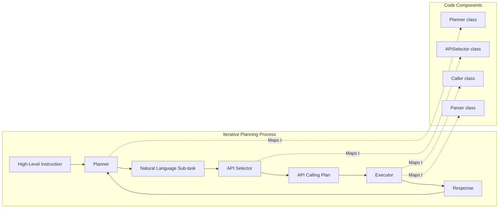

This approach enables:
- Breaking down complex instructions into manageable steps
- Building on previous results in each iteration
- Dynamic adaptation based on API responses

Sources: [README.md:18-28]()

### 2. Modular Component Architecture

RestGPT features a modular design with specialized components:

| Component | Purpose | Key Function |
|-----------|---------|--------------|
| Planner | High-level task planning | Generates natural language sub-tasks for each step |
| API Selector | API endpoint identification | Maps high-level tasks to specific API endpoints and parameters |
| Caller | API interaction | Organizes parameters and executes API calls |
| Parser | Response processing | Processes API responses into usable information |

This modularity enables:
- Independent development and improvement of components
- Clear separation of concerns
- Easier debugging and maintenance

Sources: [README.md:22-28]()

### 3. LLM Integration Throughout Pipeline

Large Language Models are integrated at each step of the process:

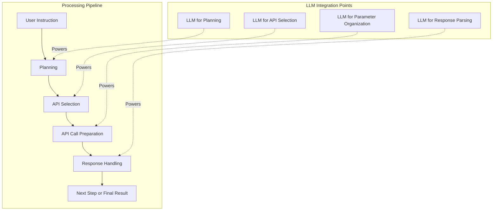

This enables:
- Natural language understanding throughout the process
- Intelligent decision-making at each step
- Adaptive handling of unexpected responses

Sources: [README.md:16-32]()

## Advanced Capabilities

### Multi-Turn API Interaction

RestGPT can handle complex tasks requiring multiple API calls in sequence. The system tracks context across calls, allowing it to:

1. Use information from previous API responses in subsequent calls
2. Build up complex operations through multiple simple API interactions
3. Maintain state across the interaction lifecycle

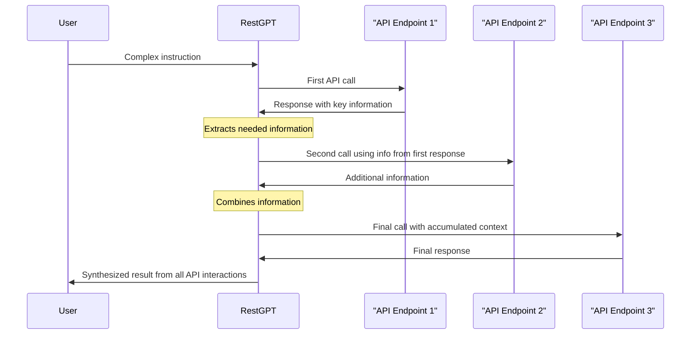

This capability is demonstrated in examples like finding "the director of today's most trending movie" where RestGPT needs to:
1. First find the trending movie
2. Then look up its director information

Sources: [README.md:36-53]()

### Contextual API Parameter Selection

RestGPT intelligently selects API parameters based on:
- The user's instruction
- API documentation
- Previous API call results
- Required and optional parameters for each endpoint

This allows efficient API usage with only necessary parameters.

Sources: [README.md:22-28]()

## Advantages and Distinctive Features

### 1. Natural Language Interface to Structured APIs

RestGPT removes the technical barrier between users and APIs by:
- Accepting natural language instructions
- Handling the complexity of API endpoint selection
- Managing parameter formatting and authentication
- Converting technical API responses into readable results

### 2. Autonomous Multi-Step Planning

The system autonomously:
- Determines the necessary sequence of API calls
- Manages dependencies between calls
- Extracts relevant information from each step
- Adapts to unexpected responses or errors

### 3. Benchmark-Driven Development (RestBench)

RestGPT is evaluated using RestBench, a high-quality benchmark with:
- Real-world scenarios from TMDB and Spotify
- Human-annotated instructions with gold solution paths
- Tasks requiring 1-4 API calls to complete
- Diverse instruction types and complexity levels

| Scenario | #APIs | Avg. API Calls Per Task | Task Count |
|----------|-------|------------------------|------------|
| TMDB     | 54    | 2.3                    | 100        |
| Spotify  | 40    | 2.6                    | 57         |

This benchmark-driven approach ensures the system can handle realistic tasks in production environments.

Sources: [README.md:36-59]()

## Practical Applications

RestGPT can be applied to various scenarios where natural language control of APIs is beneficial:

1. **Content Discovery**: Finding movies, music, or other content based on complex criteria
2. **Media Management**: Creating and modifying playlists or collections
3. **Information Retrieval**: Gathering specific details about content (directors, actors, artists)
4. **Automation**: Performing sequences of operations without manual API interaction

The modular design also allows for extension to additional API ecosystems beyond the current TMDB and Spotify implementations.

Sources: [README.md:3-7](), [README.md:36-59]()

---

# Page: Getting Started

# Getting Started

<details>
<summary>Relevant source files</summary>

The following files were used as context for generating this wiki page:

- [README.md](README.md)
- [config.yaml](config.yaml)
- [run.py](run.py)

</details>


This page provides an essential guide for setting up and using RestGPT, a system that connects Large Language Models with RESTful APIs. Here, you'll learn how to install dependencies, configure API keys, and run your first RestGPT instructions. For a high-level overview of the system architecture, see [Overview](#1), and for detailed information about core components, see [Core Components](#3).

## Prerequisites

Before starting with RestGPT, ensure you have:
- Python 3.7 or higher installed
- Access to API keys for OpenAI, TMDB, and/or Spotify (depending on which scenario you want to use)
- Basic familiarity with RESTful APIs

## Installation

To install RestGPT and its dependencies, follow these steps:

1. Clone the RestGPT repository:
   ```bash
   git clone https://github.com/Yifan-Song793/RestGPT
   cd RestGPT
   ```

2. Install required Python packages:
   ```bash
   pip install langchain colorama tiktoken spotipy openai
   ```

3. Create a logs directory for system output:
   ```bash
   mkdir logs
   ```

Sources: [README.md:61-65]()

## Configuration

RestGPT requires API keys to interact with external services. Follow these steps to configure your environment:

1. Obtain the necessary API keys:
   - OpenAI API key from [OpenAI](https://platform.openai.com/)
   - TMDB API key from [TMDB Developer Portal](https://developer.themoviedb.org/docs/getting-started)
   - Spotify API credentials from [Spotify Developer Dashboard](https://developer.spotify.com/documentation/web-api)

2. Open the `config.yaml` file and fill in your API keys:

```yaml
openai_api_key: your_openai_key_here

tmdb_access_token: your_tmdb_token_here

spotipy_client_id: your_spotify_client_id_here
spotipy_client_secret: your_spotify_client_secret_here
spotipy_redirect_uri: your_spotify_redirect_uri_here
```

Sources: [README.md:69-71](), [config.yaml:1-7]()

### Configuration Flow

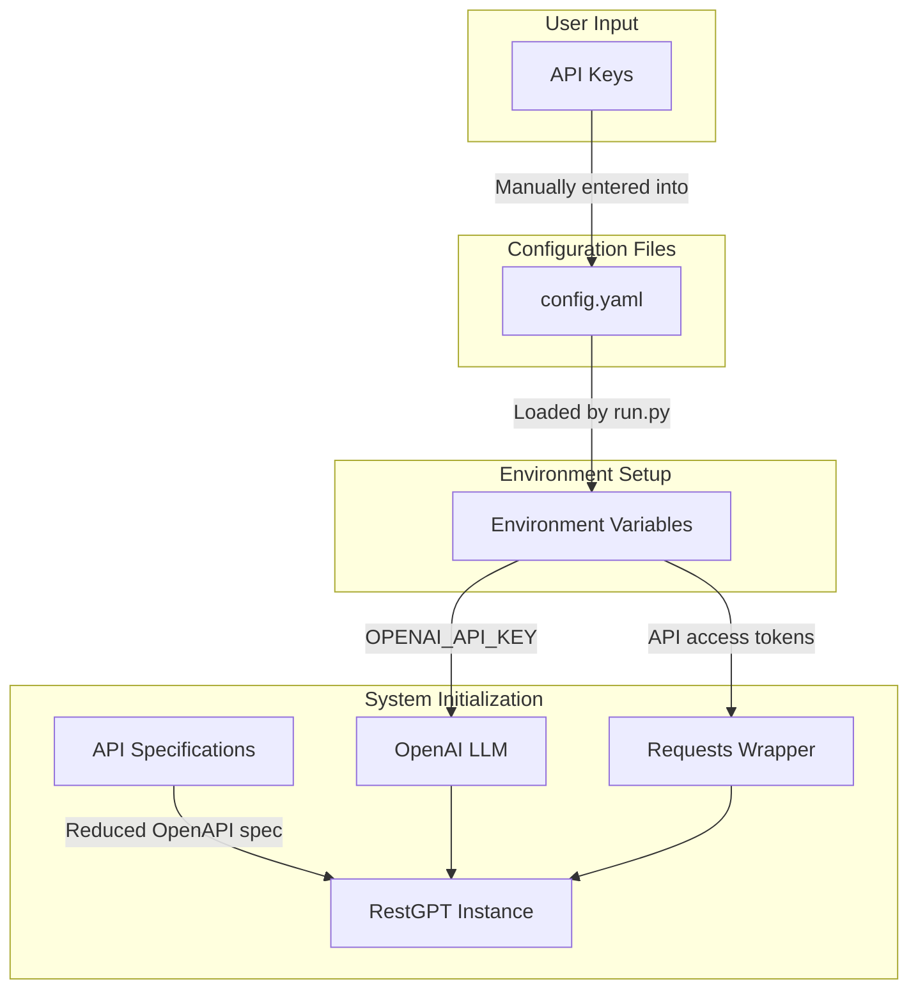

Sources: [run.py:18-61]()

## Optional: Initialize Spotify Environment

If you're planning to use the Spotify scenario, you can initialize the Spotify environment. This step is optional but **be warned that it will remove all your existing data from Spotify**:

```bash
python init_spotify.py
```

Sources: [README.md:73-79]()

## Running RestGPT

RestGPT supports two scenarios: TMDB (movie database) and Spotify (music player). Here's how to run the system:

### Basic Usage

1. Run the main script:
   ```bash
   python run.py
   ```

2. When prompted, select a scenario by typing either "TMDB" or "Spotify"

3. Enter your instruction or press Enter to use the example instruction

The system will process your instruction and return the results.

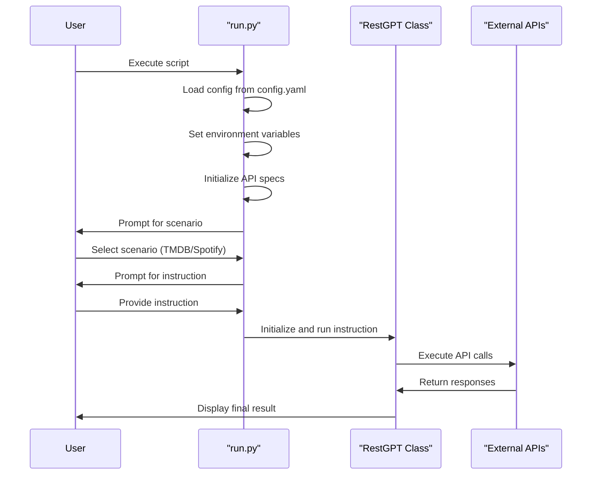

Sources: [run.py:18-79](), [README.md:81-90]()

### Example Workflow

When you run RestGPT, the system:

1. Loads your configuration from `config.yaml`
2. Sets up the environment with your API keys
3. Prompts you to select a scenario (TMDB or Spotify)
4. Prompts you for an instruction
5. Processes your instruction through its iterative planning framework
6. Returns results from the external API

Example instructions:
- TMDB: "Give me the number of movies directed by Sofia Coppola"
- Spotify: "Add Summertime Sadness by Lana Del Rey in my first playlist"

Sources: [run.py:61-77](), [README.md:30-32]()

## System Execution Flow

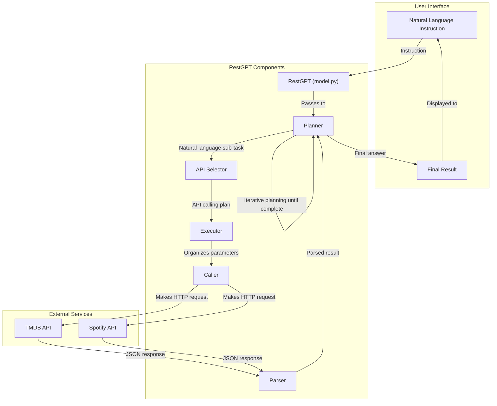

Sources: [README.md:16-32](), [run.py:74-77]()

## Running Benchmark Tests

RestGPT includes scripts to run against the RestBench benchmark datasets:

### TMDB Benchmark

```bash
python run_tmdb.py
```
This script sequentially executes all instructions in RestBench-TMDB.

### Spotify Benchmark

```bash
python run_spotify.py
```
For Spotify benchmark tests, ensure Spotify is open on your device and manually modify the `query_idx` variable in the script before execution to test specific instructions.

Sources: [README.md:91-101]()

## Next Steps

Now that you've set up RestGPT and run your first instructions, you can:

- Explore the [Core Components](#3) to understand how the system works internally
- Learn about the [Evaluation Framework (RestBench)](#4) to test RestGPT's capabilities
- Review the [Technical Reference](#5) for more advanced usage

For questions or issues, refer to the project's GitHub repository.

---

# Page: Installation and Setup

# Installation and Setup

<details>
<summary>Relevant source files</summary>

The following files were used as context for generating this wiki page:

- [README.md](README.md)
- [config.yaml](config.yaml)

</details>


This document provides step-by-step instructions for installing RestGPT and configuring its dependencies. It covers the required packages, API key setup, and environment initialization. For information about how to run the system after installation, see [Running the System](#2.2).

## Prerequisites

Before installing RestGPT, ensure you have the following:

- Python 3.7+ installed
- Access to command line/terminal
- Internet connection for API access
- API keys for required services (detailed below)

## Installation Process

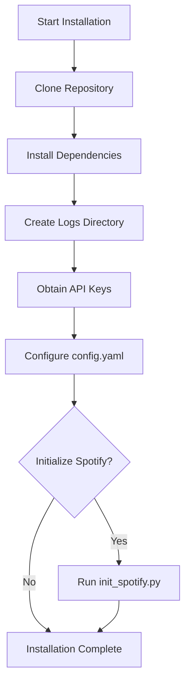

Sources: [README.md:61-71]()

### 1. Clone the Repository

Clone the RestGPT repository from GitHub:

```bash
git clone https://github.com/Yifan-Song793/RestGPT.git
cd RestGPT
```

### 2. Install Required Packages

Install the required Python packages using pip:

```bash
pip install langchain colorama tiktoken spotipy openai
```

This command installs:
- `langchain`: Framework for developing LLM-powered applications
- `colorama`: For colored terminal output
- `tiktoken`: OpenAI's tokenizer
- `spotipy`: Python client for Spotify API
- `openai`: Official OpenAI API client

Sources: [README.md:63-65]()

### 3. Create Required Directories

Create a `logs` directory in the project root for storing execution logs:

```bash
mkdir logs
```

Sources: [README.md:67]()

## API Key Configuration

RestGPT requires API keys for three different services. These keys need to be configured in the `config.yaml` file.

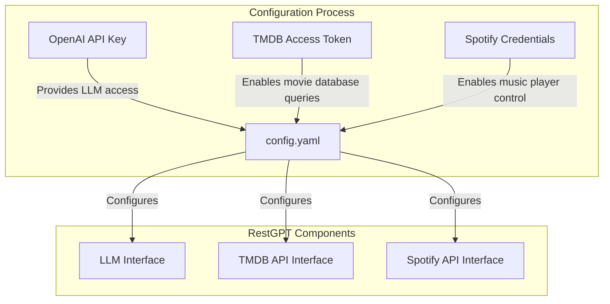

Sources: [README.md:69-71](), [config.yaml:1-7]()

### 1. Obtain API Keys

#### OpenAI API Key
1. Visit [OpenAI's platform](https://platform.openai.com/)
2. Create an account or sign in
3. Navigate to the API section
4. Generate an API key

#### TMDB API Key
1. Visit [TMDB Developer Portal](https://developer.themoviedb.org/docs/getting-started)
2. Create an account or sign in
3. Request an API key by following their process
4. Save the access token

#### Spotify API Credentials
1. Visit [Spotify Developer Dashboard](https://developer.spotify.com/documentation/web-api)
2. Create an account or sign in
3. Create a new application
4. Obtain the Client ID and Client Secret
5. Set a redirect URI (e.g., `http://localhost:8888/callback`)

Sources: [README.md:69]()

### 2. Configure the config.yaml File

Edit the `config.yaml` file in the project root directory and add your API keys:

```yaml
openai_api_key: your_openai_api_key_here

tmdb_access_token: your_tmdb_access_token_here

spotipy_client_id: your_spotify_client_id_here
spotipy_client_secret: your_spotify_client_secret_here
spotipy_redirect_uri: your_spotify_redirect_uri_here
```

The configuration file structure directly maps to the API services used by RestGPT:

| Key | Description | Required For |
|-----|-------------|-------------|
| `openai_api_key` | Authentication key for OpenAI API | Core LLM functionality |
| `tmdb_access_token` | Authentication token for TMDB API | Movie database scenario |
| `spotipy_client_id` | Spotify application client ID | Spotify scenario |
| `spotipy_client_secret` | Spotify application client secret | Spotify scenario |
| `spotipy_redirect_uri` | URI for OAuth2 authentication redirection | Spotify scenario |

Sources: [config.yaml:1-7](), [README.md:71]()

## System Component Configuration Mapping

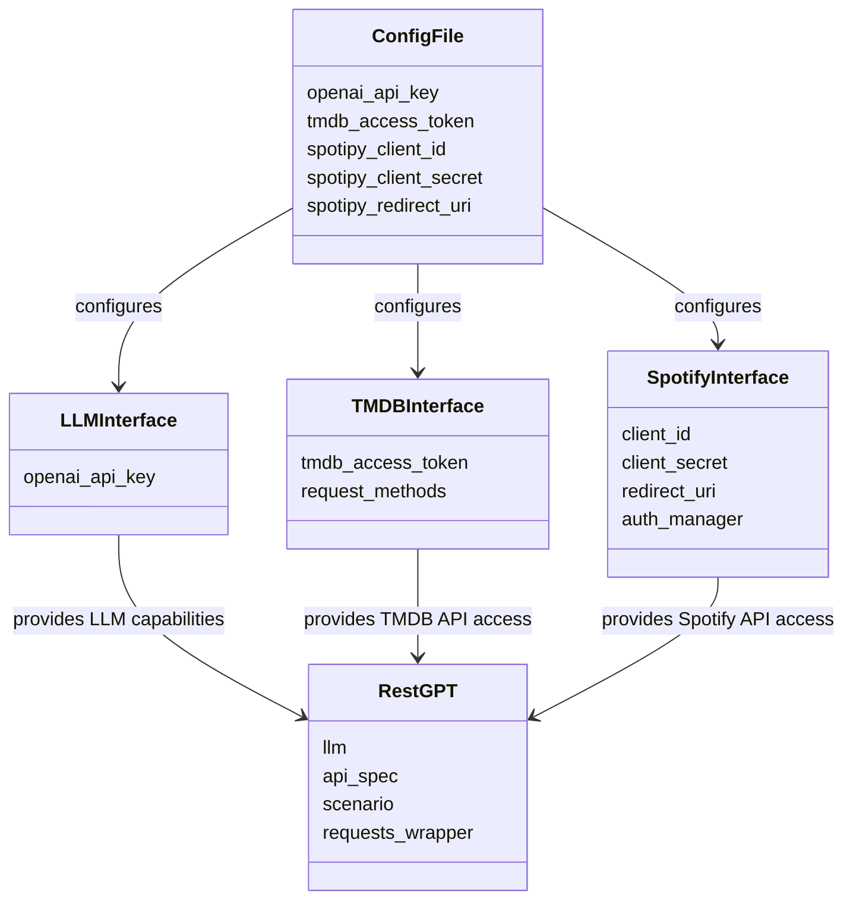

Sources: [README.md:16-29](), [config.yaml:1-7]()

## Optional: Spotify Environment Initialization

If you want to use the Spotify scenario with a clean environment, you can initialize it. However, be extremely cautious as this will remove all your existing Spotify data.

**⚠️ WARNING: This will remove all your data from Spotify! ⚠️**

Run the initialization script:

```bash
python init_spotify.py
```

This script prepares your Spotify account for use with RestGPT by resetting it to a clean state.

Sources: [README.md:73-79]()

## Verification

To verify your installation and configuration:

1. Run the basic RestGPT application:
```bash
python run.py
```

2. When prompted, select one of the available scenarios (TMDB or Spotify)
3. Enter a simple instruction to test functionality

If the system responds without errors, your installation and setup are complete and successful.

Sources: [README.md:83-89]()

## Troubleshooting

Here are some common issues and their solutions:

1. **API Key Errors**: Ensure all API keys are correctly entered in `config.yaml` without trailing spaces
2. **Missing Logs Directory**: Verify the `logs` directory exists in the project root
3. **Package Import Errors**: Confirm all dependencies are installed with `pip list`
4. **Spotify Authentication Issues**: Check that your redirect URI in the Spotify Developer Dashboard matches the one in `config.yaml`

If problems persist, check the log files in the `logs` directory for more detailed error messages.

---

# Page: Running the System

# Running the System

<details>
<summary>Relevant source files</summary>

The following files were used as context for generating this wiki page:

- [README.md](README.md)
- [init_spotify.py](init_spotify.py)
- [run.py](run.py)

</details>


This page provides detailed instructions on how to execute RestGPT with different scenarios. It covers interactive running, batch processing with predefined instructions, and scenario-specific setup. For initial installation and dependency setup, see [Installation and Setup](#2.1).

## Overview

RestGPT supports two primary scenarios: TMDB (The Movie Database) and Spotify. Each scenario allows the system to interact with different API endpoints through natural language instructions. The system can be run interactively or with predefined instructions from the RestBench benchmark.

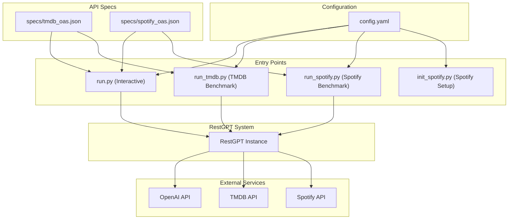

Sources: [run.py:1-80](), [README.md:61-101]()

## Prerequisites

Before running RestGPT, ensure you have:

1. Installed all dependencies (see [Installation and Setup](#2.1))
2. Created a `logs` folder in the project root
3. Obtained necessary API keys
4. Configured `config.yaml` with your API keys

### API Key Configuration

RestGPT requires the following API keys configured in `config.yaml`:

| API | Key/Token Name | Purpose |
|-----|----------------|---------|
| OpenAI | `openai_api_key` | Powers the language model components |
| TMDB | `tmdb_access_token` | Authenticates with The Movie Database API |
| Spotify | `spotipy_client_id` | Client ID for Spotify API |
| Spotify | `spotipy_client_secret` | Client secret for Spotify API |
| Spotify | `spotipy_redirect_uri` | Redirect URI for OAuth flow |

Sources: [README.md:61-71](), [run.py:18-24]()

## Running Interactively

The simplest way to run RestGPT is using the interactive mode through `run.py`.

### Interactive Execution Flow

```mermaid
sequenceDiagram
    participant User
    participant Script as "run.py"
    participant Config as "config.yaml"
    participant RestGPT
    participant APIs as "External APIs"
    
    User->>Script: Execute script
    Script->>Config: Load configuration
    Script->>User: Prompt for scenario (TMDB/Spotify)
    User->>Script: Select scenario
    
    alt TMDB scenario
        Script->>Script: Load TMDB API spec
        Script->>Script: Set up TMDB authentication
    else Spotify scenario
        Script->>Script: Load Spotify API spec
        Script->>Script: Set up Spotify authentication with OAuth
    end
    
    Script->>User: Prompt for instruction
    User->>Script: Provide instruction (or use example)
    
    Script->>RestGPT: Initialize with scenario and API spec
    Script->>RestGPT: Run with instruction
    RestGPT->>APIs: Make API calls
    APIs->>RestGPT: Return responses
    RestGPT->>Script: Return results
    Script->>User: Display results and execution time
```

Sources: [run.py:18-77]()

### Steps to Run Interactively

1. Open a terminal in the project root directory
2. Execute the script:
   ```bash
   python run.py
   ```
3. When prompted, select a scenario (TMDB or Spotify)
4. Enter an instruction or press Enter to use the example instruction
5. The system will process your instruction and display results

Example:

```
Please select a scenario (TMDB/Spotify): TMDB
Example instruction: Give me the number of movies directed by Sofia Coppola
Please input an instruction (Press ENTER to use the example instruction): 
Query: Give me the number of movies directed by Sofia Coppola
... [RestGPT execution and results]
Execution Time: 12.34
```

Sources: [run.py:32-77](), [README.md:82-89]()

## Running Benchmark Scenarios

RestGPT includes scripts to run predefined instructions from the RestBench benchmark.

### TMDB Benchmark

```bash
python run_tmdb.py
```

This script runs all instructions in the RestBench-TMDB dataset sequentially, which includes 100 instructions with varying complexity (1-4 API calls per instruction).

Sources: [README.md:91-101]()

### Spotify Benchmark

```bash
python run_spotify.py
```

For the Spotify benchmark, you need to:
1. Open Spotify on your device (to see the effects of commands)
2. Manually modify the `query_idx` in the script to select specific instructions

The RestBench-Spotify dataset includes 57 instructions with varying complexity.

Sources: [README.md:91-101]()

## Setting Up Spotify Environment

If you're using the Spotify scenario, you can initialize the Spotify environment with:

```bash
python init_spotify.py
```

**Warning**: This will remove all your existing data from Spotify!

The initialization process:

```mermaid
flowchart TD
    start["Execute init_spotify.py"]
    config["Load config.yaml"]
    env["Set environment variables"]
    spec["Load Spotify API spec"]
    auth["Authenticate with OAuth"]
    init["Initialize Spotify environment"]
    
    start --> config
    config --> env
    env --> spec
    spec --> auth
    auth --> init
```

Sources: [init_spotify.py:1-34](), [README.md:73-79]()

## System Parameters

When running RestGPT, the following key parameters are set:

### Language Model Configuration

The system uses OpenAI's text-davinci-003 model with these parameters:

```python
llm = OpenAI(model_name="text-davinci-003", temperature=0.0, max_tokens=700)
```

- `model_name`: The specific OpenAI model to use
- `temperature`: Set to 0.0 for deterministic outputs
- `max_tokens`: Maximum tokens in the model's response

### RestGPT Initialization

```python
rest_gpt = RestGPT(llm, api_spec=api_spec, scenario=scenario, 
                  requests_wrapper=requests_wrapper, simple_parser=False)
```

- `llm`: Language model instance
- `api_spec`: Processed OpenAPI specification for the selected scenario
- `scenario`: Selected scenario ("tmdb" or "spotify")
- `requests_wrapper`: HTTP request handler with authentication headers
- `simple_parser`: Boolean flag for parser complexity (set to False for advanced parsing)

Sources: [run.py:61-62]()

## Understanding the Execution Flow

When running RestGPT, the system follows this process:

```mermaid
flowchart TB
    subgraph "User Interaction"
        input["User Instruction"]
        output["Final Result"]
    end
    
    subgraph "run.py"
        config_load["Load Configuration"]
        scenario_select["Select Scenario"]
        api_load["Load API Specification"]
        auth_setup["Set up Authentication"]
        rest_init["Initialize RestGPT"]
        instruction["Get Instruction"]
        execute["Execute RestGPT.run()"]
        time_report["Report Execution Time"]
    end
    
    subgraph "RestGPT Components"
        planner["Planner\nGenerate sub-tasks"]
        api_selector["API Selector\nMap to API call"]
        caller["Caller\nExecute API request"]
        parser["Parser\nProcess API response"]
    end
    
    config_load --> scenario_select
    scenario_select --> api_load
    api_load --> auth_setup
    auth_setup --> rest_init
    rest_init --> instruction
    instruction --> execute
    execute --> time_report
    
    input --> instruction
    execute --> output
    
    execute --> planner
    planner --> api_selector
    api_selector --> caller
    caller --> parser
    parser --> planner
```

Sources: [run.py:18-77](), [README.md:16-31]()

## Example Workflow

Here's an example of RestGPT executing a TMDB scenario instruction:

1. **User provides instruction**: "Give me the number of movies directed by Sofia Coppola"
2. **RestGPT planning process**:
   - Planner generates sub-task: "Search for Sofia Coppola as a person"
   - API Selector identifies appropriate endpoint: `GET /search/person`
   - Caller executes API request with parameters
   - Parser processes response to extract person ID
   
   - Planner generates next sub-task: "Get movies directed by Sofia Coppola"
   - API Selector identifies endpoint: `GET /person/{person_id}/movie_credits`
   - Caller executes API request with extracted person ID
   - Parser counts director credits and returns final result

3. **System returns answer**: "Sofia Coppola has directed X movies."

Sources: [README.md:30-32]()

With this approach, RestGPT can handle complex instructions that require multiple API calls across different scenarios.

---

# Page: Core Components

# Core Components

<details>
<summary>Relevant source files</summary>

The following files were used as context for generating this wiki page:

- [README.md](README.md)
- [model/__init__.py](model/__init__.py)
- [model/rest_gpt.py](model/rest_gpt.py)

</details>


This page provides a comprehensive overview of the main components that make up the RestGPT system architecture. RestGPT uses a modular design with clear separation of concerns to connect Large Language Models with RESTful APIs. For information about system installation and setup, see [Getting Started](#2).

## Component Overview

RestGPT follows a coarse-to-fine planning framework that breaks down complex user instructions into manageable sub-tasks and executes them by interacting with external APIs. The system consists of four core components that work together to achieve this goal.

```mermaid
graph TD
    subgraph "RestGPT System"
        direction TB
        User(("User")) -->|"Instruction"| RestGPT["RestGPT"]
        RestGPT -->|"Query"| Planner["Planner"]
        Planner -->|"Natural language sub-task"| APISelector["API Selector"]
        APISelector -->|"API calling plan"| Executor["Executor"]
        
        subgraph "Executor Component"
            Caller["Caller"] -->|"API request"| ExternalAPIs["External APIs"]
            ExternalAPIs -->|"Response"| Parser["Parser"]
        end
        
        Executor -->|"Execution result"| Planner
        Planner -->|"Final answer"| RestGPT
        RestGPT -->|"Result"| User
    end
```

Sources: [README.md:22-28](), [model/rest_gpt.py:22-35]()

## Component Roles and Responsibilities

RestGPT's architecture is designed with each component having a specific role in the processing pipeline:

| Component | Description | Responsibility |
|-----------|-------------|----------------|
| **Planner** | High-level task planner | Generates natural language sub-tasks based on the user query and execution history |
| **API Selector** | API mapping module | Translates natural language sub-tasks into specific API calling plans |
| **Executor** | API execution engine | Handles the actual API interactions |
| **Caller** | Request formatter | Organizes parameters and executes API calls based on API documentation |
| **Parser** | Response processor | Parses API responses and extracts relevant information |

Sources: [README.md:22-28](), [model/rest_gpt.py:19-33]()

## Code Structure

The RestGPT system architecture is implemented through several interconnected classes:

```mermaid
classDiagram
    class RestGPT {
        +llm: BaseLLM
        +api_spec: ReducedOpenAPISpec
        +scenario: str
        +requests_wrapper: RequestsWrapper
        +planner: Planner
        +api_selector: APISelector
        +run(query: str): str
        -_call(inputs: Dict): Dict
    }
    
    class Planner {
        +llm: BaseLLM
        +scenario: str
        +run(input: str, history: List): str
    }
    
    class APISelector {
        +llm: BaseLLM
        +api_spec: ReducedOpenAPISpec
        +scenario: str
        +run(plan: str, background: str): str
    }
    
    class Caller {
        +llm: BaseLLM
        +api_spec: ReducedOpenAPISpec
        +scenario: str
        +requests_wrapper: RequestsWrapper
        +run(api_plan: str, background: str): str
    }
    
    class ResponseParser {
        +llm: BaseLLM
        +parse_response(query: str, response: str): str
    }
    
    RestGPT --> Planner: uses
    RestGPT --> APISelector: uses
    RestGPT --> Caller: creates and uses
    Caller --> ResponseParser: uses
```

Sources: [model/__init__.py:1-6](), [model/rest_gpt.py:22-35]()

## Execution Flow

RestGPT processes user instructions through an iterative workflow:

```mermaid
sequenceDiagram
    participant User
    participant RestGPT
    participant Planner
    participant APISelector
    participant Caller
    participant ExternalAPI
    participant Parser
    
    User->>RestGPT: Submit instruction
    RestGPT->>Planner: Forward query
    
    loop Until instruction is fulfilled
        Planner->>RestGPT: Generate sub-task
        RestGPT->>APISelector: Map to API calling plan
        
        alt API call needed
            APISelector->>Caller: Provide API calling plan
            Caller->>ExternalAPI: Execute API request
            ExternalAPI->>Caller: Return response
            Caller->>Parser: Parse response
            Parser->>RestGPT: Return parsed result
        else No API call needed
            APISelector->>RestGPT: Return explanation
        end
        
        RestGPT->>Planner: Update with execution result
        
        alt Should end
            Planner->>RestGPT: Final answer
            RestGPT->>User: Return result
        end
    end
```

Sources: [model/rest_gpt.py:131-188]()

## Data Flow Between Components

The flow of data through the RestGPT system demonstrates how natural language instructions are transformed into API calls and back into meaningful responses:

```mermaid
flowchart TD
    subgraph "Natural Language Space"
        UserInstruction["User Instruction"]
        NLSubtask["Natural Language Sub-task"]
        FinalAnswer["Final Answer"]
    end
    
    subgraph "Code Entity Space"
        APICallingPlan["API Calling Plan"]
        APIRequest["API Request Object"]
        APIResponse["API Response JSON"]
        ParsedResult["Parsed Result"]
    end
    
    UserInstruction -->|"_call()"| NLSubtask
    NLSubtask -->|"api_selector.run()"| APICallingPlan
    APICallingPlan -->|"caller.run()"| APIRequest
    APIRequest -->|"requests_wrapper.run()"| APIResponse
    APIResponse -->|"parser.parse_response()"| ParsedResult
    ParsedResult -->|"planner.run()"| NLSubtask
    NLSubtask -->|"_should_end() == True"| FinalAnswer
```

Sources: [model/rest_gpt.py:131-188]()

## Detailed Component Descriptions

### RestGPT

The `RestGPT` class acts as the central orchestrator that coordinates all components. It's implemented as a Langchain `Chain` class and manages the iterative process of planning, API selection, and execution.

Key methods:
- `_call`: Main method that processes the input query
- `_should_continue`: Determines if the iteration process should continue
- `_should_continue_plan`: Checks if additional API calls are needed for the current plan
- `_should_end`: Determines if the final answer has been reached

Sources: [model/rest_gpt.py:22-188]()

### Planner

The Planner component generates natural language sub-tasks based on the user's query and the history of previous API calls and their results. It determines when the system has gathered enough information to provide a final answer.

Key responsibilities:
- Breaking down complex queries into manageable sub-tasks
- Tracking progress toward fulfilling the user's request
- Deciding when to stop and provide a final answer

Sources: [model/rest_gpt.py:56](), [README.md:24]()

### API Selector

The API Selector maps natural language sub-tasks to specific API calling plans. It references the API documentation (provided through the `ReducedOpenAPISpec` object) to determine which API endpoint to call and how to structure the request.

Key responsibilities:
- Understanding the natural language sub-task
- Identifying the appropriate API endpoint
- Deciding on required parameters for the API call

Sources: [model/rest_gpt.py:57-58](), [README.md:25]()

### Executor

The Executor is composed of the Caller and Parser components that handle the actual API interactions.

#### Caller

The Caller organizes API parameters based on the API plan and documentation, then executes the API request using the `RequestsWrapper`.

Key responsibilities:
- Formatting API requests according to the API specification
- Handling authentication and request headers
- Executing the HTTP request
- Receiving the response from the external API

Sources: [model/rest_gpt.py:154](), [README.md:27]()

#### Parser

The Parser processes API responses, extracting relevant information and converting it into a format that can be used by the Planner in subsequent iterations.

Key responsibilities:
- Parsing API response JSON
- Extracting relevant data points
- Formatting the results for use by the Planner
- Sometimes generating Python code to parse complex responses based on the response schema

Sources: [model/rest_gpt.py:154](), [README.md:28]()

## Component Interactions in Processing Pipeline

This diagram illustrates how the RestGPT components interact during the processing of a user instruction:

```mermaid
graph TD
    subgraph "RestGPT Processing Pipeline"
        direction LR
        UserQuery["User Query: 'Find comedy movies directed by Christopher Nolan'"]
        
        subgraph "Planner"
            NLSubtask["Natural Language Sub-task: 'Search for movies directed by Christopher Nolan'"]
        end
        
        subgraph "API Selector"
            APIPlanner["API Calling Plan: 'Call GET /search/person with query=Christopher Nolan'"]
        end
        
        subgraph "Caller"
            RequestFormatter["Format Request: {host}/search/person?api_key=xxx&query=Christopher+Nolan"]
            APICall["Execute API Call: GET request to TMDB API"]
        end
        
        subgraph "Parser"
            ResponseParser["Parse Response: Extract person_id=525 from JSON response"]
        end
        
        UserQuery --> NLSubtask
        NLSubtask --> APIPlanner
        APIPlanner --> RequestFormatter
        RequestFormatter --> APICall
        APICall --> ResponseParser
        ResponseParser --> NLSubtask
    end
```

Sources: [model/rest_gpt.py:131-188](), [README.md:30-32]()

## Iteration Process

RestGPT uses an iterative approach to fulfill user instructions. Each iteration builds on the results of previous API calls, gradually collecting the information needed to answer the user's query.

The system supports several termination conditions:
- Maximum number of iterations reached (default: 15)
- Maximum execution time exceeded
- Final answer determined by the Planner

These conditions are managed by the `_should_continue()` method in the `RestGPT` class.

Sources: [model/rest_gpt.py:96-105](), [model/rest_gpt.py:131-188]()

For more detailed information about each core component, please refer to the corresponding sub-pages:
- [Planner](#3.1)
- [API Selector](#3.2)
- [Executor](#3.3)
  - [Caller](#3.3.1)
  - [Parser](#3.3.2)

---

# Page: Planner

# Planner

<details>
<summary>Relevant source files</summary>

The following files were used as context for generating this wiki page:

- [README.md](README.md)
- [model/planner.py](model/planner.py)

</details>


## Purpose and Role

The Planner is a critical core component in the RestGPT system responsible for generating natural language sub-tasks based on user instructions. Operating within the coarse-to-fine planning framework, the Planner functions as the strategic director of the system, breaking down complex user queries into manageable sub-tasks that can eventually be mapped to API calls by downstream components.

For information about how the Planner interacts with other components in the execution pipeline, see [System Architecture](#1.1).

Sources: [README.md:22-24](), [model/planner.py:88-96]()

## Position in RestGPT Architecture

```mermaid
flowchart TD
    User[User] -->|instruction| RestGPT
    
    subgraph RestGPT["RestGPT System"]
        direction LR
        Planner[Planner] -->|natural language sub-task| APISel["API Selector"]
        APISel -->|API calling plan| Exec["Executor"]
        Exec -->|execution results| Planner
    end
    
    RestGPT -->|final answer| User
```

The Planner sits at the center of RestGPT's iterative workflow, receiving user instructions initially and then continuously processing execution results from previous steps to plan the next actions.

Sources: [README.md:16-28]()

## Planner Class Implementation

The Planner is implemented as a LangChain Chain subclass in `model/planner.py`. It maintains a conversation history and produces natural language sub-tasks for the current planning step.

```mermaid
classDiagram
    class Chain {
        +run()
        +_call()
    }
    
    class Planner {
        +llm: BaseLLM
        +scenario: str
        +planner_prompt: str
        +output_key: str
        +_chain_type(): str
        +input_keys(): List[str]
        +output_keys(): List[str]
        +observation_prefix(): str
        +llm_prefix(): str
        +_stop(): List[str]
        +_construct_scratchpad(history): str
        +_call(inputs): Dict[str, str]
    }
    
    Chain <|-- Planner
```

Sources: [model/planner.py:88-153]()

### Key Attributes and Methods

| Attribute/Method | Type | Description |
|------------------|------|-------------|
| `llm` | BaseLLM | Large language model used to generate plans |
| `scenario` | str | Current scenario (e.g., "tmdb" or "spotify") |
| `planner_prompt` | str | Prompt template for planning |
| `output_key` | str | Key for output (default: "result") |
| `_construct_scratchpad` | method | Builds a history of past plan steps and responses |
| `_call` | method | Main method that processes inputs and returns outputs |

Sources: [model/planner.py:88-153]()

## Planning Process Flow

```mermaid
sequenceDiagram
    participant User
    participant RestGPT
    participant Planner
    participant APISelector
    participant Executor
    
    User->>RestGPT: Submit instruction
    RestGPT->>Planner: Forward instruction
    
    loop Until instruction is fulfilled
        Planner->>Planner: Generate natural language sub-task
        Planner->>APISelector: Send sub-task
        APISelector->>Executor: Send API calling plan
        Executor->>Planner: Return execution results
        Planner->>Planner: Update planning history
    end
    
    Planner->>RestGPT: Return final answer
    RestGPT->>User: Present final answer
```

The Planner works iteratively, generating a sub-task for each step based on the current state and previous execution results. It maintains a history of all previous steps and their outcomes, which it uses to make informed decisions about the next steps.

Sources: [model/planner.py:126-135](), [README.md:16-28]()

## Prompt Structure and Logic

The Planner uses a carefully crafted prompt template (`PLANNER_PROMPT`) with several key components:

1. **Task Instructions**: Guides the language model to act as an agent planning solutions
2. **Format Specification**: Defines the expected input-output format
3. **Guidelines**: Provides rules for plan creation (specificity, directness, etc.)
4. **In-Context Learning Examples**: Scenario-specific examples demonstrating desired planning behavior
5. **User Query and History**: The actual user instruction and interaction history

### Planning Guidelines

The Planner follows several important guidelines when generating plans:

- Plans should be in natural language, not API calls
- Plans should be as specific as possible, avoiding pronouns
- Plans should be straightforward with conditions directly in the plan
- When a plan step is incomplete, the Planner can output "Continue" to request further API calls

Sources: [model/planner.py:57-83]()

## In-Context Learning Examples

The Planner uses different sets of examples depending on the current scenario:

```mermaid
flowchart TD
    Scenario{{"Scenario"}}
    Scenario -->|"tmdb"| TMDBExamples["TMDB Examples:<br/>- Movie search<br/>- Director/screenwriter queries"]
    Scenario -->|"spotify"| SpotifyExamples["Spotify Examples:<br/>- Player control<br/>- Playlist creation"]
```

These examples demonstrate the expected planning pattern including:
- Breaking complex tasks into logical steps
- Using previous results in subsequent steps
- Determining when a task is complete

Sources: [model/planner.py:9-53]()

## Implementation Details

### Processing Flow

```mermaid
flowchart TD
    Input["Inputs (query, history)"] --> Scratchpad["Construct Scratchpad<br/>_construct_scratchpad()"]
    Scratchpad --> PromptTemplate["Create Prompt Template<br/>with scratchpad & examples"]
    PromptTemplate --> LLMChain["Run LLM Chain<br/>planner_chain.run()"]
    LLMChain --> Cleanup["Clean Output<br/>remove 'Plan step n:' prefix"]
    Cleanup --> Result["Return Result"]
```

When called, the Planner:
1. Constructs a scratchpad from the planning history
2. Builds a prompt with the scratchpad, ICL examples, and user query
3. Runs the language model to generate the next plan step
4. Cleans the output and returns it

Sources: [model/planner.py:137-153]()

### Scratchpad Construction

The scratchpad is a key element that maintains the conversation history between planning steps. It's constructed by the `_construct_scratchpad` method, which formats each plan and its execution result with appropriate prefixes.

```
Plan step 1: [plan text]
API response: [execution result]
Plan step 2: [plan text]
API response: [execution result]
...
```

Sources: [model/planner.py:126-135]()

## Usage Example

A typical interaction with the Planner might look like:

1. User submits the query: "Give me some movies performed by Tony Leung"
2. Planner generates: "search person with name 'Tony Leung'"
3. API Selector and Executor provide response: "Tony Leung's person_id is 1337"
4. Planner plans next step: "collect the list of movies performed by Tony Leung whose person_id is 1337"
5. API Selector and Executor provide response with movie list
6. Planner recognizes task completion and formulates final answer

This iterative process continues until the Planner determines that the user's query has been fully addressed.

Sources: [model/planner.py:10-17]()

## Integration Points

The Planner primarily integrates with:

1. **RestGPT Main System**: Receives user queries and provides final answers
2. **API Selector**: Receives natural language sub-tasks and converts them to API calling plans
3. **Language Model**: Uses an LLM to generate plans based on the current state

Sources: [README.md:16-28](), [model/planner.py:88-96]()

---

# Page: API Selector

# API Selector

<details>
<summary>Relevant source files</summary>

The following files were used as context for generating this wiki page:

- [README.md](README.md)
- [model/api_selector.py](model/api_selector.py)

</details>


The API Selector is a core component in the RestGPT architecture responsible for translating high-level natural language sub-tasks generated by the Planner into concrete API calling plans. It bridges the gap between abstract user intentions and the specific RESTful API endpoints needed to fulfill those intentions.

For information about how the API Selector fits into the overall RestGPT system, see [System Architecture](#1.1). For details on how API calls are executed, see [Executor](#3.3).

## Purpose and Functionality

The API Selector takes natural language sub-tasks from the Planner and determines which specific API endpoint should be called, along with any necessary parameters or filtering conditions. It maps abstract instructions like "get information about a particular movie" into concrete API calls like "GET /movie/{movie_id}" with the appropriate movie ID.

```mermaid
flowchart LR
    subgraph "Natural Language Space"
        NL["Natural Language Sub-task"]
    end
    
    subgraph "API Selector Process"
        ICL["In-Context Learning"]
        EP["API Endpoint Selection"]
        FIL["Parameter & Filter Definition"]
    end
    
    subgraph "API Space"
        AP["API Calling Plan"]
    end
    
    NL --> ICL
    ICL --> EP
    EP --> FIL
    FIL --> AP
```

Sources: [model/api_selector.py:109-169](). [README.md:23-26]()

## Architecture and Components

The API Selector is implemented as a LangChain Chain that leverages a language model to perform the translation from natural language to API calls. It maintains knowledge of available API endpoints and their descriptions to make informed decisions about which APIs to call.

```mermaid
classDiagram
    class APISelector {
        +llm: BaseLLM
        +api_spec: ReducedOpenAPISpec
        +scenario: str
        +api_selector_prompt: BasePromptTemplate
        +output_key: str
        +__init__(llm, scenario, api_spec)
        +_call(inputs): Dict
        -_construct_scratchpad(history, instruction): str
    }
    
    class Chain {
        <<langchain>>
    }
    
    APISelector --|> Chain
```

Sources: [model/api_selector.py:110-119]()

## Data Flow

The API Selector receives input from the Planner and outputs an API calling plan that will be executed by the Executor. Here's the data flow within the API Selector component:

```mermaid
sequenceDiagram
    participant Planner
    participant APISelector as "API Selector"
    participant LLM as "Language Model"
    participant Executor
    
    Planner->>APISelector: Send natural language sub-task
    APISelector->>APISelector: Format prompt with API endpoints, examples, and background
    APISelector->>LLM: Request API calling plan
    LLM->>APISelector: Return API calling plan
    
    alt Invalid API endpoint
        APISelector->>LLM: Request new API calling plan with error feedback
        LLM->>APISelector: Return revised API calling plan
    end
    
    APISelector->>Executor: Send validated API calling plan
```

Sources: [model/api_selector.py:170-195]()

## Implementation Details

### Prompt Engineering

The API Selector uses a carefully crafted prompt to guide the language model in generating appropriate API calling plans. The prompt includes:

1. Instructions for the language model on how to plan API calls
2. A list of available API endpoints and their descriptions
3. The expected format for the output
4. In-context learning examples specific to the scenario (TMDB or Spotify)
5. Special instructions for handling path parameters

```mermaid
graph TD
    subgraph "APISelector Prompt Structure"
        A["Role Definition"] --> B["API Endpoint List"]
        B --> C["Output Format Instructions"]
        C --> D["In-Context Learning Examples"]
        D --> E["Parameter Handling Instructions"]
        E --> F["User Query & Background"]
    end
```

Sources: [model/api_selector.py:73-106]()

### In-Context Learning Examples

The API Selector uses scenario-specific examples to help the language model understand the task. These examples demonstrate:

- How to translate user queries into API calls
- How to handle multi-step API calling sequences
- How to reference IDs and other data from previous responses
- How to properly format API calls with parameters

For instance, here's a simplified example for the TMDB scenario:

```
User query: search for the director of Happy Together
API calling 1: GET /movie/18329/credits to get the director for the movie Happy Together
API response: The director of Happy Together is Wong Kar-Wai (12453)
```

Sources: [model/api_selector.py:17-69]()

### Error Handling and Validation

The API Selector includes a validation mechanism to ensure that the generated API calling plan references a valid endpoint. If the language model generates an invalid API call, the system:

1. Logs the issue
2. Provides feedback to the language model
3. Requests a new API calling plan until a valid endpoint is chosen

This ensures that only valid API calling plans are forwarded to the Executor.

Sources: [model/api_selector.py:188-194]()

## Input and Output

### Input
- **Plan**: The natural language sub-task generated by the Planner
- **Background**: Context information that helps inform the API selection (e.g., previously retrieved IDs or relevant data)
- **History** (optional): Record of previous API calls and responses
- **Instruction** (optional): Additional guidance for subsequent API calls

### Output
- **Result**: A concrete API calling plan that specifies the HTTP method, endpoint, and purpose

Examples of API calling plans:
- `GET /search/person to search for Wong Kar-Wai`
- `GET /movie/18329/credits to get the director for the movie Happy Together`
- `POST /users/{user_id}/playlists to create a new playlist`

Sources: [model/api_selector.py:136-137](), [model/api_selector.py:170-195]()

## Integration with Other Components

The API Selector sits between the Planner and the Executor in the RestGPT pipeline, converting natural language sub-tasks into executable API calling plans.

```mermaid
graph TD
    subgraph "RestGPT System"
        Planner["Planner
        (Natural Language Sub-task Generator)"]
        APISelector["API Selector
        (Sub-task to API Call Mapper)"]
        Executor["Executor
        (API Call Processor)"]
        
        subgraph "Executor Components"
            Caller["Caller
            (Parameter Organizer)"]
            Parser["Parser
            (Response Processor)"]
        end
    end
    
    User["User"] -->|"Instruction"| Planner
    Planner -->|"Natural Language Sub-task"| APISelector
    APISelector -->|"API Calling Plan"| Caller
    Caller -->|"API Response"| Parser
    Parser -->|"Parsed Results"| Planner
    Planner -->|"Result"| User
```

Sources: [README.md:18-29]()

## Key Features

1. **Scenario Awareness**: Supports different API scenarios (currently TMDB and Spotify) with scenario-specific examples.
2. **Iterative Refinement**: Can refine API calling plans when invalid endpoints are selected.
3. **Context Utilization**: Uses background information and previous API calls to make informed decisions.
4. **Parameter Handling**: Identifies when path parameters need to be replaced with actual values.
5. **Filter Condition Support**: Preserves filter conditions (latest, most popular, etc.) from the original user query.

Sources: [model/api_selector.py:109-195]()

## Technical Implementation

The API Selector is implemented as a class that inherits from LangChain's Chain interface, with the following key methods:

1. `__init__`: Initializes the API Selector with a language model, scenario, and API specification
2. `_call`: The main method that generates the API calling plan
3. `_construct_scratchpad`: Formats the history of API calls for inclusion in the prompt

The class uses LangChain's `LLMChain` to interact with the language model and relies on regular expressions to process the output.

Sources: [model/api_selector.py:117-129](), [model/api_selector.py:156-169](), [model/api_selector.py:170-195]()

---

# Page: Executor

# Executor

<details>
<summary>Relevant source files</summary>

The following files were used as context for generating this wiki page:

- [README.md](README.md)
- [model/caller.py](model/caller.py)
- [model/parser.py](model/parser.py)

</details>


The Executor is a crucial component in the RestGPT system responsible for executing API calling plans against external RESTful services. It bridges the gap between high-level natural language sub-tasks from the API Selector and the actual execution of HTTP requests to external APIs. This document explains the Executor's architecture, components, and how it processes API calls within the RestGPT system. For information about the API Selector that precedes the Executor in the workflow, see [API Selector](#3.2).

## Overview

The Executor takes an API calling plan from the API Selector and performs the following functions:
1. Constructs proper HTTP requests with appropriate parameters and headers
2. Executes calls to external RESTful APIs (like TMDB or Spotify)
3. Processes and parses the responses to extract relevant information
4. Returns the extracted information in a format useful for the Planner

```mermaid
graph TD
    subgraph "Executor"
        Caller["Caller"] -->|"API Response"| Parser["Parser"]
    end
    
    APISelector["API Selector"] -->|"API Calling Plan"| Caller
    ExternalAPI["External API"] -->|"Raw JSON Response"| Caller
    Caller -->|"HTTP Request"| ExternalAPI
    Parser -->|"Parsed Result"| Planner["Planner"]
```

Sources: [README.md:26-28]()

## Architecture

The Executor consists of two main components that work together to process API calls:

1. **Caller**: Organizes parameters based on the API plan and documentation, then executes HTTP requests
2. **Parser**: Processes the API responses, extracting relevant information based on the intended query

```mermaid
flowchart LR
    subgraph "Executor"
        direction LR
        APICall["API Calling Plan"] --> Caller["Caller"]
        Caller -->|"HTTP Request"| ExtAPI["External API"]
        ExtAPI -->|"JSON Response"| Caller
        Caller -->|"Raw Response"| Parser["Parser"]
        Parser -->|"Parsed Information"| Result["Execution Result"]
    end
    
    %% Connections to other system components
    APISelector["API Selector"] -->|"Natural Language API Plan"| APICall
    Result -->|"Extracted Information"| Planner["Planner"]
```

Sources: [model/caller.py](), [model/parser.py]()

## Component Interaction

The Executor operation follows a sequence of steps where the Caller and Parser work together:

```mermaid
sequenceDiagram
    participant APISelector as "API Selector"
    participant Caller
    participant LLM as "Language Model"
    participant API as "External API"
    participant Parser
    participant Planner
    
    APISelector->>Caller: API Calling Plan
    Caller->>LLM: Analyze API plan
    LLM->>Caller: Parameter organization
    Caller->>API: Execute HTTP request
    API->>Caller: Return JSON response
    Caller->>Parser: Pass response with query
    Parser->>LLM: Generate parsing code
    LLM->>Parser: Return code for extraction
    Parser->>Parser: Execute parsing code
    alt Parsing successful
        Parser->>Planner: Return extracted information
    else Parsing failed
        Parser->>LLM: Request direct interpretation
        LLM->>Parser: Natural language summary
        Parser->>Planner: Return LLM interpretation
    end
```

Sources: [model/caller.py:244-332](), [model/parser.py:286-328]()

## Caller Component

### Purpose and Function

The Caller component is responsible for:
- Taking an API calling plan and translating it into actual HTTP requests
- Determining the appropriate HTTP method (GET, POST, PUT, DELETE)
- Constructing URL parameters and request bodies
- Executing the request via the RequestsWrapper
- Handling the response and directing it to the Parser

### Implementation Details

The Caller is implemented as a Langchain Chain subclass that uses an LLM to interpret API calling plans and organize API parameters. It handles iterative API calls with a maximum iteration limit.

```mermaid
classDiagram
    class Caller {
        +llm: BaseLLM
        +api_spec: ReducedOpenAPISpec
        +scenario: str
        +requests_wrapper: RequestsWrapper
        +max_iterations: int
        +_call(inputs: Dict): Dict
        +_get_action_and_input(llm_output: str): Tuple[str, str]
        +_get_response(action: str, action_input: str): str
    }
    
    Caller --> RequestsWrapper: uses
    Caller --> ResponseParser: creates
    Caller --> BaseLLM: consults
```

Key methods:
- `_call`: Main entry point that processes inputs and executes the API calling plan
- `_get_action_and_input`: Extracts HTTP method and parameters from LLM output
- `_get_response`: Executes the HTTP request and processes the response

Sources: [model/caller.py:112-332]()

## Parser Component

### Purpose and Function

The Parser component handles the complex task of extracting useful information from API responses. It offers two approaches:

1. **ResponseParser**: Uses Python code generation to precisely extract information from JSON responses
2. **SimpleResponseParser**: Uses direct LLM interpretation for simpler parsing needs

### Implementation Details

```mermaid
classDiagram
    class Parser {
        <<Interface>>
        +llm: BaseLLM
        +_call(inputs: Dict): Dict
    }
    
    class ResponseParser {
        +code_parsing_schema_prompt: PromptTemplate
        +code_parsing_response_prompt: PromptTemplate
        +llm_parsing_prompt: PromptTemplate
        +postprocess_prompt: PromptTemplate
        +python_globals: Dict
        +python_locals: Dict
    }
    
    class SimpleResponseParser {
        +llm_parsing_prompt: PromptTemplate
        +encoder: tiktoken.Encoding
        +max_json_length: int
    }
    
    class PythonREPL {
        +globals: Dict
        +locals: Dict
        +run(command: str): str
    }
    
    Parser <|-- ResponseParser
    Parser <|-- SimpleResponseParser
    ResponseParser --> PythonREPL: uses
```

#### Response Parsing Approaches

The Executor employs two main approaches for parsing API responses:

1. **Code Generation Approach**
   - Generates Python code to extract specific information from JSON responses
   - Executes the generated code in a controlled Python REPL environment
   - Handles complex data extraction with precise filtering and conditions
   - Falls back to simpler methods if code generation fails

2. **LLM Interpretation Approach**
   - Sends the API response directly to the LLM with query instructions
   - Gets natural language interpretation of the response
   - Used when the response schema is missing or when code generation fails

Sources: [model/parser.py:177-406]()

## Code Generation for API Response Parsing

One of the most sophisticated aspects of the Executor is its ability to generate Python code that precisely extracts information from JSON responses. The process follows these steps:

```mermaid
flowchart TD
    A["API Response + Query"] --> B["Generate Python Code"]
    B --> C["Execute Code in REPL"]
    C -->|"Success"| D["Return Parsed Result"]
    C -->|"Failure"| E["Simplify JSON and Retry"]
    E -->|"Success"| D
    E -->|"Failure"| F["Direct LLM Interpretation"]
    F --> D
```

The Python code generation is guided by templates that instruct the LLM on how to generate extraction code based on:
- The API schema
- The specific query being asked
- Examples of expected output formats

Example parsing tasks:
- Extracting specific fields from a complex JSON structure
- Filtering lists of items based on criteria
- Formatting the output as natural language

Sources: [model/parser.py:23-58](), [model/parser.py:286-328]()

## Request Execution Workflow

The complete workflow of the Executor from receiving an API plan to returning parsed results follows these steps:

```mermaid
stateDiagram-v2
    [*] --> ReceivePlan: API plan from API Selector
    ReceivePlan --> FindEndpoint: Match with API documentation
    FindEndpoint --> ConsultLLM: Generate parameter organization
    ConsultLLM --> ExecuteRequest: Make HTTP call
    ExecuteRequest --> ProcessResponse: Receive API response
    ProcessResponse --> GenerateParsingCode: Create extraction code
    GenerateParsingCode --> ExecuteCode: Run in Python REPL
    ExecuteCode --> CheckSuccess: Verify extraction
    
    CheckSuccess --> ReturnResult: Success
    CheckSuccess --> SimplifyAndRetry: Failure
    SimplifyAndRetry --> CheckSuccess2: Retry extraction
    
    CheckSuccess2 --> ReturnResult: Success
    CheckSuccess2 --> DirectLLMParsing: Failure
    DirectLLMParsing --> ReturnResult: Get LLM interpretation
    
    ReturnResult --> [*]: Return to Planner
```

Sources: [model/caller.py:244-332](), [model/parser.py:286-328]()

## Integration with External APIs

The Executor is designed to work with various RESTful APIs by using their OpenAPI specifications. It currently supports:

| API | Scenario | Description |
|-----|----------|-------------|
| TMDB | Movie Database | Search for movies, directors, credits, etc. |
| Spotify | Music Player | Create playlists, search for tracks, control playback |

The Executor adapts to different APIs through:
1. API specification loaded during initialization
2. Requests wrapper configured with appropriate authentication
3. Scenario-specific handling for certain API endpoints

Sources: [model/caller.py:249-305]()

## Error Handling

The Executor implements several layers of error handling:

1. **HTTP Error Detection**: Checks response status codes and returns error messages when non-200 codes are received
2. **Parsing Fallbacks**: Multiple fallback mechanisms if initial parsing attempts fail
3. **Iteration Limits**: Prevents infinite loops with configurable maximum iterations
4. **Timeout Handling**: Configurable maximum execution time

Additionally, the response parser includes post-processing for truncated outputs to ensure grammatically correct results.

Sources: [model/caller.py:232-241](), [model/parser.py:321-328]()

## Table of Key Components and Classes

| Component | Class | File | Primary Responsibility |
|-----------|-------|------|------------------------|
| Caller | `Caller` | model/caller.py | Organizing API parameters and executing HTTP requests |
| Parser | `ResponseParser` | model/parser.py | Processing API responses through code generation |
| Parser | `SimpleResponseParser` | model/parser.py | Processing API responses through direct LLM interpretation |
| Helper | `PythonREPL` | model/parser.py | Executing generated Python code in a controlled environment |

Sources: [model/caller.py](), [model/parser.py]()

The Executor component sits at the critical junction between natural language planning and actual API interaction, enabling RestGPT to connect LLMs with real-world services while handling the complexity of API parameter organization and response parsing.

---

# Page: Caller

# Caller

<details>
<summary>Relevant source files</summary>

The following files were used as context for generating this wiki page:

- [README.md](README.md)
- [model/caller.py](model/caller.py)

</details>


The Caller component is a critical part of RestGPT's Executor subsystem responsible for organizing API parameters based on API plans and documentation, then executing HTTP requests to external RESTful APIs. It serves as the bridge between the high-level API calling plans generated by the API Selector and the actual HTTP interactions with external services.

For information about how the Caller fits into the larger Executor component, see [Executor](#3.3). For details on how the Parser works with the Caller's responses, see [Parser](#3.3.2).

## Position in the RestGPT Architecture

The Caller operates as a core component within RestGPT's execution pipeline, taking API calling plans and transforming them into concrete API requests.

```mermaid
flowchart TD
    User[User] -->|instruction| RestGPT
    
    subgraph "RestGPT System"
        Planner["Planner"] -->|natural language sub-task| APISelector["API Selector"]
        APISelector -->|API calling plan| Executor
        
        subgraph "Executor"
            direction LR
            Caller["Caller"] -->|formatted request| ExternalAPIs["External APIs"]
            ExternalAPIs -->|response| Parser["Parser"]
        end
        
        Parser -->|parsed results| Planner
    end
    
    RestGPT -->|result| User
```

Sources: [README.md:16-29](), [model/caller.py:112-132]()

## Caller Class Structure

The Caller is implemented as a class that inherits from the Chain class in LangChain, with specific attributes and methods designed for API execution.

```mermaid
classDiagram
    class Chain {
        <<abstract>>
        +run()
        +_call()
    }
    
    class Caller {
        +llm: BaseLLM
        +api_spec: ReducedOpenAPISpec
        +scenario: str
        +requests_wrapper: RequestsWrapper
        +max_iterations: int
        +max_execution_time: float
        +early_stopping_method: str
        +simple_parser: bool
        +with_response: bool
        +output_key: str
        +_call(inputs: Dict): Dict
        +_get_action_and_input(llm_output: str): Tuple
        +_get_response(action: str, action_input: str): str
        +_should_continue(iterations: int, time_elapsed: float): bool
        +_construct_scratchpad(history: List): str
    }
    
    Chain <|-- Caller
    
    class ResponseParser {
        +llm: BaseLLM
        +api_path: str
        +api_doc: Dict
        +run(query, response_description, api_param, json): str
    }
    
    class SimpleResponseParser {
        +llm: BaseLLM
        +api_path: str
        +api_doc: Dict
        +run(query, response_description, api_param, json): str
    }
    
    Caller --> ResponseParser: uses
    Caller --> SimpleResponseParser: uses
```

Sources: [model/caller.py:112-132](), [model/caller.py:243-332]()

## Caller Workflow

The Caller processes API plans through an iterative approach, executing API calls and handling responses until a final result is determined or limits are reached.

```mermaid
sequenceDiagram
    participant APISelector as "API Selector"
    participant Caller as "Caller"
    participant LLM as "Language Model"
    participant RequestsWrapper as "Requests Wrapper"
    participant ExternalAPI as "External API"
    participant Parser as "Response Parser"
    
    APISelector->>Caller: API calling plan
    
    loop Until execution complete or limits reached
        Caller->>Caller: Construct scratchpad
        Caller->>LLM: Generate API call details
        LLM->>Caller: Operation and input data
        
        alt Action is "Execution Result"
            Caller->>Caller: Return final result
        else Action is HTTP method
            Caller->>RequestsWrapper: Execute API request
            RequestsWrapper->>ExternalAPI: HTTP request
            ExternalAPI->>RequestsWrapper: API response
            RequestsWrapper->>Caller: Response data
            Caller->>Parser: Response, description, query
            Parser->>Caller: Parsed response
            Caller->>Caller: Add to intermediate steps
        end
    end
    
    Caller->>Planner: Execution result
```

Sources: [model/caller.py:243-332]()

## Key Components and Functionality

### Required Inputs

The Caller requires several key inputs to function properly:

| Input | Type | Description |
|-------|------|-------------|
| llm | BaseLLM | Language model used to interpret plans and generate API call details |
| api_spec | ReducedOpenAPISpec | Specification of the API, containing endpoint details |
| scenario | str | Current scenario (e.g., "TMDB" or "Spotify") |
| requests_wrapper | RequestsWrapper | Wrapper for making HTTP requests |
| simple_parser | bool | Whether to use a simplified parser (optional) |
| with_response | bool | Whether to include responses in the prompt (optional) |

Sources: [model/caller.py:112-125]()

### Configuration Options

The Caller provides several configuration options to control its behavior:

| Option | Default | Description |
|--------|---------|-------------|
| max_iterations | 15 | Maximum number of iterations to attempt |
| max_execution_time | None | Maximum execution time in seconds |
| early_stopping_method | "force" | Method for early stopping |
| output_key | "result" | Key to use for output in the returned dictionary |

Sources: [model/caller.py:117-122]()

## Execution Process

### 1. API Plan Processing

When the Caller receives an API plan, it:

1. Extracts the API endpoint from the plan
2. Loads the relevant API documentation for that endpoint
3. Prepares a prompt for the language model with the API details

This process is handled in the `_call` method [model/caller.py:243-332]().

### 2. LLM-Based Action Generation

The Caller uses the language model to:

1. Generate the appropriate HTTP method (GET, POST, PUT, DELETE)
2. Determine the URL, parameters, and request body for the API call
3. Provide a description and output instructions for processing the response

The prompt template for this interaction is defined in `CALLER_PROMPT` [model/caller.py:27-107]().

```mermaid
flowchart TD
    API_Plan["API Calling Plan"] --> Caller["Caller Component"]
    
    subgraph "Caller_Internals"
        direction TB
        
        Match["Match Endpoint in API Spec"] --> Prep["Prepare API Documentation"]
        Prep --> Prompt["Create LLM Prompt"]
        Prompt --> LLM["Query Language Model"]
        LLM --> Parse["Parse LLM Output for Action"]
        
        subgraph "Action_Handling"
            direction LR
            Parse --> CheckAction{"Check Action Type"}
            
            CheckAction -->|"Execution Result"| Return["Return Final Result"]
            CheckAction -->|"HTTP Method"| Execute["Execute API Call"]
            
            Execute --> ProcessResponse["Process API Response"]
            ProcessResponse --> ParserComponent["Send to Parser"]
            ParserComponent --> AddStep["Add to Intermediate Steps"]
            AddStep --> NextIteration["Proceed to Next Iteration"]
        end
    end
    
    Caller --> Result["Execution Result"]
```

Sources: [model/caller.py:243-332](), [model/caller.py:177-196]()

### 3. API Request Execution

The Caller executes the API request by:

1. Parsing the LLM output to extract the action and input
2. Making the appropriate HTTP request using the RequestsWrapper
3. Receiving and processing the response

The `_get_response` method handles this part of the process [model/caller.py:197-242]().

### 4. Response Parsing

After receiving a response, the Caller:

1. Determines which ResponseParser to use (standard or simple)
2. Provides the parser with the response, API documentation, and query
3. Receives the parsed result
4. Adds the result to the intermediate steps for potential future iterations

This functionality is implemented in the later part of the `_call` method [model/caller.py:290-326]().

## Error Handling and Limitations

The Caller includes several mechanisms for handling errors and edge cases:

1. JSON error fixing to handle malformed JSON in LLM outputs
2. Support for different content types in API responses
3. Handling of non-200 HTTP status codes
4. Token limits for API documentation to avoid exceeding context windows

However, there are some limitations:

1. Currently only supports GET, POST, PUT, and DELETE methods
2. May require multiple iterations for complex API calls
3. Depends on the quality of the LLM's understanding of the API documentation

Sources: [model/caller.py:197-242](), [model/caller.py:243-332]()

## Integration with Other Components

### ResponseParser Integration

The Caller works closely with a ResponseParser (either standard or simplified) to process API responses:

```mermaid
flowchart LR
    subgraph "Caller Component"
        API_Call["API Call Execution"]
        Response["API Response Handling"]
    end
    
    subgraph "Parser Component"
        StandardParser["ResponseParser"]
        SimpleParser["SimpleResponseParser"]
    end
    
    API_Call --> Response
    Response --> ParserSelection{"Simple Parser?"}
    ParserSelection -->|"Yes"| SimpleParser
    ParserSelection -->|"No"| StandardParser
    SimpleParser --> ProcessedResponse["Processed Result"]
    StandardParser --> ProcessedResponse
    ProcessedResponse --> NextIteration["Next Iteration or Final Result"]
```

Sources: [model/caller.py:307-318](), [model/caller.py:324-325]()

### API Specification Handling

The Caller is designed to work with a ReducedOpenAPISpec that contains:

1. Server information (base URLs)
2. Endpoint documentation (parameters, request formats, response schemas)
3. Authentication requirements

This specification is used to guide the LLM in generating appropriate API calls and understanding responses.

Sources: [model/caller.py:251-269]()

## Conclusion

The Caller component serves as the crucial bridge between high-level API calling plans and concrete API interactions in the RestGPT system. By leveraging language models to interpret API documentation and generate appropriate requests, it enables natural language instructions to be translated into meaningful interactions with external RESTful APIs.

---

# Page: Parser

# Parser

<details>
<summary>Relevant source files</summary>

The following files were used as context for generating this wiki page:

- [README.md](README.md)
- [model/parser.py](model/parser.py)

</details>


The Parser component is a critical part of RestGPT's Executor subsystem, responsible for processing and extracting relevant information from API responses. By bridging the gap between raw API responses (typically in JSON format) and natural language understanding, the Parser enables the Planner to make informed decisions based on the data retrieved from external services.

For information about the Caller component which works closely with the Parser, see [Caller](#3.3.1).

## Overview and Purpose

The Parser transforms structured API responses into meaningful information that can be used by RestGPT's planning system. It employs a unique approach that leverages both programmatic parsing and language model capabilities:

1. **Program-Aided Language Modeling**: Generates Python code to parse API responses based on response schemas
2. **Multi-stage Parsing Strategy**: Implements fallback mechanisms to ensure robust extraction of information
3. **Response Adaptation**: Handles various response formats and sizes, adapting its parsing strategy accordingly

```mermaid
flowchart LR
    subgraph "Natural Language Space"
        UserRequest["User Request"]
        ParsedResult["Parsed Results"]
    end
    
    subgraph "API Space" 
        RawResponse["Raw API Response (JSON)"]
    end
    
    subgraph "Code Entity Space"
        ResponseParser["ResponseParser/SimpleResponseParser"]
        PythonREPL["PythonREPL"]
        GeneratedCode["Generated Python Code"]
    end
    
    UserRequest --> ResponseParser
    RawResponse --> ResponseParser
    ResponseParser --> GeneratedCode
    GeneratedCode --> PythonREPL
    PythonREPL --> ParsedResult
```

Sources: [model/parser.py:177-407](), [README.md:27-28]()

## Parser in System Architecture

The Parser functions as the final component in the Executor subsystem, receiving API responses from the Caller and transforming them into information that can be used by the Planner for subsequent decision-making.

```mermaid
flowchart TD
    User["User"] -->|"instruction"| Planner

    subgraph "RestGPT System"
        Planner["Planner"] -->|"natural language sub-task"| APISelector["API Selector"]
        APISelector -->|"API calling plan"| Executor["Executor"]
        
        subgraph "Executor"
            Caller["Caller"] -->|"formatted request"| ExternalAPIs["External APIs"]
            ExternalAPIs -->|"raw JSON response"| Parser["Parser"]
        end
        
        Parser -->|"parsed information"| Planner
    end
    
    Planner -->|"final result"| User
```

Sources: [README.md:18-28]()

## Parser Implementation

The Parser component is implemented using two main classes: `ResponseParser` and `SimpleResponseParser`. Both use LLMs to extract information from API responses, but with different approaches and fallback mechanisms.

### Parser Classes

```mermaid
classDiagram
    class Chain {
        <<abstract>>
        +input_keys: List[str]
        +output_keys: List[str]
        +_call(inputs: Dict): Dict
    }
    
    class ResponseParser {
        +llm: BaseLLM
        +code_parsing_schema_prompt: PromptTemplate
        +code_parsing_response_prompt: PromptTemplate
        +llm_parsing_prompt: PromptTemplate
        +postprocess_prompt: PromptTemplate
        +encoder: tiktoken.Encoding
        +_call(inputs: Dict): Dict
    }
    
    class SimpleResponseParser {
        +llm: BaseLLM
        +llm_parsing_prompt: PromptTemplate
        +encoder: tiktoken.Encoding
        +_call(inputs: Dict): Dict
    }
    
    class PythonREPL {
        +globals: Dict
        +locals: Dict
        +run(command: str): str
    }
    
    Chain <|-- ResponseParser
    Chain <|-- SimpleResponseParser
    ResponseParser --> PythonREPL : uses
```

Sources: [model/parser.py:156-174](), [model/parser.py:177-329](), [model/parser.py:333-407]()

### ResponseParser

The `ResponseParser` is the primary class for processing API responses. It employs a multi-stage approach to extract information:

1. **Code Generation**: Generates Python code to parse the API response based on the response schema
2. **Code Execution**: Executes the generated code using a Python REPL
3. **Fallback Mechanisms**: If code execution fails, tries alternative approaches with simplified JSON or direct LLM extraction

The `ResponseParser` is initialized with:

- An LLM to generate parsing code and process results
- API path and documentation to provide context
- Optional example responses to guide code generation

Sources: [model/parser.py:177-329]()

### SimpleResponseParser

The `SimpleResponseParser` is a lighter alternative that relies solely on the LLM's ability to extract information directly from the API response without generating intermediate Python code. It's used in cases where:

- The response structure is simpler
- The API doesn't provide complete response schema information
- A more direct extraction approach is preferred

Sources: [model/parser.py:333-407]()

### PythonREPL

The `PythonREPL` class simulates a Python Read-Eval-Print Loop environment to execute the generated parsing code. It:

- Provides an isolated execution environment with controlled globals/locals
- Captures printed output from the executed code
- Handles exceptions during code execution

Sources: [model/parser.py:156-174]()

## Parser Workflow

The Parser follows a sophisticated workflow to extract information from API responses, with multiple fallback mechanisms to ensure robust operation.

```mermaid
flowchart TD
    Input["Input:\n- Query\n- JSON Response\n- API Parameters\n- Response Description"] --> CheckPrompt["Check if code parsing\nprompt is available"]
    
    CheckPrompt -->|"No"| DirectLLM["Use LLM to directly\nextract information"]
    CheckPrompt -->|"Yes"| GenerateCode["Generate Python\ncode using Schema"]
    
    GenerateCode --> ExecuteCode["Execute code\nusing PythonREPL"]
    ExecuteCode -->|"Success"| ReturnResult["Return parsed result"]
    
    ExecuteCode -->|"Failed"| CodeWithJson["Generate code using\nresponse JSON"]
    CodeWithJson --> ExecuteCode2["Execute new code"]
    
    ExecuteCode2 -->|"Success"| ReturnResult
    ExecuteCode2 -->|"Failed"| DirectLLMFallback["Use LLM to directly\nextract information"]
    
    DirectLLM --> ReturnResult
    DirectLLMFallback --> ReturnResult
    
    ReturnResult --> CheckLength["Check output length"]
    CheckLength -->|"Too long"| Truncate["Truncate and postprocess"]
    CheckLength -->|"OK"| FinalOutput["Final output"]
    
    Truncate --> FinalOutput
```

Sources: [model/parser.py:286-328](), [model/parser.py:394-406]()

## Parsing Strategies

The Parser employs several strategies for extracting information from API responses:

### Code Generation Approach

The primary approach generates Python code to extract information based on:

1. **API Path and Description**: Provides context about what the API does
2. **Response Schema**: Defines the structure of the expected JSON response
3. **User Query**: Specifies what information to extract
4. **Response Example**: (When available) Shows a sample response to guide code generation

The generated code runs in a Python REPL and extracts the requested information from the API response.

Sources: [model/parser.py:23-58](), [model/parser.py:287-298]()

### Direct LLM Extraction

When code generation fails or isn't applicable, the Parser falls back to using the LLM to directly extract information from the API response. This approach is used:

1. As a fallback when code execution fails
2. When the response schema isn't available
3. In the `SimpleResponseParser` implementation

Sources: [model/parser.py:85-103](), [model/parser.py:316-320](), [model/parser.py:394-406]()

### Handling Large Responses

The Parser has mechanisms to handle large API responses:

1. **Schema Truncation**: Truncates large response schemas to fit within context windows
2. **JSON Simplification**: Simplifies complex JSON structures for better processing
3. **Output Truncation and Postprocessing**: Handles cases where the extracted information is too large

Sources: [model/parser.py:212-218](), [model/parser.py:304-308](), [model/parser.py:321-327]()

## Prompt Templates

The Parser uses several carefully crafted prompt templates to guide the LLM in different stages of the parsing process:

| Template Name | Purpose | Key Features |
|--------------|---------|--------------|
| `CODE_PARSING_SCHEMA_TEMPLATE` | Generate code based on response schema | Includes instructions for filtering and formatting results |
| `CODE_PARSING_RESPONSE_TEMPLATE` | Generate code based on JSON snippet | Used when schema-based generation fails |
| `LLM_PARSING_TEMPLATE` | Direct extraction from JSON response | Used as fallback or for simple cases |
| `LLM_SUMMARIZE_TEMPLATE` | Summarize API responses | Used when specific information isn't available |
| `POSTPROCESS_TEMPLATE` | Fix truncated outputs | Ensures outputs are syntactically complete |

Sources: [model/parser.py:23-153]()

## Example Parser Workflow

Here's an example of how the Parser processes an API response:

1. **Input**: 
   - A query about movie directors
   - The JSON response from a movie credits API endpoint
   - API parameters used for the request
   - Description of what the response contains

2. **Processing**:
   - The Parser generates Python code to filter through the crew list for members with job="Director"
   - The code is executed in the PythonREPL environment
   - The relevant director information is extracted and formatted

3. **Output**: 
   - A natural language response with the requested information about the directors

This workflow enables RestGPT to bridge the gap between raw API data and meaningful information that can be used for further planning.

Sources: [model/parser.py:287-298](), [README.md:27-28]()

## Summary

The Parser component is a crucial element in RestGPT's architecture, enabling the system to interpret and extract information from API responses. By combining code generation techniques with LLM-based extraction, the Parser provides a robust and flexible approach to handling diverse API responses. This capability allows RestGPT to effectively bridge the gap between raw API data and the planning system, enabling the creation of complex, multi-step workflows that interact with external services.

---

# Page: Evaluation Framework (RestBench)

# Evaluation Framework (RestBench)

<details>
<summary>Relevant source files</summary>

The following files were used as context for generating this wiki page:

- [README.md](README.md)
- [imgs/restbench_example.png](imgs/restbench_example.png)

</details>


RestBench is a high-quality benchmark designed to evaluate the performance of RestGPT in connecting Large Language Models with real-world RESTful APIs. It provides a standardized testing environment consisting of two real-world scenarios with human-annotated instructions and gold solution paths to measure how effectively RestGPT can understand user instructions and translate them into appropriate API calls.

For information about specific scenario implementations, see [TMDB Scenario](#4.1) and [Spotify Scenario](#4.2).

## Architecture Overview

RestBench is structured around scenarios, each representing a real-world API interaction context. Each scenario contains a set of instructions with their corresponding gold solution paths that define the ideal sequence of API calls needed to fulfill the instruction.

### RestBench System Structure Diagram

```mermaid
graph TD
    subgraph "RestBench Benchmark"
        TMDB_Scenario["TMDB Scenario"]
        Spotify_Scenario["Spotify Scenario"]
        
        subgraph "TMDB Components"
            TMDB_Dataset["datasets/tmdb.json"]
            TMDB_OAS["tmdb_oas.json"]
        end
        
        subgraph "Spotify Components"
            Spotify_Dataset["datasets/spotify.json"]
            Spotify_OAS["spotify_oas.json"]
            Init_Spotify["init_spotify.py"]
        end
        
        TMDB_Scenario --> TMDB_Components
        Spotify_Scenario --> Spotify_Components
    end
    
    subgraph "Evaluation Process"
        RestGPT_Agent["RestGPT Agent"]
        Config["config.yaml"]
        RunTMDB["run_tmdb.py"]
        RunSpotify["run_spotify.py"]
        Results["Evaluation Results"]
        
        Config --> RestGPT_Agent
        RunTMDB --> RestGPT_Agent
        RunSpotify --> RestGPT_Agent
        RestGPT_Agent --> Results
    end
    
    TMDB_Components --> RunTMDB
    Spotify_Components --> RunSpotify
    Init_Spotify --> RunSpotify
```

Sources: README.md

## Dataset Structure

RestBench datasets are stored in JSON format with separate files for each scenario:

- `datasets/tmdb.json`: Contains TMDB scenario instructions and gold solution paths
- `datasets/spotify.json`: Contains Spotify scenario instructions and gold solution paths

Each instruction in the dataset includes:
1. A natural language instruction
2. A gold solution path (sequence of API calls)
3. Additional metadata for evaluation

Sources: README.md

## Dataset Statistics

The benchmark provides a comprehensive set of test cases with varying complexity levels:

| Scenario | #APIs | Len-1 | Len-2 | Len-3 | Len-4 | Avg. Len. | Total |
| -------- | ----- | ----- | ----- | ----- | ----- | --------- | ----- |
| TMDB     | 54    | 5     | 66    | 27    | 2     | 2.3       | 100   |
| Spotify  | 40    | 8     | 18    | 22    | 9     | 2.6       | 57    |

This table shows the distribution of instructions by the length of their gold solution paths, where Len-X represents the number of instructions requiring X API calls to fulfill. For example, the TMDB scenario has 66 instructions that require exactly 2 API calls to complete successfully.

Sources: README.md

## Evaluation Process

The evaluation process using RestBench follows a systematic approach to measure the performance of RestGPT against human-annotated ground truth:

### Evaluation Process Flow Diagram

```mermaid
sequenceDiagram
    participant Config as "config.yaml"
    participant Dataset as "datasets/tmdb.json"
    participant Script as "run_tmdb.py"
    participant RestGPT as "RestGPT Agent"
    participant API as "TMDB API"
    participant Results as "Evaluation Results"
    
    Config->>Script: Load API configuration
    Dataset->>Script: Load instructions and gold paths
    Script->>RestGPT: Send instruction
    RestGPT->>API: Generate and execute API calls
    API->>RestGPT: Return API responses
    RestGPT->>Script: Return generated solution
    Script->>Results: Compare with gold path and record results
```

The evaluation follows these steps:

1. The evaluation script (`run_tmdb.py` or `run_spotify.py`) loads API configuration from `config.yaml`
2. The script loads instructions and their gold solution paths from the RestBench dataset
3. For each instruction, the script sends it to the RestGPT agent
4. RestGPT generates a sequence of API calls to fulfill the instruction
5. The evaluation script compares RestGPT's solution with the gold solution path
6. Results are recorded for analysis

Sources: README.md

## Benchmark Scenarios

### TMDB Movie Database Scenario

The TMDB scenario focuses on interactions with The Movie Database API, which provides information about movies, TV shows, actors, and more. It includes 100 instructions with varying complexity, requiring between 1 and 4 API calls to fulfill.

Example instruction: "Who is the director of today's most trending movie?"
Gold solution path:
1. GET /trending/{media_type}/{time_window}
2. GET /movie/{movie_id}/credits

The TMDB scenario uses 54 different API endpoints and has an average solution path length of 2.3 API calls.

### Spotify Music Player Scenario

The Spotify scenario involves interactions with the Spotify API, which allows control over music playback, playlist management, and music discovery. This scenario includes 57 instructions, also with varying complexity.

Example instruction: "Make me a playlist containing three songs of Mariah Carey and name it 'Love Mariah'."
Gold solution path:
1. GET /search
2. GET /me
3. POST /users/{user_id}/playlists
4. POST /playlists/{playlist_id}/tracks

The Spotify scenario uses 40 different API endpoints and has an average solution path length of 2.6 API calls.

Sources: README.md

## Running Evaluations

### Prerequisites

Before running evaluations, you need to set up API keys in `config.yaml`:
- TMDB key from https://developer.themoviedb.org/docs/getting-started
- Spotify key from https://developer.spotify.com/documentation/web-api
- OpenAI key from OpenAI

### Spotify Environment Initialization (Optional)

For the Spotify scenario, you can initialize the Spotify environment:

```bash
python init_spotify.py
```

**WARNING**: This will remove all your data from Spotify!

### Running the Benchmark Scenarios

RestBench provides dedicated scripts to run evaluations on both scenarios:

For TMDB:
```bash
python run_tmdb.py
```

This script sequentially executes all 100 instructions in the RestBench-TMDB dataset.

For Spotify:
```bash
python run_spotify.py
```

For the Spotify scenario, you need to manually modify the `query_idx` parameter in the script before running to select which instruction to evaluate. You should also have Spotify open on your device for the execution to work properly.

The execution logs and results are saved to the `logs` folder, which should be created before running the evaluations.

Sources: README.md

---

# Page: TMDB Scenario

# TMDB Scenario

<details>
<summary>Relevant source files</summary>

The following files were used as context for generating this wiki page:

- [README.md](README.md)
- [datasets/tmdb.json](datasets/tmdb.json)

</details>


## Purpose and Scope

This document provides a comprehensive overview of the TMDB (The Movie Database) scenario in RestGPT. It details how RestGPT connects with the TMDB API to enable natural language interactions for movie and TV show information retrieval. This page focuses on the specific implementation, capabilities, and evaluation of the TMDB scenario within the RestGPT framework. For information about the Spotify scenario, see [Spotify Scenario](#4.2).

Sources: [README.md:34-59]()

## TMDB Overview

The TMDB scenario is one of the two primary evaluation frameworks in RestBench, designed to test RestGPT's ability to interact with RESTful APIs using natural language. TMDB provides access to a vast database of movies, TV shows, actors, directors, and related media information through its API.

The scenario includes 100 diverse natural language queries with human-annotated gold solution paths, ranging from simple one-step API calls to complex multi-step sequences requiring up to 4 API calls.

### Key Statistics

| Solution Path Length | Number of Queries | Percentage |
|----------------------|-------------------|------------|
| 1-step               | 5                 | 5%         |
| 2-step               | 66                | 66%        |
| 3-step               | 27                | 27%        |
| 4-step               | 2                 | 2%         |
| **Total**            | **100**           | **100%**   |
| **Average Length**   | **2.3 steps**     | -          |

Sources: [README.md:54-59](), [datasets/tmdb.json:1-727]()

## System Integration

The TMDB scenario integrates with the core RestGPT architecture through specific TMDB API specifications and authentication.

### TMDB Integration Flow

```mermaid
flowchart TD
    subgraph "Natural Language Space"
        User["User"] -->|"movie query"| TMDBRestGPT["RestGPT (TMDB mode)"]
    end
    
    subgraph "Code Entity Space"
        TMDBRestGPT -->|"initialize with"| TMDBConfig["TMDB API Configuration"]
        TMDBRestGPT -->|"processes through"| CoreComponents["Core Components"]
        
        subgraph CoreComponents
            Planner["Planner"] -->|"sub-task"| APISelector["API Selector"]
            APISelector -->|"API plan"| Caller["Caller"]
            Caller -->|"API request"| TMDBAPI["TMDB External API"]
            TMDBAPI -->|"response"| Parser["Parser"]
            Parser -->|"parsed data"| Planner
        end
        
        TMDBConfig --> TMDBOASJSON["tmdb_oas.json"]
        TMDBConfig --> ConfigYAML["config.yaml (TMDB_KEY)"]
    end
    
    Planner --> FinalResponse["Final Response"]
    FinalResponse --> User
```

Sources: [README.md:16-28]()

## Query Types and Capabilities

The TMDB scenario supports a diverse range of natural language queries related to movies and TV shows, including:

1. **Movie Information**: Release dates, ratings, directors, cast, genres
2. **TV Show Details**: Seasons, episodes, networks, air dates
3. **Person Information**: Actors, directors, birthdays, filmographies
4. **Media Discovery**: Recommendations, similar content, trending items
5. **Visual Content**: Posters, images, logos
6. **Reviews and Keywords**: User reviews, associated keywords
7. **Companies and Collections**: Studio information, movie franchises

### TMDB API Endpoints

```mermaid
classDiagram
    class "TMDBEndpoints" {
        "/search/*"
        "/movie/*"
        "/tv/*"
        "/person/*"
        "/collection/*"
        "/company/*"
        "/network/*"
        "/trending/*"
        "/discover/*"
    }
    
    class "SearchEndpoints" {
        "/search/movie"
        "/search/tv"
        "/search/person"
        "/search/collection"
        "/search/company"
    }
    
    class "MovieEndpoints" {
        "/movie/{movie_id}"
        "/movie/{movie_id}/credits"
        "/movie/{movie_id}/images"
        "/movie/{movie_id}/keywords"
        "/movie/{movie_id}/recommendations"
        "/movie/{movie_id}/similar"
        "/movie/{movie_id}/reviews"
        "/movie/{movie_id}/release_dates"
        "/movie/popular"
        "/movie/top_rated"
        "/movie/latest"
        "/movie/now_playing"
    }
    
    class "TVEndpoints" {
        "/tv/{tv_id}"
        "/tv/{tv_id}/credits"
        "/tv/{tv_id}/images"
        "/tv/{tv_id}/keywords"
        "/tv/{tv_id}/recommendations"
        "/tv/{tv_id}/similar"
        "/tv/{tv_id}/reviews"
        "/tv/{tv_id}/season/{season_number}"
        "/tv/{tv_id}/season/{season_number}/credits"
        "/tv/{tv_id}/season/{season_number}/images"
        "/tv/{tv_id}/season/{season_number}/episode/{episode_number}"
        "/tv/{tv_id}/season/{season_number}/episode/{episode_number}/credits"
        "/tv/{tv_id}/season/{season_number}/episode/{episode_number}/images"
        "/tv/popular"
        "/tv/top_rated"
        "/tv/on_the_air"
    }
    
    "TMDBEndpoints" <|-- "SearchEndpoints"
    "TMDBEndpoints" <|-- "MovieEndpoints"
    "TMDBEndpoints" <|-- "TVEndpoints"
```

Sources: [datasets/tmdb.json:1-727]()

## Example Query Workflow

### Query Processing Sequence

```mermaid
sequenceDiagram
    participant User
    participant RestGPT as "RestGPT (TMDB mode)"
    participant Planner
    participant APISelector as "API Selector"
    participant Caller
    participant TMDB as "TMDB API"
    participant Parser
    
    User->>RestGPT: "Who directed Inception?"
    RestGPT->>Planner: Process instruction
    
    Planner->>APISelector: "First search for the movie Inception"
    APISelector->>Caller: "GET /search/movie with query='Inception'"
    Caller->>TMDB: Format and execute API request
    TMDB->>Caller: Return search results
    Caller->>Parser: Process response
    Parser->>Planner: "Found Inception (2010), ID: 27205"
    
    Planner->>APISelector: "Get credits for this movie to find director"
    APISelector->>Caller: "GET /movie/27205/credits"
    Caller->>TMDB: Format and execute API request
    TMDB->>Caller: Return movie credits
    Caller->>Parser: Process response
    Parser->>Planner: "Christopher Nolan is the director"
    
    Planner->>User: "Inception was directed by Christopher Nolan"
```

Sources: [README.md:16-32](), [datasets/tmdb.json:1-200]()

## Common Query Patterns

The TMDB scenario exhibits several recurring query patterns that map to specific API call sequences:

### Example Solution Paths

| Query Type | Example Query | API Solution Path |
|------------|---------------|-------------------|
| Movie Details | "Who directed Inception?" | 1. GET /search/movie<br>2. GET /movie/{movie_id}/credits |
| Popular Content | "What is the most popular movie now?" | 1. GET /movie/popular |
| Person Filmography | "List movies by Christopher Nolan" | 1. GET /search/person<br>2. GET /person/{person_id}/movie_credits |
| Complex Person Info | "When is the birthday of the lead actor in Titanic?" | 1. GET /search/movie<br>2. GET /movie/{movie_id}/credits<br>3. GET /person/{person_id} |
| Collection Details | "What movies are in Star Wars collection?" | 1. GET /search/collection<br>2. GET /collection/{collection_id} |
| TV Show Info | "Who starred in Breaking Bad?" | 1. GET /search/tv<br>2. GET /tv/{tv_id}/credits |
| Trending Media | "What's the most trending TV show?" | 1. GET /trending/{media_type}/{time_window} |

Sources: [datasets/tmdb.json:1-727]()

## Query-to-API Mapping Process

```mermaid
flowchart LR
    subgraph "Natural Language Space"
        NLQuery["Natural Language Query"]
        SubTasks["Planner-Generated Sub-tasks"]
    end
    
    subgraph "Code Entity Space"
        APICall["API Calling Plan"]
        ExecutedCall["Executed API Request"]
        ResponseData["Response JSON Data"]
        ParsedResult["Parsed Result"]
    end
    
    NLQuery -->|"Planner"| SubTasks
    SubTasks -->|"API Selector"| APICall
    APICall -->|"Caller"| ExecutedCall
    ExecutedCall -->|"TMDB API"| ResponseData
    ResponseData -->|"Parser"| ParsedResult
    ParsedResult -->|"Next iteration/Final result"| NLQuery
    
    subgraph "Example Query: Who directed Inception?"
        Query["Who directed Inception?"]
        Task1["Find the movie Inception"]
        Task2["Get the movie's credits"]
        API1["GET /search/movie?query=Inception"]
        API2["GET /movie/27205/credits"]
        Resp1["Movie search results JSON"]
        Resp2["Credits JSON with crew data"]
        Result["Director: Christopher Nolan"]
    end
    
    Query -.-> Task1 -.-> API1 -.-> Resp1
    Resp1 -.-> Task2 -.-> API2 -.-> Resp2 -.-> Result
```

Sources: [README.md:16-32](), [datasets/tmdb.json:1-727]()

## Running TMDB Evaluation

The RestGPT codebase includes a dedicated script for evaluating the system on the TMDB scenario:

```
python run_tmdb.py
```

This script sequentially processes all 100 instructions from the RestBench-TMDB dataset, making it easy to test and evaluate the system's performance against the benchmark.

Sources: [README.md:94-101]()

## Authentication and Setup

To use the TMDB scenario, you need to:

1. Obtain a TMDB API key from https://developer.themoviedb.org/docs/getting-started
2. Add your key to the `config.yaml` file
3. Ensure the required dependencies are installed:
   ```
   pip install langchain colorama tiktoken openai
   ```

Sources: [README.md:61-71]()

## Conclusion

The TMDB scenario provides a comprehensive benchmark for evaluating RestGPT's ability to bridge natural language understanding with structured API interactions. With 100 diverse queries and 54 distinct API endpoints, this scenario tests RestGPT's capabilities across a wide range of movie and TV show information retrieval tasks, from simple one-step queries to complex multi-step reasoning challenges.

The scenario demonstrates RestGPT's effectiveness in:
1. Breaking down complex natural language queries into sub-tasks
2. Selecting appropriate API endpoints based on these sub-tasks
3. Correctly formatting API requests with appropriate parameters
4. Parsing JSON responses to extract relevant information
5. Iteratively building toward a complete answer through multiple API calls

Sources: [README.md:34-59](), [datasets/tmdb.json:1-727]()

---

# Page: Spotify Scenario

# Spotify Scenario

<details>
<summary>Relevant source files</summary>

The following files were used as context for generating this wiki page:

- [README.md](README.md)
- [datasets/spotify.json](datasets/spotify.json)
- [init_spotify.py](init_spotify.py)

</details>


## Purpose and Scope

This document details the Spotify scenario within the RestGPT evaluation framework (RestBench). The Spotify scenario demonstrates RestGPT's ability to control a music streaming service by connecting large language models with Spotify's RESTful APIs. This scenario focuses on enabling natural language control of music playback, playlist management, artist following, and other Spotify features.

For information about the overall evaluation framework, see [Evaluation Framework (RestBench)](#4). For details on the other scenario in RestBench, see [TMDB Scenario](#4.1).

Sources: [README.md:35-59]()

## Overview of the Spotify Scenario

The Spotify scenario is one of two real-world application scenarios in RestBench, designed to evaluate how effectively RestGPT can interpret natural language instructions and translate them into sequences of API calls to a music streaming service. It represents a practical use case where users want to control their music experience through conversational commands rather than manual interface interactions.

### Key Features

The Spotify scenario enables users to:
- Create and manage playlists
- Control music playback (play, pause, skip, queue songs)
- Search for artists, albums, and tracks
- Follow/unfollow artists
- Save tracks and albums to the user's library
- Adjust playback settings (volume, repeat mode)
- Get information about currently playing music

### Benchmark Dataset

The RestBench-Spotify dataset includes 57 diverse instructions with human-annotated gold solution paths. The instructions vary in complexity, requiring between 1 and 4 API calls to execute completely:

| Path Length | Number of Instructions |
|-------------|------------------------|
| 1-step      | 8                      |
| 2-step      | 18                     |
| 3-step      | 22                     |
| 4-step      | 9                      |
| **Total**   | **57**                 |

The average solution path length is 2.6 API calls.

Sources: [README.md:35-59](), [datasets/spotify.json:1-432]()

## Architecture and Integration

### System Integration Diagram

```mermaid
graph TD
    subgraph "User Interaction"
        User["User"]
        NLInstruction["Natural Language Instruction"]
    end

    subgraph "RestGPT Components"
        Planner["Planner"]
        APISelector["API Selector"]
        Executor["Executor"]
        subgraph "Executor Components"
            Caller["Caller"]
            Parser["Parser"]
        end
    end

    subgraph "Spotify API"
        SpotifyAuth["Spotify OAuth 2.0"]
        SpotifyEndpoints["Spotify RESTful Endpoints"]
        SpotifyResources["Spotify Resources"]
    end

    User -->|"Issues instruction"| NLInstruction
    NLInstruction -->|"Input"| Planner
    Planner -->|"Natural language sub-task"| APISelector
    APISelector -->|"API calling plan"| Caller
    Caller -->|"Formatted request"| SpotifyEndpoints
    SpotifyEndpoints -->|"Response"| Parser
    Parser -->|"Parsed results"| Planner
    SpotifyAuth -->|"Authentication"| SpotifyEndpoints
    SpotifyEndpoints -->|"Manipulates"| SpotifyResources
    Planner -->|"Final result"| User
```

Sources: [README.md:16-32]()

### Natural Language to API Mapping Flow

```mermaid
graph LR
    subgraph "Natural Language Space"
        NLInstruction["NL Instruction"]
        subgraph "Example Instruction"
            I1["Make me a playlist containing three songs of Mariah Carey and name it 'Love Mariah'"]
        end
    end

    subgraph "Planning Space"
        Planner["Planner"]
        subgraph "Sub-tasks"
            T1["Search for Mariah Carey songs"]
            T2["Get user profile information"]
            T3["Create a new playlist"]
            T4["Add tracks to the playlist"]
        end
    end

    subgraph "API Space"
        APISelector["API Selector"]
        subgraph "Spotify API Endpoints"
            E1["GET /search"]
            E2["GET /me"]
            E3["POST /users/{user_id}/playlists"]
            E4["POST /playlists/{playlist_id}/tracks"]
        end
    end

    NLInstruction --> Planner
    Planner --> T1
    Planner --> T2
    Planner --> T3
    Planner --> T4
    
    T1 --> APISelector
    T2 --> APISelector
    T3 --> APISelector
    T4 --> APISelector
    
    APISelector --> E1
    APISelector --> E2
    APISelector --> E3
    APISelector --> E4
```

Sources: [README.md:45-52](), [datasets/spotify.json:1-10]()

## Setting Up the Spotify Environment

Before using the Spotify scenario, you need to configure your environment and authenticate with the Spotify API.

### Configuration Requirements

1. Spotify Developer credentials:
   - Client ID
   - Client Secret
   - Redirect URI

2. Configuration in `config.yaml`:
   ```yaml
   spotipy_client_id: "your_client_id"
   spotipy_client_secret: "your_client_secret"
   spotipy_redirect_uri: "your_redirect_uri"
   ```

### Initialization Process

The system provides an initialization script that sets up a clean Spotify environment for testing. Note that this will remove all existing data from your Spotify account.

```mermaid
sequenceDiagram
    participant User
    participant InitScript as "init_spotify.py"
    participant Spotipy as "Spotipy Auth"
    participant SpotifyAPI as "Spotify API"
    
    User->>InitScript: Run initialization
    InitScript->>InitScript: Load config.yaml
    InitScript->>Spotipy: Request authentication
    Spotipy->>User: Redirect to authorization page
    User->>Spotipy: Grant permissions
    Spotipy->>InitScript: Return access token
    InitScript->>SpotifyAPI: Initialize environment
    SpotifyAPI->>InitScript: Confirmation
    InitScript->>User: Setup complete
```

To initialize:
```bash
python init_spotify.py
```

Sources: [README.md:73-79](), [init_spotify.py:1-34]()

## Spotify API Operations

The Spotify scenario interacts with 40 different API endpoints covering various areas of functionality. Here's an overview of the main categories:

### API Operation Categories

| Category | Description | Example Endpoints |
|----------|-------------|-------------------|
| Playback Control | Manage the playback state | `/me/player/play`, `/me/player/pause`, `/me/player/next` |
| Playlist Management | Create and modify playlists | `/users/{user_id}/playlists`, `/playlists/{playlist_id}/tracks` |
| Search | Find music content | `/search` |
| Library Management | Manage saved items | `/me/tracks`, `/me/albums` |
| User Profile | Access user information | `/me` |
| Following | Manage artist following | `/me/following` |
| Browsing | Get recommendations | `/artists/{id}/related-artists` |

### Common Instruction Patterns

Based on the RestBench dataset, common instruction patterns include:

1. **Single-step operations**:
   - Pausing playback: `PUT /me/player/pause`
   - Setting volume: `PUT /me/player/volume`
   - Skipping tracks: `POST /me/player/next`

2. **Multi-step operations**:
   - Creating playlists with specific content (4 steps)
   - Finding and playing songs from specific artists (3 steps)
   - Managing followed artists (3 steps)

Sources: [datasets/spotify.json:1-432]()

## Example Scenarios

The RestBench-Spotify dataset includes a wide variety of user instructions. Here are some representative examples:

### Example 1: Playlist Creation

**Instruction**: "Make me a playlist containing three songs of Mariah Carey and name it 'Love Mariah'"

**Solution Path**:
1. `GET /search` - Search for Mariah Carey songs
2. `GET /me` - Get user profile information
3. `POST /users/{user_id}/playlists` - Create a new playlist
4. `POST /playlists/{playlist_id}/tracks` - Add tracks to the playlist

### Example 2: Playback Control

**Instruction**: "Skip to the next track and set the volume to 60"

**Solution Path**:
1. `POST /me/player/next` - Skip to the next track
2. `PUT /me/player/volume` - Set the volume level

### Example 3: Content Discovery

**Instruction**: "Recommend more artists base on my first following artist"

**Solution Path**:
1. `GET /me/following` - Get user's followed artists
2. `GET /artists/{id}/related-artists` - Get related artists

Sources: [datasets/spotify.json:1-35](), [datasets/spotify.json:223-235]()

## Running the Spotify Scenario

The Spotify scenario can be run either interactively or using the predefined benchmark instructions.

### Interactive Mode

To run the system interactively:
```bash
python run.py
```
Then select "Spotify" when prompted for the scenario, and enter your instruction.

### Benchmark Evaluation

To run the system on the benchmark dataset:
```bash
python run_spotify.py
```

Note: You should manually modify the `query_idx` in the script to select which instruction to execute, and you should have the Spotify application open on your device to observe the results.

Sources: [README.md:81-101]()

## Implementation Details

### API Specification

RestGPT utilizes a reduced OpenAPI specification (`spotify_oas.json`) that describes the Spotify API endpoints, parameters, and response schemas. This specification helps the system understand the available operations and required parameters for each API call.

### Authentication

The Spotify scenario uses OAuth 2.0 authentication. The `init_spotify.py` script extracts the required scopes from the API specification and requests authorization for all needed permissions:

```mermaid
graph TD
    subgraph "Authentication Flow"
        Config["config.yaml"]
        Init["init_spotify.py"]
        API_Spec["spotify_oas.json"]
        Auth["SpotifyOAuth"]
        Token["Access Token"]
        Headers["Request Headers"]
        Requests["RequestsWrapper"]
    end
    
    Config -->|"Load credentials"| Init
    API_Spec -->|"Extract scopes"| Init
    Init -->|"Request token"| Auth
    Auth -->|"Return token"| Token
    Token -->|"Create authorization header"| Headers
    Headers -->|"Initialize"| Requests
    Requests -->|"Make API calls"| Init
```

Sources: [init_spotify.py:1-34]()

## Conclusion

The Spotify scenario provides a comprehensive test bed for evaluating RestGPT's ability to interpret natural language instructions and control a real-world music streaming service. By covering a diverse range of operations from simple playback controls to complex playlist management, it demonstrates the system's capability to bridge the gap between natural language and RESTful API interactions.

Sources: [README.md:35-59](), [datasets/spotify.json:1-432]()

---

# Page: Technical Reference

# Technical Reference

<details>
<summary>Relevant source files</summary>

The following files were used as context for generating this wiki page:

- [README.md](README.md)
- [run.py](run.py)

</details>


This document provides detailed technical information for developers working with the RestGPT system. It covers architecture details, key interfaces, configuration options, and technical implementation details necessary for understanding, modifying, or extending the system.

For information on basic usage and setup, see [Getting Started](#2). For explanations of individual components, see [Core Components](#3).

## System Architecture Implementation

The RestGPT system implements a modular architecture that connects large language models with RESTful APIs. The following diagram shows the primary code entities and their relationships:

```mermaid
graph TD
    RestGPT["RestGPT\n(model.py)"] -->|"uses"| Planner["Planner\n(planner.py)"]
    RestGPT -->|"uses"| APISelector["APISelector\n(api_selector.py)"]
    RestGPT -->|"uses"| Caller["Caller\n(caller.py)"]
    Caller -->|"uses"| Parser["Parser\n(parser.py)"]
    
    RestGPT -->|"initialized with"| LLM["BaseLLM\n(OpenAI)"]
    RestGPT -->|"configured with"| APISpec["ReducedOpenAPISpec"]
    RestGPT -->|"uses"| RequestsWrapper["RequestsWrapper"]
    
    RequestsWrapper -->|"authenticates with"| ExternalAPIs["External APIs\n(TMDB/Spotify)"]
    
    subgraph "Core Classes"
        RestGPT
        Planner
        APISelector
        Caller
        Parser
    end
    
    subgraph "External Dependencies"
        LLM
        APISpec
        RequestsWrapper
        ExternalAPIs
    end
```

Sources: [README.md:16-28](), [run.py:60-62]()

## Class Structure and Implementation

### RestGPT Class

The `RestGPT` class is the main entry point for the system. It coordinates the execution flow between all components.

**Key attributes:**
- `llm`: The language model instance (typically OpenAI)
- `api_spec`: Reduced OpenAPI specification for the target API
- `scenario`: The current scenario (e.g., "tmdb" or "spotify")
- `requests_wrapper`: Wrapper for making authenticated HTTP requests

**Key methods:**
- `run(query: str)`: Processes a user instruction and returns the result
- `_call(inputs: Dict)`: Internal method that manages the execution flow

Sources: [run.py:62](), [README.md:16-28]()

### Execution Flow

The following sequence diagram illustrates how the different components interact during the execution of a user instruction:

```mermaid
sequenceDiagram
    participant User
    participant RestGPT as "RestGPT"
    participant Planner as "Planner"
    participant APISelector as "APISelector"
    participant Caller as "Caller"
    participant ExternalAPI as "External API"
    participant Parser as "Parser"
    
    User->>RestGPT: run(query)
    
    loop Until instruction completed
        RestGPT->>Planner: generate_plan(input, history)
        Planner-->>RestGPT: sub_task
        
        RestGPT->>APISelector: select_api(plan, background)
        APISelector-->>RestGPT: api_plan
        
        RestGPT->>Caller: execute_call(api_plan, background)
        Caller->>ExternalAPI: HTTP request
        ExternalAPI-->>Caller: response
        Caller->>Parser: parse_response(query, response)
        Parser-->>Caller: parsed_data
        Caller-->>RestGPT: execution_result
    end
    
    RestGPT-->>User: final_result
```

Sources: [README.md:18-28]()

## API Specification Integration

RestGPT uses a reduced form of OpenAPI specifications to understand the structure of external APIs. The system processes raw OpenAPI specs using the `reduce_openapi_spec` utility function to create a simplified format that contains only the information needed for API selection and calling.

```mermaid
flowchart LR
    RawSpec["Raw OpenAPI Spec\n(JSON)"] -->|"reduce_openapi_spec()"| ReducedSpec["ReducedOpenAPISpec"]
    ReducedSpec -->|"used by"| APISelector["APISelector"]
    ReducedSpec -->|"used by"| Caller["Caller"]
    
    subgraph "Input Files"
        TMDB["specs/tmdb_oas.json"]
        Spotify["specs/spotify_oas.json"]
    end
    
    TMDB -->|"load"| RawSpec
    Spotify -->|"load"| RawSpec
```

Sources: [run.py:36-39](), [run.py:46-49]()

## Authentication and External API Integration

RestGPT supports two external API scenarios:

1. **TMDB (The Movie Database)**: Requires a bearer token for authentication
2. **Spotify**: Uses OAuth 2.0 authentication

The system handles authentication through the `RequestsWrapper` class, which attaches the appropriate headers to all API requests.

| Scenario | Authentication Method | Configuration Variable | Headers |
|----------|----------------------|---------------------|----------|
| TMDB | Bearer Token | `tmdb_access_token` | `Authorization: Bearer {token}` |
| Spotify | OAuth 2.0 | `spotipy_client_id`, `spotipy_client_secret`, `spotipy_redirect_uri` | `Authorization: Bearer {token}` |

Sources: [run.py:41-45](), [run.py:51-55]()

## Language Model Integration

RestGPT uses language models (LLMs) throughout its components to understand natural language, generate plans, select APIs, and parse responses. The system currently uses OpenAI's text-davinci-003 model with the following default parameters:

```
llm = OpenAI(
    model_name="text-davinci-003", 
    temperature=0.0, 
    max_tokens=700
)
```

Each component (Planner, APISelector, Caller, Parser) receives the LLM instance during initialization and uses it for different natural language processing tasks.

Sources: [run.py:61]()

## Technical Requirements

### Dependencies

RestGPT requires the following Python packages:

- `langchain`: Framework for language model integration
- `colorama`: Terminal color formatting
- `tiktoken`: OpenAI token counting utility
- `spotipy`: Spotify API client
- `openai`: OpenAI API client

Installation command:
```
pip install langchain colorama tiktoken spotipy openai
```

Sources: [README.md:63-65]()

### Configuration

RestGPT uses a YAML configuration file (`config.yaml`) to store API keys and authentication information. The following configuration parameters are required:

| Parameter | Description | Used For |
|-----------|-------------|----------|
| `openai_api_key` | OpenAI API key | Language model access |
| `tmdb_access_token` | TMDB API access token | TMDB API authentication |
| `spotipy_client_id` | Spotify client ID | Spotify API authentication |
| `spotipy_client_secret` | Spotify client secret | Spotify API authentication |
| `spotipy_redirect_uri` | Spotify redirect URI | Spotify OAuth flow |

Sources: [run.py:19-24](), [README.md:69-71]()

## Execution Environment

The RestGPT system includes several entry points for different use cases:

1. **run.py**: Interactive command-line interface for running arbitrary instructions
2. **run_tmdb.py**: Executes all instructions in the RestBench-TMDB test set
3. **run_spotify.py**: Executes instructions from the RestBench-Spotify test set
4. **init_spotify.py**: Initializes the Spotify environment (warning: removes existing data)

The execution environment uses a logging system with colored output for better readability. The log level is set to `INFO` to display execution details.

Sources: [README.md:81-101](), [run.py:26-30]()

## Data Flow in Query Processing

The following diagram illustrates how data flows through the system when processing a user query:

```mermaid
flowchart TD
    Query["User Query (String)"] --> RestGPT["RestGPT.run()"]
    
    subgraph "Planning Stage"
        RestGPT --> Planner["Planner.generate_plan()"]
        Planner --> SubTask["Natural Language Sub-Task"]
    end
    
    subgraph "API Selection Stage"
        SubTask --> APISelector["APISelector.select_api()"]
        APISelector --> APIPlan["API Calling Plan"]
    end
    
    subgraph "Execution Stage"
        APIPlan --> Caller["Caller.execute_call()"]
        Caller --> APIRequest["HTTP Request"]
        APIRequest --> APIResponse["API Response"]
        APIResponse --> Parser["Parser.parse_response()"]
        Parser --> ParsedData["Structured Data"]
    end
    
    ParsedData --> PlanState["Updated Planning State"]
    PlanState -->|"If not complete"| Planner
    PlanState -->|"If complete"| FinalResult["Final Result (String)"]
```

Sources: [README.md:18-28](), [README.md:30-32]()

## Additional Resources

For more detailed information on specific aspects of the system, refer to:

- [API Interfaces](#5.1): Details on how RestGPT interfaces with external APIs
- [Configuration Options](#5.2): Comprehensive reference of all configuration parameters
- [Advanced Usage](#5.3): Guidelines for advanced use cases and customization

---

# Page: API Interfaces

# API Interfaces

<details>
<summary>Relevant source files</summary>

The following files were used as context for generating this wiki page:

- [datasets/spotify.json](datasets/spotify.json)
- [datasets/tmdb.json](datasets/tmdb.json)

</details>


This document explains how RestGPT interfaces with external RESTful APIs, providing technical details on the connection between natural language queries and structured API calls. For information about core components and their general functionality, see [Core Components](#3).

## 1. API Interface Architecture

RestGPT implements a modular approach to API interaction, allowing the system to connect with various RESTful services through standardized interfaces. The system bridges the gap between natural language space and API endpoint space through a series of specialized components.

```mermaid
flowchart TD
    NL["Natural Language Query"] --> Planner
    
    subgraph "Language Space"
        Planner --> |"breaks down into\nsub-tasks"| NLTask["Natural Language Sub-task"]
    end
    
    subgraph "API Mapping Space"
        NLTask --> APISelector["API Selector"]
        APISelector --> |"maps to API\ncalling plan"| APIPlan["API Calling Plan"]
    end
    
    subgraph "Execution Space"
        APIPlan --> Caller
        Caller --> |"formats request"| Request["Formatted Request"]
        Request --> |"executes"| ExternalAPI["External API"]
        ExternalAPI --> |"returns"| Response["API Response"]
        Response --> Parser
        Parser --> |"extracts relevant\ninformation"| ParsedData["Parsed Data"]
    end
    
    ParsedData --> Planner
    Planner --> |"if complete"| Result["Final Result"]
```

Sources: `datasets/spotify.json`, `datasets/tmdb.json`

## 2. API Specification Management

RestGPT consumes and processes API specifications in a reduced OpenAPI format to understand available endpoints, parameters, and expected responses for each external API.

### 2.1 Reduced OpenAPI Specification

The system uses a simplified version of the OpenAPI specification to manage API interfaces efficiently. These specifications include:

- Endpoint paths and methods
- Required and optional parameters
- Authentication requirements
- Response structure and schema

```mermaid
classDiagram
    class ReducedOpenAPISpec {
        +endpoints: Dict
        +load_from_file(filepath: str)
        +get_endpoint_info(path: str, method: str)
    }
    
    class Endpoint {
        +path: str
        +method: str
        +parameters: List
        +required_parameters: List
        +responses: Dict
    }
    
    class Parameter {
        +name: str
        +in: str
        +required: bool
        +schema: Dict
    }
    
    ReducedOpenAPISpec "1" --> "*" Endpoint: contains
    Endpoint "1" --> "*" Parameter: defines
```

Sources: `datasets/spotify.json`, `datasets/tmdb.json`

## 3. API Selection Process

The API Selector component is responsible for mapping natural language sub-tasks to specific API endpoints by analyzing the intent and parameters in the natural language text.

### 3.1 Selection Workflow

```mermaid
sequenceDiagram
    participant NLTask as "Natural Language Sub-task"
    participant APISelector as "API Selector"
    participant APISpec as "API Specification"
    participant APIPlan as "API Calling Plan"
    
    NLTask->>APISelector: Submit sub-task
    APISelector->>APISpec: Query available endpoints
    APISpec->>APISelector: Return matching endpoints
    APISelector->>APISelector: Analyze intent and parameters
    APISelector->>APISelector: Score endpoint relevance
    APISelector->>APISelector: Select best endpoint
    APISelector->>APIPlan: Generate API calling plan
```

Sources: `datasets/spotify.json`, `datasets/tmdb.json`

### 3.2 Example Mapping

The table below illustrates how natural language sub-tasks are mapped to API endpoints:

| Natural Language Sub-task | API Endpoint | Method |
|---------------------------|--------------|--------|
| Find movies directed by Sofia Coppola | /search/person | GET |
| Who was the lead actor in The Dark Knight? | /movie/{movie_id}/credits | GET |
| Make a playlist with songs by Mariah Carey | /users/{user_id}/playlists | POST |
| Skip to the next track | /me/player/next | POST |

Sources: `datasets/spotify.json`, `datasets/tmdb.json`

## 4. API Call Execution

The Caller component handles the execution of API calls by organizing parameters, formatting requests, and managing authentication.

### 4.1 Parameter Organization

RestGPT extracts and formats parameters from natural language according to API specifications. Parameters can be:

- Path parameters (e.g., `{movie_id}`, `{playlist_id}`)
- Query parameters (e.g., `?query=Titanic`)
- Request body parameters for POST/PUT requests

### 4.2 Request Execution Flow

```mermaid
flowchart TD
    APIPlan["API Calling Plan"] --> |"contains"| EndpointInfo["Endpoint Information"]
    APIPlan --> |"contains"| Parameters["Parameter Values"]
    
    subgraph "Caller Component"
        EndpointInfo --> FormatRequest["Format Request"]
        Parameters --> FormatRequest
        FormatRequest --> |"creates"| Request["HTTP Request"]
        Request --> |"applies"| Authentication["Authentication"]
        Authentication --> |"executes"| APICall["API Call"]
    end
    
    APICall --> |"sends to"| ExternalAPI["External API\n(TMDB/Spotify)"]
    ExternalAPI --> |"responds with"| Response["HTTP Response"]
    Response --> ResponseHandling["Response Handling"]
```

Sources: `datasets/spotify.json`, `datasets/tmdb.json`

## 5. Response Processing

The Parser component processes API responses and extracts relevant information to be used in subsequent planning steps.

### 5.1 Response Parsing

```mermaid
flowchart TD
    Response["API Response"] --> |"received by"| Parser["Parser Component"]
    
    subgraph "Parsing Process"
        Parser --> |"extracts"| ExtractedData["Extracted Data"]
        ExtractedData --> |"structures into"| ParsableFormat["Parsable Format"]
        ParsableFormat --> |"analyzes for"| RelevantInfo["Relevant Information"]
    end
    
    RelevantInfo --> |"feeds back to"| Planner["Planner"]
    Planner --> |"determines"| NextAction["Next Action"]
    
    NextAction --> |"if complete"| Result["Final Result"]
    NextAction --> |"if more info needed"| NewSubtask["New Sub-task"]
```

Sources: `datasets/spotify.json`, `datasets/tmdb.json`

## 6. Supported API Scenarios

RestGPT currently supports the following API scenarios:

### 6.1 TMDB (The Movie Database)

TMDB API provides access to movie, TV show, actor, and production company information. Common endpoint patterns include:

| Endpoint Pattern | Purpose | Example |
|------------------|---------|---------|
| /search/{type} | Search for movies, TV shows, people | GET /search/movie?query=Titanic |
| /movie/{movie_id}/... | Get details about specific movies | GET /movie/550/credits |
| /person/{person_id}/... | Get details about people | GET /person/123/movie_credits |
| /tv/{tv_id}/... | Get details about TV shows | GET /tv/1396/season/1 |

Sources: `datasets/tmdb.json`

### 6.2 Spotify

Spotify API provides access to music, playlist, and user account functionality. Common endpoint patterns include:

| Endpoint Pattern | Purpose | Example |
|------------------|---------|---------|
| /search | Search for tracks, artists, albums | GET /search?q=Mariah%20Carey&type=artist |
| /me/... | Access user-specific features | GET /me/playlists |
| /playlists/{playlist_id}/... | Modify playlists | POST /playlists/123/tracks |
| /me/player/... | Control playback | PUT /me/player/volume?volume_percent=60 |

Sources: `datasets/spotify.json`

## 7. Multi-Step API Interactions

Many user queries require multiple API calls to fulfill. RestGPT handles these through iterative planning and execution.

### 7.1 API Call Chaining

```mermaid
sequenceDiagram
    participant User
    participant Planner
    participant APISelector
    participant Caller
    participant ExternalAPI
    
    User->>Planner: "Who directed the top-rated movie?"
    Planner->>APISelector: Get top-rated movies
    APISelector->>Caller: GET /movie/top_rated
    Caller->>ExternalAPI: Execute API call
    ExternalAPI->>Caller: Return top movies
    Caller->>Planner: Process response
    
    Planner->>APISelector: Get movie credits for top movie
    APISelector->>Caller: GET /movie/{movie_id}/credits
    Caller->>ExternalAPI: Execute API call
    ExternalAPI->>Caller: Return movie credits
    Caller->>Planner: Process response
    
    Planner->>User: Return director information
```

Sources: `datasets/tmdb.json`

### 7.2 Example Complex Workflows

| User Query | API Call Sequence |
|------------|-------------------|
| "Make a playlist with Mariah Carey songs named 'Love Mariah'" | 1. GET /search<br>2. GET /me<br>3. POST /users/{user_id}/playlists<br>4. POST /playlists/{playlist_id}/tracks |
| "Who directed the movie Titanic?" | 1. GET /search/movie<br>2. GET /movie/{movie_id}/credits |
| "Follow the artist of the song currently playing" | 1. GET /me/player/currently-playing<br>2. GET /tracks/{id}<br>3. PUT /me/following |

Sources: `datasets/spotify.json`, `datasets/tmdb.json`

## 8. API Interface Integration

The following diagram shows how API interfaces integrate with the overall RestGPT system architecture:

```mermaid
flowchart TD
    User["User"] -->|"instruction"| RestGPT["RestGPT System"]
    
    subgraph "RestGPT Components"
        Planner["Planner"] --> APISelector["API Selector"]
        APISelector --> Caller["Caller"]
        Caller --> Parser["Parser"]
        Parser --> Planner
    end
    
    subgraph "API Interface Layer"
        Caller -->|"formats request"| RequestsWrapper["RequestsWrapper"]
        RequestsWrapper -->|"handles auth"| ExternalAPIs["External APIs"]
        ExternalAPIs -->|"returns data"| RequestsWrapper
        RequestsWrapper -->|"processes response"| Parser
    end
    
    subgraph "Configuration"
        OpenAPISpec["Reduced OpenAPI Spec"]
        Credentials["API Credentials"]
    end
    
    OpenAPISpec --> APISelector
    OpenAPISpec --> Caller
    Credentials --> RequestsWrapper
    
    RestGPT -->|"result"| User
```

Sources: `datasets/spotify.json`, `datasets/tmdb.json`

## 9. Summary

RestGPT's API interface design allows it to connect natural language instructions with structured API calls through a modular and extensible architecture. The key components involved in this process include:

1. **API Selector**: Maps natural language sub-tasks to API endpoints
2. **Caller**: Formats and executes API calls with appropriate parameters
3. **Parser**: Processes API responses and extracts relevant information
4. **API Specifications**: Provide structured information about available endpoints

This architecture enables RestGPT to interact with various RESTful services while maintaining a consistent natural language interface for users.

---

# Page: Configuration Options

# Configuration Options

<details>
<summary>Relevant source files</summary>

The following files were used as context for generating this wiki page:

- [README.md](README.md)
- [config.yaml](config.yaml)

</details>


This document provides a comprehensive reference for all configuration parameters available in RestGPT. It covers the core configuration file structure, API authentication setup, and how these configurations affect system behavior. For information about advanced usage scenarios and customization, see [Advanced Usage](#5.3).

## Core Configuration File

RestGPT uses a YAML configuration file to manage API keys and authentication parameters. The primary configuration file is located at the root directory of the project.

```mermaid
graph TD
    subgraph "Configuration System"
        config["config.yaml"]
        setup["Setup Process"]
        runtime["Runtime System"]
    end
    
    config -->|"provides credentials"| setup
    setup -->|"initializes with"| runtime
    runtime -->|"authenticates APIs using"| externalAPIs["External APIs"]
    
    subgraph "External APIs"
        openai["OpenAI API"]
        tmdb["TMDB API"]
        spotify["Spotify API"]
    end
```

Sources: [config.yaml:1-7](), [README.md:61-71]()

### Configuration File Structure

The `config.yaml` file contains the following key configuration parameters:

| Parameter | Description | Required |
|-----------|-------------|----------|
| `openai_api_key` | Authentication key for OpenAI API access | Yes |
| `tmdb_access_token` | Access token for The Movie Database (TMDB) API | Required for TMDB scenario |
| `spotipy_client_id` | Client ID for Spotify API authentication | Required for Spotify scenario |
| `spotipy_client_secret` | Client secret for Spotify API authentication | Required for Spotify scenario |
| `spotipy_redirect_uri` | Redirect URI for Spotify OAuth flow | Required for Spotify scenario |

Example configuration file:

```yaml
openai_api_key: your_openai_key_here
tmdb_access_token: your_tmdb_token_here
spotipy_client_id: your_spotify_client_id
spotipy_client_secret: your_spotify_client_secret
spotipy_redirect_uri: your_spotify_redirect_uri
```

Sources: [config.yaml:1-7]()

## API Authentication Configuration

RestGPT interacts with multiple external APIs, each requiring different authentication methods. This section details how to properly configure authentication for each service.

```mermaid
flowchart TD
    subgraph "Configuration Flow"
        config["config.yaml"]
        run["run.py / run_tmdb.py / run_spotify.py"]
    end
    
    config -->|"loads credentials"| run
    run -->|"authenticates"| apis
    
    subgraph "APIs"
        openai["OpenAI LLM API"]
        tmdb["TMDB Movie Database API"]
        spotify["Spotify Music API"]
    end
    
    openai -->|"powers"| components
    tmdb -->|"provides data to"| components
    spotify -->|"provides data to"| components
    
    subgraph "RestGPT Components"
        planner["Planner"]
        selector["API Selector"]
        executor["Executor"]
    end
    
    components -->|"enables"| functionality["User Functionality"]
```

Sources: [README.md:61-71](), [config.yaml:1-7]()

### OpenAI API Configuration

The OpenAI API key is required for all scenarios as it powers the language model capabilities of RestGPT.

- **Parameter**: `openai_api_key`
- **How to obtain**: Register at the [OpenAI platform](https://openai.com) and create an API key
- **Usage**: Powers all language model components including the Planner, API Selector, and Parser

Sources: [README.md:69](), [config.yaml:1]()

### TMDB API Configuration

The TMDB access token is required when using RestGPT with the movie database scenario.

- **Parameter**: `tmdb_access_token`
- **How to obtain**: Register at the [TMDB developer portal](https://developer.themoviedb.org/docs/getting-started) and create an access token
- **Usage**: Authenticates all requests to the TMDB API for movie information retrieval

Sources: [README.md:69](), [config.yaml:3]()

### Spotify API Configuration

Spotify requires three configuration parameters for OAuth authentication:

- **Parameters**: 
  - `spotipy_client_id`: Identifies your application to Spotify
  - `spotipy_client_secret`: Secret key for Spotify API authentication
  - `spotipy_redirect_uri`: URL where Spotify redirects after authentication
- **How to obtain**: Register an application in the [Spotify Developer Dashboard](https://developer.spotify.com/documentation/web-api)
- **Usage**: Enables RestGPT to interact with the Spotify API for music playback and playlist management

Sources: [README.md:69](), [config.yaml:5-7]()

## Environment Setup and Configuration Loading

When running RestGPT, the system loads configuration from the `config.yaml` file during initialization. The configuration is then used throughout the system's operation to authenticate API requests.

```mermaid
sequenceDiagram
    participant User
    participant Entry["Entry Points (run.py)"]
    participant Config["config.yaml"]
    participant RestGPT["RestGPT System"]
    participant APIs["External APIs"]
    
    User->>Entry: Execute script
    Entry->>Config: Load configuration
    Config->>Entry: Return API credentials
    Entry->>RestGPT: Initialize with credentials
    RestGPT->>APIs: Authenticate API requests
    Note over RestGPT,APIs: Ongoing authenticated interactions
    RestGPT->>User: Return results
```

Sources: [README.md:83-90]()

## Scenario-Specific Configuration

RestGPT requires different configuration parameters depending on which scenario you're running.

### TMDB Scenario Configuration

When running the TMDB scenario, you must provide:
- OpenAI API key
- TMDB access token

This configuration supports querying the movie database for information about films, directors, actors, and other movie-related data.

### Spotify Scenario Configuration

When running the Spotify scenario, you must provide:
- OpenAI API key
- All three Spotify authentication parameters

Additionally, Spotify requires initialization to prepare the environment:

```bash
python init_spotify.py
```

**Warning**: The initialization process will remove all existing data from your Spotify account.

Sources: [README.md:73-79](), [README.md:97-99]()

## Configuration Best Practices

### Security Considerations

1. **Never commit your config.yaml with actual keys**: Add it to your `.gitignore` file
2. **Use environment variables** for production environments
3. **Restrict API key permissions** to only what RestGPT needs
4. **Regularly rotate API keys** for enhanced security

### Troubleshooting Configuration Issues

| Issue | Possible Solution |
|-------|------------------|
| "API key not valid" | Double-check your OpenAI API key in config.yaml |
| TMDB authentication errors | Ensure your TMDB access token has not expired |
| Spotify authentication fails | Verify all three Spotify parameters are correctly configured |
| Permission errors | Check if your API keys have the necessary scopes/permissions |

Sources: [README.md:61-71]()

## Configuration and System Integration

The configuration parameters directly affect RestGPT's components and their functionality:

```mermaid
graph TD
    subgraph "Configuration Parameters"
        openaiKey["openai_api_key"]
        tmdbToken["tmdb_access_token"]
        spotifyId["spotipy_client_id"]
        spotifySecret["spotipy_client_secret"]
        spotifyRedirect["spotipy_redirect_uri"]
    end
    
    subgraph "RestGPT Components"
        planner["Planner Component"]
        apiSelector["API Selector Component"]
        executor["Executor Component"]
        caller["Caller Sub-component"]
        parser["Parser Sub-component"]
    end
    
    openaiKey -->|"powers LLM in"| planner
    openaiKey -->|"powers LLM in"| apiSelector
    openaiKey -->|"powers LLM in"| parser
    
    tmdbToken -->|"authenticates"| tmdbCalls["TMDB API Calls"]
    
    spotifyId -->|"enables"| spotifyAuth["Spotify Authentication"]
    spotifySecret -->|"enables"| spotifyAuth
    spotifyRedirect -->|"enables"| spotifyAuth
    
    spotifyAuth -->|"authenticates"| spotifyCalls["Spotify API Calls"]
    
    tmdbCalls -->|"executed by"| caller
    spotifyCalls -->|"executed by"| caller
```

Sources: [README.md:22-28](), [config.yaml:1-7]()

## Related Configuration Resources

For a deeper understanding of how these configuration options integrate with system components:

- For information on API interfaces and how they use these configurations, see [API Interfaces](#5.1)
- For advanced usage scenarios and customization options, see [Advanced Usage](#5.3)
- For running the system with different configurations, see [Running the System](#2.2)

---

# Page: Advanced Usage

# Advanced Usage

<details>
<summary>Relevant source files</summary>

The following files were used as context for generating this wiki page:

- [README.md](README.md)
- [model/rest_gpt.py](model/rest_gpt.py)

</details>


This document provides detailed information on advanced usage patterns, customization options, and extension points for the RestGPT system. It is intended for developers who want to go beyond basic usage and modify or extend the system's functionality to meet specific requirements. For basic setup and running instructions, see [Getting Started](#2) and [Running the System](#2.2).

## Customizing Component Behavior

RestGPT's modular architecture allows for customization of its core components to adapt to different use cases and scenarios beyond the default behavior.

```mermaid
flowchart TD
    subgraph "RestGPT Customization Points"
        A["LLM Selection"]
        B["Component Behavior"]
        C["Execution Parameters"]
        D["API Specifications"]
        E["Parsing Options"]
    end

    A --> |"affects all components"| RestGPT
    B --> |"component-specific modifications"| RestGPT
    C --> |"controls execution flow"| RestGPT
    D --> |"defines available APIs"| RestGPT
    E --> |"changes response handling"| RestGPT

    subgraph "RestGPT"
        Planner
        APISelector["API Selector"]
        Executor
    end

    subgraph "Executor"
        Caller
        Parser
    end
```

Sources: [model/rest_gpt.py:37-62](), [README.md:16-29]()

### LLM Selection and Configuration

RestGPT uses LangChain's BaseLLM interface, allowing you to use different language models. By default, the system uses OpenAI's models, but you can substitute any compatible LLM.

```python
# Example of initializing RestGPT with a custom LLM
from langchain.llms import OpenAI

# Initialize with higher temperature for more creative responses
custom_llm = OpenAI(temperature=0.7)
rest_gpt = RestGPT(
    llm=custom_llm,
    api_spec=api_spec,
    scenario="tmdb",
    requests_wrapper=requests_wrapper
)
```

Sources: [model/rest_gpt.py:25-35]()

### Execution Control Parameters

RestGPT provides several parameters to control execution flow and behavior:

| Parameter | Description | Default |
|-----------|-------------|---------|
| `max_iterations` | Maximum number of planning iterations | 15 |
| `max_execution_time` | Maximum execution time in seconds | None (unlimited) |
| `early_stopping_method` | Method for early stopping | "force" |
| `return_intermediate_steps` | Whether to return intermediate planning steps | False |
| `simple_parser` | Use simplified response parsing | False |

These parameters can be set during initialization to control how RestGPT processes instructions:

```python
# Example with custom execution parameters
rest_gpt = RestGPT(
    llm=llm,
    api_spec=api_spec,
    scenario="spotify",
    requests_wrapper=requests_wrapper,
    max_iterations=10,
    max_execution_time=30.0,
    return_intermediate_steps=True
)
```

Sources: [model/rest_gpt.py:32-35](), [model/rest_gpt.py:96-105]()

## Extending for New API Services

RestGPT can be extended beyond the default TMDB and Spotify scenarios to work with any RESTful API service by providing the appropriate API specification.

### API Specification Requirements

The system uses a `ReducedOpenAPISpec` format to understand API endpoints, parameters, and response structures. To extend RestGPT to new APIs:

1. Obtain or create an OpenAPI specification file for the target API
2. Convert it to the reduced format used by RestGPT
3. Create a new scenario identifier and associated prompts

```mermaid
graph TD
    subgraph "API Extension Process"
        A["Obtain OpenAPI Spec"] --> B["Convert to Reduced Format"]
        B --> C["Create New Scenario"]
        C --> D["Implement Custom Prompts"]
        D --> E["Register API Credentials"]
    end

    E --> F["Initialize RestGPT with New Scenario"]
    
    subgraph "API Components"
        F --> G["Endpoints"]
        F --> H["Authentication"]
        F --> I["Parameters"]
        F --> J["Response Schemas"]
    end
```

Sources: [model/rest_gpt.py:40-54](), [README.md:61-71]()

### Custom Scenario Implementation

To implement a new API scenario:

1. Create a new OpenAPI specification JSON file for your API
2. Add the API credentials to the `config.yaml` file
3. Extend the scenario handling in the RestGPT initialization:

```python
# Example extending scenario support in RestGPT
if scenario in ['MyCustomAPI']:
    scenario = 'mycustomapi'
if scenario not in ['tmdb', 'spotify', 'mycustomapi']:
    raise ValueError(f"Invalid scenario {scenario}")
```

The key is ensuring your OpenAPI specification accurately describes all endpoints, parameters, and response structures to allow the model to correctly formulate API calls.

Sources: [model/rest_gpt.py:49-54]()

## Advanced Execution Patterns

RestGPT uses a sophisticated planning and execution loop to process user instructions. Understanding this flow allows for more efficient usage and customization.

### Planning and Execution Cycle

The core execution loop follows this pattern:

```mermaid
sequenceDiagram
    participant User
    participant RestGPT
    participant Planner
    participant APISelector as "API Selector"
    participant Executor
    
    User->>RestGPT: query
    
    loop Until completion or max iterations
        RestGPT->>Planner: Generate plan
        Planner->>RestGPT: plan
        
        RestGPT->>APISelector: Select API
        APISelector->>RestGPT: api_plan
        
        alt API call needed
            RestGPT->>Executor: Execute call
            Executor->>RestGPT: execution_result
        else No API call needed
            RestGPT->>RestGPT: Extract result
        end
        
        RestGPT->>Planner: Update with result
        Planner->>RestGPT: Updated plan
        
        alt Continue plan is needed
            loop Continue plan execution
                RestGPT->>APISelector: Continue previous plan
                APISelector->>RestGPT: api_plan
                RestGPT->>Executor: Execute call
                Executor->>RestGPT: execution_result
                RestGPT->>Planner: Update with result
                Planner->>RestGPT: Updated plan
            end
        end
        
        alt Final answer reached
            RestGPT->>User: result
            break
        end
    end
```

Sources: [model/rest_gpt.py:131-188]()

### Continuation and Termination Conditions

RestGPT has several methods that control when to continue execution and when to terminate:

1. `_should_continue`: Checks if execution should continue based on iterations and elapsed time
2. `_should_continue_plan`: Checks if the current plan should continue execution
3. `_should_end`: Checks if the plan indicates a final answer has been reached

These methods can be overridden in a subclass to implement custom logic:

```python
# Example of customizing continuation logic
class CustomRestGPT(RestGPT):
    def _should_continue(self, iterations, time_elapsed):
        # Custom logic for continuing execution
        if iterations >= 20:  # More iterations allowed
            return False
        # Add domain-specific termination conditions
        return True
        
    def _should_end(self, plan):
        # Custom termination detection
        if "Final Result:" in plan or "Completed:" in plan:
            return True
        return False
```

Sources: [model/rest_gpt.py:96-129]()

## Debugging and Performance Monitoring

RestGPT provides several mechanisms for debugging execution and monitoring performance.

### Execution History

The system maintains several history objects during execution:

1. `planner_history`: Records plan steps and their results
2. `api_selector_history`: Tracks API selection decisions

These can be accessed and analyzed to understand the execution flow and identify issues:

```mermaid
graph TD
    subgraph "Execution History Components"
        A["planner_history"] --> B["Plans"]
        A --> C["Execution Results"]
        
        D["api_selector_history"] --> E["Plans"]
        D --> F["API Plans"]
        D --> G["Execution Results"]
    end
    
    subgraph "Debugging Flow"
        H["Inspect Histories"] --> I["Identify Issues"]
        I --> J["Modify Component Parameters"]
        J --> K["Adjust LLM Prompts"]
        K --> L["Rerun with Modified Settings"]
    end
```

Sources: [model/rest_gpt.py:138-141](), [model/rest_gpt.py:159-160]()

### Debugging Built-In Support

RestGPT includes a `debug_input` method that allows for interactive debugging during execution:

```python
def debug_input(self) -> str:
    print("Debug...")
    return input()
```

This can be called at strategic points in the execution cycle to examine the system state.

Sources: [model/rest_gpt.py:92-94]()

## Integration with External Systems

RestGPT can be integrated with external systems through its class interface. The `_call` method provides the core functionality that can be invoked from external systems.

### Custom Integration Example

To integrate RestGPT with a custom application:

```python
from model.rest_gpt import RestGPT
from utils import ReducedOpenAPISpec
from langchain.requests import RequestsWrapper
from langchain.llms import OpenAI

# Load API spec
api_spec = ReducedOpenAPISpec.from_file("path/to/api_spec.json")

# Initialize RestGPT
rest_gpt = RestGPT(
    llm=OpenAI(),
    api_spec=api_spec,
    scenario="tmdb",
    requests_wrapper=RequestsWrapper(headers={"Authorization": "Bearer YOUR_API_KEY"}),
    max_iterations=20
)

# Use in application
def process_user_query(query):
    result = rest_gpt({"query": query})
    return result["result"]
```

Sources: [model/rest_gpt.py:131-188]()

## Performance Optimization

To optimize RestGPT's performance for specific scenarios:

1. **LLM Selection**: Choose an appropriate LLM based on the complexity of your APIs and instructions
2. **Iteration Control**: Adjust `max_iterations` and `max_execution_time` based on your use case
3. **Parser Configuration**: Use `simple_parser=True` for simpler API responses to improve speed
4. **API Specification**: Ensure your OpenAPI specifications are accurate and include all necessary information
5. **Request Handling**: Configure appropriate timeout and retry logic in the `RequestsWrapper`

Sources: [model/rest_gpt.py:37-62]()

## Use Cases Beyond Standard Scenarios

While RestGPT comes with TMDB and Spotify as reference scenarios, the system can be applied to many other domains:

1. **E-commerce APIs**: Product search, inventory management, order processing
2. **Weather Services**: Current conditions, forecasts, historical data analysis
3. **Financial Services**: Account information, transaction history, payment processing
4. **Social Media Platforms**: Content posting, retrieving feeds, user interaction
5. **Travel Services**: Flight booking, hotel reservation, itinerary planning

Each use case requires proper API specification and potentially custom handling logic depending on the complexity of the APIs involved.

Sources: [README.md:34-52]()