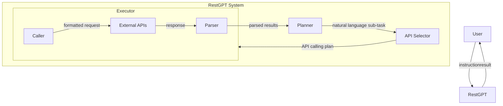
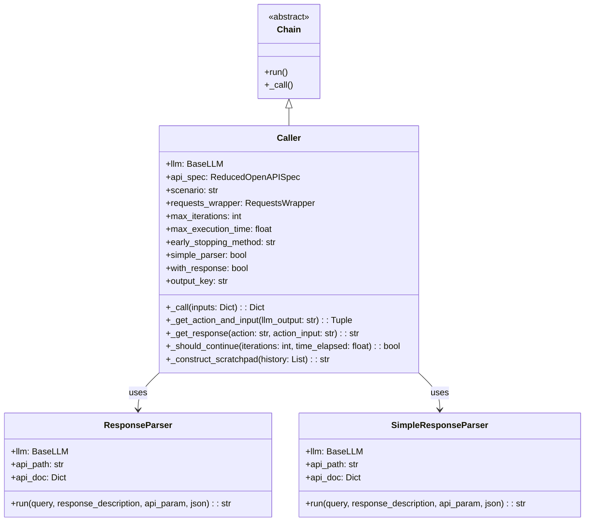
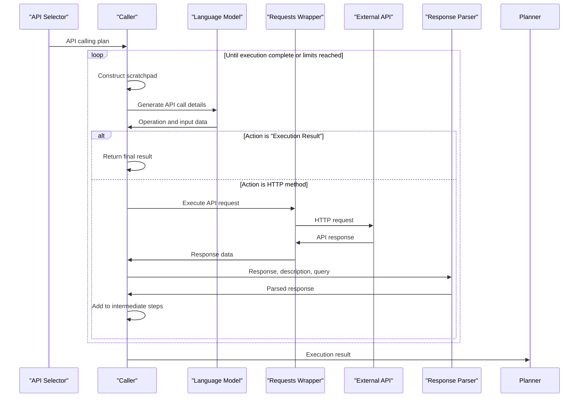
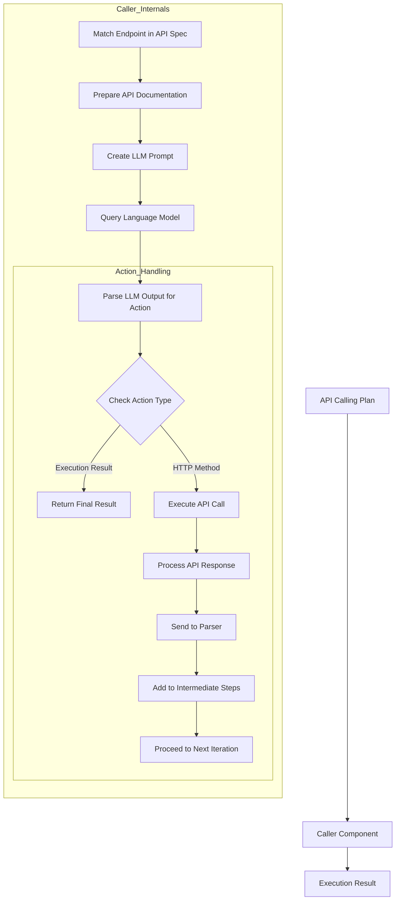
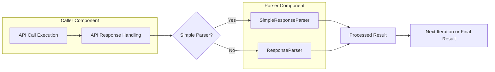

<!-- source: DeepWiki mcp.deepwiki.com · repo Yifan-Song793/RestGPT · extra page Caller · fetched 2026-10-26 -->

# Caller

Relevant source files

The following files were used as context for generating this wiki page:

- [README.md](README.md)
- [model/caller.py](model/caller.py)

The Caller component is a critical part of RestGPT's Executor subsystem responsible for organizing API parameters based on API plans and documentation, then executing HTTP requests to external RESTful APIs. It serves as the bridge between the high-level API calling plans generated by the API Selector and the actual HTTP interactions with external services.

For information about how the Caller fits into the larger Executor component, see [Executor](#3.3). For details on how the Parser works with the Caller's responses, see [Parser](#3.3.2).

## Position in the RestGPT Architecture

The Caller operates as a core component within RestGPT's execution pipeline, taking API calling plans and transforming them into concrete API requests.

Sources: [README.md:16-29](), [model/caller.py:112-132]()

## Caller Class Structure

The Caller is implemented as a class that inherits from the Chain class in LangChain, with specific attributes and methods designed for API execution.

Sources: [model/caller.py:112-132](), [model/caller.py:243-332]()

## Caller Workflow

The Caller processes API plans through an iterative approach, executing API calls and handling responses until a final result is determined or limits are reached.

Sources: [model/caller.py:243-332]()

## Key Components and Functionality

### Required Inputs

The Caller requires several key inputs to function properly:

| Input | Type | Description |
|-------|------|-------------|
| llm | BaseLLM | Language model used to interpret plans and generate API call details |
| api_spec | ReducedOpenAPISpec | Specification of the API, containing endpoint details |
| scenario | str | Current scenario (e.g., "TMDB" or "Spotify") |
| requests_wrapper | RequestsWrapper | Wrapper for making HTTP requests |
| simple_parser | bool | Whether to use a simplified parser (optional) |
| with_response | bool | Whether to include responses in the prompt (optional) |

Sources: [model/caller.py:112-125]()

### Configuration Options

The Caller provides several configuration options to control its behavior:

| Option | Default | Description |
|--------|---------|-------------|
| max_iterations | 15 | Maximum number of iterations to attempt |
| max_execution_time | None | Maximum execution time in seconds |
| early_stopping_method | "force" | Method for early stopping |
| output_key | "result" | Key to use for output in the returned dictionary |

Sources: [model/caller.py:117-122]()

## Execution Process

### 1. API Plan Processing

When the Caller receives an API plan, it:

1. Extracts the API endpoint from the plan
2. Loads the relevant API documentation for that endpoint
3. Prepares a prompt for the language model with the API details

This process is handled in the `_call` method [model/caller.py:243-332]().

### 2. LLM-Based Action Generation

The Caller uses the language model to:

1. Generate the appropriate HTTP method (GET, POST, PUT, DELETE)
2. Determine the URL, parameters, and request body for the API call
3. Provide a description and output instructions for processing the response

The prompt template for this interaction is defined in `CALLER_PROMPT` [model/caller.py:27-107]().

Sources: [model/caller.py:243-332](), [model/caller.py:177-196]()

### 3. API Request Execution

The Caller executes the API request by:

1. Parsing the LLM output to extract the action and input
2. Making the appropriate HTTP request using the RequestsWrapper
3. Receiving and processing the response

The `_get_response` method handles this part of the process [model/caller.py:197-242]().

### 4. Response Parsing

After receiving a response, the Caller:

1. Determines which ResponseParser to use (standard or simple)
2. Provides the parser with the response, API documentation, and query
3. Receives the parsed result
4. Adds the result to the intermediate steps for potential future iterations

This functionality is implemented in the later part of the `_call` method [model/caller.py:290-326]().

## Error Handling and Limitations

The Caller includes several mechanisms for handling errors and edge cases:

1. JSON error fixing to handle malformed JSON in LLM outputs
2. Support for different content types in API responses
3. Handling of non-200 HTTP status codes
4. Token limits for API documentation to avoid exceeding context windows

However, there are some limitations:

1. Currently only supports GET, POST, PUT, and DELETE methods
2. May require multiple iterations for complex API calls
3. Depends on the quality of the LLM's understanding of the API documentation

Sources: [model/caller.py:197-242](), [model/caller.py:243-332]()

## Integration with Other Components

### ResponseParser Integration

The Caller works closely with a ResponseParser (either standard or simplified) to process API responses:

Sources: [model/caller.py:307-318](), [model/caller.py:324-325]()

### API Specification Handling

The Caller is designed to work with a ReducedOpenAPISpec that contains:

1. Server information (base URLs)
2. Endpoint documentation (parameters, request formats, response schemas)
3. Authentication requirements

This specification is used to guide the LLM in generating appropriate API calls and understanding responses.

Sources: [model/caller.py:251-269]()

## Conclusion

The Caller component serves as the crucial bridge between high-level API calling plans and concrete API interactions in the RestGPT system. By leveraging language models to interpret API documentation and generate appropriate requests, it enables natural language instructions to be translated into meaningful interactions with external RESTful APIs.

---

