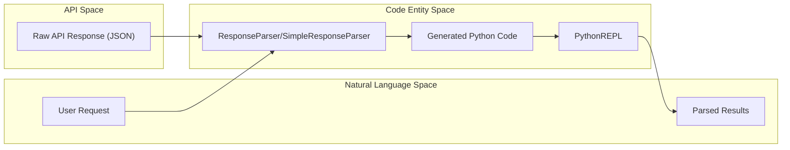
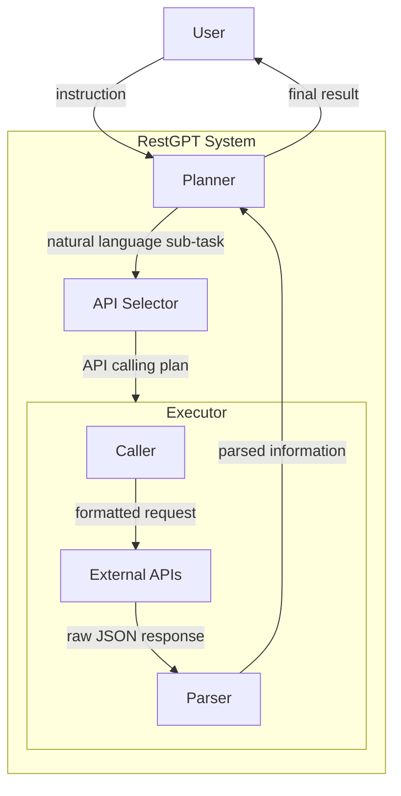
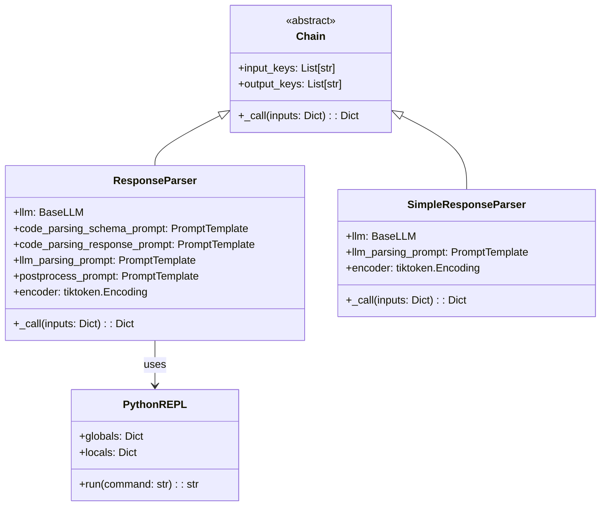
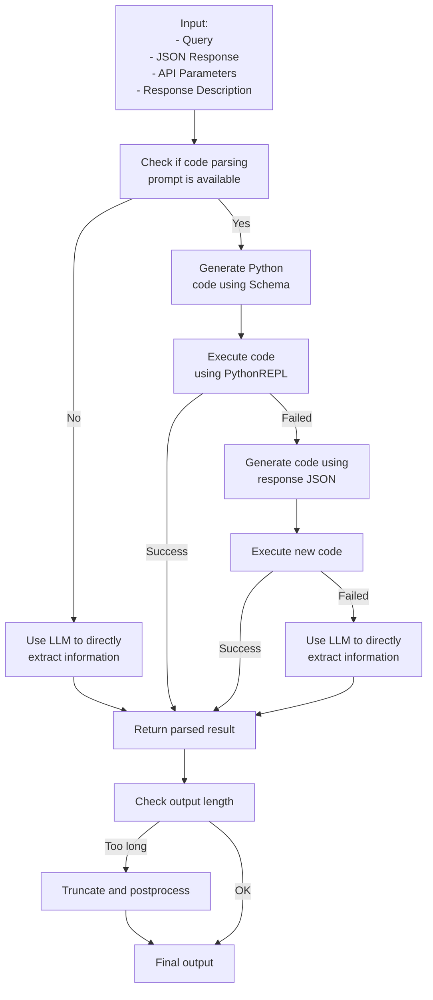

<!-- source: DeepWiki mcp.deepwiki.com · repo Yifan-Song793/RestGPT · extra page Parser · fetched 2026-10-26 -->

# Parser

Relevant source files

The following files were used as context for generating this wiki page:

- [README.md](README.md)
- [model/parser.py](model/parser.py)

The Parser component is a critical part of RestGPT's Executor subsystem, responsible for processing and extracting relevant information from API responses. By bridging the gap between raw API responses (typically in JSON format) and natural language understanding, the Parser enables the Planner to make informed decisions based on the data retrieved from external services.

For information about the Caller component which works closely with the Parser, see [Caller](#3.3.1).

## Overview and Purpose

The Parser transforms structured API responses into meaningful information that can be used by RestGPT's planning system. It employs a unique approach that leverages both programmatic parsing and language model capabilities:

1. **Program-Aided Language Modeling**: Generates Python code to parse API responses based on response schemas
2. **Multi-stage Parsing Strategy**: Implements fallback mechanisms to ensure robust extraction of information
3. **Response Adaptation**: Handles various response formats and sizes, adapting its parsing strategy accordingly

Sources: [model/parser.py:177-407](), [README.md:27-28]()

## Parser in System Architecture

The Parser functions as the final component in the Executor subsystem, receiving API responses from the Caller and transforming them into information that can be used by the Planner for subsequent decision-making.

Sources: [README.md:18-28]()

## Parser Implementation

The Parser component is implemented using two main classes: `ResponseParser` and `SimpleResponseParser`. Both use LLMs to extract information from API responses, but with different approaches and fallback mechanisms.

### Parser Classes

Sources: [model/parser.py:156-174](), [model/parser.py:177-329](), [model/parser.py:333-407]()

### ResponseParser

The `ResponseParser` is the primary class for processing API responses. It employs a multi-stage approach to extract information:

1. **Code Generation**: Generates Python code to parse the API response based on the response schema
2. **Code Execution**: Executes the generated code using a Python REPL
3. **Fallback Mechanisms**: If code execution fails, tries alternative approaches with simplified JSON or direct LLM extraction

The `ResponseParser` is initialized with:

- An LLM to generate parsing code and process results
- API path and documentation to provide context
- Optional example responses to guide code generation

Sources: [model/parser.py:177-329]()

### SimpleResponseParser

The `SimpleResponseParser` is a lighter alternative that relies solely on the LLM's ability to extract information directly from the API response without generating intermediate Python code. It's used in cases where:

- The response structure is simpler
- The API doesn't provide complete response schema information
- A more direct extraction approach is preferred

Sources: [model/parser.py:333-407]()

### PythonREPL

The `PythonREPL` class simulates a Python Read-Eval-Print Loop environment to execute the generated parsing code. It:

- Provides an isolated execution environment with controlled globals/locals
- Captures printed output from the executed code
- Handles exceptions during code execution

Sources: [model/parser.py:156-174]()

## Parser Workflow

The Parser follows a sophisticated workflow to extract information from API responses, with multiple fallback mechanisms to ensure robust operation.

Sources: [model/parser.py:286-328](), [model/parser.py:394-406]()

## Parsing Strategies

The Parser employs several strategies for extracting information from API responses:

### Code Generation Approach

The primary approach generates Python code to extract information based on:

1. **API Path and Description**: Provides context about what the API does
2. **Response Schema**: Defines the structure of the expected JSON response
3. **User Query**: Specifies what information to extract
4. **Response Example**: (When available) Shows a sample response to guide code generation

The generated code runs in a Python REPL and extracts the requested information from the API response.

Sources: [model/parser.py:23-58](), [model/parser.py:287-298]()

### Direct LLM Extraction

When code generation fails or isn't applicable, the Parser falls back to using the LLM to directly extract information from the API response. This approach is used:

1. As a fallback when code execution fails
2. When the response schema isn't available
3. In the `SimpleResponseParser` implementation

Sources: [model/parser.py:85-103](), [model/parser.py:316-320](), [model/parser.py:394-406]()

### Handling Large Responses

The Parser has mechanisms to handle large API responses:

1. **Schema Truncation**: Truncates large response schemas to fit within context windows
2. **JSON Simplification**: Simplifies complex JSON structures for better processing
3. **Output Truncation and Postprocessing**: Handles cases where the extracted information is too large

Sources: [model/parser.py:212-218](), [model/parser.py:304-308](), [model/parser.py:321-327]()

## Prompt Templates

The Parser uses several carefully crafted prompt templates to guide the LLM in different stages of the parsing process:

| Template Name | Purpose | Key Features |
|--------------|---------|--------------|
| `CODE_PARSING_SCHEMA_TEMPLATE` | Generate code based on response schema | Includes instructions for filtering and formatting results |
| `CODE_PARSING_RESPONSE_TEMPLATE` | Generate code based on JSON snippet | Used when schema-based generation fails |
| `LLM_PARSING_TEMPLATE` | Direct extraction from JSON response | Used as fallback or for simple cases |
| `LLM_SUMMARIZE_TEMPLATE` | Summarize API responses | Used when specific information isn't available |
| `POSTPROCESS_TEMPLATE` | Fix truncated outputs | Ensures outputs are syntactically complete |

Sources: [model/parser.py:23-153]()

## Example Parser Workflow

Here's an example of how the Parser processes an API response:

1. **Input**: 
   - A query about movie directors
   - The JSON response from a movie credits API endpoint
   - API parameters used for the request
   - Description of what the response contains

2. **Processing**:
   - The Parser generates Python code to filter through the crew list for members with job="Director"
   - The code is executed in the PythonREPL environment
   - The relevant director information is extracted and formatted

3. **Output**: 
   - A natural language response with the requested information about the directors

This workflow enables RestGPT to bridge the gap between raw API data and meaningful information that can be used for further planning.

Sources: [model/parser.py:287-298](), [README.md:27-28]()

## Summary

The Parser component is a crucial element in RestGPT's architecture, enabling the system to interpret and extract information from API responses. By combining code generation techniques with LLM-based extraction, the Parser provides a robust and flexible approach to handling diverse API responses. This capability allows RestGPT to effectively bridge the gap between raw API data and the planning system, enabling the creation of complex, multi-step workflows that interact with external services.

---

