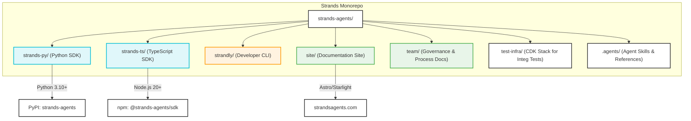
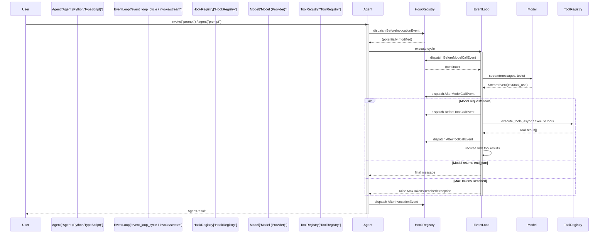
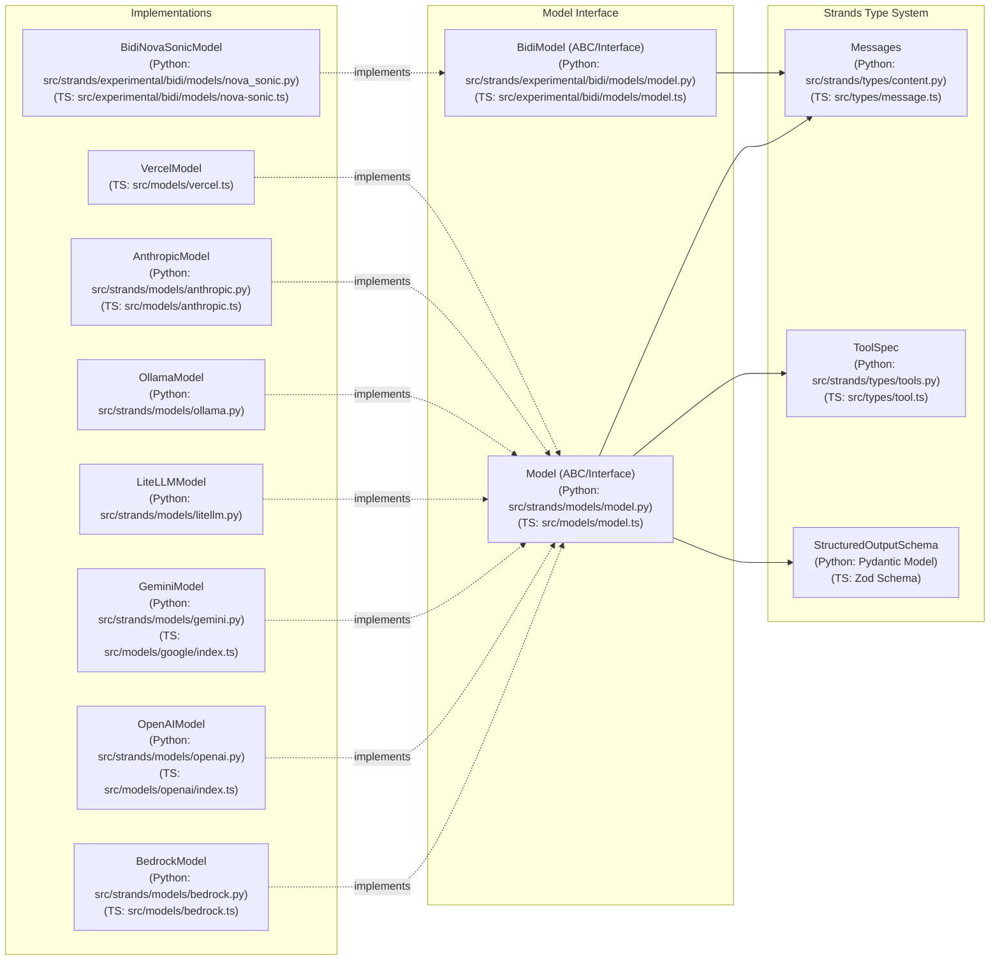

<!-- source: DeepWiki mcp.deepwiki.com · repo strands-agents/sdk-python · page 1 Introduction to Strands Agents SDK · fetched 2026-10-26 -->

# Introduction to Strands Agents SDK

Relevant source files

The following files were used as context for generating this wiki page:

- [.github/CODEOWNERS](.github/CODEOWNERS)
- [.gitignore](.gitignore)
- [AGENTS.md](AGENTS.md)
- [CODE_OF_CONDUCT.md](CODE_OF_CONDUCT.md)
- [CONTRIBUTING.md](CONTRIBUTING.md)
- [NOTICE](NOTICE)
- [README.md](README.md)
- [package-lock.json](package-lock.json)
- [package.json](package.json)
- [pyproject.toml](pyproject.toml)
- [site/src/content/docs/user-guide/build-with-ai.mdx](site/src/content/docs/user-guide/build-with-ai.mdx)
- [strandly/package.json](strandly/package.json)
- [strands-mcp/README.md](strands-mcp/README.md)
- [strands-mcp/src/strands_mcp_server/server.py](strands-mcp/src/strands_mcp_server/server.py)
- [strands-mcp/src/strands_mcp_server/utils/cache.py](strands-mcp/src/strands_mcp_server/utils/cache.py)
- [strands-mcp/src/strands_mcp_server/utils/indexer.py](strands-mcp/src/strands_mcp_server/utils/indexer.py)
- [strands-mcp/tests/test_cache.py](strands-mcp/tests/test_cache.py)
- [strands-mcp/tests/test_indexer.py](strands-mcp/tests/test_indexer.py)
- [strands-mcp/tests/test_indexer_concurrency.py](strands-mcp/tests/test_indexer_concurrency.py)
- [strands-mcp/tests/test_server.py](strands-mcp/tests/test_server.py)
- [strands-py/README.md](strands-py/README.md)
- [strands-ts/README.md](strands-ts/README.md)
- [strands-ts/package.json](strands-ts/package.json)
- [strands-ts/src/multiagent/state.ts](strands-ts/src/multiagent/state.ts)

## Purpose and Scope

This page provides a technical overview of the Strands Agents SDK, its architecture, core components, and extensibility mechanisms. It introduces the fundamental concepts and code structures that comprise the framework.

For installation instructions and quick start examples, see [Installation and Quick Start](#1.1). For detailed explanations of core concepts and the agent execution model, see [Core Concepts and Architecture](#1.2).

## What is Strands Agents SDK

Strands Agents is a simple yet powerful SDK that takes a model-driven approach to building and running AI agents. It is available in both Python and TypeScript, providing a lightweight orchestration layer that coordinates interactions between language models, tools, and custom behavior hooks through an event-driven execution loop. It scales from simple conversational assistants to complex autonomous workflows. [README.md:35-43]()

The SDK is distributed as `strands-agents` on PyPI for Python and `@strands-agents/sdk` on npm for TypeScript. The Python SDK supports Python 3.10+, while the TypeScript SDK requires Node.js 20+. [pyproject.toml:5](), [strands-ts/package.json:57-60](), [README.md:65-66](), [README.md:81-82]()

**Sources:** [pyproject.toml:5](), [strands-ts/package.json:57-60](), [README.md:35-43](), [README.md:65-66](), [README.md:81-82]()

## Core Capabilities

The SDK provides the following capabilities:

| Capability | Description | Key Components (Python) | Key Components (TypeScript) |
|------------|-------------|-------------------------|-----------------------------|
| **Model Abstraction** | Unified interface across LLM providers (Bedrock, OpenAI, Gemini, Ollama, etc.) | `Model`, `BedrockModel`, `OpenAIModel`, `LiteLLMModel` | `Agent`, `BedrockModel`, `OpenAIModel` |
| **Tool Integration** | Function decoration and external MCP server tools | `@tool`, `MCPClient`, `ToolRegistry` | `tool`, `MCPClient` |
| **Extensibility** | Event-driven hooks and plugin system for custom behavior | `HookRegistry`, `Plugin`, `AgentSkills` | `HookRegistry`, `Plugin`, `AgentSkills` |
| **Multi-Agent Orchestration** | Graph, Swarm, and A2A patterns for agent collaboration | `GraphBuilder`, `Swarm`, `A2AServer` | `Graph`, `Swarm`, `A2AServer` |
| **State Management** | Persistent session state and point-in-time snapshots | `Snapshot`, `AgentState`, `SessionManager` | `AgentState`, `SessionManager` |
| **Observability** | OpenTelemetry tracing and metrics | `StrandsTelemetry`, `opentelemetry-api` | `StrandsTelemetry`, `opentelemetry-api` |
| **Streaming** | Real-time response streaming with event types | `stream_async`, `StreamEvent` | `stream()`, `AgentStreamEvent` |

**Sources:** [README.md:37-43](), [strands-ts/README.md:38-51]()

## System Architecture Overview

The Strands Agents SDK is structured as a monorepo, containing both Python and TypeScript SDKs, a developer CLI, and the documentation site. This multi-language approach ensures conceptual parity while leveraging language-idiomatic implementations. [README.md:37-45](), [AGENTS.md:9-22]()

The monorepo structure facilitates shared context and consistent development practices across both SDKs. [AGENTS.md:9-22]()

**Sources:** [README.md:37-45](), [AGENTS.md:9-22]()

## Core Component Mapping

The following table maps high-level concepts to their implementation in code across both Python and TypeScript SDKs:

| Concept | Primary Class/Module (Python) | File Path (Python) | Primary Class/Module (TypeScript) | File Path (TypeScript) | Purpose |
|---------|-------------------------------|--------------------|-----------------------------------|------------------------|---------|
| **Agent Instance** | `Agent` | `strands-py/src/strands/agent/agent.py` | `Agent` | `strands-ts/src/agent/agent.ts` | Main orchestrator for agent execution |
| **Execution Loop** | `event_loop_cycle` | `strands-py/src/strands/event_loop/event_loop.py` | `invoke` / `stream` methods | `strands-ts/src/agent/agent.ts` | Recursive loop handling model calls and tool execution |
| **Model Interface** | `Model` (ABC) | `strands-py/src/strands/models/model.py` | `Model` (interface) | `strands-ts/src/models/model.ts` | Abstract base for all model providers |
| **Tool Definition** | `@tool` decorator | `strands-py/src/strands/tools/decorator.py` | `tool` factory | `strands-ts/src/tools/tool.ts` | Converts functions to agent tools |
| **Tool Registry** | `ToolRegistry` | `strands-py/src/strands/tools/registry.py` | `ToolRegistry` | `strands-ts/src/tools/tool-registry.ts` | Manages available tools for agent |
| **Hook System** | `HookRegistry` | `strands-py/src/strands/hooks/registry.py` | `HookRegistry` | `strands-ts/src/hooks/hook-registry.ts` | Event-driven customization points |
| **Plugin Base** | `Plugin` | `strands-py/src/strands/plugins/plugin.py` | `Plugin` | `strands-ts/src/plugins/plugin.ts` | Composable extension mechanism |
| **State Snapshot** | `Snapshot` | `strands-py/src/strands/types/_snapshot.py` | `AgentState` | `strands-ts/src/multiagent/state.ts` | Point-in-time capture of agent state |
| **Multi-Agent Base** | `MultiAgentBase` | `strands-py/src/strands/multiagent/base.py` | `MultiAgentBase` | `strands-ts/src/multiagent/multi-agent-base.ts` | Foundation for multi-agent patterns |
| **A2A Protocol** | `A2AServer` | `strands-py/src/strands/multiagent/a2a/server.py` | `A2AServer` | `strands-ts/src/a2a/express-server.ts` | Exposes agents via Agent-to-Agent protocol |

**Sources:** [strands-ts/package.json:21-158](), [strands-ts/README.md:85-195](), [README.md:69-75](), [strands-py/README.md:76-90](), [strands-mcp/README.md:39-40]()

## Agent Execution Flow

The execution flow demonstrates the recursive event loop pattern with hook intervention points. The system explicitly handles edge cases like token limits through `MaxTokensReachedException` (Python) or similar error handling in TypeScript.

**Sources:** [strands-ts/README.md:173-195]()

## Extensibility Architecture

The SDK provides three complementary extensibility mechanisms:

### Hook System
The `HookRegistry` provides event-driven customization through strongly-typed event callbacks. Common events include `BeforeInvocationEvent`, `BeforeModelCallEvent`, and `BeforeToolCallEvent`. [strands-ts/README.md:48]()

### Plugin System
The `Plugin` base class enables composable extensions. It allows for automatic discovery of hooks and tools defined within the plugin. The `AgentSkills` plugin uses this system to integrate AgentSkills.io compatible skills. [strands-ts/README.md:107-110]()

### Tool Provider Interface
Custom tool sources can implement the `ToolProvider` protocol to expose tools. This includes the `@tool` decorator (Python) or `tool` factory (TypeScript) for functions and the `MCPClient` for external Model Context Protocol servers. [strands-py/README.md:76-90](), [strands-ts/README.md:138-163]()

**Sources:** [strands-py/README.md:76-90](), [strands-ts/README.md:48](), [strands-ts/README.md:107-110](), [strands-ts/README.md:138-163]()

## Model Provider Ecosystem

All model providers implement the `Model` abstract base class (Python) or interface (TypeScript), enabling zero-code provider switching while preserving access to provider-specific features. The SDK supports a wide range of providers including Amazon Bedrock, Anthropic, OpenAI, Gemini, LiteLLM, Ollama, and more. [strands-py/README.md:123-186](), [strands-ts/README.md:94-123]()

**Sources:** [strands-py/README.md:123-186](), [strands-ts/README.md:94-123]()

## Experimental Features
The SDK includes experimental support for bidirectional streaming via `BidiAgent` and `BidiModel`. This system is designed for real-time audio/text conversations, featuring hierarchical event sequences and low-latency audio processing. [strands-ts/package.json:51-54]()

**Sources:** [strands-ts/package.json:51-54]()

## Strands MCP Server

The `strands-agents-mcp-server` package provides a Model Context Protocol (MCP) server that offers curated documentation access to AI coding assistants. It indexes `llms.txt` files, enabling tools like `search_docs` and `fetch_doc` to find and retrieve relevant documentation sections. The server supports TF-IDF ranking for search queries and can prefetch all pages for immediate body-term search via the `STRANDS_MCP_PREFETCH_ALL` configuration. [strands-mcp/README.md:35-57](), [strands-mcp/src/strands_mcp_server/server.py:24-80](), [strands-mcp/src/strands_mcp_server/server.py:83-190]()

For detailed information on the MCP server, its features, and installation in various clients (Kiro, Cursor, VS Code, Claude Code), see [Strands MCP Server](#1.3).

**Sources:** [strands-mcp/README.md:35-57](), [strands-mcp/src/strands_mcp_server/server.py:24-80](), [strands-mcp/src/strands_mcp_server/server.py:83-190]()

## Next Steps

- [Installation and Quick Start](#1.1) — Get the SDK installed and run your first agent
- [Core Concepts and Architecture](#1.2) — Deep dive into fundamental concepts (Agent, Model, Tool, Hook)
- [Strands MCP Server](#1.3) — Learn about the Model Context Protocol server

---

