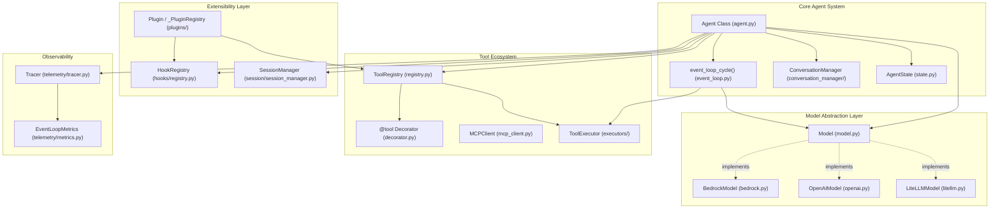
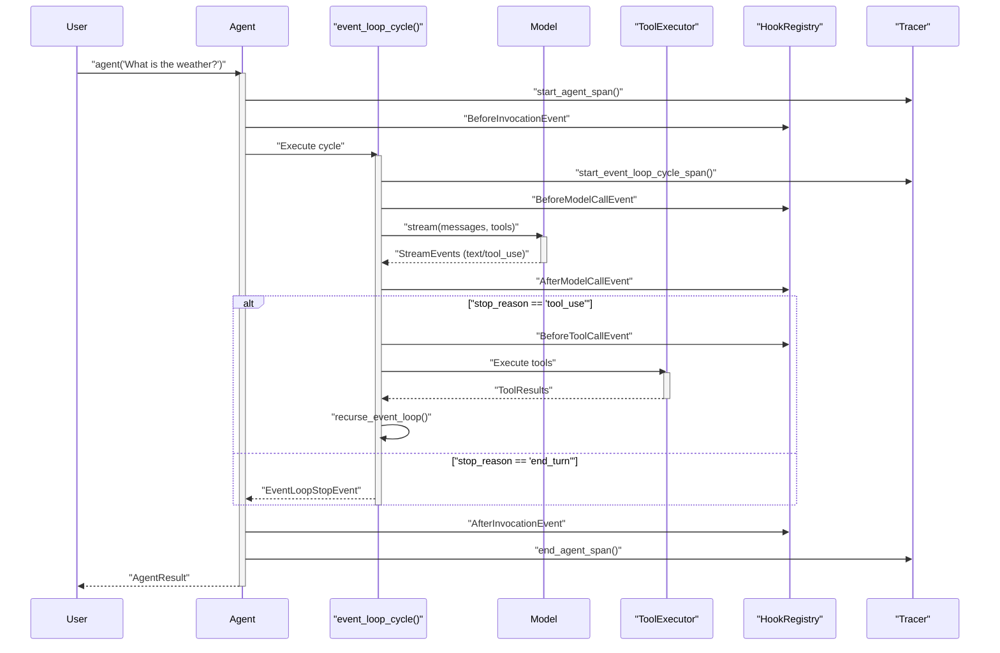
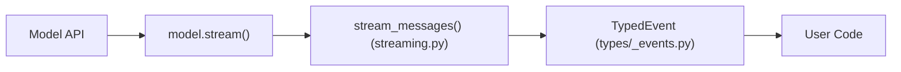

<!-- source: DeepWiki mcp.deepwiki.com · repo strands-agents/sdk-python · page 1.2 Core Concepts and Architecture · fetched 2026-10-26 -->

# Core Concepts and Architecture

<details>
<summary>Relevant source files</summary>

The following files were used as context for generating this wiki page:

- [.gitignore](.gitignore)
- [AGENTS.md](AGENTS.md)
- [CONTRIBUTING.md](CONTRIBUTING.md)
- [README.md](README.md)
- [package-lock.json](package-lock.json)
- [package.json](package.json)
- [pyproject.toml](pyproject.toml)
- [site/src/content/docs/user-guide/concepts/agents/agent-loop.mdx](site/src/content/docs/user-guide/concepts/agents/agent-loop.mdx)
- [strandly/package.json](strandly/package.json)
- [strands-py/AGENTS.md](strands-py/AGENTS.md)
- [strands-py/docs/TESTING.md](strands-py/docs/TESTING.md)
- [strands-py/src/strands/telemetry/metrics.py](strands-py/src/strands/telemetry/metrics.py)
- [strands-py/src/strands/tools/executors/_executor.py](strands-py/src/strands/tools/executors/_executor.py)
- [strands-py/src/strands/tools/executors/sequential.py](strands-py/src/strands/tools/executors/sequential.py)
- [strands-py/src/strands/tools/mcp/mcp_types.py](strands-py/src/strands/tools/mcp/mcp_types.py)
- [strands-py/tests/strands/telemetry/test_metrics.py](strands-py/tests/strands/telemetry/test_metrics.py)
- [strands-py/tests/strands/tools/executors/conftest.py](strands-py/tests/strands/tools/executors/conftest.py)
- [strands-py/tests/strands/tools/executors/test_executor.py](strands-py/tests/strands/tools/executors/test_executor.py)
- [strands-ts/AGENTS.md](strands-ts/AGENTS.md)
- [strands-ts/docs/TESTING.md](strands-ts/docs/TESTING.md)
- [strands-ts/package.json](strands-ts/package.json)
- [strands-ts/src/multiagent/state.ts](strands-ts/src/multiagent/state.ts)
- [team/DECISIONS.md](team/DECISIONS.md)

</details>


This page explains the fundamental architecture of the Strands Agents SDK, covering the core abstractions (Agent, Model, Tool, Hook), how they interact, and the execution flow through the event loop. This material focuses on the structural design patterns and component relationships that form the foundation of the SDK.

For practical usage examples and API details, see [Agent Class and Basic Usage](). For multi-agent orchestration patterns, see [Multi-Agent Systems](). For observability integration, see [Telemetry and Observability]().

---

## Core Abstractions

The SDK is built around four primary abstractions that work together to create agentic behavior:

### Agent

The `Agent` class [strands-py/src/strands/agent/agent.py:109-120]() serves as the central orchestrator and primary user-facing interface. It coordinates the interaction between models, tools, hooks, and state management components. An agent maintains:

- A conversation history (`messages` list) [strands-py/src/strands/agent/agent.py:128]()
- A reference to a `Model` instance for inference [strands-py/src/strands/agent/agent.py:127]()
- A `ToolRegistry` for tool discovery and management [strands-py/src/strands/agent/agent.py:65]()
- A `HookRegistry` [strands-py/src/strands/hooks/registry.py:1-50]() for lifecycle event callbacks
- A `ConversationManager` [strands-py/src/strands/agent/agent.py:77-81]() for context window handling
- An optional `SessionManager` [strands-py/src/strands/agent/agent.py:59]() for persistence
- `AgentState` [strands-py/src/strands/agent/state.py:1-30]() for JSON-serializable application state

The Agent class provides multiple invocation patterns:
- Synchronous: `agent("prompt")` using the `__call__` method [strands-py/src/strands/agent/agent.py:539-561]()
- Asynchronous: `agent.invoke_async("prompt")` [strands-py/src/strands/agent/agent.py:563-583]()
- Streaming: `agent.stream_async("prompt")` for real-time events [strands-py/src/strands/agent/agent.py:585-642]()
- Direct tool access: `agent.tool.tool_name(...)` via the `_ToolCaller` proxy [strands-py/src/strands/agent/agent.py:62]()

Sources: [strands-py/src/strands/agent/agent.py:109-280](), [AGENTS.md:9-18]()

### Model

The `Model` abstract base class [strands-py/src/strands/models/model.py:1-50]() defines the interface for all LLM provider integrations. Models are responsible for:

- Formatting requests according to provider-specific APIs
- Streaming responses as event objects
- Supporting tool specifications for function calling
- Handling structured output when requested

The SDK includes multiple concrete implementations:
- `BedrockModel` [strands-py/src/strands/models/bedrock.py:1-50]() - Amazon Bedrock integration
- `OpenAIModel` [strands-py/src/strands/models/openai.py:1-50]() - OpenAI-compatible APIs
- `LiteLLMModel` [strands-py/src/strands/models/litellm.py:1-50]() - Universal proxy for 100+ providers
- `AnthropicModel`, `GeminiModel`, `MistralModel`, etc. [AGENTS.md:45-54]()

Sources: [strands-py/src/strands/agent/agent.py:55-56](), [AGENTS.md:42-55]()

### Tool

Tools enable agents to interact with external systems. The SDK provides multiple ways to define tools:

**Python Functions with `@tool` decorator**: The simplest approach where functions are automatically converted to tool specifications with JSON schema generated from type hints [strands-py/src/strands/tools/decorator.py:1-50]().

**Module-level tools**: Python modules with a `TOOL_SPEC` dictionary and corresponding function [tests/strands/agent/test_agent.py:103-118]().

**MCP (Model Context Protocol) servers**: External tool services accessed via `MCPClient` [strands-py/src/strands/tools/mcp/mcp_client.py:1-50]().

The `ToolRegistry` [strands-py/src/strands/tools/registry.py:1-100]() acts as the central repository, supporting:
- Static tool registration
- Dynamic tool registration (hot-reloadable) via `ToolWatcher` [strands-py/src/strands/tools/watcher.py:1-50]()
- File system-based discovery from directories [strands-py/src/strands/agent/agent.py:135]()
- Tool specification validation with JSON schema [strands-py/src/strands/tools/_validator.py:1-50]()

Sources: [strands-py/src/strands/agent/agent.py:157-168](), [tests/strands/agent/test_agent.py:221-230](), [AGENTS.md:57-81]()

### Hook

The `HookProvider` [strands-py/src/strands/hooks/registry.py:1-50]() interface enables extensibility through lifecycle event callbacks. Hooks receive events at key points during agent execution:

- `AgentInitializedEvent` [strands-py/src/strands/hooks/events.py:1-50]()
- `BeforeInvocationEvent` [strands-py/src/strands/hooks/events.py:1-50]()
- `AfterInvocationEvent` [strands-py/src/strands/hooks/events.py:1-50]()
- `BeforeModelCallEvent` [strands-py/src/strands/event_loop/event_loop.py:18]()
- `AfterModelCallEvent` [strands-py/src/strands/event_loop/event_loop.py:18]()
- `MessageAddedEvent` [strands-py/src/strands/hooks/events.py:1-50]()

Built-in hooks include:
- `ConversationManager` [strands-py/src/strands/agent/agent.py:77-81]()
- `SessionManager` [strands-py/src/strands/agent/agent.py:59]()
- `ModelRetryStrategy` [strands-py/src/strands/event_loop/_retry.py:1-50]()

Sources: [strands-py/src/strands/agent/agent.py:44-53](), [strands-py/src/strands/event_loop/event_loop.py:18-34]()

---

## Architectural Layers

The SDK follows a layered architecture with clear separation of concerns:

**System Architecture Overview**



**Core Agent System**: The `Agent` class [strands-py/src/strands/agent/agent.py:109-120]() orchestrates all components. It delegates to `event_loop_cycle()` [strands-py/src/strands/event_loop/event_loop.py:120-158]() for execution and `ConversationManager` for history management.

**Model Abstraction Layer**: The `Model` interface defines how the agent communicates with LLMs. `BedrockModel` [strands-py/src/strands/models/bedrock.py:1-50]() is the default provider.

**Tool Ecosystem**: `ToolRegistry` [strands-py/src/strands/tools/registry.py:1-100]() manages discovery, while `ToolExecutor` [strands-py/src/strands/tools/executors/_executor.py:1-50]() handles the actual calling of functions, either concurrently or sequentially.

**Extensibility Layer**: The `HookRegistry` [strands-py/src/strands/hooks/registry.py:1-50]() dispatches events. The `Plugin` system [strands-py/src/strands/plugins/plugin.py:1-50]() provides a way to package hooks and tools together.

**Observability**: `Tracer` [strands-py/src/strands/telemetry/tracer.py:1-50]() provides OpenTelemetry integration, and `EventLoopMetrics` [strands-py/src/strands/telemetry/metrics.py:1-50]() tracks performance.

Sources: [strands-py/src/strands/agent/agent.py:1-111](), [strands-py/src/strands/event_loop/event_loop.py:1-158](), [AGENTS.md:19-132]()

---

## Event Loop Architecture

The event loop implements the core agentic pattern through recursive cycles of model invocation and tool execution.

### Event Loop Cycle Flow

**Request Execution Flow**



**Key Components**:

**Cycle Initialization** [strands-py/src/strands/event_loop/event_loop.py:161-183](): Each cycle generates a unique `event_loop_cycle_id` and creates tracing spans using `tracer.start_event_loop_cycle_span`.

**Model Execution**: The model is called to generate a response. If the model provides a `tool_use`, the loop transitions to tool execution. The loop checks for `_has_tool_use_in_latest_message` [strands-py/src/strands/event_loop/event_loop.py:58-75]() to skip redundant model calls when tool results are pending.

**Structured Output Handling**: When a `structured_output_context` [strands-py/src/strands/event_loop/event_loop.py:159]() is provided, the loop may force structured output via a hidden tool call if the model returns a plain text response [tests/strands/event_loop/test_event_loop_structured_output.py:131-166]().

Sources: [strands-py/src/strands/event_loop/event_loop.py:120-234](), [strands-py/src/strands/agent/agent.py:585-642]()

### Stop Reasons and Termination

The event loop terminates based on the `StopReason` [strands-py/src/strands/types/streaming.py:1-50]() returned by the model:

| Stop Reason | Behavior | Location |
|---|---|---|
| `end_turn` | Normal completion | [strands-py/src/strands/event_loop/event_loop.py:195]() |
| `tool_use` | Triggers tool execution and recursion | [strands-py/src/strands/event_loop/event_loop.py:188]() |
| `max_tokens` | Raises `MaxTokensReachedException` | [strands-py/src/strands/types/exceptions.py:21-27]() |
| `content_filter`| Model blocked content | [strands-py/src/strands/types/streaming.py:1-50]() |

Sources: [strands-py/src/strands/event_loop/event_loop.py:163-234](), [strands-py/src/strands/types/exceptions.py:21-27]()

---

## Streaming and Event Processing

The SDK transforms raw model responses into typed events for consumption.

### Stream Processing Pipeline



**Event Types Generated**:
- `ModelStreamChunkEvent` [strands-py/src/strands/types/_events.py:68]()
- `ModelMessageEvent` [strands-py/src/strands/types/_events.py:26]()
- `EventLoopStopEvent` [strands-py/src/strands/types/_events.py:24]()
- `StartEventLoopEvent` [strands-py/src/strands/types/_events.py:29]()

**Invocation Lock**: The Agent uses a `threading.Lock` [strands-py/src/strands/agent/agent.py:247]() to prevent concurrent invocations on the same instance, ensuring message history remains consistent. This behavior is controlled by `concurrent_invocation_mode` [strands-py/src/strands/agent/agent.py:148]().

Sources: [strands-py/src/strands/agent/agent.py:585-642](), [strands-py/src/strands/event_loop/event_loop.py:117-160](), [strands-py/src/strands/types/_events.py:1-68]()

---

## State Management

The SDK manages state through several specialized components:

### State Components

- **Messages**: The `messages` list [strands-py/src/strands/agent/agent.py:128]() stores the conversation history.
- **AgentState**: A JSON-serializable dictionary for application-specific state [strands-py/src/strands/agent/state.py:1-30]().
- **ConversationManager**: Pluggable strategies like `SlidingWindowConversationManager` [strands-py/src/strands/agent/conversation_manager/sliding_window_conversation_manager.py:1-50]() manage history size.
- **SessionManager**: Handles persistence to external storage like S3 or local files [strands-py/src/strands/session/session_manager.py:1-50]().
- **Interrupt State**: `_InterruptState` [strands-py/src/strands/interrupt.py:1-50]() tracks human-in-the-loop status.

Sources: [strands-py/src/strands/agent/agent.py:116-280](), [strands-py/src/strands/agent/state.py:1-30](), [strands-py/src/strands/interrupt.py:1-50]()

---

## Error Handling

| Exception | Cause | Recovery |
|---|---|---|
| `ContextWindowOverflowException` | Input too large | `ConversationManager` reduces context [strands-py/src/strands/types/exceptions.py:38-46]() |
| `MaxTokensReachedException` | Output limit hit | Raises error or attempts recovery [strands-py/src/strands/types/exceptions.py:21-27]() |
| `ConcurrencyException` | Concurrent call detected | Raises error based on config [strands-py/src/strands/types/exceptions.py:115-124]() |
| `ModelThrottledException` | Rate limited | `ModelRetryStrategy` retries call [strands-py/src/strands/types/exceptions.py:55-71]() |
| `StructuredOutputException` | Pydantic validation failed | Retries with error feedback [strands-py/src/strands/types/exceptions.py:102-113]() |

Sources: [strands-py/src/strands/types/exceptions.py:1-124](), [strands-py/src/strands/event_loop/event_loop.py:163-177](), [strands-py/src/strands/agent/agent.py:585-642]()

---

## Cross-SDK Parity and Monorepo Structure

The Strands Agents SDK is designed for cross-language parity, offering both Python and TypeScript implementations within a single monorepo. This design ensures a consistent developer experience and conceptual model across different environments.

### Monorepo Workspace Layout

The monorepo is structured to house multiple distinct projects, each with its own toolchain and conventions, while sharing common resources and principles.

```
strands-agents/
├── strands-py/         # Python SDK (hatch)
├── strands-ts/         # TypeScript SDK (npm workspace)
├── strandly/           # Developer CLI for local builds and workspace tooling
├── site/               # Documentation site (Astro)
├── team/               # Governance + cross-SDK process docs
├── test-infra/         # CDK stack for integ tests requiring provisioned AWS infra
├── .agents/            # Agent skills and references
├── package.json        # npm workspace root
└── .github/workflows/  # CI workflows
```
The `package.json` [package.json:1-36]() at the root defines the npm workspaces, including `strandly` [package.json:6]() and `strands-ts` [package.json:7](). Similarly, `pyproject.toml` [pyproject.toml:1-14]() defines shared Python tooling.

Sources: [AGENTS.md:9-22](), [package.json:1-36](), [pyproject.toml:1-14]()

### Parity Principles

The SDK aims for parity in *concepts and names*, not identical code. This means that while the implementation details may differ to adhere to language idioms, the high-level abstractions and their behaviors remain consistent.

**Key Parity Rules**:

- **Plugin / Construct Naming**: Constructs are named for their function, without a `Plugin` suffix (e.g., `AgentSkills`, `ContextOffloader`). [AGENTS.md:48-50]()
- **Identifiers**: Names match across SDKs, re-cased to the language idiom (`snake_case` in Python ↔ `camelCase` in TypeScript). [AGENTS.md:51-52]()
- **Single-word String-Literal Values**: Byte-identical (e.g., `'user'`, `'success'`). [AGENTS.md:53]()
- **Multi-word String-Literal Values**: `snake_case` in Python ↔ `camelCase` in TypeScript (e.g., `tool_use` ↔ `toolUse`). Conversion happens via an explicit map. [AGENTS.md:54-55]()
- **Wire Field Names**: Retain their wire format in both SDKs, even if it breaks language casing conventions (e.g., `inputSchema`, `tool_use_id`). [AGENTS.md:56-57]()
- **Hook Event Names**: Shared across SDKs (modulo suffix convention). Adding a hook event in one SDK requires adding the matching name in the other. [AGENTS.md:58-59]()
- **Public vs. Internal API**: Marked explicitly. Python uses `__all__` and `_` prefix for modules; TypeScript keeps out of `index.ts` barrel and uses `@internal` tag. [AGENTS.md:60-62]()
- **Structured Logging Format**: `field=<value>, field=<value> | lowercase human-readable message`. Python uses `%s` interpolation; TypeScript uses template literals. [AGENTS.md:63-65]()
- **Evergreen, To-the-Point Comments**: Comments explain what cannot be inferred from code, briefly stating constraints, invariants, or non-obvious "why." [AGENTS.md:66-70]()
- **Directory & File Naming Parity**: Subsystem directories use language-idiomatic separators (`snake_case` in Python, `kebab-case` in TypeScript) but stem names match word-for-word (e.g., `vended_plugins/` ↔ `vended-plugins/`). [AGENTS.md:72-74]()

Sources: [AGENTS.md:46-74](), [strands-py/AGENTS.md:1-5](), [strands-ts/AGENTS.md:1-5]()

### Implementation Details

- **Python SDK (`strands-py/`)**: Uses `hatch` for development workflow and `pyproject.toml` [pyproject.toml:1-14]() for configuration. [CONTRIBUTING.md:64-68]()
- **TypeScript SDK (`strands-ts/`)**: Uses `npm` workspaces and `package.json` [strands-ts/package.json:1-158]() for configuration. [CONTRIBUTING.md:147-150]()

Sources: [CONTRIBUTING.md:54-63](), [CONTRIBUTING.md:147-150](), [strands-ts/package.json:1-158](), [pyproject.toml:1-14]()

---

