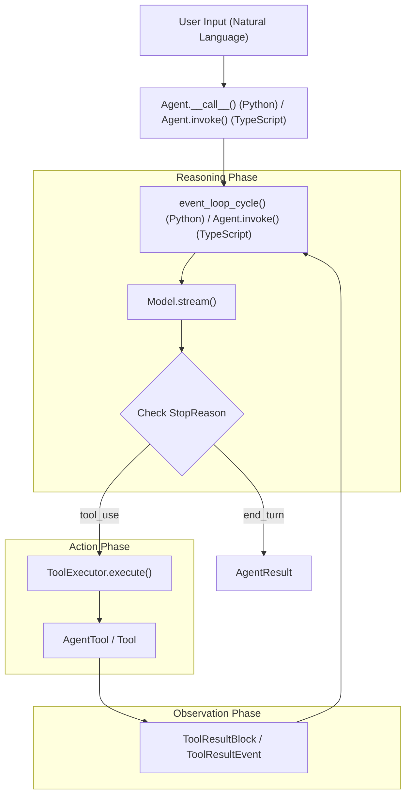
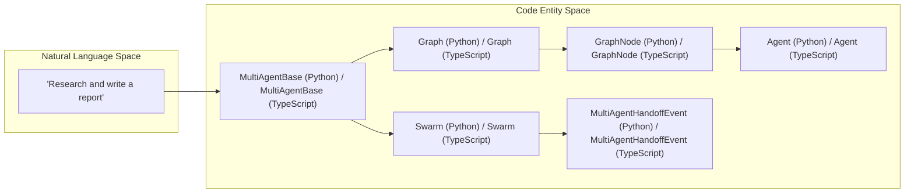

<!-- source: DeepWiki mcp.deepwiki.com · repo strands-agents/sdk-python · page 11 Glossary · fetched 2026-10-26 -->

# Glossary

Relevant source files

The following files were used as context for generating this wiki page:

- [.agents/references/mdx-authoring.md](.agents/references/mdx-authoring.md)
- [.gitignore](.gitignore)
- [AGENTS.md](AGENTS.md)
- [CONTRIBUTING.md](CONTRIBUTING.md)
- [README.md](README.md)
- [package-lock.json](package-lock.json)
- [package.json](package.json)
- [pyproject.toml](pyproject.toml)
- [site/AGENTS.md](site/AGENTS.md)
- [site/src/components/overrides/MarkdownContent.astro](site/src/components/overrides/MarkdownContent.astro)
- [site/src/config/navigation.yml](site/src/config/navigation.yml)
- [site/src/content.config.ts](site/src/content.config.ts)
- [site/src/content/catalog/strands-github-storage.yaml](site/src/content/catalog/strands-github-storage.yaml)
- [site/src/content/docs/contribute/contributing/extensions.mdx](site/src/content/docs/contribute/contributing/extensions.mdx)
- [site/src/content/docs/integrations/storage/github.mdx](site/src/content/docs/integrations/storage/github.mdx)
- [site/src/content/docs/user-guide/concepts/model-providers/amazon-bedrock.mdx](site/src/content/docs/user-guide/concepts/model-providers/amazon-bedrock.mdx)
- [site/src/content/docs/user-guide/concepts/model-providers/anthropic.mdx](site/src/content/docs/user-guide/concepts/model-providers/anthropic.mdx)
- [site/src/content/docs/user-guide/concepts/model-providers/anthropic.ts](site/src/content/docs/user-guide/concepts/model-providers/anthropic.ts)
- [site/src/content/docs/user-guide/concepts/model-providers/anthropic_imports.ts](site/src/content/docs/user-guide/concepts/model-providers/anthropic_imports.ts)
- [site/src/plugins/remark-mkdocs-snippets.ts](site/src/plugins/remark-mkdocs-snippets.ts)
- [site/src/util/integration-content.ts](site/src/util/integration-content.ts)
- [site/test/languages-schema.test.ts](site/test/languages-schema.test.ts)
- [strandly/package.json](strandly/package.json)
- [strands-py/src/strands/agent/agent.py](strands-py/src/strands/agent/agent.py)
- [strands-py/src/strands/event_loop/event_loop.py](strands-py/src/strands/event_loop/event_loop.py)
- [strands-py/src/strands/models/anthropic.py](strands-py/src/strands/models/anthropic.py)
- [strands-py/src/strands/models/bedrock.py](strands-py/src/strands/models/bedrock.py)
- [strands-py/src/strands/models/model.py](strands-py/src/strands/models/model.py)
- [strands-py/src/strands/multiagent/__init__.py](strands-py/src/strands/multiagent/__init__.py)
- [strands-py/src/strands/multiagent/base.py](strands-py/src/strands/multiagent/base.py)
- [strands-py/src/strands/multiagent/graph.py](strands-py/src/strands/multiagent/graph.py)
- [strands-py/src/strands/multiagent/swarm.py](strands-py/src/strands/multiagent/swarm.py)
- [strands-py/tests/strands/agent/hooks/test_hook_registry.py](strands-py/tests/strands/agent/hooks/test_hook_registry.py)
- [strands-py/tests/strands/event_loop/test_event_loop.py](strands-py/tests/strands/event_loop/test_event_loop.py)
- [strands-py/tests/strands/event_loop/test_event_loop_metadata.py](strands-py/tests/strands/event_loop/test_event_loop_metadata.py)
- [strands-py/tests/strands/event_loop/test_event_loop_structured_output.py](strands-py/tests/strands/event_loop/test_event_loop_structured_output.py)
- [strands-py/tests/strands/hooks/test_registry.py](strands-py/tests/strands/hooks/test_registry.py)
- [strands-py/tests/strands/models/test_anthropic.py](strands-py/tests/strands/models/test_anthropic.py)
- [strands-py/tests/strands/models/test_bedrock.py](strands-py/tests/strands/models/test_bedrock.py)
- [strands-py/tests/strands/multiagent/test_base.py](strands-py/tests/strands/multiagent/test_base.py)
- [strands-py/tests/strands/multiagent/test_graph.py](strands-py/tests/strands/multiagent/test_graph.py)
- [strands-py/tests/strands/multiagent/test_swarm.py](strands-py/tests/strands/multiagent/test_swarm.py)
- [strands-py/tests/strands/plugins/test_multiagent_plugin.py](strands-py/tests/strands/plugins/test_multiagent_plugin.py)
- [strands-py/tests_integ/test_multiagent_graph.py](strands-py/tests_integ/test_multiagent_graph.py)
- [strands-py/tests_integ/test_multiagent_swarm.py](strands-py/tests_integ/test_multiagent_swarm.py)
- [strands-ts/package.json](strands-ts/package.json)
- [strands-ts/src/agent/__tests__/agent.hook.test.ts](strands-ts/src/agent/__tests__/agent.hook.test.ts)
- [strands-ts/src/agent/__tests__/agent.model-retry.test.ts](strands-ts/src/agent/__tests__/agent.model-retry.test.ts)
- [strands-ts/src/agent/__tests__/agent.test.ts](strands-ts/src/agent/__tests__/agent.test.ts)
- [strands-ts/src/agent/agent.ts](strands-ts/src/agent/agent.ts)
- [strands-ts/src/conversation-manager/__tests__/null-conversation-manager.test.ts](strands-ts/src/conversation-manager/__tests__/null-conversation-manager.test.ts)
- [strands-ts/src/hooks/__tests__/events.test.ts](strands-ts/src/hooks/__tests__/events.test.ts)
- [strands-ts/src/hooks/events.ts](strands-ts/src/hooks/events.ts)
- [strands-ts/src/index.ts](strands-ts/src/index.ts)
- [strands-ts/src/models/__tests__/anthropic.test.ts](strands-ts/src/models/__tests__/anthropic.test.ts)
- [strands-ts/src/models/__tests__/bedrock.test.ts](strands-ts/src/models/__tests__/bedrock.test.ts)
- [strands-ts/src/models/__tests__/defaults.test.ts](strands-ts/src/models/__tests__/defaults.test.ts)
- [strands-ts/src/models/__tests__/google.test.ts](strands-ts/src/models/__tests__/google.test.ts)
- [strands-ts/src/models/anthropic.ts](strands-ts/src/models/anthropic.ts)
- [strands-ts/src/models/bedrock.ts](strands-ts/src/models/bedrock.ts)
- [strands-ts/src/models/google/adapters.ts](strands-ts/src/models/google/adapters.ts)
- [strands-ts/src/models/google/model.ts](strands-ts/src/models/google/model.ts)
- [strands-ts/src/models/google/types.ts](strands-ts/src/models/google/types.ts)
- [strands-ts/src/models/model.ts](strands-ts/src/models/model.ts)
- [strands-ts/src/multiagent/state.ts](strands-ts/src/multiagent/state.ts)
- [strands-ts/src/types/agent.ts](strands-ts/src/types/agent.ts)
- [strands-ts/src/types/messages.ts](strands-ts/src/types/messages.ts)
- [team/DECISIONS.md](team/DECISIONS.md)

This glossary defines the core technical terms, domain concepts, and implementation-specific jargon used within the Strands Agents SDK. It serves as a reference for onboarding engineers to understand how natural language concepts map to specific code entities.

## Core Concepts

### Agent
The central orchestrator in the SDK. It manages conversation history, interacts with a `Model` provider, and coordinates tool execution through the event loop.
*   **Implementation**: Defined in the `Agent` class [strands-py/src/strands/agent/agent.py:166-177]() (Python) and `Agent` class [strands-ts/src/agent/agent.ts:166-177]() (TypeScript).
*   **Interaction**: Supports both natural language calls (via `__call__` in Python, `invoke` in TypeScript) and direct tool access via the `tool` property [strands-py/src/strands/agent/agent.py:8-10]().

Sources: [strands-py/src/strands/agent/agent.py:8-10](), [strands-py/src/strands/agent/agent.py:166-177](), [strands-ts/src/agent/agent.ts:166-177]()

### Model (Model Provider)
An abstraction layer for Foundation Models. It standardizes how messages are formatted and sent to various backends.
*   **Base Class**: `Model` [strands-py/src/strands/models/model.py:56-57]() (Python) and `Model` [strands-ts/src/models/model.ts:18-18]() (TypeScript).
*   **Primary Implementation**: `BedrockModel` handles AWS Bedrock-specific features like Guardrails and prompt caching [strands-py/src/strands/models/bedrock.py:55-56]() (Python) and `BedrockModel` [strands-ts/src/models/bedrock.ts:20-20]() (TypeScript).
*   **Default**: Defaults to Claude 3.5 Sonnet on AWS Bedrock [strands-py/src/strands/models/bedrock.py:26-26]().

Sources: [strands-py/src/strands/models/bedrock.py:26-26](), [strands-py/src/strands/models/bedrock.py:55-56](), [strands-py/src/strands/models/model.py:56-57](), [strands-ts/src/models/bedrock.ts:20-20](), [strands-ts/src/models/model.ts:18-18]()

### Tool / AgentTool
A unit of functionality that an Agent can invoke. Tools consist of a schema (`ToolSpec`) for the model to understand and a callable implementation.
*   **Definition**: Typically created using the `@tool` decorator which extracts metadata from docstrings [strands-py/src/strands/tools/decorator.py:94-98](). In TypeScript, `FunctionTool` or `ZodTool` are used [strands-ts/src/tools/function-tool.ts:14-14](), [strands-ts/src/tools/zod-tool.ts:14-14]().
*   **Registry**: Managed by `ToolRegistry` for discovery and loading [strands-py/src/strands/tools/registry.py:65-65]() (Python) and `ToolRegistry` [strands-ts/src/registry/tool-registry.ts:14-14]() (TypeScript).

Sources: [strands-py/src/strands/tools/decorator.py:94-98](), [strands-py/src/strands/tools/registry.py:65-65](), [strands-ts/src/registry/tool-registry.ts:14-14](), [strands-ts/src/tools/function-tool.ts:14-14](), [strands-ts/src/tools/zod-tool.ts:14-14]()

### Event Loop
The central orchestration logic that manages the "Reasoning -> Action -> Observation" cycle.
*   **Key Function**: `event_loop_cycle` [strands-py/src/strands/event_loop/event_loop.py:120-158]() (Python).
*   **Recursive Flow**: Continues as long as the model returns a `stop_reason` of `tool_use` [strands-py/src/strands/event_loop/event_loop.py:187-189]().

Sources: [strands-py/src/strands/event_loop/event_loop.py:120-158](), [strands-py/src/strands/event_loop/event_loop.py:187-189]()

---

## Technical Terms & Jargon

| Term | Definition | Code Pointer (Python) | Code Pointer (TypeScript) |
| :--- | :--- | :--- | :--- |
| **A2A** | Agent-to-Agent protocol. Standardized communication for agents over networks. | [pyproject.toml:66-73]() | [package-lock.json:19-46]() |
| **Bidi** | Experimental bidirectional streaming system for real-time audio/text. | [pyproject.toml:75-78]() | [strands-ts/src/experimental/index.ts:14-14]() |
| **MCP** | Model Context Protocol. An open standard for connecting models to external tools. | [strands-py/src/strands/tools/mcp/mcp_client.py:104-115]() | [strands-ts/src/mcp/index.ts:14-14]() |
| **Stop Reason** | Signal from the LLM explaining why generation ceased (e.g., `end_turn`, `tool_use`). | [strands-py/src/strands/types/_events.py:27]() | [strands-ts/src/types/messages.ts:14-14]() |
| **Handoff** | Transferring control between agents in a Swarm or Graph. | [strands-py/src/strands/types/_events.py:43]() | [strands-ts/src/multiagent/base.ts:14-14]() |
| **Context Window** | The token limit of a model. Managed by `ConversationManager`. | [strands-py/src/strands/agent/agent.py:77-81]() | [strands-ts/src/agent/agent.ts:166-177]() |
| **Structured Output** | Forcing model responses into a specific Pydantic schema (Python) or Zod schema (TypeScript). | [strands-py/src/strands/agent/agent.py:172-175]() | [strands-ts/src/tools/structured-output-tool.ts:14-14]() |

Sources: [package-lock.json:19-46](), [pyproject.toml:66-73](), [pyproject.toml:75-78](), [strands-py/src/agent/agent.py:77-81](), [strands-py/src/strands/agent/agent.py:172-175](), [strands-py/src/strands/tools/mcp/mcp_client.py:104-115](), [strands-py/src/strands/types/_events.py:27](), [strands-py/src/strands/types/_events.py:43](), [strands-ts/src/agent/agent.ts:166-177](), [strands-ts/src/experimental/index.ts:14-14](), [strands-ts/src/mcp/index.ts:14-14](), [strands-ts/src/multiagent/base.ts:14-14](), [strands-ts/src/tools/structured-output-tool.ts:14-14](), [strands-ts/src/types/messages.ts:14-14]()

---

## Data Flow & Architecture Diagrams

### From Natural Language to Code Execution
This diagram bridges the gap between a user's natural language input and the internal code entities that process it.

Title: Agent Invocation Flow

Sources: [strands-py/src/strands/agent/agent.py:109-120](), [strands-py/src/strands/event_loop/event_loop.py:120-158](), [strands-py/src/strands/models/model.py:56-57](), [strands-py/src/strands/tools.executors/_executor.py:14-14](), [strands-py/src/strands/types/tools.py:50-50](), [strands-ts/src/agent/agent.ts:166-177](), [strands-ts/src/models/model.ts:18-18](), [strands-ts/src/tools/executors/concurrent.ts:14-14](), [strands-ts/src/types/agent.ts:14-14](), [strands-ts/src/types/messages.ts:14-14]()

### Multi-Agent Orchestration Space
This diagram shows how higher-level orchestration patterns map to code classes.

Title: Multi-Agent Entity Mapping

Sources: [strands-py/src/strands/agent/agent.py:109-120](), [strands-py/src/strands/multiagent/base.py:56-57](), [strands-py/src/strands/multiagent/graph.py:162-174](), [strands-py/src/strands/multiagent/swarm.py:14-14](), [strands-py/src/strands/types/_events.py:43-43](), [strands-ts/src/agent/agent.ts:166-177](), [strands-ts/src/multiagent/base.ts:14-14](), [strands-ts/src/multiagent/graph.ts:14-14](), [strands-ts/src/multiagent/swarm.ts:14-14]()

---

## Domain Concepts

### Tool Context (`ToolContext`)
A special parameter injected into tool functions at runtime. It provides tools with access to the `Agent` instance, `AgentState`, and session metadata.
*   **Implementation**: The `@tool` decorator identifies this type to exclude it from the JSON schema sent to the LLM [strands-py/src/strands/tools/decorator.py:94-98](). In TypeScript, `ToolContext` is an interface passed to tool functions [strands-ts/src/tools/tool.ts:14-14]().

Sources: [strands-py/src/strands/tools/decorator.py:94-98](), [strands-ts/src/tools/tool.ts:14-14]()

### Interrupts
A mechanism to pause agent execution (typically for human-in-the-loop approval) during a tool call.
*   **Implementation**: Managed via `_InterruptState` [strands-py/src/strands/interrupt.py:54-54]() (Python) and `InterruptState` [strands-ts/src/interrupt.ts:14-14]() (TypeScript).
*   **Flow**: If the agent is in an interrupted state, the `event_loop_cycle` skips model invocation and proceeds to tool handling or yields a `ToolInterruptEvent` [strands-py/src/strands/event_loop/event_loop.py:187-190]().

Sources: [strands-py/src/strands/event_loop/event_loop.py:187-190](), [strands-py/src/strands/interrupt.py:54-54](), [strands-ts/src/interrupt.ts:14-14]()

### Telemetry (OpenTelemetry)
The SDK implements fine-grained tracing for all operations.
*   **Tracer**: The `Tracer` class creates spans for agents, models, and tools [strands-py/src/strands/telemetry/tracer.py:77-90]() (Python) and `Tracer` [strands-ts/src/telemetry/tracer.ts:14-14]() (TypeScript).
*   **Spans**: Key spans include `event_loop_cycle` [strands-py/src/strands/event_loop/event_loop.py:175-181]() and `chat` (model invocation) [strands-py/src/strands/telemetry/tracer.py:179-179]().

Sources: [strands-py/src/strands/event_loop/event_loop.py:175-181](), [strands-py/src/strands/telemetry/tracer.py:77-90](), [strands-py/src/strands/telemetry/tracer.py:179-179](), [strands-ts/src/telemetry/tracer.ts:14-14]()