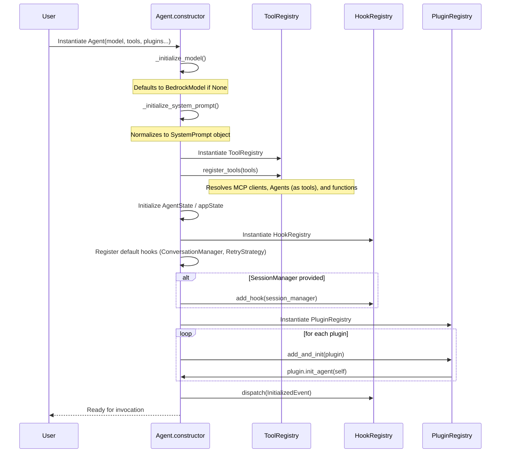

<!-- source: DeepWiki mcp.deepwiki.com · repo strands-agents/sdk-python · page 2.1 Agent Class and Initialization · fetched 2026-10-26 -->

# Agent Class and Initialization

Relevant source files

The following files were used as context for generating this wiki page:

- [strands-py/src/strands/__init__.py](strands-py/src/strands/__init__.py)
- [strands-py/src/strands/agent/_concurrency.py](strands-py/src/strands/agent/_concurrency.py)
- [strands-py/src/strands/agent/agent.py](strands-py/src/strands/agent/agent.py)
- [strands-py/src/strands/event_loop/event_loop.py](strands-py/src/strands/event_loop/event_loop.py)
- [strands-py/src/strands/storage/__init__.py](strands-py/src/strands/storage/__init__.py)
- [strands-py/src/strands/tools/_caller.py](strands-py/src/strands/tools/_caller.py)
- [strands-py/src/strands/types/exceptions.py](strands-py/src/strands/types/exceptions.py)
- [strands-py/tests/strands/agent/test_agent.py](strands-py/tests/strands/agent/test_agent.py)
- [strands-py/tests/strands/agent/test_concurrency.py](strands-py/tests/strands/agent/test_concurrency.py)
- [strands-py/tests/strands/event_loop/test_event_loop.py](strands-py/tests/strands/event_loop/test_event_loop.py)
- [strands-py/tests/strands/event_loop/test_event_loop_metadata.py](strands-py/tests/strands/event_loop/test_event_loop_metadata.py)
- [strands-py/tests/strands/event_loop/test_event_loop_structured_output.py](strands-py/tests/strands/event_loop/test_event_loop_structured_output.py)
- [strands-py/tests/strands/storage/__init__.py](strands-py/tests/strands/storage/__init__.py)
- [strands-py/tests/strands/storage/test_in_memory_storage.py](strands-py/tests/strands/storage/test_in_memory_storage.py)
- [strands-py/tests/strands/storage/test_local_file_storage.py](strands-py/tests/strands/storage/test_local_file_storage.py)
- [strands-ts/src/agent/__tests__/agent.hook.test.ts](strands-ts/src/agent/__tests__/agent.hook.test.ts)
- [strands-ts/src/agent/__tests__/agent.model-retry.test.ts](strands-ts/src/agent/__tests__/agent.model-retry.test.ts)
- [strands-ts/src/agent/__tests__/agent.test.ts](strands-ts/src/agent/__tests__/agent.test.ts)
- [strands-ts/src/agent/agent.ts](strands-ts/src/agent/agent.ts)
- [strands-ts/src/conversation-manager/__tests__/null-conversation-manager.test.ts](strands-ts/src/conversation-manager/__tests__/null-conversation-manager.test.ts)
- [strands-ts/src/hooks/__tests__/events.test.ts](strands-ts/src/hooks/__tests__/events.test.ts)
- [strands-ts/src/hooks/events.ts](strands-ts/src/hooks/events.ts)
- [strands-ts/src/index.ts](strands-ts/src/index.ts)
- [strands-ts/src/types/agent.ts](strands-ts/src/types/agent.ts)
- [strands-ts/src/types/messages.ts](strands-ts/src/types/messages.ts)

This document covers the `Agent` class constructor, its configuration parameters, initialization process, and common initialization patterns. For information about the agent's execution flow and event loop, see [Event Loop and Execution Flow](2.2). For state management and persistence, see [Agent State and Session Management](2.5).

## Overview

The `Agent` class ([strands-py/src/strands/agent/agent.py:166](), [strands-ts/src/agent/agent.ts:251]()) is the primary entry point for building agentic applications in the Strands SDK. It orchestrates interactions between language models, tools, and conversation history, providing both synchronous and asynchronous interfaces for natural language processing.

The agent supports two interaction patterns:
1. **Conversational**: `agent("Analyze this data")` via `__call__` ([strands-py/src/strands/agent/agent.py:341]()) or `invoke()` ([strands-ts/src/agent/agent.ts:607]()).
2. **Direct tool access**: `agent.tool.tool_name(param="value")` via the `ToolCaller` proxy ([strands-py/src/strands/agent/agent.py:180](), [strands-ts/src/agent/agent.ts:470]()).

**Sources:** [strands-py/src/strands/agent/agent.py:1-10](), [strands-py/src/strands/agent/agent.py:166-180](), [strands-ts/src/agent/agent.ts:251-260]()

## Agent Architecture

The following diagram bridges the high-level system components to their specific code entities within the `Agent` class across both Python and TypeScript implementations.

### Agent Component Mapping

```mermaid
graph TB
    Agent["class Agent (agent.py / agent.ts)"]
    
    subgraph "Core Components"
        Model["model: Model (model.py / model.ts)"]
        Messages["messages: Messages / Message[]"]
        SystemPrompt["system_prompt: SystemPrompt"]
        State["state: AgentState / appState"]
    end
    
    subgraph "Execution Components"
        ToolRegistry["tool_registry: ToolRegistry (registry/tool-registry.ts)"]
        ToolExecutor["tool_executor: ToolExecutor / strategy"]
        ConversationManager["conversation_manager: ConversationManager"]
        EventLoopMetrics["event_loop_metrics / metrics: AgentMetrics"]
    end
    
    subgraph "Extensibility Components"
        HookRegistry["hooks: HookRegistry (hooks/registry.ts)"]
        PluginRegistry["_plugin_registry / plugins: PluginRegistry"]
        SessionManager["session_manager: SessionManager"]
    end
    
    subgraph "Internal State Control"
        CancelSignal["_cancel_signal / cancelSignal: AbortSignal"]
        InterruptState["_interrupt_state / interruptState: InterruptState"]
        Concurrency["_concurrency_controller / _invocation_lock"]
        RetryStrategy["retry_strategy: ModelRetryStrategy"]
    end
    
    Agent --> Model
    Agent --> Messages
    Agent --> SystemPrompt
    Agent --> State
    Agent --> ToolRegistry
    Agent --> ToolExecutor
    Agent --> ConversationManager
    Agent --> EventLoopMetrics
    Agent --> HookRegistry
    Agent --> PluginRegistry
    Agent --> SessionManager
    Agent --> CancelSignal
    Agent --> InterruptState
    Agent --> Concurrency
    Agent --> RetryStrategy
```

**Sources:** [strands-py/src/strands/agent/agent.py:182-331](), [strands-ts/src/agent/agent.ts:251-480]()

## Constructor Parameters

The `Agent` constructor ([strands-py/src/strands/agent/agent.py:182](), [strands-ts/src/agent/agent.ts:311]()) accepts the following configuration:

### Model Configuration
| Parameter | Type | Default | Description |
|-----------|------|---------|-------------|
| `model` | `Model \| str \| None` | `None` | Provider for inference. Defaults to `BedrockModel` if None ([strands-py/src/strands/agent/agent.py:184](), [strands-ts/src/agent/agent.ts:312]()). |
| `system_prompt` | `str \| list[SystemContentBlock] \| None` | `None` | Instructions to guide model behavior ([strands-py/src/strands/agent/agent.py:187](), [strands-ts/src/agent/agent.ts:315]()). |
| `structured_output_model` / `structuredOutputSchema` | `type[BaseModel] \| z.ZodSchema` | `None` | Schema for structured output validation ([strands-py/src/strands/agent/agent.py:188](), [strands-ts/src/agent/agent.ts:326]()). |

### Conversation & Tooling
| Parameter | Type | Default | Description |
|-----------|------|---------|-------------|
| `messages` | `Messages \| Message[]` | `None` | Initial conversation history ([strands-py/src/strands/agent/agent.py:185](), [strands-ts/src/agent/agent.ts:314]()). |
| `tools` | `list[...] \| ToolList` | `None` | List of tools, MCP clients, or other agents ([strands-py/src/strands/agent/agent.py:186](), [strands-ts/src/agent/agent.ts:316]()). |
| `tool_executor` / `toolExecutorStrategy` | `ToolExecutor \| 'concurrent' \| 'sequential'` | `'concurrent'` | Strategy for executing tools ([strands-py/src/strands/agent/agent.py:204](), [strands-ts/src/agent/agent.ts:333]()). |
| `context_manager` | `ContextManagerStrategy` | `'auto'` | Strategy for context window management ([strands-py/src/strands/agent/agent.py:200](), [strands-ts/src/agent/agent.ts:327]()). |

### State & Persistence
| Parameter | Type | Default | Description |
|-----------|------|---------|-------------|
| `state` / `appState` | `AgentState \| Record<string, JSONValue>` | `None` | Durable agent state storage ([strands-py/src/strands/agent/agent.py:198](), [strands-ts/src/agent/agent.ts:323]()). |
| `session_manager` | `SessionManager \| None` | `None` | Manager for persistent sessions ([strands-py/src/strands/agent/agent.py:202](), [strands-ts/src/agent/agent.ts:321]()). |
| `plugins` | `list[Plugin] \| None` | `None` | List of plugins to extend agent functionality ([strands-py/src/strands/agent/agent.py:201](), [strands-ts/src/agent/agent.ts:322]()). |

**Sources:** [strands-py/src/strands/agent/agent.py:182-207](), [strands-ts/src/agent/agent.ts:311-343]()

## Initialization Flow

The initialization process transforms high-level configuration into the operational state required for the event loop.

### Initialization Sequence

**Sources:** [strands-py/src/strands/agent/agent.py:208-331](), [strands-ts/src/agent/agent.ts:345-480]()

## Concurrency and Idempotency

The SDK implements concurrency control to prevent race conditions during agent invocation.

### Concurrency Controller
The `_concurrency_controller` (Python: `_ConcurrencyController` [strands-py/src/strands/agent/_concurrency.py:13]()) or internal lock (TypeScript: `ConcurrentInvocationError` [strands-ts/src/agent/agent.ts:614]()) manages execution state.
- **Python**: Supports `THROW` (default) or `UNSAFE_REENTRANT` modes ([strands-py/src/strands/agent/agent.py:149]()).
- **TypeScript**: Throws `ConcurrentInvocationError` if `invoke()` or `stream()` is called while an invocation is already in progress ([strands-ts/src/agent/agent.ts:614-617]()).

### Idempotency Token
For distributed systems or resilient clients, the `idempotency_token` ([strands-py/src/strands/agent/agent.py:388]()) allows callers to retry an invocation safely. If a call with the same token is already in progress, the SDK will either return the existing result or throw a concurrency error depending on the state ([strands-py/src/strands/agent/_concurrency.py:54-72]()).

**Sources:** [strands-py/src/strands/agent/agent.py:736-744](), [strands-ts/src/agent/agent.ts:614-617](), [strands-py/src/strands/agent/_concurrency.py:13-72]()

## ToolCaller Proxy

The `ToolCaller` ([strands-py/src/strands/tools/_caller.py:20](), [strands-ts/src/agent/tool-caller.ts:40]()) provides a proxy interface for direct tool access via `agent.tool.<name>(...)`.

- **Direct Invocation**: Bypasses the LLM but still executes within the agent's context (hooks, telemetry, and environment).
- **Session Integration**: Direct tool calls can optionally be recorded in the conversation history via `record_direct_tool_call` ([strands-py/src/strands/agent/agent.py:191]()).
- **Validation**: Automatically validates inputs against the tool's JSON schema before execution ([strands-ts/src/agent/tool-caller.ts:135-145]()).

**Sources:** [strands-py/src/strands/agent/agent.py:123](), [strands-ts/src/agent/agent.ts:470](), [strands-ts/src/agent/tool-caller.ts:40-145]()

## Default Behaviors and Sentinels

The SDK uses sentinel classes to distinguish between an explicit `None` (disable feature) and the default value (enable feature with standard settings).

### Retry Strategy
The default strategy is controlled by `_DEFAULT_RETRY_STRATEGY` ([strands-py/src/strands/agent/agent.py:126]()). If not overridden, it uses `ModelRetryStrategy` ([strands-py/src/strands/event_loop/_retry.py:14]()) with:
- `MAX_ATTEMPTS`: 6 ([strands-py/src/strands/event_loop/event_loop.py:62]())
- `INITIAL_DELAY`: 4s ([strands-py/src/strands/event_loop/event_loop.py:63]())
- `MAX_DELAY`: 240s ([strands-py/src/strands/event_loop/event_loop.py:64]())

### Callback Handler
Controlled by `_DEFAULT_CALLBACK_HANDLER` ([strands-py/src/strands/agent/agent.py:125]()).
- **Default**: `PrintingCallbackHandler` (logs to stdout) ([strands-py/src/strands/agent/agent.py:221]()).
- **Explicit None**: `null_callback_handler` (no-op) ([strands-py/src/strands/agent/agent.py:225]()).

**Sources:** [strands-py/src/strands/agent/agent.py:113-128](), [strands-py/src/strands/agent/agent.py:218-227]()

---

