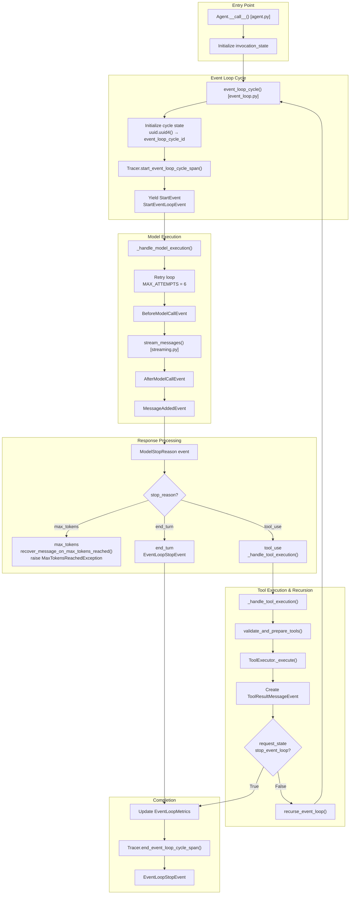
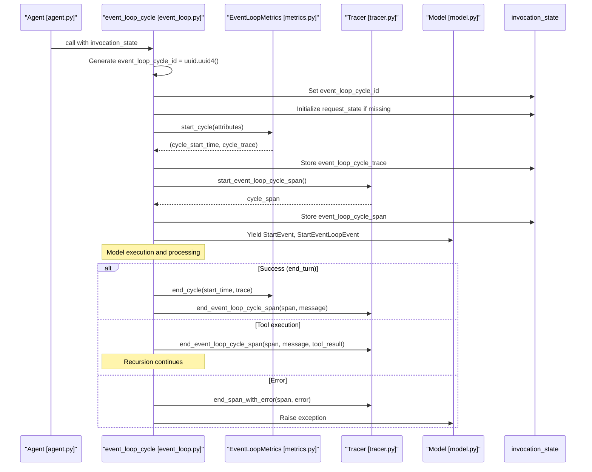

<!-- source: DeepWiki mcp.deepwiki.com · repo strands-agents/sdk-python · page 2.2 Event Loop and Execution Flow · fetched 2026-10-26 -->

# Event Loop and Execution Flow

Relevant source files

The following files were used as context for generating this wiki page:

- [site/src/content/docs/user-guide/concepts/agents/agent-loop.mdx](site/src/content/docs/user-guide/concepts/agents/agent-loop.mdx)
- [strands-py/AGENTS.md](strands-py/AGENTS.md)
- [strands-py/docs/TESTING.md](strands-py/docs/TESTING.md)
- [strands-py/src/strands/agent/agent.py](strands-py/src/strands/agent/agent.py)
- [strands-py/src/strands/event_loop/event_loop.py](strands-py/src/strands/event_loop/event_loop.py)
- [strands-py/src/strands/event_loop/streaming.py](strands-py/src/strands/event_loop/streaming.py)
- [strands-py/src/strands/telemetry/metrics.py](strands-py/src/strands/telemetry/metrics.py)
- [strands-py/src/strands/tools/executors/_executor.py](strands-py/src/strands/tools/executors/_executor.py)
- [strands-py/src/strands/tools/executors/sequential.py](strands-py/src/strands/tools/executors/sequential.py)
- [strands-py/src/strands/tools/mcp/mcp_types.py](strands-py/src/strands/tools/mcp/mcp_types.py)
- [strands-py/src/strands/types/streaming.py](strands-py/src/strands/types/streaming.py)
- [strands-py/tests/strands/event_loop/test_event_loop.py](strands-py/tests/strands/event_loop/test_event_loop.py)
- [strands-py/tests/strands/event_loop/test_event_loop_metadata.py](strands-py/tests/strands/event_loop/test_event_loop_metadata.py)
- [strands-py/tests/strands/event_loop/test_event_loop_structured_output.py](strands-py/tests/strands/event_loop/test_event_loop_structured_output.py)
- [strands-py/tests/strands/event_loop/test_streaming.py](strands-py/tests/strands/event_loop/test_streaming.py)
- [strands-py/tests/strands/telemetry/test_metrics.py](strands-py/tests/strands/telemetry/test_metrics.py)
- [strands-py/tests/strands/tools/executors/conftest.py](strands-py/tests/strands/tools/executors/conftest.py)
- [strands-py/tests/strands/tools/executors/test_executor.py](strands-py/tests/strands/tools/executors/test_executor.py)
- [strands-ts/AGENTS.md](strands-ts/AGENTS.md)
- [strands-ts/docs/TESTING.md](strands-ts/docs/TESTING.md)

This page provides a detailed technical explanation of the event loop system, which is the core execution engine that orchestrates model inference, tool execution, and error recovery during agent invocations. The event loop manages conversation turns through cycles that process model responses, execute requested tools, and handle various error conditions.

For information about the streaming event system and `TypedEvent` hierarchy, see [Streaming Responses](2.3). For details on tool execution mechanisms, see [Tool Execution Strategies](4.3). For session state persistence, see [Agent State and Session Management](2.5).

## Overview

The event loop is implemented in the `event_loop_cycle()` function, which executes a single conversational turn. Each cycle involves:

1.  **Initialization**: Setting up cycle-specific state, unique IDs, and metrics [strands-py/src/strands/event_loop/event_loop.py:161-170]().
2.  **Observability**: Creating tracing spans via `Tracer.start_event_loop_cycle_span()` [strands-py/src/strands/event_loop/event_loop.py:174-182]().
3.  **Model Inference**: Executing the model call via `_handle_model_execution()` with automatic retry logic for throttling [strands-py/src/strands/event_loop/event_loop.py:215-338]().
4.  **Response Processing**: Analyzing the model's response (text, tool use, or errors) and updating the conversation history [strands-py/src/strands/event_loop/event_loop.py:341-408]().
5.  **Execution & Recursion**: Executing tools if requested via `_handle_tool_execution()`, then recursing via `recurse_event_loop()` to continue the cycle [strands-py/src/strands/event_loop/event_loop.py:410-534]().
6.  **Finalization**: Collecting metrics and finalizing tracing spans [strands-py/src/strands/event_loop/event_loop.py:126-142]().

The event loop continues cycling until the model signals completion (`end_turn` stop reason), a limit is reached, or an unrecoverable error occurs.

**Sources:** [strands-py/src/strands/event_loop/event_loop.py:1-9](), [strands-py/src/strands/event_loop/event_loop.py:186-213]()

## Event Loop Architecture

The following diagram bridges the high-level execution flow with the specific code entities responsible for each phase.

### Code Entity Flow Diagram

**Sources:** [strands-py/src/strands/event_loop/event_loop.py:120-184](), [strands-py/src/strands/event_loop/event_loop.py:215-338](), [strands-py/src/strands/event_loop/event_loop.py:410-534](), [strands-py/src/strands/agent/agent.py:465-480]()

## Invocation State Management

The `invocation_state` dictionary maintains state across event loop cycles within a single agent invocation [strands-py/src/strands/event_loop/event_loop.py:122](). It is initialized when the agent is called and passed through all recursive cycles.

### Invocation State Structure

| Key | Type | Description |
| :--- | :--- | :--- |
| `request_state` | `dict[str, Any]` | User-defined state that persists across cycles [strands-py/src/strands/event_loop/event_loop.py:165-166](). |
| `event_loop_cycle_id` | `uuid.UUID` | Unique identifier for the current cycle [strands-py/src/strands/event_loop/event_loop.py:162](). |
| `event_loop_cycle_span` | `Span` | OpenTelemetry span for the current cycle [strands-py/src/strands/event_loop/event_loop.py:182](). |
| `event_loop_cycle_trace` | `Trace` | Internal trace object for metrics [strands-py/src/strands/event_loop/event_loop.py:169](). |

The `request_state` sub-dictionary is accessible to users and can be used to maintain custom state across cycles. For example, setting `request_state["stop_event_loop"] = True` will stop recursion after tool execution [strands-py/src/strands/event_loop/event_loop.py:531-532]().

**Sources:** [strands-py/src/strands/event_loop/event_loop.py:161-182]()

## Cycle Initialization and Lifecycle

Each event loop cycle follows a precise initialization and teardown sequence:

### Initialization Sequence Diagram

**Sources:** [strands-py/src/strands/event_loop/event_loop.py:161-182](), [strands-py/src/strands/agent/agent.py:465-480](), [strands-py/src/strands/telemetry/tracer.py:61-62]()

## Model Execution with Retry Logic

The `_handle_model_execution()` function manages model inference with automatic retry handling for throttling exceptions [strands-py/src/strands/event_loop/event_loop.py:215-338](). It uses the `ModelRetryStrategy` to implement exponential backoff.

### Retry Configuration

| Constant | Value | Description |
| :--- | :--- | :--- |
| `MAX_ATTEMPTS` | 6 | Maximum number of retry attempts for throttled requests [strands-py/src/strands/event_loop/event_loop.py:62](). |
| `INITIAL_DELAY` | 4 | Initial delay in seconds before the first retry [strands-py/src/strands/event_loop/event_loop.py:63](). |
| `MAX_DELAY` | 240 | Maximum delay cap (4 minutes) for exponential backoff [strands-py/src/strands/event_loop/event_loop.py:64](). |

The retry mechanism doubles the delay after each throttling exception up to `MAX_DELAY` [strands-py/src/strands/event_loop/event_loop.py:314-316](). After each throttling exception, an `EventLoopThrottleEvent` is yielded [strands-py/src/strands/event_loop/event_loop.py:309]().

**Sources:** [strands-py/src/strands/event_loop/event_loop.py:62-64](), [strands-py/src/strands/event_loop/event_loop.py:298-316]()

## Stop Reason Handling

After model execution completes, the event loop processes the `stop_reason` to determine the next action [strands-py/src/strands/event_loop/event_loop.py:341-408]().

| Stop Reason | Action | Outcome |
| :--- | :--- | :--- |
| `end_turn` | End the cycle normally | Yield `EventLoopStopEvent`, complete invocation [strands-py/src/strands/event_loop/event_loop.py:355-358](). |
| `tool_use` | Execute tools and recurse | Call `_handle_tool_execution()`, then `recurse_event_loop()` [strands-py/src/strands/event_loop/event_loop.py:344-353](). |
| `max_tokens` | Recover and raise exception | Call `recover_message_on_max_tokens_reached()`, raise `MaxTokensReachedException` [strands-py/src/strands/event_loop/event_loop.py:360-365](). |
| `interrupt` | Pause for human input | Suspend execution and yield interrupt events [strands-py/src/strands/event_loop/event_loop.py:381-391](). |

### Limit Validation

The `_check_limits()` function evaluates per-invocation budget caps against the current metrics [strands-py/src/strands/event_loop/event_loop.py:67-100](). It checks:
*   `limit_turns`: If the number of cycles exceeds the `turns` limit [strands-py/src/strands/event_loop/event_loop.py:91-93]().
*   `limit_total_tokens`: If cumulative tokens exceed `total_tokens` [strands-py/src/strands/event_loop/event_loop.py:94-96]().
*   `limit_output_tokens`: If output tokens exceed `output_tokens` [strands-py/src/strands/event_loop/event_loop.py:97-99]().

**Sources:** [strands-py/src/strands/event_loop/event_loop.py:67-100](), [strands-py/src/strands/event_loop/event_loop.py:360-365]()

## Tool Execution and Recursion

When the model requests tool execution (`stop_reason == "tool_use"`), the event loop enters a multi-step process managed by `_handle_tool_execution()` and `recurse_event_loop()`.

### Recursion Mechanics

The `recurse_event_loop()` function enables multi-turn tool interactions by making a recursive call to `event_loop_cycle()` [strands-py/src/strands/event_loop/event_loop.py:536-608]().

1.  **Validation**: Tools are validated against the registry via `validate_and_prepare_tools()` [strands-py/src/strands/event_loop/event_loop.py:421-422]().
2.  **Execution**: The `agent.tool_executor` (typically `ConcurrentToolExecutor`) runs the requested tools [strands-py/src/strands/event_loop/event_loop.py:433-435]().
3.  **Recursive Call**: `recurse_event_loop()` calls `event_loop_cycle()` with the updated conversation history including tool results [strands-py/src/strands/event_loop/event_loop.py:596-601]().

**Sources:** [strands-py/src/strands/event_loop/event_loop.py:410-534](), [strands-py/src/strands/event_loop/event_loop.py:536-608]()

## InvokeModelStage Middleware Chain

The model invocation is wrapped in the `InvokeModelStage` middleware chain [strands-py/src/strands/event_loop/event_loop.py:19](). This allows plugins to intercept the model call, modify messages, or inject logic before and after the model is invoked.

The chain is executed within `_handle_model_execution()` [strands-py/src/strands/event_loop/event_loop.py:228](). It uses an `InvokeModelContext` to pass state through the middleware [strands-py/src/strands/event_loop/event_loop.py:230-238]().

**Sources:** [strands-py/src/strands/event_loop/event_loop.py:19](), [strands-py/src/strands/event_loop/event_loop.py:215-240]()

## Metrics and Usage Tracking

The event loop tracks performance and token usage via `EventLoopMetrics` [strands-py/src/strands/telemetry/metrics.py:158]().

*   **Input Estimation**: `_estimate_input_tokens()` provides a baseline for the next call [strands-py/src/strands/event_loop/event_loop.py:123-163]().
*   **Usage Updates**: `event_loop_metrics.update_usage()` captures tokens from the model's metadata [strands-py/src/strands/event_loop/event_loop.py:328]().
*   **Cycle Timing**: Latency is tracked from `start_cycle()` to `end_cycle()` [strands-py/src/strands/event_loop/event_loop.py:168]().

**Sources:** [strands-py/src/strands/event_loop/event_loop.py:120-142](), [strands-py/src/strands/event_loop/event_loop.py:328-329]()

---

