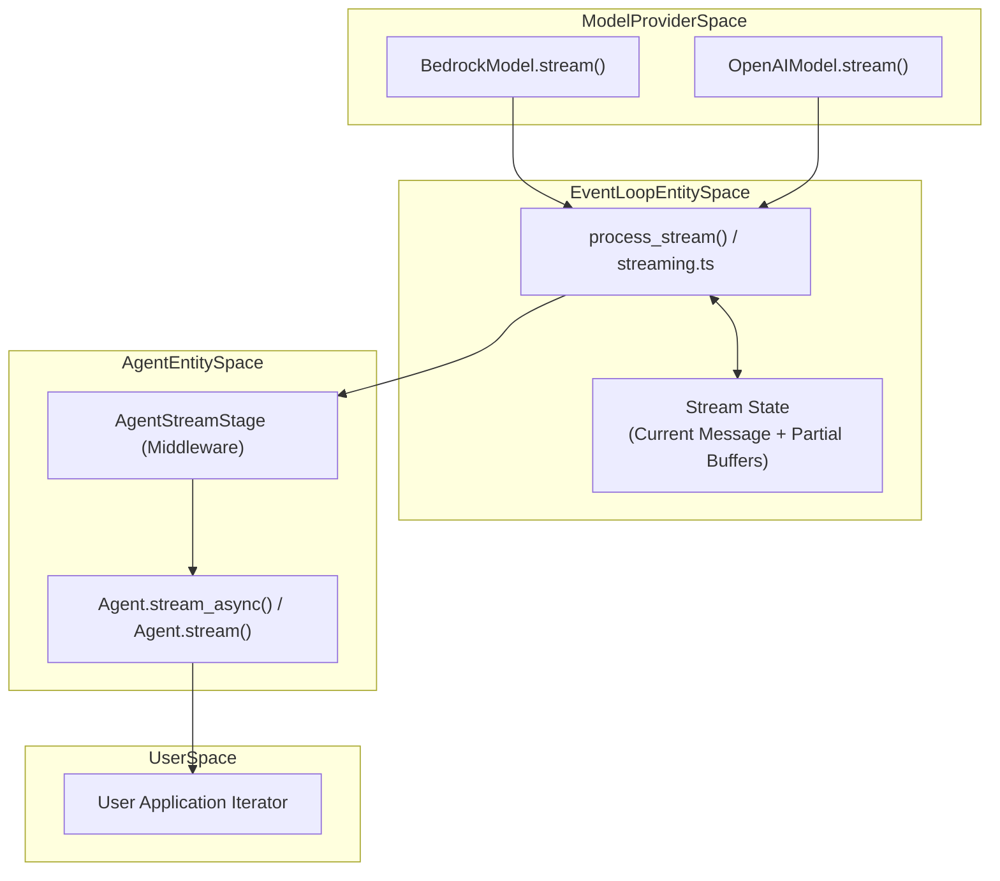
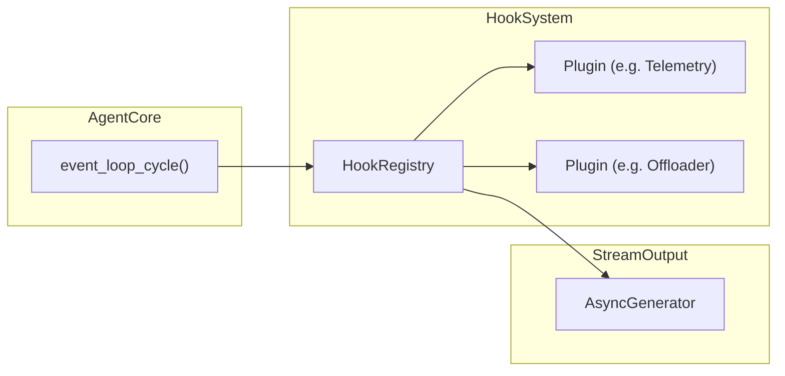

<!-- source: DeepWiki mcp.deepwiki.com · repo strands-agents/sdk-python · page 2.3 Streaming Responses · fetched 2026-10-26 -->

# Streaming Responses

<details>
<summary>Relevant source files</summary>

The following files were used as context for generating this wiki page:

- [strands-py/src/strands/agent/agent.py](strands-py/src/strands/agent/agent.py)
- [strands-py/src/strands/event_loop/event_loop.py](strands-py/src/strands/event_loop/event_loop.py)
- [strands-py/src/strands/event_loop/streaming.py](strands-py/src/strands/event_loop/streaming.py)
- [strands-py/src/strands/types/streaming.py](strands-py/src/strands/types/streaming.py)
- [strands-py/tests/strands/event_loop/test_event_loop.py](strands-py/tests/strands/event_loop/test_event_loop.py)
- [strands-py/tests/strands/event_loop/test_event_loop_metadata.py](strands-py/tests/strands/event_loop/test_event_loop_metadata.py)
- [strands-py/tests/strands/event_loop/test_event_loop_structured_output.py](strands-py/tests/strands/event_loop/test_event_loop_structured_output.py)
- [strands-py/tests/strands/event_loop/test_streaming.py](strands-py/tests/strands/event_loop/test_streaming.py)
- [strands-ts/src/agent/__tests__/agent.hook.test.ts](strands-ts/src/agent/__tests__/agent.hook.test.ts)
- [strands-ts/src/agent/__tests__/agent.model-retry.test.ts](strands-ts/src/agent/__tests__/agent.model-retry.test.ts)
- [strands-ts/src/agent/__tests__/agent.test.ts](strands-ts/src/agent/__tests__/agent.test.ts)
- [strands-ts/src/agent/agent.ts](strands-ts/src/agent/agent.ts)
- [strands-ts/src/conversation-manager/__tests__/null-conversation-manager.test.ts](strands-ts/src/conversation-manager/__tests__/null-conversation-manager.test.ts)
- [strands-ts/src/hooks/__tests__/events.test.ts](strands-ts/src/hooks/__tests__/events.test.ts)
- [strands-ts/src/hooks/events.ts](strands-ts/src/hooks/events.ts)
- [strands-ts/src/index.ts](strands-ts/src/index.ts)
- [strands-ts/src/types/agent.ts](strands-ts/src/types/agent.ts)
- [strands-ts/src/types/messages.ts](strands-ts/src/types/messages.ts)

</details>


## Purpose and Scope

This page documents the streaming API in the Strands Agents SDK, which allows developers to process agent responses in real-time. It covers:

- Using `stream_async` (Python) and `stream()` (TypeScript) to consume execution events.
- The standardized event hierarchy, including `AgentStreamEvent`, `ModelStreamEvent`, and `ToolResultEvent`.
- Internal transformation pipelines that normalize raw provider events into SDK events.
- Processing patterns for both async iteration and middleware-based interception.

For information about the underlying execution flow, see [2.2 Event Loop and Execution Flow](). For conversation history management, see [2.4 Conversation Management]().

---

## Using the Streaming API

The streaming API provides real-time access to agent execution events. This enables building responsive user interfaces, progress indicators, and monitoring tool execution before a turn is complete.

### Basic Usage Patterns

#### Python SDK
In Python, `agent.stream_async` returns an `AsyncGenerator` yielding event dictionaries.

```python
async for event in agent.stream_async("Run a security scan on host 10.0.0.5"):
    if "data" in event: # TextStreamEvent
        print(event["data"], end="", flush=True)
    elif "toolUse" in event.get("current_tool_use", {}): # ToolUseStreamEvent
        print(f"\nCalling tool: {event['current_tool_use']['name']}")
```
**Sources:** [strands-py/src/strands/agent/agent.py:737-762](), [strands-py/src/strands/event_loop/streaming.py:417-464]()

#### TypeScript SDK
In TypeScript, `agent.stream()` returns an `AsyncGenerator` yielding `AgentStreamEvent` class instances.

```typescript
for await (const event of agent.stream("Run a security scan")) {
  if (event instanceof ModelStreamUpdateEvent) {
    // Handle streaming chunks
  } else if (event instanceof ToolResultEvent) {
    console.log(`Tool ${event.tool.name} returned ${event.result.status}`);
  }
}
```
**Sources:** [strands-ts/src/agent/agent.ts:474-508](), [strands-ts/src/hooks/events.ts:10-49]()

---

## Event Hierarchy and Types

The SDK transforms raw model provider events into a standardized set of SDK events.

### Lifecycle and Data Events (TypeScript)
TypeScript uses a class-based event hierarchy where all hookable events extend `HookableEvent`.

| Event Class | Description | Key Fields |
|:---|:---|:---|
| `BeforeInvocationEvent` | Fired before any reasoning starts. | `invocationState`, `cancel` |
| `ModelStreamUpdateEvent` | Wraps transient streaming data from the model. | `event` (ModelStreamEvent) |
| `ContentBlockEvent` | Fired when a content block (text/tool) is finished. | `contentBlock` |
| `ToolResultEvent` | Fired after a tool completes execution. | `tool`, `result` |
| `AgentResultEvent` | The final event containing the total result. | `result` (AgentResult) |

**Sources:** [strands-ts/src/hooks/events.ts:77-227](), [strands-ts/src/types/agent.ts:202-202]()

### Model Streaming Events (Python)
Python yields typed dictionaries that map to the following conceptual events:

| Event Type | Purpose |
|:---|:---|
| `TextStreamEvent` | Partial text chunks generated by the model. |
| `ToolUseStreamEvent` | Incremental JSON input for a tool call. |
| `ReasoningTextStreamEvent` | Internal reasoning/thought blocks (e.g., from Bedrock/Anthropic). |
| `CitationStreamEvent` | Citations provided by models with RAG capabilities. |

**Sources:** [strands-py/src/strands/types/_events.py:144-189](), [strands-py/src/strands/event_loop/streaming.py:14-41]()

---

## Internal Streaming Architecture

The SDK maintains a state machine during streaming to incrementally build the final `Message` object while yielding partial updates to the consumer.

### Stream Transformation Flow
The following diagram bridges the gap between raw model provider outputs and the high-level `Agent` events.

**Diagram: Streaming Data Flow (Provider to User)**


**Sources:** [strands-py/src/strands/event_loop/streaming.py:366-418](), [strands-ts/src/agent/agent.ts:474-508](), [strands-ts/src/middleware/index.ts:54-54]()

### Message Normalization
Before messages are sent to the model or yielded to the user, the SDK performs normalization to ensure provider compatibility (e.g., handling empty assistant messages which some providers reject).

| Logic | Implementation |
|:---|:---|
| **Blank Text Fix** | Replaces empty/whitespace text with `[blank text]` if no other content exists. |
| **Tool Name Validation** | Replaces invalid model-generated tool names with `INVALID_TOOL_NAME`. |
| **Tracking IDs** | Ensures every message yielded has a unique `tracking_id`. |

**Sources:** [strands-py/src/strands/event_loop/streaming.py:46-108](), [strands-ts/src/types/messages.ts:59-64]()

---

## Event Processing and Hooks

Streaming events are not just for the end-user; they are the primary mechanism for the SDK's internal extensibility.

### Hook Integration
Every event yielded by the stream is also dispatched to the `HookRegistry`. This allows plugins to intercept and modify the stream. For example, the `ContextOffloader` plugin listens for `ToolResultEvent` to truncate large results before they hit the context window.

**Diagram: Hook Dispatch During Streaming**


**Sources:** [strands-ts/src/agent/agent.ts:71-89](), [strands-py/src/strands/agent/agent.py:50-60]()

### Middleware Stages
The SDK uses a middleware pattern for streaming. The `AgentStreamStage` wraps the entire execution loop, allowing for logic that spans multiple turns (e.g., total token limit enforcement).

- **Input Phase:** Sets up the `AgentStreamContext`.
- **Output Phase:** Aggregates `AgentStreamResult` including cumulative metrics.

**Sources:** [strands-ts/src/agent/agent.ts:54-70](), [strands-py/src/strands/agent/agent.py:47-48]()

---

## Agent Results and Termination

A streaming sequence always concludes with an `AgentResult`. This object provides the final summarized state of the interaction.

| Field | Description |
|:---|:---|
| `stopReason` | Why the agent stopped: `endTurn`, `toolUse`, `limitTurns`, `limitTotalTokens`, or `cancelled`. |
| `message` | The final assembled `Message` containing all text and tool blocks. |
| `usage` | Total input/output token counts for the entire stream. |
| `metrics` | Latency and timing information for each cycle. |

**Sources:** [strands-ts/src/types/agent.ts:15-15](), [strands-py/src/strands/agent/agent_result.py:19-36]()

---

