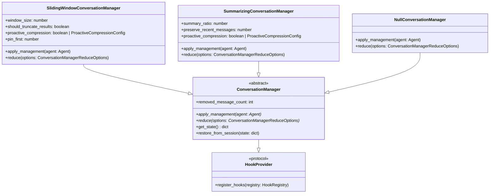
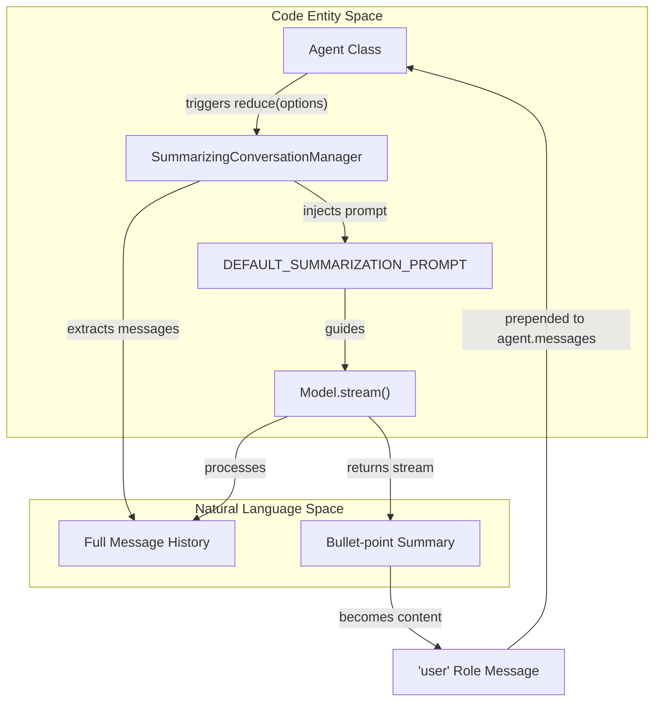

<!-- source: DeepWiki mcp.deepwiki.com · repo strands-agents/sdk-python · page 2.4 Conversation Management · fetched 2026-10-26 -->

# Conversation Management

<details>
<summary>Relevant source files</summary>

The following files were used as context for generating this wiki page:

- [site/src/content/docs/contribute/contributing/documentation.mdx](site/src/content/docs/contribute/contributing/documentation.mdx)
- [site/src/content/docs/contribute/contributing/documentation.ts](site/src/content/docs/contribute/contributing/documentation.ts)
- [site/src/content/docs/labs/ai-functions.mdx](site/src/content/docs/labs/ai-functions.mdx)
- [site/src/content/docs/user-guide/concepts/agents/conversation-management.mdx](site/src/content/docs/user-guide/concepts/agents/conversation-management.mdx)
- [site/src/content/docs/user-guide/concepts/agents/conversation-management.ts](site/src/content/docs/user-guide/concepts/agents/conversation-management.ts)
- [site/src/content/docs/user-guide/concepts/agents/conversation-management_imports.ts](site/src/content/docs/user-guide/concepts/agents/conversation-management_imports.ts)
- [site/src/content/docs/user-guide/concepts/context-management.mdx](site/src/content/docs/user-guide/concepts/context-management.mdx)
- [site/src/content/docs/user-guide/concepts/context-management.ts](site/src/content/docs/user-guide/concepts/context-management.ts)
- [site/src/content/docs/user-guide/concepts/context-management_imports.ts](site/src/content/docs/user-guide/concepts/context-management_imports.ts)
- [site/src/content/docs/user-guide/concepts/model-providers/amazon-bedrock.ts](site/src/content/docs/user-guide/concepts/model-providers/amazon-bedrock.ts)
- [site/src/content/docs/user-guide/concepts/model-providers/index.mdx](site/src/content/docs/user-guide/concepts/model-providers/index.mdx)
- [site/src/content/docs/user-guide/concepts/model-providers/index.ts](site/src/content/docs/user-guide/concepts/model-providers/index.ts)
- [site/src/content/docs/user-guide/evals-sdk/how-to/eval_task.mdx](site/src/content/docs/user-guide/evals-sdk/how-to/eval_task.mdx)
- [site/src/content/docs/user-guide/evals-sdk/simulators/tool_simulation.mdx](site/src/content/docs/user-guide/evals-sdk/simulators/tool_simulation.mdx)
- [site/src/content/docs/user-guide/observability-evaluation/traces.mdx](site/src/content/docs/user-guide/observability-evaluation/traces.mdx)
- [site/src/content/docs/user-guide/quickstart/python.mdx](site/src/content/docs/user-guide/quickstart/python.mdx)
- [strands-py/src/strands/_context_manager/modes/agentic/agentic_context.py](strands-py/src/strands/_context_manager/modes/agentic/agentic_context.py)
- [strands-py/src/strands/agent/conversation_manager/__init__.py](strands-py/src/strands/agent/conversation_manager/__init__.py)
- [strands-py/src/strands/agent/conversation_manager/conversation_manager.py](strands-py/src/strands/agent/conversation_manager/conversation_manager.py)
- [strands-py/src/strands/models/_defaults.py](strands-py/src/strands/models/_defaults.py)
- [strands-py/tests/strands/agent/test_conversation_manager.py](strands-py/tests/strands/agent/test_conversation_manager.py)
- [strands-py/tests/strands/agent/test_summarizing_conversation_manager.py](strands-py/tests/strands/agent/test_summarizing_conversation_manager.py)
- [strands-py/tests/strands/models/test_model.py](strands-py/tests/strands/models/test_model.py)
- [strands-ts/src/context-manager/modes/agentic/agentic-context.ts](strands-ts/src/context-manager/modes/agentic/agentic-context.ts)
- [strands-ts/src/conversation-manager/__tests__/conversation-manager.test.ts](strands-ts/src/conversation-manager/__tests__/conversation-manager.test.ts)
- [strands-ts/src/conversation-manager/__tests__/sliding-window-conversation-manager.test.ts](strands-ts/src/conversation-manager/__tests__/sliding-window-conversation-manager.test.ts)
- [strands-ts/src/conversation-manager/__tests__/summarizing-conversation-manager.test.ts](strands-ts/src/conversation-manager/__tests__/summarizing-conversation-manager.test.ts)
- [strands-ts/src/conversation-manager/conversation-manager.ts](strands-ts/src/conversation-manager/conversation-manager.ts)
- [strands-ts/src/conversation-manager/sliding-window-conversation-manager.ts](strands-ts/src/conversation-manager/sliding-window-conversation-manager.ts)
- [strands-ts/src/conversation-manager/summarizing-conversation-manager.ts](strands-ts/src/conversation-manager/summarizing-conversation-manager.ts)
- [strands-ts/src/models/__tests__/model.test.ts](strands-ts/src/models/__tests__/model.test.ts)
- [strands-ts/src/models/defaults.ts](strands-ts/src/models/defaults.ts)

</details>


This document explains the conversation management system in Strands Agents, which controls how conversation history (messages) is maintained and optimized for model context window constraints. Conversation managers implement strategies for retaining relevant context while staying within token limits.

For information about message structure and content types, see [Streaming Responses](2.3). For session-based persistence of conversation state, see [Agent State and Session Management](2.5).

---

## Overview

In the Strands Agents SDK, context refers to the information provided to the agent for understanding and reasoning. This includes:

*   User messages
*   Agent responses
*   Tool usage and results
*   System prompts

As conversations grow, managing this context becomes increasingly important for several reasons:

1.  **Token Limits**: Language models have fixed context windows (maximum tokens they can process).
2.  **Performance**: Larger contexts require more processing time and resources.
3.  **Relevance**: Older messages may become less relevant to the current conversation.
4.  **Coherence**: Maintaining logical flow and preserving important information.

The conversation management system addresses a fundamental challenge in multi-turn agent interactions: foundation models have finite context windows, but conversations can grow arbitrarily long. Conversation managers automatically apply strategies to keep conversation history within acceptable bounds while preserving the most relevant information.

The system integrates with the agent lifecycle through two primary mechanisms:

1.  **Reactive reduction**: When a `ContextWindowOverflowException` occurs, the conversation manager reduces context and the agent retries [strands-py/src/strands/agent/conversation_manager/conversation_manager.py:101-120]().
2.  **Proactive management**: During or after agent invocation, the conversation manager can apply cleanup strategies to prevent reaching limits [strands-ts/src/conversation-manager/sliding-window-conversation-manager.ts:164-167]().

**Sources:** [strands-py/src/strands/agent/conversation_manager/conversation_manager.py:1-22](), [strands-py/src/strands/agent/conversation_manager/null_conversation_manager.py:31-47](), [strands-ts/src/conversation-manager/sliding-window-conversation-manager.ts:164-167]()

---

## Architecture

### ConversationManager Interface

The `ConversationManager` is an abstract base class that also implements the `HookProvider` protocol [strands-py/src/strands/agent/conversation_manager/conversation_manager.py:13-34](). This allows managers to hook into the agent's event system (e.g., before model calls).



**Sources:** [strands-py/src/strands/agent/conversation_manager/conversation_manager.py:13-34](), [strands-ts/src/conversation-manager/sliding-window-conversation-manager.ts:129-150](), [strands-ts/src/conversation-manager/summarizing-conversation-manager.ts:62-80](), [strands-py/src/strands/agent/conversation_manager/null_conversation_manager.py:12-20]()

---

## Integration with Agent Lifecycle

### Lifecycle Integration Flow

The conversation manager participates in the agent execution flow at three critical points: proactive turn-based checks, reactive overflow handling, and post-invocation cleanup.

```mermaid
sequenceDiagram
    participant Agent as "Agent"
    participant Loop as "event_loop_cycle"
    participant CM as "ConversationManager"
    participant Model as "ModelProvider"
    
    Agent->>Loop: Start Cycle
    Loop->>CM: _on_before_model_call (Hook)
    Note over CM: If proactiveCompression is enabled,<br/>reduce()
    Loop->>Model: stream(messages)
    
    alt Context Window Overflow
        Model-->>Loop: ContextWindowOverflowException
        Loop->>CM: reduce(agent, error)
        CM->>Agent: Modify agent.messages (in-place)
        Loop->>Loop: Recursive Retry
    end
    
    Loop-->>Agent: Cycle Finish
    Agent->>CM: _on_after_invocation (Hook)
    Note over CM: Final cleanup/truncation
```

**Sources:** [strands-py/src/strands/agent/conversation_manager/conversation_manager.py:86-98](), [strands-py/src/strands/agent/conversation_manager/conversation_manager.py:101-120](), [strands-ts/src/conversation-manager/sliding-window-conversation-manager.ts:164-167]()

### 1. Context Overflow Handling (Reactive)
When a model provider detects that the input exceeds its limits, it raises a `ContextWindowOverflowException` [strands-ts/src/conversation-manager/__tests__/sliding-window-conversation-manager.test.ts:14](). The agent catch block invokes `conversation_manager.reduce(agent, error)`. The manager modifies the `agent.messages` list in-place to reduce token count, and the event loop attempts a recursive retry.

**Sources:** [strands-py/src/strands/agent/conversation_manager/conversation_manager.py:101-120](), [strands-py/src/strands/agent/conversation_manager/null_conversation_manager.py:31-47]()

### 2. Proactive Context Compression
Both `SlidingWindowConversationManager` and `SummarizingConversationManager` support a `proactiveCompression` parameter [strands-ts/src/conversation-manager/sliding-window-conversation-manager.ts:106-107](), [strands-ts/src/conversation-manager/summarizing-conversation-manager.ts:74-75](). If enabled, the manager registers a callback for `BeforeModelCallEvent` [strands-ts/src/conversation-manager/conversation-manager.ts:86-88](). This allows the manager to trim or summarize history *before* the model is called, preventing `ContextWindowOverflowException` and improving performance.

**Sources:** [strands-ts/src/conversation-manager/sliding-window-conversation-manager.ts:106-107](), [strands-ts/src/conversation-manager/summarizing-conversation-manager.ts:74-75](), [strands-ts/src/conversation-manager/conversation-manager.ts:86-88]()

---

## Built-in Conversation Managers

The SDK provides a flexible system for context management through the `ConversationManager` interface. You can either leverage one of Strands's provided managers:

*   [`NullConversationManager`](#nullconversationmanager): A simple implementation that does not modify conversation history.
*   [`SlidingWindowConversationManager`](#slidingwindowconversationmanager): Maintains a fixed number of recent messages (default manager).
*   [`SummarizingConversationManager`](#summarizingconversationmanager): Intelligently summarizes older messages to preserve context.

Or build your own manager that matches your requirements.

### NullConversationManager

The `NullConversationManager` is a simple implementation that does not modify the conversation history. It's useful for:

*   Short conversations that won't exceed context limits.
*   Debugging purposes.
*   Cases where you want to manage context manually.

```python
from strands import Agent
from strands.agent.conversation_manager import NullConversationManager

agent = Agent(
    conversation_manager=NullConversationManager()
)
```

```typescript
import { Agent, NullConversationManager } from '@strands-agents/sdk'

const agent = new Agent({
  conversationManager: new NullConversationManager(),
})
```

**Sources:** [strands-py/src/strands/agent/conversation_manager/null_conversation_manager.py:12-20](), [strands-py/src/strands/agent/conversation_manager/null_conversation_manager.py:31-47](), [site/src/content/docs/user-guide/concepts/agents/conversation-management.ts:15-17]()

### SlidingWindowConversationManager

The `SlidingWindowConversationManager` implements a sliding window strategy that maintains a fixed number of recent messages. This is the default conversation manager used by the `Agent` class.

```python
from strands import Agent
from strands.agent.conversation_manager import SlidingWindowConversationManager

# Create a conversation manager with custom window size
conversation_manager = SlidingWindowConversationManager(
    window_size=20,  # Maximum number of messages to keep
    should_truncate_results=True, # Enable truncating the tool result when a message is too large for the model's context window
)

agent = Agent(
    conversation_manager=conversation_manager
)
```

```typescript
import { Agent, SlidingWindowConversationManager } from '@strands-agents/sdk'

// Create a conversation manager with custom window size
const conversationManager = new SlidingWindowConversationManager({
  windowSize: 40, // Maximum number of messages to keep
  shouldTruncateResults: true, // Enable truncating the tool result when a message is too large for the model's context window
})

const agent = new Agent({
  conversationManager,
})
```

Key features of the `SlidingWindowConversationManager`:

*   **Maintains Window Size**: Automatically removes messages from the window if the number of messages exceeds the limit [strands-ts/src/conversation-manager/sliding-window-conversation-manager.ts:151-157]().
*   **Dangling Message Cleanup**: Removes incomplete message sequences to maintain valid conversation state [strands-py/tests/strands/agent/test_conversation_manager.py:63-70]().
*   **Overflow Trimming**: In the case of a context window overflow, it will trim the oldest messages from history until the request fits in the models context window.
*   **Configurable Tool Result Truncation**: Enable or disable truncation of tool results when the message exceeds context window limits. When enabled (the default; `should_truncate_results=True` in Python, `shouldTruncateResults: true` in TypeScript), the oldest message with tool results is truncated first so recent context is preserved as long as possible. Truncation depends on content type:
    *   Text payloads keep their head and tail, separated by a `<truncated chars="N"/>` marker [strands-ts/src/conversation-manager/sliding-window-conversation-manager.ts:20-22]().
    *   Images, videos, binary documents, and oversized JSON are replaced by a typed placeholder, for example `[image: png, source: bytes, 12345 bytes]` [strands-ts/src/conversation-manager/sliding-window-conversation-manager.ts:38-82]().
    *   The tool result's original `status` and `error` fields are preserved.

    When disabled, full results are preserved but more historical messages may be removed. For a proactive alternative that preserves full content externally, see the [Context Offloader](../plugins/context-offloader) plugin.
*   **Proactive Compression**: Pass `proactiveCompression: true` or `proactiveCompression: { compressionThreshold: 0.7 }` to trigger context reduction before the model call when projected input tokens exceed a configurable threshold [strands-ts/src/conversation-manager/sliding-window-conversation-manager.ts:101-107]().
*   **Message Pinning**: Protect specific messages from trimming during context reduction. The `pinFirst` parameter allows pinning a specified number of initial messages [strands-ts/src/conversation-manager/sliding-window-conversation-manager.ts:111-114]().

**Sources:** [strands-ts/src/conversation-manager/sliding-window-conversation-manager.ts:129-150](), [strands-ts/src/conversation-manager/sliding-window-conversation-manager.ts:151-157](), [strands-py/tests/strands/agent/test_conversation_manager.py:63-70](), [strands-ts/src/conversation-manager/sliding-window-conversation-manager.ts:20-22](), [strands-ts/src/conversation-manager/sliding-window-conversation-manager.ts:38-82](), [strands-ts/src/conversation-manager/sliding-window-conversation-manager.ts:101-107](), [strands-ts/src/conversation-manager/sliding-window-conversation-manager.ts:111-114](), [site/src/content/docs/user-guide/concepts/agents/conversation-management.ts:22-30]()

### SummarizingConversationManager

Instead of dropping messages, this manager uses an LLM to summarize the oldest portion of the conversation [strands-ts/src/conversation-manager/summarizing-conversation-manager.ts:54-60]().

```python
from strands import Agent
from strands.agent.conversation_manager import SummarizingConversationManager
from strands.models.bedrock import BedrockModel

# Optionally use a different model for summarization
summarization_model = BedrockModel(
    model_id='global.anthropic.claude-sonnet-4-6',
)

conversation_manager = SummarizingConversationManager(
    model=summarization_model, # Override the agent's model for summarization
    summary_ratio=0.3, # Summarize and replace the oldest 30% of messages
    preserve_recent_messages=10, # Always keep 10 most recent messages
)

agent = Agent(
    conversation_manager=conversation_manager
)
```

```typescript
import { Agent, SummarizingConversationManager, BedrockModel } from '@strands-agents/sdk'

// Optionally use a different model for summarization
const summarizationModel = new BedrockModel({
  modelId: 'global.anthropic.claude-sonnet-4-6',
})

const conversationManager = new SummarizingConversationManager({
  model: summarizationModel, // Override the agent's model for summarization
  summaryRatio: 0.3, // Summarize and replace the oldest 30% of messages
  preserveRecentMessages: 10, // Always keep 10 most recent messages
})

const agent = new Agent({
  conversationManager,
})
```

Key features of the `SummarizingConversationManager`:

*   **Summary Ratio**: Determines what percentage of the history to summarize (clamped between 0.1 and 0.8) [strands-ts/src/conversation-manager/summarizing-conversation-manager.ts:20-22]().
*   **Preservation**: Always keeps a minimum number of recent messages (`preserveRecentMessages`) [strands-ts/src/conversation-manager/summarizing-conversation-manager.ts:69-70]().
*   **Recursive Summarization**: If a previous summary exists, it is included in the new summarization task to maintain a rolling narrative [strands-ts/src/conversation-manager/summarizing-conversation-manager.ts:105-106]().
*   **Tool Preservation**: Like the sliding window, it adjusts split points to avoid splitting tool call/result pairs [strands-ts/src/conversation-manager/summarizing-conversation-manager.ts:150-153]().
*   **Custom Summarization Model**: Can be configured with a specific `model` for summarization, allowing for a cheaper or faster model than the agent's primary model [strands-ts/src/conversation-manager/summarizing-conversation-manager.ts:63-64]().
*   **Custom System Prompt**: A `summarizationSystemPrompt` can be provided to guide the summarization model's behavior [strands-ts/src/conversation-manager/summarizing-conversation-manager.ts:71-72]().

**Sources:** [strands-ts/src/conversation-manager/summarizing-conversation-manager.ts:62-80](), [strands-ts/src/conversation-manager/summarizing-conversation-manager.ts:20-22](), [strands-ts/src/conversation-manager/summarizing-conversation-manager.ts:69-70](), [strands-ts/src/conversation-manager/summarizing-conversation-manager.ts:105-106](), [strands-ts/src/conversation-manager/summarizing-conversation-manager.ts:150-153](), [strands-ts/src/conversation-manager/summarizing-conversation-manager.ts:63-64](), [strands-ts/src/conversation-manager/summarizing-conversation-manager.ts:71-72](), [site/src/content/docs/user-guide/concepts/agents/conversation-management.ts:86-98]()

---

## Context Manager Modes

The SDK provides high-level context management configurations that work out of the box, so you don't have to assemble conversation managers, offloaders, and thresholds by hand. You can pick a mode and the SDK wires up the pieces with tuned defaults.

### Automatic Context Management (`"auto"`)

For most agents with multi-turn conversations, you don't need to configure conversation management and context offloading separately. Pass `context_manager="auto"` (Python) or `contextManager: "auto"` (TypeScript) and the SDK wires up both with tuned defaults.

```python
from strands import Agent

agent = Agent(context_manager="auto")
```

```typescript
import { Agent } from '@strands-agents/sdk'

const agent = new Agent({
  contextManager: "auto"
})
```

This mode composes two components whose defaults scored highest across [ContextBench](https://arxiv.org/abs/2602.05892) evaluations:

*   **`SummarizingConversationManager`**: With a summary ratio of 0.3 and a proactive compression threshold of 0.85.
*   **`ContextOffloader` plugin**: Intercepts large tool results, stores them externally, and keeps a truncated preview in context.

Your own settings take precedence when you need fine-grained control. For example, if you pass a custom `conversation_manager`, it replaces the auto-composed `SummarizingConversationManager`, but the `ContextOffloader` is still added.

**Sources:** [site/src/content/docs/user-guide/concepts/context-management.mdx:20-51](), [site/src/content/docs/user-guide/concepts/context-management.mdx:60-86]()

### Agentic Context Management (`"agentic"`)

Agentic mode hands context management control to the model. Pass `context_manager="agentic"` (Python) or `contextManager: "agentic"` (TypeScript) and the model manages its own working memory: it sees how full the context window is and chooses when to compress, what to compress, and what to protect.

```python
from strands import Agent

agent = Agent(context_manager="agentic")
```

```typescript
import { Agent } from '@strands-agents/sdk'

const agent = new Agent({
  contextManager: "agentic"
})
```

The model is better positioned than a fixed threshold to know which messages still matter. This mode provides:

*   **Token-usage telemetry**: Before each model call, a status block is appended to the latest message reporting context window usage [strands-py/src/strands/_context_manager/modes/agentic/agentic_context.py:121-128]().
*   **Three injected tools**:
    *   `summarize_context`: Folds older messages into a model-written summary [strands-py/src/strands/_context_manager/modes/agentic/agentic_context.py:81-99]().
    *   `truncate_context`: Drops older messages entirely [strands-py/src/strands/_context_manager/modes/agentic/agentic_context.py:151-165]().
    *   `pin_context`: Marks messages that must survive compression [strands-py/src/strands/_context_manager/modes/agentic/agentic_context.py:180-190]().

Behind the tools, agentic mode also composes a `SummarizingConversationManager` with no proactive compression and a `ContextOffloader`. The conversation manager acts as a safety net, and the offloader uses a higher inline threshold (8,000 tokens vs. 1,500 in "auto" mode) to give the model more inline tool output.

**Sources:** [strands-py/src/strands/_context_manager/modes/agentic/agentic_context.py:1-10](), [site/src/content/docs/user-guide/concepts/context-management.mdx:90-114](), [strands-py/src/strands/_context_manager/modes/agentic/agentic_context.py:121-128](), [strands-py/src/strands/_context_manager/modes/agentic/agentic_context.py:81-99](), [strands-py/src/strands/_context_manager/modes/agentic/agentic_context.py:151-165](), [strands-py/src/strands/_context_manager/modes/agentic/agentic_context.py:180-190](), [site/src/content/docs/user-guide/concepts/context-management.mdx:139-145]()

### Null Context Management (`null`)

Setting `context_manager="null"` (Python) or `contextManager: "null"` (TypeScript) explicitly disables all automatic context management. This means no `ConversationManager` is configured by default, and no `ContextOffloader` plugin is added. The agent will rely entirely on the model's native context window and will throw `ContextWindowOverflowException` if limits are exceeded.

```python
from strands import Agent

agent = Agent(context_manager="null")
```

```typescript
import { Agent } from '@strands-agents/sdk'

const agent = new Agent({
  contextManager: "null"
})
```

This mode is suitable for:

*   Short, single-turn interactions where context overflow is unlikely.
*   Scenarios where you implement entirely custom context management logic.
*   Debugging or performance testing without any context overhead.

**Sources:** [site/src/content/docs/user-guide/concepts/context-management.mdx:150-154]()

---

## Data Flow: Summarization Process

This diagram bridges the code entities involved in generating a summary during a context overflow.



**Sources:** [strands-ts/src/conversation-manager/summarizing-conversation-manager.ts:24-51](), [strands-ts/src/conversation-manager/summarizing-conversation-manager.ts:169-170](), [strands-ts/src/conversation-manager/__tests__/summarizing-conversation-manager.test.ts:27-55](), [strands-ts/src/conversation-manager/summarizing-conversation-manager.ts:126-170]()

---

## State Persistence
Conversation managers track `removed_message_count` [strands-py/src/strands/agent/conversation_manager/conversation_manager.py:44-44]() and internal state (like the current summary message in `SummarizingConversationManager` [strands-ts/src/conversation-manager/summarizing-conversation-manager.ts:110-110]()). This state is serialized via `get_state()` and can be restored using `restore_from_session()`.

**Sources:** [strands-py/src/strands/agent/conversation_manager/conversation_manager.py:78-83](), [strands-ts/src/conversation-manager/summarizing-conversation-manager.ts:110-110](), [strands-ts/src/conversation-manager/sliding-window-conversation-manager.ts:115-123]()

---

## Summary of Strategy Differences

| Feature | Sliding Window | Summarizing | Null | Agentic | Auto |
| :--- | :--- | :--- | :--- | :--- | :--- |
| **Strategy** | Discards oldest messages | Condenses oldest messages | None | Model-driven (summarize/truncate/pin) | Summarize + Offload |
| **Tool Handling** | Truncates result text | Preserves pair integrity | None | Model-driven (via tools) | Offloads large results, preserves pair integrity |
| **Proactive?** | Yes (via `proactiveCompression`) | Yes (via `proactiveCompression`) | No | Yes (model decides when to act) | Yes (proactive summarization + offloading) |
| **LLM Cost** | Low (local truncation) | High (requires LLM call) | None | Medium (LLM calls tools, reads telemetry) | Medium (LLM calls for summarization) |
| **Information Loss** | High (deleted) | Medium (summarized) | None | Variable (model decides) | Low (summarized, offloaded) |

**Sources:** [strands-ts/src/conversation-manager/sliding-window-conversation-manager.ts:129-150](), [strands-ts/src/conversation-manager/summarizing-conversation-manager.ts:62-80](), [strands-py/src/strands/agent/conversation_manager/null_conversation_manager.py:12-20](), [site/src/content/docs/user-guide/concepts/context-management.mdx:20-51](), [site/src/content/docs/user-guide/concepts/context-management.mdx:90-114]()

---

