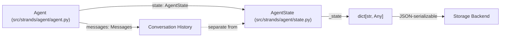
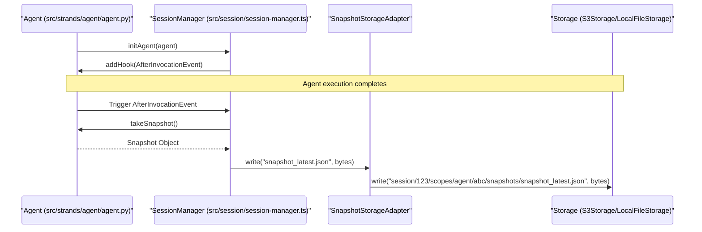

<!-- source: DeepWiki mcp.deepwiki.com · repo strands-agents/sdk-python · page 2.5 Agent State and Session Management · fetched 2026-10-26 -->

# Agent State and Session Management

Relevant source files

The following files were used as context for generating this wiki page:

- [site/src/content/docs/user-guide/concepts/agents/session-management.mdx](site/src/content/docs/user-guide/concepts/agents/session-management.mdx)
- [site/src/content/docs/user-guide/concepts/agents/session-manager.ts](site/src/content/docs/user-guide/concepts/agents/session-manager.ts)
- [site/src/content/docs/user-guide/concepts/memory/bedrock-knowledge-base.mdx](site/src/content/docs/user-guide/concepts/memory/bedrock-knowledge-base.mdx)
- [site/src/content/docs/user-guide/concepts/memory/bedrock-knowledge-base.ts](site/src/content/docs/user-guide/concepts/memory/bedrock-knowledge-base.ts)
- [site/src/content/docs/user-guide/concepts/memory/bedrock-knowledge-base_imports.ts](site/src/content/docs/user-guide/concepts/memory/bedrock-knowledge-base_imports.ts)
- [site/src/content/docs/user-guide/concepts/plugins/context-offloader.mdx](site/src/content/docs/user-guide/concepts/plugins/context-offloader.mdx)
- [site/src/content/docs/user-guide/concepts/plugins/context-offloader.ts](site/src/content/docs/user-guide/concepts/plugins/context-offloader.ts)
- [site/src/content/docs/user-guide/concepts/plugins/context-offloader_imports.ts](site/src/content/docs/user-guide/concepts/plugins/context-offloader_imports.ts)
- [site/src/content/docs/user-guide/concepts/storage.mdx](site/src/content/docs/user-guide/concepts/storage.mdx)
- [site/src/content/docs/user-guide/concepts/storage.py](site/src/content/docs/user-guide/concepts/storage.py)
- [site/src/content/docs/user-guide/concepts/storage.ts](site/src/content/docs/user-guide/concepts/storage.ts)
- [site/src/content/docs/user-guide/concepts/storage_imports.ts](site/src/content/docs/user-guide/concepts/storage_imports.ts)
- [strands-py/pyproject.toml](strands-py/pyproject.toml)
- [strands-py/src/strands/_identifier.py](strands-py/src/strands/_identifier.py)
- [strands-py/src/strands/session/__init__.py](strands-py/src/strands/session/__init__.py)
- [strands-py/src/strands/session/repository_session_manager.py](strands-py/src/strands/session/repository_session_manager.py)
- [strands-py/src/strands/session/s3_session_manager.py](strands-py/src/strands/session/s3_session_manager.py)
- [strands-py/src/strands/session/snapshot_session_manager.py](strands-py/src/strands/session/snapshot_session_manager.py)
- [strands-py/src/strands/storage/in_memory_storage.py](strands-py/src/strands/storage/in_memory_storage.py)
- [strands-py/src/strands/storage/local_file_storage.py](strands-py/src/strands/storage/local_file_storage.py)
- [strands-py/src/strands/storage/s3_storage.py](strands-py/src/strands/storage/s3_storage.py)
- [strands-py/src/strands/storage/storage.py](strands-py/src/strands/storage/storage.py)
- [strands-py/src/strands/vended_memory_stores/bedrock_knowledge_base/__init__.py](strands-py/src/strands/vended_memory_stores/bedrock_knowledge_base/__init__.py)
- [strands-py/src/strands/vended_memory_stores/bedrock_knowledge_base/store.py](strands-py/src/strands/vended_memory_stores/bedrock_knowledge_base/store.py)
- [strands-py/src/strands/vended_memory_stores/bedrock_knowledge_base/types.py](strands-py/src/strands/vended_memory_stores/bedrock_knowledge_base/types.py)
- [strands-py/tests/strands/agent/test_agent_context_manager.py](strands-py/tests/strands/agent/test_agent_context_manager.py)
- [strands-py/tests/strands/agent/test_agent_storage.py](strands-py/tests/strands/agent/test_agent_storage.py)
- [strands-py/tests/strands/session/test_repository_session_manager.py](strands-py/tests/strands/session/test_repository_session_manager.py)
- [strands-py/tests/strands/session/test_s3_session_manager.py](strands-py/tests/strands/session/test_s3_session_manager.py)
- [strands-py/tests/strands/session/test_snapshot_session_manager.py](strands-py/tests/strands/session/test_snapshot_session_manager.py)
- [strands-py/tests/strands/test_identifier.py](strands-py/tests/strands/test_identifier.py)
- [strands-py/tests/strands/vended_memory_stores/bedrock_knowledge_base/test_store.py](strands-py/tests/strands/vended_memory_stores/bedrock_knowledge_base/test_store.py)
- [strands-py/tests_integ/test_snapshot_session.py](strands-py/tests_integ/test_snapshot_session.py)
- [strands-ts/src/agent/__tests__/agent.context-manager.test.ts](strands-ts/src/agent/__tests__/agent.context-manager.test.ts)
- [strands-ts/src/agent/__tests__/agent.storage.test.ts](strands-ts/src/agent/__tests__/agent.storage.test.ts)
- [strands-ts/src/agent/__tests__/snapshot.test.ts](strands-ts/src/agent/__tests__/snapshot.test.ts)
- [strands-ts/src/agent/snapshot.ts](strands-ts/src/agent/snapshot.ts)
- [strands-ts/src/session/__tests__/session-manager.test.ts](strands-ts/src/session/__tests__/session-manager.test.ts)
- [strands-ts/src/session/session-manager.ts](strands-ts/src/session/session-manager.ts)
- [strands-ts/src/storage/in-memory-storage.ts](strands-ts/src/storage/in-memory-storage.ts)
- [strands-ts/src/storage/local-file-storage.ts](strands-ts/src/storage/local-file-storage.ts)
- [strands-ts/src/storage/s3-storage.ts](strands-ts/src/storage/s3-storage.ts)
- [strands-ts/src/storage/storage.ts](strands-ts/src/storage/storage.ts)
- [strands-ts/src/vended-plugins/context-offloader/__tests__/plugin.test.ts](strands-ts/src/vended-plugins/context-offloader/__tests__/plugin.test.ts)
- [strands-ts/src/vended-plugins/context-offloader/plugin.ts](strands-ts/src/vended-plugins/context-offloader/plugin.ts)

This page documents how agents maintain and persist state across invocations. It covers the `AgentState` class for storing JSON-serializable data, the modern `SnapshotSessionManager` for atomic persistence, and the underlying storage backends (`InMemoryStorage`, `LocalFileStorage`, `S3Storage`).

For information about conversation management (context window handling), see [Conversation Management](2.4). For interrupt state management, see [Extensibility System](5.1).

---

## Overview

Agent state management in Strands consists of three layers:

1.  **AgentState**: A JSON-serializable dictionary for storing custom agent data [strands-py/src/strands/agent/state.py:7-8]().
2.  **SessionManager**: A plugin interface that orchestrates saving/loading snapshots or message logs [strands-ts/src/session/session-manager.ts:103]().
3.  **Storage Backends**: Unified byte-level persistence (Memory, File, S3) used by session managers and other plugins like `ContextOffloader` [strands-ts/src/storage/storage.ts:2-3]().

---

## AgentState: Custom Application State

`AgentState` allows agents to maintain application-specific data (e.g., user preferences, counters) that persists alongside the conversation history but is not part of the message log itself [strands-py/src/strands/agent/state.py:7-10]().

### Code Entity Mapping: Agent State

**Sources:** [strands-py/src/strands/agent/state.py:7-10](), [strands-py/src/strands/agent/agent.py:118]()

---

## Session Management Implementations

Strands provides two distinct approaches to session management. **Snapshot-based** management is the modern standard for both Python and TypeScript SDKs.

### 1. SnapshotSessionManager (Recommended)

The `SnapshotSessionManager` (Python) and `SessionManager` (TypeScript) capture the entire agent state (messages, `AgentState`, `ConversationManager` state) in a single atomic JSON blob called a `Snapshot` [strands-py/src/strands/session/snapshot_session_manager.py:3-18]().

#### Snapshot Types
*   **`snapshot_latest`**: A mutable snapshot overwritten on each save. Used for crash recovery and resuming the most recent state [strands-ts/src/session/session-manager.ts:30-32]().
*   **Immutable Snapshots**: Append-only snapshots with unique UUID v7 IDs, created when a `snapshotTrigger` fires. Used for versioned checkpointing [strands-ts/src/session/session-manager.ts:33-35]().

#### Save Strategies
The `saveLatestOn` configuration controls I/O frequency [strands-py/src/strands/session/snapshot_session_manager.py:52-62]():
*   `invocation`: (Default) Saves after every agent invocation completes [strands-ts/src/session/session-manager.ts:38]().
*   `message`: Saves after every message added (highest durability) [strands-ts/src/session/session-manager.ts:39]().
*   `trigger`: Only saves when explicitly triggered [strands-ts/src/session/session-manager.ts:41]().

**Sources:** [strands-py/src/strands/session/snapshot_session_manager.py:28-45](), [strands-ts/src/session/session-manager.ts:26-59]()

### 2. RepositorySessionManager (Legacy/Structured)

The `RepositorySessionManager` uses a `SessionRepository` to provide a per-message CRUD interface [strands-py/src/strands/session/repository_session_manager.py:28-35](). It is optimized for large message histories where atomic snapshots might become too heavy, as it only appends new messages and syncs state if changes are detected [strands-py/src/strands/session/repository_session_manager.py:114-162]().

**Sources:** [strands-py/src/strands/session/repository_session_manager.py:28-162]()

---

## Storage Backends

Strands uses a unified `Storage` interface (byte-level `read`/`write`) to decouple persistence logic from specific providers.

| Storage Backend | Class | Use Case | File Reference |
| :--- | :--- | :--- | :--- |
| **In-Memory** | `InMemoryStorage` | Testing, short-lived sessions | [strands-ts/src/storage/in-memory-storage.ts:11]() |
| **Local File** | `LocalFileStorage` | Development, local persistence | [strands-ts/src/storage/local-file-storage.ts:12]() |
| **Amazon S3** | `S3Storage` | Production, durable distributed state | [strands-ts/src/storage/s3-storage.ts:13]() |

### Code Entity Mapping: Storage and Session Flow

**Sources:** [strands-ts/src/session/session-manager.ts:139-162](), [strands-py/src/strands/session/snapshot_session_manager.py:93-102](), [strands-ts/src/vended-plugins/context-offloader/plugin.ts:43-53]()

---

## Specialized State Persistence

### Context Offloader State
The `ContextOffloader` plugin uses the storage backends to persist oversized tool results externally. It replaces the large content in the agent's message log with a `reference` string [strands-ts/src/vended-plugins/context-offloader/plugin.ts:14-18]().
*   **Storage**: Uses `InMemoryStorage`, `LocalFileStorage`, or `S3Storage` [strands-ts/src/vended-plugins/context-offloader/plugin.ts:154-171]().
*   **Eviction**: Offloaded blocks are typically evicted after a set number of cycles to prevent storage bloat [site/src/content/docs/user-guide/concepts/plugins/context-offloader.mdx:130-132]().

### Bedrock Knowledge Base Store
The `BedrockKnowledgeBaseStore` implements `MemoryStore` for long-term semantic persistence [strands-py/src/strands/vended_memory_stores/bedrock_knowledge_base/store.py:69-77]().
*   **Writability**: Supports `CUSTOM` (inline text) and `S3` (sidecar metadata) data sources [strands-py/src/strands/vended_memory_stores/bedrock_knowledge_base/types.py:62-72]().
*   **Scoping**: Uses a `scope_metadata_key` (default: `namespace`) to isolate memories per user or session within a single Knowledge Base [strands-py/src/strands/vended_memory_stores/bedrock_knowledge_base/store.py:146-152]().

**Sources:** [strands-ts/src/vended-plugins/context-offloader/plugin.ts:65-91](), [strands-py/src/strands/vended_memory_stores/bedrock_knowledge_base/store.py:69-162](), [strands-py/src/strands/vended_memory_stores/bedrock_knowledge_base/types.py:54-97]()

---

