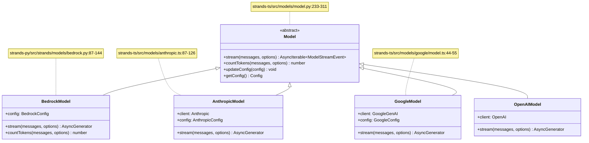
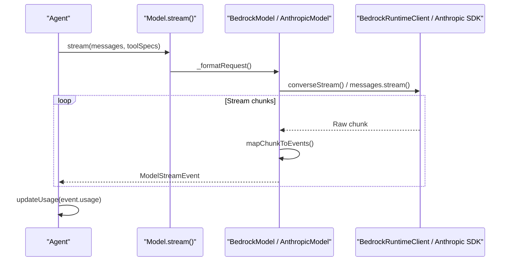

<!-- source: DeepWiki mcp.deepwiki.com · repo strands-agents/sdk-python · page 3 Model Providers · fetched 2026-10-26 -->

# Model Providers

Relevant source files

The following files were used as context for generating this wiki page:

- [site/src/content/docs/user-guide/concepts/model-providers/amazon-bedrock.mdx](site/src/content/docs/user-guide/concepts/model-providers/amazon-bedrock.mdx)
- [site/src/content/docs/user-guide/concepts/model-providers/anthropic.mdx](site/src/content/docs/user-guide/concepts/model-providers/anthropic.mdx)
- [site/src/content/docs/user-guide/concepts/model-providers/anthropic.ts](site/src/content/docs/user-guide/concepts/model-providers/anthropic.ts)
- [site/src/content/docs/user-guide/concepts/model-providers/anthropic_imports.ts](site/src/content/docs/user-guide/concepts/model-providers/anthropic_imports.ts)
- [strands-py/src/strands/models/anthropic.py](strands-py/src/strands/models/anthropic.py)
- [strands-py/src/strands/models/bedrock.py](strands-py/src/strands/models/bedrock.py)
- [strands-py/src/strands/models/model.py](strands-py/src/strands/models/model.py)
- [strands-py/tests/strands/models/test_anthropic.py](strands-py/tests/strands/models/test_anthropic.py)
- [strands-py/tests/strands/models/test_bedrock.py](strands-py/tests/strands/models/test_bedrock.py)
- [strands-ts/src/models/__tests__/anthropic.test.ts](strands-ts/src/models/__tests__/anthropic.test.ts)
- [strands-ts/src/models/__tests__/bedrock.test.ts](strands-ts/src/models/__tests__/bedrock.test.ts)
- [strands-ts/src/models/__tests__/defaults.test.ts](strands-ts/src/models/__tests__/defaults.test.ts)
- [strands-ts/src/models/__tests__/google.test.ts](strands-ts/src/models/__tests__/google.test.ts)
- [strands-ts/src/models/anthropic.ts](strands-ts/src/models/anthropic.ts)
- [strands-ts/src/models/bedrock.ts](strands-ts/src/models/bedrock.ts)
- [strands-ts/src/models/google/adapters.ts](strands-ts/src/models/google/adapters.ts)
- [strands-ts/src/models/google/model.ts](strands-ts/src/models/google/model.ts)
- [strands-ts/src/models/google/types.ts](strands-ts/src/models/google/types.ts)
- [strands-ts/src/models/model.ts](strands-ts/src/models/model.ts)

The Strands Agents SDK uses a provider abstraction pattern that enables agents to work with multiple LLM backends through a unified `Model` interface. This design allows switching between providers with minimal code changes while maintaining access to provider-specific features across both Python and TypeScript implementations.

This page introduces the `Model` abstraction, explains the provider pattern, and provides an overview of available model integrations. For detailed implementation specifics, see the sub-pages: [Model Provider Architecture](#3.1), [AWS Bedrock Models](#3.2), [OpenAI Compatible Models](#3.3), [LiteLLM Multi-Provider Support](#3.4), [Additional Model Providers](#3.5), and [Structured Output Generation](#3.6).

## The Model Abstraction

The `Model` abstract base class in Python [strands-py/src/strands/models/model.py:168-202]() and the `Model` class in TypeScript [strands-ts/src/models/model.py:233-311]() define the interface that all model providers must implement. This interface provides a standardized way to configure and process requests for different AI model providers.

| Method | Signature (approximate) | Purpose |
|--------|-----------|---------|
| `stream()` | `async def stream(...) -> AsyncIterable[StreamEvent]` | Streams conversation responses with real-time token generation |
| `count_tokens()` | `async def count_tokens(...) -> int` | Estimates or calculates the number of tokens in a message set |
| `update_config()` | `def update_config(**model_config: Any) -> None` | Updates provider-specific configuration parameters |
| `get_config()` | `def get_config() -> Any` | Retrieves current configuration including resolved metadata |

The `stream()` method [strands-py/src/strands/models/model.py:228-243]() / [strands-ts/src/models/model.py:270-270]() is the primary interface used by the agent event loop. It accepts standardized SDK types like `Message`, `ToolSpec`, and `SystemPrompt`.

**Sources:** [strands-py/src/strands/models/model.py:168-243](), [strands-ts/src/models/model.py:233-311]()

**Model Provider Class Hierarchy**

**Sources:** [strands-py/src/strands/models/bedrock.py:87-144](), [strands-ts/src/models/anthropic.ts:87-126](), [strands-ts/src/models/google/model.ts:44-55](), [strands-ts/src/models/model.py:233-311]()

## How Models Integrate with Agents

Model providers integrate with the agent system through the `Agent` and the underlying event loop cycle. The integration follows this standardized flow:

1. **Agent** calls `model.stream()` with SDK-format messages.
2. **Model Provider** converts messages to provider-specific API format (e.g., `BedrockModel` formats messages for the Bedrock Converse API [strands-py/src/strands/models/bedrock.py:464-500]()).
3. **Provider API** returns streaming response chunks.
4. **Model Provider** normalizes chunks into `StreamEvent` (Python) or `ModelStreamEvent` (TypeScript) objects [strands-ts/src/models/streaming.ts:15-30]().
5. **Event Loop** processes these events to update usage metrics and conversation state.

**Model Integration in Event Loop**

For details on the architecture and message pipeline, see [Model Provider Architecture](#3.1).

**Sources:** [strands-py/src/strands/models/bedrock.py:464-500](), [strands-ts/src/models/bedrock.ts:512-550](), [strands-ts/src/models/anthropic.ts:172-185]()

## Available Model Providers

The SDK includes multiple model provider implementations with varying capabilities across Python and TypeScript.

| Provider | Class | Primary SDKs | Key Features |
|----------|-------|--------------|--------------|
| AWS Bedrock | `BedrockModel` | Python, TS | Guardrails, Prompt Caching, S3 media support, Native token count [strands-py/src/strands/models/bedrock.py:99-144]() |
| Anthropic | `AnthropicModel` | Python, TS | Ephemeral caching, thinking/reasoning blocks, native token count [strands-ts/src/models/anthropic.ts:40-79]() |
| Google Gemini | `GoogleModel` | TS | Flash models, grounding support, system instructions [strands-ts/src/models/google/model.ts:44-55]() |
| OpenAI | `OpenAIModel` | Python, TS | Native structured output (Responses API), Mantle routing [strands-py/src/strands/models/openai.py:51-69]() |
| LiteLLM | `LiteLLMModel` | Python | Proxy to 100+ providers, standardized error handling [strands-py/src/strands/models/litellm.py:18-30]() |

For details on specific providers, see [AWS Bedrock Models](#3.2), [OpenAI Compatible Models](#3.3), and [Additional Model Providers](#3.5).

**Sources:** [strands-py/src/strands/models/bedrock.py:99-144](), [strands-ts/src/models/anthropic.ts:40-79](), [strands-ts/src/models/google/model.ts:44-55]()

## Provider Configuration and Caching

Each provider uses a configuration class to define its specific parameters. Configuration is managed through constructor arguments and the `update_config()` method.

**Prompt Caching**
The SDK provides a standardized `CacheConfig` [strands-ts/src/models/model.py:70-107]() to control prompt caching across supported providers (Bedrock, Anthropic).
- `strategy`: "auto" detects model support [strands-ts/src/models/model.py:73-79]().
- `ttl`: Standardized durations like "5m" or "1h" [strands-ts/src/models/model.py:114-114]().

**Token Counting**
Providers can use a `use_native_token_count` flag [strands-py/src/strands/models/bedrock.py:141-143]() to toggle between local heuristic estimation [strands-py/src/strands/models/model.py:92-119]() and calling the provider's native API for exact counts.

**Sources:** [strands-ts/src/models/model.py:70-114](), [strands-py/src/strands/models/bedrock.py:141-143](), [strands-py/src/strands/models/model.py:92-119]()

## Structured Output

The SDK supports generating responses that conform to specific schemas (Pydantic in Python, Zod in TypeScript). This is implemented via the `structured_output` method or by using tool-forcing mechanisms.

- **Native Support**: Providers like OpenAI use the Responses API for guaranteed schema adherence.
- **Tool-Forcing**: Providers like Bedrock use a `noop_tool` [strands-ts/src/models/bedrock.ts:68-68]() or tool-choice "forced" mode to ensure the model responds with the requested JSON structure.

For implementation details, see [Structured Output Generation](#3.6).

**Sources:** [strands-ts/src/models/bedrock.ts:68-68](), [strands-py/src/strands/models/model.py:245-256]()

---

