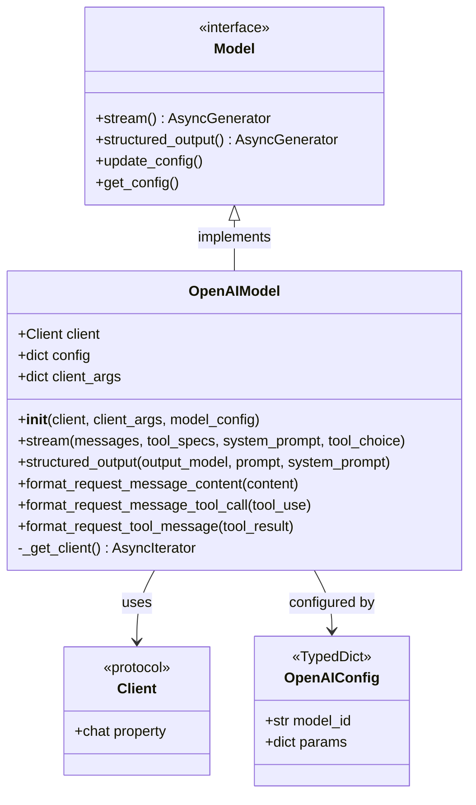
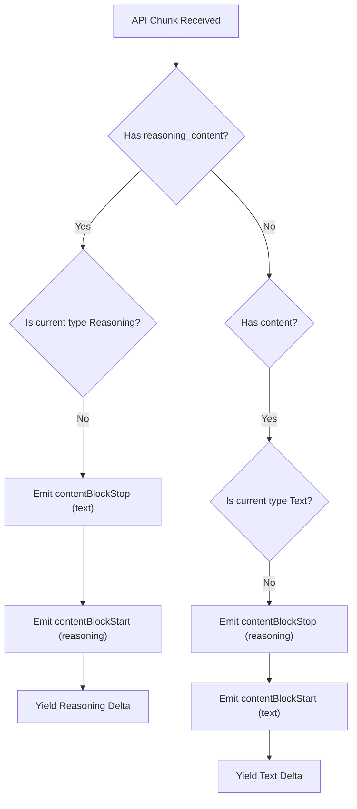

<!-- source: DeepWiki mcp.deepwiki.com · repo strands-agents/sdk-python · page 3.3 OpenAI Compatible Models · fetched 2026-10-26 -->

# OpenAI Compatible Models

<details>
<summary>Relevant source files</summary>

The following files were used as context for generating this wiki page:

- [site/src/content/docs/user-guide/concepts/model-providers/openai.mdx](site/src/content/docs/user-guide/concepts/model-providers/openai.mdx)
- [site/src/content/docs/user-guide/concepts/model-providers/openai.ts](site/src/content/docs/user-guide/concepts/model-providers/openai.ts)
- [site/src/content/docs/user-guide/concepts/model-providers/openai_imports.ts](site/src/content/docs/user-guide/concepts/model-providers/openai_imports.ts)
- [strands-py/src/strands/models/_openai_bedrock.py](strands-py/src/strands/models/_openai_bedrock.py)
- [strands-py/src/strands/models/_openai_errors.py](strands-py/src/strands/models/_openai_errors.py)
- [strands-py/src/strands/models/openai.py](strands-py/src/strands/models/openai.py)
- [strands-py/src/strands/models/openai_responses.py](strands-py/src/strands/models/openai_responses.py)
- [strands-py/tests/strands/models/test_openai.py](strands-py/tests/strands/models/test_openai.py)
- [strands-py/tests/strands/models/test_openai_errors.py](strands-py/tests/strands/models/test_openai_errors.py)
- [strands-py/tests/strands/models/test_openai_responses.py](strands-py/tests/strands/models/test_openai_responses.py)
- [strands-py/tests_integ/models/test_mantle_routing.py](strands-py/tests_integ/models/test_mantle_routing.py)
- [strands-py/tests_integ/models/test_model_mantle.py](strands-py/tests_integ/models/test_model_mantle.py)
- [strands-ts/src/models/openai/__tests__/chat.test.ts](strands-ts/src/models/openai/__tests__/chat.test.ts)
- [strands-ts/src/models/openai/__tests__/errors.test.ts](strands-ts/src/models/openai/__tests__/errors.test.ts)
- [strands-ts/src/models/openai/__tests__/mantle.test.ts](strands-ts/src/models/openai/__tests__/mantle.test.ts)
- [strands-ts/src/models/openai/__tests__/responses.test.ts](strands-ts/src/models/openai/__tests__/responses.test.ts)
- [strands-ts/src/models/openai/errors.ts](strands-ts/src/models/openai/errors.ts)
- [strands-ts/src/models/openai/index.ts](strands-ts/src/models/openai/index.ts)
- [strands-ts/src/models/openai/mantle.ts](strands-ts/src/models/openai/mantle.ts)
- [strands-ts/src/models/openai/model.ts](strands-ts/src/models/openai/model.ts)
- [strands-ts/src/models/openai/responses-adapter.ts](strands-ts/src/models/openai/responses-adapter.ts)
- [strands-ts/src/models/openai/types.ts](strands-ts/src/models/openai/types.ts)
- [strands-ts/test/integ/models/openai/mantle-routing.test.node.ts](strands-ts/test/integ/models/openai/mantle-routing.test.node.ts)
- [strands-ts/test/integ/models/openai/mantle.test.node.ts](strands-ts/test/integ/models/openai/mantle.test.node.ts)

</details>


## Purpose and Scope

This document covers the `OpenAIModel` and `OpenAIResponsesModel` provider implementations, which enable integration with OpenAI's API and OpenAI-compatible endpoints. The `OpenAIModel` class converts Strands' unified message format to OpenAI's Chat Completions API format [strands-py/src/strands/models/openai.py:1-4](), while `OpenAIResponsesModel` utilizes the newer Responses API [strands-py/src/strands/models/openai_responses.py:1-19](). Both providers handle streaming, tool execution, and specific features like reasoning content and structured output.

---

## OpenAIModel Class Overview

The `OpenAIModel` class implements the `Model` interface to provide access to OpenAI and OpenAI-compatible language models (e.g., vLLM, Ollama, DeepSeek). It supports two client configuration patterns: **client injection** for advanced use cases and **client_args** for simple initialization [strands-py/src/strands/models/openai.py:67-98]().

### Class Structure



**Key Components:**
- **client**: OpenAI-compatible client (`AsyncOpenAI` or custom wrapper) [strands-py/src/strands/models/openai.py:35]().
- **config**: Dictionary containing `model_id` and `params` [strands-py/src/strands/models/openai.py:100]().
- **client_args**: Arguments passed to the `AsyncOpenAI` constructor [strands-py/src/strands/models/openai.py:117]().

**Sources:** [strands-py/src/strands/models/openai.py:45-119]()

---

## OpenAI Responses API Model

The `OpenAIResponsesModel` is an implementation for OpenAI's newer Responses API (available in `openai>=2.0.0`) [strands-py/src/strands/models/openai_responses.py:34-45](). Unlike the stateless Chat Completions API, the Responses API is designed for server-side state management and uses a different message structure [strands-py/src/strands/models/openai_responses.py:1-19]().

### Key Differences from OpenAIModel

| Feature | OpenAIModel (Chat) | OpenAIResponsesModel (Responses) |
|---------|--------------------|-----------------------------------|
| **Input Key** | `messages` | `input` |
| **System Prompt** | `role: system` message | `instructions` parameter |
| **Content Types** | `text`, `image_url` | `input_text`, `input_image`, `input_file` |
| **Tool Calls** | `tool_calls` array | `function_call` items |
| **State Management** | Client-side history | Optional `stateful=True` for server-side state |

**Sources:** [strands-py/src/strands/models/openai_responses.py:1-19](), [strands-py/src/strands/models/openai_responses.py:134-141](), [strands-py/src/strands/models/openai_responses.py:243-294]()

---

## Configuration

### Initialization Patterns

**Pattern 1: Client Args**
```python
from strands.models.openai import OpenAIModel

model = OpenAIModel(
    client_args={"api_key": "sk-...", "base_url": "https://api.openai.com/v1"},
    model_id="gpt-4o",
    params={"max_tokens": 1000}
)
```

**Pattern 2: Client Injection (Recommended for Observability)**
```python
from openai import AsyncOpenAI
from strands.models.openai import OpenAIModel

# Useful for custom networking policies or connection pooling
client = AsyncOpenAI(api_key="sk-...", timeout=30.0)
model = OpenAIModel(client=client, model_id="gpt-4o")
```

**Sources:** [strands-py/src/strands/models/openai.py:67-98](), [strands-py/tests/strands/models/test_openai.py:76-81]()

### Mantle Routing

Both `OpenAIModel` and `OpenAIResponsesModel` support routing requests through Amazon Bedrock's OpenAI-compatible "Mantle" endpoint. This is configured via the `bedrock_mantle_config` parameter during initialization [strands-py/src/strands/models/openai.py:70-71](), [strands-py/src/strands/models/openai_responses.py:161-162]().

When `bedrock_mantle_config` is provided, the SDK automatically resolves the AWS region and mints a fresh bearer token for each request using `@aws/bedrock-token-generator` (TypeScript) or `resolve_bedrock_client_args` (Python) [strands-ts/src/models/openai/mantle.ts:140-173](), [strands-py/src/strands/models/openai.py:122-131](). This ensures long-running agents can survive the bearer token's maximum lifetime.

The base URL for the Mantle endpoint is dynamically determined based on the `model_id` to ensure correct routing (e.g., `/v1` or `/openai/v1`) [strands-ts/src/models/openai/mantle.ts:125-127](), [strands-py/src/strands/models/_openai_bedrock.py:10-12](). This routing logic is critical as Mantle rejects requests with the wrong base path with an HTTP 400 error [strands-ts/test/integ/models/openai/mantle-routing.test.node.ts:3-8]().

```mermaid
graph TD
    A[OpenAIModel/OpenAIResponsesModel Init] --> B{bedrock_mantle_config provided?}
    B -->|No| C[Use client_args or injected client]
    B -->|Yes| D[Resolve AWS Region]
    D --> E[Mint Bearer Token (on demand)]
    E --> F[Determine Mantle Base URL (e.g., /v1 or /openai/v1)]
    F --> G[Configure OpenAI Client with Mantle URL and Token]
    G --> H[Make Request to Mantle Endpoint]
```
**Mantle Base Path Resolution:**
The `_OPENAI_PATH_MODEL_PREFIXES` constant in Python [strands-py/src/strands/models/_openai_bedrock.py:10]() and `OPENAI_PATH_MODEL_PREFIXES` in TypeScript [strands-ts/src/models/openai/mantle.ts:21]() define which model prefixes should use the `/openai/v1` path. Models not matching these prefixes default to `/v1`. This mapping is regularly validated against the live Mantle catalog via integration tests [strands-py/tests_integ/models/test_mantle_routing.py:136](), [strands-ts/test/integ/models/openai/mantle-routing.test.node.ts:117]().

**Sources:**
- [strands-py/src/strands/models/openai.py:70-71]()
- [strands-py/src/strands/models/openai_responses.py:161-162]()
- [strands-py/src/strands/models/openai.py:122-131]()
- [strands-py/src/strands/models/_openai_bedrock.py:10-12]()
- [strands-ts/src/models/openai/mantle.ts:140-173]()
- [strands-ts/src/models/openai/mantle.ts:125-127]()
- [strands-ts/src/models/openai/mantle.ts:21]()
- [strands-py/tests_integ/models/test_mantle_routing.py:136]()
- [strands-ts/test/integ/models/openai/mantle-routing.test.node.ts:3-8]()
- [strands-ts/test/integ/models/openai/mantle-routing.test.node.ts:117]()

---

## Message Formatting Pipeline

The SDK transforms Strands' unified message format into provider-specific payloads.

### Content Block Mapping

The `format_request_message_content` method handles type conversion:

| Strands Type | OpenAI Chat Format | OpenAI Responses Format |
|--------------|--------------------|-------------------------|
| `text` | `{"type": "text", "text": "..."}` | `{"type": "input_text", "text": "..."}` |
| `image` | `{"type": "image_url", "image_url": {...}}` | `{"type": "input_image", "image_url": "data:..."}` |
| `document` | `{"type": "file", "file": {...}}` | `{"type": "input_file", "file_url": "data:..."}` |

**Sources:** [strands-py/src/strands/models/openai.py:155-168](), [strands-py/src/strands/models/openai_responses.py:111-126](), [strands-py/tests/strands/models/test_openai.py:127-173]()

### Tool Message Handling

A critical implementation detail in `OpenAIModel` is the handling of multi-content tool results. To maintain compatibility with endpoints like vLLM, Ollama, or Kimi K2.5, multi-content text results are joined into a single string to avoid parsing errors on the model side [strands-py/src/strands/models/openai.py:209-219]().

```python
# [strands-py/src/strands/models/openai.py:190-219]
# Joined into a single string: "Temperature: 72°F\n{"humidity": 45}\nWind: 5 mph"
exp_result = {
    "content": 'Temperature: 72°F\n{"humidity": 45, "unit": "%"}\nWind: 5 mph',
    "role": "tool",
    "tool_call_id": "c1",
}
```

**Sources:** [strands-py/src/strands/models/openai.py:190-219](), [strands-py/tests/strands/models/test_openai.py:209-232]()

---

## OpenAI-Specific Features

### Built-in Tools Support (Responses API)

The `OpenAIResponsesModel` supports OpenAI's built-in tools (e.g., `web_search`, `file_search`, `code_interpreter`) by passing them via the `params` configuration. These tools are merged with any agent function tools in the request [strands-py/src/strands/models/openai_responses.py:3-4]().

**Limitations on tool-specific metadata:**
- `web_search`: Full support including URL citations.
- `file_search`: File citation annotations are not emitted.
- `code_interpreter`: Executed code and stdout/stderr are not surfaced.
- `mcp`: Approval flow and `mcp_list_tools`/`mcp_call` events are not surfaced.
- `shell`: Local (client-executed) mode is not supported.
- `tool_search`: Not supported due to `defer_loading` requirement.
- `image_generation`: Not supported due to lack of image content block delta support.
- `computer_use_preview`: Not supported as it requires a developer-managed screenshot/action loop.

**Sources:** [strands-py/src/strands/models/openai_responses.py:3-16](), [strands-ts/src/models/openai/responses-adapter.ts:1-13]()

### Reasoning Content (o1/o3 Models)

OpenAI's reasoning models provide a `reasoning_content` field in the delta. The `OpenAIModel` tracks the transition between reasoning and standard text to emit correct `contentBlockStart` and `contentBlockStop` events [strands-py/src/strands/models/openai.py:693-711]().



**Sources:** [strands-py/src/strands/models/openai.py:645-655](), [strands-py/src/strands/models/openai.py:693-711](), [strands-py/tests/strands/models/test_openai.py:726-819]()

### Image Splitting in Tool Results

OpenAI restricts images to messages with the `user` role. If a tool returns an image, `OpenAIModel` automatically splits the message [strands-py/src/strands/models/openai.py:222-281]():
1. A `tool` message is sent with a text placeholder.
2. A subsequent `user` message is injected containing the actual image content [strands-py/src/strands/models/openai.py:386-394]().

**Sources:** [strands-py/src/strands/models/openai.py:222-281](), [strands-py/src/strands/models/openai.py:386-394]()

### LiteLLM Proxy Support

The `LiteLLMModel` (which inherits from `OpenAIModel`) supports a specific `use_litellm_proxy` flag. When enabled, it automatically prefixes the `model_id` with `litellm_proxy/` to route requests through a LiteLLM gateway [strands-py/src/strands/models/litellm.py:65]().

**Sources:** [strands-py/src/strands/models/litellm.py:36-68](), [strands-py/tests/strands/models/test_litellm.py:64-79]()

---

## Error Handling and Throttling

The models map OpenAI-specific exceptions to unified Strands exceptions to allow for provider-agnostic retry logic in the `Agent` event loop.

### Exception Mapping

| OpenAI Exception | Condition | Strands Exception |
|------------------|-----------|-------------------|
| `BadRequestError` | `code == "context_length_exceeded"` | `ContextWindowOverflowException` |
| `APIError` | Message contains "Input is too long..." | `ContextWindowOverflowException` |
| `RateLimitError` | Any | `ModelThrottledException` |

The `classify_openai_error` function in Python [strands-py/src/strands/models/_openai_errors.py:1-30]() and TypeScript [strands-ts/src/models/openai/errors.ts:39-56]() normalizes various OpenAI error messages and codes into `contextOverflow` or `throttling` kinds. This allows the SDK to catch and re-raise these as `ContextWindowOverflowException` or `ModelThrottledException` respectively [strands-py/src/strands/models/openai.py:609-630](), [strands-py/src/strands/models/openai_responses.py:72-73]().

**Sources:**
- [strands-py/src/strands/models/openai.py:34-38]()
- [strands-py/src/strands/models/openai.py:609-630]()
- [strands-py/src/strands/models/openai_responses.py:72-73]()
- [strands-py/src/strands/models/_openai_errors.py:1-30]()
- [strands-ts/src/models/openai/errors.ts:39-56]()
- [strands-ts/src/models/openai/__tests__/errors.test.ts:14-29]()

---

## Structured Output

Both providers support structured output using Pydantic models via the `structured_output` method. `OpenAIModel` uses the `beta.chat.completions.parse` endpoint to ensure schema adherence [strands-py/src/strands/models/openai.py:714-776]().

```python
class UserInfo(BaseModel):
    name: str
    age: int

# [strands-py/src/strands/models/openai.py:714]
async for event in model.structured_output(UserInfo, "Extract: John is 30"):
    if "output" in event:
        print(event["output"]) # UserInfo(name='John', age=30)
```

**Sources:** [strands-py/src/strands/models/openai.py:714-776](), [strands-py/src/strands/models/openai_responses.py:465-532](), [strands-py/tests/strands/models/test_openai.py:910-928]()

---

