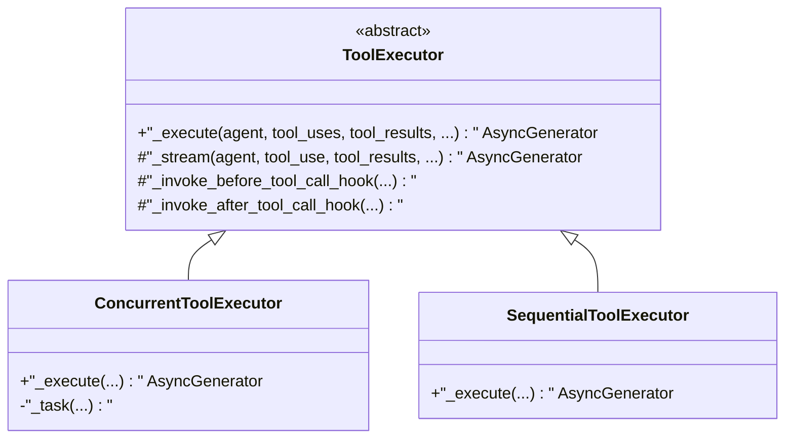
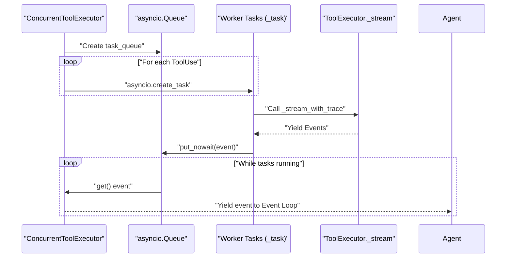
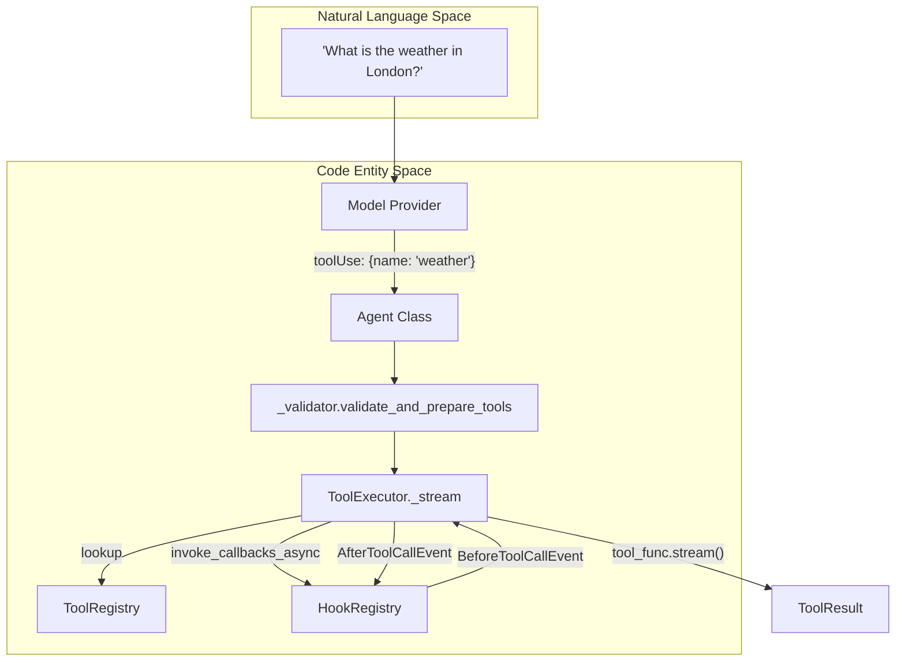

<!-- source: DeepWiki mcp.deepwiki.com · repo strands-agents/sdk-python · page 4.3 Tool Execution Strategies · fetched 2026-10-26 -->

# Tool Execution Strategies

Relevant source files

The following files were used as context for generating this wiki page:

- [site/src/content/docs/user-guide/concepts/agents/agent-loop.mdx](site/src/content/docs/user-guide/concepts/agents/agent-loop.mdx)
- [site/src/content/docs/user-guide/concepts/tools/executors.ts](site/src/content/docs/user-guide/concepts/tools/executors.ts)
- [strands-py/AGENTS.md](strands-py/AGENTS.md)
- [strands-py/docs/TESTING.md](strands-py/docs/TESTING.md)
- [strands-py/src/strands/agent/agent.py](strands-py/src/strands/agent/agent.py)
- [strands-py/src/strands/event_loop/event_loop.py](strands-py/src/strands/event_loop/event_loop.py)
- [strands-py/src/strands/telemetry/metrics.py](strands-py/src/strands/telemetry/metrics.py)
- [strands-py/src/strands/tools/executors/_executor.py](strands-py/src/strands/tools/executors/_executor.py)
- [strands-py/src/strands/tools/executors/sequential.py](strands-py/src/strands/tools/executors/sequential.py)
- [strands-py/src/strands/tools/mcp/mcp_types.py](strands-py/src/strands/tools/mcp/mcp_types.py)
- [strands-py/tests/strands/event_loop/test_event_loop.py](strands-py/tests/strands/event_loop/test_event_loop.py)
- [strands-py/tests/strands/event_loop/test_event_loop_metadata.py](strands-py/tests/strands/event_loop/test_event_loop_metadata.py)
- [strands-py/tests/strands/event_loop/test_event_loop_structured_output.py](strands-py/tests/strands/event_loop/test_event_loop_structured_output.py)
- [strands-py/tests/strands/telemetry/test_metrics.py](strands-py/tests/strands/telemetry/test_metrics.py)
- [strands-py/tests/strands/tools/executors/conftest.py](strands-py/tests/strands/tools/executors/conftest.py)
- [strands-py/tests/strands/tools/executors/test_executor.py](strands-py/tests/strands/tools/executors/test_executor.py)
- [strands-ts/AGENTS.md](strands-ts/AGENTS.md)
- [strands-ts/docs/TESTING.md](strands-ts/docs/TESTING.md)
- [strands-ts/src/__tests__/index.test.ts](strands-ts/src/__tests__/index.test.ts)
- [strands-ts/src/agent/__tests__/agent.cancel.test.ts](strands-ts/src/agent/__tests__/agent.cancel.test.ts)
- [strands-ts/src/agent/__tests__/agent.concurrent.test.ts](strands-ts/src/agent/__tests__/agent.concurrent.test.ts)
- [strands-ts/src/agent/__tests__/agent.interrupt.test.ts](strands-ts/src/agent/__tests__/agent.interrupt.test.ts)
- [strands-ts/src/middleware/README.md](strands-ts/src/middleware/README.md)
- [strands-ts/src/middleware/__tests__/agent-middleware.test.ts](strands-ts/src/middleware/__tests__/agent-middleware.test.ts)
- [strands-ts/src/middleware/__tests__/copy-on-input.test.ts](strands-ts/src/middleware/__tests__/copy-on-input.test.ts)
- [strands-ts/src/middleware/__tests__/middleware-interrupts.test.ts](strands-ts/src/middleware/__tests__/middleware-interrupts.test.ts)
- [strands-ts/src/middleware/interrupt.ts](strands-ts/src/middleware/interrupt.ts)
- [strands-ts/src/middleware/stages.ts](strands-ts/src/middleware/stages.ts)
- [strands-ts/src/models/__tests__/bedrock.transport.test.browser.ts](strands-ts/src/models/__tests__/bedrock.transport.test.browser.ts)
- [strands-ts/src/tools/executors/concurrent.ts](strands-ts/src/tools/executors/concurrent.ts)

This document covers the tool execution strategies available in the Strands Agents SDK. It details the `ToolExecutor` abstraction and its implementations: `ConcurrentToolExecutor` for parallel execution and `SequentialToolExecutor` for sequential execution.

## ToolExecutor Abstraction

The `ToolExecutor` abstract base class defines the interface for tool execution strategies. This abstraction allows agents to use different execution patterns for tools without changing the event loop or tool definitions. It handles the orchestration of tool lookups, validation, hook execution, and result collection [strands-py/src/strands/tools/executors/_executor.py:32-33]().

### ToolExecutor Class Hierarchy

**Key Responsibilities:**
- **Hook Orchestration**: Invokes `BeforeToolCallEvent` and `AfterToolCallEvent` (or their Bidi equivalents) around tool logic [strands-py/src/strands/tools/executors/_executor.py:46-91]().
- **Streaming Logic**: The `_stream` method manages individual tool execution, including dynamic tool lookup, retry loops, and error wrapping [strands-py/src/strands/tools/executors/_executor.py:94-152]().
- **Tracing**: Automatically populates OpenTelemetry span attributes with tool descriptions and JSON schemas [strands-py/src/strands/tools/executors/_executor.py:131-137]().

Sources: [strands-py/src/strands/tools/executors/_executor.py:32-152](), [strands-py/src/strands/tools/executors/concurrent.py:19-20](), [strands-py/src/strands/tools/executors/sequential.py:18-19]()

## ConcurrentToolExecutor

`ConcurrentToolExecutor` is the default execution strategy that executes multiple tools in parallel using `asyncio`. This is optimized for high-throughput scenarios where the model requests multiple independent tool calls.

### Concurrent Execution Flow

The concurrent executor utilizes an `asyncio.Queue` to multiplex events from multiple parallel worker tasks [strands-py/src/strands/tools/executors/concurrent.py:47-48](). It ensures that if any task encounters an exception, it is propagated and remaining tasks are cancelled [strands-py/src/strands/tools/executors/concurrent.py:79-87]().

Sources: [strands-py/src/strands/tools/executors/concurrent.py:23-87](), [strands-py/src/strands/tools/executors/concurrent.py:118-131]()

## SequentialToolExecutor

`SequentialToolExecutor` executes tools one at a time in the order they were requested by the model. This is critical for workflows where tools have side effects that must happen in a specific order or when human-in-the-loop interrupts should stop subsequent tools from running.

### Execution Behavior
- **Ordered Processing**: Iterates through `tool_uses` and awaits each `_stream` call fully before moving to the next [strands-py/src/strands/tools/executors/sequential.py:50-54]().
- **Interrupt Handling**: If a `ToolInterruptEvent` is yielded by a tool (e.g., via a hook), the executor sets an internal `interrupted` flag and breaks the loop, preventing subsequent tools from executing [strands-py/src/strands/tools/executors/sequential.py:55-61]().

Sources: [strands-py/src/strands/tools/executors/sequential.py:22-62](), [strands-py/tests/strands/tools/executors/test_executor.py:79-110]()

## Tool Execution Flow & Hooks

Individual tool execution (via `_stream`) follows a strict lifecycle managed by the base `ToolExecutor`.

### Lifecycle Diagram: Natural Language to Code Entity

### Hook Integration
1.  **Before Call**: `_invoke_before_tool_call_hook` is called before the tool logic runs. Hooks can return `Interrupt` objects or set `cancel_tool` [strands-py/src/strands/tools/executors/_executor.py:153-165]().
2.  **Execution**: The tool's `stream` method is called. If the tool is not found, an error result is generated [strands-py/src/strands/tools/executors/_executor.py:127-129]().
3.  **After Call**: `_invoke_after_tool_call_hook` is called with the `ToolResult` and any exceptions. Hooks can set `retry = True` to trigger a re-execution of the tool [strands-py/src/strands/tools/executors/_executor.py:151-188]().

Sources: [strands-py/src/strands/tools/executors/_executor.py:151-190](), [strands-py/src/strands/types/_events.py:145-150](), [strands-py/src/strands/tools/_validator.py:8-21]()

## Structured Output Integration

Executors pass a `StructuredOutputContext` through to tools. This context is used when the agent is configured to return specific Pydantic models [strands-py/src/strands/tools/executors/_executor.py:125]().

-   **Context Propagation**: The context is passed into the `_execute` method and subsequently into the tool's `stream` function [strands-py/src/strands/tools/executors/sequential.py:30-31](), [strands-py/src/strands/tools/executors/concurrent.py:31-32]().
-   **Test Verification**: Unit tests verify that the `StructuredOutputContext` is correctly passed into tool streams during sequential execution [strands-py/tests/strands/tools/executors/test_executor.py:113-148]() (note: the test file is `test_executor.py` not `test_sequential.py` as previously stated).

Sources: [strands-py/src/strands/tools/executors/_executor.py:99](), [strands-py/src/strands/tools/executors/sequential.py:51-53](), [strands-py/tests/strands/tools/executors/test_executor.py:113-148]()

## Validation and Error Handling

The SDK provides utilities to ensure tool calls are valid before execution and handles runtime failures gracefully.

### Validation Logic
The `_validator.validate_and_prepare_tools` function parses a message's content blocks to extract `toolUse` blocks and validates them against naming requirements [strands-py/src/strands/tools/_validator.py:8-32](). If a tool name is missing or invalid, it populates `tool_results` with an error status immediately to provide context back to the LLM [strands-py/src/strands/tools/_validator.py:33-46](). This prevents invalid tool calls from poisoning agent history while allowing the model to see the error and recover [strands-py/tests_integ/test_invalid_tool_names.py:17-52]().

### Error Handling Strategies

| Scenario | Handling Strategy | Code Reference |
| :--- | :--- | :--- |
| **Unknown Tool** | Returns `ToolResult` with `status="error"` and message "Unknown tool: {name}" | [strands-py/src/strands/tools/executors/_executor.py:177-180]() |
| **Tool Exception** | Caught in `_stream`, wrapped in `ToolResult` with exception details | [strands-py/src/strands/tools/executors/_executor.py:202-212]() |
| **Tool Cancellation** | Triggered by `BeforeToolCallEvent.cancel_tool`, yields `ToolCancelEvent` | [strands-py/src/strands/tools/executors/_executor.py:161-171]() |
| **Invalid Name** | Caught by `validate_tool_use`, results in `InvalidToolUseNameException` | [strands-py/src/strands/tools/_validator.py:31-33]() |

Sources: [strands-py/src/strands/tools/executors/_executor.py:161-212](), [strands-py/src/strands/tools/_validator.py:8-46](), [strands-py/tests/strands/tools/executors/test_executor.py:144-168](), [strands-py/tests_integ/test_invalid_tool_names.py:17-52]()

---

