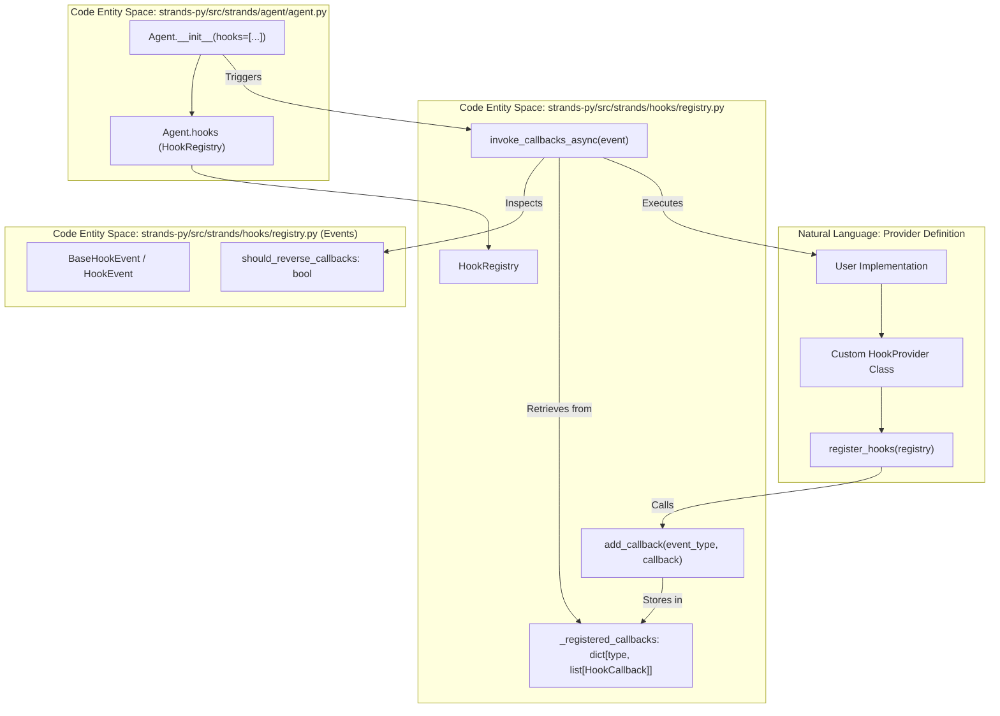
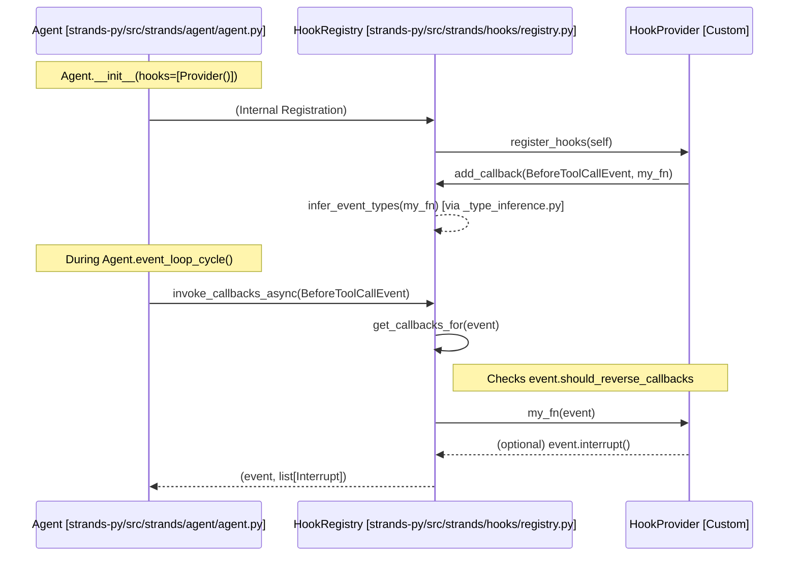

<!-- source: DeepWiki mcp.deepwiki.com · repo strands-agents/sdk-python · page 5.3 Custom Hook Providers · fetched 2026-10-26 -->

# Custom Hook Providers

<details>
<summary>Relevant source files</summary>

The following files were used as context for generating this wiki page:

- [site/src/content/docs/user-guide/concepts/tools/executors.ts](site/src/content/docs/user-guide/concepts/tools/executors.ts)
- [strands-py/src/strands/_middleware/README.md](strands-py/src/strands/_middleware/README.md)
- [strands-py/src/strands/_middleware/__init__.py](strands-py/src/strands/_middleware/__init__.py)
- [strands-py/src/strands/_middleware/registry.py](strands-py/src/strands/_middleware/registry.py)
- [strands-py/src/strands/_middleware/stages.py](strands-py/src/strands/_middleware/stages.py)
- [strands-py/src/strands/_middleware/types.py](strands-py/src/strands/_middleware/types.py)
- [strands-py/src/strands/experimental/bidi/agent/agent.py](strands-py/src/strands/experimental/bidi/agent/agent.py)
- [strands-py/src/strands/interrupt.py](strands-py/src/strands/interrupt.py)
- [strands-py/src/strands/types/_events.py](strands-py/src/strands/types/_events.py)
- [strands-py/tests/strands/agent/test_agent_cancellation.py](strands-py/tests/strands/agent/test_agent_cancellation.py)
- [strands-py/tests/strands/middleware/test_agent_middleware.py](strands-py/tests/strands/middleware/test_agent_middleware.py)
- [strands-py/tests/strands/middleware/test_agent_stream_middleware.py](strands-py/tests/strands/middleware/test_agent_stream_middleware.py)
- [strands-py/tests/strands/middleware/test_execute_tool_middleware.py](strands-py/tests/strands/middleware/test_execute_tool_middleware.py)
- [strands-py/tests/strands/middleware/test_middleware_interrupts.py](strands-py/tests/strands/middleware/test_middleware_interrupts.py)
- [strands-py/tests/strands/middleware/test_registry.py](strands-py/tests/strands/middleware/test_registry.py)
- [strands-py/tests/strands/test_interrupt.py](strands-py/tests/strands/test_interrupt.py)
- [strands-ts/src/__tests__/index.test.ts](strands-ts/src/__tests__/index.test.ts)
- [strands-ts/src/agent/__tests__/agent.cancel.test.ts](strands-ts/src/agent/__tests__/agent.cancel.test.ts)
- [strands-ts/src/agent/__tests__/agent.concurrent.test.ts](strands-ts/src/agent/__tests__/agent.concurrent.test.ts)
- [strands-ts/src/agent/__tests__/agent.interrupt.test.ts](strands-ts/src/agent/__tests__/agent.interrupt.test.ts)
- [strands-ts/src/middleware/README.md](strands-ts/src/middleware/README.md)
- [strands-ts/src/middleware/__tests__/agent-middleware.test.ts](strands-ts/src/middleware/__tests__/agent-middleware.test.ts)
- [strands-ts/src/middleware/__tests__/copy-on-input.test.ts](strands-ts/src/middleware/__tests__/copy-on-input.test.ts)
- [strands-ts/src/middleware/__tests__/middleware-interrupts.test.ts](strands-ts/src/middleware/__tests__/middleware-interrupts.test.ts)
- [strands-ts/src/middleware/interrupt.ts](strands-ts/src/middleware/interrupt.ts)
- [strands-ts/src/middleware/stages.ts](strands-ts/src/middleware/stages.ts)
- [strands-ts/src/models/__tests__/bedrock.transport.test.browser.ts](strands-ts/src/models/__tests__/bedrock.transport.test.browser.ts)
- [strands-ts/src/tools/executors/concurrent.ts](strands-ts/src/tools/executors/concurrent.ts)

</details>


## Purpose and Scope

This document explains how to create custom `HookProvider` implementations to extend agent functionality through event-driven callbacks. A `HookProvider` is a reusable component that registers hook callbacks with an agent's `HookRegistry` to respond to lifecycle events. This page also details how to leverage the `MiddlewareRegistry` to wrap core execution paths using built-in middleware stages like `AgentStreamStage`, `InvokeModelStage`, and `ExecuteToolStage`.

For general information about the hook system architecture and available event types, see [Hook System and Events](5.2). For using the `@hook` decorator within plugins, see [Plugin System](5.1).

Sources: [strands-py/src/strands/_middleware/stages.py:44-48](), [strands-py/src/strands/_middleware/stages.py:104-108]()

---

## The HookProvider Protocol

The `HookProvider` protocol defines a single method that objects must implement to register hook callbacks with an agent.

### Protocol Definition

```python
@runtime_checkable
class HookProvider(Protocol):
    def register_hooks(self, registry: HookRegistry, **kwargs: Any) -> None:
        """Register callback functions for specific event types."""
        ...
```
Sources: [strands-py/src/strands/hooks/registry.py:89-115]()

The `register_hooks` method is called once during agent initialization. It receives a `HookRegistry` instance where the provider can register its callbacks for various event types.

Sources: [strands-py/src/strands/hooks/registry.py:89-115]()

---

## Basic Implementation Pattern

### Minimal Hook Provider

A basic hook provider implementation follows this structure:

```python
class MyHookProvider:
    def register_hooks(self, registry: HookRegistry, **kwargs: Any) -> None:
        registry.add_callback(BeforeModelCallEvent, self.on_before_model_call)
        registry.add_callback(AfterModelCallEvent, self.on_after_model_call)
    
    def on_before_model_call(self, event: BeforeModelCallEvent) -> None:
        # Handle event
        pass
    
    def on_after_model_call(self, event: AfterModelCallEvent) -> None:
        # Handle event
        pass
```
Sources: [strands-py/src/strands/hooks/registry.py:98-105]()

The provider defines callback methods as instance methods and registers them by calling `registry.add_callback()` for each event type.

### Integration with Agent

Hook providers are passed to the `Agent` constructor via the `hooks` parameter:

```python
agent = Agent(
    model=my_model,
    hooks=[MyHookProvider(), AnotherProvider()]
)
```
Sources: [strands-py/src/strands/hooks/__init__.py:25]() (referenced via [tests/strands/agent/hooks/test_agent_events.py:85]())

The agent calls `register_hooks()` on each provider during initialization, building up the callback registry.

Sources: [strands-py/src/strands/hooks/registry.py:98-105](), [strands-py/src/strands/hooks/__init__.py:8-30](), [tests/strands/agent/hooks/test_agent_events.py:84-85]()

---

## Callback Signatures and Type Inference

### Explicit Event Type Registration

The most straightforward approach specifies the event type explicitly:

```python
def register_hooks(self, registry: HookRegistry, **kwargs: Any) -> None:
    registry.add_callback(BeforeInvocationEvent, self.handle_invocation)

def handle_invocation(self, event: BeforeInvocationEvent) -> None:
    print(f"Agent {event.agent.name} invoked")
```
Sources: [strands-py/src/strands/hooks/registry.py:161-192]()

### Type Inference from Annotations

When `event_type` is `None`, the registry infers the event type from the callback's type annotation:

```python
def register_hooks(self, registry: HookRegistry, **kwargs: Any) -> None:
    # Infers BeforeInvocationEvent from type hint
    registry.add_callback(None, self.handle_invocation)

def handle_invocation(self, event: BeforeInvocationEvent) -> None:
    print(f"Agent {event.agent.name} invoked")
```
Sources: [strands-py/src/strands/hooks/registry.py:193-195](), [tests/strands/hooks/test_registry.py:100-112]()

### Union Type Support

Callbacks can be registered for multiple event types using union type annotations (using `|` or `Union`):

```python
def register_hooks(self, registry: HookRegistry, **kwargs: Any) -> None:
    # Registers for both event types
    registry.add_callback(None, self.handle_model_events)

def handle_model_events(
    self, 
    event: BeforeModelCallEvent | AfterModelCallEvent
) -> None:
    print(f"Model event: {type(event).__name__}")
```
Sources: [strands-py/src/strands/hooks/registry.py:196-198](), [tests/strands/hooks/test_registry.py:171-184]()

### List of Event Types

Multiple event types can be specified as a list:

```python
def register_hooks(self, registry: HookRegistry, **kwargs: Any) -> None:
    registry.add_callback(
        [BeforeModelCallEvent, AfterModelCallEvent],
        self.handle_model_events
    )
```
Sources: [strands-py/src/strands/hooks/registry.py:163-174]()

Sources: [strands-py/src/strands/hooks/registry.py:161-213](), [tests/strands/hooks/test_registry.py:100-236]()

---

## Synchronous vs Asynchronous Callbacks

### Synchronous Callbacks

Synchronous callbacks are defined as regular functions. They are executed within `invoke_callbacks` or `invoke_callbacks_async`.

### Asynchronous Callbacks

Asynchronous callbacks use `async def` and can await operations. They **must** be invoked using `invoke_callbacks_async`.

### Restrictions

The `AgentInitializedEvent` **only supports synchronous callbacks** because it is invoked during agent construction (which is synchronous):

```python
# ✗ Invalid - raises ValueError
registry.add_callback(AgentInitializedEvent, async_callback)

# ✓ Valid
registry.add_callback(AgentInitializedEvent, sync_callback)
```
Sources: [strands-py/src/strands/hooks/registry.py:182-183](), [tests/strands/hooks/test_registry.py:29-33]()

Sources: [strands-py/src/strands/hooks/registry.py:182-183](), [tests/strands/hooks/test_registry.py:29-33](), [tests/strands/hooks/test_registry.py:92-98]()

---

## Hook Provider Architecture

### Data Flow: Provider Registration to Execution

This diagram maps the natural language flow of "creating and using a provider" to the internal code entities.



Sources: [strands-py/src/strands/hooks/registry.py:146-159](), [strands-py/src/strands/hooks/registry.py:25-37](), [strands-py/src/strands/hooks/registry.py:89-115]()

---

## Multi-Agent Hook Providers

Custom providers can also target the Multi-Agent system by registering for multi-agent specific events.

| Event Type | Purpose | File Reference |
|------------|---------|----------------|
| `MultiAgentInitializedEvent` | Fired when a multi-agent orchestrator is ready. | [strands-py/src/strands/hooks/__init__.py:46]() |
| `BeforeNodeCallEvent` | Fired before a specific node in a graph/swarm is executed. | [strands-py/src/strands/hooks/__init__.py:44]() |
| `AfterNodeCallEvent` | Fired after a node execution completes. | [strands-py/src/strands/hooks/__init__.py:37]() |
| `AfterMultiAgentInvocationEvent` | Fired when the entire multi-agent request finishes. | [strands-py/src/strands/hooks/__init__.py:36]() |

### Implementation Example for Multi-Agent

A provider can track state across node transitions by listening to `BeforeNodeCallEvent` and `AfterNodeCallEvent`.

```python
class MultiAgentLogger(HookProvider):
    def register_hooks(self, registry: HookRegistry) -> None:
        registry.add_callback(BeforeNodeCallEvent, self.on_node_start)
        registry.add_callback(AfterNodeCallEvent, self.on_node_end)

    def on_node_start(self, event: BeforeNodeCallEvent):
        print(f"Executing node: {event.node_id}")

    def on_node_end(self, event: AfterNodeCallEvent):
        print(f"Node {event.node_id} finished")
```
Sources: [tests/fixtures/mock_multiagent_hook_provider.py:15-41]()

Sources: [strands-py/src/strands/hooks/__init__.py:32-47](), [tests/fixtures/mock_multiagent_hook_provider.py:15-41]()

---

## Callback Execution Flow

### Registration and Invocation Sequence

This diagram bridges the conceptual "lifecycle" to the specific class methods and internal storage.



Sources: [strands-py/src/strands/hooks/registry.py:161-213](), [tests/strands/hooks/test_registry.py:37-71](), [strands-py/src/strands/hooks/registry.py:25-37]()

---

## Advanced Callback Behaviors

### Reverse Order for Cleanup Events
Events can signal if their callbacks should be invoked in reverse order (LIFO) by overriding the `should_reverse_callbacks` property. This is typically used for cleanup or teardown events to ensure proper nesting.
Sources: [strands-py/src/strands/hooks/registry.py:29-37](), [tests/strands/hooks/test_events.py:101-108]()

### Interrupt Aggregation
If multiple callbacks for the same event raise an interrupt (via `event.interrupt(...)`), the `HookRegistry` aggregates them into a list returned to the agent. However, if two callbacks use the same `interrupt_name`, a `ValueError` is raised to prevent ambiguity.
Sources: [tests/strands/hooks/test_registry.py:37-71](), [tests/strands/hooks/test_registry.py:74-89]()

### Deterministic Cancellation
Providers can use hooks to trigger agent cancellation. For example, a hook can call `agent.cancel()` during an `AfterModelCallEvent` to stop execution before the next cycle begins.
Sources: [tests/strands/agent/test_agent_cancellation.py:104-108]()

### Token Limit Recovery
The SDK includes utilities like `recover_message_on_max_tokens_reached` which can be integrated into hook-based workflows to handle truncated model responses by replacing incomplete tool blocks with error messages.
Sources: [strands-py/src/strands/event_loop/_recover_message_on_max_tokens_reached.py:16-50]()

Sources: [strands-py/src/strands/hooks/registry.py:29-37](), [tests/strands/hooks/test_registry.py:74-89](), [tests/strands/agent/test_agent_cancellation.py:104-108](), [strands-py/src/strands/event_loop/_recover_message_on_max_tokens_reached.py:16-74]()

---

## Middleware Stages and the MiddlewareRegistry

The `MiddlewareRegistry` allows for wrapping core execution paths of the agent, providing a powerful extensibility point beyond traditional hooks. Middleware can intercept, modify, or short-circuit operations at specific stages.

### MiddlewareRegistry

The `MiddlewareRegistry` manages the registration and composition of middleware functions. It allows adding middleware to specific `MiddlewareStage` instances.
Sources: [strands-py/src/strands/_middleware/registry.py:9-10]()

```python
class MiddlewareRegistry:
    def add_middleware(self, stage: MiddlewareStage, handler: MiddlewareHandler) -> None:
        """Register a middleware handler for a given stage."""
        # ...
```
Sources: [strands-py/src/strands/_middleware/registry.py:19-20]()

### Middleware Stages

The SDK provides several built-in middleware stages, each representing a critical point in the agent's execution flow.

#### 1. `InvokeModelStage`

This stage wraps the core model invocation. Middleware registered here can rate-limit, cache, or transform model inputs/outputs.
Sources: [strands-py/src/strands/_middleware/stages.py:44-48]()

```python
@dataclass
class InvokeModelContext:
    agent: Agent
    messages: Messages
    system_prompt: SystemPrompt
    tool_specs: list[ToolSpec]
    tool_choice: ToolChoice | None
    invocation_state: dict[str, Any]
    model: Model
    projected_input_tokens: int | None = None

InvokeModelStage: MiddlewareStage[InvokeModelContext, ModelStopReason, TypedEvent] = MiddlewareStage(name="invokeModel")
```
Sources: [strands-py/src/strands/_middleware/stages.py:24-48]()

- **Context (`InvokeModelContext`)**: Contains the agent instance, messages, system prompt, tool specifications, tool choice, invocation state, and the model being invoked. Collection fields are defensive copies, while `invocation_state` and `model` are shared by reference.
- **Result**: The last yielded event is the `ModelStopReason`.
Sources: [strands-py/src/strands/_middleware/stages.py:24-48](), [strands-py/src/strands/_middleware/README.md:59-62]()

#### 2. `ExecuteToolStage`

This stage wraps the execution of individual tools. Middleware can use this to gate execution, perform logging, or modify tool inputs/outputs. It supports middleware-initiated interrupts for human-in-the-loop approval flows.
Sources: [strands-py/src/strands/_middleware/stages.py:104-108]()

```python
@dataclass
class ExecuteToolContext:
    agent: Agent | BidiAgent
    tool: AgentTool | None
    tool_use: ToolUse
    invocation_state: dict[str, Any]
    _interrupt_state: _InterruptState = field(repr=False)

    def interrupt(self, name: str, *, reason: Any = None, response: Any = None) -> MiddlewareInterruptResult:
        # ...
```
Sources: [strands-py/src/strands/_middleware/stages.py:104-159]()

- **Context (`ExecuteToolContext`)**: Provides access to the agent, the tool being executed, the `ToolUse` block, and the invocation state. It also includes an `_interrupt_state` for managing interrupts.
- **`interrupt()` method**: Allows middleware to pause execution and request human input. It returns a `MiddlewareInterruptResult` on resume or raises an `InterruptException` if no response is available.
- **Result**: The last yielded event is a `ToolResultEvent`.
Sources: [strands-py/src/strands/_middleware/stages.py:104-159](), [strands-py/src/strands/_middleware/README.md:63-66]()

#### 3. `AgentStreamStage`

This stage wraps the entire agent invocation pass. It is primarily for internal use and is not exported from the public API in Python. It also supports middleware-initiated interrupts.
Sources: [strands-py/src/strands/_middleware/README.md:7-9](), [strands-py/src/strands/_middleware/README.md:70-73]()

```python
@dataclass
class AgentStreamContext:
    agent: Agent | BidiAgent
    args: AgentInput
    options: AgentInvokeOptions
    _interrupt_state: _InterruptState = field(repr=False)

    def interrupt(self, name: str, *, reason: Any = None, response: Any = None) -> MiddlewareInterruptResult:
        # ...
```
Sources: [strands-py/src/strands/_middleware/stages.py:166-219]()

- **Context (`AgentStreamContext`)**: Provides the agent, input arguments, invocation options, and interrupt state.
- **Result**: The last yielded event is an `EventLoopStopEvent`.
Sources: [strands-py/src/strands/_middleware/stages.py:166-219](), [strands-py/src/strands/_middleware/README.md:67-69]()

### Middleware Execution Model

Middleware handlers are composed in a chain. The `MiddlewareRegistry` ensures that handlers are executed in the order they are registered (first registered is outermost).

```mermaid
graph TD
    A[Agent Invocation] --> B{MiddlewareRegistry.invoke(stage, context, terminal)}
    B --> C[Wrap Handler 1 (Outer)]
    C --> D[Wrap Handler 2 (Inner)]
    D --> E[Terminal Operation (e.g., Model.stream() or ToolExecutor.stream())]
    E --> F[Yield Events]
    F --> D
    D --> C
    C --> G[Yield Final Result]
    G --> B
    B --> H[Agent Receives Result]

    subgraph "Middleware Handler Structure"
        direction LR
        Handler["async def handler(context, next_fn):"]
        Handler -- "Modify context" --> CallNext["async for event in next_fn(modified_context):"]
        CallNext -- "Yield events" --> YieldEvent["yield event"]
        YieldEvent -- "Return final result" --> ReturnResult["return final_result"]
    end
```
Sources: [strands-py/src/strands/_middleware/registry.py:19-20](), [strands-py/src/strands/_middleware/README.md:18-21](), [strands-py/src/strands/_middleware/README.md:98-108]()

- **Wrap Phase**: Middleware handlers wrap the `next_fn` (the next handler in the chain or the terminal operation). They can modify the context before calling `next_fn`, filter or inject events, and transform the final result. They can also short-circuit the chain by yielding a result directly without calling `next_fn`.
- **Input/Output Phases**: While the Python implementation primarily uses the "Wrap" phase, the design supports explicit Input and Output phases for transforming context and results respectively.
Sources: [strands-py/src/strands/_middleware/README.md:29-43](), [strands-py/src/strands/_middleware/README.md:114-116]()

### Middleware-Initiated Interrupts

Middleware can initiate interrupts using the `context.interrupt()` method within `ExecuteToolStage` and `AgentStreamStage`. This mechanism allows for human-in-the-loop approval flows.
Sources: [strands-py/src/strands/_middleware/README.md:76-84]()

```python
# Example from ExecuteToolStage middleware
async def approval_gate(context, next_fn):
    interrupt_result = context.interrupt("approve_calc", reason="Confirm calculation?")
    if interrupt_result.response != "yes":
        # Short-circuit or return an error result
        yield ToolResultEvent(...)
        return
    async for event in next_fn(context):
        yield event
```
Sources: [strands-py/tests/strands/middleware/test_middleware_interrupts.py:54-58]()

- **Read-only resolution**: The `interrupt()` method inspects prior responses but does not register the interrupt itself. The stage's executor (e.g., `ToolExecutor` for `ExecuteToolStage`) handles the registration upon catching the `InterruptException`.
- **Interrupt IDs**: Interrupt IDs are deterministic and namespaced by the `toolUseId` for `ExecuteToolStage` and by a UUID for `AgentStreamStage` to ensure consistent resolution across resumes.
Sources: [strands-py/src/strands/_middleware/README.md:86-91](), [strands-py/src/strands/_middleware/README.md:120-125]()

### Hooks vs. Middleware

- **Hooks**: Always fire, even if middleware short-circuits. They observe events and can mutate event properties.
- **Middleware**: Can short-circuit the execution chain. They are designed for transforming values and wrapping execution. Middleware is intended to supersede hooks for many use cases.
Sources: [strands-ts/src/middleware/README.md:3-10](), [strands-ts/src/middleware/README.md:51-54]()

Sources: [strands-py/src/strands/_middleware/stages.py:1-220](), [strands-py/src/strands/_middleware/registry.py:1-20](), [strands-py/src/strands/_middleware/README.md:1-125](), [strands-py/src/strands/interrupt.py:1-192](), [strands-ts/src/middleware/README.md:1-125](), [strands-ts/src/middleware/interrupt.ts:1-45](), [tests/strands/middleware/test_middleware_interrupts.py:1-196](), [tests/strands/middleware/test_agent_middleware.py:1-194](), [tests/strands/middleware/test_registry.py:1-210]()

---

## Summary of Constraints

| Feature | Behavior / Constraint | Source |
|---------|-----------------------|--------|
| **Write Access (Hooks)** | Event properties are read-only; attempts to set attributes after init raise `AttributeError` unless `_can_write` is overridden. | [strands-py/src/strands/hooks/registry.py:56-68]() |
| **Async Init (Hooks)** | `AgentInitializedEvent` prohibits async callbacks to avoid blocking synchronous agent constructors. | [strands-py/src/strands/hooks/registry.py:182-183]() |
| **Interrupt Names (Hooks)** | Must be unique per event invocation; duplicates raise `ValueError`. | [tests/strands/hooks/test_registry.py:88-89]() |
| **Type Inference (Hooks)** | Callbacks must have valid type hints for the event parameter if `event_type` is not explicitly provided. | [tests/strands/hooks/test_registry.py:114-121]() |
| **Middleware Interrupts** | `InvokeModelStage` does not support interrupts. Middleware interrupts are read-only with respect to interrupt state; the executor registers them. | [strands-py/src/strands/_middleware/README.md:76-84]() |
| **Middleware `invocation_state`** | Shared by reference; mutations leak. | [strands-ts/src/middleware/README.md:74-77]() |
| **Middleware `modelState`** | Excluded from `InvokeModelContext`; mutations are overwritten by agent's writeback. | [strands-ts/src/middleware/README.md:60-63]()

Sources: [strands-py/src/strands/hooks/registry.py](), [tests/strands/hooks/test_registry.py](), [strands-py/src/strands/_middleware/README.md:76-84](), [strands-ts/src/middleware/README.md:74-77](), [strands-ts/src/middleware/README.md:60-63]()

---

