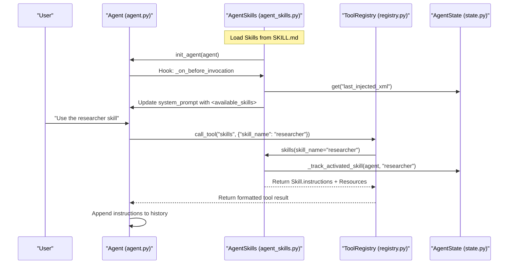
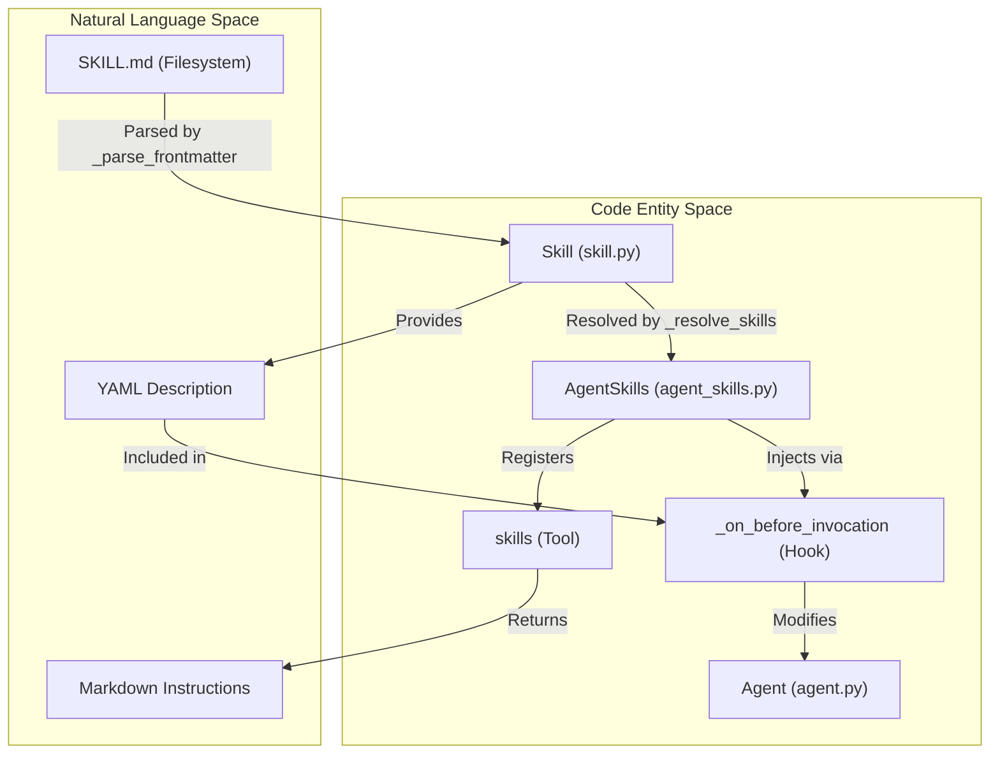

<!-- source: DeepWiki mcp.deepwiki.com · repo strands-agents/sdk-python · page 5.5 Agent Skills Plugin · fetched 2026-10-26 -->

# Agent Skills Plugin

<details>
<summary>Relevant source files</summary>

The following files were used as context for generating this wiki page:

- [.agents/references/voice-guide.md](.agents/references/voice-guide.md)
- [.agents/skills/README.md](.agents/skills/README.md)
- [.agents/skills/docs-audit/SKILL.md](.agents/skills/docs-audit/SKILL.md)
- [.agents/skills/docs-reviewer/SKILL.md](.agents/skills/docs-reviewer/SKILL.md)
- [.agents/skills/docs-writer/SKILL.md](.agents/skills/docs-writer/SKILL.md)
- [.agents/skills/pr-create/SKILL.md](.agents/skills/pr-create/SKILL.md)
- [.agents/skills/pr-feedback/SKILL.md](.agents/skills/pr-feedback/SKILL.md)
- [.agents/skills/pr-feedback/fetch-pr-feedback.sh](.agents/skills/pr-feedback/fetch-pr-feedback.sh)
- [.agents/skills/pr-writer/SKILL.md](.agents/skills/pr-writer/SKILL.md)
- [.agents/skills/pr-writer/get-diff.sh](.agents/skills/pr-writer/get-diff.sh)
- [.agents/skills/pre-push/SKILL.md](.agents/skills/pre-push/SKILL.md)
- [.agents/skills/pre-push/run-checks.sh](.agents/skills/pre-push/run-checks.sh)
- [.github/workflows/api-review-label.yml](.github/workflows/api-review-label.yml)
- [site/src/content/docs/user-guide/concepts/agents/agent-loop.ts](site/src/content/docs/user-guide/concepts/agents/agent-loop.ts)
- [site/src/content/docs/user-guide/concepts/plugins/goal-loop.mdx](site/src/content/docs/user-guide/concepts/plugins/goal-loop.mdx)
- [site/src/content/docs/user-guide/concepts/plugins/goal-loop.ts](site/src/content/docs/user-guide/concepts/plugins/goal-loop.ts)
- [site/src/content/docs/user-guide/concepts/plugins/goal-loop_imports.ts](site/src/content/docs/user-guide/concepts/plugins/goal-loop_imports.ts)
- [strands-py/src/strands/vended_plugins/goal/__init__.py](strands-py/src/strands/vended_plugins/goal/__init__.py)
- [strands-py/src/strands/vended_plugins/goal/judge.py](strands-py/src/strands/vended_plugins/goal/judge.py)
- [strands-py/tests/strands/vended_plugins/goal/__init__.py](strands-py/tests/strands/vended_plugins/goal/__init__.py)
- [team/AGENT_GUIDELINES.md](team/AGENT_GUIDELINES.md)
- [team/API_BAR_RAISING.md](team/API_BAR_RAISING.md)
- [team/COMPLEXITY.md](team/COMPLEXITY.md)
- [team/README.md](team/README.md)
- [team/TENETS.md](team/TENETS.md)

</details>


The `AgentSkills` plugin provides a mechanism for integrating specialized capabilities, known as **Skills**, into a Strands Agent. It is designed to bridge the gap between general-purpose model instructions and domain-specific expertise by dynamically injecting skill metadata into the system prompt and providing a dedicated tool for agents to "activate" these skills at runtime [src/strands/vended_plugins/skills/agent_skills.py:1-6]().

## Overview and Purpose

The `AgentSkills` plugin enables:
- **Dynamic Context Injection**: Automatically injects a catalog of available skills into the agent's system prompt via an XML-style block [src/strands/vended_plugins/skills/agent_skills.py:136-166]().
- **On-Demand Activation**: Provides a `skills` tool that allows the model to request specific instructions for a chosen skill during a conversation, saving context window space [src/strands/vended_plugins/skills/agent_skills.py:112-133]().
- **Filesystem Loading**: Supports loading skills from local directories or parent directories using a standardized `SKILL.md` format [src/strands/vended_plugins/skills/agent_skills.py:81-89]().
- **Session Persistence**: Tracks activated skills in the `AgentState` to ensure the agent maintains context across turns [src/strands/vended_plugins/skills/agent_skills.py:51-51]().

Sources: [src/strands/vended_plugins/skills/agent_skills.py:1-6]()

## Data Model: The Skill Dataclass

A `Skill` represents a discrete package of functionality. It consists of metadata for discovery and instructions for execution [src/strands/vended_plugins/skills/skill.py:195-211]().

| Attribute | Type | Description |
| :--- | :--- | :--- |
| `name` | `str` | A unique identifier for the skill. Must be lowercase alphanumeric [src/strands/vended_plugins/skills/skill.py:196-196](). |
| `description` | `str` | A brief explanation of what the skill does, used by the LLM for discovery [src/strands/vended_plugins/skills/skill.py:197-197](). |
| `instructions` | `str` | Detailed system-level instructions provided only upon activation [src/strands/vended_plugins/skills/skill.py:198-198](). |
| `allowed_tools` | `list[str]` | Optional list of tool names this skill is permitted to use [src/strands/vended_plugins/skills/skill.py:200-200](). |
| `metadata` | `dict` | Key-value pairs for author, version, or custom attributes [src/strands/vended_plugins/skills/skill.py:201-201](). |

Sources: [src/strands/vended_plugins/skills/skill.py:195-211](), [tests/strands/vended_plugins/skills/test_skill.py:33-53]()

## Skill Discovery and Loading

The plugin can resolve skills from multiple sources via the `_resolve_skills` internal method [src/strands/vended_plugins/skills/agent_skills.py:96-96]().

1.  **Direct Objects**: Passing `Skill` instances directly [src/strands/vended_plugins/skills/agent_skills.py:89-89]().
2.  **Filesystem Paths**: Passing a path to a skill directory (containing `SKILL.md`) or a parent directory containing multiple skill subdirectories [src/strands/vended_plugins/skills/agent_skills.py:87-88]().
3.  **Remote Sources**: Loading from `https://` URLs pointing to raw `SKILL.md` content [src/strands/vended_plugins/skills/agent_skills.py:90-90]().

### SKILL.md Format
The `SKILL.md` file uses a YAML frontmatter block for metadata and Markdown for instructions. The parser is designed to be resilient, attempting to fix unquoted colons in YAML values automatically using `_fix_yaml_colons` [src/strands/vended_plugins/skills/skill.py:76-83]() [src/strands/vended_plugins/skills/skill.py:89-111]().

```markdown
---
name: pdf-summarizer
description: Summarize PDF documents with specific formatting.
allowed-tools: [pdf_reader, summarize_tool]
metadata:
  author: strands-team
---
# Instructions
When this skill is activated, always format the summary as a bulleted list.
Focus on extracting financial metrics and dates.
```
Sources: [src/strands/vended_plugins/skills/skill.py:49-86](), [tests/strands/vended_plugins/skills/test_skill.py:95-103]()

### The `.agents/skills` Directory Structure

In this repository, skills are organized under the `.agents/skills/` directory. Each skill resides in its own subdirectory, containing a `SKILL.md` file and any associated helper scripts or resources.

For example, the `pr-writer` skill is located at `.agents/skills/pr-writer/SKILL.md` [pr-writer/SKILL.md:1-90](). This skill is designed to generate pull request titles and descriptions, following specific guidelines defined in `team/PR.md` [team/PR.md:1-1](). It also leverages a bundled script `get-diff.sh` to gather context [pr-writer/SKILL.md:27-29]().

Similarly, the `pr-create` skill at `.agents/skills/pr-create/SKILL.md` [pr-create/SKILL.md:1-52]() orchestrates the full PR creation flow, including pre-flight checks and using the `gh` CLI.

This structured approach allows for clear organization and easy discovery of skills by the `AgentSkills` plugin when provided with the `.agents/skills` directory as a loading path.

Sources: [pr-writer/SKILL.md:1-90](), [pr-create/SKILL.md:1-52](), [.agents/skills/README.md:34-42]()

## Implementation Detail

### System Prompt Injection
The plugin uses the `@hook` decorator on `_on_before_invocation` to inject skill metadata before each model call [src/strands/vended_plugins/skills/agent_skills.py:136-137](). It performs a "clean" injection by removing any previously injected XML block (tracked in `agent.state`) before appending the latest available skills [src/strands/vended_plugins/skills/agent_skills.py:151-166]().

### The Skills Tool
The plugin registers a tool named `skills` using the `@tool(context=True)` decorator [src/strands/vended_plugins/skills/agent_skills.py:113-114]().
- **Activation**: When called, it returns the full `instructions` and a list of any associated resource files (scripts, assets) found in the skill's directory [src/strands/vended_plugins/skills/agent_skills.py:133-134]().
- **State Tracking**: It records the activation in `agent.state` using the configured `state_key` (defaulting to `agent_skills`) [src/strands/vended_plugins/skills/agent_skills.py:133-133]() [src/strands/vended_plugins/skills/agent_skills.py:27-27]().

### Architecture: Plugin Integration Flow

This diagram illustrates how the `AgentSkills` plugin bridges the "Natural Language Space" (Skills and Instructions) with the "Code Entity Space" (Agent and Tool Registry).

**Skill Activation and Injection Flow**



Sources: [src/strands/vended_plugins/skills/agent_skills.py:101-172](), [src/strands/vended_plugins/skills/agent_skills.py:113-135](), [tests/strands/vended_plugins/skills/test_agent_skills.py:143-162]()

## Code Entity Mapping

The following diagram maps the logical components of the Skill system to their specific implementation classes and files.

**Entity Mapping: Skills Plugin**



Sources: [src/strands/vended_plugins/skills/skill.py:49-86](), [src/strands/vended_plugins/skills/agent_skills.py:45-98](), [src/strands/vended_plugins/skills/agent_skills.py:113-134]()

## Usage Example

```python
from strands import Agent
from strands.vended_plugins.skills import AgentSkills, Skill

# 1. Define skills via instances or paths
summarize = Skill(
    name="summarizer",
    description="Condense long text into bullet points",
    instructions="Provide a 3-sentence summary followed by 5 bullets."
)

# 2. Initialize plugin with mixed sources
skills_plugin = AgentSkills(
    skills=[summarize, "./my_local_skills/"],
    strict=True # Validate names strictly per spec
)

# 3. Attach to agent
agent = Agent(
    system_prompt="You are a helpful assistant.",
    plugins=[skills_plugin]
)

# 4. Agent discovers 'summarizer' in its prompt and calls the 'skills' tool
result = agent("Please summarize the attached transcript using your summarizer skill.")
```

Sources: [src/strands/vended_plugins/skills/agent_skills.py:57-70](), [tests/strands/vended_plugins/skills/test_agent_skills.py:80-112]()

---

