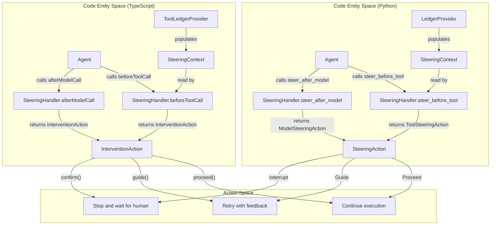
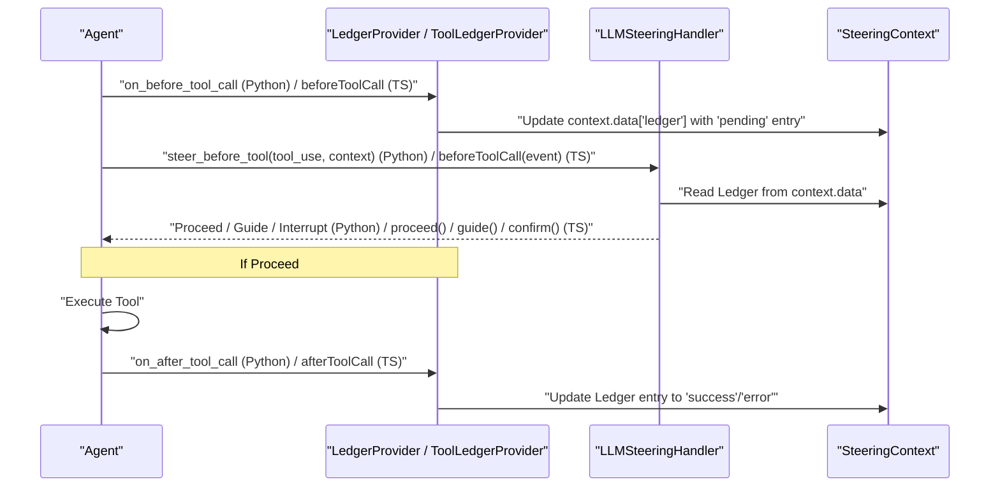

<!-- source: DeepWiki mcp.deepwiki.com · repo strands-agents/sdk-python · page 5.6 Steering System · fetched 2026-10-26 -->

# Steering System

<details>
<summary>Relevant source files</summary>

The following files were used as context for generating this wiki page:

- [site/src/content/docs/user-guide/concepts/agents/interventions/human-in-the-loop.mdx](site/src/content/docs/user-guide/concepts/agents/interventions/human-in-the-loop.mdx)
- [site/src/content/docs/user-guide/concepts/agents/interventions/human-in-the-loop.py](site/src/content/docs/user-guide/concepts/agents/interventions/human-in-the-loop.py)
- [site/src/content/docs/user-guide/concepts/agents/interventions/human-in-the-loop.ts](site/src/content/docs/user-guide/concepts/agents/interventions/human-in-the-loop.ts)
- [site/src/content/docs/user-guide/concepts/agents/interventions/human-in-the-loop_imports.ts](site/src/content/docs/user-guide/concepts/agents/interventions/human-in-the-loop_imports.ts)
- [site/src/content/docs/user-guide/concepts/agents/interventions/index.mdx](site/src/content/docs/user-guide/concepts/agents/interventions/index.mdx)
- [site/src/content/docs/user-guide/concepts/agents/interventions/interventions.py](site/src/content/docs/user-guide/concepts/agents/interventions/interventions.py)
- [site/src/content/docs/user-guide/concepts/agents/interventions/interventions.ts](site/src/content/docs/user-guide/concepts/agents/interventions/interventions.ts)
- [site/src/content/docs/user-guide/concepts/agents/interventions/interventions_imports.ts](site/src/content/docs/user-guide/concepts/agents/interventions/interventions_imports.ts)
- [site/src/content/docs/user-guide/concepts/agents/interventions/steering.mdx](site/src/content/docs/user-guide/concepts/agents/interventions/steering.mdx)
- [site/src/content/docs/user-guide/concepts/agents/interventions/steering.ts](site/src/content/docs/user-guide/concepts/agents/interventions/steering.ts)
- [site/src/content/docs/user-guide/concepts/agents/interventions/steering_imports.ts](site/src/content/docs/user-guide/concepts/agents/interventions/steering_imports.ts)
- [site/src/content/docs/user-guide/concepts/plugins/steering.mdx](site/src/content/docs/user-guide/concepts/plugins/steering.mdx)
- [strands-ts/src/hooks/types.ts](strands-ts/src/hooks/types.ts)
- [strands-ts/src/interventions/__tests__/handler.test.ts](strands-ts/src/interventions/__tests__/handler.test.ts)
- [strands-ts/src/interventions/__tests__/registry.test.ts](strands-ts/src/interventions/__tests__/registry.test.ts)
- [strands-ts/src/interventions/actions.ts](strands-ts/src/interventions/actions.ts)
- [strands-ts/src/interventions/handler.ts](strands-ts/src/interventions/handler.ts)
- [strands-ts/src/interventions/index.ts](strands-ts/src/interventions/index.ts)
- [strands-ts/src/interventions/registry.ts](strands-ts/src/interventions/registry.ts)
- [strands-ts/src/types/lifecycle-observer.ts](strands-ts/src/types/lifecycle-observer.ts)
- [strands-ts/src/vended-interventions/steering/__tests__/handler.test.ts](strands-ts/src/vended-interventions/steering/__tests__/handler.test.ts)
- [strands-ts/src/vended-interventions/steering/__tests__/llm.test.ts](strands-ts/src/vended-interventions/steering/__tests__/llm.test.ts)
- [strands-ts/src/vended-interventions/steering/__tests__/tool-ledger.test.ts](strands-ts/src/vended-interventions/steering/__tests__/tool-ledger.test.ts)
- [strands-ts/src/vended-interventions/steering/handlers/handler.ts](strands-ts/src/vended-interventions/steering/handlers/handler.ts)

</details>


The Steering System is a sophisticated extensibility framework designed to provide just-in-time guidance, validation, and control over agent behavior. It allows developers to intercept agent execution at critical boundaries—specifically before tool execution and after model generation—to enforce business logic, safety constraints, or procedural requirements without modifying the core agent prompt.

> [!IMPORTANT]
> Steering has graduated from experimental status. While legacy imports in `src/strands/experimental/steering/` still function with deprecation warnings, all core components now reside in `strands.vended_plugins.steering`.
Sources: `[strands-py/src/strands/vended_plugins/steering/core/handler.py:1-6]()`, `[strands-py/src/strands/vended_plugins/steering/handlers/llm/llm_handler.py:1-7]()`, `[site/src/content/docs/user-guide/concepts/plugins/steering.mdx:17-19]()`

## Core Architecture

The steering system operates as a set of plugins (Python) or interventions (TypeScript) that hook into the `Agent` lifecycle. It uses a specialized `SteeringHandler` to evaluate the current context and return an "effect" that dictates the agent's next action.

### Steering Lifecycle Diagram

This diagram illustrates how steering entities in the code space manage the transition from model output to tool execution.


Sources: `[site/src/content/docs/user-guide/concepts/plugins/steering.mdx:44-56]()`, `[site/src/content/docs/user-guide/concepts/plugins/steering.mdx:68-75]()`, `[site/src/content/docs/user-guide/concepts/agents/interventions/steering.mdx:60-66]()`, `[site/src/content/docs/user-guide/concepts/agents/interventions/steering.mdx:80-86]()`

## Key Components

### SteeringHandler (Python)
The base class for all steering logic, defined in `strands.vended_plugins.steering.core.handler`. It defines the interface for intercepting agent actions.
*   `steer_before_tool`: Intercepts a `tool_use` before it is executed. It can prevent execution, suggest alternatives, or allow it to proceed.
*   `steer_after_model`: Intercepts the `Message` generated by the model. It can force a retry (`Guide`) if the response is insufficient or violates rules.
Sources: `[site/src/content/docs/user-guide/concepts/plugins/steering.mdx:44-56]()`, `[site/src/content/docs/user-guide/concepts/plugins/steering.mdx:68-75]()`, `[strands-py/src/strands/vended_plugins/steering/core/handler.py:10-11]()`

### SteeringHandler (TypeScript)
In TypeScript, `SteeringHandler` extends `InterventionHandler` and narrows the return types to enforce a steering-specific contract. It implements `LifecycleObserver` to allow context providers to self-subscribe to agent hooks.
*   `beforeToolCall`: Gates or redirects a tool call.
*   `afterModelCall`: Validates model output before delivery.
Sources: `[site/src/content/docs/user-guide/concepts/agents/interventions/steering.mdx:94-100]()`, `[strands-ts/src/vended-interventions/steering/handlers/handler.ts:10-11]()`, `[strands-ts/src/types/lifecycle-observer.ts:1-10]()`

### Steering Actions
Steering handlers must return a `SteeringAction` (Python) or `InterventionAction` (TypeScript), which are typically one of three primary effects:

| Action | Python Class Name | TypeScript Factory | Behavior |
| :--- | :--- | :--- | :--- |
| **Proceed** | `Proceed` | `InterventionActions.proceed()` | Execution continues normally. |
| **Guide** | `Guide` | `InterventionActions.guide(feedback)` | The agent is instructed to retry the last step using the provided `feedback` as guidance. |
| **Interrupt** | `Interrupt` | `InterventionActions.confirm(prompt)` | Execution is halted, typically requiring human intervention. |
Sources: `[site/src/content/docs/user-guide/concepts/plugins/steering.mdx:59-63]()`, `[site/src/content/docs/user-guide/concepts/plugins/steering.mdx:78-81]()`, `[site/src/content/docs/user-guide/concepts/agents/interventions/steering.mdx:70-73]()`, `[site/src/content/docs/user-guide/concepts/agents/interventions/steering.mdx:89-91]()`, `[strands-ts/src/interventions/actions.ts:158-187]()`

## LLM-Driven Steering

The `LLMSteeringHandler` (located in `strands-py/src/strands/vended_plugins/steering/handlers/llm/llm_handler.py` for Python and `strands-ts/src/vended-interventions/steering/handlers/llm.ts` for TypeScript) is a powerful implementation that uses a secondary LLM to judge the primary agent's actions. This allows for complex, natural-language-based policy enforcement.

### Implementation Pattern
The `LLMSteeringHandler` is configured with a `system_prompt` that defines the steering policy. It evaluates the agent's intent (like a tool call) against this policy and can be combined with `LLMPromptMapper` to translate agent state into steering prompts.

```python
from strands import Agent, tool
from strands.vended_plugins.steering import LLMSteeringHandler


@tool
def send_email(recipient: str, subject: str, message: str) -> str:
    """Send an email to a recipient."""
    return f"Email sent to {recipient}"


handler = LLMSteeringHandler(
    system_prompt="""
    You are providing guidance to ensure emails maintain a cheerful, positive tone.

    Guidance:
    - Review email content for tone and sentiment
    - Suggest more cheerful phrasing if the message seems negative or neutral
    - Encourage use of positive language and friendly greetings

    When agents attempt to send emails, check if the message tone
    is appropriately cheerful and provide feedback if improvements are needed.
    """
)

agent = Agent(
    tools=[send_email],
    plugins=[handler],
)

agent(
    "Send a frustrated email to tom@example.com, "
    "a client who keeps rescheduling important meetings at the last minute"
)
print(agent.messages)
```
Sources: `[site/src/content/docs/user-guide/concepts/plugins/steering.mdx:95-132]()`, `[site/src/content/docs/user-guide/concepts/agents/interventions/steering.mdx:113-119]()`

```typescript
import { Agent, tool } from '@strands-agents/sdk'
import { LLMSteeringHandler } from '@strands-agents/sdk/vended-interventions/steering'
import { z } from 'zod'

const sendEmail = tool({
  name: 'send_email',
  description: 'Send an email to a recipient.',
  inputSchema: z.object({ recipient: z.string(), subject: z.string(), message: z.string() }),
  callback: (input) => `Email sent to ${input.recipient}`,
})

const handler = new LLMSteeringHandler({
  systemPrompt: `
    You are providing guidance to ensure emails maintain a cheerful, positive tone.

    Guidance:
    - Review email content for tone and sentiment
    - Suggest more cheerful phrasing if the message seems negative or neutral
    - Encourage use of positive language and friendly greetings

    When agents attempt to send emails, check if the message tone
    is appropriately cheerful and provide feedback if improvements are needed.
    `,
})

const agent = new Agent({
  tools: [sendEmail],
  interventions: [handler],
})

await agent.invoke(
  'Send a frustrated email to tom@example.com, ' +
    'a client who keeps rescheduling important meetings at the last minute',
)
console.log(agent.messages)
```
Sources: `[site/src/content/docs/user-guide/concepts/agents/interventions/steering.ts:1-27]()`

## Context and State Management

### LedgerProvider (Python) / ToolLedgerProvider (TypeScript)
The `LedgerProvider` (Python: `strands-py/src/strands/vended_plugins/steering/context_providers/ledger_provider.py`) or `ToolLedgerProvider` (TypeScript: `strands-ts/src/vended-interventions/steering/context_providers/tool-ledger.ts`) is a specialized `SteeringContextProvider` that maintains a record of all tool interactions within the current session. This "ledger" is injected into the `SteeringContext`, allowing handlers to make decisions based on historical tool success, failure, or frequency.

**Captured Data:**
*   `tool_name`: Name of the tool called.
*   `tool_args`: The input arguments provided.
*   `status`: Current state (`pending`, `success`, `error`).
*   `completion_timestamp`: When the tool finished execution.
Sources: `[site/src/content/docs/user-guide/concepts/plugins/steering.mdx:150-156]()`, `[strands-py/src/strands/vended_plugins/steering/context_providers/ledger_provider.py:9-20]()`, `[strands-ts/src/vended-interventions/steering/context_providers/tool-ledger.ts:1-10]()`

### Data Flow Diagram
The following diagram maps the data flow from tool execution into the steering evaluation logic.


Sources: `[site/src/content/docs/user-guide/concepts/plugins/steering.mdx:34-40]()`, `[site/src/content/docs/user-guide/concepts/agents/interventions/steering.mdx:43-49]()`

## Advanced Use Cases

### Forcing Tool Usage
Steering can be used to ensure an agent performs required actions (like logging or auditing) even if the user's prompt doesn't explicitly trigger them. A `SteeringHandler` can intercept an `end_turn` stop reason and issue a `Guide` action to force the model to call a specific tool before finishing.
Sources: `[strands-ts/src/vended-interventions/steering/__tests__/llm.test.ts:154-168]()`

### Multi-Step Retries
The `Guide` action allows for iterative refinement. A handler can track `call_count` and provide increasingly specific guidance across multiple retries until the model's output meets the required criteria.
Sources: `[strands-ts/src/vended-interventions/steering/__tests__/llm.test.ts:107-123]()`, `[strands-ts/src/vended-interventions/steering/__tests__/llm.test.ts:130-131]()`

---

