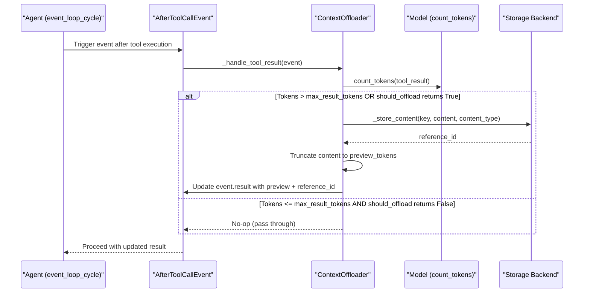

<!-- source: DeepWiki mcp.deepwiki.com · repo strands-agents/sdk-python · page 5.7 Context Offloader Plugin · fetched 2026-10-26 -->

# Context Offloader Plugin

<details>
<summary>Relevant source files</summary>

The following files were used as context for generating this wiki page:

- [site/docs/examples/typescript/deploy_to_bedrock_agentcore/invoke.ts](site/docs/examples/typescript/deploy_to_bedrock_agentcore/invoke.ts)
- [site/scripts/astro-broken-links-checker-check-links.js](site/scripts/astro-broken-links-checker-check-links.js)
- [site/src/content/docs/user-guide/concepts/agents/session-management.mdx](site/src/content/docs/user-guide/concepts/agents/session-management.mdx)
- [site/src/content/docs/user-guide/concepts/agents/session-manager.ts](site/src/content/docs/user-guide/concepts/agents/session-manager.ts)
- [site/src/content/docs/user-guide/concepts/plugins/context-offloader.mdx](site/src/content/docs/user-guide/concepts/plugins/context-offloader.mdx)
- [site/src/content/docs/user-guide/concepts/plugins/context-offloader.ts](site/src/content/docs/user-guide/concepts/plugins/context-offloader.ts)
- [site/src/content/docs/user-guide/concepts/plugins/context-offloader_imports.ts](site/src/content/docs/user-guide/concepts/plugins/context-offloader_imports.ts)
- [site/src/content/docs/user-guide/concepts/storage.mdx](site/src/content/docs/user-guide/concepts/storage.mdx)
- [site/src/content/docs/user-guide/concepts/storage.py](site/src/content/docs/user-guide/concepts/storage.py)
- [site/src/content/docs/user-guide/concepts/storage.ts](site/src/content/docs/user-guide/concepts/storage.ts)
- [site/src/content/docs/user-guide/concepts/storage_imports.ts](site/src/content/docs/user-guide/concepts/storage_imports.ts)
- [site/src/content/docs/user-guide/concepts/streaming/async-iterators.ts](site/src/content/docs/user-guide/concepts/streaming/async-iterators.ts)
- [site/test/update-docs.test.ts](site/test/update-docs.test.ts)
- [strands-py/src/strands/vended_plugins/context_offloader/__init__.py](strands-py/src/strands/vended_plugins/context_offloader/__init__.py)
- [strands-py/src/strands/vended_plugins/context_offloader/plugin.py](strands-py/src/strands/vended_plugins/context_offloader/plugin.py)
- [strands-py/src/strands/vended_plugins/context_offloader/search.py](strands-py/src/strands/vended_plugins/context_offloader/search.py)
- [strands-py/src/strands/vended_plugins/context_offloader/storage.py](strands-py/src/strands/vended_plugins/context_offloader/storage.py)
- [strands-py/tests/strands/agent/test_agent_context_manager.py](strands-py/tests/strands/agent/test_agent_context_manager.py)
- [strands-py/tests/strands/vended_plugins/context_offloader/test_plugin.py](strands-py/tests/strands/vended_plugins/context_offloader/test_plugin.py)
- [strands-py/tests/strands/vended_plugins/context_offloader/test_search.py](strands-py/tests/strands/vended_plugins/context_offloader/test_search.py)
- [strands-py/tests/strands/vended_plugins/context_offloader/test_storage.py](strands-py/tests/strands/vended_plugins/context_offloader/test_storage.py)
- [strands-ts/src/agent/__tests__/agent.context-manager.test.ts](strands-ts/src/agent/__tests__/agent.context-manager.test.ts)
- [strands-ts/src/agent/__tests__/agent.storage.test.ts](strands-ts/src/agent/__tests__/agent.storage.test.ts)
- [strands-ts/src/agent/__tests__/snapshot.test.ts](strands-ts/src/agent/__tests__/snapshot.test.ts)
- [strands-ts/src/agent/snapshot.ts](strands-ts/src/agent/snapshot.ts)
- [strands-ts/src/session/__tests__/session-manager.test.ts](strands-ts/src/session/__tests__/session-manager.test.ts)
- [strands-ts/src/session/session-manager.ts](strands-ts/src/session/session-manager.ts)
- [strands-ts/src/vended-plugins/context-offloader/__tests__/plugin.test.ts](strands-ts/src/vended-plugins/context-offloader/__tests__/plugin.test.ts)
- [strands-ts/src/vended-plugins/context-offloader/__tests__/search.test.ts](strands-ts/src/vended-plugins/context-offloader/__tests__/search.test.ts)
- [strands-ts/src/vended-plugins/context-offloader/__tests__/storage.test.node.ts](strands-ts/src/vended-plugins/context-offloader/__tests__/storage.test.node.ts)
- [strands-ts/src/vended-plugins/context-offloader/__tests__/storage.test.ts](strands-ts/src/vended-plugins/context-offloader/__tests__/storage.test.ts)
- [strands-ts/src/vended-plugins/context-offloader/index.ts](strands-ts/src/vended-plugins/context-offloader/index.ts)
- [strands-ts/src/vended-plugins/context-offloader/plugin.ts](strands-ts/src/vended-plugins/context-offloader/plugin.ts)
- [strands-ts/src/vended-plugins/context-offloader/search.ts](strands-ts/src/vended-plugins/context-offloader/search.ts)
- [strands-ts/src/vended-plugins/context-offloader/storage.ts](strands-ts/src/vended-plugins/context-offloader/storage.ts)

</details>


The `ContextOffloader` is a vended plugin designed to manage large tool outputs by proactively intercepting oversized results before they consume the agent's context window. It persists large content blocks to a storage backend and replaces them with a truncated preview and a reference identifier [strands-py/src/strands/vended_plugins/context_offloader/plugin.py:3-5]().

Unlike reactive context management strategies (like `SlidingWindowConversationManager`), the `ContextOffloader` operates at the tool execution boundary using the `AfterToolCallEvent` hook [strands-py/src/strands/vended_plugins/context_offloader/plugin.py:188-191]().

## Overview and Configuration

The plugin is initialized with a mandatory `Storage` backend and configurable token thresholds. It uses the agent's model to estimate token counts, leveraging `tiktoken` when available and falling back to character-based heuristics [strands-py/src/strands/vended_plugins/context_offloader/plugin.py:176-177]().

### Configuration Parameters
| Parameter | Type | Default | Description |
| :--- | :--- | :--- | :--- |
| `storage` | `Storage` | (Required) | Backend for persisting offloaded content. |
| `max_result_tokens` | `int` | `2,500` | Threshold above which tool results are offloaded. |
| `preview_tokens` | `int` | `1,000` | Number of tokens to retain as an in-context preview. |
| `include_retrieval_tool` | `bool` | `True` | Whether to register the `retrieve_offloaded_content` tool. |
| `should_offload` | `ShouldOffload` | `None` | Callback to selectively offload results based on tool name or token count. |
| `evict_after_cycles` | `int \| None` | `20` | Number of agent loop cycles after which unused offloaded content is evicted from `InMemoryStorage`. Set to `None` to disable. |

Sources: [strands-py/src/strands/vended_plugins/context_offloader/plugin.py:193-200](), [strands-py/src/strands/vended_plugins/context_offloader/plugin.py:143-146]()

### Content Handling
The plugin handles different content types specifically during the offloading process:
*   **Text**: Stored as `text/plain`, replaced with a preview [strands-py/src/strands/vended_plugins/context_offloader/plugin.py:180]().
*   **JSON**: Stored as `application/json`, replaced with a preview [strands-py/src/strands/vended_plugins/context_offloader/plugin.py:181]().
*   **Image**: Stored in its native format (e.g., `image/png`), replaced with a placeholder showing format and size [strands-py/src/strands/vended_plugins/context_offloader/plugin.py:182-183]().
*   **Document**: Stored in its native format (e.g., `application/pdf`), replaced with a placeholder showing format, name, and size [strands-py/src/strands/vended_plugins/context_offloader/plugin.py:184-185]().
*   **Unknown types**: Passed through unchanged [strands-py/src/strands/vended_plugins/context_offloader/plugin.py:186]().

Sources: [strands-py/src/strands/vended_plugins/context_offloader/plugin.py:178-186]()

## Architecture and Data Flow

The following diagram illustrates how the `ContextOffloader` intercepts tool results and interacts with the storage system.

### Data Flow: Tool Result Interception

Sources: [strands-py/src/strands/vended_plugins/context_offloader/plugin.py:246-276](), [strands-py/src/strands/vended_plugins/context_offloader/plugin.py:153-164]()

## Storage Backends

The SDK provides three built-in implementations of the `Storage` protocol, though these are now deprecated in favor of the unified `strands.storage` module [strands-py/src/strands/vended_plugins/context_offloader/storage.py:3-6](). The `ContextOffloader` plugin can adapt to both the legacy and unified `Storage` interfaces [strands-py/src/strands/vended_plugins/context_offloader/plugin.py:110-134]().

### 1. InMemoryStorage
Stores content in a thread-safe dictionary. This is useful for testing and serverless environments where disk access is not available [strands-py/src/strands/vended_plugins/context_offloader/storage.py:236-241]().
*   **Reference Format**: `mem_{counter}_{key}` [strands-py/src/strands/vended_plugins/context_offloader/storage.py:261-265]().
*   **Eviction**: Supports turn-based eviction, removing entries not accessed within `evict_after_cycles` agent loop cycles [strands-py/src/strands/vended_plugins/context_offloader/storage.py:242-245]().

### 2. FileStorage
Persists content to a local directory. It uses a `.metadata.json` sidecar file to track MIME types, ensuring they survive process restarts [strands-py/src/strands/vended_plugins/context_offloader/storage.py:103-107]().
*   **Reference Format**: Path to the file (e.g., `./artifacts/1234_1_key.txt`) [strands-py/src/strands/vended_plugins/context_offloader/storage.py:172]().
*   **Sandbox Integration**: Can route file I/O through a `Sandbox` instance [strands-py/src/strands/vended_plugins/context_offloader/storage.py:115-116]().

### 3. S3Storage
Stores content in an AWS S3 bucket. This is recommended for production environments requiring shared state across multiple agent instances [strands-py/src/strands/vended_plugins/context_offloader/storage.py:291-294]().
*   **Reference Format**: `s3://{bucket}/{key}` [strands-py/src/strands/vended_plugins/context_offloader/storage.py:348]().

Sources: [strands-py/src/strands/vended_plugins/context_offloader/storage.py:102-378]()

## Code Entity Map

The following diagram maps the logical components to their implementation classes and methods.

### System Entity Mapping
```mermaid
graph TD
    subgraph "Plugin Space"
        CO["ContextOffloader (plugin.py)"]
        HTR["_handle_tool_result()"]
        RTC["retrieve_offloaded_content()"]
        SO["ShouldOffload (Protocol)"]
    end

    subgraph "Storage Space (storage.py)"
        SP["Storage (Protocol)"]
        IMS["InMemoryStorage"]
        FS["FileStorage"]
        S3S["S3Storage"]
        UF_S["Unified Storage (strands.storage.Storage)"]
    end

    subgraph "Core Space"
        ATCE["AfterToolCallEvent (events.py)"]
        TC["ToolContext (types/tools.py)"]
        MSG["Message (types/content.py)"]
    end

    subgraph "Search Module (search.py)"
        ISC["_is_searchable_content()"]
        SC["_search_content()"]
    end

    CO --> HTR
    CO --> RTC
    CO --> SO
    HTR -.->|intercepts| ATCE
    RTC --> SP
    SP <|-- IMS
    SP <|-- FS
    SP <|-- S3S
    SP <|-- UF_S
    RTC -.->|injected| TC
    RTC --> ISC
    RTC --> SC
    HTR --> MSG
```
Sources: [strands-py/src/strands/vended_plugins/context_offloader/plugin.py:54-60](), [strands-py/src/strands/vended_plugins/context_offloader/plugin.py:153-164](), [strands-py/src/strands/vended_plugins/context_offloader/plugin.py:168-200](), [strands-py/src/strands/vended_plugins/context_offloader/storage.py:58-100](), [strands-py/src/strands/vended_plugins/context_offloader/storage.py:102-233](), [strands-py/src/strands/vended_plugins/context_offloader/storage.py:236-288](), [strands-py/src/strands/vended_plugins/context_offloader/storage.py:291-378](), [strands-py/src/strands/vended_plugins/context_offloader/search.py:29-32](), [strands-py/src/strands/vended_plugins/context_offloader/search.py:34-84]()

## The Retrieval Tool

If `include_retrieval_tool` is enabled, the agent gains access to the `retrieve_offloaded_content` tool. This allows the agent to fetch the full content of an offloaded block if it determines the preview is insufficient [strands-py/src/strands/vended_plugins/context_offloader/plugin.py:197]().

### Implementation Details
*   **Tool Name**: `retrieve_offloaded_content` [strands-py/src/strands/vended_plugins/context_offloader/plugin.py:150]().
*   **Input**: The tool accepts a `reference` string (from the offload placeholder), an optional `pattern` (regex or keyword), an optional `line_range` (1-indexed, inclusive), and `context_lines` for search results [strands-py/src/strands/vended_plugins/context_offloader/plugin.py:153-164]().
*   **Behavior**:
    1.  Calls `_retrieve_content(self._storage, reference)` to fetch the raw bytes and content type [strands-py/src/strands/vended_plugins/context_offloader/plugin.py:300]().
    2.  If `pattern` or `line_range` are provided, and the content is searchable (e.g., `text/*`, `application/json`), it uses the `_search_content` utility to return formatted search results [strands-py/src/strands/vended_plugins/context_offloader/plugin.py:303-310]().
    3.  Otherwise, it decodes `text/*` as UTF-8, parses `application/json` back into a dictionary, and returns `image/*` or `application/*` as proper `ToolResultContent` blocks [strands-py/src/strands/vended_plugins/context_offloader/plugin.py:312-327]().

Sources: [strands-py/src/strands/vended_plugins/context_offloader/plugin.py:290-327]()

## The Search Module

The `strands.vended_plugins.context_offloader.search` module provides utilities for searching and formatting offloaded text content. It supports grep-like pattern matching and line-range access, with output truncated to a specified character budget [strands-py/src/strands/vended_plugins/context_offloader/search.py:1-4]().

### Key Functions
*   `_is_searchable_content(content_type: str) -> bool`: Determines if a given MIME type can be searched as text (e.g., `text/plain`, `application/json`) [strands-py/src/strands/vended_plugins/context_offloader/search.py:29-32]().
*   `_search_content(...) -> str`: The main search function. It takes the full text, an optional `pattern` (regex or keyword), an optional `line_range` (1-indexed), `context_lines`, and `max_chars` for truncation [strands-py/src/strands/vended_plugins/context_offloader/search.py:34-84]().
    *   It handles cases where only a `line_range` is provided, returning the specified lines [strands-py/src/strands/vended_plugins/context_offloader/search.py:82-84]().
    *   It uses `_truncate` to limit output size and `_format_lines` to present results with line numbers and match indicators [strands-py/src/strands/vended_plugins/context_offloader/search.py:86-110]().

Sources: [strands-py/src/strands/vended_plugins/context_offloader/search.py:1-152]()

---

