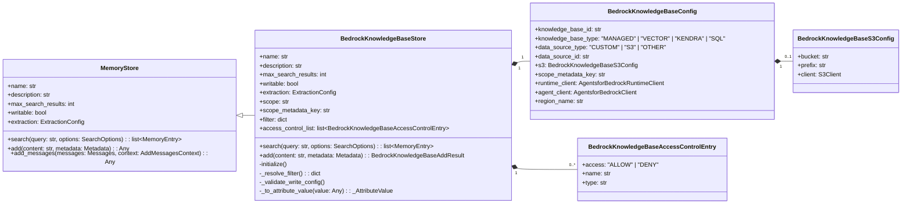

<!-- source: DeepWiki mcp.deepwiki.com · repo strands-agents/sdk-python · page 5.8 Memory System and Context Injection · fetched 2026-10-26 -->

# Memory System and Context Injection

<details>
<summary>Relevant source files</summary>

The following files were used as context for generating this wiki page:

- [.agents/references/terminology.md](.agents/references/terminology.md)
- [site/src/content/docs/user-guide/concepts/memory/bedrock-knowledge-base.mdx](site/src/content/docs/user-guide/concepts/memory/bedrock-knowledge-base.mdx)
- [site/src/content/docs/user-guide/concepts/memory/bedrock-knowledge-base.ts](site/src/content/docs/user-guide/concepts/memory/bedrock-knowledge-base.ts)
- [site/src/content/docs/user-guide/concepts/memory/bedrock-knowledge-base_imports.ts](site/src/content/docs/user-guide/concepts/memory/bedrock-knowledge-base_imports.ts)
- [site/src/content/docs/user-guide/concepts/memory/overview.mdx](site/src/content/docs/user-guide/concepts/memory/overview.mdx)
- [site/src/content/docs/user-guide/concepts/memory/overview.ts](site/src/content/docs/user-guide/concepts/memory/overview.ts)
- [site/src/content/docs/user-guide/concepts/memory/overview_imports.ts](site/src/content/docs/user-guide/concepts/memory/overview_imports.ts)
- [site/src/content/docs/user-guide/concepts/memory/test-memory-store.mdx](site/src/content/docs/user-guide/concepts/memory/test-memory-store.mdx)
- [site/src/content/docs/user-guide/concepts/memory/test-memory-store.ts](site/src/content/docs/user-guide/concepts/memory/test-memory-store.ts)
- [site/src/content/docs/user-guide/concepts/memory/test-memory-store_imports.ts](site/src/content/docs/user-guide/concepts/memory/test-memory-store_imports.ts)
- [site/src/content/docs/user-guide/concepts/plugins/context-injector.mdx](site/src/content/docs/user-guide/concepts/plugins/context-injector.mdx)
- [site/src/content/docs/user-guide/concepts/plugins/context-injector.ts](site/src/content/docs/user-guide/concepts/plugins/context-injector.ts)
- [site/src/content/docs/user-guide/concepts/plugins/index.mdx](site/src/content/docs/user-guide/concepts/plugins/index.mdx)
- [strands-py/pyproject.toml](strands-py/pyproject.toml)
- [strands-py/src/strands/injection/__init__.py](strands-py/src/strands/injection/__init__.py)
- [strands-py/src/strands/injection/_message_injection.py](strands-py/src/strands/injection/_message_injection.py)
- [strands-py/src/strands/injection/_xml.py](strands-py/src/strands/injection/_xml.py)
- [strands-py/src/strands/injection/types.py](strands-py/src/strands/injection/types.py)
- [strands-py/src/strands/memory/extraction/coordinator.py](strands-py/src/strands/memory/extraction/coordinator.py)
- [strands-py/src/strands/memory/extraction/resolve_extraction_config.py](strands-py/src/strands/memory/extraction/resolve_extraction_config.py)
- [strands-py/src/strands/memory/extraction/types.py](strands-py/src/strands/memory/extraction/types.py)
- [strands-py/src/strands/memory/memory_manager.py](strands-py/src/strands/memory/memory_manager.py)
- [strands-py/src/strands/memory/types.py](strands-py/src/strands/memory/types.py)
- [strands-py/src/strands/session/s3_session_manager.py](strands-py/src/strands/session/s3_session_manager.py)
- [strands-py/src/strands/vended_memory_stores/__init__.py](strands-py/src/strands/vended_memory_stores/__init__.py)
- [strands-py/src/strands/vended_memory_stores/bedrock_knowledge_base/__init__.py](strands-py/src/strands/vended_memory_stores/bedrock_knowledge_base/__init__.py)
- [strands-py/src/strands/vended_memory_stores/bedrock_knowledge_base/store.py](strands-py/src/strands/vended_memory_stores/bedrock_knowledge_base/store.py)
- [strands-py/src/strands/vended_memory_stores/bedrock_knowledge_base/types.py](strands-py/src/strands/vended_memory_stores/bedrock_knowledge_base/types.py)
- [strands-py/src/strands/vended_memory_stores/test_memory_store/__init__.py](strands-py/src/strands/vended_memory_stores/test_memory_store/__init__.py)
- [strands-py/src/strands/vended_memory_stores/test_memory_store/store.py](strands-py/src/strands/vended_memory_stores/test_memory_store/store.py)
- [strands-py/src/strands/vended_memory_stores/test_memory_store/types.py](strands-py/src/strands/vended_memory_stores/test_memory_store/types.py)
- [strands-py/src/strands/vended_plugins/context_injector/__init__.py](strands-py/src/strands/vended_plugins/context_injector/__init__.py)
- [strands-py/src/strands/vended_plugins/context_injector/plugin.py](strands-py/src/strands/vended_plugins/context_injector/plugin.py)
- [strands-py/tests/strands/agent/conversation_manager/test_token_usage_middleware.py](strands-py/tests/strands/agent/conversation_manager/test_token_usage_middleware.py)
- [strands-py/tests/strands/injection/__init__.py](strands-py/tests/strands/injection/__init__.py)
- [strands-py/tests/strands/injection/test_message_injection.py](strands-py/tests/strands/injection/test_message_injection.py)
- [strands-py/tests/strands/memory/test_extraction.py](strands-py/tests/strands/memory/test_extraction.py)
- [strands-py/tests/strands/memory/test_memory_manager.py](strands-py/tests/strands/memory/test_memory_manager.py)
- [strands-py/tests/strands/memory/test_resolve_extraction_config.py](strands-py/tests/strands/memory/test_resolve_extraction_config.py)
- [strands-py/tests/strands/session/test_s3_session_manager.py](strands-py/tests/strands/session/test_s3_session_manager.py)
- [strands-py/tests/strands/vended_memory_stores/bedrock_knowledge_base/test_store.py](strands-py/tests/strands/vended_memory_stores/bedrock_knowledge_base/test_store.py)
- [strands-py/tests/strands/vended_memory_stores/test_memory_store/__init__.py](strands-py/tests/strands/vended_memory_stores/test_memory_store/__init__.py)
- [strands-py/tests/strands/vended_memory_stores/test_memory_store/test_store.py](strands-py/tests/strands/vended_memory_stores/test_memory_store/test_store.py)
- [strands-py/tests/strands/vended_plugins/context_injector/test_plugin.py](strands-py/tests/strands/vended_plugins/context_injector/test_plugin.py)
- [strands-py/tests_integ/memory/test_bedrock_knowledge_base_store.py](strands-py/tests_integ/memory/test_bedrock_knowledge_base_store.py)
- [strands-ts/src/memory/__tests__/memory-manager.test.ts](strands-ts/src/memory/__tests__/memory-manager.test.ts)
- [strands-ts/src/memory/extraction/__tests__/extraction.test.ts](strands-ts/src/memory/extraction/__tests__/extraction.test.ts)
- [strands-ts/src/memory/extraction/__tests__/model-extractor.test.ts](strands-ts/src/memory/extraction/__tests__/model-extractor.test.ts)
- [strands-ts/src/memory/extraction/coordinator.ts](strands-ts/src/memory/extraction/coordinator.ts)
- [strands-ts/src/memory/extraction/model-extractor.ts](strands-ts/src/memory/extraction/model-extractor.ts)
- [strands-ts/src/memory/extraction/types.ts](strands-ts/src/memory/extraction/types.ts)
- [strands-ts/src/memory/index.ts](strands-ts/src/memory/index.ts)
- [strands-ts/src/memory/memory-manager.ts](strands-ts/src/memory/memory-manager.ts)
- [strands-ts/src/memory/types.ts](strands-ts/src/memory/types.ts)
- [strands-ts/src/vended-memory-stores/bedrock-knowledge-base/index.ts](strands-ts/src/vended-memory-stores/bedrock-knowledge-base/index.ts)
- [strands-ts/src/vended-memory-stores/bedrock-knowledge-base/store.ts](strands-ts/src/vended-memory-stores/bedrock-knowledge-base/store.ts)
- [strands-ts/src/vended-memory-stores/test-memory-store/__tests__/test-memory-store.test.node.ts](strands-ts/src/vended-memory-stores/test-memory-store/__tests__/test-memory-store.test.node.ts)
- [strands-ts/src/vended-memory-stores/test-memory-store/index.ts](strands-ts/src/vended-memory-stores/test-memory-store/index.ts)
- [strands-ts/src/vended-memory-stores/test-memory-store/store.ts](strands-ts/src/vended-memory-stores/test-memory-store/store.ts)
- [strands-ts/test/integ/memory/bedrock-knowledge-base-store.test.node.ts](strands-ts/test/integ/memory/bedrock-knowledge-base-store.test.node.ts)

</details>


This page details the memory system within the Strands Agents SDK, focusing on the `MemoryManager`, the `MemoryStore` interface, automatic extraction mechanisms, and the `ContextInjector` plugin for dynamic context injection.

## MemoryManager

The `MemoryManager` [strands-py/src/strands/memory/memory_manager.py:72-86]() is a core component responsible for orchestrating memory operations across one or more `MemoryStore` instances. It provides capabilities for:
*   **Searching memory**: Retrieving relevant information from configured memory stores based on a query.
*   **Adding memory**: Storing new information into writable memory stores.
*   **Automatic extraction**: Periodically extracting facts or summaries from conversation history and persisting them to memory stores.
*   **Context injection**: Dynamically injecting retrieved memory entries into the agent's model context before each model call.

The `MemoryManager` is initialized with a list of `MemoryStore` instances [strands-py/src/strands/memory/memory_manager.py:90-118](). It validates the configuration, ensuring unique store names and proper write sink implementations for writable stores.

### MemoryManager Tools

The `MemoryManager` can expose two tools to the agent: `search_memory` and `add_memory`.

#### `search_memory` Tool
This tool allows the agent to query long-term memory for facts, preferences, or context. It is enabled by default [strands-py/src/strands/memory/memory_manager.py:93-94]().
*   **Description**: "Search long-term memory for facts, preferences, or context from previous conversations. Use when you need background about the user or topic that may have been discussed before." [strands-py/src/strands/memory/memory_manager.py:44-47]()
*   **Configuration**: Can be customized via `search_tool_config` [strands-py/src/strands/memory/memory_manager.py:102-104]().

#### `add_memory` Tool
This tool allows the agent to add new information to long-term memory. It is disabled by default [strands-py/src/strands/memory/memory_manager.py:94-95]().
*   **Description**: "Add facts, preferences, or decisions to long-term memory so they are remembered across conversations. Use when the user shares something worth recalling later." [strands-py/src/strands/memory/memory_manager.py:49-52]()
*   **Configuration**: Can be enabled and customized via `add_tool_config` [strands-py/src/strands/memory/memory_manager.py:104-106](). It can restrict which writable stores the tool can write to [strands-py/src/strands/memory/types.py:108-109]() and whether to wait for writes to complete [strands-py/src/strands/memory/types.py:110-113]().

### Data Flow for Memory Operations

The `MemoryManager` orchestrates the flow of data for both search and add operations.

```mermaid
graph TD
    A[Agent] -->|Calls search_memory tool| MM{MemoryManager}
    A -->|Calls add_memory tool| MM
    MM -->|search(query, options)| MS1[MemoryStore 1]
    MM -->|search(query, options)| MS2[MemoryStore 2]
    MS1 -->|MemoryEntry[]| MM
    MS2 -->|MemoryEntry[]| MM
    MM -->|Aggregate Results| A
    MM -->|add(content, metadata)| MS_W1[Writable MemoryStore 1]
    MM -->|add(content, metadata)| MS_W2[Writable MemoryStore 2]
    MS_W1 -->|Success/Failure| MM
    MS_W2 -->|Success/Failure| MM
    MM -->|Report Status| A

    subgraph Automatic Extraction
        MM -->|MessageAddedEvent| EC[ExtractionCoordinator]
        EC -->|extract(messages)| ME[ModelExtractor (optional)]
        ME -->|ExtractionResult[]| EC
        EC -->|add(content, metadata)| MS_W_EXT[Writable MemoryStore (with extraction)]
        EC -->|add_messages(messages, context)| MS_W_EXT_MSG[Writable MemoryStore (with extraction)]
    end

    subgraph Context Injection
        MM -->|InvokeModelStage (middleware)| CI[ContextInjector]
        CI -->|query(messages)| MM
        MM -->|search(query, options)| MS_INJ[MemoryStore (for injection)]
        MS_INJ -->|MemoryEntry[]| MM
        MM -->|format(entries)| CI
        CI -->|Inject formatted text| Model[Model Input]
    end
```
**Diagram: MemoryManager Data Flow**
Sources:
- [strands-py/src/strands/memory/memory_manager.py:72-86]()
- [strands-py/src/strands/memory/memory_manager.py:44-47]()
- [strands-py/src/strands/memory/memory_manager.py:49-52]()
- [strands-py/src/strands/memory/memory_manager.py:93-94]()
- [strands-py/src/strands/memory/memory_manager.py:102-104]()
- [strands-py/src/strands/memory/memory_manager.py:104-106]()
- [strands-py/src/strands/memory/types.py:108-109]()
- [strands-py/src/strands/memory/types.py:110-113]()

## MemoryStore Interface

The `MemoryStore` [strands-py/src/strands/memory/types.py:38-45]() is an abstract interface that defines how memory backends interact with the `MemoryManager`. All concrete memory store implementations must adhere to this interface.

Key attributes and methods of `MemoryStore`:
*   `name`: A unique identifier for the store [strands-py/src/strands/memory/types.py:38]().
*   `description`: A human-readable description of the store's contents [strands-py/src/strands/memory/types.py:38]().
*   `max_search_results`: Default maximum number of results to return per search [strands-py/src/strands/memory/types.py:38]().
*   `writable`: A boolean indicating if the store accepts write operations [strands-py/src/strands/memory/types.py:38]().
*   `extraction`: Configuration for automatic extraction [strands-py/src/strands/memory/types.py:38]().
*   `search(query: str, options: SearchOptions) -> list[MemoryEntry]`: Searches the store for entries matching the query, ordered by relevance [strands-py/src/strands/memory/types.py:38]().
*   `add(content: str, metadata: Metadata) -> Any` (optional): Adds a single piece of content to the store. Required if the store is writable and uses an `Extractor` [strands-py/src/strands/memory/memory_manager.py:140-148]().
*   `add_messages(messages: Messages, context: AddMessagesContext) -> Any` (optional): Ingests a batch of conversation messages. Required if the store is writable and does not use an `Extractor` [strands-py/src/strands/memory/memory_manager.py:149-153]().

### `MemoryEntry`
A `MemoryEntry` [strands-py/src/strands/memory/types.py:24-35]() represents a single piece of memory retrieved from or stored to a `MemoryStore`. It contains:
*   `content`: The textual content of the memory entry.
*   `store_name`: The name of the store this entry originated from (set by `MemoryManager.search`).
*   `metadata`: Optional JSON-compatible metadata (e.g., scores, IDs, timestamps).

Sources:
- [strands-py/src/strands/memory/types.py:38-45]()
- [strands-py/src/strands/memory/types.py:24-35]()
- [strands-py/src/strands/memory/memory_manager.py:140-148]()
- [strands-py/src/strands/memory/memory_manager.py:149-153]()

## Automatic Extraction

Automatic extraction allows the `MemoryManager` to periodically process conversation messages and store relevant information into memory stores. This process is coordinated by the `ExtractionCoordinator` [strands-py/src/strands/memory/extraction/coordinator.py:24-30]().

### `ExtractionConfig`
Each writable `MemoryStore` can have an `ExtractionConfig` [strands-py/src/strands/memory/extraction/types.py:127-145]() that defines:
*   `trigger`: When extraction should run (e.g., `InvocationTrigger`, `IntervalTrigger`) [strands-py/src/strands/memory/extraction/types.py:131-134]().
*   `extractor`: How to transform messages into discrete `MemoryEntry` objects. If omitted, the `MemoryManager` determines the extraction method based on the store's write capabilities [strands-py/src/strands/memory/extraction/types.py:135-141]().
*   `filter`: Which content blocks to strip from messages before extraction (defaults to excluding tool traffic) [strands-py/src/strands/memory/extraction/types.py:142-145]().

### `ExtractionCoordinator`
The `ExtractionCoordinator` [strands-py/src/strands/memory/extraction/coordinator.py:24-30]() manages the lifecycle of extraction for all configured stores.
*   It listens for `MessageAddedEvent` and `AfterInvocationEvent` hooks [strands-py/src/strands/memory/extraction/coordinator.py:100-101]() to track conversation turns and trigger extraction.
*   It maintains a buffer of unsaved messages for each store [strands-py/src/strands/memory/extraction/coordinator.py:102-103]().
*   When a trigger fires, it processes the buffered messages:
    *   If an `Extractor` is configured, it uses the `Extractor` to produce `ExtractionResult` objects and calls `store.add()` for each [strands-py/src/strands/memory/extraction/coordinator.py:170-176]().
    *   If no `Extractor` is configured, it passes the filtered messages directly to `store.add_messages()` [strands-py/src/strands/memory/extraction/coordinator.py:177-180]().
*   Extraction runs asynchronously in the background to avoid blocking the agent's main thread [strands-py/src/strands/memory/extraction/coordinator.py:150-151]().

### `ModelExtractor`
The `ModelExtractor` [strands-ts/src/memory/extraction/model-extractor.ts:10-11]() is a concrete `Extractor` implementation that uses the agent's model to distill facts from conversation messages. It generates a prompt asking the model to extract facts in a JSON array format [strands-ts/src/memory/extraction/model-extractor.ts:30-40](). This is used when a store is writable via `add()` but does not provide its own server-side extraction mechanism.

Sources:
- [strands-py/src/strands/memory/extraction/coordinator.py:24-30]()
- [strands-py/src/strands/memory/extraction/types.py:127-145]()
- [strands-py/src/strands/memory/extraction/types.py:131-134]()
- [strands-py/src/strands/memory/extraction/types.py:135-141]()
- [strands-py/src/strands/memory/extraction/types.py:142-145]()
- [strands-py/src/strands/memory/extraction/coordinator.py:100-101]()
- [strands-py/src/strands/memory/extraction/coordinator.py:102-103]()
- [strands-py/src/strands/memory/extraction/coordinator.py:170-176]()
- [strands-py/src/strands/memory/extraction/coordinator.py:177-180]()
- [strands-py/src/strands/memory/extraction/coordinator.py:150-151]()
- [strands-ts/src/memory/extraction/model-extractor.ts:10-11]()
- [strands-ts/src/memory/extraction/model-extractor.ts:30-40]()

## BedrockKnowledgeBaseStore

The `BedrockKnowledgeBaseStore` [strands-py/src/strands/vended_memory_stores/bedrock_knowledge_base/store.py:69-98]() is a `MemoryStore` implementation backed by Amazon Bedrock Knowledge Bases. It supports semantic search and document ingestion.

### Key Features
*   **Knowledge Base Types**: Automatically detects and works with `MANAGED`, `VECTOR`, `KENDRA`, and `SQL` knowledge bases [strands-py/src/strands/vended_memory_stores/bedrock_knowledge_base/store.py:73-77]().
*   **Data Source Types**: Supports `CUSTOM` and `S3` data sources for direct document ingestion [strands-py/src/strands/vended_memory_stores/bedrock_knowledge_base/store.py:71-72]().
    *   **`CUSTOM`**: Ingests content as inline text with metadata attached as inline attributes [strands-py/src/strands/vended_memory_stores/bedrock_knowledge_base/types.py:63-64]().
    *   **`S3`**: Uploads content to an S3 bucket and ingests the object. Metadata is stored as a separate `.metadata.json` sidecar [strands-py/src/strands/vended_memory_stores/bedrock_knowledge_base/types.py:64-67]().
*   **Access Control List (ACL)**: Supports document-level access control entries for ACL-aware data sources [strands-py/src/strands/vended_memory_stores/bedrock_knowledge_base/types.py:99-117]().
*   **Scope Filtering**: Allows isolating documents by a `scope` parameter, which is applied as a search filter and stamped on writes [strands-py/src/strands/vended_memory_stores/bedrock_knowledge_base/store.py:146-147](). An explicit `filter` can override the scope-derived one [strands-py/src/strands/vended_memory_stores/bedrock_knowledge_base/store.py:148-149]().

### Configuration
The store is configured via `BedrockKnowledgeBaseStoreConfig` [strands-py/src/strands/vended_memory_stores/bedrock_knowledge_base/types.py:119-130](), which includes:
*   `knowledge_base_id`: The Bedrock Knowledge Base identifier.
*   `data_source_type`: The type of data source (`CUSTOM`, `S3`, `OTHER`).
*   `data_source_id`: Data source to ingest into (required for writes).
*   `s3`: `BedrockKnowledgeBaseS3Config` for S3 ingestion settings [strands-py/src/strands/vended_memory_stores/bedrock_knowledge_base/types.py:18-52]().
*   `scope_metadata_key`: Metadata attribute key for scope-based filtering (defaults to `'namespace'`) [strands-py/src/strands/vended_memory_stores/bedrock_knowledge_base/types.py:76-77]().


**Diagram: BedrockKnowledgeBaseStore Class Diagram**
Sources:
- [strands-py/src/strands/vended_memory_stores/bedrock_knowledge_base/store.py:69-98]()
- [strands-py/src/strands/vended_memory_stores/bedrock_knowledge_base/store.py:73-77]()
- [strands-py/src/strands/vended_memory_stores/bedrock_knowledge_base/store.py:71-72]()
- [strands-py/src/strands/vended_memory_stores/bedrock_knowledge_base/types.py:63-64]()
- [strands-py/src/strands/vended_memory_stores/bedrock_knowledge_base/types.py:64-67]()
- [strands-py/src/strands/vended_memory_stores/bedrock_knowledge_base/types.py:99-117]()
- [strands-py/src/strands/vended_memory_stores/bedrock_knowledge_base/store.py:146-147]()
- [strands-py/src/strands/vended_memory_stores/bedrock_knowledge_base/store.py:148-149]()
- [strands-py/src/strands/vended_memory_stores/bedrock_knowledge_base/types.py:119-130]()
- [strands-py/src/strands/vended_memory_stores/bedrock_knowledge_base/types.py:18-52]()
- [strands-py/src/strands/vended_memory_stores/bedrock_knowledge_base/types.py:76-77]()

## TestMemoryStore

The `TestMemoryStore` [strands-py/src/strands/vended_memory_stores/test_memory_store/store.py:73-107]() is a simple, zero-infrastructure `MemoryStore` implementation designed for prototyping and testing.

### Key Characteristics
*   **Persistence**: By default, it persists memory entries to a local JSON file (e.g., `~/.strands/memory/<store-name>.json`) [strands-py/src/strands/vended_memory_stores/test_memory_store/store.py:155-156](). It can be configured as ephemeral (`persist=False`) for single-session use [strands-py/src/strands/vended_memory_stores/test_memory_store/store.py:147-149]().
*   **Recall Mechanism**: Uses lexical search, ranking results by token overlap with the query. The most recent entry wins ties [strands-py/src/strands/vended_memory_stores/test_memory_store/store.py:79-82](). This is keyword matching, not semantic search.
*   **Scalability**: Suitable for modest volumes of data (hundreds to low thousands of entries) as each `add` operation rewrites the entire file [strands-py/src/strands/vended_memory_stores/test_memory_store/store.py:84-86]().
*   **Cross-SDK Compatibility**: The on-disk format is shared with the TypeScript SDK's `TestMemoryStore`, allowing entries to be read by either SDK [strands-py/src/strands/vended_memory_stores/test_memory_store/store.py:94-97]().
*   **Internal Storage**: Manages its own storage backend using the unified `Storage` interface (`LocalFileStorage` for persistent, `InMemoryStorage` for ephemeral) [strands-py/src/strands/vended_memory_stores/test_memory_store/store.py:147-157]().

Sources:
- [strands-py/src/strands/vended_memory_stores/test_memory_store/store.py:73-107]()
- [strands-py/src/strands/vended_memory_stores/test_memory_store/store.py:155-156]()
- [strands-py/src/strands/vended_memory_stores/test_memory_store/store.py:147-149]()
- [strands-py/src/strands/vended_memory_stores/test_memory_store/store.py:79-82]()
- [strands-py/src/strands/vended_memory_stores/test_memory_store/store.py:84-86]()
- [strands-py/src/strands/vended_memory_stores/test_memory_store/store.py:94-97]()
- [strands-py/src/strands/vended_memory_stores/test_memory_store/store.py:147-157]()

## ContextInjector Plugin

The `ContextInjector` is a plugin that dynamically injects retrieved memory entries into the agent's model context. This allows the agent to access relevant long-term memory without explicitly calling a `search_memory` tool.

### `MemoryInjectionConfig`
The `MemoryInjectionConfig` [strands-py/src/strands/memory/types.py:173-200]() extends the generic `InjectionConfig` and provides specific settings for memory injection:
*   `max_entries`: Maximum number of entries to retrieve and inject per model call (defaults to 5) [strands-py/src/strands/memory/types.py:181-187]().
*   `query`: A callback function (`InjectionQueryCallback`) that derives the search query from the current conversation [strands-py/src/strands/memory/types.py:188-191]().
*   `format`: A callback function (`InjectionFormatCallback`) that renders the retrieved memory entries into the injected text [strands-py/src/strands/memory/types.py:192-194]().
*   `trigger`: When injection should occur (e.g., `on_model_call`, `on_user_message`) [strands-py/src/strands/injection/types.py:24-25]().

### Injection Subsystem

The injection process is implemented as middleware within the `InvokeModelStage` [strands-py/src/strands/memory/memory_manager.py:13-14]().

```mermaid
graph TD
    A[Agent.invoke_model()] --> B{InvokeModelStage Middleware Chain}
    B --> CI[ContextInjector Middleware]
    CI --> IQC[InjectionQueryContext]
    IQC --> MM{MemoryManager.search()}
    MM --> ME[MemoryEntry[]]
    ME --> IFC[InjectionFormatContext]
    IFC --> F[Format Callback]
    F --> IT[Injected Text (XML)]
    IT --> M[Model Input]
    M --> B
```
**Diagram: Context Injection Flow**
Sources:
- [strands-py/src/strands/memory/memory_manager.py:13-14]()
- [strands-py/src/strands/memory/types.py:173-200]()
- [strands-py/src/strands/memory/types.py:181-187]()
- [strands-py/src/strands/memory/types.py:188-191]()
- [strands-py/src/strands/memory/types.py:192-194]()
- [strands-py/src/strands/injection/types.py:24-25]()

#### Message Injection
The `_create_injection_middleware` function [strands-py/src/strands/memory/memory_manager.py:13-14]() constructs the middleware that performs the injection.
1.  **Query Derivation**: The `query` callback is invoked with the current conversation messages (`InjectionQueryContext`) to determine the search query [strands-py/src/strands/memory/types.py:121-129]().
2.  **Memory Search**: The `MemoryManager` performs a search across its configured stores using the derived query.
3.  **Formatting**: The retrieved `MemoryEntry` objects are passed to the `format` callback (`InjectionFormatContext`) [strands-py/src/strands/memory/types.py:133-140](), which renders them into a string.
4.  **XML Formatting**: The formatted memory is typically wrapped in XML tags (e.g., `<memory>`, `<entry>`) to clearly delineate it within the model's context. Helper functions like `_escape_xml_attr` and `_escape_xml_text` [strands-py/src/strands/memory/memory_manager.py:15-16]() are used to ensure proper XML encoding.
5.  **Context Prepending**: The resulting XML-formatted memory is prepended to the model's input, making it available to the LLM for the current turn.

Sources:
- [strands-py/src/strands/memory/memory_manager.py:13-14]()
- [strands-py/src/strands/memory/types.py:121-129]()
- [strands-py/src/strands/memory/types.py:133-140]()
- [strands-py/src/strands/memory/memory_manager.py:15-16]()

---

