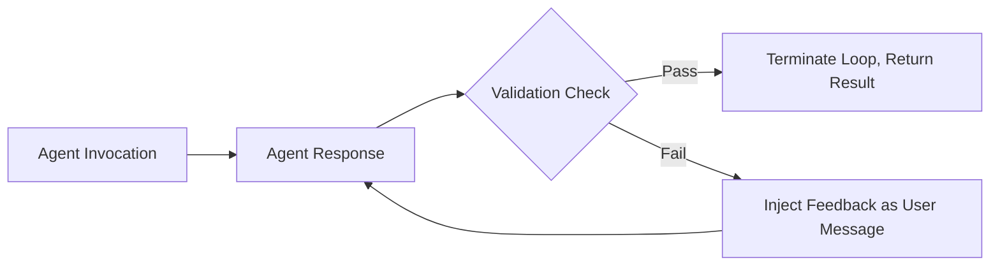
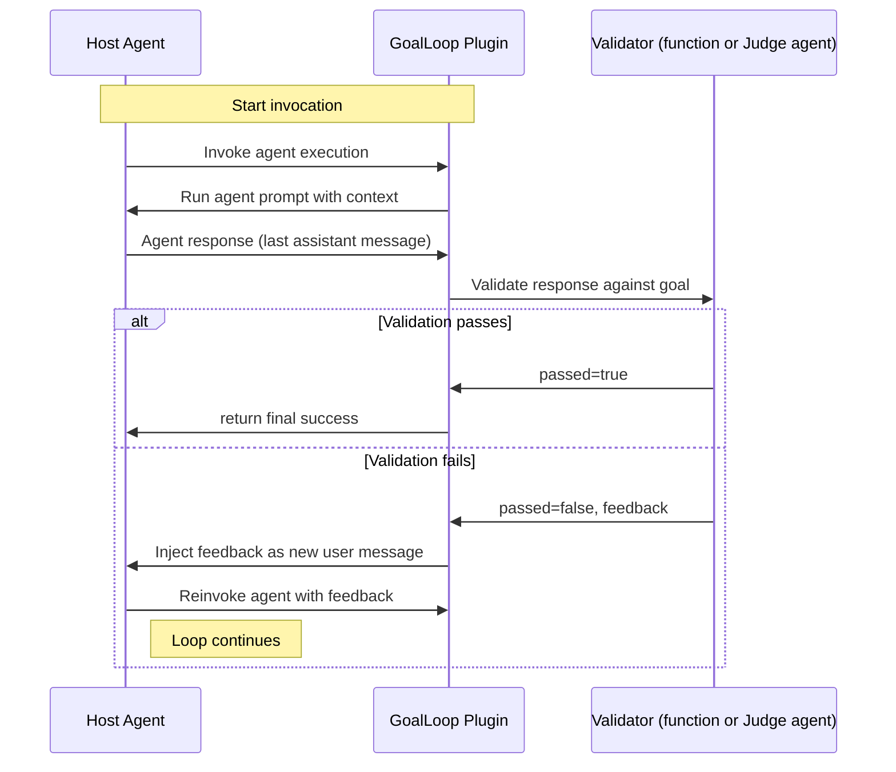
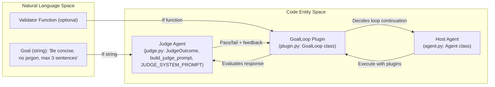

<!-- source: DeepWiki mcp.deepwiki.com · repo strands-agents/sdk-python · page 5.9 Goal Loop Plugin · fetched 2026-10-26 -->

# Goal Loop Plugin

<details>
<summary>Relevant source files</summary>

The following files were used as context for generating this wiki page:

- [.agents/references/voice-guide.md](.agents/references/voice-guide.md)
- [.agents/skills/docs-audit/SKILL.md](.agents/skills/docs-audit/SKILL.md)
- [.agents/skills/docs-reviewer/SKILL.md](.agents/skills/docs-reviewer/SKILL.md)
- [.agents/skills/docs-writer/SKILL.md](.agents/skills/docs-writer/SKILL.md)
- [site/src/content/docs/user-guide/concepts/agents/agent-loop.ts](site/src/content/docs/user-guide/concepts/agents/agent-loop.ts)
- [site/src/content/docs/user-guide/concepts/plugins/goal-loop.mdx](site/src/content/docs/user-guide/concepts/plugins/goal-loop.mdx)
- [site/src/content/docs/user-guide/concepts/plugins/goal-loop.ts](site/src/content/docs/user-guide/concepts/plugins/goal-loop.ts)
- [site/src/content/docs/user-guide/concepts/plugins/goal-loop_imports.ts](site/src/content/docs/user-guide/concepts/plugins/goal-loop_imports.ts)
- [strands-py/src/strands/vended_plugins/goal/__init__.py](strands-py/src/strands/vended_plugins/goal/__init__.py)
- [strands-py/src/strands/vended_plugins/goal/judge.py](strands-py/src/strands/vended_plugins/goal/judge.py)
- [strands-py/tests/strands/vended_plugins/goal/__init__.py](strands-py/tests/strands/vended_plugins/goal/__init__.py)

</details>


The **Goal Loop Plugin** is a vended extensibility component in the Strands Agents SDK designed to iteratively refine agent outputs until they meet a specified goal or quality criterion. It automates the pattern of agent invocation, evaluation of responses, feedback injection, and re-invocation, continuing this cycle until the output is validated as "done," a maximum number of attempts is reached, or a timeout expires.

---

## Purpose and Scope

Many agent workflows require responses that satisfy complex or subjective criteria—such as brevity, accuracy, format adherence, or passing external tests. Single-pass agent completions often fall short due to vague instructions or model variance, leading to the need for retries and refinements with guidance.

The Goal Loop Plugin abstracts this refinement process, allowing you to:

- Specify a **goal** as either a natural language description or a programmatic validator function.
- Attach the plugin to an agent to enable automatic response validation.
- Receive structured feedback on failing attempts.
- Drive the agent to re-try with feedback inserted as new user messages.
- Automatically stop when the goal is met or retry limits/timeouts are hit.

It consists chiefly of two parts:

- The **GoalLoop** class: the main plugin implementing the retry loop logic.
- The **Judge** component: a specialized agent used for natural-language goal evaluation that produces structured pass/fail outcomes with feedback messages.

---

## Overview of Behavior

The core logic of the Goal Loop Plugin can be summarized as follows:



1. The host agent is invoked to generate a response.
2. GoalLoop extracts the last assistant message and evaluates it using the configured validation mechanism.
3. If the validator passes, the loop exits with a success result.
4. If the response fails validation but retry budget remains, GoalLoop creates a feedback message injected as a new user message.
5. The agent is reinvoked with the augmented conversation.
6. This cycle continues until success, or retries/time budget are exhausted.

This iterative pattern abstracts common retry boilerplate and integrates seamlessly through the plugin hook lifecycle.

Sources: [site/src/content/docs/user-guide/concepts/plugins/goal-loop.mdx:16-39](), [site/src/content/docs/user-guide/concepts/plugins/goal-loop.ts:19-36](), [strands-py/src/strands/vended_plugins/goal/__init__.py:1-15]()

---

## Key Classes and Functions

### GoalLoop (Main Plugin Class)

- The `GoalLoop` class manages the retry loop state, tracks attempts, handles timeout and attempt limits, feeds back validation messages, and controls conversation context preservation.
- Accepts key configuration parameters:
  - `goal`: a natural-language string describing the objective, or a callable function for programmatic validation.
  - `max_attempts`: maximum retry count before giving up.
  - `timeout`: time budget in seconds (Python) or milliseconds (TypeScript).
  - `judge`: optional configuration for a judge sub-agent, including model and system prompt.
  - `preserve_context`: whether to keep full conversation history across attempts or reset context to limit drift.
  - `resume_prompt_template`: a callable building feedback messages for retries.

The plugin exposes methods to:

- Drive the iterative agent invocation and validation cycle integrated into the agent event loop.
- Expose the final `GoalResult` object for inspecting aggregated attempt data.

Sources: [strands-py/src/strands/vended_plugins/goal/plugin.py:1-130](https://github.com/strands-agents/sdk-python/blob/main/src/strands/vended_plugins/goal/plugin.py), [site/src/content/docs/user-guide/concepts/plugins/goal-loop.ts:19-36]()

---

### Validator Interface and ValidationOutcome

- The `Validator` type defines the interface for validation callbacks.
- Validators receive the last agent response message and the host agent instance.
- They return:
  - A boolean `true` / `false` (pass/fail).
  - A dict/object with a `passed` boolean and optional `feedback` string.
  - A `ValidationOutcome` instance wrapping these fields.

The plugin supports:

- Synchronous and asynchronous validators, enabling complex external checks like running test suites or calling APIs.
- Natural-language goals evaluated by an internal judge agent.

Sources: [strands-py/src/strands/vended_plugins/goal/plugin.py:90-110](), [site/src/content/docs/user-guide/concepts/plugins/goal-loop.mdx:77-158]()

---

### Judge Component (Natural-Language Validator)

The **Judge** is a specialized internal agent used when the goal is a natural-language string. It grades the agent's response against the goal with strict criteria:

- Only passes results when every part of the goal is clearly met.
- Partial satisfaction is treated as failure to avoid false positives.
- Uncertainty defaults to failed judgment.
- Feedback must identify the concrete unmet requirement and actionable fix.
- Responses are returned only as structured output via the `strands_structured_output` tool, formatted for machine parsing.

The judge prompt synthesizes:

- The **goal description**
- The **full conversation transcript**, including inline summaries of tool calls and results

Rendering of the transcript messages for the judge follows:

- Text content blocks are joined as-is.
- Tool calls and results are summarized compactly, truncating to a max length.
- Roles are indicated in `[role]` bracketed sections.

This design ensures the judge sees context, not just the final response, and can grade goals relating to tool usage and conversation flow.

```mermaid
graph TD
  Goal[Goal: natural language description]
  Transcript[Full conversation transcript\n(with tool call/result inline summaries)]
  JudgeAgent["Judge Agent\n(system prompt = JUDGE_SYSTEM_PROMPT)"]
  ValidationResult["ValidationOutcome:\npassed (bool), feedback (optional)"]
  
  Goal --> JudgeAgent
  Transcript --> JudgeAgent
  JudgeAgent --> ValidationResult
```

Sources: [strands-py/src/strands/vended_plugins/goal/judge.py:16-129](), [site/src/content/docs/user-guide/concepts/plugins/goal-loop.mdx:16-39]()

---

## Data Flow and Execution Sequence



---

## Example Usage

You create a `GoalLoop` plugin instance with a goal string, and attach it to an `Agent`. Invoking the agent triggers the iterative refinement.

```python
from strands import Agent
from strands.vended_plugins.goal import GoalLoop

concise = GoalLoop(
    goal="At most 3 sentences, accessible to a 10-year-old, no jargon.",
    max_attempts=3,
)

agent = Agent(plugins=[concise])
result = agent("Explain how rainbows form.")
print(concise.last_result(agent))

# Typical output:
# GoalResult(passed=True, stop_reason='satisfied', attempts=[...])
```

Or use a programmatic validator function:

```python
def word_count_validator(response, agent):
    text = " ".join(
        block["text"]
        for block in response["content"]
        if "text" in block
    )
    words = len(text.split())
    if words <= 50:
        return True
    return {
        "passed": False,
        "feedback": f"Too long ({words} words). Cap at 50.",
    }

plugin = GoalLoop(
    goal=word_count_validator,
    max_attempts=5,
    timeout=30.0,
)
```

Sources: [site/src/content/docs/user-guide/concepts/plugins/goal-loop.mdx:43-63, 77-111]()

---

## Configuration Parameters

| Parameter             | Default               | Description                                                                                   |
|-----------------------|-----------------------|-----------------------------------------------------------------------------------------------|
| `goal`                | *(required)*          | Natural-language goal string or callable validator function.                                  |
| `max_attempts`        | Infinity (unbounded)  | Maximum number of retry attempts before stopping.                                            |
| `timeout`             | Infinity (unbounded)  | Wall-clock time budget for the entire run in seconds (Python) or milliseconds (TypeScript).  |
| `judge`               | None                  | Configuration for judge sub-agent, including model and system prompt strings.                 |
| `preserve_context`    | True                  | Whether conversation context is preserved between attempts or reset for each retry.          |
| `resume_prompt_template` | Built-in function     | Callable that generates the retry feedback message, accepting the feedback string.           |
| `name`                | `"strands:goal-loop"` | Unique plugin identifier.                                                                     |

> **Note:** Leaving both `max_attempts` and `timeout` unbounded triggers a warning. Set at least one to avoid infinite loops.

Sources: [site/src/content/docs/user-guide/concepts/plugins/goal-loop.mdx:161-189]()

---

## Inspecting Plugin Results

After the agent invocation completes, the plugin provides access to a detailed `GoalResult`:

- `passed`: indicates if the goal was ultimately satisfied.
- `stop_reason`: why the loop ended (`satisfied`, `timeout`, or `max_attempts`).
- `attempts`: list of all attempts made with feedback messages and pass/fail per attempt.

Example inspection:

```python
result = plugin.last_result(agent)
if result and not result.passed:
    print(f"Stopped after {len(result.attempts)} attempts")
    print(f"Reason: {result.stop_reason}")
    for attempt in result.attempts:
        print(f"  Attempt #{attempt.attempt}: {attempt.feedback}")
```

This enables programmatic reaction and diagnostics after goal-driven retries.

Sources: [site/src/content/docs/user-guide/concepts/plugins/goal-loop.mdx:196-210](), [site/src/content/docs/user-guide/concepts/plugins/goal-loop.ts:42-60]()

---

## Integration with the Agent Event Loop

The GoalLoop plugin installs hooks into the agent's event loop process:

- After the agent produces a response, GoalLoop's validation logic executes.
- On failure, it injects a user message with the judgment feedback.
- It then forces the agent to re-run with this augmented context.
- It tracks attempts and respects timeout and max attempt limits to halt retries.

This is managed internally so users only interact with the agent at a high level.

Sources: Implicit from [strands-py/src/strands/vended_plugins/goal/plugin.py:20-120]()

---

## Summary Diagram: Natural Language Goal to Code



Sources: [strands-py/src/strands/vended_plugins/goal/plugin.py](), [strands-py/src/strands/vended_plugins/goal/judge.py](), [site/src/content/docs/user-guide/concepts/plugins/goal-loop.mdx]()

---

## Summary

The Goal Loop Plugin provides a robust, reusable pattern for iterative goal-driven agent completion refinement, centralizing validation, feedback, and retry logic with optional natural-language evaluation by a dedicated internal judge agent.

This plugin is key for workflows demanding quality assurance, complex output criteria, or test-driven validation of agent responses without manual retry implementations.

---

# Sources

- `site/src/content/docs/user-guide/concepts/plugins/goal-loop.mdx:1-210`  
- `site/src/content/docs/user-guide/concepts/plugins/goal-loop.ts:1-204`  
- `strands-py/src/strands/vended_plugins/goal/__init__.py:1-40`  
- `strands-py/src/strands/vended_plugins/goal/plugin.py:1-130`  
- `strands-py/src/strands/vended_plugins/goal/judge.py:1-129`

---

