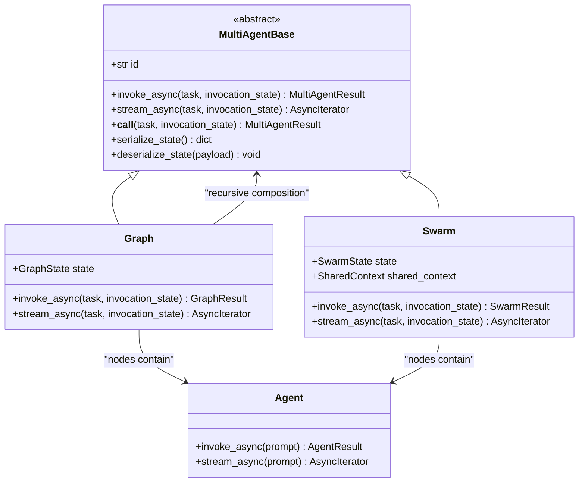
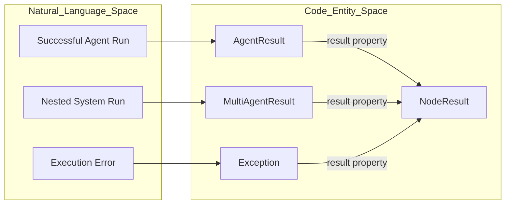
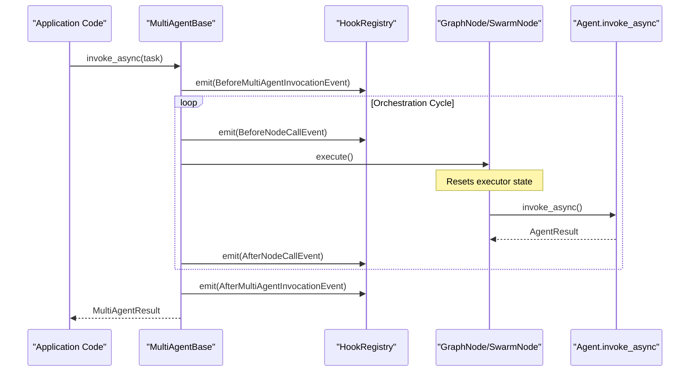

<!-- source: DeepWiki mcp.deepwiki.com · repo strands-agents/sdk-python · page 6.1 Multi-Agent Base and Patterns · fetched 2026-10-26 -->

# Multi-Agent Base and Patterns

<details>
<summary>Relevant source files</summary>

The following files were used as context for generating this wiki page:

- [site/src/content/docs/user-guide/concepts/multi-agent/swarm.mdx](site/src/content/docs/user-guide/concepts/multi-agent/swarm.mdx)
- [strands-py/src/strands/multiagent/__init__.py](strands-py/src/strands/multiagent/__init__.py)
- [strands-py/src/strands/multiagent/base.py](strands-py/src/strands/multiagent/base.py)
- [strands-py/src/strands/multiagent/graph.py](strands-py/src/strands/multiagent/graph.py)
- [strands-py/src/strands/multiagent/swarm.py](strands-py/src/strands/multiagent/swarm.py)
- [strands-py/tests/strands/agent/hooks/test_hook_registry.py](strands-py/tests/strands/agent/hooks/test_hook_registry.py)
- [strands-py/tests/strands/hooks/test_registry.py](strands-py/tests/strands/hooks/test_registry.py)
- [strands-py/tests/strands/multiagent/test_base.py](strands-py/tests/strands/multiagent/test_base.py)
- [strands-py/tests/strands/multiagent/test_graph.py](strands-py/tests/strands/multiagent/test_graph.py)
- [strands-py/tests/strands/multiagent/test_swarm.py](strands-py/tests/strands/multiagent/test_swarm.py)
- [strands-py/tests/strands/plugins/test_multiagent_plugin.py](strands-py/tests/strands/plugins/test_multiagent_plugin.py)
- [strands-py/tests_integ/test_multiagent_graph.py](strands-py/tests_integ/test_multiagent_graph.py)
- [strands-py/tests_integ/test_multiagent_swarm.py](strands-py/tests_integ/test_multiagent_swarm.py)
- [strands-ts/src/__fixtures__/agent-helpers.ts](strands-ts/src/__fixtures__/agent-helpers.ts)
- [strands-ts/src/__tests__/queue.test.ts](strands-ts/src/__tests__/queue.test.ts)
- [strands-ts/src/multiagent/__tests__/graph.test.ts](strands-ts/src/multiagent/__tests__/graph.test.ts)
- [strands-ts/src/multiagent/__tests__/interrupts.test.ts](strands-ts/src/multiagent/__tests__/interrupts.test.ts)
- [strands-ts/src/multiagent/__tests__/nodes.test.ts](strands-ts/src/multiagent/__tests__/nodes.test.ts)
- [strands-ts/src/multiagent/__tests__/swarm.test.ts](strands-ts/src/multiagent/__tests__/swarm.test.ts)
- [strands-ts/src/multiagent/graph.ts](strands-ts/src/multiagent/graph.ts)
- [strands-ts/src/multiagent/nodes.ts](strands-ts/src/multiagent/nodes.ts)
- [strands-ts/src/multiagent/swarm.ts](strands-ts/src/multiagent/swarm.ts)
- [strands-ts/src/queue.ts](strands-ts/src/queue.ts)
- [strands-ts/src/vended-tools/bash/bash.ts](strands-ts/src/vended-tools/bash/bash.ts)

</details>


## Purpose and Scope

This page documents the foundational abstractions for multi-agent orchestration in the Strands SDK. It covers the `MultiAgentBase` abstract class, shared data structures (`Status`, `NodeResult`, `MultiAgentResult`), and the high-level patterns for coordinating multiple agents. For detailed implementation of specific patterns, see [Graph-based Orchestration (6.2)]() and [Swarm Collaboration (6.3)](). For state persistence across multi-agent executions, see [Multi-Agent State and Persistence (6.4)]().

## Overview

The multi-agent system enables orchestration of multiple `Agent` instances to solve complex tasks through two primary patterns:

- **Graph**: Deterministic execution where agents or nested systems are nodes in a directed graph, executed according to edge dependencies. [strands-py/src/strands/multiagent/graph.py:1-15]()
- **Swarm**: Collaborative agent teams with shared working memory and autonomous coordination via tool-based handoffs. [strands-py/src/strands/multiagent/swarm.py:1-14]()

Both patterns share a common abstraction layer that provides unified result types, status tracking, and recursive composition. [strands-py/src/strands/multiagent/base.py:1-4](), [strands-py/src/strands/multiagent/base.py:143-150]()

**Sources**: [strands-py/src/strands/multiagent/graph.py:1-15](), [strands-py/src/strands/multiagent/swarm.py:1-14](), [strands-py/src/strands/multiagent/base.py:1-150]()

## MultiAgentBase Interface

The `MultiAgentBase` class provides the foundation for all multi-agent orchestration patterns. It defines a polymorphic interface that allows both `Graph` and `Swarm` to be used interchangeably and composed recursively. [strands-py/src/strands/multiagent/base.py:143-150]()

**Code Entity Relationship Diagram**

**Sources**: [strands-py/src/strands/multiagent/base.py:143-230](), [strands-py/src/strands/multiagent/graph.py:408-467](), [strands-py/src/strands/multiagent/swarm.py:229-301]()

### Core Methods

#### invoke_async()
Executes the multi-agent orchestration asynchronously. [strands-py/src/strands/multiagent/base.py:154-165]()

```python
async def invoke_async(
    self, 
    task: MultiAgentInput, 
    invocation_state: dict[str, Any] | None = None, 
    **kwargs: Any
) -> MultiAgentResult
```
- **task**: The input task, which can be a `str`, a list of `ContentBlock`, or a list of `InterruptResponseContent`. [strands-py/src/strands/types/multiagent.py:8-8]()
- **invocation_state**: Optional state passed to the invocation.
- **Returns**: A `MultiAgentResult` containing the execution outcome and metrics. [strands-py/src/strands/multiagent/base.py:128-138]()

#### stream_async()
Streams events during execution for real-time monitoring of node transitions and internal agent outputs. [strands-py/src/strands/multiagent/base.py:167-190]()

#### __call__()
Synchronous wrapper that calls `run_async` on `invoke_async`. [strands-py/src/strands/multiagent/base.py:192-210]()

**Sources**: [strands-py/src/strands/multiagent/base.py:154-210](), [strands-py/src/strands/types/multiagent.py:8-8]()

## Common Data Structures

### Status Enum
Tracks the lifecycle of both the orchestrator and individual nodes. [strands-py/src/strands/multiagent/base.py:24-40]()

| Value | Description |
|-------|-------------|
| `PENDING` | Task has not started execution yet. |
| `EXECUTING` | Task is currently running. |
| `COMPLETED` | Task finished successfully. |
| `FAILED` | Task encountered an error. |
| `INTERRUPTED` | Task was interrupted by user. |
| `CANCELLED` | Task was cancelled. |

**Status Precedence**:
When determining the overall status of a multi-agent system, `FAILED` takes precedence over `INTERRUPTED`, which takes precedence over `CANCELLED`, which takes precedence over `COMPLETED`. This ensures that any critical issues are reflected in the final status.

**Sources**: [strands-py/src/strands/multiagent/base.py:24-40]()

### NodeResult
Wraps the result from a single node execution, handling `AgentResult`, nested `MultiAgentResult`, or `Exception`. [strands-py/src/strands/multiagent/base.py:42-58]()

**Natural Language to Code Entity Space: Node Execution Results**

**Sources**: [strands-py/src/strands/multiagent/base.py:42-58](), [strands-py/src/strands/agent/base.py:15-20]()

### MultiAgentResult
Represents the complete output of a multi-agent workflow, aggregating metrics from all constituent nodes. [strands-py/src/strands/multiagent/base.py:128-138]()

| Property | Type | Description |
|----------|------|-------------|
| `status` | `Status` | Overall execution status. |
| `results` | `dict[str, NodeResult]` | Map of node IDs to their respective results. |
| `accumulated_usage` | `Usage` | Total tokens used across all nodes. |
| `accumulated_metrics` | `Metrics` | Aggregated latency and performance data. |
| `interrupts` | `list[Interrupt]` | List of user interrupts encountered. |

**Sources**: [strands-py/src/strands/multiagent/base.py:128-138](), [strands-py/src/strands/multiagent/graph.py:130-140](), [strands-py/src/strands/multiagent/swarm.py:222-227]()

## Orchestration Patterns

### Pattern Comparison

| Characteristic | Graph | Swarm |
|---------------|-------|-------|
| **Coordination** | Deterministic via edge dependencies. [strands-py/src/strands/multiagent/graph.py:10-14]() | Autonomous via tool-based coordination. [strands-py/src/strands/multiagent/swarm.py:9-11]() |
| **Structure** | Explicit DAG/Cyclic structure. [strands-py/src/strands/multiagent/graph.py:12-14]() | Self-organizing teams with shared memory. [strands-py/src/strands/multiagent/swarm.py:8-12]() |
| **Parallelism** | Supports parallel node execution. [strands-py/src/strands/multiagent/graph.py:10-10]() | Sequential handoffs between agents. [strands-py/src/strands/multiagent/swarm.py:302-303]() |
| **Context** | Propagation along edges. [strands-py/src/strands/multiagent/graph.py:11-11]() | Shared working memory (`SharedContext`). [strands-py/src/strands/multiagent/swarm.py:122-125]() |

### Recursive Composition
The `MultiAgentBase` interface allows for hierarchical orchestration. A `Graph` can contain another `Graph` or a `Swarm` as a single node. When the outer system executes that node, it calls the nested system's `invoke_async` method, and the resulting `MultiAgentResult` is wrapped in a `NodeResult` for the outer system. [strands-py/src/strands/multiagent/graph.py:408-467](), [strands-py/src/strands/multiagent/base.py:42-58]()

**Sources**: [strands-py/src/strands/multiagent/graph.py:1-15](), [strands-py/src/strands/multiagent/swarm.py:1-14](), [strands-py/src/strands/multiagent/base.py:42-58]()

## Execution Model

### Invocation Flow

**Multi-Agent Execution Pipeline**

**Sources**: [strands-py/src/strands/multiagent/graph.py:510-593](), [strands-py/src/strands/multiagent/swarm.py:342-415](), [strands-py/src/strands/hooks/events.py:240-279](), [strands-py/src/strands/multiagent/graph.py:187-190]()

### Event Streaming
The `stream_async` method yields specific multi-agent events:
- `MultiAgentNodeStartEvent`: Emitted when a node begins execution. [strands-py/src/strands/multiagent/graph.py:510-593]()
- `MultiAgentNodeStreamEvent`: Forwards internal agent events (thinking, tool calls) to the orchestrator's stream. [strands-py/src/strands/multiagent/swarm.py:342-415]()
- `MultiAgentHandoffEvent`: Specific to Swarm, indicates a transfer of control between agents. [strands-py/src/strands/multiagent/swarm.py:342-415]()
- `MultiAgentNodeStopEvent`: Emitted when a node completes execution. [strands-py/src/strands/multiagent/graph.py:510-593]()
- `MultiAgentNodeCancelEvent`: Emitted when a node's execution is cancelled. [strands-py/src/strands/types/_events.py:16-16]()
- `MultiAgentNodeInterruptEvent`: Emitted when a node's execution is interrupted. [strands-py/src/strands/types/_events.py:15-15]()

**Sources**: [strands-py/src/strands/multiagent/graph.py:510-593](), [strands-py/src/strands/multiagent/swarm.py:342-415](), [strands-py/src/strands/types/_events.py:15-16]()

## Result Aggregation

### Metrics Accumulation
Both patterns aggregate `Usage` (tokens) and `Metrics` (latency) from every node. [strands-py/src/strands/multiagent/base.py:133-134]()
- For `Agent` nodes, metrics are pulled from `AgentResult.metrics`. [strands-py/src/strands/multiagent/graph.py:928-935]()
- For nested `MultiAgentBase` nodes, metrics are pulled from the `MultiAgentResult.accumulated_usage`. [strands-py/src/strands/multiagent/graph.py:936-943]()

### Result Flattening
The `NodeResult.get_agent_results()` method provides a way to extract all leaf `AgentResult` objects from a potentially deep tree of nested multi-agent systems, ignoring intermediate exceptions. [strands-py/src/strands/multiagent/base.py:59-70]()

**Sources**: [strands-py/src/strands/multiagent/base.py:1-230](), [strands-py/src/strands/multiagent/graph.py:1-1000](), [strands-py/src/strands/multiagent/swarm.py:1-850](), [strands-py/src/strands/hooks/events.py:240-279]()

---

