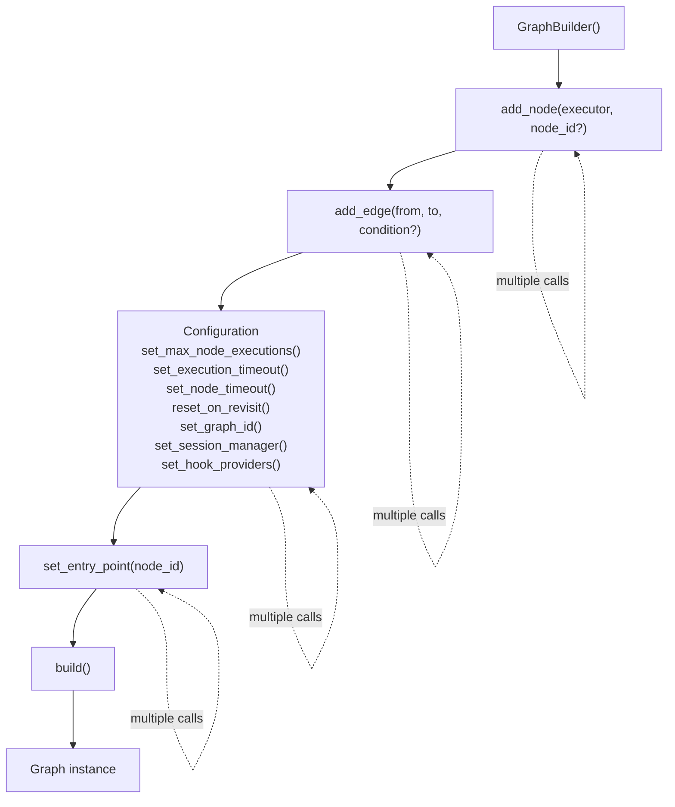

<!-- source: DeepWiki mcp.deepwiki.com · repo strands-agents/sdk-python · page 6.2 Graph-based Orchestration · fetched 2026-10-26 -->

# Graph-based Orchestration

<details>
<summary>Relevant source files</summary>

The following files were used as context for generating this wiki page:

- [site/src/content/docs/user-guide/concepts/multi-agent/graph.mdx](site/src/content/docs/user-guide/concepts/multi-agent/graph.mdx)
- [site/src/content/docs/user-guide/concepts/multi-agent/graph.ts](site/src/content/docs/user-guide/concepts/multi-agent/graph.ts)
- [site/src/content/docs/user-guide/concepts/multi-agent/multi-agent-patterns.mdx](site/src/content/docs/user-guide/concepts/multi-agent/multi-agent-patterns.mdx)
- [site/src/content/docs/user-guide/concepts/multi-agent/swarm.mdx](site/src/content/docs/user-guide/concepts/multi-agent/swarm.mdx)
- [site/src/content/docs/user-guide/concepts/tools/index.mdx](site/src/content/docs/user-guide/concepts/tools/index.mdx)
- [site/src/content/docs/user-guide/concepts/tools/tools_imports.ts](site/src/content/docs/user-guide/concepts/tools/tools_imports.ts)
- [site/src/content/docs/user-guide/observability-evaluation/logs.mdx](site/src/content/docs/user-guide/observability-evaluation/logs.mdx)
- [site/src/content/docs/user-guide/observability-evaluation/metrics.mdx](site/src/content/docs/user-guide/observability-evaluation/metrics.mdx)
- [strands-py/src/strands/multiagent/__init__.py](strands-py/src/strands/multiagent/__init__.py)
- [strands-py/src/strands/multiagent/base.py](strands-py/src/strands/multiagent/base.py)
- [strands-py/src/strands/multiagent/graph.py](strands-py/src/strands/multiagent/graph.py)
- [strands-py/src/strands/multiagent/swarm.py](strands-py/src/strands/multiagent/swarm.py)
- [strands-py/tests/strands/agent/hooks/test_hook_registry.py](strands-py/tests/strands/agent/hooks/test_hook_registry.py)
- [strands-py/tests/strands/hooks/test_registry.py](strands-py/tests/strands/hooks/test_registry.py)
- [strands-py/tests/strands/multiagent/test_base.py](strands-py/tests/strands/multiagent/test_base.py)
- [strands-py/tests/strands/multiagent/test_graph.py](strands-py/tests/strands/multiagent/test_graph.py)
- [strands-py/tests/strands/multiagent/test_swarm.py](strands-py/tests/strands/multiagent/test_swarm.py)
- [strands-py/tests/strands/plugins/test_multiagent_plugin.py](strands-py/tests/strands/plugins/test_multiagent_plugin.py)
- [strands-py/tests_integ/test_multiagent_graph.py](strands-py/tests_integ/test_multiagent_graph.py)
- [strands-py/tests_integ/test_multiagent_swarm.py](strands-py/tests_integ/test_multiagent_swarm.py)
- [strands-ts/src/__fixtures__/agent-helpers.ts](strands-ts/src/__fixtures__/agent-helpers.ts)
- [strands-ts/src/__tests__/queue.test.ts](strands-ts/src/__tests__/queue.test.ts)
- [strands-ts/src/multiagent/__tests__/graph.test.ts](strands-ts/src/multiagent/__tests__/graph.test.ts)
- [strands-ts/src/multiagent/__tests__/interrupts.test.ts](strands-ts/src/multiagent/__tests__/interrupts.test.ts)
- [strands-ts/src/multiagent/__tests__/nodes.test.ts](strands-ts/src/multiagent/__tests__/nodes.test.ts)
- [strands-ts/src/multiagent/__tests__/swarm.test.ts](strands-ts/src/multiagent/__tests__/swarm.test.ts)
- [strands-ts/src/multiagent/graph.ts](strands-ts/src/multiagent/graph.ts)
- [strands-ts/src/multiagent/nodes.ts](strands-ts/src/multiagent/nodes.ts)
- [strands-ts/src/multiagent/swarm.ts](strands-ts/src/multiagent/swarm.ts)
- [strands-ts/src/queue.ts](strands-ts/src/queue.ts)
- [strands-ts/src/vended-tools/bash/bash.ts](strands-ts/src/vended-tools/bash/bash.ts)

</details>


Graph-based orchestration provides a deterministic, dependency-driven approach to multi-agent workflows. The `Graph` class enables parallel execution of agents organized as nodes in a directed graph, where edges represent dependencies and optional conditional logic.

For self-organizing collaborative agent teams with shared context, see [6.3. Swarm Collaboration](). For the base abstractions and composition patterns, see [6.1. Multi-Agent Base and Patterns]().

**Sources**: [strands-py/src/strands/multiagent/graph.py:1-15]()

## Core Architecture

The graph orchestration system consists of four primary components that work together to define and execute agent workflows.

### Code Entity Relationship Diagram

```mermaid
graph TD
    subgraph "Graph Construction (Code Entities)"
        GraphBuilderPy["GraphBuilder<br/>(strands-py/src/strands/multiagent/graph.py)"]
        GraphPy["Graph<br/>(strands-py/src/strands/multiagent/graph.py)"]
        GraphNodePy["GraphNode<br/>(strands-py/src/strands/multiagent/graph.py)"]
        GraphEdgePy["GraphEdge<br/>(strands-py/src/strands/multiagent/graph.py)"]

        GraphTs["Graph<br/>(strands-ts/src/multiagent/graph.ts)"]
        NodeTs["Node<br/>(strands-ts/src/multiagent/nodes.ts)"]
        AgentNodeTs["AgentNode<br/>(strands-ts/src/multiagent/nodes.ts)"]
        MultiAgentNodeTs["MultiAgentNode<br/>(strands-ts/src/multiagent/nodes.ts)"]
        EdgeTs["Edge<br/>(strands-ts/src/multiagent/edge.ts)"]
    end
    
    subgraph "Execution Engine"
        GraphStatePy["GraphState<br/>(strands-py/src/strands/multiagent/graph.py)"]
        MultiAgentStateTs["MultiAgentState<br/>(strands-ts/src/multiagent/state.ts)"]
    end
    
    subgraph "Node Executors"
        AgentPy["Agent<br/>(strands-py/src/strands/agent/agent.py)"]
        AgentTs["Agent<br/>(strands-ts/src/agent/agent.ts)"]
        MultiAgentBasePy["MultiAgentBase<br/>(strands-py/src/strands/multiagent/base.py)"]
        MultiAgentTs["MultiAgent<br/>(strands-ts/src/multiagent/multiagent.ts)"]
    end
    
    GraphBuilderPy -->|"add_node()"| GraphNodePy
    GraphBuilderPy -->|"add_edge()"| GraphEdgePy
    GraphBuilderPy -->|"build()"| GraphPy
    
    GraphPy -->|"manages"| GraphStatePy
    GraphPy -->|"executes"| GraphNodePy
    
    GraphNodePy -->|"wraps"| AgentPy
    GraphNodePy -->|"wraps"| MultiAgentBasePy

    GraphTs -->|"manages"| MultiAgentStateTs
    GraphTs -->|"executes"| NodeTs
    NodeTs <|-- AgentNodeTs
    NodeTs <|-- MultiAgentNodeTs

    AgentNodeTs -->|"wraps"| AgentTs
    MultiAgentNodeTs -->|"wraps"| MultiAgentTs
    
    GraphEdgePy -->|"connects"| GraphNodePy
    GraphEdgePy -->|"condition(state)"| GraphStatePy

    EdgeTs -->|"connects"| NodeTs
    EdgeTs -->|"handler(state)"| MultiAgentStateTs
```

**Sources**: [strands-py/src/strands/multiagent/graph.py:162-207](), [strands-py/src/strands/multiagent/graph.py:230-262](), [strands-py/src/strands/multiagent/base.py:178-185](), [strands-ts/src/multiagent/graph.ts:139-160](), [strands-ts/src/multiagent/nodes.ts:67-81](), [strands-ts/src/multiagent/edge.ts:1-10]()

### GraphNode (Python)

`GraphNode` wraps an `Agent` or `MultiAgentBase` instance as a node in the graph. Each node tracks its execution status, dependencies, and result.

| Attribute | Type | Description |
|-----------|------|-------------|
| `node_id` | `str` | Unique identifier for the node |
| `executor` | `AgentBase \| MultiAgentBase` | The agent or multi-agent system to execute |
| `dependencies` | `set[GraphNode]` | Nodes that must complete before this node executes |
| `execution_status` | `Status` | Current status (PENDING, EXECUTING, COMPLETED, etc.) |
| `result` | `NodeResult \| None` | Result after execution completes |
| `execution_time` | `int` | Time taken to execute in milliseconds |

The node maintains initial state snapshots to support reset-on-revisit behavior for cyclic graphs:

```python
def reset_executor_state(self) -> None:
    """Reset GraphNode executor state to initial state when graph was created."""
    if hasattr(self.executor, "messages"):
        self.executor.messages = copy.deepcopy(self._initial_messages)
    if hasattr(self.executor, "state") and hasattr(self.executor.state, "get"):
        self.executor.state = AgentState(self._initial_state.get())
    self.execution_status = Status.PENDING
    self.result = None
```

**Sources**: [strands-py/src/strands/multiagent/graph.py:162-206]()

### Nodes (TypeScript)

In TypeScript, nodes are represented by the abstract `Node` class, with concrete implementations `AgentNode` and `MultiAgentNode`.

-   **`Node`**: Abstract base class for all multi-agent orchestration nodes. Handles boilerplate like duration measurement, status tracking, and error capture, delegating to `handle()` for node-specific logic. [strands-ts/src/multiagent/nodes.ts:67-81]()
-   **`AgentNode`**: Wraps an `InvokableAgent` (typically an `Agent` instance). By default, it snapshots the wrapped agent's state before execution and restores it afterward, ensuring a clean slate for each run. This behavior can be overridden with `preserveContext: true` to allow state accumulation across executions. [strands-ts/src/multiagent/nodes.ts:170-196]()
-   **`MultiAgentNode`**: Wraps a `MultiAgent` instance (e.g., another `Graph` or `Swarm`), allowing for nested orchestrations. [strands-ts/src/multiagent/nodes.ts:260-267]()

### GraphEdge (Python)

`GraphEdge` represents a directed connection between nodes with an optional condition function.

| Attribute | Type | Description |
|-----------|------|-------------|
| `from_node` | `GraphNode` | Source node |
| `to_node` | `GraphNode` | Target node (becomes dependent on source) |
| `condition` | `Callable[[GraphState], bool] \| None` | Optional function to determine if the edge should be traversed |

The condition function receives the full `GraphState` and can inspect completed nodes, results, and execution metadata:

```python
def should_traverse(self, state: GraphState) -> bool:
    """Check if this edge should be traversed based on condition."""
    if self.condition is None:
        return True
    return self.condition(state)
```

**Sources**: [strands-py/src/strands/multiagent/graph.py:143-159]()

### Edges (TypeScript)

In TypeScript, edges are defined by the `Edge` class and can include an optional `EdgeHandler` for conditional traversal.

```typescript
export class Edge {
  readonly source: Node
  readonly target: Node
  readonly handler?: EdgeHandler
  // ...
}
```

The `EdgeHandler` is a function that receives the current `MultiAgentState` and `invocationState` to determine if the edge should be traversed. [strands-ts/src/multiagent/edge.ts:1-10]()

### GraphState (Python)

`GraphState` maintains the execution state throughout the graph's lifecycle.

| Attribute | Type | Description |
|-----------|------|-------------|
| `task` | `MultiAgentInput` | Original input task for the graph |
| `status` | `Status` | Current execution status |
| `completed_nodes` | `set[GraphNode]` | Nodes that have completed |
| `failed_nodes` | `set[GraphNode]` | Nodes that failed |
| `interrupted_nodes` | `set[GraphNode]` | Nodes interrupted by user |
| `execution_order` | `list[GraphNode]` | Chronological execution order |
| `results` | `dict[str, NodeResult]` | Results keyed by node_id |
| `accumulated_usage` | `Usage` | Total token usage across all nodes |
| `accumulated_metrics` | `Metrics` | Total metrics (latency, etc.) |
| `execution_count` | `int` | Total number of node executions |
| `execution_time` | `int` | Total execution time in milliseconds |

**Sources**: [strands-py/src/strands/multiagent/graph.py:64-105]()

### MultiAgentState (TypeScript)

The TypeScript `Graph` uses `MultiAgentState` to manage its execution state. This class tracks node statuses, results, and accumulated metrics.

```typescript
export class MultiAgentState {
  readonly nodeStates: Map<string, NodeState>
  readonly results: Map<string, NodeResult>
  readonly accumulatedUsage: Usage
  readonly accumulatedMetrics: Metrics
  // ...
}
```

**Sources**: [strands-ts/src/multiagent/state.ts:10-16]()

## GraphBuilder API (Python)

The `GraphBuilder` class provides a fluent API for constructing graphs with validation.



**Sources**: [strands-py/src/strands/multiagent/graph.py:230-405]()

### Building a Graph (Python)

Example showing the complete builder pattern:

```python
from strands.multiagent import GraphBuilder
from strands import Agent

# Create agents
research_agent = Agent(name="researcher")
analysis_agent = Agent(name="analyst")
report_agent = Agent(name="report")

# Build graph
builder = GraphBuilder()

# Add nodes (returns GraphNode for reference)
research_node = builder.add_node(research_agent, "research")
analysis_node = builder.add_node(analysis_agent, "analysis")
report_node = builder.add_node(report_agent, "report")

# Add edges with dependencies
builder.add_edge("research", "analysis")  # analysis depends on research
builder.add_edge("analysis", "report")    # report depends on analysis

# Configure execution limits
builder.set_max_node_executions(10)
builder.set_execution_timeout(300.0)  # 5 minutes
builder.set_node_timeout(60.0)        # 1 minute per node

# Build and validate
graph = builder.build()
```

**Sources**: [strands-py/src/strands/multiagent/graph.py:248-262](), [strands-py/tests/strands/multiagent/test_graph.py:148-180]()

### Node ID Assignment (Python)

If `node_id` is not provided to `add_node()`, the builder auto-generates it from the executor:

```python
if node_id is None:
    node_id = getattr(executor, "id", None) or \
              getattr(executor, "name", None) or \
              f"node_{len(self.nodes)}"
```

**Sources**: [strands-py/src/strands/multiagent/graph.py:248-260]()

### Validation Rules (Python)

The builder enforces several validation rules at build time:

| Validation | Error Condition |
|------------|-----------------|
| Duplicate node IDs | Same `node_id` used twice |
| Duplicate instances | Same executor instance added as multiple nodes |
| Missing edge nodes | Edge references non-existent node |
| No entry points | All nodes have dependencies (circular only) |
| Invalid entry points | Specified entry point not in graph |
| Session persistence | Agent nodes have `_session_manager` set |

**Sources**: [strands-py/src/strands/multiagent/graph.py:394-405](), [strands-py/src/strands/multiagent/graph.py:208-228](), [strands-py/tests/strands/multiagent/test_graph.py:424-545]()

## Graph Constructor (TypeScript)

The TypeScript `Graph` is constructed directly using an options object, rather than a builder.

```typescript
export interface GraphOptions extends GraphConfig {
  id?: string
  nodes: NodeDefinition[]
  edges: EdgeDefinition[]
  sources?: string[]
  sessionManager?: SessionManager
  plugins?: MultiAgentPlugin[]
  traceAttributes?: Record<string, AttributeValue>
}
```

**Sources**: [strands-ts/src/multiagent/graph.ts:88-104]()

### Building a Graph (TypeScript)

```typescript
import { Graph } from '@strands/multiagent'
import { Agent } from '@strands/agent'

// Create agents
const researcher = new Agent({ id: 'researcher' })
const writer = new Agent({ id: 'writer' })

// Build graph
const graph = new Graph({
  nodes: [researcher, writer],
  edges: [['researcher', 'writer']],
  maxConcurrency: 2, // Allow parallel execution
  timeout: 300_000, // 5 minutes total
  nodeTimeout: 60_000, // 1 minute per node
})

const result = await graph.invoke('Explain quantum computing')
```

**Sources**: [strands-ts/src/multiagent/graph.ts:130-137]()

### Node ID Assignment (TypeScript)

Node IDs are typically derived from the `id` property of the `Agent` or `MultiAgent` instance passed to the `nodes` array.

### Validation Rules (TypeScript)

The TypeScript `Graph` constructor performs validation to ensure a well-formed graph:
-   **Duplicate Node IDs**: Ensures all node IDs are unique.
-   **Missing Edge Nodes**: Checks that all nodes referenced in edges exist.
-   **No Entry Points**: If `sources` are not explicitly provided, it auto-detects nodes with no incoming edges. If no such nodes are found and no sources are specified, it warns about a potentially unreachable graph.
-   **Timeout Configuration**: Warns if `maxSteps` or `timeout` are not set for cyclic graphs, as they could run indefinitely.
-   **`preserveContext` with non-`Agent`**: Throws if `preserveContext: true` is used with a non-`Agent` `InvokableAgent`.

**Sources**: [strands-ts/src/multiagent/graph.ts:161-169](), [strands-ts/src/multiagent/nodes.ts:154-164]()

## Execution Model

The graph executes nodes in **batches** based on dependency satisfaction, with nodes in each batch running in **parallel**.

### Graph Execution Sequence

```mermaid
graph TD
    subgraph "Execution Flow (Python)"
        EntryPy["Entry Points<br/>(no dependencies)"] --> Batch1Py["Execute Batch 1<br/>(_execute_nodes_parallel)"]
        Batch1Py --> Check1Py["Check Limits<br/>GraphState.should_continue()"]
        Check1Py -->|"limits OK"| Ready1Py["Find Ready Nodes<br/>(_find_newly_ready_nodes)"]
        Check1Py -->|"limit reached"| StopPy["Stop Execution<br/>(Status.FAILED)"]
        Ready1Py -->|"nodes ready"| Handoff1Py["Emit MultiAgentHandoffEvent"]
        Ready1Py -->|"no nodes ready"| CompletePy["Complete<br/>(Status.COMPLETED)"]
        Handoff1Py --> Batch2Py["Execute Batch 2"]
        Batch2Py --> Check2Py["Check Limits"]
        Check2Py --> Ready2Py["Find Ready Nodes"]
        Ready2Py -.->|"cycle"| Handoff2Py["Emit Handoff"]
        Handoff2Py -.-> BatchNPy["Execute Batch N"]
    end
    
    subgraph "Per Node Execution (Python: strands-py/src/strands/multiagent/graph.py)"
        NodeStartPy["MultiAgentNodeStartEvent"] --> HookPy["BeforeNodeCallEvent"]
        HookPy -->|"no interrupt"| InputPy["Build Node Input<br/>(_build_node_input)"]
        HookPy -->|"interrupt"| InterruptPy["MultiAgentNodeInterruptEvent"]
        InputPy --> ExecutePy["Execute Node<br/>(_execute_node)"]
        ExecutePy --> NodeStopPy["MultiAgentNodeStopEvent"]
        NodeStopPy --> AfterHookPy["AfterNodeCallEvent"]
    end

    subgraph "Execution Flow (TypeScript)"
        EntryTs["Source Nodes<br/>(no incoming edges)"] --> QueueTs["Node Execution Queue<br/>(Queue)"]
        QueueTs --> ProcessTs["Process Nodes<br/>(up to maxConcurrency)"]
        ProcessTs --> CheckLimitsTs["Check Limits<br/>(maxSteps, timeout)"]
        CheckLimitsTs -->|"limits OK"| ReadyTs["Find Ready Successors<br/>(EdgeHandler evaluation)"]
        CheckLimitsTs -->|"limit reached"| StopTs["Stop Execution<br/>(Status.FAILED)"]
        ReadyTs -->|"nodes ready"| QueueTs
        ReadyTs -->|"no nodes ready"| CompleteTs["Complete<br/>(Status.COMPLETED)"]
    end

    subgraph "Per Node Execution (TypeScript: strands-ts/src/multiagent/nodes.ts)"
        NodeStreamTs["Node.stream()"] --> HandleTs["Node.handle()"]
        HandleTs -->|"AgentNode"| AgentInvokeTs["Agent.stream()"]
        HandleTs -->|"MultiAgentNode"| MultiAgentInvokeTs["MultiAgent.stream()"]
        NodeStreamTs --> NodeResultEventTs["NodeResultEvent"]
    end
```



**Sources**: [strands-py/src/strands/multiagent/graph.py:635-693](), [strands-py/src/strands/multiagent/graph.py:845-933](), [strands-py/src/strands/multiagent/graph.py:107-126](), [strands-ts/src/multiagent/graph.ts:300-309](), [strands-ts/src/multiagent/nodes.ts:91-153]()

### Parallel Batch Execution (Python)

Nodes within a batch execute concurrently using `asyncio`:

```python
async def _execute_nodes_parallel(
    self, nodes: list["GraphNode"], invocation_state: dict[str, Any]
) -> AsyncIterator[Any]:
    """Execute multiple nodes in parallel and merge their event streams."""
    event_queue: asyncio.Queue[Any | None | Exception] = asyncio.Queue()
    
    # Start all node streams as independent tasks
    tasks = [asyncio.create_task(
        self._stream_node_to_queue(node, event_queue, invocation_state)
    ) for node in nodes]
    
    # Consume events as they arrive (fail-fast on exceptions)
    ...
```

**Sources**: [strands-py/src/strands/multiagent/graph.py:695-753]()

### Parallel Execution (TypeScript)

The TypeScript `Graph` uses an `asyncio.Queue` equivalent (`Queue` in [strands-ts/src/queue.ts]()) to manage concurrent node execution up to `maxConcurrency`. Nodes are launched individually as they become ready, rather than in discrete batches.

```typescript
// From Graph.stream()
const queue = new Queue<NodeExecutionOutput>()
// ...
// Launch initial source nodes
for (const node of this._sources) {
  this._launchNode(node, input, state, invocationState, cancelSignal, queue)
}
// ...
// Process results and launch successors
for await (const output of queue.drain()) {
  // ...
  for (const successor of this._findReadySuccessors(node, state, invocationState)) {
    this._launchNode(successor, input, state, invocationState, cancelSignal, queue)
  }
}
```

**Sources**: [strands-ts/src/multiagent/graph.ts:300-309](), [strands-ts/src/multiagent/graph.ts:400-402](), [strands-ts/src/multiagent/graph.ts:420-422]()

### Dependency Resolution (Python)

After each batch completes, the graph finds newly ready nodes by checking conditional edges:

```python
def _find_newly_ready_nodes(self, completed_batch: list["GraphNode"]) -> list["GraphNode"]:
    """Find nodes that became ready after the last execution."""
    newly_ready = []
    for _node_id, node in self.nodes.items():
        if self._is_node_ready_with_conditions(node, completed_batch):
            newly_ready.append(node)
    return newly_ready
```

**Sources**: [strands-py/src/strands/multiagent/graph.py:818-843]()

### Dependency Resolution (TypeScript)

The TypeScript `Graph` uses **AND semantics** for dependency resolution: a node runs only when *all* its incoming edges are satisfied. This contrasts with the Python SDK's OR semantics. `_findReadySuccessors` identifies nodes whose dependencies are met.

```typescript
private _findReadySuccessors(
  completedNode: Node,
  state: MultiAgentState,
  invocationState: InvocationState
): Node[] {
  const ready: Node[] = []
  for (const edge of this.edges) {
    if (edge.source.id === completedNode.id) {
      // Check if the edge condition allows traversal
      if (edge.handler && !edge.handler(state, { invocationState })) {
        continue
      }
      // Check if all incoming edges for the target node are satisfied
      if (this._isNodeReady(edge.target, state, invocationState)) {
        ready.push(edge.target)
      }
    }
  }
  return ready
}
```

**Sources**: [strands-ts/src/multiagent/graph.ts:115-118](), [strands-ts/src/multiagent/graph.ts:500-517]()

## Conditional Edges

Edges can have condition functions that receive the full `GraphState` (Python) or `MultiAgentState` and `invocationState` (TypeScript) and determine whether the edge should be traversed.

### Example: Conditional Routing (Python)

```python
def route_to_specialist(state: GraphState) -> bool:
    """Route to specialist only if analysis shows complexity."""
    analysis_node_id = "analysis"
    
    if analysis_node_id not in state.results:
        return False
    
    result = state.results[analysis_node_id]
    agent_results = result.get_agent_results()
    
    if not agent_results:
        return False
    
    # Check if message indicates high complexity
    message = agent_results[0].message
    content_text = " ".join([
        block.get("text", "") 
        for block in message.get("content", [])
        if isinstance(block, dict)
    ]).lower()
    
    return "complex" in content_text
```

**Sources**: [strands-py/src/strands/multiagent/graph.py:143-159](), [strands-py/src/strands/multiagent/base.py:59-70]()

### Example: Conditional Routing (TypeScript)

```typescript
import type { MultiAgentState, InvocationState } from '@strands/multiagent'

const complexAnalysisEdgeHandler = (state: MultiAgentState, { invocationState }: { invocationState: InvocationState }) => {
  const analysisResult = state.results.get('analysis')
  if (!analysisResult) {
    return false
  }
  const content = analysisResult.content.map(block => (block as TextBlock).text).join(' ').toLowerCase()
  return content.includes('complex')
}

const graph = new Graph({
  nodes: [analyst, specialist],
  edges: [
    { source: 'analyst', target: 'specialist', handler: complexAnalysisEdgeHandler },
  ],
})
```

**Sources**: [strands-ts/src/multiagent/edge.ts:11-16]()

## Cyclic Graphs and Reset Behavior

Graphs can contain cycles (feedback loops) with proper execution limits to prevent infinite execution.

| Limit | Type | Description |
|-------|------|-------------|
| `max_node_executions` (Python) | `int \| None` | Maximum total node executions across all nodes |
| `execution_timeout` (Python) | `float \| None` | Total execution timeout in seconds |
| `reset_on_revisit` (Python) | `bool` | Whether to reset node state when re-executed |
| `maxSteps` (TypeScript) | `number` | Maximum total node executions across all nodes |
| `timeout` (TypeScript) | `number` | Wall-clock ceiling for the entire graph invocation in milliseconds |
| `nodeTimeout` (TypeScript) | `number` | Fallback per-node wall-clock ceiling in milliseconds |
| `preserveContext` (TypeScript) | `boolean` | Whether an `AgentNode` accumulates state across executions |

When `reset_on_revisit=True` (Python), nodes that are executed multiple times start fresh each time via `GraphNode.reset_executor_state()`. [strands-py/src/strands/multiagent/graph.py:183-195]()

In TypeScript, `AgentNode`s are stateless by default. To enable state accumulation for revisited nodes, `preserveContext: true` must be set in the `AgentNodeOptions`. [strands-ts/src/multiagent/nodes.ts:190-196]()

**Sources**: [strands-py/src/strands/multiagent/graph.py:107-126](), [strands-py/src/strands/multiagent/graph.py:183-195](), [strands-py/src/strands/multiagent/graph.py:847-851](), [strands-ts/src/multiagent/graph.ts:60-61](), [strands-ts/src/multiagent/graph.ts:63-64](), [strands-ts/src/multiagent/graph.ts:70-71](), [strands-ts/src/multiagent/nodes.ts:179-196]()

## Interrupt Handling

Graphs support user interrupts for human-in-the-loop workflows. When an interrupt occurs, the graph preserves state for resumption.

### Interrupt State Management (Python)

```python
def _activate_interrupt(self, node: GraphNode, interrupts: list[Interrupt]) -> MultiAgentNodeInterruptEvent:
    """Activate the interrupt state."""
    node.execution_status = Status.INTERRUPTED
    self.state.status = Status.INTERRUPTED
    self.state.interrupted_nodes.add(node)
    
    self._interrupt_state.interrupts.update({interrupt.id: interrupt for interrupt in interrupts})
    self._interrupt_state.activate()
    
    if isinstance(node.executor, Agent):
        self._interrupt_state.context[node.node_id] = {
            "activated": node.executor._interrupt_state.activated,
            "interrupt_state": node.executor._interrupt_state.to_dict(),
            "state": node.executor.state.get(),
            "messages": node.executor.messages,
        }
    
    return MultiAgentNodeInterruptEvent(node.node_id, interrupts)
```

**Sources**: [strands-py/src/strands/multiagent/graph.py:606-633]()

### Interrupt State Management (TypeScript)

The TypeScript `Graph` manages interrupt state via `_pendingInterruptState` and `MultiAgentState.nodeStates[nodeId].interruptedSnapshot`. When an interrupt occurs, the graph's status is set to `INTERRUPTED`, and the state of the interrupted node is captured. This allows the graph to resume from the point of interruption.

```typescript
// From Node.stream()
// Resuming from INTERRUPTED: drop the stale result so the fresh one replaces it.
dropStaleInterruptedResult(this.id, nodeState, state)
// ...
// Clear the stored snapshot on non-INTERRUPTED terminal states; `handle()`
// repopulates it above if this run itself interrupted.
if (result!.status !== Status.INTERRUPTED) {
  delete nodeState.interruptedSnapshot
}
```

**Sources**: [strands-ts/src/multiagent/graph.ts:153-159](), [strands-ts/src/multiagent/nodes.ts:99-100](), [strands-ts/src/multiagent/nodes.ts:137-140]()

## Event Streaming

Graphs emit structured events during execution that can be consumed in real-time via `stream_async()` (Python) or `stream()` (TypeScript).

| Event Type | Field in Event | Description |
|------------|----------------|-------------|
| `multi_agent_node_start` (Python) | `node_id` | Node begins execution |
| `multi_agent_node_stream` (Python) | `event` | Forwarded event from node executor |
| `multi_agent_node_stop` (Python) | `node_result` | Node completes with result |
| `multi_agent_handoff` (Python) | `to_node_ids` | Transition between batches |
| `result` (Python) | `result` | Final `GraphResult` |
| `nodeStreamUpdateEvent` (TypeScript) | `nodeId`, `nodeType`, `event` | Forwarded event from node executor |
| `nodeResultEvent` (TypeScript) | `nodeId`, `nodeType`, `result` | Node completes with result |
| `multiAgentHandoffEvent` (TypeScript) | `fromNodeId`, `toNodeIds` | Transition between nodes/batches |
| `multiAgentResultEvent` (TypeScript) | `result` | Final `MultiAgentResult` |

**Sources**: [strands-py/src/strands/multiagent/graph.py:509-526](), [strands-py/src/strands/types/_events.py:275-316](), [strands-ts/src/multiagent/events.ts:30-39](), [strands-ts/src/multiagent/events.ts:41-50](), [strands-ts/src/multiagent/events.ts:52-61](), [strands-ts/src/multiagent/events.ts:63-72]()

---

**Sources**: [strands-py/src/strands/multiagent/graph.py](), [strands-py/src/strands/multiagent/base.py](), [strands-py/tests/strands/multiagent/test_graph.py](), [strands-py/tests_integ/test_multiagent_graph.py](), [strands-ts/src/multiagent/graph.ts](), [strands-ts/src/multiagent/nodes.ts](), [strands-ts/src/multiagent/edge.ts](), [strands-ts/src/multiagent/state.ts](), [strands-ts/src/multiagent/events.ts]()

---

