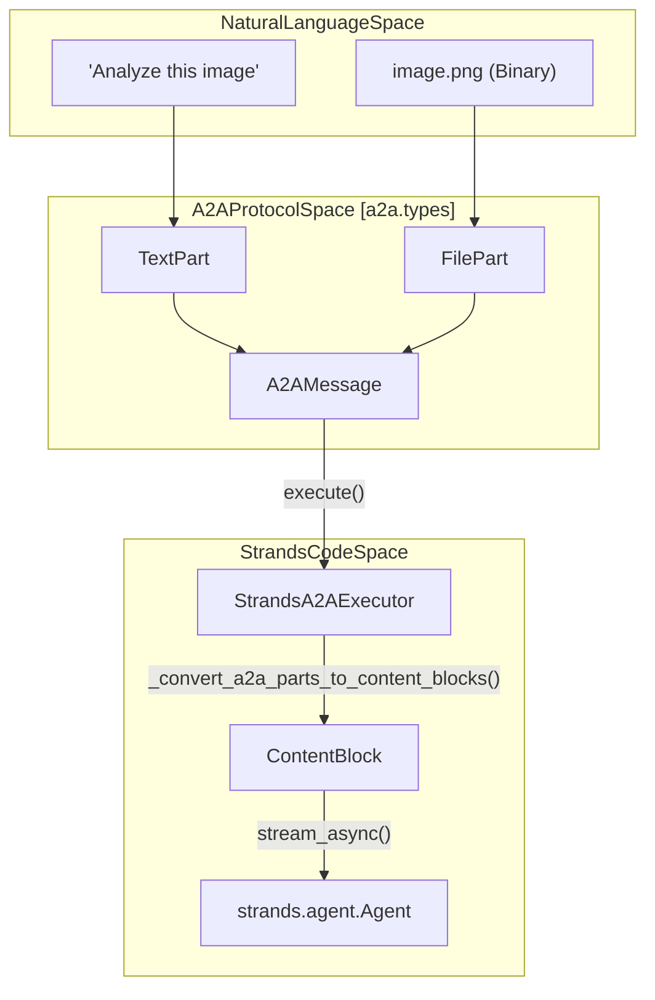
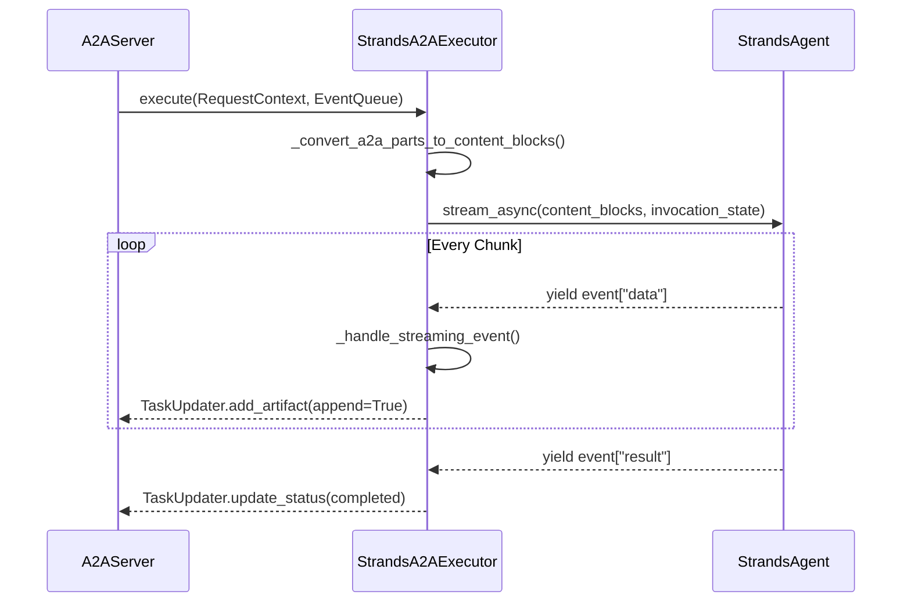

<!-- source: DeepWiki mcp.deepwiki.com · repo strands-agents/sdk-python · page 6.5 Agent-to-Agent (A2A) Protocol · fetched 2026-10-26 -->

# Agent-to-Agent (A2A) Protocol

<details>
<summary>Relevant source files</summary>

The following files were used as context for generating this wiki page:

- [site/src/content/docs/user-guide/concepts/model-providers/custom_model_provider.mdx](site/src/content/docs/user-guide/concepts/model-providers/custom_model_provider.mdx)
- [site/src/content/docs/user-guide/concepts/model-providers/openai-responses.mdx](site/src/content/docs/user-guide/concepts/model-providers/openai-responses.mdx)
- [site/src/content/docs/user-guide/concepts/multi-agent/agent-to-agent.mdx](site/src/content/docs/user-guide/concepts/multi-agent/agent-to-agent.mdx)
- [site/src/content/docs/user-guide/concepts/multi-agent/agent-to-agent.ts](site/src/content/docs/user-guide/concepts/multi-agent/agent-to-agent.ts)
- [strands-py/src/strands/multiagent/a2a/__init__.py](strands-py/src/strands/multiagent/a2a/__init__.py)
- [strands-py/src/strands/multiagent/a2a/executor.py](strands-py/src/strands/multiagent/a2a/executor.py)
- [strands-py/src/strands/multiagent/a2a/server.py](strands-py/src/strands/multiagent/a2a/server.py)
- [strands-py/tests/strands/multiagent/a2a/conftest.py](strands-py/tests/strands/multiagent/a2a/conftest.py)
- [strands-py/tests/strands/multiagent/a2a/test_executor.py](strands-py/tests/strands/multiagent/a2a/test_executor.py)
- [strands-py/tests/strands/multiagent/a2a/test_server.py](strands-py/tests/strands/multiagent/a2a/test_server.py)

</details>


The Agent-to-Agent (A2A) Protocol implementation in the Strands SDK enables seamless communication between Strands agents and other A2A-compliant systems. This system provides a standardized way to expose local agents as web services and consume remote agents as if they were local SDK entities.

## Architecture Overview

The A2A integration consists of two primary directions:
1.  **Inbound (Server):** Wrapping a `strands.agent.Agent` with `A2AServer` to expose it via a FastAPI/Starlette application. [strands-py/src/strands/multiagent/a2a/server.py:29-97]()
2.  **Outbound (Client):** Using `A2AAgent` to interact with a remote A2A service using the standard `AgentBase` protocol. [site/src/content/docs/user-guide/concepts/multi-agent/agent-to-agent.mdx:66-72]()

### Data Flow and Code Entity Mapping

The following diagram illustrates how Natural Language requests are transformed into A2A protocol entities and processed by the Strands execution engine.

**A2A Request Processing Flow**

Sources: [strands-py/src/strands/multiagent/a2a/executor.py:109-116](), [strands-py/src/strands/multiagent/a2a/server.py:128-133]()

---

## A2AServer: Exposing Agents

The `A2AServer` class acts as a bridge between the Strands `Agent` and the A2A web protocol. It handles metadata management (Agent Cards), skill discovery, and request routing. [strands-py/src/strands/multiagent/a2a/server.py:30-30]()

### Key Components
-   **AgentCard:** Automatically generated metadata including name, description, and version. [strands-py/src/strands/multiagent/a2a/server.py:124-125]()
-   **Skill Discovery:** Automatically converts Strands `AgentTool` definitions into A2A `AgentSkill` objects by reading tool configurations via `_get_skills_from_tools`. [strands-py/src/strands/multiagent/a2a/server.py:159-173]()
-   **Mounting:** Supports flexible URL mounting for load balancers via `http_url` and `serve_at_root` parameters. [strands-py/src/strands/multiagent/a2a/server.py:105-114]()

### Protocol Converters
The SDK provides internal utilities in `_converters.py` to translate between Strands types and A2A types:
-   `convert_input_to_message`: Transforms `AgentInput` (strings, message lists, or content blocks) into `a2a.types.Message`. [strands-py/src/strands/multiagent/a2a/executor.py:307-340]()
-   `convert_response_to_agent_result`: Extracts content from A2A `TaskStatusUpdateEvent`, `TaskArtifactUpdateEvent`, or `A2AMessage` back into a Strands `AgentResult`. [strands-py/src/strands/multiagent/a2a/executor.py:343-380]()

Sources: [strands-py/src/strands/multiagent/a2a/server.py:29-97](), [strands-py/src/strands/multiagent/a2a/executor.py:307-380]()

---

## StrandsA2AExecutor

The `StrandsA2AExecutor` is the core execution logic used by the server to run the underlying Strands agent. It handles the complexities of multi-modal data conversion and streaming compliance. [strands-py/src/strands/multiagent/a2a/executor.py:109-116]()

### Multi-modal Handling
The executor maps A2A `FilePart` objects to Strands `ContentBlock` types (e.g., `ImageContent`, `VideoContent`, `DocumentContent`) based on MIME types and file extensions. [strands-py/src/strands/multiagent/a2a/executor.py:228-305]()

| A2A MIME Category | Strands Content Type | Default Format |
| :--- | :--- | :--- |
| `image/*` | `ImageContent` | `png` |
| `video/*` | `VideoContent` | `mp4` |
| `text/*`, `application/*` | `DocumentContent` | `txt` |

Sources: [strands-py/src/strands/multiagent/a2a/executor.py:121-125](), [strands-py/src/strands/multiagent/a2a/executor.py:228-305]()

### Streaming Modes
The executor supports two streaming behaviors via the `enable_a2a_compliant_streaming` flag:
1.  **Legacy Mode (Default):** Uses `update_status` with status messages. This triggers a `UserWarning` regarding A2A spec non-conformance. [strands-py/src/strands/multiagent/a2a/executor.py:131-133]()
2.  **Compliant Mode:** Uses `add_artifact` with incremental updates and unique artifact IDs, strictly following the A2A specification. [strands-py/src/strands/multiagent/a2a/executor.py:131-133]()

**Executor Execution Loop**

Sources: [strands-py/src/strands/multiagent/a2a/executor.py:400-400](), [strands-py/src/strands/multiagent/a2a/executor.py:402-402]()

---

## A2AAgent: Consuming Remote Agents

The `A2AAgent` acts as a client wrapper for remote A2A agents. It is lazy-loaded in the main agent package to defer the import of the optional `a2a` dependency. [site/src/content/docs/user-guide/concepts/multi-agent/agent-to-agent.mdx:66-72]()

### Card Resolution
Before or during interaction, `A2AAgent` uses an `A2ACardResolver` to fetch the remote `AgentCard`. This populates the local agent's `name` and `description` if they were not explicitly provided during initialization. [site/src/content/docs/user-guide/concepts/multi-agent/agent-to-agent.mdx:127-132]()

### Usage in Multi-Agent Systems
Because `A2AAgent` inherits from `AgentBase`, it is compatible with all Strands multi-agent patterns, including `Graph` and `Swarm`. [site/src/content/docs/user-guide/concepts/multi-agent/agent-to-agent.mdx:100-101]()

**Example: Remote Node in a Graph**
```python
a2a_agent = A2AAgent(endpoint="http://remote-agent:9000")
builder = GraphBuilder()
builder.add_node(a2a_agent, "remote_worker")
```
Sources: [site/src/content/docs/user-guide/concepts/multi-agent/agent-to-agent.mdx:77-81]()

### Event Types
When streaming from an `A2AAgent`, the system yields `A2AStreamUpdateEvent` objects followed by a final `AgentResultEvent`.
- **A2AStreamUpdateEvent:** Wraps raw A2A protocol events (Messages, Task updates). [site/src/content/docs/user-guide/concepts/multi-agent/agent-to-agent.mdx:199-200]()
- **AgentResultEvent:** Contains the final `AgentResult` converted from the protocol response. [site/src/content/docs/user-guide/concepts/multi-agent/agent-to-agent.mdx:199-200]()

Sources: [site/src/content/docs/user-guide/concepts/multi-agent/agent-to-agent.mdx:199-200]()

---

