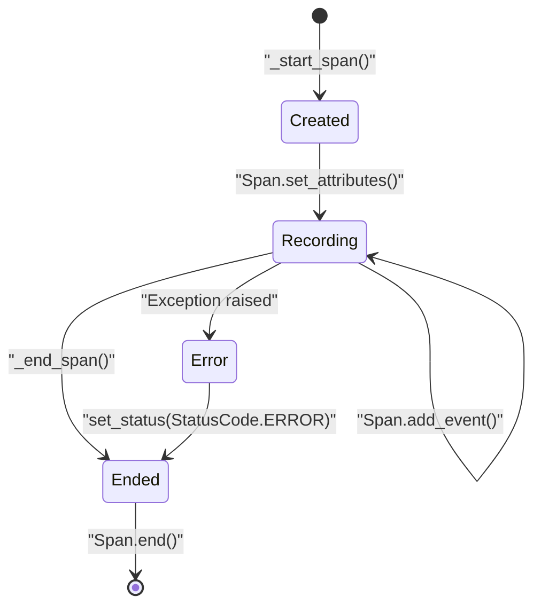
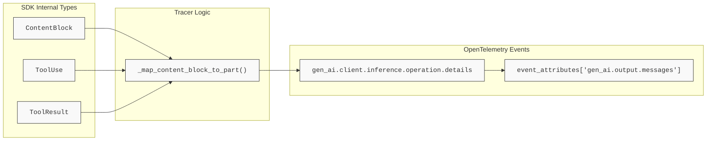

<!-- source: DeepWiki mcp.deepwiki.com · repo strands-agents/sdk-python · page 7.2 Tracing and Spans · fetched 2026-10-26 -->

# Tracing and Spans

Relevant source files

The following files were used as context for generating this wiki page:

- [strands-py/src/strands/memory/extraction/model_extractor.py](strands-py/src/strands/memory/extraction/model_extractor.py)
- [strands-py/src/strands/telemetry/tracer.py](strands-py/src/strands/telemetry/tracer.py)
- [strands-py/tests/strands/memory/test_model_extractor.py](strands-py/tests/strands/memory/test_model_extractor.py)
- [strands-py/tests/strands/memory/test_telemetry.py](strands-py/tests/strands/memory/test_telemetry.py)
- [strands-py/tests/strands/telemetry/test_tracer.py](strands-py/tests/strands/telemetry/test_tracer.py)
- [strands-ts/src/memory/__tests__/memory-tracing.test.ts](strands-ts/src/memory/__tests__/memory-tracing.test.ts)
- [strands-ts/src/telemetry/__tests__/tracer.test.node.ts](strands-ts/src/telemetry/__tests__/tracer.test.node.ts)
- [strands-ts/src/telemetry/tracer.ts](strands-ts/src/telemetry/tracer.ts)

## Purpose and Scope

This document describes the span types, lifecycle, attributes, and semantic conventions used for distributed tracing in the Strands Agents SDK. Spans are the fundamental building blocks of traces, representing individual units of work such as agent invocations, model calls, tool executions, and event loop cycles.

The SDK leverages OpenTelemetry to provide deep observability into the execution flow of autonomous agents. This includes support for standard GenAI semantic conventions, recursive event loop tracking, and specialized handling for backends like Langfuse.

**Sources:** [strands-py/src/strands/telemetry/tracer.py:1-26](), [strands-py/src/strands/telemetry/tracer.py:77-112]()

## Span Type Hierarchy

The SDK creates five distinct span types, each representing a different level of abstraction in the agent execution model. These spans form a hierarchical tree that captures the complete flow of an agent invocation.

### Span Type Overview

| Span Type | Method | Purpose | Parent Type | Kind |
|-----------|--------|---------|-------------|------|
| Agent | `start_agent_span` | Top-level agent invocation | None or Multi-Agent | `INTERNAL` |
| Event Loop Cycle | `start_event_loop_cycle_span` | Single iteration of event loop | Agent | `INTERNAL` |
| Model Invoke | `start_model_invoke_span` | LLM API call | Event Loop Cycle | `INTERNAL` |
| Tool Call | `start_tool_call_span` | Individual tool execution | Event Loop Cycle | `INTERNAL` |
| Multi-Agent | `start_multiagent_span` | Graph or Swarm orchestration | None | `CLIENT` |
| Memory Search | `start_memory_search_span` | Querying memory stores | Agent, Event Loop Cycle | `INTERNAL` |
| Memory Add | `start_memory_add_span` | Adding entries to memory stores | Agent, Event Loop Cycle | `INTERNAL` |
| Memory Inject | `start_memory_inject_span` | Injecting memory into context | Agent, Event Loop Cycle | `INTERNAL` |
| Memory Extract | `start_memory_extract_span` | Extracting facts from messages | Agent, Event Loop Cycle | `INTERNAL` |

**Sources:** [strands-py/src/strands/telemetry/tracer.py:282-758](), [strands-py/src/strands/telemetry/tracer.py:706-758](), [strands-ts/src/telemetry/tracer.ts:33-55]()

### Natural Language to Code Entity Space: Execution Flow

This diagram maps the logical steps of an agent's life to the specific tracing functions and OpenTelemetry entities used in the codebase.

```mermaid
graph TD
    subgraph "Natural Language Space"
        UserCall["'Agent, get the weather'"]
        Think["Agent Thinking Process"]
        LLM["Asking the Model"]
        Action["Running a Tool"]
        MemoryOp["Memory Operation (Search/Add/Extract/Inject)"]
    end

    subgraph "Code Entity Space"
        AgentStart["tracer.start_agent_span()"]
        CycleStart["tracer.start_event_loop_cycle_span()"]
        ModelStart["tracer.start_model_invoke_span()"]
        ToolStart["tracer.start_tool_call_span()"]
        MemorySearchStart["tracer.start_memory_search_span()"]
        MemoryAddStart["tracer.start_memory_add_span()"]
        MemoryInjectStart["tracer.start_memory_inject_span()"]
        MemoryExtractStart["tracer.start_memory_extract_span()"]
        
        OTEL_S["opentelemetry.trace.Span"]
        OTEL_T["opentelemetry.trace.Tracer"]
    end

    UserCall -.-> AgentStart
    Think -.-> CycleStart
    LLM -.-> ModelStart
    Action -.-> ToolStart
    MemoryOp -.-> MemorySearchStart
    MemoryOp -.-> MemoryAddStart
    MemoryOp -.-> MemoryInjectStart
    MemoryOp -.-> MemoryExtractStart

    AgentStart --> OTEL_T
    CycleStart --> OTEL_T
    ModelStart --> OTEL_S
    ToolStart --> OTEL_S
    MemorySearchStart --> OTEL_S
    MemoryAddStart --> OTEL_S
    MemoryInjectStart --> OTEL_S
    MemoryExtractStart --> OTEL_S

    classDef code font-family:monospace,fill:#f9f9f9,stroke:#333
    class AgentStart,CycleStart,ModelStart,ToolStart,MemorySearchStart,MemoryAddStart,MemoryInjectStart,MemoryExtractStart,OTEL_S,OTEL_T code
```

**Sources:** [strands-py/src/strands/telemetry/tracer.py:77-160](), [strands-py/src/strands/telemetry/tracer.py:282-758](), [strands-ts/src/telemetry/tracer.ts:33-55]()

## Span Lifecycle

All spans follow a consistent lifecycle managed by the `Tracer` class [strands-py/src/strands/telemetry/tracer.py:77](). The lifecycle consists of creation, attribute setting, event recording, and termination.

### Lifecycle Stages

**Sources:** [strands-py/src/strands/telemetry/tracer.py:125-223](), [strands-py/tests/strands/telemetry/test_tracer.py:102-130]()

### Generic Span Creation

The `_start_span` method [strands-py/src/strands/telemetry/tracer.py:125-160]() is the internal foundation for all span types. It handles common initialization logic:

1.  **Context Resolution**: Retrieves the current span via `trace_api.get_current_span()` if no parent is provided [strands-py/src/strands/telemetry/tracer.py:144-145]().
2.  **Parent Linking**: Sets the parent span in the context if it is recording [strands-py/src/strands/telemetry/tracer.py:148-149]().
3.  **Initialization**: Starts a new span using the configured `tracer` [strands-py/src/strands/telemetry/tracer.py:151]().
4.  **Metadata**: Sets `gen_ai.event.start_time` and any provided attributes [strands-py/src/strands/telemetry/tracer.py:154-158]().

### Generic Span Termination

The `_end_span` method [strands-py/src/strands/telemetry/tracer.py:183-223]() handles span completion with error handling:

1.  **Metadata**: Sets `gen_ai.event.end_time` [strands-py/src/strands/telemetry/tracer.py:201]().
2.  **Error Handling**: If an exception is passed, it sets the status to `StatusCode.ERROR` and calls `record_exception` [strands-py/src/strands/telemetry/tracer.py:208-212]().
3.  **Finalization**: Calls `span.end()` and forces a flush of the `tracer_provider` to ensure data delivery [strands-py/src/strands/telemetry/tracer.py:218-220]().

**Sources:** [strands-py/src/strands/telemetry/tracer.py:125-223](), [strands-py/tests/strands/telemetry/test_tracer.py:87-118]()

## Span Types and Methods

### Agent Span
Represents the top-level invocation. It captures tool definitions [strands-py/src/strands/telemetry/tracer.py:613-623]() and final usage metrics [strands-py/src/strands/telemetry/tracer.py:688-702]().
*   **Method**: `start_agent_span` / `end_agent_span`

### Event Loop Cycle Span
Captures one iteration of the agent's logic. It tracks recursion depth via `event_loop.parent_cycle_id` [strands-py/src/strands/telemetry/tracer.py:521-532]().
*   **Method**: `start_event_loop_cycle_span` / `end_event_loop_cycle_span`

### Model Invoke Span
Captures the LLM provider interaction. Includes specific GenAI attributes like `gen_ai.request.model` [strands-py/src/strands/telemetry/tracer.py:321]() and token usage [strands-py/src/strands/telemetry/tracer.py:341-376]().
*   **Method**: `start_model_invoke_span` / `end_model_invoke_span`

### Tool Call Span
Captures individual tool execution, including the `tool_call_id` and arguments [strands-py/src/strands/telemetry/tracer.py:378-499]().
*   **Method**: `start_tool_call_span` / `end_tool_call_span`

### Multi-Agent Span
Captures the orchestration of multiple agents, such as in Graph or Swarm patterns.
*   **Method**: `start_multiagent_span` / `end_multiagent_span`

### Memory Spans
The memory subsystem generates several span types to track its operations:

*   **Memory Search Span**: Tracks queries to memory stores.
    *   **Method**: `start_memory_search_span` / `end_memory_search_span`
    *   **Attributes**: `store_failure_count`, `entries` (content of retrieved entries) [strands-py/tests/strands/memory/test_telemetry.py:86-88]().
*   **Memory Add Span**: Tracks adding entries to memory stores.
    *   **Method**: `start_memory_add_span` / `end_memory_add_span`
    *   **Attributes**: `force_root` (for detached operations) [strands-py/tests/strands/memory/test_telemetry.py:146]().
*   **Memory Inject Span**: Tracks the process of injecting memory into the agent's context.
    *   **Method**: `start_memory_inject_span` / `end_memory_inject_span`
    *   **Attributes**: `injected`, `entry_count`, `format_error` [strands-py/tests/strands/memory/test_telemetry.py:158-159]().
*   **Memory Extract Span**: Tracks the extraction of facts from messages using a model.
    *   **Method**: `start_memory_extract_span` / `end_memory_extract_span`
    *   **Attributes**: Includes model invocation details and usage metrics [strands-py/src/strands/memory/extraction/model_extractor.py:87-110]().

**Sources:** [strands-py/src/strands/telemetry/tracer.py:282-704](), [strands-py/tests/strands/telemetry/test_tracer.py:131-728](), [strands-py/src/strands/telemetry/tracer.py:706-758](), [strands-py/tests/strands/memory/test_telemetry.py:77-171](), [strands-ts/src/telemetry/tracer.ts:33-55](), [strands-ts/src/telemetry/__tests__/tracer.test.node.ts:104-128](), [strands-ts/src/memory/__tests__/memory-tracing.test.ts:62-180]()

## Span Attributes and Semantic Conventions

The SDK supports two versions of OpenTelemetry GenAI semantic conventions, controlled by the `OTEL_SEMCONV_STABILITY_OPT_IN` environment variable [strands-py/src/strands/telemetry/tracer.py:98-112]().

### Semantic Convention Versions

| Environment Variable Value | Convention | Provider Attribute |
|----------------------------|------------|-------------------|
| (default) | Legacy | `gen_ai.system` |
| `gen_ai_latest_experimental` | v1.36.0+ | `gen_ai.provider.name` |

**Sources:** [strands-py/src/strands/telemetry/tracer.py:86-103](), [strands-py/src/strands/telemetry/tracer.py:789-814]()

### Common Attributes

All spans include these base attributes:
*   `gen_ai.operation.name`: Operation type (e.g., "chat", "execute_tool") [strands-py/src/strands/telemetry/tracer.py:320]().
*   `gen_ai.system` / `gen_ai.provider.name`: Set to "strands-agents" [strands-py/src/strands/telemetry/tracer.py:794-814]().
*   `gen_ai.event.start_time`: ISO 8601 timestamp [strands-py/src/strands/telemetry/tracer.py:154]().

**Sources:** [strands-py/src/strands/telemetry/tracer.py:154-201](), [strands-py/src/strands/telemetry/tracer.py:789-814]()

### Token Usage and Performance
The `_add_optional_usage_and_metrics_attributes` method [strands-py/src/strands/telemetry/tracer.py:161-181]() adds:
*   `gen_ai.usage.cache_read_input_tokens` [strands-py/src/strands/telemetry/tracer.py:172-173]()
*   `gen_ai.server.time_to_first_token` [strands-py/src/strands/telemetry/tracer.py:178-179]()
*   `gen_ai.server.request.duration` [strands-py/src/strands/telemetry/tracer.py:181-182]()

**Sources:** [strands-py/src/strands/telemetry/tracer.py:161-181](), [strands-py/src/strands/telemetry/tracer.py:688-702]()

### Attribute Redaction
Sensitive attributes like `gen_ai.input.messages`, `gen_ai.output.messages`, `gen_ai.system_instructions`, `gen_ai.tool.call.arguments`, and `gen_ai.tool.call.result` can be redacted. Redaction is opt-in via the `gen_ai_unredacted_attributes=<list>` token in `OTEL_SEMCONV_STABILITY_OPT_IN` [strands-py/src/strands/telemetry/tracer.py:101-109](). The list uses `;` as a separator and supports trailing-`*` glob patterns [strands-py/src/strands/telemetry/tracer.py:102-103]().

**Sources:** [strands-py/src/strands/telemetry/tracer.py:101-109](), [strands-py/src/strands/telemetry/tracer.py:131-138](), [strands-py/src/strands/telemetry/tracer.py:150-168]()

## Span Events

Events provide a timeline within a span. The SDK maps internal message types to OpenTelemetry events.

### Content Block Mapping

This diagram shows how internal SDK types are transformed into OpenTelemetry-compatible event structures.

**Sources:** [strands-py/src/strands/telemetry/tracer.py:816-888](), [strands-py/src/strands/telemetry/tracer.py:258-280]()

### Event Recording
Events are added via `_add_event` [strands-py/src/strands/telemetry/tracer.py:238-256](). If `is_langfuse` is True [strands-py/src/strands/telemetry/tracer.py:114-123](), event attributes are also mirrored as span attributes to ensure visibility in the Langfuse UI [strands-py/src/strands/telemetry/tracer.py:249-251]().

**Sources:** [strands-py/src/strands/telemetry/tracer.py:238-256](), [strands-py/src/strands/telemetry/tracer.py:114-123]()

## Tracer Infrastructure

### Serialization
The SDK uses a custom `JSONEncoder` [strands-py/src/strands/telemetry/tracer.py:29-76]() to handle non-serializable types like `datetime` [strands-py/src/strands/telemetry/tracer.py:56-57]() and nested containers [strands-py/src/strands/telemetry/tracer.py:60-65]() when recording trace attributes and events.

### Tracer Singleton
The `get_tracer()` function [strands-py/src/strands/telemetry/tracer.py:894-905]() maintains a global `Tracer` instance, ensuring that tracing state is consistent across the entire process. It initializes the `Tracer` which instruments threading via `ThreadingInstrumentor` [strands-py/src/strands/telemetry/tracer.py:96]().

**Sources:** [strands-py/src/strands/telemetry/tracer.py:29-76](), [strands-py/src/strands/telemetry/tracer.py:894-905](), [strands-py/src/strands/telemetry/tracer.py:90-97]()

---

